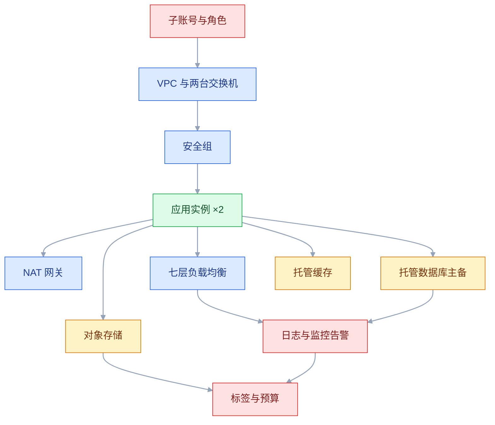
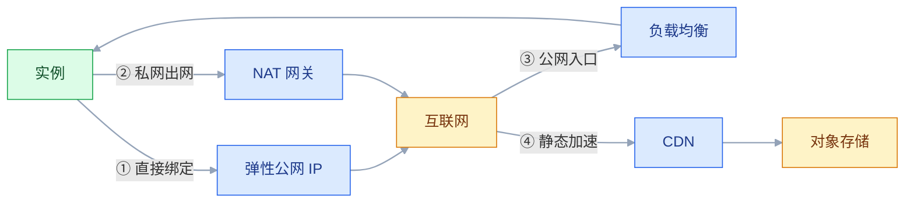

# 云厂商产品介绍

## 一、工程案例：把一台全栈服务器拆成六类云资源

**场景**：一套 Spring Boot 业务系统（内部管理 + 对外 API），日活约 5000、日均请求约 200 万次；数据库起步 50G、年增 100G；用户上传文件起步 200G、年增 500G。团队 4 个后端，没有专职运维、没有 DBA，目前所有东西挤在一台 4C8G 上：MySQL、Redis、应用、Nginx、日志全在本地磁盘。目标是**把这一台机器拆成六类资源，每一类都给出容量依据、计费方式和验收标准**，而不是照着产品目录买一遍。

**为什么必须拆**：单机全栈的问题不是性能，是**故障域**。磁盘写满会同时干掉数据库和日志；一次误删表没有任何可恢复点；一台机器重启，全站中断。拆开的本质是把「一个故障域」变成「几个独立故障域」，再决定哪些故障域可以接受。

**动手前确认**：现有账单能导出（后面要对比改造前后）；业务高峰时段已知；域名和备案主体一致；有一个能收短信的手机号接告警。

### 1.1 现状的五个风险

| 风险 | 现状 | 拆开之后对应哪类资源 |
|---|---|---|
| 单点故障 | 一台 ECS 承载全部 | 计算：多实例 + 负载均衡 |
| 数据不可恢复 | 手工 `mysqldump`，无 binlog 归档 | 数据库：托管主备 + 日志备份 |
| 磁盘持续增长 | 图片和日志都写本地盘 | 存储：对象存储 + 日志服务 |
| 故障无证据 | 只能 SSH 上去 `grep` | 可观测：日志、指标、告警 |
| 权限无边界 | 所有人用同一个账号 | 身份：子账号与角色 |

### 1.2 容量估算：把业务数字翻译成资源规格

先算几个数，再谈买什么。公式都很粗，但足以判断「瓶颈在算力还是在别处」。

| 指标 | 估法 | 本例结果 | 结论 |
|---|---|---|---|
| 平均 QPS | 日请求 ÷ 86400 | 200 万 ÷ 86400 ≈ 23 | 很低 |
| 峰值 QPS | 平均 QPS × 峰值系数 | 23 × 5 ≈ 115 | 单台 2C4G 通常够，瓶颈不在这里 |
| 动态带宽 | 峰值 QPS × 平均响应体 × 8 | 115 × 20KB × 8 ≈ 18 Mbps | 静态资源必须外移，否则带宽很贵 |
| 存储增量 | （起步量 + 年增量 × 年数）× 冗余系数 | （50 + 100×3）× 1.5 ≈ 525G | 数据库盘按 3 年规划 |
| 文件增量 | 同上 | （200 + 500×3）× 1.2 ≈ 2T | 不能放云盘，必须对象存储 |
| 连接数 | 实例数 × 池大小 + 后台任务 | 2 × 20 + 20 ≈ 60 | 数据库规格先看连接数上限 |

> 这些数字只用于**判断方向**，不是选型依据的终点。真实压测一次，比任何估算都可靠；云产品的具体规格与上限以官方当前文档为准。

**三个直接结论**：① 算力不是瓶颈，**单点和磁盘**才是；② 静态资源占带宽大头，CDN 和对象存储的收益远大于升配；③ 文件增长远快于数据库，存储要按「几乎无限」来选，不要按云盘容量规划。

### 1.3 能力映射：需求 → 能力 → 形态 → 依据

不要从产品名出发，从能力出发。同一列能力，各家叫法不同，但形态和边界是相似的。

| 需求 | 能力类别 | 形态 | 规格依据 | 计费模式 |
|---|---|---|---|---|
| 跑应用 | 计算 | 云服务器实例 | 峰值 QPS、JVM 内存、单机故障可接受度 | 包年包月 |
| 分摊流量 | 网络 | 七层负载均衡 | 峰值连接数、是否需要按域名/路径分流 | 按量或包年 |
| 存业务数据 | 数据库 | 托管主备实例 | 数据量、连接数、IOPS、恢复点目标 | 包年包月 |
| 扛热点读 | 数据库 | 托管缓存 | 热键数量、内存水位、是否需持久化 | 包年包月 |
| 存用户文件 | 存储 | 对象存储 | 总量、增长、是否需要公网直读 | 按量 |
| 加速静态资源 | 网络 | CDN | 下行流量、命中率、回源比例 | 按量 |
| 查问题 | 可观测 | 日志服务 | 每日写入量、保留天数、检索频率 | 按量 |
| 发现异常 | 可观测 | 指标监控与告警 | 指标数量、告警条数、通知渠道 | 基础免费 + 按量 |
| 内网出公网 | 网络 | NAT 网关 | 出网峰值、流量总量 | 规格费 + 流量费 |
| 固定公网地址 | 网络 | 弹性公网 IP | 是否需要漂移、带宽上限 | 按量或固定带宽 |
| 权限隔离 | 身份 | 子账号与角色 | 人员数量、职责划分 | 免费 |
| 备份 | 存储 | 快照与备份库 | 恢复点目标、保留天数、异地要求 | 按量 |

**这张表的用法**：先填「规格依据」那一列。填不出来，说明还没想清楚需求，此时买什么规格都是猜。

### 1.4 开通顺序与依赖



| 顺序 | 动作 | 关键选择 | 选错的代价 |
|---|---|---|---|
| 1 | 子账号与角色 | 按职责分策略，程序用实例角色 | 主账号泄露，攻击者可开高配实例挖矿 |
| 2 | 地域与 VPC | 离用户近、网段不与公司内网冲突 | 地域不能改，只能迁移 |
| 3 | 交换机 | 至少两个可用区 | 单可用区，机房故障即全站不可用 |
| 4 | 安全组 | 默认拒绝，按需放行 | 先全开再收紧，往往会漏 |
| 5 | 应用实例 | 通用型、独享型、密钥登录 | 选了突发型，压测时被限速 |
| 6 | 负载均衡 | 七层、健康检查、证书 | 四层转发看不到 Host，无法按域名分流 |
| 7 | 数据库与缓存 | 同 VPC、私网、高可用版 | 跨 VPC 只能走公网，慢且不安全 |
| 8 | 对象存储 | 同地域、私有、内网 endpoint | 公共读会被盗刷流量 |
| 9 | 日志与监控 | 采集 agent、告警联系人 | 出事没有证据，告警发不出去 |
| 10 | 标签与预算 | project/env/owner | 账单无法拆分，浪费找不到主 |

```bash
# 查清家底：实例、磁盘、EIP 各有多少
aliyun ecs DescribeInstances --RegionId cn-hangzhou \
  --output cols=InstanceId,InstanceName,InstanceChargeType,Status
aliyun ecs DescribeDisks --RegionId cn-hangzhou \
  --output cols=DiskId,DiskName,Size,Status,Type
aliyun vpc DescribeEipAddresses --RegionId cn-hangzhou \
  --output cols=AllocationId,IpAddress,Status

# 给资源打标签（成本分摊的前提，越早做越省事）
aliyun ecs TagResources --RegionId cn-hangzhou --ResourceType instance \
  --ResourceId.1 i-xxxx --Tag.1.Key project --Tag.1.Value shop \
  --Tag.2.Key env --Tag.2.Value prod
```

### 1.5 验收（11 项全过才算交付）

| # | 检查 | 命令或路径 | 通过标准 |
|---|---|---|---|
| 1 | 实例规格正确 | 实例详情 → 规格族 | 是 g/c/r 独享型，不是 t 系列 |
| 2 | 跨可用区 | 实例与数据库的可用区 | 至少分布在两个可用区 |
| 3 | 无公网 IP | 实例详情 → 网络 | 应用实例只有私网 IP，出网走 NAT |
| 4 | 负载均衡生效 | `curl -s http://VIP/health` × 10 | 响应带实例标识，10 次命中两台后端 |
| 5 | 健康检查真实 | 停一台应用 | 30 秒内该后端变异常，请求不报错 |
| 6 | 数据库私网 | RDS → 连接信息 | 无公网地址，白名单仅为应用网段 |
| 7 | 备份可恢复 | 恢复到新实例 | 数据完整，时间点正确 |
| 8 | 对象存储私有 | 匿名 `curl` 对象 URL | 返回 403 |
| 9 | 日志可查 | 按 traceId 检索 | 能串起一次完整请求 |
| 10 | 告警可达 | 触发一条测试告警 | 短信与群消息都收到 |
| 11 | 账单可拆 | 费用中心 → 按标签 | 每个资源都有 project/env/owner |

### 1.6 复盘：哪些买多了，哪些买少了

| 现象 | 判断 | 下一次怎么改 |
|---|---|---|
| CPU 长期低于 15% | 算力买多 | 降一档规格，或合并无状态服务 |
| 带宽经常打满、CDN 命中率低 | 静态资源没外移 | 先把图片和前端包搬走，再谈升带宽 |
| 数据库连接数常到 70% | 连接池或规格不足 | 先查连接泄漏，再升规格 |
| 磁盘 3 个月涨了 40% | 日志或备份写进了数据盘 | 日志外送，备份单独放 |
| 账单里流量费超过实例费 | 出口路径设计有问题 | 加 CDN、走内网 endpoint |
| 没人能说清某台机器干什么 | 标签缺失 | 先补 owner，再谈优化 |

**交付物**：六类资源的清单（资源 ID、规格、计费方式、标签）、改造前后各一个月的账单对比，以及 11 项验收记录。

**这张复盘表的价值**：它把「选型」从一次性的采购动作，变成了每月可校准的循环。多数规格可以变配（本地盘、部分异构实例除外），真正难改的是**地域、可用区、VPC 网段和架构**——所以这几样要在第一天想清楚。

---

## 二、高频问答：会卡住你的地方，也是面试最常问的

### 2.1 买完 SSH 连不上

**现场**

控制台看实例状态与公网 IP，安全组入方向是否有 22，`ss -tunlp` 看监听地址。

```bash
# 从能访问的机器上测端口，先分清「拒绝」还是「超时」
nc -vz -w 5 47.98.123.45 22
# 超时：多半是安全组或路由；拒绝：端口没服务或 sshd 没起
```

**要点**

- 连不上先确认包有没有到机器，再谈服务；把网络问题当成进程问题，就会一直重启。
- 三种原因：安全组没放行 22、实例根本没有公网 IP、SSH 只监听在内网地址。
- 超时和拒绝指向不同层：超时多半是安全组或路由，拒绝是端口没服务或 sshd 没起。

**追问**

- 超时和拒绝怎么区分？→ 超时是包没到或被丢，拒绝是到了但端口没开。
- 没有公网 IP 怎么登录？→ 走会话管理或堡垒机。
- 安全组放行了还不通？→ 还有主机防火墙和进程监听地址两道门。

### 2.2 生产用了突发型，压测就卡死

**现场**

实例详情看规格族是否为 t 系列，监控里看 CPU 使用率与 CPU 积分数。

```text
控制台：ECS → 监控 → CPU 使用率、CPU 积分余额
现象：CPU 使用率曲线在某个点被「压平」，同时积分归零
```

**要点**

- 突发性能实例靠 CPU 积分运行，低负载时攒积分，持续跑满后积分耗尽，CPU 被限制到基线。
- 只看了「2 核」这个数字，没看这 2 核是共享的还是独享的。
- 生产环境应选通用型、计算型等独享规格。

**追问**

- 积分耗尽后 CPU 掉到多少？→ 基线，可能只有一二十个百分点。
- 测试环境能用突发型吗？→ 可以，间歇性低负载正合适。
- 怎么从监控上看出来？→ CPU 曲线被压平，同时积分归零。

### 2.3 轻量应用服务器想平滑长大

**现场**

看产品文档的「使用限制」页，再在控制台看是否支持变配到 ECS 规格族。

```text
控制台：轻量实例 → 升降配 → 看可选范围是否只有同套餐
文档关键词：使用限制、不支持升级、能否加入负载均衡
```

**要点**

- 轻量产品是套餐制，多数厂商不支持直接升级为标准云服务器，扩展能力也常受限。
- 低价是拿扩展性换的，适合确定不会长大的负载。
- 买之前要看能不能加入负载均衡后端、能挂几块数据盘、VPC 能力边界。

**追问**

- 轻量能不能挂负载均衡？→ 看厂商限制，很多不支持。
- 长大了怎么办？→ 迁移到标准云服务器，不能原地升级。
- 哪一页文档决定这件事？→ 使用限制。

### 2.4 云盘扩容了，`df` 还是老容量

**现场**

`lsblk` 看到新容量、`df -h` 还是旧容量，就是只做了第一段。

```bash
lsblk                      # 看盘变大了没有
df -T /data                # 看文件系统类型
# ext4 且有分区
growpart /dev/vdb 1 && resize2fs /dev/vdb1
# xfs 且已挂载
growpart /dev/vdb 1 && xfs_growfs /data
df -h /data                # 确认新容量
```

**要点**

- 控制台只改了块设备容量，分区表和文件系统还没扩，这是两段式操作。
- 云盘是块设备，文件系统是块设备上的一层结构，两层都要扩。
- ext4 和 xfs 的第二步命令不同：`resize2fs` 与 `xfs_growfs`。

**追问**

- 为什么 `lsblk` 变了 `df` 没变？→ 分区和文件系统还没扩。
- 云盘能缩容吗？→ 不能，只能新建小盘再迁移。
- 有分区和没分区的命令差在哪？→ 有分区要先 `growpart`。

### 2.5 托管数据库连不上

**现场**

RDS 控制台看白名单与连接地址，从应用机器 `nc -vz` 内网地址和端口。

```bash
hostname -I                                  # 应用实例的内网 IP
nc -vz -w 5 rm-xxxx.mysql.rds.aliyuncs.com 3306
# 超时：网络或白名单；拒绝：端口或实例状态
```

**要点**

- 实例运行中不等于网络可达，可达性由 VPC、白名单、连接地址三者共同决定。
- 三种原因：白名单没有应用实例 IP、应用和数据库不在同一个 VPC、连的是公网地址而实例没开公网。
- 超时是网络或白名单，拒绝是端口或实例状态。

**追问**

- 同一个账号为什么也不通？→ 内网边界是 VPC，不是账号。
- 白名单填什么？→ 应用交换机网段，不要填 `0.0.0.0/0`。
- 开了公网地址还连不上？→ 还要看白名单是否放行来源 IP。

### 2.6 对象存储账单突然翻倍

**现场**

账单按产品拆到 OSS，再按「流量」「请求」「存储」三个计费项分别看。

```text
费用中心 → 账单明细 → 产品=对象存储 → 按计费项分组
控制台：OSS → Bucket → 用量统计 → 外网流出流量、请求次数
再查：Bucket 读写权限、是否有防盗链、是否走了 CDN
```

**要点**

- 大头通常是外网下行流量或请求次数，不是存储费，容量反而是最便宜的一项。
- Bucket 设成公共读后被爬、被当图床，流量会指数级上涨。
- 排查要按计费项分组，再看 Bucket 权限、防盗链、是否走了 CDN。

**追问**

- 怎么从账单上确认是流量还是请求？→ 按计费项分组看占比。
- 公共读为什么危险？→ 任何人可直读，被爬的流量由你付。
- 走 CDN 能省钱吗？→ 能降低回源和外网下行，但要算 CDN 的流量单价。

### 2.7 弹性公网 IP 没绑机器也在扣钱

**现场**

EIP 列表看状态是否为「可用/未绑定」，账单里找「公网 IP 配置费」这类计费项。

```bash
aliyun vpc DescribeEipAddresses --RegionId cn-hangzhou \
  --output cols=AllocationId,IpAddress,Status,ChargeType
# Status=Available 就是没绑定，确认不用后释放
```

**要点**

- EIP 是独立占用的公网地址资源，未绑定也占着地址池，多数厂商会对闲置地址收占用费。
- 把 IP 当成「附属于实例的配置」就会漏掉这笔钱，它是独立资源、独立计费。
- 是否收费、费率与免费额度以厂商当前文档为准。

**追问**

- 释放 EIP 有什么风险？→ 地址可能被别家占走，依赖这个出口 IP 的白名单会断。
- 怎么查还有多少闲置？→ `DescribeEipAddresses` 筛 `Status=Available`。
- 地址费和带宽费是一回事吗？→ 不是，地址占用与带宽/流量分别计费。

### 2.8 快照越存越贵

**现场**

快照列表按容量排序，看自动快照策略的保留天数是不是「永久」。

```bash
aliyun ecs DescribeSnapshots --RegionId cn-hangzhou \
  --output cols=SnapshotId,SnapshotName,SourceDiskSize,CreationTime
```

**要点**

- 快照按实际占用的存储容量计费，首个全量、后续只记新增数据块，但从不删除就会持续累积。
- 把快照当免费附赠能力，就会设成永久保留。
- 策略要设保留天数，手动快照带日期并定期清理。

**追问**

- 为什么后续快照不是全量？→ 只存变化的数据块，按增量占用计费。
- 删除旧快照会影响新快照吗？→ 不会，但会少一个恢复点。
- 快照等于备份吗？→ 不等于，没做过恢复演练的快照只是存储成本。

### 2.9 负载均衡后端全部异常，全站 502

**现场**

后端服务器组看健康状态，在实例上直接 `curl` 健康检查地址。

```bash
curl -i http://127.0.0.1:8080/health        # 本机通不通
ss -tunlp | grep 8080                        # 监听地址是 0.0.0.0 还是 127.0.0.1
```

**要点**

- 健康检查决定流量是否发给你，配错等于全站下线，不是顺带配的附属功能。
- 三种原因：路径或端口配错、应用只监听 `127.0.0.1`、健康检查接口依赖数据库导致一抖全判死。
- 检查接口要轻，不要串联下游依赖。

**追问**

- 502 和 503 怎么分？→ 502 是后端没给合法响应，503 通常是没有健康后端可转。
- 为什么数据库一抖全站 502？→ 健康检查里查了数据库，所有后端一起被判死。
- 应用监听 `127.0.0.1` 会怎样？→ 健康检查从外部访问不到，后端一直异常。

### 2.10 NAT 网关买了，内网机器还是出不去

**现场**

看交换机的关联 NAT、路由表的 `0.0.0.0/0` 下一跳、安全组出方向规则。

```bash
# 在实例上验证出网与 DNS
curl -I https://www.aliyun.com
getent hosts mirrors.aliyun.com
```

**要点**

- NAT 要「交换机关联 + 路由指向」两件事都做，只买设备等于没接线路。
- 另外两个原因：路由表没有指向 NAT 的默认路由、安全组出方向被收紧。
- 验证方法是实例上 `curl` 外网，并解析一次域名。

**追问**

- 为什么绑了 NAT 还要改路由？→ 流量要有下一跳才会走 NAT。
- 出方向安全组也会拦吗？→ 会，出方向收紧了照样出不去。
- 域名解析失败说明什么？→ 先看 DNS，再看 53 端口的出方向。

### 2.11 跨 VPC 或跨地域网络不通

**现场**

看两端 IP 是否在同一 VPC、同一网段规划，跨地域是否建了对等连接或云企业网。

```bash
mtr -rw -c 20 10.0.2.15      # 看断在哪一跳
```

**要点**

- 同地域不同 VPC 默认不通，跨地域默认不通，只有同一 VPC 内的不同交换机默认互通。
- 内网边界是 VPC，不是账号；同一个云账号不等于同一个内网。
- 跨 VPC 要用对等连接或云企业网，跨地域同样。

**追问**

- 同账号同地域为什么也不通？→ 不在同一个 VPC。
- 对等连接和云企业网怎么选？→ 少量 VPC 用对等连接，多 VPC 多地域用云企业网。
- 怎么定位断在哪一跳？→ `mtr` 看丢包出现在哪一段。

### 2.12 按量付费的测试机忘了释放

**现场**

实例列表按计费方式筛「按量付费」，再按创建时间排序，之后按资源 ID 看持续计费项。

```bash
aliyun ecs DescribeInstances --RegionId cn-hangzhou \
  --output cols=InstanceId,InstanceName,InstanceChargeType,CreationTime,Status
```

**要点**

- 「停止」是否停算力费取决于停机模式：节省停机停 vCPU 与内存计费，普通停机照收；云盘、EIP、固定带宽在停机期间通常照收。
- 只有释放实例才结束资源占用，释放前确认云盘是否随实例一起释放。
- 云上的生命周期是「创建 → 停止 → 释放」，关机不等于销毁。

**追问**

- 节省停机和普通停机差在哪？→ 前者释放算力，后者保留算力继续计费。
- 释放时最容易漏什么？→ 云盘是否随实例释放、EIP 是否解绑。
- 怎么防止再忘？→ 给按量资源打标签定 owner，再配预算告警。

---

## 三、核心知识：从零开始要建立的东西

### 3.1 云资源的四层抽象

所有云产品，无论叫什么名字，都能归到四层：**计算、存储、网络、托管服务**。前三层是原料，第四层是在原料上跑好的成品。

| 层 | 解决的问题 | 交付物 | 典型计费维度 |
|---|---|---|---|
| 计算 | 在哪里跑代码 | 实例、容器、函数 | 时长、规格、调用次数 |
| 存储 | 数据放在哪 | 块设备、文件系统、对象 | 容量、请求、流量 |
| 网络 | 怎么连进来、怎么连出去 | 私网、公网、负载均衡 | 带宽、流量、实例费 |
| 托管服务 | 少运维哪一层 | 数据库、缓存、队列、日志 | 规格、存储、连接数 |

**理解这一层划分的收益**：看到一个新产品的名字，能立刻判断它替代的是哪层原料，以及它把哪部分运维接走了。

### 3.2 计算形态的谱系

同样是「跑代码」，粒度不同，责任和成本曲线完全不同。

| 形态 | 你交付 | 平台管 | 冷启动 | 适合 |
|---|---|---|---|---|
| 虚拟机 | 镜像或系统 | 硬件、虚拟化 | 分钟级 | 任意有状态服务 |
| 容器 | 镜像 | 调度、节点、网络 | 秒级 | 无状态微服务 |
| 函数 | 代码包 | 运行时、扩缩、计费 | 毫秒到秒 | 事件驱动、短任务 |
| 裸金属 | 系统 | 硬件 | 小时级 | 高性能、特殊硬件、合规 |

**取舍**：抽象层越高，启动越快、闲置越少、限制越多。函数最轻，几乎不用管机器，但运行时和网络都受平台约束；虚拟机居中，给你 root，也给你系统层的运维责任；裸金属相反，整台物理机归你，启动最慢、限制最少，运维也最重。

### 3.3 规格族的命名与配比

实例规格族的字母代表 **CPU 与内存的比例**，数字代表代际，后缀代表大小。看懂这套命名，就不会把内存型买去跑 Web。

| 代号 | CPU:内存 | 适用 | 不适用 |
|---|---|---|---|
| g 通用型 | 约 1:4 | Web 应用、中间件、中小数据库 | 极端计算或极端内存 |
| c 计算型 | 约 1:2 | 高并发、转码、批处理 | 内存吃紧的服务 |
| r 内存型 | 约 1:8 | 缓存、内存数据库、实时分析 | 普通 Web，内存浪费 |
| t 突发型 | 约 1:2 | 测试、个人站点、低负载 | 生产持续高负载 |
| gn/ga 等异构型 | 视卡型 | 推理、渲染、训练 | 一般业务，成本极高 |

**规格大小的换算**：常见约定是 `large` = 2 vCPU、`xlarge` = 4 vCPU、`2xlarge` = 8 vCPU。不同厂商、不同代际可能有差异，下单页为准。

> **面试**：常问「g、c、r 规格族怎么选？」答：按 CPU 与内存比例，Web 用 g、高并发用 c、缓存和内存库用 r。

### 3.4 CPU 积分与共享/独享

| 类型 | CPU 归属 | 性能表现 | 价格 | 适用 |
|---|---|---|---|---|
| 共享型 | 与其他实例争抢物理核 | 低负载正常，持续跑满时性能波动 | 低 | 测试、学习 |
| 突发型 | 有基线，靠积分超发 | 积分耗尽后掉到基线 | 低 | 间歇性低负载 |
| 独享型 | 独占物理核 | 稳定 | 高 | 生产、对外服务 |

**机制**：突发型实例有一个基线性能（比如 20%），低于基线时攒积分，高于基线时消耗积分。积分归零后，CPU 被硬限制在基线。**这解释了「平时好好的，一压测就卡」**——不是网络问题，是算力被限。

> **面试**：常问「突发型为什么一压测就卡？」答：靠 CPU 积分超发，积分耗尽后被限制在基线，不是性能虚标。

### 3.5 三种存储的语义

| 维度 | 块存储 | 文件存储 | 对象存储 |
|---|---|---|---|
| 访问方式 | 挂载成磁盘 | NFS/SMB 挂载 | HTTP API |
| 共享 | 通常单机 | 多机同时读写 | 天然共享 |
| 目录 | 有 | 有 | 无，用 key 前缀模拟 |
| 修改 | 随机读写 | 随机读写 | 整体覆盖 |
| 容量 | 有限，按盘买 | 有限，按容量买 | 近似无限 |
| 延迟 | 最低 | 毫秒级 | 较高 |
| 适合 | 系统盘、数据库 | 共享配置、容器存储 | 图片、视频、备份、静态站 |

**一句话判据**：需要「像本地磁盘一样改文件」用块存储；需要「多台机器同时看到同一份目录」用文件存储；需要「海量、便宜、能公网分发」用对象存储。

### 3.6 存储的性能维度

容量不是唯一指标。数据库卡顿，经常是 IOPS 或吞吐先到顶。

| 维度 | 含义 | 谁在消耗 |
|---|---|---|
| IOPS | 每秒读写次数 | 小文件随机读写、数据库 |
| 吞吐 | 每秒传输字节 | 大文件顺序读写、备份 |
| 时延 | 单次 IO 的响应时间 | 在线事务，最敏感 |
| 突发能力 | 短时间超过基线的能力 | 启动、批量导入 |

**关键约束**：云盘性能有上限，而且**受实例规格的存储带宽限制**。买了一块高 IOPS 的盘，挂在低配实例上，也跑不出标称值。具体上限以官方文档的「云盘性能」与「实例存储带宽」两张表为准。

### 3.7 网络的三层抽象

| 层 | 作用 | 默认行为 | 常见错误 |
|---|---|---|---|
| VPC | 划出一块隔离的私网 | 不同 VPC 默认不通 | 网段与公司内网冲突 |
| 交换机 | VPC 内的子网，绑定可用区 | 同 VPC 内默认互通 | 只建一个，全压在单可用区 |
| 安全组 | 实例级白名单防火墙 | 无匹配允许规则即不通 | 以为默认全通，或先全开再收紧 |

**规划顺序**：先定 VPC 网段（给未来留余量），再按可用区划交换机，最后按「角色」建安全组（Web、App、DB 各一组）。安全组引用安全组，比填 IP 段更耐扩容。

### 3.8 公网进出的四条路径



| 路径 | 方向 | 计费 | 适用 |
|---|---|---|---|
| EIP 直绑实例 | 双向 | 地址占用 + 带宽或流量 | 少量需要公网 IP 的机器 |
| NAT 网关 | 只出不进 | 规格费 + 流量 | 多台内网机器统一出网 |
| 负载均衡 + EIP | 只进不出 | 实例费 + 带宽/流量 | 对外提供服务的唯一入口 |
| CDN + 对象存储 | 只进不出 | 下行流量 + 请求 + 存储 | 静态资源分发 |

**设计原则**：**入口收敛，出口收敛**。动态入口只有负载均衡一个，静态入口只有 CDN 一个，出口只有 NAT 一个。收敛之后，安全组、证书、WAF、流量监控都只需要配一处。

### 3.9 四层与七层负载均衡

| 维度 | 四层 | 七层 |
|---|---|---|
| 看得到 | 源 IP、目标 IP、端口 | URL、Host、Header、Cookie |
| 转发依据 | IP + 端口 | 域名、路径、Header |
| 性能 | 更高 | 略低，但通常够用 |
| 典型用途 | 数据库代理、游戏、非 HTTP | Web、API、按域名分流 |
| 证书 | 通常不做 HTTP 层卸载 | 可以集中管理 |

**健康检查是负载均衡的核心**，不是附属功能。检查路径要轻、要能代表「这个实例能不能接流量」，不要在里面查数据库——依赖一抖，所有后端一起被判死。

> **面试**：常问「四层和七层负载均衡怎么选？」答：要按域名、路径、Header 分流和集中管证书就选七层，其余选四层。

### 3.10 数据库的托管形态

| 形态 | 结构 | 故障切换 | 适用 |
|---|---|---|---|
| 基础版 | 单节点 | 无 | 测试、非核心 |
| 高可用版 | 主备双节点 | 自动，通常几十秒 | 生产标配 |
| 集群版 | 一主多读或多分片 | 自动 | 读多、数据量大 |
| 计算存储分离 | 多计算节点共享存储 | 自动，秒级 | 数据量大、快速扩读 |

**托管数据库的硬边界**：不给操作系统、不给 root、通常不能装自定义插件、部分参数改了要重启、连接数按规格封顶。选之前先确认这些限制不会挡住业务。

### 3.11 弹性伸缩的触发方式

| 触发 | 依据 | 优点 | 风险 |
|---|---|---|---|
| 定时 | 已知的业务高峰 | 简单、可预测 | 临时流量无效 |
| 指标 | CPU、内存、QPS、队列长度 | 跟真实负载走 | 指标滞后，扩出来时高峰已过 |
| 预测 | 历史曲线 | 提前扩容 | 需要足够历史数据 |

**伸缩组的三个前置条件**：无状态应用、状态外置（会话进缓存、文件进对象存储）、已做好自定义镜像。缺一个，扩出来的新实例就接不了流量。

### 3.12 可用区与容灾拓扑

| 拓扑 | 可用性 | 成本 | 说明 |
|---|---|---|---|
| 单可用区单实例 | 最低 | 最低 | 任何故障都全站中断 |
| 单可用区多实例 | 中 | 低 | 挡得住进程崩溃，挡不住机房故障 |
| 跨可用区多实例 | 较高 | 中 | 生产底线，需负载均衡配合 |
| 跨地域多活 | 最高 | 高 | 涉及数据同步与切流，复杂度陡增 |

**一条实践底线**：生产系统至少跨两个可用区。同地域跨可用区的内网延迟通常在一两毫秒量级，代价很小；跨地域则要走专线或公网，量级完全不同。

### 3.13 计费模式与现金流

| 模式 | 付费时点 | 单价 | 灵活性 | 适合 |
|---|---|---|---|---|
| 包年包月 | 先付 | 低 | 低，退订有损失 | 长期稳态 |
| 按量付费 | 后付，按小时或秒 | 高 | 最高 | 临时、弹性、不确定 |
| 抢占式 | 按量，按市场价 | 很低 | 随时可能被回收 | 无状态可中断任务 |
| 预留/节省计划 | 先承诺用量，后抵扣 | 较低 | 中 | 长期大规模 |

**成本优化的顺序**：先删无用资源，再谈计费模式，最后才谈折扣。删掉一台闲置实例的收益，永远大于把在用的实例从按量换成包年。

### 3.14 产品限制优先于产品功能

选型时最该看的两页文档，不是「产品优势」，是「使用限制」和「配额」。

| 限制类型 | 例子 | 影响 |
|---|---|---|
| 功能限制 | 托管库不能装插件、轻量不能升 ECS | 决定方案是否可行 |
| 配额限制 | 单地域 VPC 数量、EIP 数量、快照数量 | 决定扩容天花板 |
| 性能限制 | 云盘 IOPS 受实例规格约束 | 决定真实性能 |
| 网络限制 | 跨地域默认不通、公网带宽上限 | 决定架构拓扑 |

**判据**：功能决定「能不能做」，限制决定「做到什么程度」。后者更容易在半年后变成迁移理由。

> **面试**：常问「选云产品最该看哪两页文档？」答：使用限制和配额，它们决定方案可行性和扩容天花板。

### 3.15 多云与混合云的网络前提

| 形态 | 网络如何通 | 主要成本 | 适用 |
|---|---|---|---|
| 单云多地域 | 云企业网或对等连接 | 跨区流量费 | 多地用户 |
| 多云 | 公网 VPN 或专线 | 专线月费 + 出口流量 | 有明确议价或合规诉求 |
| 混合云 | 专线/VPN 接 IDC | 专线费 + 设备 | 数据不出机房、存量系统 |

**现实约束**：多云的第一道坎不是产品差异，是**身份与网络**。账号体系不互通、内网不通、监控不统一，这三件事的固定成本，往往高于多一家供应商带来的折扣。

### 3.16 API 化与基础设施即代码

控制台的每个按钮背后都是一次 API 调用。能 API 化，就能进版本管理、能评审、能复现。

| 层次 | 工具形态 | 产出 |
|---|---|---|
| 单次操作 | CLI | 可复制的命令 |
| 批量操作 | 脚本 | 可重复执行的流程 |
| 声明式 | Terraform/资源编排 | 可版本管理的资源定义 |
| 流水线 | CI/CD 集成 | 可审计的变更记录 |

**边界**：IaC 管得住「资源定义」，管不住「资源里的数据」和「控制台里手点的临时改动」。上了 IaC 之后，要配套「禁止手改」的约束，否则配置漂移会比不用更危险。

---

## 四、冷门知识汇总

| 知识点 | 为什么冷门 | 用到时的关键词 |
|---|---|---|
| 实例元数据服务 | 平时只用 SSH，很少从内部取身份信息 | 实例角色、临时凭证、100.100.100.200（阿里云地址，各家不同） |
| 云助手 | 多台机器批量执行时才需要 | 批量命令、免 SSH、执行记录 |
| 专有宿主机 | 只有合规或自带许可场景才用 | DDH、BYOL、物理隔离 |
| 云盘预配置 IOPS | 普通业务碰不到性能上限 | PL 等级、IOPS 上限、实例存储带宽 |
| 快照跨地域复制 | 做异地容灾时才想起 | 跨区复制、RPO、恢复演练 |
| 镜像跨地域复制 | 多地域部署时才知道要复制 | 自定义镜像、跨区、批量开服 |
| 数据库代理 | 应用不想改代码做读写分离 | 读写分离地址、连接池、主从延迟 |
| 数据传输服务 | 迁移或同步时才用 | 增量同步、全量校验、切流 |
| 云企业网 | 多 VPC、多地域组网才需要 | CEN、对等连接、路由传播 |
| 全球加速 | 跨国访问慢时才考虑 | Anycast、骨干网、就近接入 |
| 智能接入网关 | 把 IDC 接进云上 VPC | SAG、专线备份、边界路由 |
| 操作审计 | 平时不看，出事追责或过等保才去查 | ActionTrail、谁改了安全组 |
| 密钥管理 | 做透明加密或凭据托管才用 | KMS、TDE、凭据轮转 |
| 云拨测 | 只监控自己机房发现不了区域故障 | 多地域探测、可用性、首包时间 |
