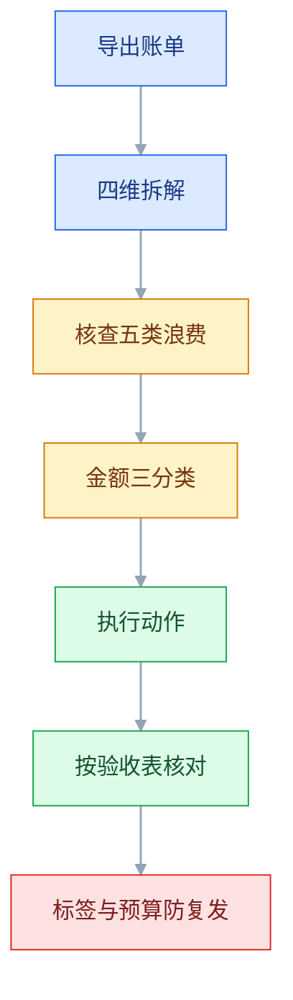
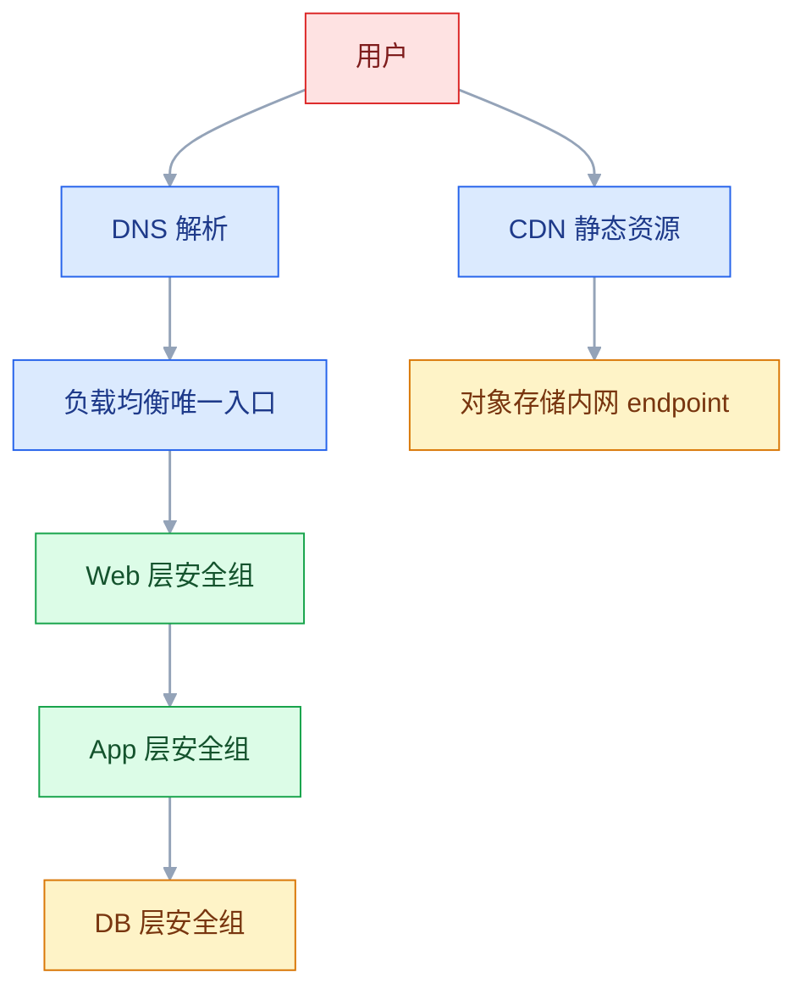
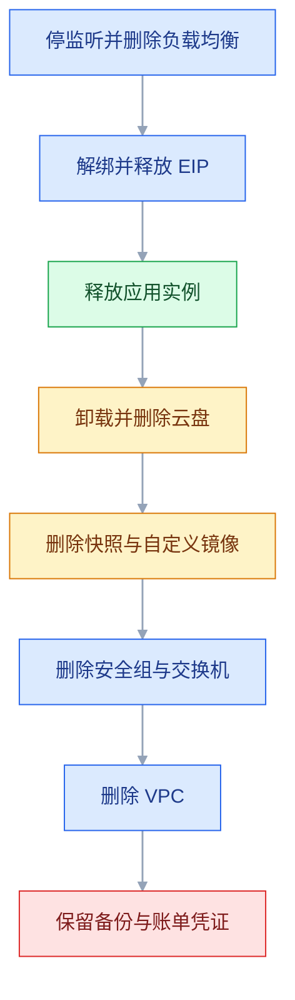

# 云产品使用细节

## 一、工程案例：按账单反查资源浪费并给出优化动作

**场景**：一套跑了半年的业务系统，月账单从 800 元涨到 2600 元，同期没有上新业务，也没有做活动。老板问「钱花哪了」，团队里没人答得上来——控制台里资源太多，账单只看了总数。目标：**48 小时内把超支拆到具体资源 ID 并列出动作清单，一个月内完成验收，并建立一套下个月不会再问同样问题的机制**。

**为什么从账单入手**：云上的浪费几乎不会报错。多开的一台按量实例、忘了释放的 EIP、设成永久保留的快照，都在安静地计费，直到有人看账单。反查的顺序必须是**先看钱、再看资源、最后看配置**，反过来会在一堆正常资源里迷路。

**动手前确认**：有费用中心的账单导出权限；知道本月与上月的完整账期；能登录所有相关账号（很多人漏了子账号或老账号）；变更前先截图存证。

**交付物**：一份《资源浪费归因表》（资源 ID / 计费项 / 月金额 / 归属人 / 动作 / 计划完成日）+ 一份动作执行记录。全篇步骤都围绕这两份东西推进，1.5 的验收表就是它的检查清单。

**执行路径**：



后面按这条路径逐步展开，每一步都对应归因表里的一列。

### 1.1 第一步：把账单拆成四个视图

只看总额永远找不到原因。同一份账单，按四种维度各看一遍，异常会自己浮出来。

| 视图 | 看什么 | 能发现 |
|---|---|---|
| 按产品 | 哪一类产品占比最大、环比涨幅最高 | 是计算涨了还是流量涨了 |
| 按资源 ID | 具体哪台实例、哪个 Bucket、哪块盘 | 涨幅落到单一资源 |
| 按标签 | project / env / owner | 哪个项目、哪个环境在烧钱 |
| 按天 | 日账单曲线 | 某天突增，还是一条斜线缓慢上涨 |

```bash
# 月度总账，先确认大盘
aliyun bssopenapi QueryAccountBill --BillingCycle 2026-09 --Granularity MONTHLY

# 按产品拆（返回字段与参数名以 aliyun CLI 当前版本为准）
aliyun bssopenapi QueryAccountBill --BillingCycle 2026-09 \
  --Granularity MONTHLY --IsGroupByProduct true

# 实例清单：计费方式 + 创建时间，找「按量且很老」的
aliyun ecs DescribeInstances --RegionId cn-hangzhou \
  --output cols=InstanceId,InstanceName,InstanceChargeType,CreationTime,Status
```

**读法**：如果按天曲线是**台阶式**上升，说明某天新增了资源；如果是**斜坡式**，说明是流量或存储的自然增长。这两种情况的处理方式完全不同。

### 1.2 第二步：核查五类高频浪费

这五类占了中小团队云浪费的绝大多数，逐个查一遍，通常能解释 70% 以上的异常。

| 类型 | 特征 | 核查方式 |
|---|---|---|
| 未绑定的 EIP | 状态为可用，仍按占用计费 | EIP 列表筛「未绑定」 |
| 未挂载的云盘 | 盘还在，没有挂载点，按容量计费 | 云盘列表筛「待挂载」 |
| 陈年快照 | 创建时间很早，保留策略为永久 | 快照列表按时间与容量排序 |
| 按量实例 | 计费方式为按量，创建时间很久 | 实例列表按计费方式 + 创建时间 |
| 空转的负载均衡 | 没有后端，或后端全部异常 | 实例列表看后端组 |

```bash
# 未绑定的 EIP：Status=Available 就是没挂到任何资源上
aliyun vpc DescribeEipAddresses --RegionId cn-hangzhou \
  --output cols=AllocationId,IpAddress,Status,ChargeType

# 未挂载的云盘：Status=Available
aliyun ecs DescribeDisks --RegionId cn-hangzhou \
  --output cols=DiskId,DiskName,Size,Status,Type,CreationTime

# 快照：按创建时间排，找出超过保留期的
aliyun ecs DescribeSnapshots --RegionId cn-hangzhou \
  --output cols=SnapshotId,SnapshotName,SourceDiskSize,CreationTime

# 按量实例：ChargeType=PostPaid，且 CreationTime 很早
aliyun ecs DescribeInstances --RegionId cn-hangzhou --InstanceChargeType PostPaid \
  --output cols=InstanceId,InstanceName,CreationTime,Status
```

> 查出来不等于能删。**每一台待删资源都要先回答三个问题**：谁创建的、现在还有没有流量、删了会不会影响某个定时任务或某份报表。

### 1.3 第三步：把金额分成三类

| 分类 | 判据 | 处理原则 |
|---|---|---|
| 必要 | 有明确业务归属，用量与业务量同步 | 不动，或只优化计费方式 |
| 可降 | 规格长期过剩、计费模式选错 | 降配、换包年、开生命周期 |
| 可删 | 无人认领、无流量、测试遗留 | 先停用观察，再释放 |

**「可降」里最常见的一种**：CPU 长期低于 10%、内存长期低于 20%，但因为「怕不够」一直没降。实例可以降规格；云盘只能扩不能缩，买大了只能新建迁移。降一档通常能省下可观的比例。

**「可删」里最危险的一种**：看起来没流量，其实是每月跑一次的报表任务在连它。停用观察一周，比直接删除安全得多。

### 1.4 第四步：动作、收益与风险

| 动作 | 回收什么 | 风险 | 前置检查 |
|---|---|---|---|
| 释放未绑定 EIP | 地址占用费 | IP 以后可能被别家占走 | 确认没有白名单依赖这个出口 IP |
| 删除未挂载云盘 | 容量费 | 盘上可能有旧数据 | 先打快照，再保留 7 天 |
| 清理过期快照 | 快照容量费 | 失去某个恢复点 | 确认最近的可用恢复点仍在 |
| 释放按量实例 | 算力费 | 业务中断 | 确认没有流量、没有定时任务 |
| 实例降配 | 规格差价 | 性能不足 | 看 30 天 CPU/内存峰值，不只看均值 |
| 转包年包月 | 单价差 | 锁定，退订有损失 | 确认至少还能用 3 个月 |
| 开生命周期 | 存储费 | 取回延迟与请求费变化 | 确认归档数据的访问频率 |
| 带宽转固定 | 按流量计费的敞口 | 峰值被限 | 看近 30 天带宽峰值与月均流量 |

**排序原则**：先做「零风险高收益」的（删未挂载盘、清过期快照），再做「有风险但收益明确」的（降配、释放实例），最后才谈计费模式。**不要一上来就改计费方式**，那只是把单价压低，浪费的量还在。

### 1.5 验收（11 项全过才算完成）

| # | 检查 | 命令或路径 | 通过标准 |
|---|---|---|---|
| 1 | 账单已归因 | 费用中心 → 按资源 ID | 前 10 大资源都有归属项目 |
| 2 | 无闲置 EIP | `DescribeEipAddresses` | 没有超过 7 天仍为 `Available` 的地址 |
| 3 | 无未挂载盘 | `DescribeDisks` | 没有超过 7 天仍为 `Available` 的盘 |
| 4 | 快照有保留策略 | 自动快照策略列表 | 保留 7~30 天，不是永久 |
| 5 | 按量资源有主 | 实例列表 + 标签 | 每台都有 owner 与用途 |
| 6 | 降配已验证 | 变更后观察 72 小时 | CPU 峰值 ≤ 70%、内存峰值 ≤ 80%，无新增 5xx |
| 7 | 预算告警生效 | 费用中心 → 预算管理 | 50%/80%/100% 三档都配了 |
| 8 | 预测告警开启 | 预算详情 | 已开启预测/超支提醒（名称以控制台为准） |
| 9 | 标签覆盖 | 标签控制台 | 核心资源覆盖率 ≥ 90% |
| 10 | 生命周期生效 | OSS → 生命周期 | 有转低频/归档/删除规则 |
| 11 | 下月账单回落 | 次月账单 | 环比下降，且没有新异常项 |

> **第 6 项必须观察满 72 小时**，要覆盖至少一个业务高峰。只看变更后一小时，等于没验证。
> **第 11 项是唯一的终局指标**。前面十项都做了，账单没降，说明归因错了或者动作没执行。

### 1.6 防复发：五件低成本的事

| 机制 | 做法 | 拦住什么 |
|---|---|---|
| 标签规范 | 创建资源时必填 project/env/owner | 无人认领的资源 |
| 预算告警 | 月预算 + 50/80/100% 三档 + 预测超支 | 缓慢上涨和突增 |
| 生命周期 | 对象存储按天数转低频/归档/删除 | 存储费只增不减 |
| 快照策略 | 自动快照 + 保留天数 + 随盘释放 | 快照无限累积 |
| 月度巡检 | 固定一天，按 1.2 的五类逐项过 | 人为遗忘 |

**最有效的是第一条**。没有标签，账单永远是一团糊；有了标签，任何一个数字都能追到人。标签不需要技术能力，只需要在开通流程里加一个必填项。

---

## 二、高频问答：会卡住你的地方，也是面试最常问的

### 2.1 服务器关机了，账单还在涨

**现场**

账单按资源 ID 看停机期间仍在计费的是哪一项，实例详情看停机模式。

```text
控制台：ECS → 实例详情 → 停止模式（节省停机 / 普通停机）
费用中心 → 账单明细 → 按资源 ID → 看计费项是「实例」还是「云盘/带宽」
```

**要点**

- 「停止」只停实例的计算资源，且是否停算力费取决于停机模式；云盘、EIP、固定带宽通常照收，包年包月一直计费。
- 云上的生命周期是创建、停止、释放，只有释放才结束资源占用。
- 判断方法是按资源 ID 看计费项是「实例」还是「云盘/带宽」。

**追问**

- 包年包月关机还收费吗？→ 收，买的是时长。
- 节省停机模式省什么？→ 只省 vCPU 与内存的算力费。
- 为什么释放才停？→ 计费绑定资源占用，不是有没有跑业务。

### 2.2 按量付费的机器忘了释放

**现场**

筛出所有按量实例，按创建时间排序，逐台确认用途。

```bash
aliyun ecs DescribeInstances --RegionId cn-hangzhou --InstanceChargeType PostPaid \
  --output cols=InstanceId,InstanceName,CreationTime,Status
```

**要点**

- 按量实例按小时或按秒持续计费，停机不一定停算力费，云盘和公网资源继续计费，GPU 类单位成本尤其高。
- 用「使用时长」估算成本会失真，计费看的是「资源存活时长」。
- 忘记释放的那段时间，才是账单的主要部分。

**追问**

- 怎么快速找出该释放的？→ 按量 + 创建时间排序，逐台确认用途。
- GPU 实例为什么特别贵？→ 单位算力成本高，闲置也在计费。
- 释放前要确认什么？→ 没有流量、没有定时任务、云盘是否需要保留。

### 2.3 弹性公网 IP 闲置也在收费

**现场**

EIP 列表状态为「可用」即未绑定，账单里找公网 IP 相关计费项。

```bash
aliyun vpc DescribeEipAddresses --RegionId cn-hangzhou \
  --output cols=AllocationId,IpAddress,Status
# Status=Available → 未绑定，确认不用后释放
```

**要点**

- EIP 是独立占用的公网地址，未绑定也占着地址池，按占用计费。
- 公网 IP 不是实例的附属配置，它是独立资源、独立计费。
- 确认不用后释放，但先确认没有白名单依赖这个出口 IP。

**追问**

- 释放后还能拿回来吗？→ 不保证，地址可能被别家占走。
- 带宽费还收吗？→ 地址占用与带宽/流量分别计费。
- 怎么批量发现闲置？→ 按状态筛 `Available`，超过 7 天的重点看。

### 2.4 安全组放通了，还是连不上

**现场**

`ss -tunlp` 看监听地址，`ufw status` 看主机防火墙，控制台确认公网 IP。

```bash
ss -tunlp | grep 8080
# 127.0.0.1:8080 → 只监听本机，外部永远连不上
# 0.0.0.0:8080   → 监听所有网卡
sudo ufw status verbose
```

**要点**

- 连通性至少经过「安全组 → 主机防火墙 → 进程监听地址」三道门，任何一道关着都不通。
- 只盯云平台这一层，会反复改安全组却始终不通。
- 另外两个原因：实例没有公网 IP，或请求走的是另一条网络路径。

**追问**

- `127.0.0.1:8080` 和 `0.0.0.0:8080` 差在哪？→ 前者只监听本机，外部永远连不上。
- ufw 和 firewalld 都要看吗？→ 看系统实际启用哪个，两个都装时可能同时生效。
- 安全组是有状态的吗？→ 是，出去的连接回包自动放行。

### 2.5 云盘扩容后容量没变

**现场**

`lsblk` 看到新容量、`df -h` 还是旧容量。

```bash
lsblk                 # 第一段是否生效
df -T /data           # 文件系统类型
# ext4 + 分区
growpart /dev/vdb 1 && resize2fs /dev/vdb1
# xfs + 已挂载
growpart /dev/vdb 1 && xfs_growfs /data
df -h /data
```

**要点**

- 控制台只扩了块设备，分区和文件系统还没扩，这是两段式操作。
- 云盘是块设备，文件系统是上面的结构，两层都要扩。
- ext4 用 `resize2fs`，xfs 用 `xfs_growfs`；有分区先 `growpart`。

**追问**

- 能缩容吗？→ 不能，只能新建小盘再迁移。
- 为什么建议少量多次？→ 云盘只能扩不能缩，一次买大会浪费。
- 扩容会丢数据吗？→ 正常扩容不丢，但操作前仍要确认盘和分区的对应关系。

### 2.6 快照费用越积越多

**现场**

快照列表按容量排序，自动策略看保留天数，确认是否开启「随云盘释放」。

```bash
aliyun ecs DescribeSnapshots --RegionId cn-hangzhou \
  --output cols=SnapshotId,SnapshotName,SourceDiskSize,CreationTime
```

**要点**

- 快照按增量后的实际占用容量计费，且默认可能不随实例释放，自动策略设成永久容量会一直涨。
- 把「保留更多」等同于「更安全」是误区，没有恢复演练的快照只是存储成本。
- 保留 7~30 天，手动快照命名带日期，用完即删。

**追问**

- 「随云盘释放」不开会怎样？→ 删盘后快照还在，继续计费。
- 快照和镜像什么区别？→ 镜像是整机模板，快照是单块盘的时间点副本。
- 回滚前要注意什么？→ 先备份现状，回滚会覆盖当前数据。

### 2.7 对象存储账单暴涨

**现场**

账单按计费项拆成存储、流量、请求，再看 Bucket 权限与 CDN 命中率。

```text
费用中心 → 账单明细 → 产品=对象存储 → 按计费项分组
控制台：OSS → 用量统计 → 外网流出流量、请求次数
控制台：Bucket → 权限 → 是否公共读
```

**要点**

- 大头通常是外网下行流量和请求次数，存储费只占小头；对象存储最贵的从来不是存，是取。
- Bucket 公共读后被爬虫抓取、被当图床，流量会成倍上涨。
- 同地域用内网 endpoint 通常不产生外网流量费，只差一个后缀。

**追问**

- 内网 endpoint 和公网 endpoint 差多少？→ 一个免外网下行费，一个按外网计费。
- 生命周期能省哪部分？→ 存储容量，把冷数据转低频或归档。
- 防盗链有用吗？→ 有，但只能防一部分，公共读本身就该改私有。

### 2.8 数据库磁盘满了，只能读不能写

**现场**

控制台看磁盘使用率，查大表、binlog 保留天数、慢查询产生的临时文件。

```sql
-- 进库后看容量分布（需要相应权限）
SELECT table_schema, ROUND(SUM(data_length+index_length)/1024/1024,1) AS mb
FROM information_schema.tables GROUP BY table_schema ORDER BY mb DESC;
```

**要点**

- 磁盘满时写入会失败，部分托管数据库会进入只读保护，重启不会清理数据。
- 吃盘的三类：binlog、临时表、大表。
- 先把空间腾出来再查根因，重启只会让问题晚几分钟复发。

**追问**

- 重启为什么没用？→ 数据还在盘上，重启不释放空间。
- binlog 能直接删吗？→ 不能手删，要调保留天数或让备份接走。
- 怎么快速找大表？→ 查 `information_schema.tables` 按容量排序。

### 2.9 负载均衡 502，后端全部不健康

**现场**

后端组看健康状态，实例上直接 `curl` 健康检查地址，`ss` 看监听地址。

```bash
curl -i http://127.0.0.1:8080/health
ss -tunlp | grep 8080
```

**要点**

- 502 表示后端没给出合法响应，503 通常表示没有健康后端可转；先用后端健康状态判断是「没后端」还是「后端在报错」。
- 三种原因：健康检查路径或端口配错、应用只监听回环地址、检查接口依赖数据库导致一抖全判死。
- 健康检查不是配着玩的，它直接决定流量发不发给你。

**追问**

- 502 和 503 分别该查谁？→ 502 查后端应用，503 查后端列表和健康检查。
- 健康检查为什么不能查数据库？→ 下游一抖，所有后端一起被判死。
- 阈值配几次合适？→ 不健康 3 次防抖，健康 2 次尽快加回。

### 2.10 改了 `/etc/fstab`，重启后机器起不来

**现场**

控制台 VNC 进救援模式，看 `journalctl -xb`；或改完先 `mount -a` 验证。

```bash
# 正确写法：UUID + nofail
UUID=xxxx-xxxx  /data  ext4  defaults,nofail  0  2
sudo mount -a          # 改完立刻验证，不要等重启
```

**要点**

- fstab 里的设备或 UUID 不存在、写错，开机会卡在紧急模式；没有 `nofail` 就没有兜底。
- fstab 参与开机流程，写错的代价是机器起不来，只能走控制台救援。
- 正确写法是 UUID + `nofail`，改完立刻 `mount -a` 验证。

**追问**

- 为什么用 UUID 不用设备名？→ 设备名可能变，UUID 跟着文件系统走。
- `nofail` 防的是什么？→ 设备不在时继续启动，不进紧急模式。
- 已经起不来怎么办？→ 控制台 VNC 进救援模式改回 fstab。

### 2.11 5Mbps 带宽，下载只有几百 KB

**现场**

用大文件实测下载速度，再对照监控里的「公网出带宽」曲线。

```text
理论最大下载速度 = 带宽(Mbps) ÷ 8   （MB/s）
5Mbps  → 约 0.625MB/s
10Mbps → 约 1.25MB/s
```

**要点**

- 带宽单位是 Mbps，下载速度是 MB/s，差 8 倍；5Mbps 的理论上限约 0.625MB/s。
- 把 bit 当成 Byte，就会觉得带宽被偷工减料。
- 另外要防按流量计费时被恶意刷，账单会比带宽更先爆。

**追问**

- 10Mbps 实际能跑多少？→ 约 1.25MB/s，还要扣协议开销。
- 为什么实测比理论还低？→ 协议开销、并发、对端限速。
- 按带宽和按流量怎么选？→ 峰值稳定选固定带宽，波动大选按流量但要防刷。

### 2.12 域名或证书到期，全站报错

**现场**

`whois` 看域名到期日，`openssl` 看证书到期日，浏览器看证书错误类型。

```bash
whois example.com | grep -i expire
openssl s_client -connect www.example.com:443 -servername www.example.com </dev/null 2>/dev/null \
  | openssl x509 -noout -dates
```

**要点**

- 域名过期进入赎回期，或免费 DV 证书到期；免费证书有效期通常较短，常见 90 天。
- 只监控服务器、不监控「域名 + 证书」这两个外部依赖，过期时机器一切正常、用户却打不开。
- 到期日要单独做监控，它比进程更容易被忘。

**追问**

- 域名过期还有救吗？→ 赎回期通常还能赎回，费用更高。
- 证书为什么总是忘续？→ 有效期短，又不在服务器监控里。
- 怎么自动化？→ 用 ACME 自动签发续期，另加到期告警。

### 2.13 管理端口开到公网，几小时内被入侵

**现场**

安全组入方向是否有高危端口对全网开放，`ss -tunlp` 看监听地址，主机上是否有异常进程、异常外联。

```bash
# 本机监听：0.0.0.0 表示所有网卡都可访问
ss -tunlp | grep -E ':(2375|6379|9200|3306|27017)([[:space:]]|$)'

# 云上再看一层：入方向规则里授权对象为 0.0.0.0/0 的高危端口
# 控制台：安全组 → 入方向 → 逐条核对
```

**要点**

- 公网扫描是持续自动化的，Docker 2375、ES 9200、Redis 6379、MySQL 3306 一旦对 `0.0.0.0/0` 开放，常在数小时内被植入挖矿或勒索程序。
- 处置顺序是先收缩安全组切断入口，再清理入侵痕迹；只杀进程就恢复业务，等于没处理。
- 管理端口只对堡垒机或 VPC 内网开放，Docker 用 TLS 或 SSH 隧道，不要直接暴露 2375。

**追问**

- 为什么 2375 特别危险？→ 无认证即可控制宿主机。
- 只改安全组就够了吗？→ 不够，还要查异常进程、外联和持久化。
- 怎么提前发现？→ 安全组定期核对、端口扫描、异常外联告警。

---

## 三、核心知识：从零开始要建立的东西

### 3.1 实例的生命周期与计费状态

| 状态 | 计算资源 | 云盘 | 公网 IP/带宽 | 计费 |
|---|---|---|---|---|
| 创建中 | 分配中 | 已计费 | 已计费 | 通常从创建成功起算 |
| 运行中 | 占用 | 计费 | 计费 | 全额 |
| 已停止（节省停机，仅按量） | 释放 | 计费 | 计费 | 免算力费，其余照收 |
| 已停止（普通停机） | 保留 | 计费 | 计费 | 多数情况仍收算力费 |
| 已释放 | 释放 | 按设置保留或释放 | 解绑后另计 | 仅保留部分继续计费 |

**关键理解**：计费绑定的是**资源占用**，不是「有没有在跑业务」。所以清理浪费的第一步永远是「释放」，不是「关机」。

**三种计费模式**：包年包月适合长期稳定负载，单价低但锁定；按量付费按秒或小时结算，适合短期和弹性；抢占式实例价格最低，但可能被回收，只适合可中断的任务。

> **面试**：常问「关机了为什么还计费？」答：计费绑定资源占用，停机只改运行状态，云盘、EIP、带宽照收，释放才结束。

### 3.2 镜像的类型与来源

| 类型 | 来源 | 特点 | 适用 |
|---|---|---|---|
| 公共镜像 | 厂商提供 | 纯净、有安全更新 | 绝大多数场景 |
| 自定义镜像 | 你自己制作 | 固化环境、批量复制 | 弹性伸缩、标准化交付 |
| 共享镜像 | 其他账号共享 | 跨账号交付 | 多团队、多账号 |
| 镜像市场 | 第三方提供 | 预装应用 | 快速试用，需评估来源 |

**镜像与快照的区别**：镜像是「整台机器的模板」，用来创建新实例；快照是「某块盘的时间点副本」，用来回滚数据。镜像通常包含系统盘状态，快照只针对单块盘。

### 3.3 登录凭证与密钥对

| 方式 | 安全性 | 丢失后 | 适用 |
|---|---|---|---|
| 密钥对 | 高，基本无法爆破 | 重置密钥对，通常需重启 | 生产环境 |
| 密码 | 取决于强度 | 控制台重置 | 临时、测试 |
| 会话管理器/堡垒机 | 高，可审计 | 重新授权 | 多人运维、合规 |

**机制**：创建密钥对时，公钥被注入实例的 `~/.ssh/authorized_keys`，私钥只让你下载一次。SSH 握手时你用私钥签名，服务器用公钥验证。**私钥文件权限必须是 600 或更严格（如 400）**，权限过宽 SSH 会拒绝使用。

### 3.4 安全组的规则模型

安全组是**有状态的白名单**：没有匹配的允许规则就不通；虽然支持显式拒绝，但绝大多数场景只用允许规则。出去的连接，回包自动放行。

| 要素 | 含义 | 常见取值 |
|---|---|---|
| 方向 | 入方向 / 出方向 | 入方向严控，出方向通常全放 |
| 协议 | TCP / UDP / ICMP / 全部 | 按服务选 |
| 端口 | 单个或范围 | 22、80、443、8080 |
| 授权对象 | CIDR 或另一个安全组 | `10.0.1.0/24` 或 `sg-app` |

**三条实践**：① 按角色分组（Web、App、DB），不要一台机器一个组；② 组间引用而不是填 IP 段，扩容时不用改规则；③ 22 端口只对固定 IP 或堡垒机开放。

> 新建安全组的初始规则因厂商和控制台版本而异，有的预置 22/3389 放通，有的全拒。**不要假设默认值，逐条看一遍**。

> **面试**：常问「安全组放通了为什么还是连不上？」答：它是白名单且只覆盖一层，主机防火墙和进程监听地址还要各自放行。

### 3.5 VPC、交换机与路由

| 概念 | 作用 | 关键约束 |
|---|---|---|
| VPC | 隔离的私网 | 网段一旦确定很难改，规划时留余量 |
| 交换机 | VPC 内的子网 | 必须属于某个可用区 |
| 路由表 | 决定流量下一跳 | 默认只有内网互通；走 NAT 出公网要加默认路由 |
| 安全组 | 实例级访问控制 | 依附于实例，不依附于子网 |

**地域与可用区**：地域是物理区域，可用区是地域内独立的机房。资源创建后地域不可改；跨地域访问走公网、延迟高且可能产生流量费，同地域跨可用区走内网。

**网段规划的一条经验**：不要把 `10.0.0.0/16` 一次用满，按环境切 `/20` 或 `/24`，给未来扩容和专线接入留空间。和公司内网冲突是最常见的返工原因。

### 3.6 公网入口的五种形态

| 形态 | 是否可漂移 | 计费 | 适用 |
|---|---|---|---|
| 实例直接分配公网 IP | 否 | 带宽或流量 | 单机、临时 |
| 弹性公网 IP | 是 | 地址占用 + 带宽/流量 | 需要迁移、容灾 |
| 负载均衡 | 是（后端） | 实例费 + 流量/带宽 | 对外服务唯一入口 |
| CDN | 不适用 | 下行流量 + 请求 | 静态资源 |
| NAT 网关 | 是（共享出口） | 实例费 + 流量 | 多实例共用一个固定公网出口 |

**设计原则**：对外入口收敛到负载均衡，实例不直接暴露公网。这样证书、WAF、限流、日志都只需要在一处配。



这张图就是「收敛入口」的落地结构：公网只碰 LB 和 CDN，DB 只在私网；OSS 走内网 endpoint，CDN 回源单独授权。

### 3.7 云盘的类型与挂载

| 类型 | 性能量级 | 成本 | 适用 |
|---|---|---|---|
| 普通云盘（部分地域已停售） | 低 | 最低 | 测试、冷数据 |
| 高效云盘 | 中 | 中 | 一般应用、开发测试 |
| SSD 云盘 | 较高 | 较高 | 中小数据库 |
| ESSD 各等级 | 高到极高 | 高 | 生产数据库、高并发 |

**挂载的本质**：把块设备接到目录树上，再在上面建文件系统。**新盘第一次使用必须先格式化**，格式化会清空数据；已经挂载过的盘不要再格式化。

```bash
lsblk                                  # 确认设备与是否已挂载
mkfs.ext4 /dev/vdb                     # 仅限确认是空盘
mkdir -p /data && mount /dev/vdb /data
blkid /dev/vdb                         # 取 UUID，写 fstab 用
```

### 3.8 云盘扩容的两段式

扩容是两段：**第一段在控制台把块设备变大，第二段在系统里扩分区和文件系统**。只做第一段，`lsblk` 能看到新容量，`df -h` 仍是旧的。

| 情况 | 命令 |
|---|---|
| 整盘 ext4，无分区 | `resize2fs /dev/vdb` |
| 整盘 xfs，已挂载 | `xfs_growfs /data` |
| 有分区 + ext4 | `growpart /dev/vdb 1` 然后 `resize2fs /dev/vdb1` |
| 有分区 + xfs | `growpart /dev/vdb 1` 然后 `xfs_growfs /data` |

**边界**：云盘只能扩、不能缩。买大了只能新建一块小盘再迁移数据。所以扩容策略是「少量多次」，不是「一次买够三年」。

### 3.9 快照的增量原理

**第一份全量、之后增量**：快照按实际变化的数据块存储，所以按「占用的增量容量」计费，不是每份都按全量计费。

| 特性 | 说明 | 工程含义 |
|---|---|---|
| 增量存储 | 只存变化块 | 变化频繁的盘，快照增长快 |
| 与盘绑定 | 快照属于某块云盘 | 换盘后旧快照仍在 |
| 可跨区复制 | 复制到另一地域 | 产生跨区流量与存储费 |
| 回滚覆盖 | 恢复到快照点会覆盖当前数据 | 回滚前先备份现状 |

**保留策略**：自动快照保留 7~30 天，手动快照命名带日期，用完即删。**没有恢复演练的快照，只是心理安慰**。

> **面试**：常问「快照为什么不是每份都按全量收费？」答：首个全量、之后只存变化块，按增量占用计费。

### 3.10 对象存储的命名空间与权限

对象存储没有真正的目录，只有 **Bucket + Key**。Key 里的 `/` 只是字符，控制台把它显示成目录是为了好用。

| 层级 | 全局唯一 | 作用 |
|---|---|---|
| Bucket | 是，跨账号唯一 | 命名空间、地域、权限边界 |
| Key | Bucket 内唯一 | 对象标识，可用前缀模拟目录 |
| Object | 不适用 | 数据本体 + 元数据 |

**权限模型**：Bucket 级别（私有、公共读、公共读写）+ 对象级别 ACL + 账号级策略 + 临时签名 URL。**生产默认私有**，对外访问通过 CDN 回源或签名 URL。

### 3.11 对象存储的计费维度

| 计费项 | 触发条件 | 优化手段 |
|---|---|---|
| 存储容量 | 按实际存储量与存储类型 | 生命周期转低频/归档 |
| 外网下行流量 | 公网直接下载对象 | 走 CDN、同地域走内网 endpoint |
| 请求次数 | 每次 API 调用 | 合并小文件、加缓存 |
| 数据取回 | 低频/归档类型读取 | 热数据不要放归档 |
| 跨区复制 | 开启跨地域复制 | 只复制必要前缀 |

**最容易忽略的一条**：同地域的实例访问对象存储，用**内网 endpoint** 通常不产生外网流量费；写成公网 endpoint 就会按外网下行计费。只差一个后缀，可能就是一个月的流量钱。

> **面试**：常问「对象存储账单里哪项最容易失控？」答：外网下行流量和请求次数，不是存储容量。

### 3.12 负载均衡的调度与健康检查

| 调度算法 | 依据 | 适用 |
|---|---|---|
| 轮询 | 依次分发 | 后端性能一致 |
| 加权轮询 | 权重比例 | 后端规格不同 |
| 最小连接 | 当前连接数 | 长连接、请求时长差异大 |
| 源 IP 哈希 | 客户端 IP | 需要简单会话保持 |

**健康检查四要素**：协议与路径、间隔、超时、健康/不健康阈值。阈值的作用是**防抖**：连续失败几次才摘除，连续成功几次才加回。

| 参数 | 常见取值 | 说明 |
|---|---|---|
| 间隔 | 5 秒 | 太短增加负担，太长发现慢 |
| 超时 | 3~5 秒 | 必须大于正常响应时间 |
| 不健康阈值 | 3 次 | 避免偶发抖动导致误摘 |
| 健康阈值 | 2 次 | 恢复后尽快加回 |

### 3.13 监控指标的三类来源

| 来源 | 能拿到什么 | 局限 |
|---|---|---|
| 虚拟化层（无需 agent） | CPU、网络、磁盘 IO、实例状态 | 看不到内存内部、进程、文件系统使用率 |
| 主机 agent | 内存、磁盘使用率、进程、连接数 | 需要安装，agent 挂了就断 |
| 黑盒拨测 | 从外部能否访问、响应时间 | 只能看结果，看不到原因 |

**这解释了一个常见现象**：新买的机器在控制台看不到内存指标——不是产品坏了，是没装 agent。CPU 能从虚拟化层直接读到，内存不能。

### 3.14 告警的阈值与持续时间

一条告警由四部分组成：**指标 + 阈值 + 持续周期 + 通知渠道**。少一个，告警要么误报，要么不响。

| 配置 | 建议 | 原因 |
|---|---|---|
| 阈值 | 磁盘 80%、CPU 85%、内存 85% | 留出处理时间 |
| 持续周期 | 连续 3~5 个周期 | 过滤瞬时抖动 |
| 通知渠道 | 短信 + 群机器人 | 单一渠道会漏 |
| 恢复通知 | 开启 | 知道什么时候恢复 |
| 静默期 | 变更窗口内静默 | 避免维护期刷屏 |

**告警设计的分寸**：只对「需要人立刻行动」的事情告警。把所有指标都配上告警，结果就是没人看。

### 3.15 账单的计量与出账

| 层次 | 粒度 | 延迟 | 用途 |
|---|---|---|---|
| 用量明细 | 按小时或按秒 | 准实时到小时级 | 查异常、做容量分析 |
| 账单明细 | 按天或按月 | 通常 T+1 | 对账、按资源拆分 |
| 月度账单 | 按月 | 次月出账 | 财务结算、开票 |

**为什么当天看到的金额和最终账单不一样**：部分产品有出账延迟、折扣后结算、按量资源跨小时计费。**用「用量明细」做技术分析，用「月度账单」做财务口径**，两者不要混。

### 3.16 资源回收的依赖顺序



**顺序错了会怎样**：实例还挂着云盘就删盘，盘删不掉；EIP 还绑着实例就释放，会先被拒绝；VPC 里还有交换机就删 VPC，直接报错。**先解依赖，再删本体**。

**回收前的三件事**：确认没有流量、打一份最终快照或备份、保留账单与配置记录。删除是不可逆的，而排查往往在删除之后才需要。

---

## 四、冷门知识汇总

| 知识点 | 为什么冷门 | 用到时的关键词 |
|---|---|---|
| 实例元数据服务 | 平时只用 SSH，很少从内部取身份 | `100.100.100.200`、实例角色、临时凭证 |
| 云助手 | 单机运维用不到，批量才需要 | 批量命令、免登录、执行记录 |
| 节省停机模式 | 只在按量实例上出现，包年用户不关心 | 停机模式、算力费、云盘照收 |
| 快照随盘释放 | 默认不一定开，删盘后才发现 | 自动快照、随云盘释放、残留计费 |
| 内网 endpoint | 只差一个后缀，账单差一个量级 | internal、同地域、免流量费 |
| 签名 URL | 私有 Bucket 对外分享的唯一轻量方案 | 预签名、有效期、临时授权 |
| 跨区复制流量费 | 做容灾时才开，开了才知道贵 | 跨地域复制、RPO、流量计费 |
| 安全组引用安全组 | 多数人还在填 IP 段 | 组间授权、扩容免改规则 |
| 备案与接入商绑定 | 换云厂商要重新备案 | ICP、接入商、域名实名 |
| 免费证书短周期 | 申请时很少有人看有效期 | DV、有效期、自动续期 |
| 账单出账延迟 | 当天金额和月账单对不上 | 用量明细、T+1、结算周期 |
| 资源回收依赖 | 删除时被拒绝才知道有顺序 | 解绑、卸载、依赖检查 |
