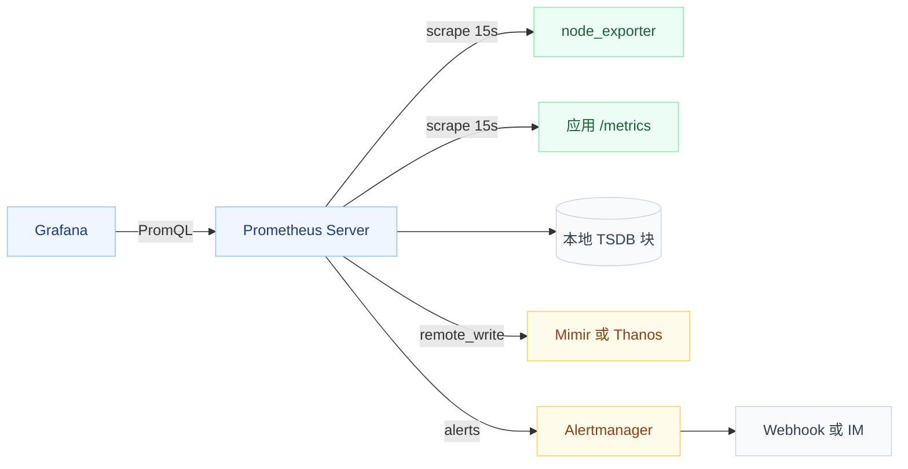

# Prometheus指标监控

> 这篇从 Prometheus 的拉模型与数据模型讲起，经过安装配置、指标类型与命名、PromQL、Exporter 与目标发现、告警规则与 Alertmanager、Recording Rules 和长期存储，最后落到排障现场手册与一个订单服务的完整监控落地。
>
> 学完能独立部署一套 Prometheus，写出可用的 PromQL 与告警规则，并在目标掉线、指标缺失、基数失控时按现象查到第一条命令。

## 一、Prometheus 的定位与边界

Prometheus 是以时间序列数据库（Time Series Database，TSDB）为核心的指标监控系统，默认用拉模型（pull）从目标暴露的 HTTP 接口抓取数值。它回答的是“某个数值随时间怎么变、什么时候越过阈值”，不负责单条请求的完整调用链，也不做日志全文检索。

监控体系通常拆成三类信号，各自解决不同问题：

| 信号 | 代表工具 | 回答的问题 | 成本特点 |
|---|---|---|---|
| 指标 Metrics | Prometheus | 趋势、水位、告警 | 存储小、聚合快 |
| 日志 Logs | Loki、Elasticsearch | 单次事件的具体内容 | 存储大、检索灵活 |
| 链路 Traces | Tempo、Jaeger | 一次请求经过哪些服务 | 采样后成本可控 |

Prometheus 的边界由此确定：它擅长判断“错误率是否升高、延迟是否变慢、磁盘是否将满”，不擅长回答“这条报错日志的完整堆栈是什么”。把日志塞进指标标签，或用指标还原单次请求，都会让成本失控。

### 1.1 拉模型与推送模型的取舍

拉模型由 Prometheus 主动访问目标的 `/metrics`，目标只需要暴露接口，不需要知道 Prometheus 地址。推送模型由被监控端主动上报，适合无法被访问的网络位置和短生命周期任务。

| 维度 | 拉模型（pull） | 推送模型（push） |
|---|---|---|
| 目标发现 | 服务发现、文件、静态配置 | 目标自行配置上报地址 |
| 故障判断 | `up == 0` 直接表示抓取失败 | 需要额外心跳才能判断 |
| 网络方向 | 监控端访问被监控端 | 被监控端访问监控端 |
| 短任务 | 任务结束后无法再抓取 | 天然适配 |
| 典型场景 | 常驻服务、主机、数据库 | 批处理、边缘设备、Serverless |

短生命周期任务用 Pushgateway 中转，但 Pushgateway 会把最后一次推送的值一直保留，不能替代正常的拉取目标。批处理任务推送后应主动删除对应分组，否则残留的 `job` 会持续出现在查询里。

### 1.2 数据模型

Prometheus 的每条样本由“指标名 + 标签集 + 时间戳 + 数值”组成：

```text
http_requests_total{job="order", instance="10.0.1.12:8080", method="POST", status="201"} 1024 1762992000000
```

指标名表示“度量什么”，标签表示“这个度量的哪个维度”。`job` 是抓取任务名，`instance` 是目标地址，这两个标签由 Prometheus 自动附加，用来区分同一类目标的多个副本。

标签组合决定时间序列（series）的唯一性。任意一个标签值变化，都会产生一条新的时间序列。`status="201"` 和 `status="500"` 是两条序列，不是同一条序列的两个点。这个机制是指标聚合的基础，也是基数爆炸的根源。



### 1.3 什么时候不该用 Prometheus

- 需要按用户、订单、请求 ID 精确检索：这些值做标签会造成百万级序列，应放日志或链路。
- 需要强一致的事务记录、审计流水、计费明细：指标会采样和聚合，不能当账本。
- 单集群序列数超过千万且保留期很长：单机 Prometheus 会遇到内存和查询瓶颈，应使用 Mimir、Thanos 或 VictoriaMetrics。
- 需要跨地域长期归档且查询不频繁：对象存储加 Thanos 更合适，不要让 Prometheus 本地磁盘硬扛。

## 二、安装与最小验证

> 版本基线（2026-11）：Prometheus 3.x（3.0 之后的任一 3.x 小版本），Alertmanager 0.28+，node_exporter 1.9+。3.x 已默认支持 UTF-8 指标名与 remote write 2.0，旧版的若干废弃参数已移除；OTLP 接收端仍需启动参数 `--web.enable-otlp-receiver` 显式打开。

安装前先确认端口：Prometheus 用 `9090`，Alertmanager 用 `9093`，node_exporter 用 `9100`。下面以 Ubuntu 24.04 为主，RHEL 系把 `apt` 换成 `dnf`，macOS 与 Windows 给出对应方式。

### 2.1 Ubuntu 二进制与 systemd

官方仓库的发行包版本往往落后，生产环境用官方压缩包加 systemd 管理，升级时只替换二进制和静态资源。

```bash
# 下载与解压；版本号按实际发布替换，目录名保持一致便于升级
cd /tmp
curl -LO https://github.com/prometheus/prometheus/releases/download/v3.5.0/prometheus-3.5.0.linux-amd64.tar.gz
tar -xzf prometheus-3.5.0.linux-amd64.tar.gz

# 二进制放 /usr/local/bin，配置和规则放 /etc/prometheus，数据放 /var/lib/prometheus
sudo install -m 0755 prometheus-3.5.0.linux-amd64/prometheus /usr/local/bin/
sudo install -m 0755 prometheus-3.5.0.linux-amd64/promtool /usr/local/bin/
sudo mkdir -p /etc/prometheus/rules /var/lib/prometheus
sudo cp -r prometheus-3.5.0.linux-amd64/consoles prometheus-3.5.0.linux-amd64/console_libraries /etc/prometheus/

# 专用用户不能登录，数据目录只给它读写
sudo useradd --system --no-create-home --shell /usr/sbin/nologin prometheus
sudo chown -R prometheus:prometheus /etc/prometheus /var/lib/prometheus
```

`/etc/systemd/system/prometheus.service`：

```ini
[Unit]
Description=Prometheus
Wants=network-online.target
After=network-online.target

[Service]
User=prometheus
Group=prometheus
Type=simple
# 保留 15 天；生产按磁盘容量调整，长期数据交给 remote_write
ExecStart=/usr/local/bin/prometheus \
  --config.file=/etc/prometheus/prometheus.yml \
  --storage.tsdb.path=/var/lib/prometheus \
  --storage.tsdb.retention.time=15d \
  --web.listen-address=:9090 \
  --web.enable-lifecycle
# 配置热加载依赖 --web.enable-lifecycle，收到 SIGHUP 时重读配置
ExecReload=/bin/kill -HUP $MAINPID
Restart=on-failure
RestartSec=5

[Install]
WantedBy=multi-user.target
```

`--web.enable-lifecycle` 打开后，改完配置可以 `curl -X POST http://127.0.0.1:9090/-/reload`，不必重启进程。这个接口没有鉴权，只能监听内网或放在反向代理后面。

### 2.2 macOS 与 Windows

macOS 用 Homebrew，适合本地验证：

```bash
brew install prometheus
prometheus --config.file="$(brew --prefix)/etc/prometheus/prometheus.yml"
```

Windows 下载 `prometheus-3.x.windows-amd64.zip`，解压后直接运行 `prometheus.exe --config.file=prometheus.yml`。生产环境应注册为服务，或用容器运行，避免登录会话结束就停。

### 2.3 最小配置

`/etc/prometheus/prometheus.yml`：

```yaml
global:
  scrape_interval: 15s        # 抓取间隔决定指标分辨率，越短成本越高
  evaluation_interval: 15s    # 规则计算间隔，通常与抓取间隔一致
  external_labels:            # 远程写入和联邦时用于标识来源
    cluster: prod-shanghai
    replica: prom-a

rule_files:
  - /etc/prometheus/rules/*.yml

alerting:
  alertmanagers:
    - static_configs:
        - targets: ['127.0.0.1:9093']

scrape_configs:
  - job_name: prometheus
    static_configs:
      - targets: ['127.0.0.1:9090']   # 先监控自己，验证链路最短

  - job_name: node
    static_configs:
      - targets:
          - '10.0.1.11:9100'
          - '10.0.1.12:9100'
        labels:
          env: prod
          role: app
```

启动并验证：

```bash
sudo systemctl daemon-reload
sudo systemctl enable --now prometheus
systemctl status prometheus --no-pager
curl -s http://127.0.0.1:9090/-/ready
curl -s 'http://127.0.0.1:9090/api/v1/query?query=up' | jq '.data.result'
```

预期输出：

```text
Prometheus Server is Ready.
[
  {
    "metric": {"__name__": "up", "instance": "127.0.0.1:9090", "job": "prometheus"},
    "value": [1762992000.123, "1"]
  }
]
```

`up == 1` 表示上一次抓取成功，`up == 0` 表示抓取失败或超时。这个指标是所有“目标是否存活”告警的起点，但它只说明 HTTP 抓取成功，不说明应用业务正常。

### 2.4 配置校验

每次改完配置先校验再重载：

```bash
promtool check config /etc/prometheus/prometheus.yml
```

预期输出：

```text
SUCCESS: /etc/prometheus/prometheus.yml is valid prometheus config file syntax
```

`promtool` 只校验语法和规则表达式，不校验目标是否可达、规则是否会误报。语法通过只是第一步。

## 三、指标类型与命名

Prometheus 客户端库只有四种指标类型，选错类型会让后续查询和告警全部变形。判断标准是“这个数值会不会只增不减”和“是否需要分位数”。

| 类型 | 语义 | 典型指标 | 能否直接求平均 |
|---|---|---|---|
| Counter | 单调递增的累计值 | `http_requests_total` | 不能，先 `rate` |
| Gauge | 可增可减的瞬时值 | `node_memory_available_bytes` | 能 |
| Histogram | 按桶累计的分布 | `http_request_duration_seconds` | 分桶后算分位 |
| Summary | 客户端计算的分位数 | `rpc_duration_seconds` | 不能跨实例聚合 |

### 3.1 Counter 与 Gauge

Counter 只增不减，进程重启后归零，查询时用 `rate()` 或 `increase()` 处理归零。典型错误是对 Counter 直接求平均，得到的值没有物理意义。

Gauge 表示当前状态，可以直接聚合。`node_load1`、`node_filesystem_avail_bytes`、`up` 都是 Gauge。Gauge 的历史值可以求平均，但平均值往往掩盖尖峰，告警应看最大值或持续时长。

### 3.2 Histogram 与 Summary

Histogram 在客户端按固定桶累计计数，服务端可以任意聚合后再算分位数。Summary 在客户端直接计算分位数，跨实例无法合并。多副本服务应优先用 Histogram。

Histogram 暴露三组序列：

```text
http_request_duration_seconds_bucket{le="0.1"} 100
http_request_duration_seconds_bucket{le="0.3"} 180
http_request_duration_seconds_bucket{le="+Inf"} 200
http_request_duration_seconds_sum 42.5
http_request_duration_seconds_count 200
```

`le` 是“小于等于该值”的累计计数。默认桶往往不适合业务，需要按 SLO 设置。SLO 要求 P95 小于 300ms，桶至少要覆盖 `0.05`、`0.1`、`0.2`、`0.3`、`0.5`、`1`、`2`，否则分位数会在桶边界上跳变。

### 3.3 命名规范

指标名用“命名空间_子系统_名称_单位”的结构，单位用国际基本单位，不要用毫秒、KB 这类会在聚合时出错的单位。

| 规则 | 正确示例 | 错误示例 |
|---|---|---|
| Counter 以 `_total` 结尾 | `orders_created_total` | `orders_created` |
| 时间用秒 | `request_duration_seconds` | `request_duration_ms` |
| 大小用字节 | `cache_size_bytes` | `cache_size_mb` |
| 标签用小写蛇形 | `status_code` | `statusCode` |
| 不在指标名里塞维度 | `http_requests_total{method="GET"}` | `http_get_requests_total` |

标签值必须是有界集合。`status`、`method`、`region`、`route` 适合做标签；`user_id`、`order_id`、`trace_id`、`request_id` 不适合，它们会让序列数随业务量线性增长。

```go
// 片段：Go 客户端注册一个带业务标签的 Counter
var ordersCreated = prometheus.NewCounterVec(
    prometheus.CounterOpts{
        Name: "orders_created_total",       // 带 _total 后缀，查询时用 rate
        Help: "Number of created orders.",
    },
    []string{"channel", "status"},          // 只放低基数维度，订单号不能进标签
)

func init() {
    prometheus.MustRegister(ordersCreated)
}
```

> 边界：一次请求的 ID、用户 ID、SQL 语句文本都属于高基数数据，应写入日志或链路属性，不要写进指标标签。一个标签每增加 1 万个取值，就可能把内存放大一个数量级。

## 四、PromQL 查询

PromQL 是 Prometheus 的查询语言，核心是“先选时间序列，再在时间窗口上计算”。查询结果分瞬时向量（instant vector）和区间向量（range vector），函数对两者的要求不同。

### 4.1 选择器与时间窗口

```promql
# 瞬时向量：每个序列取最近一个点
up{job="node"}

# 区间向量：取最近 5 分钟的所有点，只能传给 rate、increase 等函数
node_cpu_seconds_total{job="node", mode="idle"}[5m]

# 正则匹配，=~ 是全匹配不是包含
http_requests_total{status=~"5.."}

# 排除标签，用 != 或 !~
http_requests_total{status!="200"}
```

时间窗口必须大于抓取间隔的 4 倍。抓取间隔 15s 时，`rate(x[1m])` 只有 4 个点，任何一次抓取抖动都会让结果剧烈跳变；`rate(x[5m])` 有 20 个点，曲线稳定得多。

### 4.2 速率与增量

`rate()` 计算每秒平均增长率，自动处理 Counter 归零；`increase()` 计算窗口内的总增量；`irate()` 只用最后两个点，适合看瞬时变化，不适合告警。

```promql
# 每秒请求数，按 job 汇总
sum by (job) (rate(http_requests_total[5m]))

# 5 分钟错误请求增量，用于判断“错误是否在持续发生”
sum by (job) (increase(http_requests_total{status=~"5.."}[5m]))

# 错误率：分子分母都要先 rate，不能先 sum 再 rate
sum by (job) (rate(http_requests_total{status=~"5.."}[5m]))
/
sum by (job) (rate(http_requests_total[5m]))
```

错误率查询最容易犯的错是写成 `sum(rate(errors)) / sum(rate(total))` 后忘记 `by (job)`，结果只剩一个全局值，无法定位是哪个服务出错。分子分母的标签集必须一致，否则除法会得到空结果。

### 4.3 聚合

```promql
# 按 job 求和
sum by (job) (rate(http_requests_total[5m]))

# 去掉 instance 维度后求和，常用于多副本汇总
sum without (instance) (rate(http_requests_total[5m]))

# 每个 job 取前 3 个实例
topk(3, sum by (job, instance) (rate(http_requests_total[5m])))

# 统计当前有多少个目标在线
count(up == 1)
```

`by` 保留列出的标签，`without` 删除列出的标签。两者不能混用在同一层聚合里。聚合后的标签集决定后续能否与其它指标做向量匹配。

### 4.4 直方图分位数

```promql
# 经典 Histogram：先按 le 聚合，再算分位
histogram_quantile(
  0.95,
  sum by (le) (rate(http_request_duration_seconds_bucket{job="order"}[5m]))
)

# 原生 Histogram（Prometheus 3.x）：不需要 _bucket，直接对直方图算分位
histogram_quantile(
  0.95,
  sum by (job) (rate(http_request_duration_seconds{job="order"}[5m]))
)
```

`histogram_quantile` 的结果是估算值，桶越粗误差越大。P99 需要更细的尾部桶，只配到 `le="1"` 的直方图算不出真实的 P99。聚合时必须保留 `le`，写成 `sum(rate(...))` 会丢掉桶边界，函数直接返回 NaN。

### 4.5 比较、偏移与子查询

```promql
# 只保留大于阈值的序列，结果值是原值
node_filesystem_avail_bytes / node_filesystem_size_bytes < 0.1

# bool 把结果变成 0/1，适合做告警表达式
(node_filesystem_avail_bytes / node_filesystem_size_bytes < 0.1) > bool 0

# 与 1 小时前对比
sum(rate(http_requests_total[5m])) / sum(rate(http_requests_total[5m] offset 1h))

# 子查询：对 1 小时内的 5 分钟错误率再求最大值
max_over_time(
  (sum(rate(http_requests_total{status=~"5.."}[5m]))
   /
   sum(rate(http_requests_total[5m])))[1h:1m]
)
```

`offset` 只能放在选择器后面，不能放在函数外层。子查询的 `[1h:1m]` 表示“过去 1 小时，按 1 分钟步长计算内层表达式”，步长不能小于抓取间隔。

### 4.6 常用函数速查

| 函数 | 用途 | 注意 |
|---|---|---|
| `rate` | Counter 每秒增长 | 窗口至少 4 个抓取点 |
| `increase` | 窗口内总增量 | 结果可能是小数 |
| `histogram_quantile` | 分位数 | 必须保留 `le` |
| `absent` | 序列消失时返回 1 | 用于“完全没数据”告警 |
| `predict_linear` | 线性预测 | 适合磁盘将满 |
| `clamp_max` | 限制上限 | 防止异常值撑爆图 |
| `label_replace` | 改写标签 | 谨慎使用，易造重复序列 |

`absent()` 是唯一能发现“指标根本没上报”的函数。`up == 0` 只能发现抓取失败，如果应用不再暴露某个指标但抓取仍然成功，只有 `absent()` 能发现。

## 五、Exporter 与采集目标

Exporter 把不具备 Prometheus 接口的系统翻译成 `/metrics`。生产环境最常见的四类是主机、黑盒探测、数据库和容器。

| Exporter | 采集对象 | 默认端口 | 关键指标 |
|---|---|---|---|
| node_exporter | Linux 主机 | 9100 | `node_load1`、`node_filesystem_*` |
| blackbox_exporter | HTTP/TCP/ICMP 探测 | 9115 | `probe_success`、`probe_duration_seconds` |
| mysqld_exporter | MySQL | 9104 | `mysql_global_status_*` |
| cAdvisor | 容器资源 | 8080 | `container_cpu_usage_seconds_total` |

### 5.1 安装 node_exporter

```bash
# 主机指标采集器，必须与 Prometheus 版本代际接近
curl -LO https://github.com/prometheus/node_exporter/releases/download/v1.9.1/node_exporter-1.9.1.linux-amd64.tar.gz
tar -xzf node_exporter-1.9.1.linux-amd64.tar.gz
sudo install -m 0755 node_exporter-1.9.1.linux-amd64/node_exporter /usr/local/bin/

sudo useradd --system --no-create-home --shell /usr/sbin/nologin node_exporter
```

`/etc/systemd/system/node_exporter.service`：

```ini
[Unit]
Description=Node Exporter
After=network-online.target

[Service]
User=node_exporter
Group=node_exporter
ExecStart=/usr/local/bin/node_exporter \
  --collector.systemd \
  --collector.processes
Restart=on-failure

[Install]
WantedBy=multi-user.target
```

`--collector.systemd` 打开后可以看服务状态，但会多出 `node_systemd_unit_state` 这类序列，主机多时要注意基数。默认采集器已经覆盖 CPU、内存、磁盘、网络、文件系统，不需要全部打开。

```bash
sudo systemctl daemon-reload
sudo systemctl enable --now node_exporter
curl -s http://127.0.0.1:9100/metrics | grep '^node_load1'
```

预期输出：

```text
node_load1 0.42
```

### 5.2 静态配置与文件发现

目标少时用 `static_configs`，目标由配置管理系统生成时用 `file_sd_configs`。文件发现让 Prometheus 定期重读 JSON，不必重启。

```yaml
scrape_configs:
  - job_name: node
    file_sd_configs:
      - files:
          - /etc/prometheus/targets/node/*.json
        refresh_interval: 30s
```

`/etc/prometheus/targets/node/prod.json`：

```json
[
  {
    "targets": ["10.0.1.11:9100", "10.0.1.12:9100"],
    "labels": {
      "env": "prod",
      "role": "app",
      "region": "shanghai"
    }
  }
]
```

文件发现只认 JSON 和 YAML，文件写坏时 Prometheus 会保留上一次成功加载的结果，日志里出现 `Error on file service discovery`。改完文件用 `promtool check config` 校验主配置，目标文件本身用 `jq empty` 校验。

### 5.3 relabel 与标签治理

`relabel_configs` 在抓取前改写目标标签，`metric_relabel_configs` 在入库前丢弃或改写样本。两者都按顺序执行，前一条的结果是后一条的输入。

```yaml
scrape_configs:
  - job_name: node
    static_configs:
      - targets: ['10.0.1.11:9100']
    relabel_configs:
      # 只保留生产环境目标，测试机不进入主库
      - source_labels: [env]
        regex: 'prod'
        action: keep
      # 用地址最后一段做 instance，避免 IP 变化后序列断裂
      - source_labels: [__address__]
        regex: '([^:]+):.*'
        target_label: instance
        replacement: '${1}'

    metric_relabel_configs:
      # 丢弃高基数且无用的指标，降低存储和查询成本
      - source_labels: [__name__]
        regex: 'node_scrape_collector_.*'
        action: drop
      # 把超长挂载点标签截断，防止文件系统路径撑爆标签
      - source_labels: [mountpoint]
        regex: '(.{0,40}).*'
        target_label: mountpoint
        replacement: '${1}'
```

`action: keep` 表示只保留匹配的目标，`drop` 表示丢弃匹配的目标或样本。`labeldrop` 和 `labelkeep` 删除标签，但会改变序列身份，使用前要确认不会与其它序列冲突。

> 边界：`metric_relabel_configs` 只能删减，不能补算。丢弃指标前先确认没有告警和看板依赖它；用 `count by (__name__)({__name__=~".+"})` 查清每个指标名下的序列数，再决定删谁。

### 5.4 抓取验证

```bash
# 查看所有目标状态，DOWN 的目标会带 lastError
curl -s http://127.0.0.1:9090/api/v1/targets | jq '.data.activeTargets[] | {scrapeUrl, health, lastError}'

# 查看抓取耗时，P99 接近 timeout 就要调大超时或减少采集项
curl -s 'http://127.0.0.1:9090/api/v1/query?query=scrape_duration_seconds' | jq '.data.result'
```

预期输出中 `health` 为 `up`，`lastError` 为空。若 `health` 为 `down`，先在本机 `curl` 目标地址，再查防火墙和安全组，不要直接改 Prometheus 配置。

## 六、告警规则与 Alertmanager

告警分两段：Prometheus 按规则计算表达式，产生告警实例；Alertmanager 负责去重、分组、抑制和发送。规则写错会漏报或风暴，路由写错会把告警发错人。

### 6.1 规则文件

`/etc/prometheus/rules/order-slo.yml`：

```yaml
groups:
  - name: order-slo
    interval: 30s                 # 比全局 15s 粗，降低规则计算压力
    rules:
      # 预计算 P95，看板和告警复用同一条序列，避免重复扫描原始桶
      - record: job:http_request_duration_seconds:p95_5m
        expr: |
          histogram_quantile(
            0.95,
            sum by (job, le) (rate(http_request_duration_seconds_bucket[5m]))
          )

      - alert: OrderHighLatency
        expr: job:http_request_duration_seconds:p95_5m{job="order"} > 0.3
        for: 5m                   # 持续 5 分钟才触发，过滤瞬时抖动
        labels:
          severity: warning
          team: order
        annotations:
          summary: "订单服务 P95 延迟超过 300ms"
          description: "当前 P95 = {{ $value | humanizeDuration }}，已持续 5 分钟。"

      - alert: TargetDown
        expr: up{job="order"} == 0
        for: 2m
        labels:
          severity: critical
          team: order
        annotations:
          summary: "订单服务抓取目标掉线"

      - alert: OrderErrorBudgetBurn
        expr: |
          (
            sum(rate(http_requests_total{job="order", status=~"5.."}[5m]))
            /
            sum(rate(http_requests_total{job="order"}[5m]))
          ) > (14.4 * 0.001)
        for: 2m
        labels:
          severity: critical
          team: order
        annotations:
          summary: "订单服务错误率燃烧过快"
```

`for` 是告警从 pending 变成 firing 的最短持续时间。没有 `for` 的规则会被每一次抖动触发，形成告警风暴。`severity` 和 `team` 是路由依据，必须与 Alertmanager 的匹配规则一致。

### 6.2 规则单测

规则单测让告警逻辑在上线前可验证，不依赖真实流量。

`/etc/prometheus/rules/order-slo.test.yml`：

```yaml
rule_files:
  - order-slo.yml
evaluation_interval: 1m

tests:
  - interval: 1m
    input_series:
      # 前 5 分钟正常，之后连续掉线
      - series: 'up{job="order", instance="10.0.1.12:8080"}'
        values: '1 1 1 1 1 0 0 0 0 0'
    alert_rule_test:
      - eval_time: 4m
        alertname: TargetDown
        exp_alerts: []
      - eval_time: 8m
        alertname: TargetDown
        exp_alerts:
          - exp_labels:
              severity: critical
              team: order
              job: order
              instance: 10.0.1.12:8080
            exp_annotations:
              summary: "订单服务抓取目标掉线"
```

```bash
promtool test rules /etc/prometheus/rules/order-slo.test.yml
```

预期输出：

```text
Unit Testing:  /etc/prometheus/rules/order-slo.test.yml
  SUCCESS
```

`exp_annotations` 必须与规则里的注解完全一致，模板渲染后的值也要写对。单测失败时 `promtool` 会打印实际告警与期望告警的差异，按差异改规则或改测试，不要删断言。

### 6.3 Alertmanager 路由

`/etc/alertmanager/alertmanager.yml`：

```yaml
global:
  resolve_timeout: 5m

route:
  receiver: default
  group_by: ['alertname', 'cluster', 'service']
  group_wait: 30s          # 首次等待，给同组告警留聚合时间
  group_interval: 5m       # 同组新增告警的发送间隔
  repeat_interval: 4h      # 未恢复告警的重复提醒间隔
  routes:
    - matchers: ['severity="critical"']
      receiver: pager
      continue: false       # 命中 critical 后不再走后续路由
    - matchers: ['team="order"']
      receiver: order-im

receivers:
  - name: default
    webhook_configs:
      - url: http://127.0.0.1:9099/default
  - name: pager
    webhook_configs:
      - url: http://127.0.0.1:9099/pager
        send_resolved: true
  - name: order-im
    webhook_configs:
      - url: http://127.0.0.1:9099/order

inhibit_rules:
  # 同一实例已有 critical，屏蔽它的 warning，避免重复打扰
  - source_matchers: ['severity="critical"']
    target_matchers: ['severity="warning"']
    equal: ['alertname', 'instance']
```

`continue: false` 表示命中后停止匹配后续路由，`true` 表示继续向下匹配。分组标签决定哪些告警合并成一条通知，`group_by` 里放 `instance` 会让每个实例单独发一条，通常不适合大规模告警。

```bash
amtool check-config /etc/alertmanager/alertmanager.yml
```

预期输出：

```text
Checking '/etc/alertmanager/alertmanager.yml'  SUCCESS
Found:
 - global config
 - route
 - 1 inhibit rules
 - 3 receivers
 - 0 templates
```

### 6.4 告警验证

```bash
# 查看当前 firing 的告警
curl -s http://127.0.0.1:9090/api/v1/alerts | jq '.data.alerts[] | {labels, state, activeAt}'

# 查看 Alertmanager 收到的告警
curl -s http://127.0.0.1:9093/api/v2/alerts | jq '.[] | {labels, status}'

# 手动发一条测试告警，验证路由和通知
amtool alert add test_alert severity=warning team=order \
  --alertmanager.url=http://127.0.0.1:9093 \
  --annotation=summary="路由测试"
```

`amtool alert add` 会产生一条真实告警，验证完用 `amtool alert expire` 或等它超时。测试告警不要带 `critical`，避免触发真实值班。

## 七、Recording Rules 与长期存储

单机 Prometheus 的本地存储适合 15 到 30 天，跨集群、跨年查询要靠远程写入。Recording Rules 把昂贵查询预计算成新序列，看板和告警都省去重复扫描。

### 7.1 Recording Rules 的命名与使用

规则名用 `level:metric:operations` 的结构，一眼能看出聚合维度和计算方式：

```yaml
groups:
  - name: recording
    interval: 30s
    rules:
      - record: job:http_requests:rate5m
        expr: sum by (job) (rate(http_requests_total[5m]))

      - record: job:http_request_duration_seconds:p95_5m
        expr: |
          histogram_quantile(
            0.95,
            sum by (job, le) (rate(http_request_duration_seconds_bucket[5m]))
          )

      - record: instance:node_filesystem_usage:ratio
        expr: |
          1 - (
            node_filesystem_avail_bytes{fstype!~"tmpfs|overlay"}
            /
            node_filesystem_size_bytes{fstype!~"tmpfs|overlay"}
          )
```

预计算后，看板查询 `job:http_request_duration_seconds:p95_5m` 只扫一条序列，不再扫全部桶。规则的 `interval` 应不小于数据源的抓取间隔，否则窗口里点数不足。

### 7.2 remote_write

```yaml
remote_write:
  - url: http://mimir.monitoring.svc:9009/api/v1/push
    name: mimir-prod
    remote_timeout: 30s
    queue_config:
      capacity: 10000            # 队列容量，过小会在后端抖动时丢样本
      max_shards: 50             # 并发分片上限，按后端承受能力调
      max_samples_per_send: 5000
      batch_send_deadline: 5s
    write_relabel_configs:
      # 调试类指标不进长期库，节省对象存储
      - source_labels: [__name__]
        regex: 'go_.*|process_.*'
        action: drop
```

远程写入是异步的，后端不可用时样本先在本地 WAL 排队，队列满后开始丢弃。`prometheus_remote_storage_samples_dropped_total` 大于 0 说明后端已经跟不上，需要扩容或减少写入量。

### 7.3 长期存储选型

| 方案 | 定位 | 优点 | 代价 |
|---|---|---|---|
| 本地 TSDB | 单集群短期 | 简单、查询快 | 不能跨集群、扩容难 |
| Thanos | 多集群全局视图 | 对象存储成本低、Sidecar 侵入小 | 组件多、查询链路长 |
| Mimir | 多租户水平扩展 | 原生多租户、压缩好 | 部署复杂、资源要求高 |
| VictoriaMetrics | 高压缩比单机/集群 | 写入省、PromQL 兼容 | 生态与告警链路需适配 |

选型的判断顺序是：先看是否需要跨集群查询，再看是否需要多租户隔离，最后看运维团队能否承担组件数量。单集群 30 天以内的数据，本地 TSDB 加定时备份已经够用。

## 八、排障现场手册

Prometheus 的排障顺序是“目标是否可达 → 抓取是否成功 → 样本是否入库 → 查询是否正确 → 告警是否发出”。跳过任何一步都可能改错地方。

| 现象 | 最可能原因 | 第一条命令 |
|---|---|---|
| 目标 DOWN | 端口不通、路径错、防火墙 | `curl -v http://目标:9100/metrics` |
| `up=1` 但无业务指标 | 指标名写错、标签不匹配 | `/api/v1/label/__name__/values` |
| 查询返回空 | 时间窗口太短、标签不一致 | 去掉标签逐步缩小条件 |
| 内存持续上涨 | 高基数标签、抓取目标过多 | `/api/v1/status/tsdb` |
| 规则不触发 | 表达式错、`for` 未满足 | `promtool test rules` |
| 告警不发送 | 路由不匹配、静默、抑制 | `amtool alert query` |
| 远程写入丢样本 | 队列满、后端限流 | `prometheus_remote_storage_samples_dropped_total` |

### 8.1 目标抓取失败

```bash
# 先在 Prometheus 主机上访问目标，排除网络和防火墙
curl -v --max-time 5 http://10.0.1.12:9100/metrics

# 查看目标详情和 lastError
curl -s http://127.0.0.1:9090/api/v1/targets \
  | jq '.data.activeTargets[] | select(.health=="down") | {scrapeUrl, lastError}'
```

常见错误是 `connection refused`（进程没起）、`context deadline exceeded`（网络慢或采集项太多）、`403`（反向代理鉴权）。`server returned HTTP status 404` 多半是 `metrics_path` 写错。

### 8.2 指标存在但查询为空

```bash
# 确认指标名是否存在
curl -s http://127.0.0.1:9090/api/v1/label/__name__/values \
  | jq -r '.data[]' | grep order

# 确认标签值，注意大小写和空格
curl -s 'http://127.0.0.1:9090/api/v1/label/status/values' | jq '.data'
```

PromQL 的标签匹配区分大小写，`status="500"` 不会匹配 `status="500 "`。`rate()` 返回空的主要原因是窗口内点数不足（窗口至少要有两个采样点）。

### 8.3 基数失控与内存

```bash
# 查看序列数最多的指标名
curl -s http://127.0.0.1:9090/api/v1/status/tsdb \
  | jq '.data.seriesCountByMetricName[:10]'

# 查看当前 head 里的序列总数
curl -s 'http://127.0.0.1:9090/api/v1/query?query=prometheus_tsdb_head_series' \
  | jq '.data.result[0].value[1]'
```

预期输出（示例）：

```json
[
  {"name": "http_requests_total", "value": 182340},
  {"name": "node_network_receive_bytes_total", "value": 42110}
]
```

`http_requests_total` 排第一且数值远超业务维度，说明标签里混进了高基数字段。处理方式是先加 `metric_relabel_configs` 丢弃，再改应用埋点，不要直接删时间序列。

### 8.4 查询慢与规则超时

```bash
# 查看查询耗时分布
curl -s 'http://127.0.0.1:9090/api/v1/query?query=prometheus_engine_query_duration_seconds' \
  | jq '.data.result'

# 查看规则计算耗时，接近 interval 就会堆积
curl -s 'http://127.0.0.1:9090/api/v1/query?query=prometheus_rule_group_last_duration_seconds' \
  | jq '.data.result'
```

查询慢的常见原因是时间范围过大、正则匹配全量序列、在原始桶上反复算分位。处理顺序是缩小范围、加 Recording Rules、再考虑扩容。

### 8.5 告警不触发或不发送

```bash
# 规则是否加载，lastEvaluation 是否在更新
curl -s http://127.0.0.1:9090/api/v1/rules | jq '.data.groups[].rules[] | {name, health, lastError}'

# Alertmanager 是否收到，是否被静默
curl -s http://127.0.0.1:9093/api/v2/alerts | jq '.[] | {labels, status, silencedBy}'

# 查看静默列表
amtool silence query --alertmanager.url=http://127.0.0.1:9093
```

规则 `health` 为 `err` 时看 `lastError`；告警在 Prometheus 是 firing 但 Alertmanager 没有，检查 `alerting.alertmanagers` 地址和网络；Alertmanager 有告警但没通知，检查路由匹配、静默和抑制规则。

## 九、最佳实践案例

### 9.1 案例背景

一个订单服务部署在 3 台 Ubuntu 24.04 上，前面是 Nginx，后面是 MySQL 8.4，副本数 3，峰值 1200 QPS。业务方要求：下单接口 P95 小于 300ms，5 分钟错误率低于 0.1%，磁盘剩余空间不低于 10%。

现状是只有 Zabbix 的主机存活告警，接口变慢靠用户投诉，故障定位平均 40 分钟。约束是只有一台 8 核 32GB 的监控机，不能引入 Kubernetes，日志已经由 Loki 收集，本期只做指标和告警。

目标是用一套 Prometheus 加 Alertmanager 覆盖主机、Nginx、订单应用和 MySQL，告警按严重级别路由到不同渠道，并能在 5 分钟内判断是主机、入口还是应用的问题。

### 9.2 案例实操

第一步，在三台应用机和监控机部署 node_exporter，在 Nginx 上开 `stub_status`，应用用 Micrometer 暴露 `/actuator/prometheus`。

```yaml
# /etc/prometheus/prometheus.yml（节选）
global:
  scrape_interval: 15s
  evaluation_interval: 15s
  external_labels:
    cluster: order-prod

rule_files:
  - /etc/prometheus/rules/*.yml

alerting:
  alertmanagers:
    - static_configs:
        - targets: ['127.0.0.1:9093']

scrape_configs:
  - job_name: prometheus
    static_configs:
      - targets: ['127.0.0.1:9090']

  - job_name: node
    file_sd_configs:
      - files: ['/etc/prometheus/targets/node/*.json']
        refresh_interval: 30s

  - job_name: order
    metrics_path: /actuator/prometheus
    static_configs:
      - targets:
          - '10.0.1.11:8080'
          - '10.0.1.12:8080'
          - '10.0.1.13:8080'
        labels:
          env: prod
          team: order

  - job_name: nginx
    static_configs:
      - targets: ['10.0.1.10:9113']   # nginx-prometheus-exporter
```

`/etc/prometheus/targets/node/prod.json`：

```json
[
  {
    "targets": [
      "10.0.1.10:9100",
      "10.0.1.11:9100",
      "10.0.1.12:9100",
      "10.0.1.13:9100"
    ],
    "labels": {"env": "prod", "role": "order"}
  }
]
```

第二步，写 Recording Rules，把 P95、错误率和磁盘水位预计算出来。

```yaml
# /etc/prometheus/rules/order-slo.yml
groups:
  - name: order-slo
    interval: 30s
    rules:
      - record: job:http_request_duration_seconds:p95_5m
        expr: |
          histogram_quantile(
            0.95,
            sum by (job, le) (
              rate(http_server_requests_seconds_bucket{job="order"}[5m])
            )
          )

      - record: job:http_requests:error_ratio_5m
        expr: |
          sum by (job) (rate(http_server_requests_seconds_count{job="order", status=~"5.."}[5m]))
          /
          sum by (job) (rate(http_server_requests_seconds_count{job="order"}[5m]))

      - record: instance:node_filesystem_usage:ratio
        expr: |
          1 - (
            node_filesystem_avail_bytes{job="node", fstype!~"tmpfs|overlay"}
            /
            node_filesystem_size_bytes{job="node", fstype!~"tmpfs|overlay"}
          )
```

第三步，写告警规则并做单测。

```yaml
# /etc/prometheus/rules/order-alerts.yml
groups:
  - name: order-alerts
    interval: 30s
    rules:
      - alert: OrderHighLatency
        expr: job:http_request_duration_seconds:p95_5m{job="order"} > 0.3
        for: 5m
        labels:
          severity: warning
          team: order
        annotations:
          summary: "订单接口 P95 超过 300ms"
          description: "当前值 {{ $value | humanizeDuration }}，持续 5 分钟。"

      - alert: OrderErrorBudgetBurn
        expr: job:http_requests:error_ratio_5m{job="order"} > 0.001
        for: 5m
        labels:
          severity: critical
          team: order
        annotations:
          summary: "订单接口错误率超过 0.1%"
          description: "当前错误率 {{ $value | humanizePercentage }}。"

      - alert: NodeDiskWillFill
        expr: |
          predict_linear(
            instance:node_filesystem_usage:ratio{job="node"}[6h], 24 * 3600
          ) > 0.95
        for: 10m
        labels:
          severity: warning
          team: ops
        annotations:
          summary: "磁盘预计 24 小时内写满"
          description: "实例 {{ $labels.instance }}，挂载点 {{ $labels.mountpoint }}。"

      - alert: TargetDown
        expr: up{job=~"node|order|nginx"} == 0
        for: 2m
        labels:
          severity: critical
          team: ops
        annotations:
          summary: "抓取目标掉线"
          description: "{{ $labels.job }} / {{ $labels.instance }} 已 2 分钟不可达。"
```

`predict_linear` 用过去 6 小时的趋势外推 24 小时，只在磁盘持续增长时有意义。对写入量稳定的日志盘会提前告警，对周期性清理的盘可能误报，需要按实际挂载点调整窗口。

第四步，Alertmanager 按级别路由。

```yaml
# /etc/alertmanager/alertmanager.yml
global:
  resolve_timeout: 5m

route:
  receiver: ops-im
  group_by: ['alertname', 'cluster', 'team']
  group_wait: 30s
  group_interval: 5m
  repeat_interval: 4h
  routes:
    - matchers: ['severity="critical"']
      receiver: oncall-pager
    - matchers: ['team="order"']
      receiver: order-im

receivers:
  - name: ops-im
    webhook_configs:
      - url: http://127.0.0.1:9099/ops
  - name: order-im
    webhook_configs:
      - url: http://127.0.0.1:9099/order
  - name: oncall-pager
    webhook_configs:
      - url: http://127.0.0.1:9099/pager
        send_resolved: true

inhibit_rules:
  - source_matchers: ['severity="critical"']
    target_matchers: ['severity="warning"']
    equal: ['alertname', 'instance']
```

第五步，校验并上线。

```bash
promtool check config /etc/prometheus/prometheus.yml
promtool check rules /etc/prometheus/rules/order-slo.yml /etc/prometheus/rules/order-alerts.yml
amtool check-config /etc/alertmanager/alertmanager.yml

sudo systemctl reload prometheus
sudo systemctl restart alertmanager
```

预期输出：

```text
SUCCESS: /etc/prometheus/prometheus.yml is valid prometheus config file syntax
SUCCESS: 3 rules found
SUCCESS: 4 rules found
Checking '/etc/alertmanager/alertmanager.yml'  SUCCESS
```

第六步，验证指标和告警链路。

```bash
# 三个订单副本都应在线
curl -s 'http://127.0.0.1:9090/api/v1/query?query=up{job="order"}' \
  | jq '.data.result[] | {instance: .metric.instance, value: .value[1]}'

# P95 应该有值且小于 0.3
curl -s 'http://127.0.0.1:9090/api/v1/query?query=job:http_request_duration_seconds:p95_5m' \
  | jq '.data.result[] | {job: .metric.job, p95: .value[1]}'

# 确认告警规则已加载
curl -s http://127.0.0.1:9090/api/v1/rules \
  | jq '.data.groups[] | {name, rules: [.rules[].name]}'
```

预期输出（示例）：

```jsonl
{"instance": "10.0.1.11:8080", "value": "1"}
{"instance": "10.0.1.12:8080", "value": "1"}
{"instance": "10.0.1.13:8080", "value": "1"}
{"job": "order", "p95": "0.218"}
```

### 9.3 案例结果

上线后三个订单副本的 `up` 全为 1，P95 稳定在 0.18 到 0.24 秒，错误率低于 0.05%。一次压测中错误率升到 0.3%，`OrderErrorBudgetBurn` 在 5 分钟后触发，值班从告警里直接看到 `job="order"` 和实例地址，定位时间从 40 分钟降到 8 分钟。

失败模式与处理：

- 应用把 `order_id` 写进指标标签，序列数从 2 万涨到 90 万，Prometheus 内存翻倍。处理是改埋点去掉该标签；短期用 `metric_relabel_configs` 的 `drop` 丢弃整条高基数指标，不要只 `labeldrop`——去掉标签后多条序列会撞成同一组标签，抓取时报重复样本。
- `rate()` 窗口设成 1 分钟，抓取间隔 15 秒，错误率曲线剧烈抖动，告警反复触发。改成 5 分钟窗口后稳定。
- Alertmanager 的 `group_by` 带了 `instance`，一次数据库故障产生 60 条通知。去掉 `instance` 后合并成 3 条。
- 磁盘告警最初写成 `node_filesystem_avail_bytes < 10%`（非法 PromQL），改成 `node_filesystem_avail_bytes / node_filesystem_size_bytes < 0.1` 后又在日志轮转前误报。最终改用 `predict_linear` 预测 24 小时写满，误报消失。

复盘：指标监控的价值不在“能看图”，而在“每个告警都能追到一条可执行的命令”。规则先单测再上线，标签先治理再扩容，告警先分组再谈渠道，顺序反过来就会在故障时被自己的监控拖住。
