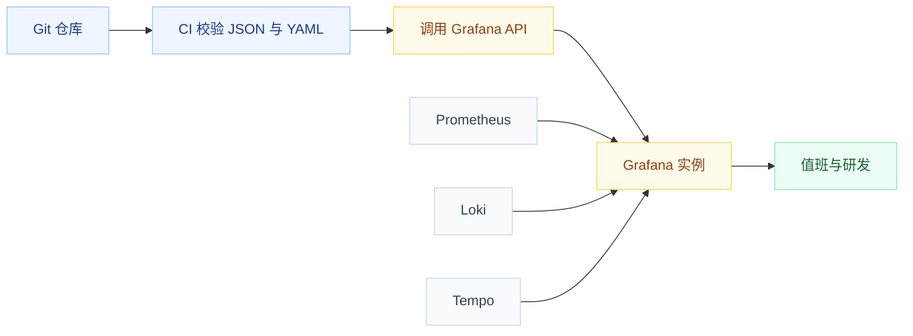

# Grafana可视化看板

> 这篇从 Grafana 的职责边界与看板设计原则讲起，经过安装登录、数据源接入、Panel 与查询、变量、统一告警、Dashboard as Code，最后落到看板性能排障与一个订单服务 SLO 看板的完整交付。
>
> 学完能独立搭起一套可版本化的 Grafana 看板，把 Prometheus、Loki、Tempo 的数据组织成能定位问题的面板，并用配置文件而不是手工点击完成发布。

## 一、Grafana 的定位与看板设计原则

Grafana 是查询与展示层，不存储指标、日志和链路。它把数据源的查询结果渲染成面板（Panel），把多个面板组织成看板（Dashboard），再基于查询结果做告警。数据是否正确取决于数据源，Grafana 只负责“怎么问、怎么画、怎么提醒”。

这个边界决定了两条工程规则：看板里的每个查询都必须能在数据源里单独验证；看板本身要能随代码发布和回滚，不能只存在于某台服务器的数据库里。

### 1.1 看板回答的是决策问题

一张看板只服务一个场景。运维值班看“现在是否正常”，研发排查看“哪个依赖变慢”，管理层看“SLO 是否达标”。三类问题混在一张图上，结果是每类人都要在一堆面板里找自己的那一块。

常用的组织方法有三种：

| 方法 | 关注点 | 适合对象 |
|---|---|---|
| Golden Signals | 延迟、流量、错误、饱和度 | 在线服务 |
| RED | Rate、Errors、Duration | 请求型服务 |
| USE | Utilization、Saturation、Errors | 主机、磁盘、网络 |

订单服务的首页按 Golden Signals 排四个区块，每个区块一行，异常时颜色直接指向问题类型。主机看板按 USE 排，先看 CPU 和内存使用率，再看磁盘饱和与网络错误。

### 1.2 一屏之内能判断

看板的首屏必须回答“现在有没有问题”。做法是：左上放总体健康和时间范围，右上放环境与实例变量，中间放四个核心指标，下方才放细分维度。首屏超过 12 个面板，值班人员就会开始滚动而不是判断。

颜色只表达状态，不表达装饰。绿色表示达标，黄色表示接近阈值，红色表示越界，灰色表示无数据。同一指标在不同看板里保持同一配色，避免“这张图红色是坏，那张图红色是好”。

### 1.3 看板也是代码

手工在界面上改的面板，无法评审、无法回滚、无法复现。生产看板应满足：

- 数据源、看板、告警规则都以 YAML 或 JSON 存放在 Git；
- 发布通过 CI 调用 Grafana API，而不是登录界面点保存；
- 每个看板有稳定 UID，重命名不改变链接；
- 变更走合并请求，至少一人评审。



> 边界：Grafana 不适合做长期数据归档，也不适合在面板里做复杂 ETL。聚合和预计算应放在 Prometheus 的 Recording Rules 或 Loki 的查询侧，看板只做最后一步展示。

## 二、安装与首次登录

> 版本基线（2026-11）：Grafana 12.x，Prometheus 3.x，Loki 3.x，Tempo 2.x。Grafana 12 的告警、权限和 Dashboard Schema 与 9.x 有差异，旧版本文档里的 `[alerting]` 配置不能直接照搬。

Grafana 的安装包自带前端静态资源和后端二进制，数据默认存 SQLite。生产环境应换成 PostgreSQL 或 MySQL，否则多副本无法共享会话和看板。

### 2.1 Ubuntu 与 Rocky

Ubuntu 用官方 APT 仓库：

```bash
# 导入签名密钥，apt 才能验证包来源
sudo mkdir -p /etc/apt/keyrings
curl -fsSL https://apt.grafana.com/gpg.key \
  | sudo gpg --dearmor -o /etc/apt/keyrings/grafana.gpg

echo "deb [signed-by=/etc/apt/keyrings/grafana.gpg] https://apt.grafana.com stable main" \
  | sudo tee /etc/apt/sources.list.d/grafana.list

sudo apt update
sudo apt install -y grafana
```

Rocky Linux 9/10 用 DNF 仓库：

```bash
sudo tee /etc/yum.repos.d/grafana.repo >/dev/null <<'EOF'
[grafana]
name=grafana
baseurl=https://rpm.grafana.com
repo_gpgcheck=1
enabled=1
gpgcheck=1
gpgkey=https://rpm.grafana.com/gpg.key
EOF

sudo dnf install -y grafana
```

macOS 与 Windows 只适合本地验证：

```bash
brew install grafana
brew services start grafana
```

Windows 下载 `.msi` 安装后，服务名为 `Grafana`，配置文件在 `C:\Program Files\GrafanaLabs\grafana\conf\defaults.ini`。生产环境优先用容器或 Linux 包。

### 2.2 生产配置

`/etc/grafana/grafana.ini`：

```ini
[server]
protocol = http
http_port = 3000
domain = grafana.example.com
root_url = https://grafana.example.com/   # 代理终止 TLS 时，Grafana 信任转发头才能生成正确链接
enable_gzip = true

[database]
type = postgres
host = 127.0.0.1:5432
name = grafana
user = grafana
password = $__env{GRAFANA_DB_PASSWORD}
ssl_mode = require

[security]
# 首次启动后由环境变量注入，不要在配置文件里写明文
admin_user = admin
admin_password = $__env{GRAFANA_ADMIN_PASSWORD}
cookie_secure = true
cookie_samesite = lax

[users]
allow_sign_up = false
auto_assign_org_role = Viewer

[auth.anonymous]
enabled = false

[analytics]
reporting_enabled = false
check_for_updates = false
```

`$__env{...}` 是 Grafana 的环境变量插值语法，密码通过 systemd 的 `EnvironmentFile` 注入。`allow_sign_up = false` 和匿名访问关闭是生产环境的底线，否则任何人都能注册并看到所有看板。

```bash
sudo systemctl daemon-reload
sudo systemctl enable --now grafana-server
systemctl status grafana-server --no-pager
curl -s http://127.0.0.1:3000/api/health | jq
```

预期输出：

```json
{
  "commit": "a1b2c3d",
  "database": "ok",
  "version": "12.2.0"
}
```

`database` 为 `ok` 才说明存储可用。`version` 用于确认升级是否生效，不要用页面底部的版本号做唯一依据。

### 2.3 首次登录与最小验证

浏览器打开 `http://服务器:3000`，用 `admin` 和初始密码登录，系统会强制改密码。命令行环境可以用 API 验证：

```bash
# 用管理员账号换取会话，后续请求带 Cookie
curl -s -c /tmp/grafana.cookie \
  -H 'Content-Type: application/json' \
  -d '{"user":"admin","password":"初始密码"}' \
  http://127.0.0.1:3000/login

curl -s -b /tmp/grafana.cookie http://127.0.0.1:3000/api/user | jq '{login, orgId, isGrafanaAdmin}'
```

预期输出：

```json
{"login": "admin", "orgId": 1, "isGrafanaAdmin": true}
```

生产环境不要用管理员账号做自动化。应该创建服务账号（Service Account），给它最小权限，再用 Token 调用 API：

```bash
# 创建服务账号，角色 Editor 足够发布看板
curl -s -u admin:密码 \
  -H 'Content-Type: application/json' \
  -d '{"name":"ci-dashboard","role":"Editor"}' \
  http://127.0.0.1:3000/api/serviceaccounts | jq '{id, name, role}'

# 为服务账号创建 Token，返回值只显示一次
curl -s -u admin:密码 \
  -H 'Content-Type: application/json' \
  -d '{"name":"ci-token"}' \
  http://127.0.0.1:3000/api/serviceaccounts/1/tokens
```

预期输出（示例，`key` 只出现一次）：

```json
{"id":1,"name":"ci-token","key":"glsa_xxxxxxxxxxxxxxxx_abcdef123456"}
```

Token 存入 CI 的密钥管理，不要提交到仓库。服务账号的权限按团队拆分，负责订单看板的账号不应该能改数据库看板。

## 三、数据源配置

数据源是 Grafana 与后端存储之间的连接。生产环境用配置文件声明数据源，手工添加的数据源在重建实例后会丢失，且 UID 不稳定会导致看板查询全部失效。

### 3.1 Prometheus 数据源

`/etc/grafana/provisioning/datasources/prometheus.yaml`：

```yaml
apiVersion: 1

datasources:
  - name: Prometheus
    type: prometheus
    uid: prom-main            # 固定 UID，看板 JSON 用它引用数据源
    access: proxy             # 由 Grafana 后端转发，避免浏览器直连内网
    url: http://127.0.0.1:9090
    isDefault: true
    jsonData:
      httpMethod: POST        # 长查询用 POST，避免 URL 过长被代理截断
      timeInterval: 15s       # 与抓取间隔一致，Grafana 据此推荐最小步长
      prometheusType: Prometheus
      prometheusVersion: 3.5.0
      # 从 exemplar 跳到 Tempo，指标异常时直接看链路
      exemplarTraceIdDestinations:
        - name: trace_id
          datasourceUid: tempo-main
    editable: false
```

`access: proxy` 让 Grafana 服务器访问 Prometheus，浏览器只访问 Grafana。这样 Prometheus 不需要暴露到公网，也避免跨域问题。`timeInterval` 写错会让 `$__rate_interval` 算出过小的窗口，`rate()` 结果抖动。

### 3.2 Loki 与 Tempo 数据源

`/etc/grafana/provisioning/datasources/loki.yaml`：

```yaml
apiVersion: 1

datasources:
  - name: Loki
    type: loki
    uid: loki-main
    access: proxy
    url: http://127.0.0.1:3100
    jsonData:
      maxLines: 1000           # 单次返回上限，太大浏览器会卡
      # 把日志里的 trace_id 变成可点击链接，跳到 Tempo
      derivedFields:
        - name: trace_id
          matcherRegex: '"trace_id":"([0-9a-f]{32})"'
          url: '$${__value.raw}'
          datasourceUid: tempo-main
```

`$${__value.raw}` 里的双美元是 Grafana 的转义写法，表示把捕获组的值原样拼进链接。写成单个 `$` 会被当成变量替换，链接会变成空值。

`/etc/grafana/provisioning/datasources/tempo.yaml`：

```yaml
apiVersion: 1

datasources:
  - name: Tempo
    type: tempo
    uid: tempo-main
    access: proxy
    url: http://127.0.0.1:3200
    jsonData:
      # 从 trace 反查同一服务的日志，排障时不用手工复制 trace_id
      tracesToLogsV2:
        datasourceUid: loki-main
        spanStartTimeShift: '-1m'
        spanEndTimeShift: '1m'
        filterByTraceID: true
        tags:
          - key: service.name
            value: service_name
      serviceMap:
        datasourceUid: prom-main
      nodeGraph:
        enabled: true
```

三个数据源的 UID 必须与看板 JSON 里引用的值一致。改 UID 等于让所有看板失效，迁移时用新 UID 新建数据源，再批量改看板，不要直接覆盖。

### 3.3 验证数据源

```bash
# 列出所有数据源，确认 UID 和类型
curl -s -b /tmp/grafana.cookie http://127.0.0.1:3000/api/datasources \
  | jq '.[] | {name, type, uid}'

# 健康检查，Grafana 会实际请求后端
curl -s -b /tmp/grafana.cookie \
  http://127.0.0.1:3000/api/datasources/uid/prom-main/health | jq
```

预期输出：

```json
{"status":"OK","message":"Data source is working","name":"Prometheus"}
```

健康检查通过只说明地址和认证没问题，不说明查询正确。接着在 Explore 里执行 `up`，确认有数据返回，再做看板。

> 边界：`secureJsonData` 里的密码和 Token 在 API 返回中会被脱敏，导出数据源配置时不会带出明文。迁移实例时要在新环境重新注入密钥，不能指望导出文件。

## 四、Panel 与查询

面板是看板的最小单位，由查询、可视化类型、字段配置三部分组成。同一个查询换一种可视化，表达的意思可能完全不同，选型的依据是“读者要比较什么”。

### 4.1 面板类型选型

| 类型 | 适合表达 | 不适合 |
|---|---|---|
| Time series | 随时间变化的趋势 | 单点快照 |
| Stat | 当前值与阈值状态 | 多序列对比 |
| Gauge | 占用率、水位 | 历史趋势 |
| Table | 多维明细、排序 | 长时间序列 |
| Heatmap | 延迟分布、并发密度 | 精确单值 |

订单首页用 Stat 展示当前 QPS 和错误率，用 Time series 展示 P95 趋势，用 Gauge 展示磁盘水位，用 Table 展示最慢的五个接口。Heatmap 只在分析延迟分布时使用，不放在首屏。

### 4.2 查询编辑器与时间宏

Grafana 的 Prometheus 查询支持时间宏，宏会在发请求前替换成实际区间：

| 宏 | 含义 | 使用场景 |
|---|---|---|
| `$__interval` | 当前面板的步长 | 聚合窗口 |
| `$__rate_interval` | 至少 4 个抓取点的步长 | `rate()` 首选 |
| `$__range` | 整个时间范围 | 总量统计 |
| `$__from` / `$__to` | 起止时间戳 | 注释、标注 |

```promql
# 用 $__rate_interval 而非固定 5m，缩放时间范围时窗口自动适配
sum by (job) (rate(http_requests_total{job="$job"}[$__rate_interval]))

# 错误率：分子分母同维度，结果才能按 job 对齐
sum by (job) (rate(http_requests_total{job="$job", status=~"5.."}[$__rate_interval]))
/
sum by (job) (rate(http_requests_total{job="$job"}[$__rate_interval]))
```

固定写 `[5m]`：在 30 天范围内窗口相对过短，单点抖动明显、噪声大；写 `[$__rate_interval]` 后，Grafana 会根据面板宽度和时间范围算出合适窗口。

### 4.3 字段配置与覆盖

字段配置决定单位、小数位、阈值和颜色。单位必须显式设置，否则 Grafana 会把 `0.218` 显示成 `0.218`，读者无法判断是秒还是毫秒。

```json
{
  "fieldConfig": {
    "defaults": {
      "unit": "s",
      "decimals": 3,
      "min": 0,
      "thresholds": {
        "mode": "absolute",
        "steps": [
          {"color": "green", "value": null},
          {"color": "yellow", "value": 0.3},
          {"color": "red", "value": 0.5}
        ]
      }
    },
    "overrides": [
      {
        "matcher": {"id": "byName", "options": "P95"},
        "properties": [
          {"id": "custom.lineWidth", "value": 2},
          {"id": "custom.fillOpacity", "value": 10}
        ]
      }
    ]
  }
}
```

`steps` 的第一项 `value` 必须是 `null`，表示“从负无穷开始”。写成 `0` 会让小于 0 的值没有颜色。阈值和告警阈值保持一致，图上黄色但告警没响，会让值班怀疑告警坏了。

### 4.4 转换（Transformations）

转换在查询之后、渲染之前处理数据，适合把多个查询拼成一张表。常用四种：

| 转换 | 作用 | 典型用法 |
|---|---|---|
| Reduce fields | 把时间序列压成单值 | 表格里放当前值 |
| Join by field | 按标签合并多个查询 | 延迟与错误率并排 |
| Organize fields | 改名、隐藏列、排序 | 表格可读性 |
| Add field from calculation | 计算比率、差值 | 错误占比 |

转换顺序按列表从上到下执行，调换顺序结果会变。`Join by field` 之前要先确认两个查询有共同的标签，否则得到笛卡尔积。

## 五、变量与可复用看板

变量让一张看板服务多个环境、多个服务，避免为每个组合复制一份。变量设计得好，看板数量能减少一个数量级。

### 5.1 变量类型

| 类型 | 取值来源 | 适合 |
|---|---|---|
| Query | 数据源查询 | 实例、服务、命名空间 |
| Custom | 手写列表 | 环境、固定枚举 |
| Interval | 时间间隔列表 | 聚合步长 |
| Textbox | 用户输入 | 临时过滤 |
| Constant | 固定值 | 隐藏配置 |
| Data source | 数据源列表 | 多数据源切换 |

环境变量用 Custom：`prod,staging,dev`。实例用 Query，从 Prometheus 的标签值里取，新增机器自动出现，不需要改看板。

### 5.2 查询变量与级联

```yaml
# 变量定义（看板 JSON 的 templating.list 片段）
- name: env
  type: custom
  query: prod,staging,dev
  current:
    text: prod
    value: prod
  includeAll: false

- name: job
  type: query
  datasource:
    uid: prom-main
  query:
    query: label_values(up{env="$env"}, job)
    refId: PrometheusVariableQueryEditor-VariableQuery
  includeAll: true
  allValue: .*
  multi: true

- name: instance
  type: query
  datasource:
    uid: prom-main
  query:
    query: label_values(up{env="$env", job=~"$job"}, instance)
  includeAll: true
  allValue: .*
  multi: true
```

`label_values(up{env="$env"}, job)` 先按环境过滤，再取 `job` 的唯一值。级联变量必须按依赖顺序排列，`instance` 在 `job` 之后，否则切换环境时实例列表不会刷新。

`allValue: .*` 配合 `multi: true`，选中 All 时查询里的 `=~"$job"` 会变成 `=~".*"`，即匹配所有 job；All 默认就展开成全部选项，只有需要覆盖成一个特定值（如 `allValue: 'order'`）时才要显式配。

### 5.3 重复行与面板复用

看板 JSON 的 `repeat` 字段可以按变量值重复一行：

```json
{
  "type": "row",
  "title": "$job",
  "repeat": "job",
  "collapsed": false,
  "panels": []
}
```

选中三个 job 就会生成三行，每行的 `$job` 替换成对应值。重复行适合“每个服务一行核心指标”，不适合几十个服务，否则面板数量爆炸。超过 10 个值时改用表格加筛选。

### 5.4 变量验证

切换变量后，面板标题和查询都要跟着变。验证方法是看查询检查器（Query Inspector）里的最终表达式：

```bash
# 直接调数据源代理接口，确认变量替换后的 PromQL 能返回数据
curl -s -b /tmp/grafana.cookie \
  'http://127.0.0.1:3000/api/datasources/proxy/uid/prom-main/api/v1/query?query=up%7Bjob%3D%22order%22%7D' \
  | jq '.data.result | length'
```

预期输出为副本数，例如 `3`。返回 `0` 说明变量值没传对，或标签在数据里不存在。

## 六、告警

Grafana 12 的统一告警（Unified Alerting）把告警规则、通知策略、联系人放在同一套模型里。规则可以由 Grafana 管理，也可以由 Prometheus 数据源管理；两者不要对同一个条件重复配置，否则会收到双份通知。

### 6.1 两种告警模式

| 模式 | 规则存放 | 优点 | 缺点 |
|---|---|---|---|
| Grafana-managed | Grafana 数据库 | 可跨数据源、可在界面调试 | 依赖 Grafana 可用性 |
| Data source-managed | Prometheus/Loki | 与指标同生命周期 | 只能在数据源侧编辑 |

已有 Prometheus 规则体系的团队，优先用数据源托管，Grafana 只负责展示和通知。没有规则体系的团队，用 Grafana 托管更省事，但要把 Grafana 的数据库纳入备份。

### 6.2 联系人、策略与规则

`/etc/grafana/provisioning/alerting/contact-points.yaml`：

```yaml
apiVersion: 1

contactPoints:
  - orgId: 1
    name: ops-webhook
    receivers:
      - uid: ops-webhook
        type: webhook
        disableResolveMessage: false
        settings:
          url: http://127.0.0.1:9099/grafana
          httpMethod: POST
          # 只发关键字段，避免 webhook 体过大被网关拒绝
          maxAlerts: 20
```

`/etc/grafana/provisioning/alerting/policies.yaml`：

```yaml
apiVersion: 1

policies:
  - orgId: 1
    receiver: ops-webhook
    group_by: ['alertname', 'grafana_folder']
    group_wait: 30s
    group_interval: 5m
    repeat_interval: 4h
    routes:
      - receiver: ops-webhook
        matchers:
          - severity = critical
        continue: false
```

`/etc/grafana/provisioning/alerting/order-rules.yaml`：

```yaml
apiVersion: 1

groups:
  - orgId: 1
    name: order-slo
    folder: Order
    interval: 1m
    rules:
      - uid: order-p95-high
        title: 订单接口 P95 超过 300ms
        condition: C
        data:
          - refId: A
            relativeTimeRange:
              from: 600
              to: 0
            datasourceUid: prom-main
            model:
              expr: job:http_request_duration_seconds:p95_5m{job="order"}
              instant: true
              intervalMs: 1000
              maxDataPoints: 43200
              refId: A
          # C 是阈值节点，引用 A 的结果，避免在表达式里写比较
          - refId: C
            datasourceUid: __expr__
            model:
              conditions:
                - evaluator:
                    params: [0.3]
                    type: gt
                  operator:
                    type: and
                  query:
                    params: [C]
                  reducer:
                    type: last
                  type: query
              expression: A
              refId: C
              type: threshold
        for: 5m
        labels:
          severity: warning
          team: order
        annotations:
          summary: 订单接口 P95 超过 300ms
          description: 当前值 {{ $values.A }}，持续 5 分钟。
        noDataState: NoData
        execErrState: Error
        isPaused: false
```

`relativeTimeRange` 的单位是秒，`from: 600` 表示查询最近 10 分钟。`instant: true` 让 Prometheus 返回瞬时向量，阈值节点才能取到单值。`noDataState: NoData` 会把“查不到数据”单独标记，不会误判为正常。

### 6.3 告警验证

```bash
# 查看规则是否加载、状态是否 normal
curl -s -b /tmp/grafana.cookie \
  http://127.0.0.1:3000/api/v1/provisioning/alert-rules | jq '.[] | {title, condition, for}'

# 查看当前告警实例
curl -s -b /tmp/grafana.cookie \
  http://127.0.0.1:3000/api/alertmanager/grafana/api/v2/alerts | jq '.[] | {labels, status}'
```

预期输出：

```json
{"title":"订单接口 P95 超过 300ms","condition":"C","for":"5m"}
```

规则加载后不会立刻产生告警，要等 `for` 满足且查询返回越界值。测试时把阈值临时改低，确认通知能到 webhook，再改回真实阈值。

> 边界：Grafana 托管告警的规则存在 Grafana 数据库里，`provisioning/alerting` 文件在启动时导入，界面上改过的规则可能被下次启动覆盖。生产环境要么全量用文件管理，要么全量用界面管理，不要混用。

## 七、Dashboard as Code

看板即代码（Dashboard as Code）的核心是：看板的唯一事实来源在 Git，Grafana 只是运行时的渲染结果。做到这一点，才能评审、回滚和批量复制。

### 7.1 仓库结构

```text
grafana/
├── provisioning/
│   ├── datasources/
│   │   ├── prometheus.yaml
│   │   ├── loki.yaml
│   │   └── tempo.yaml
│   ├── dashboards/
│   │   └── default.yaml
│   └── alerting/
│       ├── contact-points.yaml
│       ├── policies.yaml
│       └── order-rules.yaml
└── dashboards/
    └── order-slo.json
```

`/etc/grafana/provisioning/dashboards/default.yaml`：

```yaml
apiVersion: 1

providers:
  - name: order
    orgId: 1
    folder: Order
    folderUid: order
    type: file
    disableDeletion: true      # 防止误删文件后看板被自动删除
    allowUiUpdates: false      # 禁止界面改看板，保证 Git 是唯一来源
    updateIntervalSeconds: 30
    options:
      path: /var/lib/grafana/dashboards
      foldersFromFilesStructure: false
```

`disableDeletion: true` 和 `allowUiUpdates: false` 是生产环境的关键两项。前者防止配置文件短暂缺失时看板被删，后者防止有人在界面上改完就以为已经生效。

### 7.2 看板 JSON 的关键字段

```json
{
  "uid": "order-slo",
  "title": "Order SLO",
  "tags": ["order", "slo"],
  "timezone": "browser",
  "schemaVersion": 41,
  "refresh": "30s",
  "time": {"from": "now-6h", "to": "now"},
  "templating": {
    "list": [
      {
        "name": "env",
        "type": "custom",
        "query": "prod,staging",
        "current": {"text": "prod", "value": "prod"}
      }
    ]
  },
  "panels": [
    {
      "id": 1,
      "type": "timeseries",
      "title": "P95 延迟",
      "datasource": {"type": "prometheus", "uid": "prom-main"},
      "gridPos": {"h": 8, "w": 12, "x": 0, "y": 0},
      "fieldConfig": {
        "defaults": {"unit": "s", "min": 0},
        "overrides": []
      },
      "targets": [
        {
          "refId": "A",
          "expr": "job:http_request_duration_seconds:p95_5m{job=\"order\"}",
          "legendFormat": "P95"
        }
      ]
    }
  ]
}
```

`uid` 必须稳定且唯一，链接和告警都靠它定位。`schemaVersion` 要与 Grafana 版本匹配，跨大版本升级时先导出再导入，不要手工改数字。`gridPos` 的 `w` 总和不超过 24，超过会换行。

### 7.3 发布流水线

```bash
#!/usr/bin/env bash
# scripts/publish-dashboard.sh：在 CI 中发布单个看板
set -euo pipefail

GRAFANA_URL="${GRAFANA_URL:?缺少 GRAFANA_URL}"
GRAFANA_TOKEN="${GRAFANA_TOKEN:?缺少 GRAFANA_TOKEN}"
DASHBOARD_FILE="${1:?用法: publish-dashboard.sh dashboards/order-slo.json}"
FOLDER_UID="${FOLDER_UID:-order}"

# 先校验 JSON，坏文件不进入发布流程
jq empty "$DASHBOARD_FILE"

# 用 --slurpfile 读取文件，避免 shell 拼接破坏 JSON
jq -n \
  --slurpfile dashboard "$DASHBOARD_FILE" \
  --arg folder "$FOLDER_UID" \
  '{dashboard: $dashboard[0], overwrite: true, folderUid: $folder}' \
  > /tmp/dashboard-payload.json

curl -sS -f \
  -H "Authorization: Bearer ${GRAFANA_TOKEN}" \
  -H 'Content-Type: application/json' \
  --data @/tmp/dashboard-payload.json \
  "${GRAFANA_URL}/api/dashboards/db" \
  | jq '{status, uid, version, url}'
```

`overwrite: true` 表示同 UID 覆盖，版本号由 Grafana 自增。`-f` 让 HTTP 4xx/5xx 直接失败，CI 不会把“发布失败”当成成功。返回的 `version` 可用于确认这次发布真的写入了。

```bash
chmod +x scripts/publish-dashboard.sh
GRAFANA_URL=https://grafana.example.com \
GRAFANA_TOKEN=glsa_xxx \
./scripts/publish-dashboard.sh dashboards/order-slo.json
```

预期输出：

```json
{"status":"success","uid":"order-slo","version":7,"url":"/d/order-slo/order-slo"}
```

### 7.4 方案对比

| 方案 | 适用 | 代价 |
|---|---|---|
| 文件 provision | 单实例、配置简单 | 多实例要同步文件 |
| HTTP API + CI | 多环境、需要审批 | 要维护 Token 和脚本 |
| Terraform provider | 基础设施统一管理 | 学习成本高 |
| Grafana Operator | Kubernetes 原生 | 只适合 K8s 环境 |

小团队从文件 provision 起步，看板数量超过 20 张或环境超过 2 个后，再引入 API 发布。Terraform 适合已经把监控资源纳入 IaC 的团队，不建议为了“看起来规范”单独引入。

## 八、看板性能与排障

看板慢通常不是 Grafana 渲染慢，而是查询慢或查询次数太多。一个 20 面板的看板，每次刷新会并发发出 20 个查询，数据源被打满后所有面板一起超时。

| 现象 | 最可能原因 | 第一条命令或设置 |
|---|---|---|
| 整个看板超时 | 时间范围过大、面板过多 | 缩小到 6 小时，看是否恢复 |
| 单个面板 No data | 查询错、变量为空 | Query Inspector 看最终表达式 |
| 数据源 401/403 | Token 过期、代理鉴权 | `curl` 数据源健康接口 |
| 变量下拉为空 | 查询变量依赖顺序错 | 检查变量顺序和 `allValue` |
| 告警不触发 | 阈值节点引用错、`for` 未满足 | `/api/v1/provisioning/alert-rules` |
| 发布后看板被覆盖 | 文件 provision 与界面混用 | 查 `allowUiUpdates` |

### 8.1 查询变慢

```bash
# 查看 Grafana 自身的请求耗时，定位是 Grafana 还是数据源
curl -s http://127.0.0.1:3000/metrics \
  | grep 'grafana_http_request_duration_seconds' | head

# 查看数据源请求耗时，按数据源和状态码分
curl -s http://127.0.0.1:3000/metrics \
  | grep 'grafana_datasource_request_duration_seconds' | head
```

`grafana_datasource_request_duration_seconds` 的 P99 持续升高，说明数据源查询慢；Grafana 自身 HTTP 耗时高但数据源耗时正常，说明是渲染或网络问题。

处理顺序：

1. 缩小默认时间范围，从 `now-30d` 改成 `now-6h`；
2. 给面板设置 `Max data points`，通常 500 到 1000；
3. 用 Recording Rules 预计算，避免每次刷新扫原始桶；
4. 减少同屏面板数，把明细拆到二级看板；
5. 打开查询缓存，对不要求实时的面板设置 TTL。

### 8.2 面板无数据

先在 Explore 里用同一数据源、同一时间范围执行查询。Explore 有数据而面板没有，问题在变量或面板配置；Explore 也没有，问题在数据源或查询本身。

```bash
# 检查变量替换后的表达式，确认标签值存在
curl -s -b /tmp/grafana.cookie \
  'http://127.0.0.1:3000/api/datasources/proxy/uid/prom-main/api/v1/label/job/values' \
  | jq '.data'
```

常见原因是变量选中了 All，但查询写的是 `job="$job"` 而不是 `job=~"$job"`。等号只匹配单个值，多选变量展开后是 `a|b`，等号永远匹配不到。

### 8.3 数据源认证失败

```bash
# 绕过 Grafana，直接验证数据源地址和凭据
curl -s -o /dev/null -w '%{http_code}\n' http://127.0.0.1:9090/-/ready

# 查看 Grafana 日志里的数据源错误
journalctl -u grafana-server -n 100 --no-pager | grep -i datasource
```

`401` 多半是反向代理要求认证，`403` 是权限不足，`502` 是后端不可达。数据源配置里的 URL 要用 Grafana 容器内可解析的地址，`localhost` 在容器里指向容器自己。

### 8.4 告警不触发

```bash
# 规则状态：normal / pending / firing
curl -s -b /tmp/grafana.cookie \
  http://127.0.0.1:3000/api/prometheus/grafana/api/v1/rules \
  | jq '.data.groups[].rules[] | {name, state, lastEvaluation}'
```

`state` 一直是 `normal`，检查阈值节点的 `expression` 是否指向正确的 `refId`，以及 `instant` 是否为 `true`。`lastEvaluation` 不更新，说明规则调度被暂停或 Grafana 时间不同步。

## 九、最佳实践案例

### 9.1 案例背景

订单服务已经有 Prometheus 指标、Loki 日志和 Tempo 链路，但看板是三个人分别手工建的，同一个 P95 有三套算法，故障时值班不知道该信哪张图。服务有 3 个副本、2 个环境（prod/staging），SLO 要求 P95 小于 300ms、错误率低于 0.1%。

约束是不能停掉现有看板，新看板必须与旧看板并行一周；Grafana 是 12.x 单实例加 PostgreSQL；发布必须走 Git，不能登录界面改；告警只接一个 webhook 网关。

目标是交付一张订单 SLO 看板，包含环境与实例变量、四个核心面板、一条 P95 告警，并全部通过 CI 发布，能回滚到上一版本。

### 9.2 案例实操

第一步，把数据源和看板 provider 写入 provisioning，固定 UID。

```yaml
# provisioning/datasources/prometheus.yaml
apiVersion: 1
datasources:
  - name: Prometheus
    type: prometheus
    uid: prom-main
    access: proxy
    url: http://127.0.0.1:9090
    isDefault: true
    jsonData:
      httpMethod: POST
      timeInterval: 15s
      exemplarTraceIdDestinations:
        - name: trace_id
          datasourceUid: tempo-main
```

```yaml
# provisioning/dashboards/default.yaml
apiVersion: 1
providers:
  - name: order
    orgId: 1
    folder: Order
    folderUid: order
    type: file
    disableDeletion: true
    allowUiUpdates: false
    updateIntervalSeconds: 30
    options:
      path: /var/lib/grafana/dashboards
```

第二步，写看板 JSON。四个面板分别是 P95、错误率、QPS、磁盘水位，变量为 `env` 和 `job`。

```json
{
  "uid": "order-slo",
  "title": "Order SLO",
  "tags": ["order", "slo"],
  "timezone": "browser",
  "schemaVersion": 41,
  "refresh": "30s",
  "time": {"from": "now-6h", "to": "now"},
  "templating": {
    "list": [
      {
        "name": "env",
        "label": "环境",
        "type": "custom",
        "query": "prod,staging",
        "current": {"text": "prod", "value": "prod"},
        "includeAll": false
      },
      {
        "name": "job",
        "label": "服务",
        "type": "query",
        "datasource": {"type": "prometheus", "uid": "prom-main"},
        "query": {
          "query": "label_values(up{env=\"$env\"}, job)",
          "refId": "PrometheusVariableQueryEditor-VariableQuery"
        },
        "includeAll": true,
        "allValue": ".*",
        "multi": true,
        "current": {"text": ["order"], "value": ["order"]}
      }
    ]
  },
  "panels": [
    {
      "id": 1,
      "type": "stat",
      "title": "P95 延迟",
      "datasource": {"type": "prometheus", "uid": "prom-main"},
      "gridPos": {"h": 6, "w": 6, "x": 0, "y": 0},
      "fieldConfig": {
        "defaults": {
          "unit": "s",
          "decimals": 3,
          "thresholds": {
            "mode": "absolute",
            "steps": [
              {"color": "green", "value": null},
              {"color": "yellow", "value": 0.3},
              {"color": "red", "value": 0.5}
            ]
          }
        },
        "overrides": []
      },
      "targets": [
        {
          "refId": "A",
          "expr": "job:http_request_duration_seconds:p95_5m{job=~\"$job\"}",
          "legendFormat": "{{job}}",
          "instant": true
        }
      ]
    },
    {
      "id": 2,
      "type": "stat",
      "title": "错误率",
      "datasource": {"type": "prometheus", "uid": "prom-main"},
      "gridPos": {"h": 6, "w": 6, "x": 6, "y": 0},
      "fieldConfig": {
        "defaults": {
          "unit": "percentunit",
          "decimals": 3,
          "thresholds": {
            "mode": "absolute",
            "steps": [
              {"color": "green", "value": null},
              {"color": "yellow", "value": 0.001},
              {"color": "red", "value": 0.005}
            ]
          }
        },
        "overrides": []
      },
      "targets": [
        {
          "refId": "A",
          "expr": "job:http_requests:error_ratio_5m{job=~\"$job\"}",
          "legendFormat": "{{job}}",
          "instant": true
        }
      ]
    },
    {
      "id": 3,
      "type": "timeseries",
      "title": "QPS 与 P95 趋势",
      "datasource": {"type": "prometheus", "uid": "prom-main"},
      "gridPos": {"h": 9, "w": 16, "x": 0, "y": 6},
      "fieldConfig": {
        "defaults": {"unit": "short", "min": 0},
        "overrides": [
          {
            "matcher": {"id": "byName", "options": "P95"},
            "properties": [{"id": "unit", "value": "s"}]
          }
        ]
      },
      "targets": [
        {
          "refId": "A",
          "expr": "sum by (job) (rate(http_requests_total{job=~\"$job\"}[$__rate_interval]))",
          "legendFormat": "QPS {{job}}"
        },
        {
          "refId": "B",
          "expr": "job:http_request_duration_seconds:p95_5m{job=~\"$job\"}",
          "legendFormat": "P95"
        }
      ]
    },
    {
      "id": 4,
      "type": "gauge",
      "title": "磁盘水位",
      "datasource": {"type": "prometheus", "uid": "prom-main"},
      "gridPos": {"h": 9, "w": 8, "x": 16, "y": 6},
      "fieldConfig": {
        "defaults": {
          "unit": "percentunit",
          "min": 0,
          "max": 1,
          "thresholds": {
            "mode": "absolute",
            "steps": [
              {"color": "green", "value": null},
              {"color": "yellow", "value": 0.8},
              {"color": "red", "value": 0.9}
            ]
          }
        },
        "overrides": []
      },
      "targets": [
        {
          "refId": "A",
          "expr": "max(instance:node_filesystem_usage:ratio{env=\"$env\"})",
          "legendFormat": "使用率",
          "instant": true
        }
      ]
    }
  ]
}
```

`gridPos` 的 `w` 合计每行 24：第一行两个 6 列加空白，第二行 16 列加 8 列。`job` 变量用 `=~`，选中 All 时才能匹配全部服务。

第三步，写 Grafana 托管告警，复用 Prometheus 的 Recording Rules。

```yaml
# provisioning/alerting/order-rules.yaml
apiVersion: 1
groups:
  - orgId: 1
    name: order-slo
    folder: Order
    interval: 1m
    rules:
      - uid: order-p95-high
        title: 订单接口 P95 超过 300ms
        condition: C
        data:
          - refId: A
            relativeTimeRange:
              from: 600
              to: 0
            datasourceUid: prom-main
            model:
              expr: job:http_request_duration_seconds:p95_5m{job="order"}
              instant: true
              intervalMs: 1000
              maxDataPoints: 43200
              refId: A
          - refId: C
            datasourceUid: __expr__
            model:
              conditions:
                - evaluator:
                    params: [0.3]
                    type: gt
                  operator:
                    type: and
                  query:
                    params: [C]
                  reducer:
                    type: last
                  type: query
              expression: A
              refId: C
              type: threshold
        for: 5m
        labels:
          severity: warning
          team: order
        annotations:
          summary: 订单接口 P95 超过 300ms
          description: 当前值 {{ $values.A }}，持续 5 分钟。
        noDataState: NoData
        execErrState: Error
        isPaused: false
```

第四步，在 CI 中发布并验证。

```bash
# 校验 JSON，坏文件直接失败
jq empty dashboards/order-slo.json

# 发布；Token 来自 CI 密钥
GRAFANA_URL=https://grafana.example.com \
GRAFANA_TOKEN="$GRAFANA_TOKEN" \
./scripts/publish-dashboard.sh dashboards/order-slo.json

# 验证看板存在且 UID 正确
curl -s -H "Authorization: Bearer $GRAFANA_TOKEN" \
  "$GRAFANA_URL/api/dashboards/uid/order-slo" \
  | jq '{title: .dashboard.title, version: .dashboard.version, panels: (.dashboard.panels | length)}'

# 验证告警规则已加载
curl -s -H "Authorization: Bearer $GRAFANA_TOKEN" \
  "$GRAFANA_URL/api/v1/provisioning/alert-rules" \
  | jq '.[] | {title, for, condition}'
```

预期输出：

```jsonl
{"title":"Order SLO","version":3,"panels":4}
{"title":"订单接口 P95 超过 300ms","for":"5m","condition":"C"}
```

第五步，验证查询本身。看板能打开不代表数据正确，用数据源代理接口跑一次面板里的表达式：

```bash
curl -s -H "Authorization: Bearer $GRAFANA_TOKEN" \
  "$GRAFANA_URL/api/datasources/proxy/uid/prom-main/api/v1/query?query=job%3Ahttp_request_duration_seconds%3Ap95_5m%7Bjob%3D%22order%22%7D" \
  | jq '.data.result[0].value[1]'
```

预期输出（示例）：

```text
"0.218"
```

### 9.3 案例结果

新看板上线后与旧看板并行一周，P95 与旧图差异小于 5ms，差异来自旧图用了 1 分钟窗口。首屏加载从 9 秒降到 2.3 秒，面板从 26 个减到 4 个，值班平均定位时间从 25 分钟降到 7 分钟。

一次发布事故中，CI 把 `job` 变量的 `=~` 误写成 `=`，所有面板显示 No data，发布流水线的查询校验没有覆盖变量替换后的表达式，问题在值班发现后才回滚。之后在 CI 里增加了一步：用默认变量值请求一次数据源，返回空就阻断发布。

失败模式与处理：

- 看板 JSON 的 `datasource.uid` 写成 `prometheus`，重建数据源后 UID 变化，全部面板报错。改成固定 UID `prom-main` 后恢复。
- 告警阈值 0.3 与面板阈值 0.3 一致，但告警规则带 `for: 5m` 持续判定、面板是即时值，告警比面板晚触发。统一 Recording Rules 的窗口并把 `for` 纳入值班响应预期后，两边对齐。
- 有人登录界面改了面板，下一次文件 provision 覆盖回去。把 `allowUiUpdates` 设为 `false` 并在团队内说明后不再发生。
- 磁盘面板用 `max()` 聚合所有挂载点，`/boot` 占满导致误报。改成按 `mountpoint` 过滤并只保留根分区。

复盘：看板的价值不在面板数量，而在“同一条结论只有一个来源”。数据源 UID、Recording Rules、阈值和告警窗口必须在代码里对齐；发布流程要验证查询结果，而不是只验证 HTTP 200。
