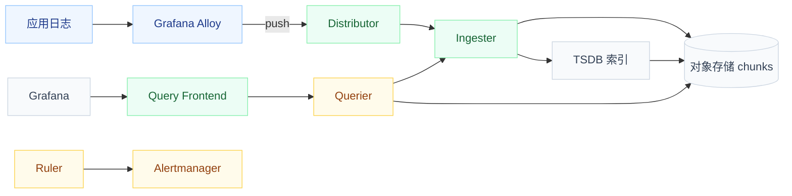

# Loki日志聚合

> 这篇从 Loki 的“只索引标签”架构讲起，经过单机安装、标签设计与 Alloy 采集、LogQL 查询、Grafana 日志关联、告警规则、对象存储与保留策略，最后落到日志排障现场手册与一个订单服务的日志平台落地。
>
> 学完能独立部署 Loki，设计不会爆基数的标签，写出可定位问题的 LogQL，并把日志告警接到现有通知链路。

## 一、Loki 的定位与架构

Loki 是面向日志的聚合系统，核心取舍是“只索引标签，不索引正文”。日志内容被压缩成块（chunk）放进对象存储，索引里只保留流标签和块的位置。这个设计让存储成本接近原始压缩日志，代价是查询必须先用标签缩小范围，再做文本过滤。

把它和 Elasticsearch 放在一起比较，差异一目了然：

| 维度 | Loki | Elasticsearch |
|---|---|---|
| 索引对象 | 标签 | 分词后的全文 |
| 存储成本 | 低，接近压缩日志 | 高，索引常与原文同量级 |
| 查询方式 | 标签 + 管道过滤 | 全文检索、聚合 |
| 适用场景 | 按服务、环境查日志 | 复杂全文检索、审计 |
| 运维复杂度 | 组件少、依赖对象存储 | 分片、副本、JVM 调优 |

Loki 不擅长“在十亿行里搜一个不存在的关键词”，也不擅长把日志当数据库做多维聚合。它擅长“查订单服务过去 15 分钟的错误日志”，这正是值班最常做的事。

### 1.1 写入与读取路径



写入时，Distributor 按流（stream）的哈希把日志分给 Ingester，Ingester 在内存里攒块，定期刷到对象存储。读取时，Querier 先查索引定位块，再从对象存储拉取并解压。

流由标签集唯一确定。`{job="order", env="prod", level="error"}` 是一条流，`level="info"` 是另一条。标签值变化就产生新流，流太多会压垮 Ingester 和索引。

### 1.2 部署形态

| 形态 | 组件 | 适用规模 |
|---|---|---|
| 单机（all） | 一个进程包含全部组件 | 开发、小规模 |
| 简单可扩展（SSD） | 读写分离，3 副本 | 中等规模 |
| 微服务 | 每个组件独立伸缩 | 大规模、多租户 |

单机模式用本地文件系统，重启会丢未刷盘的数据，不能用于生产。生产至少用 SSD 模式，块存储放 S3 或 MinIO，副本数设为 3。

### 1.3 什么时候不该用 Loki

- 需要按关键词做相关性排序、拼写纠错、复杂全文检索：用 Elasticsearch 或 OpenSearch。
- 需要把日志当审计凭证保存多年且逐条不可篡改：对象存储加 WORM 策略，不要依赖 Loki 的保留期。
- 日志量极小、只需要 `journalctl`：直接上主机查，引入 Loki 只增加运维面。
- 需要跨日志做大规模 JOIN：先落到数据仓库，Loki 不适合当分析引擎。

## 二、安装与最小验证

> 版本基线（2026-11）：Loki 3.x，Grafana Alloy 1.x，logcli 3.x，Grafana 12.x。Promtail 已停止维护，新部署统一用 Alloy；旧环境的 Promtail 配置可以逐步迁移，不要在新集群继续铺。

单机部署用于验证链路，生产配置在第七节展开。下面用 Ubuntu 24.04，RHEL 系替换包管理命令即可。

### 2.1 单机 Loki

```bash
# 下载二进制；版本号按实际发布替换
curl -LO https://github.com/grafana/loki/releases/download/v3.5.0/loki-linux-amd64.zip
unzip loki-linux-amd64.zip
sudo install -m 0755 loki-linux-amd64 /usr/local/bin/loki

sudo useradd --system --no-create-home --shell /usr/sbin/nologin loki
sudo mkdir -p /var/lib/loki/{chunks,rules,compactor}
sudo chown -R loki:loki /var/lib/loki
```

`/etc/loki/loki-config.yaml`：

```yaml
auth_enabled: false              # 单租户关闭鉴权，多租户生产必须打开

server:
  http_listen_port: 3100
  grpc_listen_port: 9096
  log_level: info

common:
  instance_addr: 127.0.0.1
  path_prefix: /var/lib/loki
  storage:
    filesystem:
      chunks_directory: /var/lib/loki/chunks
      rules_directory: /var/lib/loki/rules
  replication_factor: 1          # 单机只能 1，生产至少 3
  ring:
    kvstore:
      store: inmemory            # 单机用内存环，多副本要换 consul 或 memberlist

schema_config:
  configs:
    - from: 2024-04-01
      store: tsdb                # Loki 3.x 默认 TSDB 索引，替代 boltdb-shipper
      object_store: filesystem
      schema: v13
      index:
        prefix: index_
        period: 24h

limits_config:
  retention_period: 336h         # 14 天，按合规和磁盘容量调整
  max_query_series: 5000         # 单次查询允许的最大流数，防止打爆 querier
  allow_structured_metadata: true
  volume_enabled: true

compactor:
  working_directory: /var/lib/loki/compactor
  retention_enabled: true        # 不开这个，retention_period 只是标记不删除
  delete_request_store: filesystem

ruler:
  storage:
    type: local
    local:
      directory: /var/lib/loki/rules
  rule_path: /var/lib/loki/rules-temp
  alertmanager_url: http://127.0.0.1:9093
  enable_api: true
```

`retention_enabled` 和 `delete_request_store` 必须同时配置，否则日志会一直占着对象存储。`schema: v13` 与 `store: tsdb` 是 Loki 3.x 的默认组合，新建集群不要再用 v11。

`/etc/systemd/system/loki.service`：

```ini
[Unit]
Description=Loki
After=network-online.target

[Service]
User=loki
Group=loki
ExecStart=/usr/local/bin/loki -config.file=/etc/loki/loki-config.yaml -config.expand-env=true
Restart=on-failure
RestartSec=5
LimitNOFILE=65536

[Install]
WantedBy=multi-user.target
```

```bash
sudo systemctl daemon-reload
sudo systemctl enable --now loki
curl -s http://127.0.0.1:3100/ready
```

预期输出：

```text
ready
```

### 2.2 推送一条日志

不装采集器也能验证写入链路：

```bash
# 纳秒时间戳是 Loki 的默认时间精度
TS=$(date +%s%N)
curl -s -o /dev/null -w '%{http_code}\n' \
  -X POST http://127.0.0.1:3100/loki/api/v1/push \
  -H 'Content-Type: application/json' \
  -d "{\"streams\":[{\"stream\":{\"job\":\"demo\",\"env\":\"dev\"},\"values\":[[\"${TS}\",\"hello loki\"]]}]}"
```

预期输出：

```text
204
```

`204 No Content` 表示写入成功。返回 `400` 多半是时间戳不是纳秒或 JSON 结构错，返回 `429` 是超出速率限制。

### 2.3 查询验证

```bash
# 用 logcli 查最近 10 分钟，比手工拼 URL 稳定
logcli query '{job="demo"}' --limit=5 --since=10m
```

预期输出：

```text
2026-11-13T10:00:00+08:00 {job="demo", env="dev"} hello loki
```

没有 `logcli` 时用 HTTP 接口：

```bash
curl -sG http://127.0.0.1:3100/loki/api/v1/query_range \
  --data-urlencode 'query={job="demo"}' \
  --data-urlencode "start=$(( $(date +%s) - 600 ))000000000" \
  --data-urlencode "end=$(date +%s)000000000" \
  --data-urlencode 'limit=5' | jq '.data.result[].values'
```

### 2.4 Docker Compose 最小栈

本地验证可以用容器，数据卷必须挂出来，否则重启即丢：

```yaml
services:
  loki:
    image: grafana/loki:3.5.0
    command: -config.file=/etc/loki/local-config.yaml
    ports:
      - "3100:3100"
    volumes:
      - ./loki-config.yaml:/etc/loki/local-config.yaml:ro
      - loki-data:/loki
    restart: unless-stopped

  alloy:
    image: grafana/alloy:1.8.0
    command:
      - run
      - /etc/alloy/config.alloy
      - --server.http.listen-addr=0.0.0.0:12345
    ports:
      - "12345:12345"
    volumes:
      - ./config.alloy:/etc/alloy/config.alloy:ro
      - /var/log:/var/log:ro
    depends_on:
      - loki
    restart: unless-stopped

volumes:
  loki-data:
```

容器里的 `localhost` 指向容器自己，Alloy 推日志要用服务名 `http://loki:3100`。这个坑在单机二进制部署时不出现，迁移到容器后最容易踩。

## 三、标签设计与采集

Loki 的性能上限首先由标签基数决定：十万条同标签的日志只产生一条流，十万个不同 `request_id` 会产生十万条流，后者会先压垮索引。日志总量与保留期则决定存储成本和查询范围，同样不能忽略。

### 3.1 标签的取舍

适合做标签的字段必须满足“取值有限、查询常用、变化不频繁”：

| 字段 | 是否做标签 | 原因 |
|---|---|---|
| `job` / `service` | 是 | 取值有限，几乎每次查询都用 |
| `env` | 是 | 生产、预发、开发三四个值 |
| `level` | 是 | 五六个值，告警要按级别过滤 |
| `namespace` / `pod` | 视规模 | K8s 里常用，但 Pod 名会频繁变化 |
| `trace_id` | 否 | 结构化元数据，不是标签 |
| `user_id` / `order_id` | 否 | 高基数，必然爆流 |

Loki 3.x 的结构化元数据（Structured Metadata）专门承接 `trace_id`、`request_id` 这类高基数字段：它们随日志行存储，可以被查询过滤，但不进入索引，不产生新流。

### 3.2 Alloy 采集配置

Grafana Alloy 用组件化配置替代 Promtail 的 `scrape_configs`。下面采集一个目录下的 JSON 日志：

```hcl
// /etc/alloy/config.alloy
logging {
  level = "info"
}

// 文件发现：每个 target 附带 job 和 env，成为 Loki 的流标签
loki.source.file "order" {
  targets = [
    {
      __path__ = "/var/log/order/*.log",
      job      = "order",
      env      = "prod",
    },
  ]
  forward_to = [loki.process.order.receiver]
}

loki.process "order" {
  // 先解析 JSON，把字段放进 extracted map，后续 stage 才能引用
  stage.json {
    expressions = {
      level    = "level",
      msg      = "message",
      trace_id = "trace_id",
      duration = "duration_ms",
    }
  }

  // level 基数低、告警要用，提升为标签
  stage.labels {
    values = {
      level = "",
    }
  }

  // trace_id 基数高，放结构化元数据，查询时仍可过滤
  stage.structured_metadata {
    values = {
      trace_id = "",
    }
  }

  // 只保留必要字段，减少存储；原始行仍可通过 __line__ 查看
  stage.output {
    source = "msg",
  }

  forward_to = [loki.write.default.receiver]
}

loki.write "default" {
  endpoint {
    url = "http://127.0.0.1:3100/loki/api/v1/push"
    // 后端抖动时先重试，避免直接丢日志
    retry_on_http_429 = true
  }
}
```

`stage.labels` 的 `values` 里写空字符串，表示用 extracted map 里的同名字段。`stage.output` 只改写入的日志行，不改标签；如果下游还需要原始 JSON，去掉这个 stage。

> 边界：不要把整个 JSON 的所有字段都提升为标签。每增加一个标签，流数量按取值数相乘；`level` 五个值、`method` 五个值、`status` 十个值，组合起来就是 250 条流，再乘实例数就失控了。

### 3.3 主机日志与 systemd 日志

```hcl
// 采集 systemd journal，适合没有落盘文件的服务
loki.source.journal "system" {
  matches    = "_SYSTEMD_UNIT=nginx.service"
  labels     = {job = "nginx", env = "prod"}
  forward_to = [loki.write.default.receiver]
}

// 采集 /var/log/syslog，用正则提取级别
loki.source.file "syslog" {
  targets    = [{__path__ = "/var/log/syslog", job = "syslog", env = "prod"}]
  forward_to = [loki.process.syslog.receiver]
}

loki.process "syslog" {
  stage.regex {
    expression = `^(?P<ts>\w+\s+\d+\s+\d+:\d+:\d+)\s+\S+\s+(?P<service>[^:]+):\s+(?P<msg>.*)$`
  }
  stage.labels {
    values = {service = ""}
  }
  forward_to = [loki.write.default.receiver]
}
```

正则里的命名捕获组会成为 extracted map 的键，`stage.labels` 再把需要的键提升为标签。正则尽量从行首锚定，避免在大日志行上回溯。

### 3.4 标签验证

```bash
# 查看当前所有标签名，确认没有意外的高基数字段
curl -s http://127.0.0.1:3100/loki/api/v1/labels | jq '.data'

# 查看某个标签的所有值
curl -s 'http://127.0.0.1:3100/loki/api/v1/label/level/values' | jq '.data'

# 查看匹配流的数量，数字异常大就说明标签设计有问题
curl -sG http://127.0.0.1:3100/loki/api/v1/series \
  --data-urlencode 'match[]={job="order"}' | jq '.data | length'
```

预期输出（示例）：

```json
["env", "job", "level", "service"]
3
```

`series` 返回的数量是当前时间范围内匹配的流数。单个 job 超过几百条流就要检查是否有高基数标签，超过几千条基本可以确定设计有问题。

## 四、LogQL 查询

LogQL 分两部分：日志查询返回日志行，指标查询返回数值。所有查询都从流选择器开始，先缩小流范围，再做过滤和解析。

### 4.1 流选择器与行过滤

```logql
# 选择一个流
{job="order"}

# 多标签精确匹配
{job="order", env="prod", level="error"}

# 正则匹配，注意是全匹配
{job=~"order|payment"}

# 包含字符串，|= 是大小写敏感的包含
{job="order"} |= "timeout"

# 排除包含
{job="order"} != "healthcheck"

# 正则过滤
{job="order"} |~ "timeout|deadline exceeded"

# 大小写不敏感的包含（Loki 3.x）
{job="order"} |~ "(?i)timeout"
```

行过滤在解压后的日志行上执行，越早过滤越好。先写 `|=` 再写 `| json`，比先解析再过滤快一个数量级，因为解析只发生在命中的行上。

### 4.2 解析器

```logql
# JSON 日志：解析后字段可作为标签过滤
{job="order"} | json | level="error"

# 只解析需要的字段，减少 CPU
{job="order"} | json level="level", msg="message" | level="error"

# logfmt：key=value 形式
{job="order"} | logfmt | status >= 500

# 正则命名捕获
{job="nginx"} | regexp `(?P<ip>\S+) - - \[(?P<ts>[^\]]+)\] "(?P<method>\S+) (?P<path>\S+)" (?P<status>\d+)`

# pattern：比正则快，用占位符跳过不关心的部分
{job="nginx"} | pattern `<_> - - <_> "<method> <path> <_>" <status> <_>`
```

`| json` 不带参数时解析所有字段，日志行很大时会明显变慢。生产查询应显式列出字段。`| pattern` 不支持嵌套结构，遇到 JSON 仍要用 `| json`。

### 4.3 格式化与标签改写

```logql
# 只输出时间和消息，减少传输量
{job="order"} | json | line_format "{{.level}} {{.msg}}"

# 把解析出的字段变成标签，用于后续聚合
{job="order"} | json | label_format service="order", env="prod"

# 解析失败的行会带 __error__，显式丢弃避免污染结果
{job="order"} | json | __error__=""
```

`line_format` 只改返回的日志行，不改存储。`label_format` 生成的是查询期标签，不会写回索引，可以放心用于临时聚合。

### 4.4 指标查询

```logql
# 每秒日志行数，按级别分组
sum by (level) (rate({job="order"}[1m]))

# 5 分钟错误日志条数，用于告警
sum(count_over_time({job="order"} | json | level="error" [5m]))

# 按服务统计错误占比
sum by (job) (count_over_time({env="prod"} | json | level="error" [5m]))
/
sum by (job) (count_over_time({env="prod"}[5m]))

# 日志字节速率，用于容量规划
sum by (job) (bytes_rate({job="order"}[5m]))

# 从日志里提取耗时并算 P99
quantile_over_time(
  0.99,
  {job="order"} | json | unwrap duration [5m]
) by (job)
```

`unwrap` 要求字段是数值，解析失败会产生 `__error__`，聚合前加 `| __error__=""`。`count_over_time` 的窗口不能太小，1 分钟窗口在低流量服务上经常返回 0。

### 4.5 查询性能

| 写法 | 相对开销 | 原因 |
|---|---|---|
| `{job="x"} \|= "err"` | 低 | 只解压和字符串匹配 |
| `{job="x"} \| json` | 中 | 每行解析 JSON |
| `{job="x"} \| regexp` | 高 | 正则回溯 |
| `{job="x"} \| pattern` | 中低 | 固定模式匹配 |
| 跨多个 job 的 `=~".*"` | 很高 | 扫描全部流 |

查询时间范围越大、流越多，开销越高。值班查询控制在 1 小时内，看趋势用指标查询，不要用日志查询拉 7 天。

> 边界：LogQL 的指标查询是近似计算，步长和窗口由查询参数决定。做容量规划时用 `bytes_rate` 的长期平均值，不要用单次峰值外推。

## 五、Grafana 集成与日志关联

Grafana 是 Loki 的主要查询入口。数据源配置正确后，日志面板、Explore、告警和链路跳转都依赖同一个 UID。

### 5.1 数据源配置

`/etc/grafana/provisioning/datasources/loki.yaml`：

```yaml
apiVersion: 1

datasources:
  - name: Loki
    type: loki
    uid: loki-main
    access: proxy
    url: http://127.0.0.1:3100
    jsonData:
      maxLines: 1000
      # 日志里的 trace_id 变成跳转 Tempo 的链接
      derivedFields:
        - name: trace_id
          matcherRegex: '"trace_id":"([0-9a-f]{32})"'
          url: '$${__value.raw}'
          datasourceUid: tempo-main
      # 只对这些标签做自动补全，避免高基数标签拖慢下拉
      labelFilters:
        - key: job
          operator: '='
          value: '.*'
```

`derivedFields` 的正则必须与实际日志格式一致。日志是 `"trace_id":"..."` 就按这个写，是 `trace_id=...` 就换成正则，匹配不到时链接不会出现。

### 5.2 日志面板

日志面板的关键配置是查询、时间范围和显示格式：

```json
{
  "type": "logs",
  "title": "订单错误日志",
  "datasource": {"type": "loki", "uid": "loki-main"},
  "options": {
    "showTime": true,
    "showLabels": true,
    "wrapLogMessage": true,
    "sortOrder": "Descending",
    "dedupStrategy": "none"
  },
  "targets": [
    {
      "refId": "A",
      "expr": "{job=\"order\", env=\"$env\"} | json | level=\"error\"",
      "queryType": "range"
    }
  ]
}
```

`dedupStrategy` 设为 `none` 保留重复行，排查重试风暴时需要看重复次数；设为 `signature` 会合并相同行，适合快速浏览。

### 5.3 从日志跳到链路

日志里带 `trace_id` 时，点击链接直接打开 Tempo 的 trace 详情。这要求三件事同时成立：

1. 应用日志输出 32 位十六进制的 `trace_id`；
2. Loki 的 `derivedFields` 正则能捕获它；
3. Tempo 数据源的 UID 与 `datasourceUid` 一致。

```bash
# 验证日志里确实有 trace_id，且格式是 32 位
logcli query '{job="order"} |= "trace_id"' --limit=1 --since=10m
```

预期输出（示例）：

```text
2026-11-13T10:02:11+08:00 {job="order", env="prod", level="error"} {"level":"error","trace_id":"4bf92f3577b34da6a3ce929d0e0e4736","message":"payment timeout"}
```

从 Tempo 反查日志时，`tracesToLogsV2` 里的 `filterByTraceID: true` 会把 trace_id 拼进 LogQL。两边的字段名必须一致，否则跳转后查询为空。

### 5.4 多数据源混排

日志面板可以和时间序列放在同一张看板，但不要放在同一个面板里。Grafana 的 Mixed 数据源允许一个面板查多个数据源，时间对齐和单位却很难统一。正确做法是上下两个面板，共享时间范围，用同一个变量控制服务。

## 六、告警规则

Loki 的告警由 Ruler 组件执行，规则本质是 LogQL 指标查询。告警规则放在 Loki 侧，Grafana 只负责展示和通知，链路比 Grafana 托管告警短。

### 6.1 规则文件

`/var/lib/loki/rules/fake/order-logs.yaml`：

```yaml
groups:
  - name: order-logs
    interval: 1m
    rules:
      - alert: OrderErrorLogBurst
        # 5 分钟内错误日志超过 20 条；低流量服务要按基线调整
        expr: |
          sum by (job) (
            count_over_time({job="order", env="prod"} | json | level="error" [5m])
          ) > 20
        for: 2m
        labels:
          severity: warning
          team: order
        annotations:
          summary: "订单服务错误日志突增"
          description: "5 分钟内错误日志 {{ $value }} 条，检查下游依赖。"

      - alert: OrderTimeoutKeyword
        # 关键词告警适合捕获未结构化的异常，成本比全量解析低
        expr: |
          sum by (job) (
            count_over_time({job="order", env="prod"} |= "timeout" [5m])
          ) > 5
        for: 1m
        labels:
          severity: critical
          team: order
        annotations:
          summary: "订单服务出现超时关键词"
```

`fake` 目录是单租户模式的默认租户名。开启 `auth_enabled` 后，目录名要换成实际租户 ID，否则规则不会被加载。

### 6.2 Ruler 配置与重载

```yaml
ruler:
  storage:
    type: local
    local:
      directory: /var/lib/loki/rules
  rule_path: /var/lib/loki/rules-temp
  alertmanager_url: http://127.0.0.1:9093
  enable_api: true
  ring:
    kvstore:
      store: inmemory
```

改完规则文件不需要重启 Loki，Ruler 会按求值间隔重新加载并扫描规则文件。验证：

```bash
# 查看规则是否加载，health 应为 ok
curl -s http://127.0.0.1:3100/prometheus/api/v1/rules \
  | jq '.data.groups[] | {name, rules: [.rules[] | {name, health, lastError}]}'

# 查看当前告警
curl -s http://127.0.0.1:3100/prometheus/api/v1/alerts \
  | jq '.data.alerts[] | {labels, state, value}'
```

预期输出：

```json
{"name":"order-logs","rules":[{"name":"OrderErrorLogBurst","health":"ok","lastError":""}]}
```

`health` 为 `err` 时看 `lastError`，常见原因是 LogQL 语法错、标签不存在、时间窗口内没有数据。规则没有数据时不会报错，只会保持 inactive，需要用 `absent_over_time` 单独监控“日志断流”。

### 6.3 日志断流告警

日志系统最危险的故障是“没有日志”，而不是“日志里有错误”。应用不再打日志、Alloy 掉线、网络不通，都会让错误告警静默。

```yaml
      - alert: OrderLogsMissing
        # 10 分钟一条日志都没有，说明采集链路断了，而不是服务正常
        expr: |
          absent_over_time({job="order", env="prod"} [10m])
        for: 5m
        labels:
          severity: critical
          team: ops
        annotations:
          summary: "订单服务日志断流"
          description: "10 分钟内没有收到任何日志，检查 Alloy 与 Loki 写入链路。"
```

这条规则会产生“无数据”而不是“有数值”，部分版本的 Ruler 对空结果不触发。更稳妥的写法是用 `absent_over_time` 包一层，或在采集侧加心跳日志。

## 七、存储、保留与运维

Loki 的成本大头是对象存储和 Ingester 内存。索引只占很小一部分，块压缩比通常在 5 到 10 倍，具体取决于日志重复度。

### 7.1 对象存储配置

```yaml
common:
  storage:
    s3:
      endpoint: minio.monitoring.svc:9000
      bucketnames: loki-chunks
      access_key_id: ${S3_ACCESS_KEY}
      secret_access_key: ${S3_SECRET_KEY}
      s3forcepathstyle: true      # MinIO 必须打开，AWS S3 关闭
      insecure: false

schema_config:
  configs:
    - from: 2024-04-01
      store: tsdb
      object_store: s3
      schema: v13
      index:
        prefix: loki_index_
        period: 24h
```

索引和块都进对象存储，本地只保留缓存和 WAL。`s3forcepathstyle` 在 MinIO 上必须为 `true`，否则请求会走虚拟主机风格域名，解析失败。

### 7.2 保留与删除

```yaml
limits_config:
  retention_period: 336h
  # 按流覆盖保留期：debug 日志只留 24 小时
  retention_stream:
    - selector: '{level="debug"}'
      priority: 1
      period: 24h
    - selector: '{env="dev"}'
      priority: 2
      period: 72h

compactor:
  working_directory: /var/lib/loki/compactor
  retention_enabled: true
  delete_request_store: s3
  compaction_interval: 10m
```

`retention_stream` 的优先级数字越大越优先，匹配多条规则时取优先级最高的。`compactor` 按 `compaction_interval` 扫描，删除不是实时的，通常有几小时延迟。

```bash
# 查看 compactor 是否在跑，以及最近一次保留扫描
curl -s http://127.0.0.1:3100/metrics | grep 'loki_compactor'
```

### 7.3 容量与副本

| 参数 | 作用 | 调整方向 |
|---|---|---|
| `replication_factor` | 写入副本数 | 生产 3，单机 1 |
| `chunk_target_size` | 块目标大小 | 默认 1.5MB，太小碎片多 |
| `max_chunk_age` | 块最长存活 | 默认 2h，太短增加对象数 |
| `ingester.mem` | Ingester 内存 | 按日增量估算 |
| `max_query_series` | 查询流上限 | 防止单查询拖垮集群 |

Ingester 内存估算的粗口径是“峰值写入速率 × 块停留时间”。日增 100GB、块停留 2 小时，峰值内存约几 GB，再留一倍余量。副本数增加会成倍放大内存。

### 7.4 多租户

```yaml
auth_enabled: true
```

打开后，所有请求必须带 `X-Scope-OrgID` 头，Grafana 数据源在 `jsonData.httpHeaderName1` 和 `secureJsonData.httpHeaderValue1` 里配置。租户之间索引和块隔离，Ruler 目录按租户分。

多租户不是免费的：每个租户都有独立的流和索引，小租户多的时候元数据开销明显。团队规模小于五个时，用单租户加标签隔离更省事。

## 八、排障现场手册

日志平台的排障顺序是“应用有没有写 → Alloy 有没有采 → Loki 有没有收 → 查询条件对不对”。任何一步跳过，都会在错误的地方改配置。

| 现象 | 最可能原因 | 第一条命令 |
|---|---|---|
| 查不到日志 | 标签不匹配、时间范围错 | `logcli labels` 看实际标签 |
| 只有部分实例有日志 | Alloy 未部署、路径错 | `systemctl status alloy` |
| 写入 429 | 超出速率限制、流太多 | 查 `loki_distributor_*` 指标 |
| 查询超时 | 时间范围大、正则太宽 | 缩小到 15 分钟再加过滤 |
| 日志乱序 | 应用时间戳回退 | 开 `unordered_writes` |
| 磁盘不降 | compactor 未开保留 | 查 `retention_enabled` |
| Grafana 报 502 | Loki 不可达、代理超时 | `curl /ready` |

### 8.1 查不到日志

```bash
# 先确认标签真实存在，不要凭记忆写
logcli labels
logcli labels job

# 用最宽的查询确认这个时间范围内有没有数据
logcli query '{job="order"}' --since=1h --limit=1

# 确认 Alloy 是否在推送
journalctl -u alloy -n 50 --no-pager
```

标签值区分大小写，`env="Prod"` 匹配不到 `env="prod"`。时间范围要注意时区，`--since=1h` 是相对当前时间，手工拼 `start`/`end` 时单位是纳秒。

### 8.2 流数量过多

```bash
# 查看当前流数量，按 job 分组
curl -s 'http://127.0.0.1:3100/loki/api/v1/index/stats?query=%7Bjob%3D%22order%22%7D' | jq

# 查看 distributor 收到的流数量
curl -s http://127.0.0.1:3100/metrics | grep 'loki_distributor_streams_received_total'
```

`streams` 数量持续上涨而日志量不变，说明有新标签值在不断产生。常见来源是 Pod 名、容器 ID、带时间戳的路径。处理方式是把这些字段降为结构化元数据，或直接从标签里删掉。

### 8.3 写入被限流

```bash
# 查看 429 计数和限流原因
curl -s http://127.0.0.1:3100/metrics | grep -E 'loki_distributor_.*(429|discarded)'

# 查看当前租户的限流配置
curl -s http://127.0.0.1:3100/config | jq '.limits_config'
```

`429` 可能是 `ingestion_rate_mb`、`ingestion_burst_size_mb` 或 `max_streams_per_user` 触发。先确认是哪一项，再调参；直接把所有限制翻倍会让 Ingester 先 OOM。

### 8.4 查询超时与内存高

```bash
# 查看正在运行的查询
curl -s http://127.0.0.1:3100/loki/api/v1/status/active_queries 2>/dev/null | jq

# 查看查询队列和耗时
curl -s http://127.0.0.1:3100/metrics | grep 'loki_query_frontend'
```

查询超时的处理顺序：缩小时间范围、增加标签过滤、把 `| regexp` 换成 `| pattern`、限制 `max_query_series`。不要一上来加 Querier 副本，慢查询会先把对象存储的带宽打满。

### 8.5 日志乱序

```yaml
limits_config:
  unordered_writes: true
```

`unordered_writes` 允许 Ingester 接受时间戳回退的日志，代价是查询时需要归并排序。应用侧更应该修时间戳，容器迁移和时钟漂移是乱序的常见来源。

### 8.6 保留策略不生效

```bash
# 确认 compactor 启用且没有报错
curl -s http://127.0.0.1:3100/config | jq '.compactor'
journalctl -u loki -n 100 --no-pager | grep -i compactor
```

`retention_period` 只是限制，真正删除靠 compactor。`delete_request_store` 没配、对象存储权限不足、`retention_enabled` 为 false，都会让日志永久保留。

## 九、最佳实践案例

### 9.1 案例背景

订单服务部署在 3 台 Ubuntu 24.04 上，日志是 JSON 行，字段包括 `level`、`message`、`trace_id`、`duration_ms`。原先用 `journalctl` 加 `grep` 排查，一次跨实例问题要在三台机器上分别登录，平均定位 30 分钟。

约束是日志日增约 40GB，保留 14 天，对象存储用已有的 MinIO；Loki 与 Grafana 部署在同一台 8 核 32GB 监控机上；应用不能改日志格式，只能改采集配置；告警统一走 Alertmanager。

目标是：3 个实例的日志进 Loki，按 `job`、`env`、`level` 查询，`trace_id` 能跳 Tempo，错误日志突增和日志断流都能告警。

### 9.2 案例实操

第一步，部署 Loki，使用 MinIO 作为块存储，开启保留和 Ruler。

```yaml
# /etc/loki/loki-config.yaml
auth_enabled: false

server:
  http_listen_port: 3100
  grpc_listen_port: 9096

common:
  instance_addr: 127.0.0.1
  path_prefix: /var/lib/loki
  storage:
    s3:
      endpoint: minio.monitoring.svc:9000
      bucketnames: loki-chunks
      access_key_id: ${S3_ACCESS_KEY}
      secret_access_key: ${S3_SECRET_KEY}
      s3forcepathstyle: true
      insecure: false
  replication_factor: 1
  ring:
    kvstore:
      store: inmemory

schema_config:
  configs:
    - from: 2024-04-01
      store: tsdb
      object_store: s3
      schema: v13
      index:
        prefix: loki_index_
        period: 24h

limits_config:
  retention_period: 336h
  max_query_series: 5000
  allow_structured_metadata: true
  volume_enabled: true
  retention_stream:
    - selector: '{level="debug"}'
      priority: 1
      period: 24h

compactor:
  working_directory: /var/lib/loki/compactor
  retention_enabled: true
  delete_request_store: s3
  compaction_interval: 10m

ruler:
  storage:
    type: local
    local:
      directory: /var/lib/loki/rules
  rule_path: /var/lib/loki/rules-temp
  alertmanager_url: http://127.0.0.1:9093
  enable_api: true
```

MinIO 的 bucket 要提前创建，`loki` 用户至少要有 `s3:GetObject`、`s3:PutObject`、`s3:DeleteObject`、`s3:ListBucket` 权限。权限不足时 Loki 启动能过，写入时才报错。

第二步，三台应用机部署 Alloy，采集订单日志。

```hcl
# /etc/alloy/config.alloy
logging {
  level = "info"
}

loki.source.file "order" {
  targets = [
    {
      __path__ = "/var/log/order/app.log",
      job      = "order",
      env      = "prod",
    },
  ]
  forward_to = [loki.process.order.receiver]
}

loki.process "order" {
  stage.json {
    expressions = {
      level    = "level",
      msg      = "message",
      trace_id = "trace_id",
      duration = "duration_ms",
    }
  }

  stage.labels {
    values = {
      level = "",
    }
  }

  stage.structured_metadata {
    values = {
      trace_id = "",
    }
  }

  # 丢弃健康检查日志，减少无效写入
  stage.drop {
    source     = "msg"
    expression = ".*healthcheck.*"
    drop_counter_reason = "healthcheck"
  }

  forward_to = [loki.write.default.receiver]
}

loki.write "default" {
  endpoint {
    url = "http://10.0.1.10:3100/loki/api/v1/push"
    retry_on_http_429 = true
  }
}
```

`stage.drop` 在解析之后执行，丢弃的日志不会进入 Loki，`drop_counter_reason` 会出现在 Alloy 的指标里，便于确认丢弃量是否符合预期。

第三步，配置 Grafana 数据源与 trace 跳转。

```yaml
# /etc/grafana/provisioning/datasources/loki.yaml
apiVersion: 1
datasources:
  - name: Loki
    type: loki
    uid: loki-main
    access: proxy
    url: http://127.0.0.1:3100
    jsonData:
      maxLines: 1000
      derivedFields:
        - name: trace_id
          matcherRegex: '"trace_id":"([0-9a-f]{32})"'
          url: '$${__value.raw}'
          datasourceUid: tempo-main
```

第四步，写告警规则。

```yaml
# /var/lib/loki/rules/fake/order-logs.yaml
groups:
  - name: order-logs
    interval: 1m
    rules:
      - alert: OrderErrorLogBurst
        expr: |
          sum by (job) (
            count_over_time({job="order", env="prod"} | json | level="error" [5m])
          ) > 20
        for: 2m
        labels:
          severity: warning
          team: order
        annotations:
          summary: "订单服务错误日志突增"
          description: "5 分钟内错误日志 {{ $value }} 条。"

      - alert: OrderLogsMissing
        expr: |
          absent_over_time({job="order", env="prod"} [10m])
        for: 5m
        labels:
          severity: critical
          team: ops
        annotations:
          summary: "订单服务日志断流"
```

第五步，验证写入、查询和告警。

```bash
# Loki 就绪
curl -s http://127.0.0.1:3100/ready

# 确认三个实例都在写，按 instance 看不到是因为 instance 不是标签，
# 用结构化元数据或额外标签区分；这里先确认流存在
logcli series '{job="order"}' --since=1h

# 查错误日志，确认 level 标签生效
logcli query '{job="order", level="error"}' --since=15m --limit=5

# 查 trace_id 是否作为结构化元数据存在
logcli query '{job="order"} | trace_id="4bf92f3577b34da6a3ce929d0e0e4736"' --since=1h

# 规则是否加载
curl -s http://127.0.0.1:3100/prometheus/api/v1/rules \
  | jq '.data.groups[].rules[] | {name, health}'
```

预期输出：

```text
ready
{job="order", env="prod", level="info"}
2026-11-13T10:12:03+08:00 {job="order", env="prod", level="error"} {"level":"error","trace_id":"4bf92f3577b34da6a3ce929d0e0e4736","message":"payment timeout"}
{"name":"OrderErrorLogBurst","health":"ok"}
{"name":"OrderLogsMissing","health":"ok"}
```

### 9.3 案例结果

上线后 3 台应用机的日志在 10 秒内可查，错误日志按 `level` 过滤的查询从分钟级降到 2 秒内。一次支付超时故障中，值班从错误日志里的 `trace_id` 直接跳到 Tempo，定位到下游支付网关，平均恢复时间从 30 分钟降到 9 分钟。

容量方面，日增 40GB 的原始日志压缩后约 6GB，14 天保留占用约 84GB，MinIO 余量充足。`debug` 日志按 24 小时保留，进一步压低了无效存储。

失败模式与处理：

- 初期把 `trace_id` 做成标签，单日流数从 12 条涨到 40 万条，Ingester 内存打满。改成结构化元数据后恢复。
- 应用日志里 `level` 有大写 `ERROR` 和小写 `error` 两种，查询只写小写导致漏查。在 Alloy 的 `stage.labels` 前加 `stage.template` 统一小写，或在查询里用 `level=~"(?i)error"`。
- `retention_enabled` 开了但没配 `delete_request_store`，Loki 启动报错，日志没有删除。补上后 compactor 正常运行。
- 告警规则用 `count_over_time(...) > 20`，低峰期永远不触发，高峰期误报。改成按基线比值，或把阈值按服务分级。

复盘：Loki 的成败在标签设计，不在查询语法。先保证流数量可控，再谈查询便利；先把 `trace_id` 放对位置，再谈链路关联；先验证保留真的删除，再谈容量规划。
