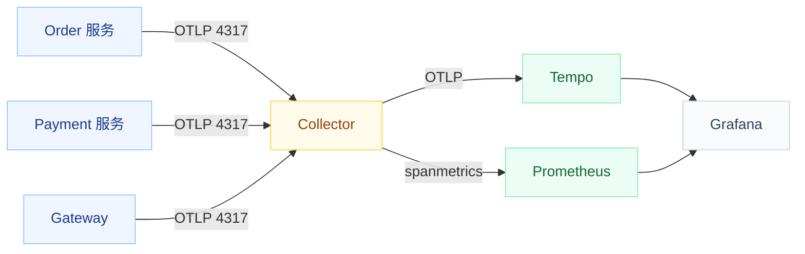

# OpenTelemetry链路追踪

> 这篇从链路追踪的 Trace/Span 模型讲起，经过 Collector 与 Tempo 的最小闭环、Java/Python/Go 埋点、Collector 处理器、头部与尾部采样、Tempo 存储与 TraceQL，最后落到上下文传播、排障现场手册与一个三服务订单系统的链路落地。
>
> 学完能独立接入 OpenTelemetry，把跨服务调用串成一条完整链路，按成本和故障类型选择采样策略，并在链路断开、Span 缺失、Collector 过载时查到第一条命令。

## 一、链路追踪的定位与核心模型

链路追踪（Distributed Tracing）记录一次请求在多个服务之间的完整路径。它回答“这次请求慢在哪一段、错在哪个服务”，不回答“这个指标长期趋势如何”，也不保存完整日志正文。

三类可观测信号的分工：

| 信号 | 记录单位 | 主要问题 | 成本 |
|---|---|---|---|
| 指标 | 数值序列 | 是否异常、趋势 | 低 |
| 日志 | 离散事件 | 发生了什么 | 中高 |
| 链路 | 一次请求的调用树 | 慢在哪、断在哪 | 随采样率变化 |

排障时的顺序通常是“指标发现异常 → 链路定位服务 → 日志看具体错误”。链路是中间桥梁，缺少它，从指标到日志只能靠时间点和猜测。

### 1.1 Trace 与 Span

一次请求对应一个 Trace，Trace 由多个 Span 组成树形结构。每个 Span 表示一个工作单元，记录开始时间、持续时间、属性、事件和状态。

```text
Trace ID: 4bf92f3577b34da6a3ce929d0e0e4736
├── Span: GET /api/orders            service=gateway   duration=420ms
│   ├── Span: OrderService.create    service=order     duration=380ms
│   │   ├── Span: INSERT orders      service=order     duration=35ms
│   │   └── Span: POST /pay          service=payment   duration=300ms
│   │       └── Span: SELECT account service=payment   duration=18ms
│   └── Span: publish order.created  service=gateway   duration=8ms
```

每个 Span 的关键字段：

| 字段 | 含义 | 示例 |
|---|---|---|
| `trace_id` | 整条链路的唯一标识 | 32 位十六进制 |
| `span_id` | 当前 Span 的唯一标识 | 16 位十六进制 |
| `parent_span_id` | 父 Span，根 Span 为空 | 16 位十六进制 |
| `name` | 操作名 | `POST /pay` |
| `kind` | 客户端/服务端/生产者/消费者 | `SPAN_KIND_CLIENT` |
| `start_time` / `end_time` | 起止时间 | 纳秒时间戳 |

### 1.2 上下文传播

跨服务串联依赖上下文传播（Context Propagation）。OpenTelemetry 默认使用 W3C Trace Context 标准，HTTP 头里带 `traceparent`：

```text
traceparent: 00-4bf92f3577b34da6a3ce929d0e0e4736-00f067aa0ba902b7-01
             │  │                                │                │
             │  │                                │                └─ 采样标志 01=采样
             │  └─ trace_id                       └─ parent span_id
             └─ 版本
```

下游服务从请求头里取出 `trace_id` 和 `span_id`，把自己新建的 Span 的 `parent_span_id` 指向它。任何一段没有传递这个头，链路就在那里断开，变成两条独立的 Trace。

### 1.3 SDK、Agent 与 Collector

三者的职责不同：

| 组件 | 位置 | 职责 |
|---|---|---|
| SDK | 应用进程内 | 创建 Span、打属性、决定是否采样 |
| Agent | 应用进程内或同机 | 自动埋点、注入上下文、批量上报 |
| Collector | 独立进程 | 接收、处理、采样、导出到后端 |

Agent 是“自动化的 SDK”，适合不想改代码的存量应用；SDK 适合需要精细控制的业务代码；Collector 是统一入口，负责解耦应用与后端，让后端迁移不影响应用。



### 1.4 什么时候不该全量追踪

全量追踪的成本随请求量线性增长。1000 QPS、每请求 8 个 Span，一天的 Span 数是 6.9 亿，按压缩后 300 字节估算也要 200GB 量级。

不适合全量追踪的场景：

- 高频健康检查、静态资源请求：直接过滤，不产生 Span。
- 内部批处理、定时任务：按任务维度采样，不需要每次执行都留。
- 合规要求“所有请求可追溯”：用日志或审计表，链路只保留采样后的样本。
- 后端存储没有扩容预算：先定采样率，再谈接入范围。

## 二、安装与最小验证

> 版本基线（2026-11）：OpenTelemetry Collector 0.12x（contrib 发行版），OpenTelemetry Java Agent 2.x，Tempo 2.x，Grafana 12.x。Collector 的 0.x 版本配置仍可能在小版本间调整字段，升级前先用 `otelcol validate` 校验。

最小闭环由三部分组成：一个能发 OTLP 的客户端、一个 Collector、一个能查 Trace 的后端。先用 `telemetrygen` 造数据，避免一开始就被应用埋点卡住。

### 2.1 安装 Collector

```bash
# contrib 版包含 tail_sampling、spanmetrics 等常用组件，core 版没有
curl -LO https://github.com/open-telemetry/opentelemetry-collector-releases/releases/download/v0.128.0/otelcol-contrib_0.128.0_linux_amd64.tar.gz
tar -xzf otelcol-contrib_0.128.0_linux_amd64.tar.gz
sudo install -m 0755 otelcol-contrib /usr/local/bin/otelcol-contrib

sudo useradd --system --no-create-home --shell /usr/sbin/nologin otelcol
sudo mkdir -p /etc/otelcol /var/lib/otelcol
sudo chown -R otelcol:otelcol /etc/otelcol /var/lib/otelcol
```

macOS 与 Windows 用对应的压缩包，或直接用容器：

```bash
docker run --rm -p 4317:4317 -p 4318:4318 \
  -v "$PWD/otel-config.yaml:/etc/otelcol/config.yaml:ro" \
  otel/opentelemetry-collector-contrib:0.128.0
```

### 2.2 最小 Collector 配置

`/etc/otelcol/config.yaml`：

```yaml
receivers:
  otlp:
    protocols:
      grpc:
        endpoint: 0.0.0.0:4317     # Java/Python SDK 默认走 gRPC
      http:
        endpoint: 0.0.0.0:4318     # 浏览器和部分语言走 HTTP

processors:
  memory_limiter:
    check_interval: 1s
    limit_mib: 512                 # 超过上限先拒收，避免 OOM 被系统杀掉
    spike_limit_mib: 128
  batch:
    timeout: 5s
    send_batch_size: 8192

exporters:
  debug:
    verbosity: basic               # 最小验证时把 Span 打到日志，确认链路通

extensions:
  health_check:
    endpoint: 0.0.0.0:13133

service:
  extensions: [health_check]
  pipelines:
    traces:
      receivers: [otlp]
      processors: [memory_limiter, batch]
      exporters: [debug]
  telemetry:
    logs:
      level: info
    metrics:
      readers:
        - pull:
            exporter:
              prometheus:
                host: 0.0.0.0
                port: 8888
```

`memory_limiter` 必须放在处理器链第一位，它要在其它处理器分配内存之前生效。`batch` 放在最后、导出之前，减少网络请求数。

```bash
otelcol-contrib validate --config=/etc/otelcol/config.yaml
```

预期输出：

```text
Config file /etc/otelcol/config.yaml is valid
```

### 2.3 造一条 Trace

```bash
# telemetrygen 是官方压测与验证工具，不依赖应用
go install github.com/open-telemetry/opentelemetry-collector-contrib/cmd/telemetrygen@latest

telemetrygen traces \
  --otlp-insecure \
  --otlp-endpoint 127.0.0.1:4317 \
  --traces 3 \
  --service order-demo
```

预期在 Collector 日志里看到：

```text
Traces  {"kind": "exporter", "data_type": "traces", "name": "debug", "resource spans": 3, "spans": 6}
```

`resource spans` 是资源数，`spans` 是 Span 总数。一条 Trace 包含多个 Span 时，两个数字不相等是正常的。

### 2.4 接入 Tempo

`/etc/tempo/tempo.yaml`（单机本地存储，仅验证）：

```yaml
server:
  http_listen_port: 3200

distributor:
  receivers:
    otlp:
      protocols:
        grpc:
          endpoint: 0.0.0.0:4327
        http:
          endpoint: 0.0.0.0:4328

ingester:
  max_block_duration: 5m           # 块越小查询越快，对象存储文件越多
  trace_idle_period: 10s

compactor:
  compaction:
    block_retention: 48h           # 单机验证保留两天，生产按需

storage:
  trace:
    backend: local
    local:
      path: /var/tempo/blocks
    wal:
      path: /var/tempo/wal

metrics_generator:
  registry:
    external_labels:
      source: tempo
  storage:
    path: /var/tempo/generator/wal

overrides:
  metrics_generator_processors: [service-graphs, span-metrics]
```

把 Collector 的 exporter 改成 OTLP 指向 Tempo：

```yaml
exporters:
  otlp/tempo:
    endpoint: 127.0.0.1:4327
    tls:
      insecure: true                # 内网明文，跨网必须开 TLS

service:
  pipelines:
    traces:
      receivers: [otlp]
      processors: [memory_limiter, batch]
      exporters: [otlp/tempo, debug]
```

```bash
sudo systemctl restart otelcol tempo
curl -s http://127.0.0.1:3200/ready
```

预期输出：

```text
ready
```

Tempo 的 OTLP 接收端在本章固定用 4327/4328，Collector 仍用 4317/4318，同机部署不会抢端口。生产环境可以换机部署，也可以保持这套错开的端口。

## 三、SDK 埋点

自动埋点覆盖框架层，业务层的关键步骤需要手工 Span。两者结合，才能既省事又能回答“慢在哪个业务动作”。

### 3.1 Java Agent 自动埋点

```bash
# 下载 agent，版本与 Collector 不必一致，但要与 Java 版本兼容
curl -LO https://github.com/open-telemetry/opentelemetry-java-instrumentation/releases/download/v2.20.0/opentelemetry-javaagent.jar
sudo mv opentelemetry-javaagent.jar /opt/otel/opentelemetry-javaagent.jar
```

启动参数：

```bash
java \
  -javaagent:/opt/otel/opentelemetry-javaagent.jar \
  -jar /opt/app/order.jar
```

环境变量：

```bash
export OTEL_SERVICE_NAME=order
export OTEL_EXPORTER_OTLP_ENDPOINT=http://127.0.0.1:4317
export OTEL_EXPORTER_OTLP_PROTOCOL=grpc
export OTEL_RESOURCE_ATTRIBUTES=deployment.environment=prod,service.version=1.4.2
export OTEL_TRACES_SAMPLER=parentbased_traceidratio
export OTEL_TRACES_SAMPLER_ARG=0.1        # 头部采样 10%，尾部采样在 Collector 再做
export OTEL_METRICS_EXPORTER=none         # 指标仍走 Prometheus，避免重复采集
export OTEL_LOGS_EXPORTER=none            # 日志仍走 Loki，避免双写
```

`OTEL_SERVICE_NAME` 必须设置，否则服务名会变成 `unknown_service:java`，后端无法按服务聚合。`OTEL_RESOURCE_ATTRIBUTES` 里的 `deployment.environment` 是区分生产与预发的关键标签。

Spring Boot 3.5 自带 Micrometer Tracing，如果同时使用 Java Agent，可能出现重复 Span。处理方式是在 `application.yml` 里关闭 Spring 的 tracing：

```yaml
management:
  tracing:
    enabled: false
```

或者不用 Agent，改用 Micrometer 的 OTLP 导出。两条路只能选一条，不要叠加。

### 3.2 Java 手工 Span

```java
import io.opentelemetry.api.trace.Span;
import io.opentelemetry.api.trace.SpanKind;
import io.opentelemetry.api.trace.StatusCode;
import io.opentelemetry.api.trace.Tracer;
import io.opentelemetry.context.Scope;

public class PaymentClient {
    private final Tracer tracer;

    public PaymentClient(Tracer tracer) {
        this.tracer = tracer;
    }

    public String charge(String orderId, long amount) {
        // SpanKind.CLIENT 表示这是对外部系统的调用，后端会据此画服务依赖
        Span span = tracer.spanBuilder("payment.charge")
                .setSpanKind(SpanKind.CLIENT)
                .setAttribute("order.id", orderId)
                .setAttribute("payment.amount", amount)
                .startSpan();

        // makeCurrent 把 Span 放进当前上下文，内部嵌套调用才能挂到它下面
        try (Scope scope = span.makeCurrent()) {
            String result = doCharge(orderId, amount);
            span.setAttribute("payment.status", "success");
            return result;
        } catch (RuntimeException e) {
            // 记录异常堆栈并把 Span 标成错误，否则后端只看到一条慢调用
            span.recordException(e);
            span.setStatus(StatusCode.ERROR, e.getMessage());
            throw e;
        } finally {
            span.end();               // 必须 end，否则 Span 永远不会导出
        }
    }

    private String doCharge(String orderId, long amount) {
        return "ok";
    }
}
```

`order.id` 这类业务属性适合放在 Span 上，但不要放手机号、身份证号等敏感信息。属性基数高的值可以放，Span 是一次性记录，不像指标标签会长期累积。

### 3.3 Python 与 Go

Python 自动埋点用 `opentelemetry-instrument` 启动：

```bash
pip install opentelemetry-distro opentelemetry-exporter-otlp
opentelemetry-bootstrap -a install

OTEL_SERVICE_NAME=order \
OTEL_EXPORTER_OTLP_ENDPOINT=http://127.0.0.1:4318 \
OTEL_EXPORTER_OTLP_PROTOCOL=http/protobuf \
opentelemetry-instrument python app.py
```

Python 手工 Span：

```python
from opentelemetry import trace

tracer = trace.get_tracer(__name__)

def reserve_stock(sku: str, count: int) -> bool:
    # 上下文管理器自动处理 start/end 和异常记录
    with tracer.start_as_current_span("inventory.reserve") as span:
        span.set_attribute("sku", sku)
        span.set_attribute("count", count)
        try:
            ok = do_reserve(sku, count)
            span.set_attribute("reserve.ok", ok)
            return ok
        except Exception as exc:
            span.record_exception(exc)
            span.set_status(trace.Status(trace.StatusCode.ERROR, str(exc)))
            raise
```

Go 手工 Span：

```go
ctx, span := tracer.Start(ctx, "inventory.reserve",
    trace.WithSpanKind(trace.SpanKindClient),
    trace.WithAttributes(
        attribute.String("sku", sku),
        attribute.Int("count", count),
    ),
)
defer span.End()

if err != nil {
    span.RecordError(err)
    span.SetStatus(codes.Error, err.Error())
}
```

### 3.4 语义约定

属性名遵循 OpenTelemetry 语义约定（Semantic Conventions），后端和看板才能跨语言聚合。常用字段：

| 属性 | 用途 | 示例 |
|---|---|---|
| `service.name` | 服务名 | `order` |
| `deployment.environment` | 环境 | `prod` |
| `http.request.method` | HTTP 方法 | `POST` |
| `http.response.status_code` | 状态码 | `500` |
| `db.system` | 数据库类型 | `mysql` |
| `messaging.system` | 消息系统 | `kafka` |

自定义属性用点号分层，例如 `payment.provider`、`order.channel`。不要用大写或下划线，不同 SDK 的转换规则不一致，会导致同一字段在 Tempo 里出现两个名字。

## 四、Collector 配置

Collector 的配置由五部分组成：接收器、处理器、导出器、连接器、扩展。`service.pipelines` 把它们串成数据流。配置错误时 Collector 启动即失败，不会带病运行。

### 4.1 处理器链

处理器按顺序执行，顺序错会丢数据或浪费资源：

| 处理器 | 作用 | 建议位置 |
|---|---|---|
| `memory_limiter` | 内存保护 | 第一位 |
| `resourcedetection` | 补主机/云元数据 | 第二位 |
| `attributes` | 增删改属性 | 中段 |
| `tail_sampling` | 按 Trace 决策采样 | `batch` 之前 |
| `batch` | 合并请求 | 最后 |

### 4.2 生产配置

```yaml
receivers:
  otlp:
    protocols:
      grpc:
        endpoint: 0.0.0.0:4317
        max_recv_msg_size_mib: 16   # 大 Span 批次需要更大的消息上限
      http:
        endpoint: 0.0.0.0:4318

processors:
  memory_limiter:
    check_interval: 1s
    limit_mib: 2048
    spike_limit_mib: 512

  resourcedetection:
    detectors: [env, system]
    timeout: 2s
    system:
      hostname_sources: [os]

  attributes:
    actions:
      - key: deployment.environment
        value: prod
        action: insert          # 应用没传时补默认值，传了不覆盖
      - key: http.user_agent
        action: delete         # 高基数且排障价值低，直接删

  tail_sampling:
    decision_wait: 10s          # 等整条 Trace 到齐再决策，太短会误判
    num_traces: 100000          # 内存里保留的 Trace 数，按峰值 QPS × 等待时间估
    expected_new_traces_per_sec: 1000
    policies:
      - name: errors
        type: status_code
        status_code:
          status_codes: [ERROR]
      - name: slow
        type: latency
        latency:
          threshold_ms: 500
      - name: baseline
        type: probabilistic
        probabilistic:
          sampling_percentage: 5

  batch:
    timeout: 5s
    send_batch_size: 8192
    send_batch_max_size: 10000

exporters:
  otlp/tempo:
    endpoint: tempo:4327
    tls:
      insecure: true
    retry_on_failure:
      enabled: true
      initial_interval: 5s
      max_interval: 30s
    sending_queue:
      enabled: true
      num_consumers: 8
      queue_size: 5000

  debug:
    verbosity: basic

extensions:
  health_check:
    endpoint: 0.0.0.0:13133
  pprof:
    endpoint: 127.0.0.1:1777
  zpages:
    endpoint: 127.0.0.1:55679

service:
  extensions: [health_check, pprof, zpages]
  pipelines:
    traces:
      receivers: [otlp]
      processors:
        - memory_limiter
        - resourcedetection
        - attributes
        - tail_sampling
        - batch
      exporters: [otlp/tempo, debug]
  telemetry:
    logs:
      level: info
    metrics:
      readers:
        - pull:
            exporter:
              prometheus:
                host: 0.0.0.0
                port: 8888
```

`tail_sampling` 必须放在 `batch` 之前，因为 `batch` 会把不同 Trace 的 Span 混在一起，尾部采样无法按 Trace 决策。`decision_wait` 要大于最慢请求的持续时间，否则慢 Trace 还没到齐就被采样器判成“普通请求”。

### 4.3 spanmetrics 连接器

链路数据可以生成指标，补上“按服务看延迟和错误率”的视图：

```yaml
connectors:
  spanmetrics:
    namespace: traces.spanmetrics
    histogram:
      explicit:
        buckets: [5ms, 10ms, 25ms, 50ms, 100ms, 250ms, 500ms, 1s, 2s]
    dimensions:
      - name: http.request.method
      - name: http.response.status_code
    dimensions_cache_size: 10000

exporters:
  prometheus:
    endpoint: 0.0.0.0:8889

service:
  pipelines:
    traces:
      receivers: [otlp]
      processors: [memory_limiter, tail_sampling, batch]
      exporters: [otlp/tempo, spanmetrics]
    metrics/spanmetrics:
      receivers: [spanmetrics]
      processors: [batch]
      exporters: [prometheus]
```

`dimensions` 只放低基数属性，`http.route`、`http.status_code` 可以，`user.id` 不行。连接器生成的指标名形如 `traces_spanmetrics_latency_bucket`，可以直接接 Prometheus 抓取。

### 4.4 配置校验与热加载

```bash
otelcol-contrib validate --config=/etc/otelcol/config.yaml

# 查看 Collector 自身指标，确认队列没有堆积
curl -s http://127.0.0.1:8888/metrics | grep 'otelcol_exporter_queue_size'

# zpages 查看实时管道状态（仅排障时开）
curl -s http://127.0.0.1:55679/debug/tracez | head
```

Collector 不支持配置文件热加载，改完必须重启。生产环境用两个实例滚动重启，避免采集中断。

## 五、采样策略

采样决定“哪些 Trace 被保留”。采样率每降一半，存储和网络成本也降一半，但排障时可能正好丢掉出问题的那条。

### 5.1 头部采样与尾部采样

| 维度 | 头部采样 | 尾部采样 |
|---|---|---|
| 决策时机 | 请求开始时 | 整条 Trace 到齐后 |
| 决策位置 | SDK/Agent | Collector |
| 能否按错误保留 | 不能 | 能 |
| 内存开销 | 无 | 高，需缓存 Trace |
| 实现复杂度 | 低 | 高 |

头部采样用 `parentbased_traceidratio`，按 trace_id 的哈希做概率决策，上下游保持一致。它的问题是“请求开始时不知道会不会出错”，错误请求可能被采到 1% 里，也可能被丢掉。

尾部采样在 Collector 里等整条 Trace 结束，再按状态码、延迟、属性决定。它能保证“所有错误都留、所有慢请求都留”，代价是 Collector 要缓存最近的 Trace。

### 5.2 尾部采样策略

```yaml
processors:
  tail_sampling:
    decision_wait: 10s
    num_traces: 100000
    expected_new_traces_per_sec: 1000
    policies:
      # 先按错误保留，命中即采样，不再看后面的策略
      - name: errors
        type: status_code
        status_code:
          status_codes: [ERROR]
      # 慢请求保留，阈值按 SLO 设，不要设成平均值
      - name: slow
        type: latency
        latency:
          threshold_ms: 500
      # 特定租户或灰度流量全留
      - name: canary
        type: string_attribute
        string_attribute:
          key: deployment.environment
          values: [canary]
      # 其余按 5% 保留，保证有基线样本
      - name: baseline
        type: probabilistic
        probabilistic:
          sampling_percentage: 5
```

策略按顺序匹配，命中第一条就停止。错误策略放最前面，保证错误不被基线概率丢掉。`latency` 的阈值应参考 SLO 的 P99，而不是平均延迟。

### 5.3 采样率与成本估算

以 1000 QPS、每请求 8 个 Span、每个 Span 压缩后 300 字节计算：

```text
每天 Span 数 = 1000 × 86400 × 8 = 6.912 亿
每天原始体积 = 6.912 亿 × 300 B ≈ 207 GB
5% 采样后 = 10.4 GB/天
30 天保留 ≈ 311 GB
```

这是粗算，实际还要加索引和副本。若后端按 Span 计费，成本按同样比例下降。采样率不是越低越好，基线样本太少会导致“平时看不到正常链路”，排障时无法对比。

### 5.4 常见错误

- 在多个 Collector 实例各自做尾部采样：同一条 Trace 的 Span 分散到不同实例，谁都凑不齐，采样结果随机。尾部采样必须保证同一 Trace 落到同一实例，用 `loadbalancing` 导出器按 `traceID` 路由。
- 头部采样 1% 叠加尾部采样 10%：实际保留率是 0.1%，错误也可能被头部丢掉。尾部采样场景下，头部应设为 100% 或 `parentbased_always_on`。
- `decision_wait` 小于慢请求时长：慢 Trace 被提前判定，`latency` 策略失效。
- `num_traces` 太小：高 QPS 下缓存被挤爆，采样决策退化成随机。

```yaml
# 多 Collector 做尾部采样时，先用负载均衡按 traceID 分片
exporters:
  loadbalancing:
    routing_key: traceID
    protocol:
      otlp:
        tls:
          insecure: true
    resolver:
      static:
        hostnames:
          - collector-1:4317
          - collector-2:4317
```

## 六、后端存储与查询

Tempo 是 Grafana 体系的链路后端，对象存储放块，本地只留 WAL 和索引。它兼容 OTLP，查询用 TraceQL。Jaeger 仍是常见选择，但 2.x 已改为基于 OpenTelemetry Collector 的架构。

### 6.1 Tempo 生产配置

```yaml
server:
  http_listen_port: 3200

distributor:
  receivers:
    otlp:
      protocols:
        grpc:
          endpoint: 0.0.0.0:4327
        http:
          endpoint: 0.0.0.0:4328

ingester:
  max_block_duration: 5m
  trace_idle_period: 10s

compactor:
  compaction:
    block_retention: 720h          # 30 天，按合规和成本调整

storage:
  trace:
    backend: s3
    s3:
      endpoint: minio.monitoring.svc:9000
      bucket: tempo-traces
      access_key: ${S3_ACCESS_KEY}
      secret_key: ${S3_SECRET_KEY}
      insecure: false
    wal:
      path: /var/tempo/wal

metrics_generator:
  registry:
    external_labels:
      source: tempo
      cluster: prod-shanghai
  storage:
    path: /var/tempo/generator/wal
    remote_write:
      - url: http://prometheus:9090/api/v1/write
        send_exemplars: true

overrides:
  metrics_generator_processors: [service-graphs, span-metrics]
```

`metrics_generator` 从 Trace 生成服务图和 Span 指标，写入 Prometheus（Prometheus 侧要开 `--web.enable-remote-write-receiver`，默认关闭）。`send_exemplars: true` 让指标点带上 trace_id，Grafana 里可以从延迟尖峰直接跳到对应链路。

### 6.2 TraceQL 查询

TraceQL 是 Tempo 的查询语言，按 Span 属性、资源属性、持续时间过滤：

```traceql
# 查某个服务的错误 Span
{ resource.service.name = "order" && status = error }

# 查状态码大于等于 500 的 HTTP Span
{ span.http.status_code >= 500 }

# 查超过 500ms 的 Span
{ duration > 500ms }

# 按 Span 名查
{ name = "payment.charge" }

# 结构化查询：先命中父 Span，再要求子 Span 满足条件
{ name = "POST /api/orders" } >> { status = error }

# 按属性查，属性名带点号时用引号
{ span."payment.provider" = "stripe" }
```

```bash
# 搜索最近 1 小时的错误链路
curl -sG http://127.0.0.1:3200/api/search \
  --data-urlencode 'q={ resource.service.name = "order" && status = error }' \
  --data-urlencode 'limit=10' \
  --data-urlencode 'start=1762988400' \
  --data-urlencode 'end=1762992000' \
  | jq '.traces | length'

# 按 trace_id 取完整链路
curl -s http://127.0.0.1:3200/api/traces/4bf92f3577b34da6a3ce929d0e0e4736 \
  | jq '.batches | length'
```

预期输出（示例）：

```text
7
4
```

`traces` 是命中的 Trace 数，`batches` 是这条 Trace 的资源批次数，不等于 Span 数。查不到时先确认时间范围，Tempo 默认按块检索，刚写入的 Trace 可能在 ingester 里还没刷盘。

### 6.3 Tempo 与 Jaeger 的选择

| 维度 | Tempo | Jaeger 2.x |
|---|---|---|
| 存储 | 对象存储，成本低 | Cassandra/ES，运维重 |
| 查询语言 | TraceQL | Jaeger 查询语法 |
| 与 Grafana | 原生集成 | 内置 Jaeger 数据源 |
| 架构 | 微服务，可拆可合 | 基于 OTel Collector |
| 适合 | 已有 Grafana 体系 | 已有 Jaeger 存量 |

新项目优先 Tempo，尤其是已经在用 Grafana 和 Prometheus 的团队。存量 Jaeger 不必急着迁，OTLP 是共同协议，Collector 可以同时导出到两边。

## 七、上下文传播与跨服务

链路断开九成发生在传播环节，而不是埋点环节。Span 建得再全，HTTP 头没带过去，下游就是一条新链路。

### 7.1 HTTP 与 gRPC

HTTP 自动埋点会注入 `traceparent` 和 `tracestate`。手写 HTTP 客户端时，必须把当前上下文注入请求头：

```java
// 片段：用 OpenTelemetry 的 HTTP 注入器传播上下文
HttpRequest.Builder builder = HttpRequest.newBuilder(uri);
openTelemetry.getPropagators().getTextMapPropagator()
    .inject(Context.current(), builder, (carrier, key, value) ->
        carrier.setHeader(key, value));
```

gRPC 的 Java 客户端用 `GrpcTelemetry` 拦截器，Python 用 `opentelemetry-instrumentation-grpc`，Go 用 `otelgrpc`。只要用了官方拦截器，上下文会自动透传。

### 7.2 消息队列

Kafka 的上下文放在消息头里，生产者注入、消费者提取。自动埋点覆盖常见客户端，但批量消费和手动提交容易丢上下文。

```java
// 片段：消费端从消息头恢复上下文，再创建 Span
TextMapGetter<ConsumerRecord<?, ?>> getter = new TextMapGetter<>() {
    public Iterable<String> keys(ConsumerRecord<?, ?> carrier) {
        return carrier.headers().headers().stream().map(Header::key).toList();
    }
    public String get(ConsumerRecord<?, ?> carrier, String key) {
        Header header = carrier.headers().lastHeader(key);
        return header == null ? null : new String(header.value(), StandardCharsets.UTF_8);
    }
};

Context extracted = openTelemetry.getPropagators().getTextMapPropagator()
    .extract(Context.current(), record, getter);

Span span = tracer.spanBuilder("order.created.consume")
    .setParent(extracted)              // 关键：显式挂到生产者上下文
    .startSpan();
```

没有 `setParent` 时，消费端会新建一条根 Trace，生产者和消费者在 Tempo 里是两条互不相关的链路。

### 7.3 异步与线程池

上下文默认存在 ThreadLocal 里，切线程会丢。Java 用 `Context.current().wrap(runnable)` 包装任务，Python 用 `contextvars`，Go 把 `ctx` 显式传参。

```java
// 片段：把当前上下文带到线程池任务里
Runnable wrapped = Context.current().wrap(() -> {
    // 这里创建的 Span 会挂到提交任务的 Span 下面
    tracer.spanBuilder("async.refresh").startSpan().end();
});
executor.submit(wrapped);
```

Go 里不要用全局变量存 `ctx`，每个函数第一个参数传 `context.Context`，这是语言层面的约定。

### 7.4 传播失败的现象

| 现象 | 原因 | 检查点 |
|---|---|---|
| 每个服务一条独立 Trace | 请求头没注入或没提取 | 抓包看 `traceparent` |
| 下游 Span 的 parent 为空 | 消费者没 `setParent` | 消费端代码 |
| 部分请求断链 | 只有某些客户端没埋点 | 客户端库与拦截器 |
| 跨语言断链 | 传播格式不一致 | 统一 `tracecontext,baggage` |
| 网关后全部断链 | 代理删了请求头 | Nginx/网关透传配置 |

```bash
# 在网关上抓包，确认 traceparent 是否透传
sudo tcpdump -i any -A -s 0 'tcp port 8080' | grep -i traceparent
```

> 边界：`traceparent` 是标准头，不要自定义 `X-Trace-Id` 代替。自定义头只能做到日志关联，无法让 OTel SDK 自动接续上下文。

## 八、排障现场手册

链路排障按“有没有数据 → 数据是否完整 → 数据是否正确 → 成本是否可控”推进。先看 Collector 日志和自身指标，再看应用。

| 现象 | 最可能原因 | 第一条命令 |
|---|---|---|
| 完全没有 Trace | 端点错、协议错、采样关 | `curl :13133`、看 Collector 日志 |
| 只有部分服务有 | Agent 未挂、服务名重复 | `ps -ef \| grep javaagent` |
| 一条请求多条 Trace | 传播头丢失 | 抓包看 `traceparent` |
| 子 Span 缺失 | 异步未包装、库未插桩 | 查 `otel.instrumentation.*` 配置 |
| Collector OOM | `memory_limiter` 过大、尾部缓存满 | `otelcol_process_runtime_heap_alloc_bytes` |
| 后端 429 | 导出过快、队列太小 | `otelcol_exporter_send_failed_spans` |
| Tempo 查不到 | 未刷盘、时间范围错、租户错 | `/api/search` 加宽时间 |

### 8.1 没有 Trace

```bash
# Collector 健康检查
curl -s http://127.0.0.1:13133/health

# 看接收端是否收到数据
journalctl -u otelcol -n 100 --no-pager | grep -i 'traces'

# 确认端口在监听
ss -lntp | grep -E '4317|4318'
```

应用侧确认三件事：`OTEL_EXPORTER_OTLP_ENDPOINT` 指向 Collector、协议与端口匹配（gRPC 4317，HTTP 4318）、采样器不是 `always_off`。Java Agent 还要确认 `-javaagent` 在 `-jar` 之前。

### 8.2 Collector 过载

```bash
# 内存与队列
curl -s http://127.0.0.1:8888/metrics \
  | grep -E 'otelcol_process_runtime_heap_alloc_bytes|otelcol_exporter_queue_size|otelcol_exporter_send_failed_spans'

# 尾部采样缓存
curl -s http://127.0.0.1:8888/metrics | grep 'otelcol_processor_tail_sampling'
```

`queue_size` 持续接近上限，说明后端写入慢或网络抖动。先调大 `sending_queue.queue_size` 和 `num_consumers`，再看后端是否限流。`send_failed_spans` 增长说明数据已经在丢，必须尽快处理。

### 8.3 链路断开

```bash
# 在应用侧看当前 Span 的 trace_id，和下游日志对比
# 日志里没有 trace_id 时，先在日志框架的 MDC 里注入
```

排查顺序：网关是否透传 `traceparent` → 客户端是否注入 → 服务端是否提取 → 异步是否包装。四步中任何一步缺失，都会表现为“两条 Trace”。

### 8.4 Tempo 查不到

```bash
# Tempo 是否就绪
curl -s http://127.0.0.1:3200/ready

# 搜索接口直接查，排除 Grafana 变量问题
curl -sG http://127.0.0.1:3200/api/search \
  --data-urlencode 'q={ resource.service.name = "order" }' \
  --data-urlencode 'limit=5' | jq '.traces | length'

# 查看 ingester 里是否有未刷盘的 Trace
curl -s http://127.0.0.1:3200/metrics | grep 'tempo_ingester_traces_created_total'
```

刚写入的 Trace 默认在 ingester 里停留一段时间，`trace_idle_period` 之后才刷盘。查询最近 1 分钟的链路可能查不到，等 30 秒再试。

### 8.5 时钟偏移

Span 的起止时间来自各自主机，时钟不一致会让调用关系错乱，甚至出现“子 Span 比父 Span 先开始”。

```bash
# 检查 NTP 同步状态
timedatectl status
chronyc tracking
```

所有节点必须开 NTP，容器继承宿主机时间。跨时区部署统一用 UTC，展示层再转本地时区。

## 九、最佳实践案例

### 9.1 案例背景

一个订单系统由 gateway、order、payment 三个 Java 服务组成，部署在 3 台 Ubuntu 24.04 上，日均 800 万请求，峰值 600 QPS。现状是只有 Prometheus 指标和 Loki 日志，接口变慢时只能按时间点猜是哪个服务。

目标是接入 OpenTelemetry，把一次下单请求串成完整链路，错误和慢请求必须保留，正常流量按 5% 采样，链路数据保留 14 天。约束是不能改业务代码，只能用 Java Agent；Collector 与 Tempo 部署在监控机；对象存储用现有 MinIO。

### 9.2 案例实操

第一步，部署 Tempo，使用 MinIO 存储。

```yaml
# /etc/tempo/tempo.yaml
server:
  http_listen_port: 3200

distributor:
  receivers:
    otlp:
      protocols:
        grpc:
          endpoint: 0.0.0.0:4327
        http:
          endpoint: 0.0.0.0:4328

ingester:
  max_block_duration: 5m
  trace_idle_period: 10s

compactor:
  compaction:
    block_retention: 336h

storage:
  trace:
    backend: s3
    s3:
      endpoint: minio.monitoring.svc:9000
      bucket: tempo-traces
      access_key: ${S3_ACCESS_KEY}
      secret_key: ${S3_SECRET_KEY}
      insecure: false
    wal:
      path: /var/tempo/wal

metrics_generator:
  registry:
    external_labels:
      source: tempo
      cluster: prod-shanghai
  storage:
    path: /var/tempo/generator/wal
    remote_write:
      - url: http://127.0.0.1:9090/api/v1/write
        send_exemplars: true

overrides:
  metrics_generator_processors: [service-graphs, span-metrics]
```

第二步，部署 Collector，开启尾部采样。

```yaml
# /etc/otelcol/config.yaml
receivers:
  otlp:
    protocols:
      grpc:
        endpoint: 0.0.0.0:4317
        max_recv_msg_size_mib: 16
      http:
        endpoint: 0.0.0.0:4318

processors:
  memory_limiter:
    check_interval: 1s
    limit_mib: 2048
    spike_limit_mib: 512

  resourcedetection:
    detectors: [env, system]
    timeout: 2s

  attributes:
    actions:
      - key: deployment.environment
        value: prod
        action: insert
      - key: http.user_agent
        action: delete

  tail_sampling:
    decision_wait: 10s
    num_traces: 120000
    expected_new_traces_per_sec: 800
    policies:
      - name: errors
        type: status_code
        status_code:
          status_codes: [ERROR]
      - name: slow
        type: latency
        latency:
          threshold_ms: 500
      - name: baseline
        type: probabilistic
        probabilistic:
          sampling_percentage: 5

  batch:
    timeout: 5s
    send_batch_size: 8192
    send_batch_max_size: 10000

exporters:
  otlp/tempo:
    endpoint: 127.0.0.1:4327
    tls:
      insecure: true
    retry_on_failure:
      enabled: true
      initial_interval: 5s
      max_interval: 30s
    sending_queue:
      enabled: true
      num_consumers: 8
      queue_size: 5000

  debug:
    verbosity: basic

extensions:
  health_check:
    endpoint: 0.0.0.0:13133

service:
  extensions: [health_check]
  pipelines:
    traces:
      receivers: [otlp]
      processors:
        - memory_limiter
        - resourcedetection
        - attributes
        - tail_sampling
        - batch
      exporters: [otlp/tempo, debug]
  telemetry:
    logs:
      level: info
    metrics:
      readers:
        - pull:
            exporter:
              prometheus:
                host: 0.0.0.0
                port: 8888
```

`num_traces` 按峰值 800 新 Trace/秒 × 10 秒等待 × 1.5 倍余量估算，约 12000 条；这里留了十倍余量给突发流量。内存不足时先降 `decision_wait`，再降 `num_traces`。

第三步，三个服务挂 Java Agent，统一资源属性。

```bash
# /etc/systemd/system/order.service 的 Environment 段
Environment=OTEL_SERVICE_NAME=order
Environment=OTEL_EXPORTER_OTLP_ENDPOINT=http://127.0.0.1:4317
Environment=OTEL_EXPORTER_OTLP_PROTOCOL=grpc
Environment=OTEL_RESOURCE_ATTRIBUTES=deployment.environment=prod,service.version=1.4.2,service.namespace=shop
Environment=OTEL_TRACES_SAMPLER=parentbased_always_on
Environment=OTEL_METRICS_EXPORTER=none
Environment=OTEL_LOGS_EXPORTER=none
Environment=JAVA_TOOL_OPTIONS=-javaagent:/opt/otel/opentelemetry-javaagent.jar
```

头部采样用 `parentbased_always_on`，让所有 Span 都到 Collector，由尾部采样统一决策。如果头部先砍到 10%，错误请求可能根本到不了尾部采样器。

第四步，配置 Grafana 数据源并验证链路。

```yaml
# /etc/grafana/provisioning/datasources/tempo.yaml
apiVersion: 1
datasources:
  - name: Tempo
    type: tempo
    uid: tempo-main
    access: proxy
    url: http://127.0.0.1:3200
    jsonData:
      tracesToLogsV2:
        datasourceUid: loki-main
        spanStartTimeShift: '-1m'
        spanEndTimeShift: '1m'
        filterByTraceID: true
        tags:
          - key: service.name
            value: service_name
      serviceMap:
        datasourceUid: prom-main
```

第五步，验证。

```bash
# Collector 配置校验
otelcol-contrib validate --config=/etc/otelcol/config.yaml

# Collector 健康
curl -s http://127.0.0.1:13133/health

# 三个服务都应出现在 Tempo 的服务列表里
curl -s http://127.0.0.1:3200/api/search/tags | jq '.tagNames' | grep service.name

# 搜索最近 15 分钟的错误链路
curl -sG http://127.0.0.1:3200/api/search \
  --data-urlencode 'q={ resource.service.name = "order" && status = error }' \
  --data-urlencode 'limit=5' | jq '.traces | length'

# 取一条完整链路，确认 Span 数大于 1
TRACE_ID=$(curl -sG http://127.0.0.1:3200/api/search \
  --data-urlencode 'q={ resource.service.name = "order" }' \
  --data-urlencode 'limit=1' | jq -r '.traces[0].traceID')
curl -s "http://127.0.0.1:3200/api/traces/${TRACE_ID}" \
  | jq '[.batches[].scopeSpans[].spans[]] | length'

# 尾部采样指标，确认错误和慢请求被保留
curl -s http://127.0.0.1:8888/metrics \
  | grep 'otelcol_processor_tail_sampling_sampling_policy_evaluation_count'
```

预期输出：

```text
Config file /etc/otelcol/config.yaml is valid
{"status":"Server available"}
["service.name","http.method","http.status_code"]
3
12
```

`3` 表示最近 15 分钟有 3 条错误链路，`12` 表示这条链路包含 12 个 Span。Span 数明显少于预期时，检查异步线程和消息队列的上下文传播。

### 9.3 案例结果

上线后一次下单请求在 Tempo 里能看到 gateway → order → payment 的完整调用树，平均 12 到 18 个 Span。错误链路 100% 保留，慢于 500ms 的请求 100% 保留，正常流量保留 5%，Tempo 日增从预估的 200GB 降到约 12GB，14 天保留占用约 170GB。

一次支付超时故障中，值班从 Grafana 的 P99 面板点进 exemplar，直接打开对应 Trace，发现 `payment.charge` 耗时 2.8 秒而下游 `SELECT account` 只有 18ms，问题定位到支付网关的连接池等待，恢复时间从 35 分钟降到 8 分钟。

失败模式与处理：

- 三个服务都配了 `OTEL_SERVICE_NAME=order`，Tempo 里只有一个服务，无法区分调用方。改成各自的服务名后恢复。
- 订单服务的异步线程池没有包装上下文，异步 Span 变成独立 Trace。用 `Context.current().wrap()` 包装后接上。
- 头部采样先设了 10%，尾部采样的错误策略几乎收不到错误请求。改成 `parentbased_always_on` 后错误保留率达标。
- Collector 的 `num_traces` 设成 10000，峰值时缓存被挤爆，慢请求被误判。按峰值 QPS 重算并留余量后稳定。
- Tempo 的 `block_retention` 设了 14 天，但 compactor 没配对象存储权限，旧块删不掉。补权限后容量回到预期。

复盘：链路追踪的难点不在接入，而在“传播不断、采样不丢关键、成本可控”。先把 `traceparent` 打通，再谈采样；先保证错误和慢请求保留，再谈基线比例；先用 Collector 解耦，再谈后端迁移。
