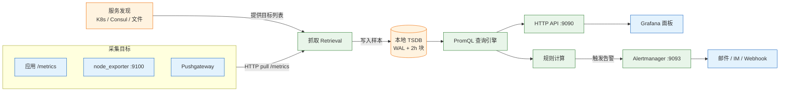
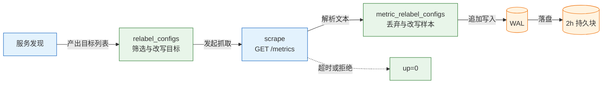
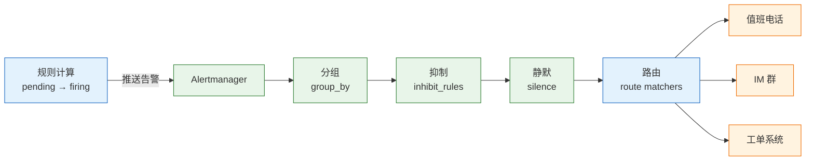

# Prometheus 与 Grafana

---

## 一、Prometheus 与 Grafana 是什么

Prometheus 是开源的指标监控与告警系统，2012 年在 SoundCloud 内部诞生，2016 年加入 CNCF，是继 Kubernetes 之后第二个从 CNCF 毕业的项目。它把监控对象抽象成带标签的时间序列，按固定间隔主动拉取指标，用 PromQL 完成查询与聚合，用本地 TSDB 存储，再由 Alertmanager 负责通知路由。Grafana 是独立的数据可视化平台，本身不采集、不存储指标，只把 Prometheus 的查询结果画成面板。

从运维视角看，这套组合解决四个问题：**趋势判断**（错误率是在涨还是在落）、**容量评估**（磁盘、连接池、队列还有多少余量）、**故障发现**（目标是否存活、SLO 是否被突破）、**告警闭环**（条件满足后通知到正确的人）。它不解决单条请求的上下文、异常堆栈和跨服务调用链，那些属于日志与追踪的职责。

### 1.1 核心概念

Prometheus 的数据模型只有两个维度：**指标名**和**标签**。指标名说明“测的是什么”，标签说明“这个数值属于谁”。两者组合成一条时间序列，序列上的每个点就是一个样本。

| 概念 | 定义 | 运维含义 |
|---|---|---|
| Metric | 指标名，如 `http_requests_total` | 命名要带单位、带 `_total` 后缀 |
| Label | 键值对，如 `job="api"`、`code="500"` | 标签组合决定序列数量与存储成本 |
| Sample | 时间戳 + 浮点数值 | 采集越频繁，样本越多，成本越高 |
| Series | 指标名 + 唯一标签组合 | 多一个高基数标签，序列数可能成倍增长 |
| Target | 暴露 `/metrics` 的 HTTP 端点 | 抓不到时 `up=0`，不是“没有数据” |
| Job | 一组同类目标的采集任务 | 一个 job 对应一类服务或一类 exporter |

Prometheus 默认采用 **pull（拉取）模型**：由 Prometheus 按 `scrape_interval` 访问目标的 `/metrics`，而不是应用主动推送。这个选择带来两个直接结果。第一，目标是否存活本身就是指标 `up`，取值为 1 或 0，不需要额外的心跳机制。第二，抓取方向固定，防火墙只需放行 Prometheus 到目标的出站连接，目标不必知道 Prometheus 的地址。

> **注意**：`up=0` 表示抓取失败，不等于业务指标为 0。查询错误率时如果直接对空结果做除法，会得到空值而不是 0，告警表达式必须显式处理“无数据”的语义。

监控指标按四个黄金信号组织：**延迟**、**流量**、**错误**、**饱和度**。这四类能覆盖大多数在线服务的健康判断，也是 RED 面板的理论基础。

### 1.2 与相邻技术的关系

Prometheus 不是通用监控的唯一起点，选型时要先看监控对象的形态。以主机为中心、以检查脚本和阈值为核心的老一代系统，与以服务为中心、以多维标签和查询语言为核心的 Prometheus，解决的是不同粒度的问题。

| 技术 | 数据模型 | 与 Prometheus 的差异 |
|---|---|---|
| Zabbix / Nagios | 主机 + 监控项 + 触发器 | 强在主机与网络设备巡检，多维聚合弱 |
| InfluxDB | 时序库，通常配合 Telegraf 推送 | 写入灵活，但缺少统一的拉取与服务发现模型 |
| VictoriaMetrics | 兼容 PromQL 的时序库 | 单机性能与压缩更好，常作为长期存储 |
| Thanos / Mimir | 基于对象存储的集群方案 | 解决 Prometheus 单机容量与全局查询 |
| Loki / ELK | 日志存储与检索 | 回答“哪条请求报了什么错”，不存指标 |
| Jaeger / Tempo | 分布式追踪 | 回答“请求经过哪些服务、慢在哪一段” |
| 云监控 | 厂商托管的指标服务 | 开箱即用，跨云统一和自定义查询受限 |

指标、日志、追踪互为补充：指标是聚合数值，负责发现“有事发生”；日志是离散事件，负责解释“发生了什么”；追踪是请求级因果链，负责定位“慢在哪个调用”。Prometheus 的职责是发现与量化，不是根因分析的终点。

与 InfluxDB 的关键差异在推送与拉取。批处理 Job 这类抓不到的目标，才用 Pushgateway 补位。

### 1.3 架构组成

Prometheus 进程内部可分为抓取、存储、查询、规则四部分，外部再挂 Alertmanager、Exporters 和 Grafana。理解这条链路，排障时才知道该看哪一段。



| 组件 | 职责 | 典型故障表现 |
|---|---|---|
| Retrieval | 按配置抓取目标并解析样本 | targets 页面大量 `down`，`up=0` |
| TSDB | WAL、内存块、2 小时持久块与压实 | 启动慢、查询报错、磁盘写满 |
| Query Engine | 执行 PromQL，返回即时或范围结果 | 查询超时、内存飙升 |
| Rule Manager | 周期计算记录规则与告警规则 | 规则不生效、告警延迟 |
| Alertmanager | 分组、抑制、静默、路由、重试 | 告警不发送或重复发送 |
| Exporter | 把第三方系统指标转成文本格式 | 指标缺失、采集报错 |
| Grafana | 查询、可视化、面板与变量 | 面板 No data、数据源 502 |

TSDB 的写入先进入 WAL（预写日志），再进入内存块；每两小时切出一个持久块，后台压实合并，保留期按块删除。删除以块为单位，**实际保留时间可能略超过配置值**。WAL 只用于崩溃后重放，不能替代备份。

> **运维提示**：Prometheus 单机不是高可用架构。两个副本可以采集同一批目标，但查询层要去重，告警也会重复触发；真正的长期存储与全局查询要引入 Thanos、Mimir 或 VictoriaMetrics。

---

## 二、安装与配置

### 2.1 资源规划与系统准备

Prometheus 的资源消耗由**活跃序列数**决定，而不是由目标数量决定。一个目标暴露一千条序列，十个目标就可能是一万条；标签取值越多，序列越多，内存和磁盘一起上涨。

| 资源 | 经验值 | 说明 |
|---|---|---|
| 内存 | 按活跃序列估算 | 每条序列占用数 KB，序列翻倍内存近似翻倍 |
| 磁盘 | 约 1–2 字节/样本 | 15s 采集、十万序列约每天 1 GB 量级 |
| CPU | 抓取与规则为主 | 规则多、查询重时优先增加核数 |
| 时间 | 所有节点 NTP 同步 | 时间戳错乱会让关联与排序失效 |
| 文件描述符 | `nofile` 不低于 65536 | 目标多时并发连接上升 |

磁盘容量按 **每日样本数 = 活跃序列数 × 86400 ÷ 采集间隔** 估算，再乘每样本字节数和保留天数。十万序列、15 秒间隔约每天 1 GB 量级。真实值受标签长度和查询负载影响，上线后用 `prometheus_tsdb_storage_blocks_bytes` 校准。数据目录应放在独立磁盘，抓取高峰与压实重叠时机械盘延迟明显。

### 2.2 二进制安装与 systemd 托管

生产环境优先用二进制加 systemd，升级可控，配置和参数能进版本库；容器部署适合演示与单机小规模，见 2.3。

```bash
# ========== 创建运行用户与目录 ==========
# Prometheus 不需要 root，独立用户可降低被利用后的影响
sudo useradd --no-create-home --shell /usr/sbin/nologin prometheus
sudo mkdir -p /etc/prometheus /var/lib/prometheus
sudo chown -R prometheus:prometheus /etc/prometheus /var/lib/prometheus

# ========== 下载并安装二进制 ==========
# 版本号以官方 Releases 页面为准，这里与 2.3 的镜像标签保持一致
curl -LO https://github.com/prometheus/prometheus/releases/download/v3.15.1/prometheus-3.15.1.linux-amd64.tar.gz
tar -xzf prometheus-3.15.1.linux-amd64.tar.gz
sudo install -m 0755 prometheus-3.15.1.linux-amd64/prometheus /usr/local/bin/
sudo install -m 0755 prometheus-3.15.1.linux-amd64/promtool /usr/local/bin/
sudo install -m 0644 prometheus-3.15.1.linux-amd64/prometheus.yml /etc/prometheus/prometheus.yml

# ========== 校验配置语法 ==========
# 改完配置先校验，避免重启后进程直接退出
promtool check config /etc/prometheus/prometheus.yml

# ========== 前台试运行 ==========
# 首次部署先在前台确认没有报错，再交给 systemd
sudo -u prometheus prometheus \
  --config.file=/etc/prometheus/prometheus.yml \
  --storage.tsdb.path=/var/lib/prometheus
```

systemd 单元文件把启动参数固定下来，重启策略和日志都交给系统管理：

```text
# /etc/systemd/system/prometheus.service
[Unit]
Description=Prometheus
Documentation=https://prometheus.io/docs/
Wants=network-online.target
After=network-online.target

[Service]
User=prometheus
Group=prometheus
Type=simple
ExecStart=/usr/local/bin/prometheus \
  --config.file=/etc/prometheus/prometheus.yml \
  --storage.tsdb.path=/var/lib/prometheus \
  --storage.tsdb.retention.time=15d \
  --web.listen-address=0.0.0.0:9090 \
  --web.enable-lifecycle
ExecReload=/bin/kill -HUP $MAINPID
Restart=on-failure
RestartSec=5s

[Install]
WantedBy=multi-user.target
```

```bash
# ========== 启动与开机自启 ==========
sudo systemctl daemon-reload
sudo systemctl enable --now prometheus
systemctl status prometheus --no-pager

# ========== 健康检查 ==========
# 正常返回：Prometheus Server is Healthy.
curl -s http://localhost:9090/-/healthy

# ========== 重载配置 ==========
# 改了 prometheus.yml 后热加载，不中断采集
curl -s -X POST http://localhost:9090/-/reload
```

> **安全警告**：`--web.enable-lifecycle` 会开放 `POST /-/reload`，任何能访问 9090 端口的人都能触发配置重载。只监听内网地址，或在反向代理层加认证；对公网暴露这个端口等同于交出监控系统的控制权。

### 2.3 容器化部署完整栈

最小演示栈包含 Prometheus、node_exporter、Alertmanager、Grafana。镜像固定版本，避免 `latest`。

```yaml
# compose.yaml
services:
  prometheus:
    image: prom/prometheus:v3.15.1
    container_name: prometheus
    command:
      - --config.file=/etc/prometheus/prometheus.yml
      - --storage.tsdb.path=/prometheus
      - --storage.tsdb.retention.time=15d
      - --web.enable-lifecycle
    ports:
      - "9090:9090"
    volumes:
      - ./prometheus.yml:/etc/prometheus/prometheus.yml:ro   # 主配置只读挂载
      - ./rules:/etc/prometheus/rules:ro                     # 告警与记录规则目录
      - prom-data:/prometheus                                # TSDB 数据必须持久化
    restart: unless-stopped

  alertmanager:
    image: prom/alertmanager:v0.34.1
    container_name: alertmanager
    ports:
      - "9093:9093"
    volumes:
      - ./alertmanager.yml:/etc/alertmanager/alertmanager.yml:ro
      - am-data:/alertmanager
    restart: unless-stopped

  node-exporter:
    image: prom/node-exporter:v1.12.1
    container_name: node-exporter
    command:
      - --path.rootfs=/host
      - --collector.textfile.directory=/var/lib/node_exporter/textfile
    ports:
      - "9100:9100"
    volumes:
      - /:/host:ro,rslave                                  # 只读挂载宿主根目录
      - ./node-exporter-textfile:/var/lib/node_exporter/textfile:ro
    restart: unless-stopped

  grafana:
    image: grafana/grafana:13.3.0
    container_name: grafana
    ports:
      - "3000:3000"
    environment:
      GF_SECURITY_ADMIN_PASSWORD: ${GRAFANA_PASSWORD:?set in .env}
      GF_USERS_ALLOW_SIGN_UP: "false"
    volumes:
      - grafana-data:/var/lib/grafana
      - ./grafana/provisioning:/etc/grafana/provisioning:ro
      - ./grafana/dashboards:/var/lib/grafana/dashboards:ro
    restart: unless-stopped

volumes:
  prom-data:
  am-data:
  grafana-data:
```

主配置文件把抓取、规则、告警三部分串起来，字段含义写在注释里：

```yaml
# prometheus.yml
global:
  scrape_interval: 15s          # 默认采集间隔，15s 是常见折中
  scrape_timeout: 10s           # 必须小于 scrape_interval
  evaluation_interval: 15s      # 规则计算间隔，独立于采集
  external_labels:              # 写入远程存储或联邦时附加的集群标识
    cluster: demo
    env: prod

rule_files:
  - /etc/prometheus/rules/*.yml # 记录规则与告警规则

alerting:
  alertmanagers:
    - static_configs:
        - targets: ["alertmanager:9093"]

scrape_configs:
  - job_name: prometheus
    static_configs:
      - targets: ["localhost:9090"]   # 容器内自身的地址

  - job_name: node
    static_configs:
      - targets: ["node-exporter:9100"]
        labels:
          instance_role: host         # 自定义标签，便于按角色聚合

  - job_name: api
    metrics_path: /metrics            # 非默认路径时显式指定
    static_configs:
      - targets: ["api:8080"]         # 换成实际服务地址
```

首次启动时 Alertmanager 配置可以先放最小可用版本，完整路由见 5.3：

```yaml
# alertmanager.yml（最小版）
route:
  receiver: default
receivers:
  - name: default
```

```bash
# ========== 生成 Grafana 管理员密码 ==========
# 交互输入，避免密码进入 shell 历史和镜像层
read -rsp 'Grafana admin password: ' GRAFANA_PASSWORD
printf '\n'
printf 'GRAFANA_PASSWORD="%s"\n' "$GRAFANA_PASSWORD" > .env

# ========== 启动并查看状态 ==========
docker compose up -d
docker compose ps

# ========== 验证所有目标抓取成功 ==========
curl -s 'http://localhost:9090/api/v1/query?query=up' \
  | jq -r '.data.result[] | "\(.metric.job)=\(.value[1])"'
```

预期输出类似：

```text
prometheus=1
node=1
```

`1` 表示抓取成功，`0` 表示目标不可达。浏览器打开 `http://localhost:9090` 可以执行 PromQL；打开 `http://localhost:3000`，用 `admin` 和刚才设置的密码登录 Grafana，添加 Prometheus 数据源，地址填 `http://prometheus:9090`。

> **版本现状（2026-10）**：Prometheus 3.15.1、Grafana 13.3.0、node_exporter 1.12.1、Alertmanager 0.34.1。升级前阅读 PromQL 与配置项的弃用说明，规则统一用 `promtool` 校验后再上线。

### 2.4 核心配置与安全

Prometheus 的启动参数不多，但对存储和暴露面影响很大。把常用参数记成一张表，比每次翻文档可靠。

| 参数 | 作用 | 建议 |
|---|---|---|
| `--config.file` | 主配置文件路径 | 固定路径，纳入版本管理 |
| `--storage.tsdb.path` | TSDB 数据目录 | 独立磁盘，预留 30% 余量 |
| `--storage.tsdb.retention.time` | 样本保留时长 | 按磁盘和合规要求设置 |
| `--storage.tsdb.retention.size` | 保留的最大字节数 | 与时间保留同时生效，先到先删 |
| `--web.listen-address` | 监听地址 | 默认只监听内网或本机 |
| `--web.enable-lifecycle` | 开放重载接口 | 仅内网，代理层加认证 |
| `--web.enable-remote-write-receiver` | 接收 remote write | 只在需要接收写入时开启 |
| `--web.config.file` | TLS 与基础认证配置 | 对外暴露时必配 |

Prometheus 没有用户体系和细粒度权限。对外访问时前置反向代理，做 TLS、基础认证和 IP 白名单；Grafana 用组织与文件夹权限控制面板。

> **安全警告**：不要把 9090、9093 直接映射到公网。监控数据包含服务名、实例地址、错误率和容量信息，足以支撑一次完整的信息收集。确需远程访问时，走 VPN 或带认证的反向代理。

---

## 三、核心对象与数据模型

### 3.1 时间序列与样本

一条时间序列由指标名和一组标签唯一确定。标签的顺序不影响身份，`{job="api",code="500"}` 与 `{code="500",job="api"}` 是同一条序列。Prometheus 在内部把指标名存成特殊标签 `__name__`，因此 PromQL 里 `http_requests_total` 与 `{__name__="http_requests_total"}` 等价。

| 存储层次 | 内容 | 生命周期 |
|---|---|---|
| 样本 | 时间戳 + 数值 | 随块保留期删除 |
| 内存块 | 最近写入的样本 | 约 2 小时后落盘 |
| 持久块 | 压实后的只读块 | 按保留期整块删除 |
| WAL | 未落盘的写入日志 | 截断后回收，不用于长期查询 |

即时查询的回看窗口是 5 分钟：Prometheus 取每个序列在评估点前 5 分钟内的最后一个样本，超出窗口没有新样本就视为 stale。目标停止上报后图表会延迟断线，而不是立刻变 0。

### 3.2 标签设计与基数控制

标签是 Prometheus 最强的能力，也是最大的成本来源。每增加一个唯一取值就多一条序列，序列数上涨会同时推高内存、磁盘、抓取时间和查询延迟。

| 适合做标签 | 不适合做标签 |
|---|---|
| `service`、`env`、`region` | 用户 ID、订单号、会话 ID |
| `method`、`route`（模板化） | 原始 URL、查询参数 |
| `status`、`code` | 异常堆栈、错误消息 |
| `instance`、`job` | 时间戳、随机字符串 |

原始路径 `/api/orders/12345` 必须在上报前模板化成 `/api/orders/{id}`，否则每个订单都会生成一条新序列。已经写入的高基数指标，用 `metric_relabel_configs` 丢弃或改写；这是止损手段，不是设计手段，因为它发生在抓取之后，抓取和解析的成本已经付出。

```yaml
# 抓取后对样本做二次处理
metric_relabel_configs:
  # 丢弃调试用的 Go 运行时指标，减少序列
  - source_labels: [__name__]
    regex: 'go_.*'
    action: drop

  # 把带 ID 的路径改写成模板，避免基数爆炸
  - source_labels: [path]
    regex: '/api/orders/[0-9]+'
    target_label: route
    replacement: '/api/orders/{id}'
    action: replace
```

`relabel_configs` 在抓取前操作目标，`metric_relabel_configs` 在抓取后操作样本；前者能减少抓取次数，后者只能减少存储。

### 3.3 指标类型与暴露格式

Prometheus 客户端库定义了四种指标类型，类型决定了能用哪些函数、能回答什么问题。

| 类型 | 特征 | 常用函数 | 典型用途 |
|---|---|---|---|
| Counter | 只增不减，重启归零 | `rate`、`increase` | 请求数、错误数、字节数 |
| Gauge | 可增可减 | `avg`、`max`、`predict_linear` | 内存、温度、队列长度 |
| Histogram | 桶计数 + 总和 + 总数 | `histogram_quantile` | 请求延迟、响应大小 |
| Summary | 客户端计算的分位数 | 直接读取 | 客户端侧延迟统计 |

文本暴露格式固定为 `# HELP`、`# TYPE` 加样本行，指标名和标签都要符合命名规范：

```text
# HELP http_requests_total 请求总数
# TYPE http_requests_total counter
http_requests_total{job="api",method="GET",route="/orders/{id}",code="200"} 10231
http_requests_total{job="api",method="GET",route="/orders/{id}",code="500"} 87

# HELP http_request_duration_seconds 请求耗时
# TYPE http_request_duration_seconds histogram
http_request_duration_seconds_bucket{le="0.1"} 9000
http_request_duration_seconds_bucket{le="0.3"} 9800
http_request_duration_seconds_bucket{le="1"} 10150
http_request_duration_seconds_bucket{le="+Inf"} 10318
http_request_duration_seconds_sum 1520.5
http_request_duration_seconds_count 10318
```

指标命名遵循三条约定：使用基础单位（秒、字节、次数），不用毫秒或 KB；Counter 以 `_total` 结尾；同类指标复用同一组标签名。命名一旦被面板和告警引用，修改成本很高。

### 3.4 抓取配置与 relabel

一次抓取要经过服务发现、目标重写、HTTP 请求、样本解析、样本重写、写入 WAL 六步。任何一步出错，最终都表现为 `up=0` 或指标缺失。



| 配置项 | 默认值 | 作用 |
|---|---|---|
| `scrape_interval` | 1m | 采集间隔，越短分辨率越高、成本越大 |
| `scrape_timeout` | 10s | 单次抓取超时，必须小于采集间隔 |
| `metrics_path` | `/metrics` | 指标暴露路径 |
| `scheme` | `http` | 抓取协议，启用 TLS 时改 `https` |
| `honor_labels` | `false` | 冲突时是否保留目标自带标签 |
| `sample_limit` | 0（不限） | 单次抓取样本上限，防止异常目标打爆内存 |
| `label_limit` | 0（不限） | 单样本标签数量上限 |

目标多时不要手写几百行 `static_configs`，用文件服务发现或 K8s 服务发现。文件服务发现把目标列表放在 JSON 里，Prometheus 定期重读，变更不需要重启：

```yaml
scrape_configs:
  - job_name: node
    file_sd_configs:
      - files: ["/etc/prometheus/targets/node/*.json"]
        refresh_interval: 30s
    relabel_configs:
      # 从地址中提取主机名，覆盖默认的 instance 标签
      - source_labels: [__address__]
        regex: '(.+):9100'
        target_label: instance
        replacement: '$1'
```

relabel 的常用动作只有五类：`keep` 保留匹配目标、`drop` 丢弃匹配目标、`replace` 改写标签、`labelmap` 批量映射标签名、`hashmod` 做分片。分片采集时用 `hashmod` 把目标分散到多个 Prometheus 副本，是横向扩展的常见手法。

---

## 四、PromQL 查询

### 4.1 选择器与时间范围

PromQL 的查询结果有四种类型：瞬时向量、范围向量、标量、字符串。绝大多数面板和告警使用瞬时向量，范围向量只作为 `rate`、`increase` 等函数的输入。

| 写法 | 含义 | 示例 |
|---|---|---|
| `metric` | 按指标名选择 | `http_requests_total` |
| `metric{label="v"}` | 等值过滤 | `http_requests_total{code="500"}` |
| `metric{label=~"5.."}` | 正则过滤 | `http_requests_total{code=~"5.."}` |
| `metric[5m]` | 范围向量，取 5 分钟样本 | `http_requests_total[5m]` |
| `offset 1h` | 相对评估时间偏移 | `http_requests_total offset 1h` |
| `@ 1700000000` | 固定评估时间戳 | `rate(http_requests_total[5m] @ 1700000000)` |

即时查询和范围查询都能走 HTTP API，脚本化排障比界面点选更快：

```bash
# ========== 即时查询 ==========
curl -sG 'http://localhost:9090/api/v1/query' \
  --data-urlencode 'query=up' | jq '.data.result[0]'

# ========== 范围查询 ==========
# start/end 用 Unix 秒，step 是返回点的间隔
curl -sG 'http://localhost:9090/api/v1/query_range' \
  --data-urlencode 'query=rate(node_cpu_seconds_total{mode="idle"}[5m])' \
  --data-urlencode "start=$(( $(date +%s) - 900 ))" \
  --data-urlencode "end=$(date +%s)" \
  --data-urlencode 'step=15s' | jq '.data.result | length'

# ========== 查看抓取目标状态 ==========
curl -s 'http://localhost:9090/api/v1/targets' \
  | jq -r '.data.activeTargets[] | "\(.labels.job) \(.health)"'
```

### 4.2 速率与增量函数

Counter 的原始值没有直观意义，必须转成速率或增量。函数的窗口选择直接决定曲线的平滑度和告警的灵敏度。

| 函数 | 输入 | 输出 | 适用场景 |
|---|---|---|---|
| `rate` | 范围向量（Counter） | 每秒平均增长速率 | 告警、长期趋势 |
| `irate` | 范围向量（Counter） | 最后两个点的瞬时速率 | 短时抖动观察 |
| `increase` | 范围向量（Counter） | 窗口内的总增量 | 统计周期内总量 |
| `delta` | 范围向量（Gauge） | 窗口首尾差值 | 温度、队列变化 |
| `predict_linear` | 范围向量（Gauge） | 线性预测未来值 | 磁盘写满时间 |
| `absent` | 瞬时向量 | 无数据时返回 1 | 目标消失告警 |

最常用的三类查询是错误速率、错误占比和延迟分位数：

```promql
# 每秒 5xx 请求数（5 分钟窗口）
sum(rate(http_requests_total{job="api",code=~"5.."}[5m]))

# 5xx 占比
sum(rate(http_requests_total{job="api",code=~"5.."}[5m]))
/
sum(rate(http_requests_total{job="api"}[5m]))

# p95 延迟
histogram_quantile(
  0.95,
  sum by (le) (rate(http_request_duration_seconds_bucket{job="api"}[5m]))
)
```

几个容易出错的点必须记住：

- **`rate` 只能用于 Counter**，窗口至少是采集间隔的 4 倍。15 秒采集用 `[1m]` 以上，否则窗口内样本太少，曲线剧烈抖动。
- **`rate` 会自动处理 Counter 归零**，但前提是窗口内确实发生重启。短窗口出现尖刺，先查目标有没有重启。
- **`irate` 只看最后两个点**，适合观察瞬时变化，不适合“持续 10 分钟”的告警。
- **没有流量时 `rate` 返回空**，不是 0。用 `absent()` 或 `or vector(0)` 区分“没数据”和“没错误”，但必须明确语义。
- **除法要先聚合再相除**，否则标签对不齐会得到空结果。分子分母的标签集必须一致。

### 4.3 聚合与分组

聚合运算把多条序列合并成一条，`by` 保留指定标签，`without` 删除指定标签，两者只能选一个。

| 运算符 | 作用 | 示例 |
|---|---|---|
| `sum` | 求和 | `sum by (route) (rate(http_requests_total[5m]))` |
| `avg` | 平均值 | `avg by (instance) (node_load1)` |
| `max` / `min` | 最大 / 最小 | `max by (service) (queue_depth)` |
| `count` | 序列数量 | `count(up{job="api"} == 1)` |
| `topk` | 取前 K 条 | `topk(5, sum by (route) (rate(http_requests_total[5m])))` |
| `quantile` | 分位数（非直方图） | `quantile(0.9, node_load1)` |

`sum without (instance)` 保留除 instance 外的全部标签再求和。`topk` 必须作用在聚合之后，否则得到的是每个标签组合内部的 Top K。

```promql
# 每个接口的 QPS
sum by (route) (rate(http_requests_total{job="api"}[5m]))

# 每个服务的错误率，先聚合再相除
sum by (service) (rate(http_requests_total{code=~"5.."}[5m]))
/
sum by (service) (rate(http_requests_total[5m]))

# 全局错误最多的五个接口
topk(5, sum by (route) (rate(http_requests_total{code=~"5.."}[5m])))
```

### 4.4 直方图与分位数

Histogram 把观测值放进预定义的桶里，每个桶只记录“小于等于上界的次数”。分位数由 `histogram_quantile` 在桶边界之间插值得到，因此桶的划分决定了精度。

```promql
# 全局 p95，必须先按 le 聚合
histogram_quantile(
  0.95,
  sum by (le) (rate(http_request_duration_seconds_bucket{job="api"}[5m]))
)
```

桶边界要覆盖真实延迟分布。如果所有请求都在 0.1 秒以内，而桶只有 0.5、1、5 秒，插值结果会非常粗糙；如果桶太密，序列数又会膨胀。常见做法是覆盖 50ms 到 10s，按 2 倍或 3 倍递增，并在 `+Inf` 桶上保留兜底。

> **注意**：`histogram_quantile` 必须按 `le` 聚合，漏掉 `le` 会把不同桶当成不同序列，计算结果没有意义。Summary 的分位数由客户端计算，不能跨实例求和或求平均，多实例场景优先用 Histogram。

Prometheus 3.x 支持原生直方图，查询时不需要预定义桶边界，但需要客户端、Prometheus 和远程存储全链路支持。混合部署时先确认兼容性，不要默认开启。

### 4.5 记录规则与查询优化

记录规则把高频、复杂的查询预先算好，存成新的时间序列。面板和告警引用记录规则，可以显著降低重复计算。

```yaml
# rules/recording.yml
groups:
  - name: api.recording
    interval: 30s
    rules:
      # 命名约定：level:metric:operations
      - record: job:http_requests:rate5m
        expr: sum by (job) (rate(http_requests_total[5m]))

      - record: job:http_request_duration_seconds:p95
        expr: |
          histogram_quantile(
            0.95,
            sum by (job, le) (rate(http_request_duration_seconds_bucket[5m]))
          )
```

| 优化手段 | 做法 | 效果 |
|---|---|---|
| 预聚合 | 记录规则固化常用查询 | 降低面板与告警的计算量 |
| 缩小窗口 | 用 `[5m]` 而不是 `[1h]` | 减少扫描样本数 |
| 先过滤标签 | `{job="api"}` 放在最前 | 减少参与运算的序列 |
| 避免全量正则 | 不用 `.*` 匹配所有标签 | 降低查询规划开销 |
| 控制基数 | 删除无用的高基数指标 | 直接降低内存与磁盘 |

记录规则按 `level:metric:operations` 命名，规则改完先 `promtool check rules` 校验，再重载。

---

## 五、告警与通知

### 5.1 告警规则结构

告警规则本质上是周期性执行的 PromQL，条件为真时进入 pending，持续 `for` 后转为 firing。`for` 是抑制抖动的第一道防线。

```yaml
# rules/alerts.yml
groups:
  - name: api
    interval: 30s
    rules:
      - alert: ApiHigh5xx
        expr: |
          sum(rate(http_requests_total{job="api",code=~"5.."}[5m]))
          /
          sum(rate(http_requests_total{job="api"}[5m])) > 0.05
        for: 10m                 # 条件持续 10 分钟才触发
        keep_firing_for: 5m      # 条件恢复后再保持 5 分钟，避免抖动
        labels:
          severity: page         # 分级决定通知通道
          team: platform
        annotations:
          summary: "API 5xx 比例超过 5%"
          runbook_url: "https://runbook.example.com/api-5xx"
```

| 字段 | 作用 | 常见错误 |
|---|---|---|
| `expr` | 判定表达式 | 忘记聚合，导致按实例各告一次 |
| `for` | 持续时长 | 设得太短，抖动即告警 |
| `keep_firing_for` | 恢复后的保持时间 | 与 `for` 混淆，延长了故障感知 |
| `labels` | 附加标签，用于路由 | 缺少 `severity`，无法分级 |
| `annotations` | 人类可读的描述 | 写死数值，恢复后描述失真 |

`annotations` 支持 `$value`、`$labels` 等模板变量，描述要写清服务、指标、当前值和 Runbook。

### 5.2 规则校验与单元测试

规则写错最常见的形式是标签不匹配、聚合维度漏掉、`for` 与评估间隔冲突。`promtool` 同时提供语法校验和单元测试，应该在 CI 里跑。

```bash
# ========== 校验规则语法 ==========
docker run --rm -v "$PWD:/work" -w /work --entrypoint promtool \
  prom/prometheus:v3.15.1 check rules rules/alerts.yml

# ========== 校验主配置 ==========
docker run --rm -v "$PWD:/work" -w /work --entrypoint promtool \
  prom/prometheus:v3.15.1 check config prometheus.yml

# ========== 运行规则单元测试 ==========
# 工作目录切到 rules，测试文件里的 alerts.yml 按相对路径解析
docker run --rm -v "$PWD:/work" -w /work/rules --entrypoint promtool \
  prom/prometheus:v3.15.1 test rules alerts_test.yml
```

单元测试用构造的时间序列验证告警是否在预期时刻触发，特别适合比例、聚合和 `for` 这类容易写错的逻辑：

```yaml
# rules/alerts_test.yml
rule_files:
  - alerts.yml
evaluation_interval: 1m

tests:
  - interval: 1m
    input_series:
      # 每分钟增加 10 条 5xx
      - series: 'http_requests_total{job="api",code="500"}'
        values: '0+10x15'
      # 每分钟增加 90 条 200，5xx 占比 10%
      - series: 'http_requests_total{job="api",code="200"}'
        values: '0+90x15'
    alert_rule_test:
      - eval_time: 16m
        alertname: ApiHigh5xx
        exp_alerts:
          - exp_labels:
              severity: page
              team: platform
            exp_annotations:
              summary: "API 5xx 比例超过 5%"
              runbook_url: "https://runbook.example.com/api-5xx"
```

预期输出以 `SUCCESS` 结尾。5xx 占比在第 5 分钟达到 10%，条件此后一直为真；`for: 10m` 要求再持续 10 分钟，因此第 15 分钟转为 firing，测试取第 16 分钟验证。若没有触发，先检查表达式标签是否与测试序列一致，再检查 `for` 与 `evaluation_interval` 的换算。

> **运维提示**：`values: '0+10x15'` 表示从 0 开始、每次加 10、重复 15 个点。写测试时先用小数量验证语义，再放大到真实比例，避免因为序列长度不够导致 `for` 永远不满足。

### 5.3 Alertmanager 路由、分组与抑制

Prometheus 只负责判定“是否告警”，Alertmanager 负责“发给谁、发几次、什么时候不发”。这条链路不经过 Grafana，Grafana 挂了不影响告警。



```yaml
# alertmanager.yml
global:
  resolve_timeout: 5m          # 告警恢复后的等待时间

route:
  receiver: chat               # 默认接收器
  group_by: [alertname, service]  # 同一服务同类告警合并
  group_wait: 30s              # 首次聚合等待，避免一条条发
  group_interval: 5m           # 同组新增告警的发送间隔
  repeat_interval: 4h          # 未恢复告警的重复提醒间隔
  routes:
    # 严重告警走值班通道，等待更短、重复更频繁
    - matchers: ['severity="page"']
      receiver: oncall
      group_wait: 10s
      repeat_interval: 1h
    # 工单级告警只进系统，不打扰值班
    - matchers: ['severity="ticket"']
      receiver: ticket
      repeat_interval: 24h

receivers:
  - name: chat
    webhook_configs:
      - url: http://chat.example.com/webhook
        send_resolved: true     # 恢复通知也要发
  - name: oncall
    webhook_configs:
      - url: http://oncall.example.com/webhook
        send_resolved: true
  - name: ticket
    webhook_configs:
      - url: http://ticket.example.com/webhook
        send_resolved: true

inhibit_rules:
  # 数据库整体不可用时，抑制同服务的下游 5xx 告警
  - source_matchers: ['alertname="DatabaseDown"']
    target_matchers: ['severity="page"']
    equal: [service]
```

| 参数 | 作用 | 调大后的影响 |
|---|---|---|
| `group_by` | 决定哪些告警合并 | 分组越粗，单条通知信息越少 |
| `group_wait` | 首次发送前等待 | 告警到达更慢，但更完整 |
| `group_interval` | 同组更新间隔 | 新增告警通知变慢 |
| `repeat_interval` | 未恢复重复提醒 | 提醒变少，可能漏看 |
| `send_resolved` | 是否发恢复通知 | 关闭后值班不知道已恢复 |

告警分级是路由的前提：`page` 立即处理，`ticket` 跟进，`info` 只记录。

### 5.4 SLO 与错误预算告警

固定阈值告警的问题是：CPU 高不一定影响用户，错误率 0.1% 也可能已经违反承诺。SLO 用“好事件 / 总事件”定义目标，例如 30 天内 99.9% 的请求成功，允许的失败比例就是错误预算。

| 概念 | 定义 | 示例 |
|---|---|---|
| SLI | 可测量的服务质量指标 | 成功请求占比、p95 延迟 |
| SLO | SLI 的目标值 | 30 天 99.9% 成功 |
| 错误预算 | 1 减去 SLO | 0.1%，约 43 分钟停机 |
| 燃烧率 | 错误率 ÷ 预算比例 | 14.4 倍表示 1 小时烧掉 2% 预算 |

按燃烧率告警比固定阈值稳定，它衡量预算消耗速度，而不是某一刻的瞬时值。多窗口同时超阈值，可以过滤短时抖动：

```promql
# 1 小时长窗口 + 5 分钟短窗口，同时超过 14.4 倍燃烧率
(
  sum(rate(http_requests_total{job="api",code=~"5.."}[1h]))
  / sum(rate(http_requests_total{job="api"}[1h]))
) > (14.4 * 0.001)
and
(
  sum(rate(http_requests_total{job="api",code=~"5.."}[5m]))
  / sum(rate(http_requests_total{job="api"}[5m]))
) > (14.4 * 0.001)
```

| 窗口组合 | 燃烧率阈值 | 建议动作 |
|---|---|---|
| 1h + 5m | 14.4 | page，立即处理 |
| 6h + 30m | 6 | ticket，当天跟进 |
| 3d + 6h | 1 | 记录，周度复盘 |

SLO 不必一开始做全。先把错误率、延迟、可用性测准，再定义目标；没有可信的 SLI，SLO 只是拍脑袋的数字。预算有富余时可以加快发布，预算快用完时先冻结变更修稳定性。

---

## 六、Grafana 面板设计

### 6.1 数据源与 provisioning

Grafana 连接数据源、执行查询、渲染图表，本身不采集、不存储指标。数据源和面板通过 provisioning 初始化，容器重建后不丢。

```yaml
# grafana/provisioning/datasources/prometheus.yml
apiVersion: 1

datasources:
  - name: Prometheus
    type: prometheus
    access: proxy              # 由 Grafana 服务端代理请求
    url: http://prometheus:9090
    isDefault: true
    jsonData:
      timeInterval: 15s        # 与 scrape_interval 保持一致
      httpMethod: POST         # 长查询用 POST，避免 URL 过长
```

```yaml
# grafana/provisioning/dashboards/default.yml
apiVersion: 1

providers:
  - name: default
    orgId: 1
    folder: Demo
    type: file
    disableDeletion: true      # 防止界面误删版本库里的面板
    updateIntervalSeconds: 30
    options:
      path: /var/lib/grafana/dashboards
```

| 配置项 | 作用 | 建议 |
|---|---|---|
| `access: proxy` | 请求经 Grafana 转发 | 数据源在内网时使用 |
| `isDefault` | 默认数据源 | 只设一个，避免面板绑错 |
| `timeInterval` | 查询最小步长 | 不小于采集间隔 |
| `httpMethod: POST` | 长查询提交方式 | 查询语句长时开启 |
| `disableDeletion` | 禁止界面删除 | 面板即代码时必开 |

### 6.2 RED 与 USE 面板

面板按固定框架组织，不是图表堆砌。面向服务用 RED，面向资源用 USE，两者结合才能从“用户受影响”追到“资源瓶颈”。

| 框架 | 维度 | 核心指标 | 适用对象 |
|---|---|---|---|
| RED | Rate | 每秒请求数 | 服务、接口 |
| RED | Errors | 5xx 比例、失败数 | 服务、接口 |
| RED | Duration | p95 / p99 延迟 | 服务、接口 |
| USE | Utilization | CPU、内存、磁盘使用率 | 主机、容器 |
| USE | Saturation | 队列长度、负载、连接池等待 | 主机、中间件 |
| USE | Errors | 网卡丢包、磁盘错误 | 主机、网络 |

一个服务至少要有五块面板：请求量、错误率、p95/p99 延迟、存活实例数、关键依赖。每块面板都要标注单位和图例，否则看图只能靠猜。

```promql
# 请求量
sum(rate(http_requests_total{job="api"}[5m]))

# 错误率
sum(rate(http_requests_total{job="api",code=~"5.."}[5m]))
/
sum(rate(http_requests_total{job="api"}[5m]))

# 存活实例数
count(up{job="api"} == 1)

# CPU 使用率（按实例计算，1 减去空闲比例）
1 - avg by (instance) (rate(node_cpu_seconds_total{mode="idle"}[5m]))
```

> **运维提示**：面板要标出 SLO 线和发布时间，否则异常曲线无法判断是否违规，也无法和变更对应。

### 6.3 面板即代码与变量

手工拖出来的面板无法 review、无法复现、无法回滚。把 dashboard 的 JSON 放进版本库，用 provisioning 或 API 导入，改面板和改告警一样可追溯。

```bash
# ========== 导出面板 JSON ==========
# uid 从面板 URL 或 JSON 模型里获取
curl -s -u "admin:$GRAFANA_PASSWORD" \
  'http://localhost:3000/api/dashboards/uid/api-overview' \
  | jq '.dashboard' > dashboards/api-overview.json

# ========== 通过 API 导入 ==========
# 导入前先包一层 dashboard 字段，并指定覆盖行为
jq '{dashboard: ., overwrite: true}' \
  dashboards/api-overview.json > /tmp/import.json
curl -s -u "admin:$GRAFANA_PASSWORD" \
  -H 'Content-Type: application/json' \
  -X POST 'http://localhost:3000/api/dashboards/db' \
  -d @/tmp/import.json | jq '.status'
```

面板变量把硬编码的值变成下拉选择，常见类型有 `query`（从标签取值）、`custom`（固定列表）、`interval`（时间间隔）。变量查询要加过滤条件，避免把高基数标签的所有取值都拉进下拉框：

```promql
# 变量 query：只取 api 这个 job 的 instance
label_values(up{job="api"}, instance)
```

| 实践 | 做法 | 收益 |
|---|---|---|
| 面板入版本库 | JSON + provisioning | 可 review、可回滚 |
| 统一单位 | 秒、字节、百分比 | 避免同图不同量纲 |
| 固定图例 | `{{route}}`、`{{instance}}` | 多序列可区分 |
| 限制变量取值 | 变量查询加 job 过滤 | 下拉框不卡顿 |
| 标注发布事件 | Annotation 查询 | 异常与变更对齐 |

---

## 七、完整示例：业务指标接入与告警闭环

### 7.1 准备业务指标文件

下面用 node_exporter 的 textfile collector 模拟一个订单服务，不依赖应用代码，能把采集、查询、告警、面板整条链路跑通。textfile 目录里的 `.prom` 文件会在每次抓取时被读取，格式与 `/metrics` 完全一致。

```bash
# ========== 创建指标目录 ==========
mkdir -p ./node-exporter-textfile

# ========== 写入初始指标 ==========
cat > ./node-exporter-textfile/orders.prom <<'EOF'
# HELP orders_total 订单请求总数
# TYPE orders_total counter
orders_total{service="order",code="200"} 10231
orders_total{service="order",code="500"} 87
EOF
```

确认 `compose.yaml` 里的 node-exporter 已经挂载目录并启用 collector：

```yaml
  node-exporter:
    image: prom/node-exporter:v1.12.1
    command:
      - --path.rootfs=/host
      - --collector.textfile.directory=/var/lib/node_exporter/textfile
    volumes:
      - /:/host:ro,rslave
      - ./node-exporter-textfile:/var/lib/node_exporter/textfile:ro
```

### 7.2 采集与验证

```bash
# ========== 重载配置（如果改过 prometheus.yml） ==========
curl -s -X POST http://localhost:9090/-/reload

# ========== 确认 textfile 指标已进入 TSDB ==========
curl -s 'http://localhost:9090/api/v1/query?query=orders_total' \
  | jq -r '.data.result[] | "\(.metric.code)=\(.value[1])"'

# ========== 计算 5 分钟错误率 ==========
curl -sG 'http://localhost:9090/api/v1/query' \
  --data-urlencode 'query=sum(rate(orders_total{code="500"}[5m])) / sum(rate(orders_total[5m]))' \
  | jq -r '.data.result[0].value[1]'
```

刚写入的 Counter 只有一个点，`rate` 需要至少两个样本才有结果。等待两个采集周期后再查，或者用下面的脚本持续递增，模拟真实流量：

```bash
# ========== 模拟 10 分钟业务流量 ==========
# 每 15 秒递增一次，成功 +30、失败 +2，错误率约 6.25%
for i in $(seq 1 40); do
  ok=$((10231 + i * 30))
  fail=$((87 + i * 2))
  cat > ./node-exporter-textfile/orders.prom <<EOF
# HELP orders_total 订单请求总数
# TYPE orders_total counter
orders_total{service="order",code="200"} $ok
orders_total{service="order",code="500"} $fail
EOF
  sleep 15
done
```

> **注意**：textfile 里的 Counter 必须单调递增。脚本从初始值重写会被当成一次重启，`rate` 出现尖刺。真实应用由客户端库维护计数器，不会如此。

### 7.3 配置告警与面板

```yaml
# rules/orders.yml
groups:
  - name: orders
    interval: 30s
    rules:
      - alert: OrderHighErrorRate
        expr: |
          sum(rate(orders_total{code="500"}[2m]))
          /
          sum(rate(orders_total[2m])) > 0.05
        for: 2m
        labels:
          severity: page
          team: commerce
        annotations:
          summary: "订单接口错误率超过 5%"
          description: "当前错误率 {{ $value | humanizePercentage }}"
```

```bash
# ========== 校验并重载规则 ==========
docker run --rm -v "$PWD:/work" -w /work --entrypoint promtool \
  prom/prometheus:v3.15.1 check rules rules/orders.yml
curl -s -X POST http://localhost:9090/-/reload

# ========== 查看告警状态 ==========
curl -s 'http://localhost:9090/api/v1/query?query=ALERTS' \
  | jq -r '.data.result[] | "\(.metric.alertname) \(.metric.alertstate)"'
```

预期状态从 `pending` 变为 `firing`：前者表示条件已满足但未到 `for` 时长，后者表示已推送给 Alertmanager。停止脚本后条件消失，告警在一个评估周期内恢复。

在 Grafana 新建面板，数据源选 Prometheus，查询填 7.2 的错误率表达式，单位选 `percentunit`，图例填 `order-5xx`。再建一块请求量面板，查询用 `sum(rate(orders_total[5m]))`，两块面板放在同一行，就能同时看到“量”和“质”。

| 验证项 | 预期结果 | 不符合时检查 |
|---|---|---|
| 指标可见 | `orders_total` 有两条序列 | textfile 路径、collector 参数 |
| 抓取成功 | `up{job="node"}=1` | 容器网络、端口映射 |
| 查询有值 | 错误率约 0.06 | 时间窗口、样本数量 |
| 告警触发 | 状态从 pending 到 firing | `for`、规则是否加载 |
| 面板出图 | 曲线与查询一致 | 数据源地址、时间范围 |

### 7.4 验证与回滚

完整闭环要验证触发与恢复两个方向：只验触发，会漏掉告警不消失；只验恢复，会错过真正的故障。上线前在 staging 验证通知链路；发布时在面板标注版本，10 分钟内看错误率与延迟。维护窗口用 silence 并设到期时间；每月清理无效规则。

```bash
# ========== 触发阶段：观察 ALERTS ==========
curl -s 'http://localhost:9090/api/v1/query?query=ALERTS{alertstate="firing"}' \
  | jq -r '.data.result[].metric.alertname'

# ========== 恢复阶段：停止模拟脚本后再次查询 ==========
curl -s 'http://localhost:9090/api/v1/query?query=ALERTS' \
  | jq -r '.data.result[] | "\(.metric.alertname) \(.metric.alertstate)"'
```

回滚时先停掉模拟脚本，注释 `rules/orders.yml` 中的告警并重载，再清理 textfile。历史样本保留在 TSDB 里用于复盘，不要删数据目录。

---

## 八、生产实践与适用边界

### 8.1 高可用与长期存储

Prometheus 单机没有自动故障切换。生产上常见四种做法，代价各不相同：

| 方案 | 做法 | 代价 |
|---|---|---|
| 双副本 | 两个 Prometheus 采同一批目标 | 查询要去重，告警会重复 |
| Thanos | 边车上传块到对象存储，Querier 全局查询 | 组件多，对象存储与网络成本 |
| Mimir / VictoriaMetrics | 集群化写入与查询 | 运维复杂度高，需要专门团队 |
| 远程写入 | `remote_write` 到远端存储 | 队列堵塞会丢数据，需监控 |

双副本的关键是**查询层去重**。Grafana 同时查两个副本会得到重复序列，必须在数据源或查询层合并。告警侧让两个 Prometheus 都发给同一个 Alertmanager 集群，由 gossip 机制去重。

长期存储按样本量计费。每条样本都要走网络、进队列、写对象存储，量大时先 relabel 和降采样，再扩容。

### 8.2 容量与变更管理

| 项目 | 做法 | 目的 |
|---|---|---|
| 时间同步 | 所有节点启用 NTP | 避免样本时间错位 |
| 容量巡检 | 每周看序列数与块大小 | 提前发现基数增长 |
| 配置管理 | 配置、规则、面板全部入 Git | 可 review、可回滚 |
| 规则评审 | 新增告警必须带 Runbook | 保证可处理 |
| 告警治理 | 每月统计触发次数与误报 | 删除无效规则 |
| 备份 | 快照或远程存储 | 防止磁盘故障丢历史 |

Prometheus 提供 TSDB 快照接口，需要开启管理 API；快照用硬链接，恢复时停进程、替换数据目录、再启动。

> **运维红线**：不要直接删除 `/var/lib/prometheus` 下的块目录来“清磁盘”。块目录与 WAL、索引相互关联，手工删除可能让 TSDB 无法启动。要缩短保留期，改启动参数并重启；要立即释放空间，用快照迁移后重建实例。

---

## 九、常见排障

| 现象 | 最可能原因 | 处理 |
|---|---|---|
| `up=0` | 目标挂了、端口不对、DNS 或防火墙 | `curl` 目标 `/metrics`，查 targets 页面 |
| Grafana 显示 No data | 数据源地址错、时间范围不对、标签不匹配 | 先在 Prometheus 里跑同一条查询 |
| 告警不触发 | 指标名或标签错、没有流量、规则没加载 | `promtool check rules`，看 rules 页面与 `ALERTS` |
| 告警一直重复 | 没有 `for`、`repeat_interval` 太短、分组太细 | 加 `for`，按服务分组，调重复间隔 |
| `duplicate sample for timestamp` | 两个目标产生相同标签序列 | 查重复 target，必要时用 relabel 区分 |
| 内存持续上涨 | 高基数标签、保留期太长、重查询 | 看 TSDB 状态接口，删高基数指标，缩窗口 |
| 曲线有缺口 | 抓取超时、目标慢、时钟不同步 | 调 `scrape_timeout`，查目标延迟，统一 NTP |
| Counter 图突然归零 | 应用重启 | 用 `rate` 看速率，不要直接画原始值 |
| Grafana 502 | 数据源网络不通、代理配置错 | 从 Grafana 容器内 `curl` 数据源地址 |
| 告警风暴 | 阈值太低、缺抑制、下游连锁 | 加 `for`、分组、抑制，先止血再调阈值 |
| 规则计算变慢 | 表达式扫描量大、记录规则过多 | 缩小窗口，预聚合，拆分规则组 |
| 磁盘写满 | 保留期过长、序列增长、未配限额 | 调保留时间或大小，清理无用指标 |

排障顺序是“先确认数据存在，再确认数据正确，最后才调资源”：

```bash
# ========== 第一步：确认抓取状态 ==========
curl -s 'http://localhost:9090/api/v1/targets' \
  | jq -r '.data.activeTargets[] | "\(.labels.job) \(.health) \(.lastError)"'

# ========== 第二步：直接访问目标，排除应用与网络问题 ==========
curl -s http://node-exporter:9100/metrics | head -n 20

# ========== 第三步：校验配置与规则 ==========
promtool check config /etc/prometheus/prometheus.yml
promtool check rules /etc/prometheus/rules/*.yml

# ========== 第四步：在 Prometheus 内单独执行查询 ==========
curl -sG 'http://localhost:9090/api/v1/query' \
  --data-urlencode 'query=up{job="node"}' | jq '.data.result'

# ========== 第五步：检查告警链路 ==========
curl -s http://localhost:9093/-/healthy
curl -s http://localhost:9093/api/v2/alerts | jq -r '.[].labels.alertname'

# ========== 第六步：检查存储与资源 ==========
curl -s http://localhost:9090/api/v1/status/tsdb | jq '.data.seriesCountByMetricName[:5]'
df -h /var/lib/prometheus
```

1. **看 `up` 与 targets 页面**，区分“抓不到”和“抓到了但值不对”。
2. **直接 `curl` 目标 `/metrics`**，排除应用未暴露、端口错误、网络策略拦截。
3. **跑 `promtool check`**，排除配置与规则语法错误；再看规则是否真的被加载。
4. **在 Prometheus UI 单独执行查询**，确认表达式和标签；再回 Grafana 检查时间范围、变量、数据源。
5. **检查 Alertmanager** 的告警状态、静默和路由，确认通知链路没有断在最后一步。
6. **最后才调保留期、内存、分片**。数据不正确时扩容，只会放大错误。
