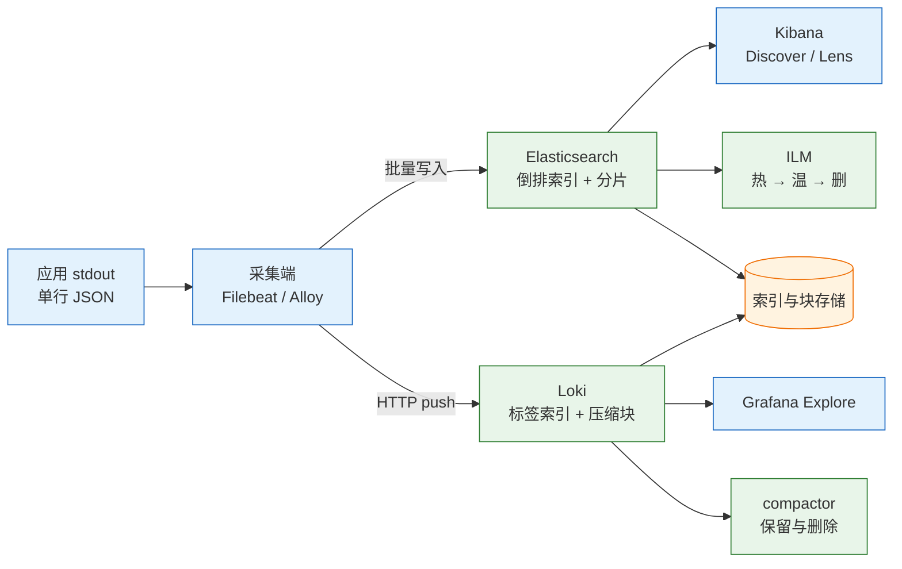
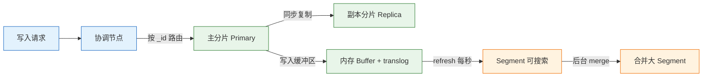
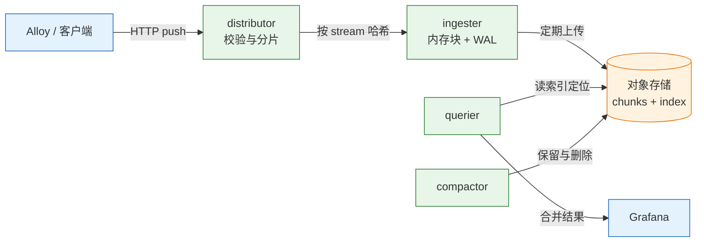

# 日志系统：ELK 与 Loki

---

## 一、日志系统是什么

日志是应用在运行过程中产生的离散事件，一条记录通常包含时间、级别、服务、上下文和消息。单机时代，日志写在本地文件里，排查问题时 `grep` 即可；进入容器和微服务时代，日志分散在几十个 Pod、几百个容器里，本地文件随容器销毁而消失，集中式日志系统才成为基础设施。

集中式日志系统解决四件事：**集中采集**（把分散的 stdout 和文件收拢）、**结构化解析**（把一行文本拆成可过滤的字段）、**条件检索**（按服务、时间、级别、关键字快速定位）、**按时间保留**（热数据可查、冷数据可归档、过期自动删除）。它不解决调用链追踪、业务报表和根因自动定位，那些分别属于 tracing、数据仓库和人的判断。

### 1.1 核心概念

日志系统和数据库一样，有自己的数据模型。理解文档、索引、流、标签这几个对象，才能判断一条日志写到了哪里、为什么查不到。

| 概念 | 含义 | 运维影响 |
|---|---|---|
| 事件（Event） | 一条带时间戳的日志记录 | 时间字段决定排序与范围查询 |
| 文档（Document） | Elasticsearch 中的一条 JSON 记录 | 字段类型由 mapping 决定 |
| 索引（Index） | 文档的集合，检索和删除的单位 | 按日期或服务切分，才有保留粒度 |
| 数据流（Data Stream） | 只追加的索引序列，自动滚动 | 新版本写日志的推荐形态 |
| 流（Stream） | Loki 中标签组合相同的日志序列 | 标签基数决定索引大小 |
| 块（Chunk） | Loki 压缩后的日志数据块 | 查询时先定位块，再解压过滤 |

日志有两种形态。**非结构化日志**是一行自由文本，采集端只能用正则或 grok 猜测字段，格式一改就失效。**结构化日志**是一行 JSON，字段名和类型明确，采集端只做轻量转换，Kibana 和 Grafana 都能直接按字段过滤。生产环境应优先结构化，把解析成本从采集端移到应用端。

时间语义也要分清。**事件时间**是日志产生的时间，**入库时间**是日志到达存储的时间。跨时区、跨主机排障必须用事件时间，并且统一存 UTC；否则同一秒的日志在不同节点上会排成不同顺序。

### 1.2 与相邻技术的关系

ELK 是 Elasticsearch、Logstash、Kibana 的合称，实际部署常加入 Filebeat，严格叫 Elastic Stack。Loki 属于 Grafana 的 LGTM 体系（Loki、Grafana、Tempo、Mimir），定位是“低成本的日志聚合”，不是 Elasticsearch 的功能替代。

| 系统 | 索引方式 | 查询能力 | 成本特征 |
|---|---|---|---|
| Elasticsearch | 倒排索引，字段可检索 | 全文检索、聚合、排序强 | 索引膨胀，JVM 与分片运维重 |
| Loki | 只索引标签，正文压缩 | 标签过滤、行过滤、指标查询 | 对象存储便宜，查询耗 CPU |
| ClickHouse | 列式存储，SQL | 大规模聚合快 | 需要自建表结构与写入链路 |
| 对象存储归档 | 不建索引 | 只能整包下载 | 极低成本，不适合在线检索 |

日志与指标、追踪的分工要明确。指标回答“错误率是否上涨”，日志回答“具体哪条请求报了什么错”，追踪回答“请求经过了哪些服务、慢在哪一段”。三者用 `trace_id` 关联：指标发现异常，日志定位错误，追踪还原调用路径。

日志系统不是数据仓库：复杂 join、全表扫描、长期报表会拖垮 Elasticsearch，这类需求应进 ClickHouse 或数仓。

### 1.3 架构组成

两条技术栈的采集入口相似，存储与查询路径不同。选择哪条，取决于查询模式，而不是组件数量。



| 组件 | 职责 | 典型故障 |
|---|---|---|
| 采集端 | 读文件或容器日志，做轻量处理 | 权限不足、registry 损坏、输出认证失败 |
| Elasticsearch | 建索引、存储、检索、聚合 | 分片未分配、磁盘水位、写入拒绝 |
| Kibana | 查询界面、可视化、空间与权限 | data view 不匹配、服务不可达 |
| Loki | 接收推送、压缩块、按标签检索 | 乱序拒绝、标签基数高、查询超时 |
| Grafana | 查询与面板 | 数据源地址错、时间范围错 |
| 对象存储 | 存放 Loki 块与索引 | 权限、生命周期误删 |

采集端有两种部署形态：**节点级**（DaemonSet 或系统服务）读取宿主机上的容器日志目录，**旁路级**（sidecar）跟随单个 Pod。节点级资源占用低，但需要能访问容器运行时日志路径；旁路级隔离好，但 Pod 数量多时开销成倍增加。大多数集群用节点级。

> **运维提示**：日志链路是“至少一次”语义，采集端重启、网络重试都可能产生重复。去重应靠日志里的唯一 ID 在查询层处理，不要在采集端追求精确一次。

---

## 二、Elasticsearch 与 Kibana 安装配置

### 2.1 资源规划与内核参数

Elasticsearch 是 JVM 应用，堆内存、文件系统和内核参数共同决定稳定性。堆给得太小会频繁 GC，给得太大反而失去压缩指针优势，还留给文件系统缓存的余量不足。

| 资源 | 建议 | 原因 |
|---|---|---|
| JVM 堆 | 不超过物理内存一半，且不超过约 31 GB | 保留页缓存，压缩指针上限 |
| 磁盘 | SSD，预留 30% 以上 | 写入、合并、水位都依赖余量 |
| 内存锁定 | `bootstrap.memory_lock: true` | 防止堆被换出导致停顿 |
| 文件描述符 | 不低于 65535 | 分片与连接数随规模上升 |
| 内核参数 | `vm.max_map_count=262144` | 低于此值会导致启动失败 |
| 集群规模 | 生产至少 3 个数据节点 | 副本才有放置位置 |

```bash
# ========== 内核参数：虚拟内存映射上限 ==========
# 容器宿主机和裸机都需要设置，重启后仍生效
sudo sysctl -w vm.max_map_count=262144
echo 'vm.max_map_count=262144' | sudo tee /etc/sysctl.d/99-elasticsearch.conf
sudo sysctl --system

# ========== 文件描述符与内存锁定 ==========
# limits 配置对 systemd 服务不一定生效，容器用 ulimits 单独设置
echo 'elasticsearch soft nofile 65535' | sudo tee /etc/security/limits.d/99-elasticsearch.conf
echo 'elasticsearch hard nofile 65535' | sudo tee -a /etc/security/limits.d/99-elasticsearch.conf

# ========== 验证 ==========
sysctl vm.max_map_count
ulimit -n
```

单节点只适合开发和演示。生产集群要考虑脑裂、副本放置和磁盘故障，至少三个候选主节点，数据节点按容量横向扩展。节点角色不要混在一起，主节点负责集群状态，数据节点负责存储与查询。

### 2.2 Compose 部署

下面的栈包含 Elasticsearch、Kibana 和 Filebeat，版本固定，便于复现。`xpack.security.enabled=false` 只用于本地实验，生产必须开启安全。

```yaml
# compose.yaml
services:
  es:
    image: docker.elastic.co/elasticsearch/elasticsearch:9.5.5
    container_name: es
    environment:
      - discovery.type=single-node          # 单节点发现，集群部署时删除
      - xpack.security.enabled=false        # 仅本地实验，生产必须为 true
      - xpack.security.enrollment.enabled=false  # 关闭安全时一并关闭注册
      - ES_JAVA_OPTS=-Xms1g -Xmx1g          # 堆初始值与最大值保持一致
      - bootstrap.memory_lock=true          # 锁定内存，避免换页
    ulimits:
      memlock:
        soft: -1
        hard: -1
      nofile:
        soft: 65535
        hard: 65535
    ports:
      - "9200:9200"
    volumes:
      - es-data:/usr/share/elasticsearch/data
    healthcheck:
      test: ["CMD-SHELL", "curl -fsS http://localhost:9200/_cluster/health || exit 1"]
      interval: 30s
      timeout: 10s
      retries: 5

  kibana:
    image: docker.elastic.co/kibana/kibana:9.5.5
    container_name: kibana
    environment:
      - ELASTICSEARCH_HOSTS=http://es:9200
    ports:
      - "5601:5601"
    depends_on:
      es:
        condition: service_healthy
    restart: unless-stopped

  filebeat:
    image: docker.elastic.co/beats/filebeat:9.5.5
    container_name: filebeat
    user: root                             # 读取宿主机日志目录需要权限
    command: ["filebeat", "-e", "-strict.perms=false"]
    volumes:
      - ./filebeat.yml:/usr/share/filebeat/filebeat.yml:ro
      - ./app-logs:/var/log/app:ro     # 应用日志目录，按实际路径替换
    depends_on:
      es:
        condition: service_healthy
    restart: unless-stopped

volumes:
  es-data:
```

```bash
# ========== 准备日志目录并启动存储与界面 ==========
# 先建目录，避免 Docker 以 root 身份创建挂载点
# Filebeat 等索引模板安装后再启动，见 7.1
mkdir -p ./app-logs
docker compose up -d es kibana
docker compose ps

# ========== 验证版本 ==========
# 预期输出与镜像标签一致，小版本随镜像变化
curl -s localhost:9200 | jq -r '.version.number'

# ========== 查看集群健康 ==========
# 单节点通常为 yellow，因为没有第二个节点放副本
curl -s 'localhost:9200/_cluster/health?pretty' | jq '{status,number_of_nodes,active_shards}'
```

> **版本现状（2026-10）**：Elasticsearch、Kibana、Filebeat 均为 9.5.5，Loki 为 3.7.9。升级前先读 breaking changes，索引模板、ILM 策略与采集配置要一起验证。

> **安全警告**：`xpack.security.enabled=false` 会让 9200 端口完全无认证。只要宿主机能被外部访问，任何人都能读走全部日志、删除索引。实验环境也要绑定 `127.0.0.1`，不要把端口映射到公网。

### 2.3 安全配置与验证

Elasticsearch 8 起默认开启安全，首次启动会生成证书、内置用户和密码。9.x 延续这套机制。生产环境至少完成四件事：TLS 加密传输、内置用户改密、应用使用 API Key、Kibana 按空间和角色分权。

```bash
# ========== 重置内置用户密码 ==========
# 交互式输入新密码，不要把密码写在命令行参数里
docker exec -it es bin/elasticsearch-reset-password -u elastic

# ========== 生成应用使用的 API Key ==========
# 输出只显示一次，立即存入密钥管理系统
curl -s -X POST -u elastic:'<ELASTIC_PASSWORD>' \
  'localhost:9200/_security/api_key' \
  -H 'Content-Type: application/json' \
  -d '{"name":"filebeat-writer","role_descriptors":{"writer":{"cluster":["monitor"],"index":[{"names":["logs-*"],"privileges":["create_index","create","index","write"]}]}}}'

# ========== 带证书访问 ==========
# --cacert 指向集群 CA，不能用 -k 跳过校验
curl -s --cacert config/certs/ca/ca.crt \
  -u elastic:'<ELASTIC_PASSWORD>' \
  'https://localhost:9200/_cluster/health?pretty'
```

| 安全项 | 做法 | 目的 |
|---|---|---|
| 传输加密 | 启用 TLS，客户端校验 CA | 防止日志与凭据被嗅探 |
| 身份认证 | 内置用户改密，应用用 API Key | 避免共享超级用户 |
| 授权 | 角色限定索引与操作 | 采集端只能写，Kibana 只能读 |
| 网络隔离 | 9200 只对内网开放 | 缩小暴露面 |
| 审计 | 开启审计日志，单独存储 | 满足合规与追责 |

> **运维红线**：不要用 `elastic` 超级用户作为 Filebeat 或 Logstash 的输出账号。采集端一旦被攻破，攻击者就能删除全部索引。为每个采集链路建独立角色和 API Key，权限只覆盖目标索引的写入。

### 2.4 核心参数

Elasticsearch 的配置分三类：集群发现、路径与内存、安全。容器部署用环境变量覆盖，裸机部署写 `elasticsearch.yml`，两种方式不要混用同一组参数。

| 参数 | 作用 | 建议 |
|---|---|---|
| `cluster.name` | 集群名称 | 固定且唯一，避免误加入 |
| `node.name` | 节点名称 | 用主机名，便于定位 |
| `discovery.seed_hosts` | 候选主节点地址 | 生产至少三个 |
| `cluster.initial_master_nodes` | 首次选举的节点列表 | 只在初始化时使用 |
| `path.data` | 数据目录 | 独立磁盘，权限正确 |
| `bootstrap.memory_lock` | 锁定堆内存 | 与 ulimit 配合 |
| `xpack.security.enabled` | 是否开启安全 | 生产必须为 true |

```yaml
# elasticsearch.yml（裸机部署示例）
cluster.name: logs-prod
node.name: es-data-01
path.data: /var/lib/elasticsearch
path.logs: /var/log/elasticsearch

network.host: 0.0.0.0
http.port: 9200

# 生产集群的三个候选主节点，单节点部署时删除
discovery.seed_hosts: ["es-data-01", "es-data-02", "es-data-03"]
cluster.initial_master_nodes: ["es-data-01", "es-data-02", "es-data-03"]

# 锁定内存，配合 /etc/security/limits.conf 的 memlock
bootstrap.memory_lock: true

# 安全：生产必须开启，证书路径按实际部署填写
xpack.security.enabled: true
xpack.security.transport.ssl.enabled: true
xpack.security.http.ssl.enabled: true
```

> **注意**：`cluster.initial_master_nodes` 只用于集群首次启动。集群成型后必须删除，否则重启时可能触发新的选举，造成脑裂或数据丢失。

---

## 三、Elasticsearch 核心对象

### 3.1 索引、文档与 Mapping

索引是文档的集合，文档是 JSON，mapping 是字段类型定义。三者关系类似数据库里的库、行、表结构，但 Elasticsearch 的 mapping 一旦字段类型确定，修改成本很高，通常要重建索引并 reindex。

| 字段类型 | 用途 | 能否聚合 | 注意事项 |
|---|---|---|---|
| `text` | 全文分词检索 | 否 | 需要 `keyword` 子字段做聚合 |
| `keyword` | 精确值、标签、状态码 | 是 | 适合 service、level、trace_id |
| `date` | 时间戳 | 是 | 显式指定 format |
| `integer` / `long` | 数值 | 是 | 范围查询比字符串快 |
| `flattened` | 未知结构的 JSON | 有限 | 防止字段数爆炸 |
| `object` / `nested` | 嵌套对象 | 视配置 | `nested` 查询成本高 |

动态 mapping 是日志场景的常见陷阱。应用在 JSON 里多打一个随机 key，Elasticsearch 就多一个字段；字段数涨到几千后，集群状态膨胀、写入变慢、恢复时间变长。固定字段显式声明，未知字段用 `dynamic: false` 或 `flattened` 兜底。

```json
PUT demo-classic
{
  "settings": {
    "number_of_shards": 1,
    "number_of_replicas": 0
  },
  "mappings": {
    "dynamic": false,
    "properties": {
      "@timestamp": { "type": "date" },
      "service":    { "type": "keyword" },
      "env":        { "type": "keyword" },
      "level":      { "type": "keyword" },
      "msg":        { "type": "text" },
      "route":      { "type": "keyword" },
      "status":     { "type": "integer" },
      "duration_ms":{ "type": "long" },
      "trace_id":   { "type": "keyword" },
      "attrs":      { "type": "flattened" }
    }
  }
}
```

写入是近实时的：文档先进内存缓冲区和 translog，默认每秒 refresh 一次生成可搜索的 segment。这意味着刚写入的日志最多延迟约 1 秒才能被查到；需要立即验证时加 `?refresh=true`，但生产环境不要对每条写入都强制刷新。

### 3.2 分片与副本

索引被切成主分片，主分片分布在数据节点上，副本是主分片的拷贝。主分片数在索引创建后不能直接修改，副本数可以随时调整。



| 对象 | 含义 | 可调整性 |
|---|---|---|
| 主分片 | 索引的水平切分 | 创建后不可直接改，需 shrink/split/reindex |
| 副本 | 主分片的拷贝 | 可随时增减 |
| 路由 | `_id` 哈希决定文档落在哪个分片 | 默认按 `_id` |
| 刷新 | 让写入对搜索可见 | `refresh_interval` 可调 |

经验值：单个分片控制在 10–50 GB，分片太多会增加集群状态和查询开销；每 GB JVM 堆不超过 20 个分片是常见上限，不是硬指标。单节点开发环境副本无法分配，集群会 yellow，这是正常的；生产至少两个数据节点再谈副本。

```bash
# ========== 查看索引与分片 ==========
curl -s 'localhost:9200/_cat/indices?v&s=index'
curl -s 'localhost:9200/_cat/shards?v'

# ========== 查看未分配分片的原因 ==========
curl -s 'localhost:9200/_cluster/allocation/explain?pretty'

# ========== 调整副本数（单节点开发环境设为 0） ==========
curl -s -X PUT 'localhost:9200/demo-classic/_settings' \
  -H 'Content-Type: application/json' \
  -d '{"index":{"number_of_replicas":0}}'
```

> **注意**：不要为了“提高并发”把主分片设得很大。分片不是越多越快，每个分片都有固定开销；小索引用 1 个主分片足够，按数据量和节点数规划，而不是按核数拍脑袋。

### 3.3 数据流与 ILM

日志是只追加的数据，最适合用 data stream。data stream 由一个或多个隐藏的后备索引组成，写入时自动指向当前索引，达到条件后 rollover 到新索引，旧索引按 ILM 策略降温和删除。

| ILM 阶段 | 典型动作 | 目的 |
|---|---|---|
| hot | rollover、forcemerge | 承接写入，控制单索引大小 |
| warm | shrink、forcemerge、迁移节点 | 降低资源占用 |
| cold | 迁移到廉价存储 | 只保留偶尔查询 |
| delete | 删除索引 | 控制保留期与成本 |

```json
PUT _ilm/policy/logs-app-policy
{
  "policy": {
    "phases": {
      "hot": {
        "min_age": "0ms",
        "actions": {
          "rollover": {
            "max_primary_shard_size": "30gb",
            "max_age": "1d"
          },
          "set_priority": { "priority": 100 }
        }
      },
      "warm": {
        "min_age": "7d",
        "actions": {
          "forcemerge": { "max_num_segments": 1 },
          "set_priority": { "priority": 50 }
        }
      },
      "delete": {
        "min_age": "90d",
        "actions": { "delete": {} }
      }
    }
  }
}
```

`min_age` 从 rollover 之后开始计算，不是从文档写入时间计算。这个细节决定了实际保留期会比“90 天”多出一个滚动周期，容量规划要留余量。

### 3.4 索引模板

索引模板把 settings、mappings 和 ILM 策略绑定到匹配的索引或 data stream 上。新索引创建时自动套用，避免每建一个索引都手工配置。

```json
PUT _index_template/logs-app-template
{
  "index_patterns": ["logs-app-*"],
  "data_stream": {},
  "priority": 200,
  "template": {
    "settings": {
      "number_of_shards": 1,
      "number_of_replicas": 1,
      "index.lifecycle.name": "logs-app-policy",
      "index.refresh_interval": "5s"
    },
    "mappings": {
      "dynamic": false,
      "properties": {
        "@timestamp": { "type": "date" },
        "service":    { "type": "keyword" },
        "level":      { "type": "keyword" },
        "msg":        { "type": "text" },
        "trace_id":   { "type": "keyword" }
      }
    }
  },
  "_meta": {
    "description": "应用日志模板，字段变更需走评审"
  }
}
```

| 模板字段 | 作用 | 注意 |
|---|---|---|
| `index_patterns` | 匹配索引或数据流 | 不要覆盖系统索引 |
| `data_stream` | 声明为数据流模板 | 与普通索引模板二选一 |
| `priority` | 多模板冲突时的优先级 | 数值大者生效 |
| `_meta` | 模板元信息 | 写清负责人和变更说明 |

模板变更不会自动修改已有索引，只影响新创建的索引。要修正历史数据，需要 reindex 或重建 data stream。

---

## 四、日志采集管道

### 4.1 日志格式规范

采集端的能力有限，日志格式越规整，后续检索越省力。应用只写 stdout，一行一个 JSON，字段固定，时间统一 UTC。

```json
{"ts":"2026-10-28T10:00:00.123Z","level":"ERROR","service":"api","env":"prod","trace_id":"4f9c2a","route":"/orders/{id}","status":500,"duration_ms":1830,"msg":"db timeout"}
```

| 字段 | 类型 | 用途 |
|---|---|---|
| `ts` | ISO 8601 时间 | 事件时间，统一 UTC |
| `level` | 枚举 | ERROR、WARN、INFO、DEBUG |
| `service` / `env` | 字符串 | 低基数标签，用于过滤 |
| `trace_id` | 字符串 | 关联追踪与其他服务日志 |
| `route` | 模板化路径 | 聚合统计，避免原始 URL |
| `status` / `duration_ms` | 数值 | 错误率与延迟分析 |

时间统一用 UTC、ISO 8601 带毫秒，不要在应用里写本地时间。Kibana 和 Grafana 会按浏览器时区显示，但存储必须是 UTC，否则跨时区排障会错位。日志级别也不要滥用：生产默认 INFO，DEBUG 用动态开关短时打开，查完就关。

字段名一旦发布就不要随便改，查询、看板和告警会一起坏。采集端限制单行长度，超长堆栈合并成一个字段，不要把一次异常拆成几百条。

> **安全警告**：日志里不能出现密码、token、身份证号、完整卡号、密钥。脱敏必须在应用输出前完成，采集端正则替换只能兜底；一旦写入存储，副本、快照、备份都会带着敏感数据扩散。

### 4.2 Filebeat 配置

Filebeat 是轻量采集器，负责读文件、做少量字段处理、批量写入 Elasticsearch 或 Logstash。它不擅长复杂转换，grok 和 enrich 应交给 Logstash。

```yaml
# filebeat.yml
filebeat.inputs:
  - type: filestream              # 新版本推荐 filestream，替代 log
    id: app-logs                  # 唯一 ID，用于记录读取位置
    paths:
      - /var/log/app/*.log
    parsers:
      - ndjson:                   # 按 JSON 解析，字段直接展开
          target: ""              # 展开到顶层
          add_error_key: true     # 解析失败时记录错误字段

processors:
  # 用事件时间覆盖 Filebeat 的入库时间
  - timestamp:
      field: ts
      layouts:
        - '2006-01-02T15:04:05.000Z'
      test:
        - '2026-10-28T10:00:00.123Z'
  # 丢弃健康检查日志，减少无效写入
  - drop_event:
      when:
        contains:
          msg: "/healthz"
  # 补充主机元数据，便于按节点排查
  - add_host_metadata:
      when.not.contains.tags: forwarded

output.elasticsearch:
  hosts: ["http://es:9200"]
  # data stream 名称必须符合 logs-<dataset>-<namespace>
  index: "logs-app-default"

setup.template.enabled: false        # 模板由 3.4 预先安装
setup.ilm.enabled: false             # ILM 已绑定在 3.4 的模板上
```

| 配置块 | 作用 | 常见错误 |
|---|---|---|
| `filestream.id` | 记录读取位点 | 多实例共用同一 ID 会重复读 |
| `parsers.ndjson` | 解析 JSON 行 | 日志不是单行 JSON 时解析失败 |
| `processors` | 丢弃、补充、改写字段 | 顺序错导致字段还不存在 |
| `timestamp` | 用 `ts` 覆盖 `@timestamp` | 时间格式与日志不一致 |
| `output.elasticsearch.index` | 指定 data stream | 名称不符合三段式规范 |
| `setup.template.enabled` | 关闭自动模板 | 与预装模板冲突 |

```bash
# ========== 校验配置 ==========
docker compose exec filebeat filebeat test config -c /usr/share/filebeat/filebeat.yml

# ========== 测试输出连通性 ==========
docker compose exec filebeat filebeat test output -c /usr/share/filebeat/filebeat.yml

# ========== 查看采集日志 ==========
docker compose logs -f filebeat
```

> **注意**：Filebeat 的 registry 记录每个文件读到哪一行。删除 registry 会导致全量重读，日志量瞬间翻倍；迁移采集器时要连同 registry 一起迁移，或接受一次重复。

### 4.3 Logstash 处理

Logstash 适合需要 grok 解析、字段丰富、多路输出的场景。它的 JVM 和管道模型比 Filebeat 重，部署前要评估吞吐和堆内存。

```ruby
# pipeline/logs.conf
input {
  beats {
    port => 5044                 # 接收 Filebeat 输出
  }
}

filter {
  # 已经是 JSON 的日志直接解析，避免 grok
  json {
    source => "message"
    target => "doc"
  }

  # 用事件时间覆盖入库时间
  date {
    match => ["[doc][ts]", "ISO8601"]
    target => "@timestamp"
  }

  # 只保留检索需要的字段，减小索引体积
  mutate {
    remove_field => ["message", "event", "agent", "host"]
  }
}

output {
  elasticsearch {
    hosts => ["http://es:9200"]
    # Logstash 走独立索引，避免与 3.4 的 data stream 模板冲突
    index => "logstash-app-%{+yyyy.MM.dd}"
    # 生产环境应配置 user/password 或 api_key
  }
}
```

| 插件段 | 常用插件 | 用途 |
|---|---|---|
| input | `beats`、`kafka`、`http` | 接收采集端或消息队列数据 |
| filter | `json`、`grok`、`date`、`mutate` | 解析、改时间、删字段 |
| output | `elasticsearch`、`kafka`、`s3` | 写入存储或二次分发 |

grok 是最后手段。正则匹配成本高，日志格式一改就失效；能输出 JSON 就不要用 grok，必须用时把表达式纳入版本库并写测试样例。

### 4.4 采集器选型

| 采集器 | 适合场景 | 代价 |
|---|---|---|
| Filebeat | 文件与容器日志进 Elasticsearch | 复杂转换能力有限 |
| Logstash | grok、enrich、多路输出 | JVM 重，管道要调优 |
| Grafana Alloy | 进 Loki 或 OTel，统一采集 | 配置模型与 Promtail 不同 |
| Fluent Bit | 资源受限节点、K8s 边缘采集 | 插件生态与过滤能力较弱 |

典型组合是 Filebeat → Elasticsearch，Alloy → Loki；只有需要复杂解析或路由时才加 Logstash。采集链越长，延迟和故障点越多，能在应用端结构化就不要在中间层堆插件。

---

## 五、Kibana 检索与可视化

### 5.1 Data View 与字段

Kibana 通过 data view 绑定索引模式和时间字段，Discover 才能按时间轴展示日志。data view 不是索引本身，它只是查询时的范围定义。

```bash
# ========== 创建 data view ==========
# kbn-xsrf 是 Kibana 的 CSRF 防护头，写操作必须带
curl -s -X POST 'localhost:5601/api/data_views/data_view' \
  -H 'kbn-xsrf: true' \
  -H 'Content-Type: application/json' \
  -d '{"data_view":{"title":"logs-app-*","timeFieldName":"@timestamp"}}' \
  | jq '.data_view.id'

# ========== 查看字段能力 ==========
curl -s 'localhost:5601/api/data_views' -H 'kbn-xsrf: true' \
  | jq -r '.data_view[] | "\(.title) \(.timeFieldName)"'
```

Discover 是排障的第一入口。选定 data view 和时间范围后，把 `service`、`level`、`status`、`duration_ms` 加为列，再按时间倒序查看；需要反复使用的过滤条件保存为 saved search，分享链接时带上时间范围，别人打开看到的是同一段现场。

| 设置 | 作用 | 常见错误 |
|---|---|---|
| `title` | 索引模式 | 写成具体索引，跨天数据查不到 |
| `timeFieldName` | 时间字段 | 选了入库时间，排序错位 |
| 字段格式 | 数值、百分比、持续时间 | 单位不统一，图表误读 |
| 运行时字段 | 查询时计算 | 复杂脚本拖慢检索 |

### 5.2 KQL 查询

Kibana 的 KQL 面向交互式检索，语法比 Elasticsearch DSL 简单。它适合快速缩小范围，不适合复杂聚合。

| 写法 | 含义 | 示例 |
|---|---|---|
| `field: value` | 字段等值 | `service: "api"` |
| `field >= value` | 数值范围 | `status >= 500` |
| `and` / `or` / `not` | 布尔组合 | `level: "ERROR" and not route: "/healthz"` |
| `field: value*` | 前缀通配 | `route: "/orders/*"` |
| `*` | 全字段匹配 | `"timeout"` |

```text
# 最近一小时 api 服务的 5xx 错误
service: "api" and level: "ERROR" and status >= 500

# 排除健康检查，按接口过滤
service: "api" and route: "/orders/*" and not msg: "healthcheck"
```

> **注意**：KQL 的 `field: value` 对 `text` 字段是分词匹配，对 `keyword` 字段是精确匹配。同一个值在两种字段上结果不同，查询前先确认字段类型。

### 5.3 聚合与图表

日志检索只是第一步，聚合才能回答“哪个接口错误最多”“错误从几点开始”。Kibana 的 Lens 和聚合查询都建立在 Elasticsearch 的 aggregation 之上。

```json
GET logs-app-default/_search
{
  "size": 0,
  "query": {
    "bool": {
      "filter": [
        { "term": { "level": "ERROR" } },
        { "range": { "@timestamp": { "gte": "now-1h" } } }
      ]
    }
  },
  "aggs": {
    "by_service": {
      "terms": { "field": "service", "size": 10 },
      "aggs": {
        "by_minute": {
          "date_histogram": { "field": "@timestamp", "fixed_interval": "1m" }
        }
      }
    }
  }
}
```

图表选择服从问题：看趋势用折线图，看分布用柱状图，看占比用饼图，看 Top N 用表格。Lens 里先选可视化类型，再拖字段，最后把过滤条件固化成面板；同一张图不要混合不同量纲的指标。保存到空间时写清负责人和用途，避免半年后没人知道这张图该不该删。

| 聚合 | 用途 | 注意 |
|---|---|---|
| `terms` | 按字段分组 Top N | 高基数字段会返回大量桶 |
| `date_histogram` | 按时间分桶 | 间隔与时间范围要匹配 |
| `percentiles` | 延迟分位数 | 基于近似算法 |
| `cardinality` | 去重计数 | 大基数结果有误差 |

---

## 六、Loki 与 Alloy

### 6.1 Loki 架构与部署

Loki 只索引标签，日志正文压缩后放对象存储。查询时先用标签缩小 stream，再解压块做行过滤。这个设计让存储成本大幅下降，但要求标签设计非常克制。



| 组件 | 职责 | 故障表现 |
|---|---|---|
| distributor | 校验租户与标签，计算 stream 哈希 | 推送 400/429 |
| ingester | 在内存中累积块并写 WAL | 查询最近数据缺失 |
| querier | 读索引与块，合并结果 | 查询超时、结果不全 |
| compactor | 合并索引、执行保留删除 | 磁盘不释放、旧数据不删 |
| object store | 持久化块与索引 | 上传失败、查询读不到 |

```yaml
# compose.yaml（在 2.2 的栈中追加 Loki 服务）
services:
  loki:
    image: grafana/loki:3.7.9
    container_name: loki
    command: -config.file=/etc/loki/loki-config.yml
    ports:
      - "3100:3100"
    volumes:
      - ./loki-config.yml:/etc/loki/loki-config.yml:ro
      - loki-data:/loki
    restart: unless-stopped

volumes:
  loki-data:
```

```yaml
# loki-config.yml
auth_enabled: false                  # 单租户演示；多租户设为 true
server:
  http_listen_port: 3100

common:
  path_prefix: /loki
  storage:
    filesystem:                      # 演示用本地存储，生产换 S3/OSS
      chunks_directory: /loki/chunks
      rules_directory: /loki/rules
  replication_factor: 1
  ring:
    kvstore:
      store: inmemory

schema_config:
  configs:
    - from: 2024-04-01
      store: tsdb                    # Loki 3.x 推荐 TSDB 索引
      object_store: filesystem
      schema: v13
      index:
        prefix: index_
        period: 24h

limits_config:
  retention_period: 720h             # 30 天保留
  reject_old_samples: true
  reject_old_samples_max_age: 168h   # 拒绝 7 天前的乱序日志
  max_query_series: 500              # 限制单次查询的 stream 数

compactor:
  working_directory: /loki/compactor
  retention_enabled: true
  delete_request_store: filesystem   # 启用保留删除时必填
```

```bash
# ========== 启动 Loki ==========
docker compose up -d loki

# ========== 就绪检查 ==========
# 正常返回 ready
curl -s localhost:3100/ready

# ========== 查看指标与配置 ==========
curl -s localhost:3100/metrics | head -n 20
```

### 6.2 Alloy 采集配置

Promtail 已于 2026-03-02 EOL，新部署使用 Grafana Alloy。Alloy 用组件化配置描述采集、处理和输出，语法与 Promtail 的 scrape_config 不同。

```alloy
// 发现 Docker 容器
discovery.docker "containers" {
  host = "unix:///var/run/docker.sock"
}

// 读取容器日志并附加标签
loki.source.docker "logs" {
  host       = "unix:///var/run/docker.sock"
  targets    = discovery.docker.containers.targets
  labels     = { job = "docker" }
  forward_to = [loki.write.default.receiver]
}

// 写入 Loki
loki.write "default" {
  endpoint {
    url = "http://loki:3100/loki/api/v1/push"
  }
}
```

| 组件 | 作用 | 关键参数 |
|---|---|---|
| `discovery.docker` | 发现容器目标 | `host` 指向 Docker socket |
| `loki.source.docker` | 读取容器 stdout/stderr | `targets`、`labels` |
| `loki.write` | 推送到 Loki | `url`、批量与重试 |
| `loki.process` | 解析、过滤、改标签 | 放在 source 与 write 之间 |

采集端不要把 `request_id`、`user_id` 变成标签，它们应留在日志正文里。标签只放 `service`、`env`、`level`、`container` 这类低基数维度。标签组合越多，Loki 的 stream 越多，索引和查询都会变慢。

> **注意**：Alloy 读取 Docker socket 等于获得宿主机 root 等价权限。生产环境限制 socket 挂载范围，或改用只读日志目录加 file 采集。

### 6.3 LogQL 查询

LogQL 分两部分：**日志查询**返回日志行，**指标查询**在日志上做计数、速率和分位数。语法顺序固定为“流选择器 → 行过滤 → 解析器 → 标签过滤”。

| 操作符 | 含义 | 示例 |
|---|---|---|
| `{label="v"}` | 流选择器，必须至少一个非空匹配 | `{service="api"}` |
| `\|=` | 包含字符串 | `\|= "ERROR"` |
| `!=` | 不包含字符串 | `!= "healthcheck"` |
| `\|~` | 正则匹配 | `\|~ "timeout\|refused"` |
| `\| json` | 解析 JSON 字段 | `\| json` |
| `\| logfmt` | 解析 logfmt | `\| logfmt` |
| `\| unwrap` | 提取数值用于指标查询 | `\| unwrap duration_ms` |

```logql
# 流选择器 + 行过滤
{service="api", env="prod"} |= "ERROR" != "healthcheck"

# 解析 JSON，再按字段过滤
{service="api"} | json | status >= 500

# 按级别统计每分钟条数
sum by (level) (count_over_time({service="api"}[1m]))

# 错误日志速率
sum by (route) (rate({service="api"} |= "ERROR" [5m]))

# 延迟 p95：先 unwrap 数值字段
quantile_over_time(
  0.95,
  {service="api"} | json | unwrap duration_ms [5m]
)
```

```bash
# ========== 查询最近 5 分钟 ==========
curl -sG http://localhost:3100/loki/api/v1/query_range \
  --data-urlencode 'query={service="api"} |= "timeout"' \
  --data-urlencode "start=$(( $(date +%s) - 300 ))000000000" \
  --data-urlencode "end=$(date +%s)000000000" \
  | jq '.data.result[0].values'
```

> **注意**：LogQL 的标签过滤必须能缩小到少量 stream。只写 `{env="prod"}` 会扫描整个环境的所有日志，查询很容易超时；先加 `service`，再加正文过滤，顺序不能反。

### 6.4 保留与 compactor

Loki 的保留由 compactor 执行，配置项在 `limits_config` 和 `compactor` 两处，缺一个都不会真正删除数据。对象存储上的生命周期规则是第二道保险，不能替代 compactor。

| 配置 | 作用 | 注意 |
|---|---|---|
| `retention_period` | 全局保留时长 | 按租户可覆盖 |
| `retention_enabled` | 开启删除 | 未开启时只标记不删除 |
| `delete_request_store` | 删除请求的存储后端 | 必须与对象存储一致 |
| `reject_old_samples_max_age` | 拒绝过旧样本 | 防止采集端补历史拖垮写入 |
| `max_query_series` | 单次查询 stream 上限 | 防止大查询打爆 querier |

多租户部署要开启 `auth_enabled`，推送与查询都带 `X-Scope-OrgID`，不同租户的 stream 与保留策略相互隔离。

> **运维红线**：不要在对象存储上直接删除 Loki 的 chunk 或 index 前缀来“清空间”。索引与块相互引用，手工删除会让查询报错、compactor 状态不一致。要缩短保留期，改配置并重启 compactor，让系统按租户逐步删除。

---

## 七、完整示例：日志从产生到检索

### 7.1 启动栈与写入

在 2.2 的栈基础上增加 6.1 的 Loki 服务，形成双栈对照。先验证 Elasticsearch 的写入与查询，再验证 Loki 的推送与检索；Alloy 采集配置见 6.2，示例用 HTTP 推送直接验证 Loki。

启动顺序有依赖：Elasticsearch 先健康，Kibana 和 Filebeat 才能连上；Loki 先就绪，采集端才能推送。先装 3.4 的索引模板和 3.3 的 ILM 策略，再启动采集端，否则 data stream 会用动态 mapping 自动创建，后续修正要重建。

```bash
# ========== 准备日志目录并启动 Elasticsearch ==========
mkdir -p ./app-logs
docker compose up -d es

# ========== 等待 Elasticsearch 就绪 ==========
# 最多等待 60 秒，避免无限阻塞
for i in $(seq 1 30); do
  curl -fsS localhost:9200 >/dev/null && break
  sleep 2
done

# ========== 安装 ILM 策略与索引模板 ==========
# 先把 3.3、3.4 的 JSON 分别保存为 ilm-policy.json、index-template.json
curl -s -X PUT 'localhost:9200/_ilm/policy/logs-app-policy' \
  -H 'Content-Type: application/json' \
  --data-binary @ilm-policy.json

curl -s -X PUT 'localhost:9200/_index_template/logs-app-template' \
  -H 'Content-Type: application/json' \
  --data-binary @index-template.json

# ========== 启动其余服务 ==========
docker compose up -d kibana loki
docker compose up -d filebeat

# ========== 写入一条日志并立即刷新 ==========
curl -s -X PUT 'localhost:9200/logs-demo/_doc/1?refresh=true' \
  -H 'Content-Type: application/json' \
  -d '{"service":"api","level":"ERROR","msg":"timeout calling db","ts":"2026-10-28T10:00:00Z"}'

# ========== 按字段查询 ==========
curl -s 'localhost:9200/logs-demo/_search?q=level:ERROR&pretty' \
  | jq '.hits.total.value'
```

预期响应类似：

```json
{"_index":"logs-demo","_id":"1","result":"created","_shards":{"total":2,"successful":1,"failed":0},"_seq_no":0,"_primary_term":1}
```

查询命中数为 `1`。`_shards.total` 为 2 是因为包含副本，单节点时副本未分配，`successful` 为 1，这与集群 yellow 是同一件事。

Loki 的推送接口接收纳秒时间戳，返回 204 表示已接收：

```bash
# ========== 推送一条日志 ==========
NOW=$(date +%s)000000000
curl -s -o /dev/null -w '%{http_code}\n' \
  -X POST http://localhost:3100/loki/api/v1/push \
  -H 'Content-Type: application/json' \
  -d "{\"streams\":[{\"stream\":{\"service\":\"api\",\"level\":\"error\"},\"values\":[[\"$NOW\",\"timeout calling db\"]]}]}"
```

```text
204
```

### 7.2 采集与验证

```bash
# ========== 生成一条应用日志，供 Filebeat 采集 ==========
printf '{"ts":"%s","level":"ERROR","service":"api","env":"prod","trace_id":"demo-1","route":"/orders/{id}","status":500,"duration_ms":1830,"msg":"db timeout"}\n' \
  "$(date -u +%Y-%m-%dT%H:%M:%S.000Z)" >> ./app-logs/api.log

# ========== 查看 Filebeat 是否在发货 ==========
docker compose logs --tail=50 filebeat | grep -i "harvester\|publish"

# ========== 统计最近一小时写入量 ==========
curl -s 'localhost:9200/logs-app-default/_count' \
  -H 'Content-Type: application/json' \
  -d '{"query":{"range":{"@timestamp":{"gte":"now-1h"}}}}' | jq '.count'

# ========== 查看 Loki 的 stream 数量 ==========
curl -sG 'localhost:3100/loki/api/v1/label/service/values' | jq '.data'

# ========== 查看 data stream 与后备索引 ==========
curl -s 'localhost:9200/_data_stream/logs-app-default?pretty'
curl -s 'localhost:9200/_cat/indices/.ds-logs-app-*?v'

# ========== 查看 Loki 就绪状态 ==========
curl -s localhost:3100/ready
```

| 检查项 | 正常表现 | 异常时看 |
|---|---|---|
| 采集端 | 日志无 `permission denied` | 挂载路径、运行用户 |
| Elasticsearch | data stream 创建，文档数增长 | 模板、输出地址、认证 |
| Loki | `/ready` 返回 ready | 配置、对象存储、端口 |
| Kibana | Discover 能看到新日志 | data view、时间字段 |

### 7.3 检索与告警

Kibana 里用 KQL 缩小范围，Grafana 里用 LogQL 做同样的检索。两边语法不同，排障顺序一致：先限定服务与环境，再限定时间，最后加错误条件。

```text
# Kibana KQL
service: "api" and level: "ERROR" and status >= 500

# LogQL
{service="api", env="prod"} | json | level="ERROR" and status >= 500
```

Loki 的 ruler 可以把 LogQL 指标查询变成告警规则（需在 Loki 配置中启用 ruler），语法与 Prometheus 规则类似：

```yaml
# loki/rules/api.yml
groups:
  - name: logs.api
    rules:
      - alert: ApiErrorLogBurst
        expr: |
          sum by (service) (rate({service="api"} |= "ERROR" [5m])) > 1
        for: 5m
        labels:
          severity: ticket
        annotations:
          summary: "api 错误日志超过每秒 1 条"
```

| 查询目标 | Kibana | Grafana / Loki |
|---|---|---|
| 按服务过滤 | `service: "api"` | `{service="api"}` |
| 排除关键字 | `not msg: "health"` | `!= "health"` |
| JSON 字段过滤 | 直接写字段 | `\| json \| status >= 500` |
| 时间范围 | 右上角选择器 | 查询的 start/end 参数 |

### 7.4 保留与清理

验证保留策略是否生效，不能只看配置，要看索引和块是否真的减少。

```bash
# ========== 查看 ILM 执行状态 ==========
curl -s 'localhost:9200/.ds-logs-app-*/_ilm/explain?pretty' \
  | jq -r '.indices[] | "\(.index) \(.phase) \(.action)"'

# ========== 查看后备索引 ==========
curl -s 'localhost:9200/_cat/indices/.ds-logs-app-*?v&s=index'

# ========== 手工删除测试索引（不可恢复） ==========
curl -s -X DELETE 'localhost:9200/logs-demo'
```

> **运维红线**：`DELETE /logs-app-*`、`_delete_by_query` 和 `docker compose down -v` 都会造成不可恢复的数据丢失。删除前先确认快照、确认索引模式没有匹配到生产索引，并在维护窗口执行。

---

## 八、成本控制与保留策略

### 8.1 成本构成

日志成本由写入量、索引开销、副本数和保留时长共同决定，可以按 **日增 GB × 膨胀系数 × 副本数 × 保留天数** 估算。先算每天每服务写入多少 GB，再乘索引膨胀和副本，不要凭感觉买磁盘。

| 成本项 | Elasticsearch | Loki |
|---|---|---|
| 原始日志 | 1 倍 | 1 倍 |
| 索引与元数据 | 1.5–3 倍 | 标签索引很小 |
| 副本 | 再乘副本数 | 由对象存储保证 |
| 查询资源 | JVM 堆与 CPU | querier 的 CPU 与内存 |
| 长期存储 | 热节点磁盘贵 | 对象存储便宜 |

降成本的手段按优先级排列：关掉 DEBUG、丢弃健康检查、采样高频重复日志、缩短保留期、冷热分层、压缩。不要先买更大的磁盘；先确认这些日志有人看。

### 8.2 分层保留

| 日志 | 保留 | 存放 |
|---|---|---|
| 应用 ERROR/WARN | 30–90 天 | Loki，按 service/env 查 |
| 访问日志/审计 | 180 天–1 年 | Elasticsearch + ILM |
| DEBUG | 1–7 天或默认关闭 | 本地或采样，不进中央 |
| 安全与支付审计 | 按合规要求 | 不可变存储，单独权限 |

Elasticsearch 用 ILM：热阶段按 1 天或 30 GB 滚动、7 天转温、温阶段可保留到 30 天、90 天删除；Loki 用 compactor 配 `retention_period`。所有节点用 NTP 同步，时间错乱会让排序和关联失效。没有保留策略，日志系统最终一定被磁盘写满。

> **运维提示**：保留策略要和业务方确认，审计日志看合规要求，应用日志看排障需求，两者不要共用一条策略。

---

## 九、常见排障

| 现象 | 最可能原因 | 处理 |
|---|---|---|
| ES 集群 yellow | 副本未分配（单节点常见） | 开发环境副本设为 0，生产加节点 |
| ES 集群 red | 主分片未分配、磁盘水位、节点掉线 | `_cluster/allocation/explain`，清磁盘或恢复节点 |
| 写入被拒 429 | bulk 队列满、分片跟不上 | 降批量、加 backoff、扩容 |
| 磁盘 watermark 触发 | 使用率超过 85%/90%/95% | 删旧索引、调 ILM、加磁盘 |
| 启动报 `max virtual memory areas` | `vm.max_map_count` 太小 | `sysctl -w vm.max_map_count=262144` 并持久化 |
| mapping 爆炸 | 动态字段太多 | 显式 mapping、`dynamic: false`、flattened |
| Filebeat 不发货 | 权限、registry、输出认证 | 看 Filebeat 日志，跑 `filebeat test output` |
| Kibana 无数据 | data view 时间字段错、索引不匹配 | 核对 `@timestamp` 与索引模式 |
| Loki `entry too far behind` | 日志乱序超过窗口 | 采集端按时间排序，调 chunk 配置 |
| Loki `too many outstanding requests` | 查询范围太大或并发高 | 缩时间范围，加 `limit`，拆查询 |
| Loki 标签基数高 | 把 ID 放进标签 | 改成正文过滤，重建 stream |
| 日志重复 | 采集端重启重复读、至少一次语义 | 用唯一 ID 去重，接受少量重复 |
| 查询超时 | 全量扫描、正则太宽 | 先标签缩小，再过滤，避免 `.*` |

排障顺序从数据产生的源头往下走，先确认“有没有”，再确认“对不对”：

```bash
# ========== 第一步：采集端是否读到日志 ==========
docker compose logs --tail=100 filebeat
docker compose exec filebeat filebeat test output -c /usr/share/filebeat/filebeat.yml

# ========== 第二步：入口是否接收 ==========
curl -s -o /dev/null -w '%{http_code}\n' localhost:9200
curl -s localhost:3100/ready

# ========== 第三步：存储是否健康 ==========
curl -s 'localhost:9200/_cluster/health?pretty'
curl -s 'localhost:9200/_cat/indices?v&s=index'
curl -s 'localhost:9200/_cat/shards?v' | grep -i unassigned

# ========== 第四步：查询是否命中 ==========
curl -s 'localhost:9200/logs-app-default/_count' \
  -H 'Content-Type: application/json' \
  -d '{"query":{"range":{"@timestamp":{"gte":"now-1h"}}}}'
```

1. **采集端**：应用有没有写 stdout？采集器有没有报错、有没有权限读日志目录？
2. **入口**：推送返回 204/200 还是 429/400？先确认数据到了，再谈查询。
3. **存储**：ES 看 `_cluster/health`、`_cat/indices`、`_cat/shards`；Loki 看 ingester 与对象存储。
4. **查询**：缩小时间范围，先查 `*` 再逐层加条件，确认是数据缺失还是条件写错。
5. **展示**：data view、时间字段、Grafana 数据源，最后才怀疑存储。
6. **资源**：分片、堆内存、保留期放在最后调；数据已经丢了，调参没有意义。

> **排障提示**：ES 的 `yellow` 在单节点是预期状态，不是故障；`red` 才代表主分片不可用。看到颜色先看 `unassigned_shards` 和分配解释，不要直接重启集群。
