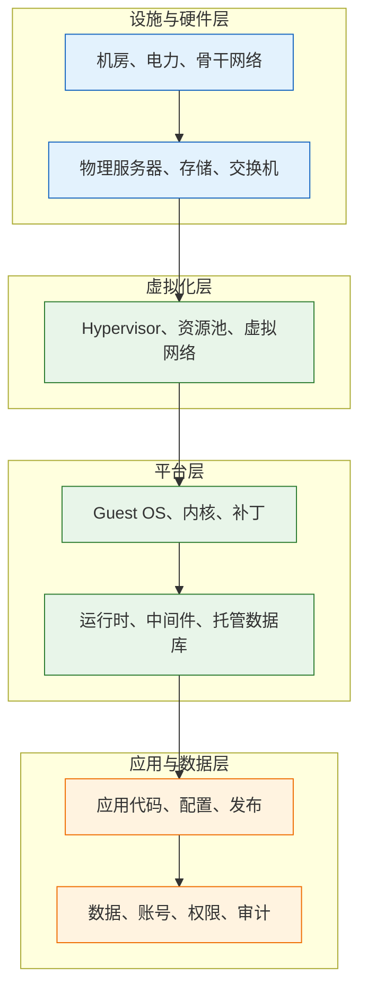
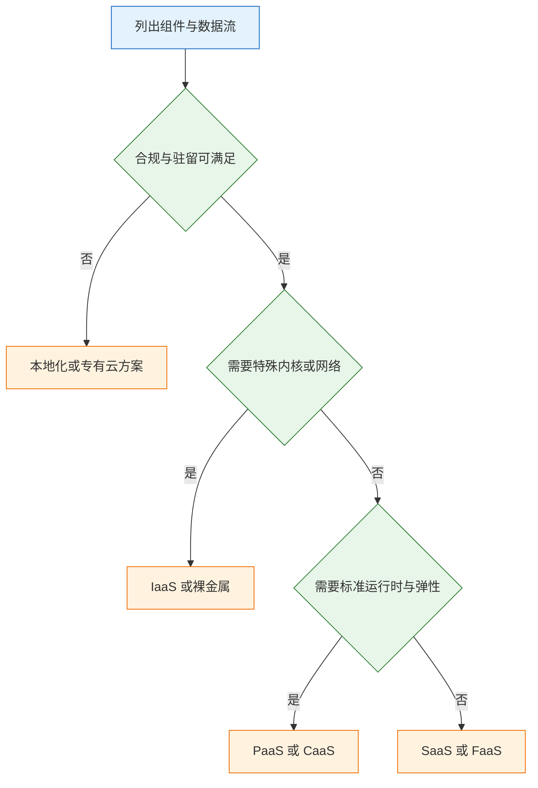
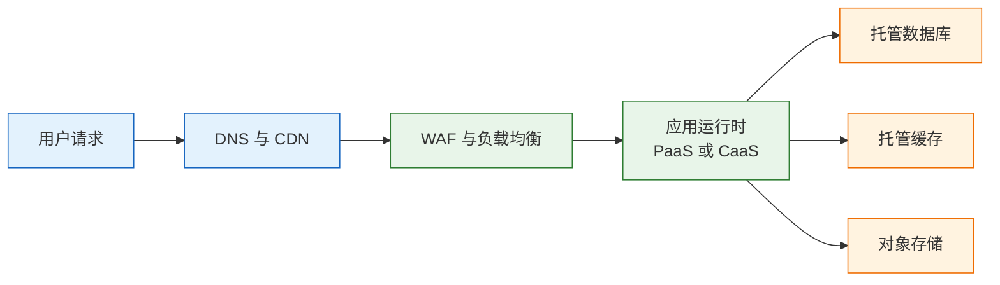
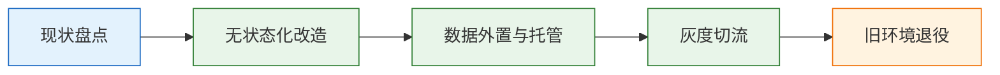

# IaaS、PaaS、SaaS 服务模型

---

## 一、云服务模型是什么

### 1.1 核心概念

云服务模型（Cloud Service Model）是对云计算责任边界的标准化划分。它回答的不是“产品是否先进”，而是“从哪一层开始由使用方接管”。同一条业务链路，放在不同模型上，补丁、备份、扩缩容、安全加固和账单的归属完全不同。

IaaS（Infrastructure as a Service，基础设施即服务）交付虚拟机、块存储、虚拟网络、负载均衡等基础资源。使用方拿到操作系统管理员权限，从内核参数、中间件版本到应用部署全部自行负责。典型产品包括 AWS EC2、阿里云 ECS、腾讯云 CVM、Google Compute Engine。

PaaS（Platform as a Service，平台即服务）交付操作系统、运行时、中间件和部分数据服务。使用方只提交应用代码、配置和数据，平台负责运行时补丁、实例扩缩容、部分高可用。典型产品包括 Azure App Service、AWS Elastic Beanstalk、Heroku、阿里云 SAE；托管数据库 RDS、托管 Redis 在责任划分上同样属于 PaaS。

SaaS（Software as a Service，软件即服务）交付可直接使用的软件能力。使用方不接触服务器、数据库和代码，只管理账号、权限、配置与数据。典型产品包括 Microsoft 365、Salesforce、GitHub、飞书。

三个模型之外还有两个常用补充形态：CaaS（Container as a Service）交付托管 Kubernetes 控制面，使用方管理节点与工作负载；FaaS（Function as a Service）交付函数运行时，使用方只提交函数代码和事件源。

| 模型 | 交付物 | 使用方接管点 | 典型产品 |
|---|---|---|---|
| IaaS | 虚拟机、磁盘、网络 | 操作系统及以上 | EC2、ECS、CVM、GCE |
| PaaS | 运行时、中间件、托管数据库 | 应用、数据、配置 | App Service、RDS、SAE |
| SaaS | 完整软件产品 | 账号、权限、数据 | Microsoft 365、Salesforce |
| CaaS | 托管 K8s 控制面 | 节点、工作负载、策略 | EKS、AKS、GKE、ACK |
| FaaS | 函数运行时与事件源 | 函数代码、配置 | Lambda、Cloud Functions |

> **注意**：模型名称只描述责任边界，不描述部署位置。私有云里的虚拟机仍然是 IaaS，公有云上的托管数据库仍然是 PaaS；判断依据是“谁打补丁、谁做备份、谁扩缩容”，不是机房归属。

### 1.2 与相邻技术的关系

云服务模型与虚拟化、容器、编排、云原生是不同层面的概念，混用会导致选型讨论失焦。

虚拟化是 IaaS 的技术基础。Hypervisor 把物理资源切成虚拟机，使用方获得独立的 Guest OS。没有虚拟化，IaaS 只能交付物理机租赁。

容器是应用打包方式，不是服务模型。容器可以跑在 IaaS 的虚拟机上，也可以跑在 CaaS 的托管节点上，还可以由 PaaS 平台隐藏。容器解决的是依赖一致性和交付粒度，不自动解决补丁、备份和计费归属。

Kubernetes 是容器编排系统。托管 Kubernetes 属于 CaaS：供应商负责控制面可用性、版本升级和 etcd，使用方负责节点池、工作负载、网络策略和存储。自建 Kubernetes 跑在 IaaS 上，控制面责任重新回到使用方。

云原生是一组架构方法，强调声明式、不可变、可观测和弹性。它可以建立在 IaaS、CaaS 或 PaaS 之上，但不能替代服务模型的责任划分。

| 相邻技术 | 解决的问题 | 与服务模型的关系 |
|---|---|---|
| 虚拟化 | 物理资源切分与隔离 | IaaS 的实现基础 |
| 容器 | 应用打包与依赖一致 | 可运行在 IaaS、CaaS、PaaS |
| Kubernetes | 容器编排与自愈 | 托管形态即 CaaS |
| 云原生 | 应用如何面对变化与失败 | 跨模型的架构方法 |
| Serverless | 按事件执行、按用量计费 | FaaS 的实现形态 |

### 1.3 架构组成

把云平台纵向拆开，可以得到一条从设施到数据的责任栈。每一层都有明确的交付物和接管点，服务模型就是在这条栈上画横线。



| 层级 | 主要内容 | IaaS 责任方 | PaaS 责任方 |
|---|---|---|---|
| 设施与硬件 | 机房、服务器、网络 | 供应商 | 供应商 |
| 虚拟化 | Hypervisor、资源池 | 供应商 | 供应商 |
| 操作系统 | Guest OS、补丁、内核 | 使用方 | 供应商 |
| 运行时 | JDK、中间件、数据库 | 使用方 | 供应商 |
| 应用与数据 | 代码、配置、数据、权限 | 使用方 | 使用方 |

SaaS 把应用层也纳入供应商责任，使用方只保留账号、权限、配置和数据内容。数据内容的责任始终不会转移：供应商负责存储介质的可用性与加密能力，使用方负责分类、授权、备份策略和删除时机。

> **运维提示**：画责任栈时，每一层都要写三个字段：交付物、责任方、证据来源。证据可以是合同条款、SLA、配置项截图或审计报告；只写“供应商负责”无法在事故复盘时使用。

---

## 二、服务模型的分类与边界

### 2.1 IaaS 的能力边界

IaaS 交付的是“可管理的空白机器”。使用方获得 root 或 Administrator 权限，可以改内核参数、装任意 agent、绑多块磁盘、组私有网络。能力边界也在这里：供应商只保证虚拟化层和物理资源的可用性，Guest OS 内部的补丁、账号、防火墙、日志、备份全部由使用方承担。

IaaS 适合三类场景：需要特殊内核参数或网络协议的遗留系统；许可证绑定物理机或特定 CPU 特性的软件；超大规模且具备专职运维团队、对单位成本敏感的业务。

| 能力 | 供应商负责 | 使用方负责 |
|---|---|---|
| 计算可用性 | 物理机、虚拟化、迁移 | Guest OS 启动与健康 |
| 块存储 | 介质冗余、快照接口 | 分区、文件系统、挂载 |
| 网络 | 虚拟网络底座、边界 | 子网、路由、安全组、ACL |
| 镜像 | 公共镜像基线 | 加固、补丁、镜像生命周期 |

> **注意**：云主机的“可用”只代表虚拟化层正常。操作系统内核 panic、磁盘写满、安全组误删、证书过期，都不在供应商的基础设施 SLA 内。IaaS 的故障排查必须同时看云监控和 Guest OS 内部指标。

### 2.2 PaaS 的能力边界

PaaS 交付的是“可部署的运行环境”。平台接管操作系统补丁、运行时版本、实例扩缩容、部分健康检查和日志采集。使用方提交代码、依赖清单、环境变量和启动命令，平台负责构建与运行。

PaaS 的边界通常体现在四个方面：网络端口受限，只暴露 HTTP/HTTPS 或指定端口；文件系统临时，重启后本地写入丢失；运行时长受限，长连接和后台线程可能被回收；原生依赖受限，需要平台提供 buildpack 或自定义构建包。

| 平台能力 | 提供方式 | 使用方责任 |
|---|---|---|
| 运行时 | 托管 JDK、Node、Python 等 | 依赖版本与启动参数 |
| 扩缩容 | 按实例数或指标自动调整 | 容量上限与并发模型 |
| 托管数据库 | 备份、主从、故障切换 | Schema、索引、连接池、恢复演练 |
| 日志与监控 | 采集 stdout、基础指标 | 日志格式、告警规则、保留期 |

托管数据库属于 PaaS，但“自动备份已开启”不等于“可恢复”。备份保留期、跨区副本、恢复耗时、恢复后的账号权限，都需要使用方验证。

### 2.3 SaaS 的能力边界

SaaS 交付的是“可直接使用的产品”。使用方不拥有基础设施，也不修改产品代码，只通过管理后台、API 和集成配置使用能力。边界集中在租户模型、身份集成、数据导出和审计。

| 关注项 | 说明 | 核查动作 |
|---|---|---|
| 租户与隔离 | 单租户、逻辑多租户或混合 | 确认数据隔离方式与日志边界 |
| 身份集成 | SAML、OIDC、SCIM | 验证 SSO 与离职自动禁用 |
| 数据导出 | 全量导出格式、频率、API | 每季度执行一次导出演练 |
| 审计与留存 | 操作日志、登录日志、保留期 | 对接 SIEM，确认留存满足合规 |

SaaS 的风险不在功能，而在“配置即责任”。公开链接、外部共享、API Token 权限、第三方集成授权，都是使用方配置的结果。供应商提供能力，不替使用方做数据分类。

### 2.4 CaaS 与 FaaS 的补充形态

CaaS 位于 IaaS 与 PaaS 之间。供应商负责 Kubernetes 控制面的可用性、etcd 备份、API Server 升级和基础准入控制；使用方负责节点池、运行时、工作负载、网络策略、存储类和成本。CaaS 保留了 Kubernetes 的声明式能力，同时把最难的控制器运维转移给供应商。

FaaS 把执行单元缩小到函数。供应商负责运行时、扩缩容、事件源集成和按调用计费；使用方负责函数代码、内存配置、超时、并发上限和幂等。FaaS 的边界是冷启动、执行时长、内存上限、连接数和本地状态，长连接与重计算通常不适合。

| 模型 | 控制面归属 | 数据面归属 | 适用负载 |
|---|---|---|---|
| CaaS | 供应商 | 使用方节点与 Pod | 容器化微服务、需要编排 |
| FaaS | 供应商 | 供应商按调用调度 | 事件驱动、突发短任务 |
| 自建 K8s | 使用方 | 使用方 | 强定制、离线、特殊合规 |

> **运维提示**：CaaS 的成本容易被低估。控制面费用只是起点，节点池、负载均衡、公网出口、日志采集、跨区流量都会叠加。选型时把“每集群固定成本”和“每 Pod 变动成本”分开估算。

---

## 三、共享责任与控制力

### 3.1 共享责任矩阵

共享责任模型（Shared Responsibility Model）把安全与运维责任拆到具体条目。它不是一个口号，而是一张需要签字确认的表。

| 责任项 | IaaS | PaaS | SaaS |
|---|---|---|---|
| 物理与环境安全 | 供应商 | 供应商 | 供应商 |
| 虚拟化与宿主机 | 供应商 | 供应商 | 供应商 |
| Guest OS 补丁 | 使用方 | 供应商 | 供应商 |
| 运行时与中间件 | 使用方 | 供应商 | 供应商 |
| 应用代码与配置 | 使用方 | 使用方 | 供应商 |
| 数据分类与授权 | 使用方 | 使用方 | 使用方 |
| 备份策略与恢复演练 | 使用方 | 共同 | 共同 |
| 账号与访问审计 | 使用方 | 使用方 | 使用方 |

“共同”意味着接口两侧都有动作：供应商提供备份功能与保留期，使用方决定备份范围、开启策略并验证恢复。只开启不验证，等于没有备份。

### 3.2 控制力与运维负担

控制力与运维负担是一对反向指标。控制力越强，越能定制内核、网络和运行时；同时补丁、容量、故障切换、安全加固的工作量也越大。

| 维度 | 自建 IDC | IaaS | PaaS | SaaS |
|---|---|---|---|---|
| 控制力 | 最高 | 高 | 中 | 低 |
| 运维负担 | 最高 | 高 | 中 | 最低 |
| 上线速度 | 慢 | 中 | 快 | 最快 |
| 弹性上限 | 受资产限制 | 高 | 高 | 受产品限制 |

选型不是追求控制力最大化，而是让控制力刚好覆盖业务差异。标准 Web 服务不需要改内核，把控制力花在 IaaS 上只会增加补丁和值班成本；需要特殊网络协议或内核模块的系统，放到 PaaS 上会被平台限制卡死。

### 3.3 合规与数据驻留

合规要求往往先于技术选型。数据能否出境、能否落在指定区域、子处理商是否披露、加密密钥由谁持有，这些条件会直接排除一批产品。

| 合规项 | 核查内容 | 证据形式 |
|---|---|---|
| 数据驻留 | 存储、备份、日志所在区域 | 区域配置与账单 |
| 子处理商 | 分包商清单与变更通知 | 供应商合规页面 |
| 加密与密钥 | 传输、静态加密、BYOK | 配置截图与密钥托管说明 |
| 审计与留存 | 操作日志、访问记录、保留期 | 审计报告与导出样本 |

> **安全警告**：合规责任不会因为选择 SaaS 而消失。数据分类、授权范围、共享链接、导出审批仍由使用方承担；一次公开链接泄露就足以构成数据事件，供应商的合规认证不能免责。

---

## 四、选型方法与决策顺序

### 4.1 选型维度

选型先把硬约束列出来，再比较软指标。硬约束不满足的方案直接淘汰，不进入打分环节。

| 维度 | 判断依据 | 淘汰条件 |
|---|---|---|
| 合规 | 区域、行业、数据分类 | 数据无法落在允许区域 |
| 团队能力 | 值班、内核、网络、数据库 | 无人承担 7×24 故障 |
| 负载形态 | 协议、连接时长、内核参数 | 平台不支持所需协议 |
| 退出成本 | 导出格式、API 专有度 | 数据无法全量导出 |

软指标包括上线速度、生态集成、单位成本、供应商支持质量。软指标适合加权评分，不适合一票否决；硬约束必须先过。

### 4.2 组件级拆分

一个系统很少只用一种模型。按组件拆分，把每个组件的责任落到具体模型，比整站选型更现实。

| 组件 | 推荐模型 | 理由 |
|---|---|---|
| DNS、CDN、WAF | SaaS 或 PaaS | 自建无规模收益，按用量付费 |
| 负载均衡 | 云负载均衡 | 证书、健康检查、高可用交给平台 |
| 应用运行时 | PaaS 或 CaaS | 标准 HTTP 服务优先托管 |
| 数据库与缓存 | 托管 PaaS | 备份、主从、切换成本高 |
| 对象存储 | 对象存储服务 | 静态文件与备份不占应用磁盘 |
| 邮件、短信、SSO | SaaS | 送达率、认证安全门槛高 |

组件拆分的副产品是供应商数量。每增加一个供应商，就多一套 IAM、账单、支持和故障边界。小团队优先在同一云内选择托管服务，跨云只在合规、容灾或明确议价时引入。

### 4.3 决策流程



决策顺序固定为五步：先定合规与数据驻留，再定团队运维能力，再看负载形态与协议限制，然后比较退出成本，最后才比较价格。顺序反过来，通常会得到一个“便宜但迁移不出去”的方案。

---

## 五、成本测算与供应商锁定

### 5.1 TCO 构成

TCO（Total Cost of Ownership，总拥有成本）不是资源月费。它至少包含资源、人力、可观测性、网络、备份与容灾、安全合规、迁移退出、故障损失八项。

| 成本项 | 内容 | 易漏点 |
|---|---|---|
| 资源费 | 计算、存储、数据库、网络 | 公网流量、跨区流量 |
| 人力 | 部署、补丁、值班、排障 | 夜间与节假日值班 |
| 可观测性 | 日志、指标、追踪、存储 | 日志保留期与查询费 |
| 备份与容灾 | 快照、跨区副本、演练 | 恢复演练的人力 |
| 迁移与退出 | 数据导出、双跑、改造 | 专有 API 的适配层 |

只比较资源费，结论通常与真实成本相反。IaaS 的机器单价低，但补丁、备份、高可用、监控都要自建；PaaS 的平台费高，但把这些工作打包进了服务。

### 5.2 成本测算脚本

下面的脚本把资源费与人力费分开计算。单价全部由环境变量传入，不内置任何报价，避免把示例数字当成真实价格。

```bash
#!/usr/bin/env bash
set -euo pipefail

# ========== 输入参数 ==========
# 每月小时数，按 730 估算，可按实际月份调整
HOURS="${HOURS:-730}"
# 单台云主机每小时价格，必须从账单或价格页读取
VM_HOURLY="${VM_HOURLY:?请设置 VM_HOURLY}"
# 云主机数量
VM_COUNT="${VM_COUNT:-3}"
# IaaS 每月运维工时
OPS_HOURS="${OPS_HOURS:-20}"
# 人力小时成本，按内部核算口径填写
OPS_HOURLY="${OPS_HOURLY:?请设置 OPS_HOURLY}"
# PaaS 平台月费
PAAS_MONTHLY="${PAAS_MONTHLY:-0}"
# PaaS 每月运维工时
PAAS_OPS_HOURS="${PAAS_OPS_HOURS:-6}"
# SaaS 每席位月费与席位数
SAAS_SEAT="${SAAS_SEAT:-0}"
SAAS_SEATS="${SAAS_SEATS:-10}"

# ========== 分模型测算 ==========
# IaaS：资源费 + 运维人力
IAAS=$(awk -v h="$HOURS" -v p="$VM_HOURLY" -v n="$VM_COUNT" \
  -v oh="$OPS_HOURS" -v op="$OPS_HOURLY" \
  'BEGIN { printf "%.2f", h * p * n + oh * op }')
# PaaS：平台费 + 降低后的运维人力
PAAS=$(awk -v m="$PAAS_MONTHLY" -v oh="$PAAS_OPS_HOURS" -v op="$OPS_HOURLY" \
  'BEGIN { printf "%.2f", m + oh * op }')
# SaaS：席位费
SAAS=$(awk -v s="$SAAS_SEAT" -v n="$SAAS_SEATS" \
  'BEGIN { printf "%.2f", s * n }')

# ========== 输出对比 ==========
# 三项口径不同，不能直接当作同功能报价
printf 'IaaS 月成本: %s\n' "$IAAS"
printf 'PaaS 月成本: %s\n' "$PAAS"
printf 'SaaS 月成本: %s\n' "$SAAS"
```

运行方式与输出结构：

```bash
# 传入真实单价后执行，金额单位为内部核算币种
VM_HOURLY=0.00 OPS_HOURLY=0.00 ./tco.sh
```

```text
IaaS 月成本: <按输入计算>
PaaS 月成本: <按输入计算>
SaaS 月成本: <按输入计算>
```

脚本的价值在于把隐性人力显性化。资源费只占一行，运维工时往往才是主项；PaaS 与 SaaS 的测算口径不同，前者覆盖应用运行，后者只覆盖一个窄功能，对比时要先补齐范围。

### 5.3 供应商锁定与退出计划

锁定是程度问题，不是有或无。数据格式、API 语义、身份体系、网络地址、计费合同，任何一项专有都会提高迁移成本。

| 锁定面 | 表现 | 缓解措施 |
|---|---|---|
| 数据 | 专有格式、无法全量导出 | 定期导出标准格式并校验 |
| API | 专有消息、队列、认证 | 适配层隔离，固定 API 版本 |
| 身份 | 专有目录、单点登录绑定 | 标准 SAML/OIDC，保留本地账号 |
| 网络 | 专有地址段、私网互联 | 双跑期保留可切换路径 |

退出计划要写成可执行清单：数据导出范围与频率、恢复演练周期、IaC 覆盖比例、DNS TTL、合同终止条款、数据删除证明。没有退出计划的低成本，只是把成本推迟到迁移当天。

> **安全警告**：把全部身份、密钥和数据放在单一供应商，且没有导出与恢复演练，等同于把业务连续性交给一份未验证的合同。退出计划必须包含“账号被停用后如何取回数据”。

---

## 六、典型架构与迁移治理

### 6.1 三层 Web 架构的落位

以一个标准订单系统为例，按接入、应用、数据三层落位，可以得到一张责任清晰的架构图。



| 层 | 组件 | 模型 | 主要责任方 |
|---|---|---|---|
| 接入 | DNS、CDN、WAF | SaaS 或 PaaS | 平台负责可用性 |
| 应用 | 运行时、发布、扩缩容 | PaaS 或 CaaS | 使用方负责代码 |
| 数据 | 数据库、缓存、对象存储 | 托管 PaaS | 共同负责备份恢复 |

接入层自建没有规模收益，证书轮换、DDoS 清洗、节点覆盖都依赖平台；应用层保留发布权和配置权；数据层把备份、主从、故障切换交给平台，但 Schema、索引、连接池和恢复演练仍在使用方。

### 6.2 迁移路径

迁移按层推进，不按整站切换。先把无状态部分搬走，再把有状态部分交给托管服务，最后切流量并退役旧环境。



| 阶段 | 关键动作 | 回退方式 |
|---|---|---|
| 盘点 | 依赖、数据流、端口、定时任务 | 保留原环境只读 |
| 改造 | 会话外置、文件上对象存储 | 双写或开关切换 |
| 数据 | 迁移、校验、增量同步 | 保留反向同步通道 |
| 切流 | 小比例灰度、观察指标 | DNS 或负载均衡回切 |

迁移期间最难的是数据一致性。全量迁移之后必须做增量同步与校验，切流前确认回退通道可用；只做一次全量导入就切流，回退时会出现数据缺口。

### 6.3 治理机制

选型不是一次会议，而是持续治理。责任矩阵、架构评审、成本标签、供应商台账、SLA 复盘，需要固定节奏。

| 机制 | 频率 | 产出 |
|---|---|---|
| 责任矩阵评审 | 每季度 | 更新责任方与证据 |
| 架构评审 | 新服务上线前 | 模型选择与退出方案 |
| 成本复盘 | 每月 | 单位成本与异常项 |
| 供应商复盘 | 每半年 | SLA、事件、续约与替代 |

> **运维提示**：把责任矩阵放进运行手册，事故复盘时按表确认“这一层谁负责、证据在哪”。口头约定在跨团队事故里几乎无法执行。

---

## 七、常见误区与排查

### 7.1 误区对照

| 误区 | 实际情况 | 纠正方式 |
|---|---|---|
| 上云等于免运维 | 责任转移到 IAM、网络、配额、成本 | 建立共享责任矩阵 |
| PaaS 不能跑生产 | 标准 Web 服务可跑，特殊协议受限 | 先验证端口、长连接、文件系统 |
| 托管数据库不用备份 | 平台提供能力，策略仍由使用方定 | 开启备份并做恢复演练 |
| SaaS 数据责任在供应商 | 数据分类与授权始终在使用方 | 配置共享策略与导出审计 |
| 多云等于高可用 | 增加网络、IAM、支持与一致性成本 | 先明确容灾目标再引入 |

### 7.2 故障排查表

| 现象 | 最可能原因 | 处理 |
|---|---|---|
| 上云后仍频繁宕机 | 责任误判，补丁或备份缺失 | 按责任矩阵逐项核对 |
| PaaS 长连接频繁断开 | 平台超时或端口限制 | 查平台限制，改用支持长连接的层 |
| 数据库恢复失败 | 备份未开启或从未演练 | 开启备份，恢复到独立实例验证 |
| 账单突然翻倍 | 公网流量、跨区复制、闲置资源 | 按用量类型钻取，补标签与预算 |
| 合规审计不通过 | 区域、子处理商、加密不满足 | 做数据映射，补 DPA 与区域配置 |
| 单可用区故障停机 | 未做多可用区部署 | 跨区部署并定期切换演练 |
| 触发配额或限流 | 默认配额不足或突发流量 | 提前申请配额，做退避与降级 |

### 7.3 排查顺序

1. 判断故障落在哪一层：设施、平台、应用还是 SaaS 供应商。
2. 查看供应商状态页与区域公告，排除大面积故障。
3. 核对自身配置：配额、安全组、证书、DNS、IAM。
4. 对照最近变更：发布、扩容、策略调整、资源删除。
5. 需要时切到备用区域或降级通道，先恢复服务。
6. 故障结束后补责任矩阵、监控项与退出演练，防止同类问题复发。

> **核心结论**：IaaS 接管操作系统，PaaS 接管运行时，SaaS 接管产品；选型先定责任边界，再比价格；托管降低运维，不降低架构责任。
