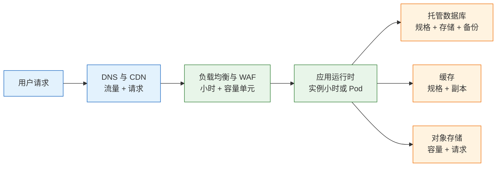
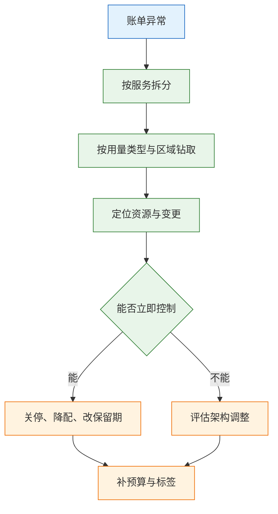

# 云平台产品与成本

---

## 一、云平台成本是什么

### 1.1 核心概念

云平台成本是资源用量、计费规则与架构选择三者共同作用的结果。同一套系统，换成按量、预留或竞价，账单结构会完全不同；同一份代码，放在同可用区还是跨可用区调用，网络费用也会差出一个量级。

理解成本要建立三个层次。**可见性**回答费用花在哪个服务、哪个环境、哪个负责人；**优化**回答哪些用量可以删除、降配、更换计费模式或调整架构；**治理**回答怎样让下个月不再长回来。三者顺序不能颠倒：看不见的费用无法优化，没有治理的优化会在三个月内反弹。

计费的基本形式可以概括为：费用 = 计量用量 × 单价 + 固定费用。计量用量可能是实例小时、GB-月、请求次数、公网流量、GB-秒或容量单元；固定费用包括托管控制面、公网地址、密钥管理、支持计划等按月收取的项目。

| 层次 | 目标 | 产出 | 失败表现 |
|---|---|---|---|
| 可见性 | 费用可归属 | 标签、账单导出、分摊报表 | 只知道总额，不知道归属 |
| 优化 | 单位成本下降 | 清理、降配、生命周期、承诺 | 一次性节省后反弹 |
| 治理 | 成本可持续 | 预算、配额、评审、复盘 | 新资源持续失控 |

> **注意**：成本优化不等于降低总额。业务量翻倍时总额上升是正常的，判断标准是单位成本（每千请求、每租户、每订单）是否稳定或下降。

### 1.2 与相邻技术的关系

云成本与 IaaS、PaaS、SaaS 的服务模型直接相关。服务模型决定哪些层由供应商计费、哪些层由使用方自建。IaaS 的虚拟机单价低，但补丁、备份、监控、值班都要自行承担；PaaS 把运行时和部分运维打包进平台费；SaaS 按席位或用量收费，使用方不再为底层资源付费。

成本管理也不是财务的独立工作。它与容量规划共享用量数据，与 IaC 共享资源生命周期，与可观测性共享标签和指标。FinOps（云财务运营）把这些动作组织成跨团队流程，核心是让工程团队对自己的资源用量负责。

| 相邻领域 | 关注点 | 与成本的关系 |
|---|---|---|
| 服务模型 | 责任边界 | 决定固定费与自建人力 |
| 容量规划 | 峰值与均值 | 决定规格与副本数 |
| IaC | 资源生命周期 | 决定删除是否彻底 |
| 可观测性 | 日志、指标、追踪 | 自身即为持续成本 |

### 1.3 架构组成

云成本的产生链路可以拆成六段：资源被创建，用量被计量，计量按价格表计价，账单按账号与标签归集，再分摊到服务或租户，最后进入预算与决策。


| 环节 | 数据来源 | 常见缺口 |
|---|---|---|
| 计量 | 云监控、用量接口 | 只保留短期数据，无法回溯 |
| 计价 | 价格页、合同折扣 | 折扣未落到账单 |
| 归集 | 账单明细 | 共享资源无法拆分 |
| 分摊 | 标签、成本类别 | 标签覆盖率低 |

> **运维提示**：账单明细要保留至少十三个月，覆盖年度同比。多数云厂商默认只提供近几个月的明细视图，需要手动开启导出到对象存储。

---

## 二、产品分类与计费维度

### 2.1 计算与存储

计算按实例运行时长计费，粒度从秒到小时不等；停止实例通常不再收取计算费，但挂载的磁盘、预留的公网地址、快照仍然计费。块存储按容量与性能计费，高性能盘与普通盘单价不同，额外 IOPS 和吞吐往往单独计价。

对象存储的计费维度最多：存储容量、请求次数、数据取回、公网流出、跨区复制。容量便宜不代表总价便宜，小文件高频访问会把请求费推高，归档类存储的取回费和最短存储期也会被忽略。

| 类别 | 计费单位 | 容易忽略的部分 |
|---|---|---|
| 虚拟机 | 秒或小时 × 规格 | 停止后的磁盘与地址 |
| 块存储 | GB-月 + IOPS/吞吐 | 未挂载卷、过期快照 |
| 对象存储 | GB-月 + 请求 + 取回 | 版本、分片、跨区复制 |
| 归档存储 | GB-月 + 取回 + 提前删除 | 最短存储期与取回延迟 |

### 2.2 网络与分发

网络是云账单中最容易被低估的部分。公网流出按 GB 计费且通常分段递减；跨可用区流量双向计费；NAT 网关按运行小时加处理流量计费；负载均衡按小时加容量单元；CDN 按分发流量与请求数计费。

一次跨区调用看似只多几毫秒，乘以每天数亿次请求就是持续支出。把高频调用的服务放在同一可用区、用 VPC 终端节点访问对象存储、把静态资源交给 CDN，都是结构性优化，不依赖削减功能。

| 计费项 | 触发条件 | 优化方向 |
|---|---|---|
| 公网流出 | 响应返回互联网 | CDN、压缩、减少回源 |
| 跨区流量 | 跨可用区或跨区域调用 | 同区部署、批量传输 |
| NAT 处理费 | 私网访问公网 | 终端节点、代理聚合 |
| 负载均衡 | 实例小时 + 容量单元 | 合并入口、清理闲置 |

> **注意**：AWS 自 2024 年起对公有 IPv4 地址单独计费，未关联实例的地址同样收费。清理闲置地址既是安全动作，也是成本动作。

### 2.3 数据与托管服务

托管数据库按实例规格与运行时长计费，存储、备份、只读副本、跨区复制、性能洞察分别计价。备份保留期越长，存储费越高；只读副本越多，计算费越高。缓存服务同理，很多团队为读多写少的业务开了过多副本。

消息队列、函数计算、容器服务各有自己的计量方式。函数按调用次数与执行时长计费，内存配置直接放大单价；托管 Kubernetes 收取控制面小时费，节点、负载均衡、日志仍按各自维度计费。

| 服务 | 主要计费项 | 常见浪费 |
|---|---|---|
| 托管数据库 | 实例小时 + 存储 + 备份 | 副本过多、备份无限期 |
| 缓存 | 实例小时 + 规格 | 副本与规格长期不调整 |
| 函数计算 | 调用次数 + GB-秒 | 内存过大、无效重试 |
| 托管 K8s | 控制面小时 + 节点 | 节点利用率低、请求虚高 |

### 2.4 平台与可观测性

日志、指标、追踪是按量增长的典型服务。日志按采集量、存储量、查询扫描量计费；指标按序列数与保留期计费；追踪按 span 数量计费。打开 DEBUG 级别、把访问日志全量采集、保留一年以上，都会形成稳定且难以察觉的支出。

密钥管理、配置中心、镜像仓库、备份库、支持计划属于平台固定费。单项金额不大，但会随账号、区域和密钥数量线性增长。

| 服务 | 计费维度 | 控制手段 |
|---|---|---|
| 日志 | 采集 GB + 存储 + 查询 | 采样、分级、到期转归档 |
| 指标 | 序列数 + 保留期 | 删除高基数标签 |
| 追踪 | span 数 + 存储 | 头部或尾部采样 |
| 密钥与仓库 | 密钥数、存储量 | 定期清理废弃版本 |

---

## 三、计费模式与承诺结构

### 3.1 按量计费

按量计费没有承诺，用多少付多少，适合新业务、波动负载和短期验证。它的价值是保留选择权：规格可以随时改，资源可以随时删。代价是单价最高。

新系统上线的前一到三个月应当保持按量，用真实数据建立用量基线。没有基线就买长期承诺，本质是在预测未来，而预测往往偏乐观。

### 3.2 预留与节省计划

预留实例承诺一到三年，换取较大折扣，通常绑定区域、实例族或具体规格。节省计划承诺每小时消费额，折扣略低但更灵活，可以跨实例族和部分服务抵扣。

承诺覆盖的是稳定基线，不是峰值。常见做法是覆盖六到七成的基线用量，剩余部分留给按量和竞价。覆盖率过高会在业务收缩或规格迁移时形成浪费。

| 模式 | 承诺对象 | 灵活性 | 适用 |
|---|---|---|---|
| 标准预留 | 区域 + 实例族 | 低 | 长期稳定的同类实例 |
| 可转换预留 | 实例族可换 | 中 | 规格可能调整 |
| 计算节省计划 | 每小时消费额 | 高 | 多实例族、多服务 |
| 实例节省计划 | 实例族 | 中 | 单一族的大用量 |

### 3.3 竞价与可中断负载

竞价实例使用空闲容量，价格随供需波动，回收前通常有短时通知。它适合批处理、渲染、CI 构建、无状态离线计算等可中断且能重试的任务。

不适合竞价的是数据库、单实例核心服务、长事务和不能丢状态的任务。把有状态服务放在竞价实例上，节省的费用往往不足以覆盖一次故障恢复。

> **注意**：竞价实例的回收通知时间有限，应用必须在收到通知后保存检查点并快速退出。没有检查点机制的任务，重启后只能从头开始。

### 3.4 免费额度与试用

免费额度适合验证和教学，不适合生产依赖。额度通常限定服务、区域、用量和有效期，超额即按量计费，到期后自动转为付费。

| 边界 | 说明 | 风险 |
|---|---|---|
| 用量上限 | 每月限定 GB 或小时 | 超额静默计费 |
| 时间上限 | 试用期结束 | 资源继续运行 |
| 服务范围 | 仅部分规格 | 选错规格即付费 |
| 区域范围 | 仅指定区域 | 跨区资源不免费 |

> **安全警告**：用个人账号或试用账号承载生产数据，会在额度到期、账号欠费或协议变更时直接失去访问。生产资源必须使用组织账号并开启账单告警。

---

## 四、成本可见性与账单拆分

### 4.1 标签体系

标签是成本归属的基础。最小集合包括环境、服务、负责人、成本中心，分别回答哪套环境、哪个系统、谁清理、谁付费。

标签必须强制。靠事后补标签永远补不完，正确做法是在 IaC 模块和组织策略里校验，缺少必填标签的资源拒绝创建。共享资源如网络、日志、堡垒机，按用量比例或固定比例分摊，并写明分摊规则。

| 标签 | 取值示例 | 用途 |
|---|---|---|
| env | prod、staging、dev | 区分环境与生命周期 |
| service | order-api、gateway | 归属到系统 |
| owner | 团队名或值班组 | 定位责任人 |
| cost-center | 内部核算编码 | 财务分摊 |

### 4.2 账单导出与查询

云厂商的账单控制台适合看趋势，不适合做钻取。要做按服务、按用量类型、按标签的分析，应开启账单明细导出：AWS 导出到 S3 后用 Athena 查询，Azure 用成本管理导出，GCP 导出到 BigQuery。

导出有延迟，通常一天一次；实时性要求高的场景仍需控制台的按日视图。导出数据要保留原始粒度，不要在入库时聚合，否则后续无法按新维度重算。

| 平台 | 导出方式 | 查询工具 |
|---|---|---|
| AWS | 成本与用量报告到 S3 | Athena、QuickSight |
| Azure | 成本管理导出到存储 | Power BI、Synapse |
| GCP | 账单导出到 BigQuery | BigQuery、Looker Studio |
| 私有云 | 计量数据库 | 自建报表 |

### 4.3 账单钻取实操

以下命令需要云命令行工具、已启用的成本分析接口和相应只读权限。区域、时间与金额均为示例，实际以账单为准。

```bash
# ========== 按服务查看月度成本 ==========
aws ce get-cost-and-usage \
  --region us-east-1 \
  --time-period Start=2026-09-01,End=2026-10-01 \
  --granularity MONTHLY \
  --metrics UnblendedCost \
  --group-by Type=DIMENSION,Key=SERVICE \
  --query 'ResultsByTime[0].Groups[].[Keys[0],Metrics.UnblendedCost.Amount]' \
  --output text | sort -k2 -nr | head -10

# ========== 找未挂载的块存储 ==========
aws ec2 describe-volumes \
  --filters Name=status,Values=available \
  --query 'Volumes[].[VolumeId,Size,CreateTime]' \
  --output table

# ========== 找未关联的公网地址 ==========
aws ec2 describe-addresses \
  --query 'Addresses[?AssociationId==null].[PublicIp,AllocationId]' \
  --output table
```

输出类似：

```text
Amazon Elastic Compute Cloud - Compute	<金额>
Amazon Relational Database Service	<金额>
Amazon Simple Storage Service	<金额>
```

先看前五项，它们通常占账单的大部分。再按用量类型钻取，把服务名展开成具体计费项，例如把计算费拆成实例小时、数据传输、块存储读写。

> **运维提示**：`UnblendedCost` 是未分摊折扣的原始成本，`AmortizedCost` 把预付承诺按小时摊平。看月度趋势用摊余成本，看单笔账单用原始成本。

### 4.4 单位成本指标

总账随业务增长，无法单独判断效率。单位成本把金额除以业务量，得到每千请求成本、每活跃租户成本、每订单成本、每 GB 处理成本。

单位成本的用途有三类：判断涨幅是业务增长还是效率下降；比较不同区域、不同版本的部署效率；为容量决策提供依据。若请求增长三成、成本增长六成，说明某处用量增速超过业务，需要钻取而不是直接扩容。

| 指标 | 计算方式 | 适用场景 |
|---|---|---|
| 每千请求成本 | 月成本 ÷ 请求数 × 1000 | API、网关 |
| 每租户成本 | 月成本 ÷ 活跃租户 | 多租户 SaaS |
| 每订单成本 | 月成本 ÷ 订单数 | 交易系统 |
| 每 GB 处理成本 | 月成本 ÷ 处理数据量 | 数据管道 |

---

## 五、成本优化方法

### 5.1 闲置与错配资源

先清理不产生价值的资源：未挂载的磁盘、未关联的地址、过期快照、空闲负载均衡、无人使用的 NAT 网关、已下线但仍运行的测试环境。

再做规格匹配。CPU 与内存长期低于两成的实例考虑降配，长期高于八成的考虑扩容或优化代码。判断依据是连续两周以上的分位数指标，不是某一天的峰值。

| 对象 | 判断依据 | 处理 |
|---|---|---|
| 未挂载磁盘 | 状态为可用 | 确认无数据后删除 |
| 未关联地址 | 无绑定实例 | 释放 |
| 旧快照 | 创建时间与保留策略 | 按策略过期 |
| 低载实例 | p95 CPU 与内存 | 降配或合并 |

### 5.2 存储生命周期

对象存储的成本靠生命周期规则控制，而不是靠人工清理。典型策略是热数据保留三十天，之后转低频，九十天后转归档，超过保留期删除；同时开启版本过期，清理历史版本和被覆盖的对象。

分片上传失败会留下不可见的分片，按容量计费。为桶配置中止未完成分片上传的规则，可以自动回收这部分空间。

| 阶段 | 存储类型 | 注意点 |
|---|---|---|
| 0–30 天 | 标准存储 | 高频访问 |
| 30–90 天 | 低频或即时归档 | 取回有费用 |
| 90 天以上 | 归档或深度归档 | 最短存储期 |
| 超期 | 删除 | 先确认合规要求 |

> **注意**：归档存储有最短存储期，提前删除仍需支付剩余天数。对频繁变动的数据使用归档，反而会增加成本。

### 5.3 网络与日志成本

网络优化的核心是减少穿越计费边界的次数。同区部署优先，跨区调用改为批量或异步，私网访问云服务走终端节点而不是 NAT，静态资源走 CDN，响应开启压缩。

日志优化分三步：降低采集量，关闭 DEBUG、采样、过滤健康检查；缩短热存储期；把冷数据转对象存储。指标优化重点是高基数标签，用户标识、请求标识这类标签会成倍增加时间序列。

### 5.4 架构级优化

当资源层优化见顶，只剩架构调整：把同步调用改为消息队列削峰、给热点数据加缓存、把大文件从应用服务器剥离到对象存储、把定时任务从常驻实例改为函数或 Job。

架构优化的收益最大，风险也最大。每次调整都要先定义验证指标，确认延迟、错误率和可靠性没有下降，再扩大范围。

### 5.5 优化效果验证

优化不是关掉资源就结束。下个月要用同一组报表验证：总账、前五项服务、标签覆盖率、闲置资源数量、单位成本。只看节省金额，容易把可靠性和性能一起省掉。

| 验证项 | 对比方式 | 通过标准 |
|---|---|---|
| 总账 | 环比、同比 | 涨幅低于业务涨幅 |
| 单位成本 | 每千请求或每租户 | 稳定或下降 |
| 可靠性 | SLO、错误率 | 不低于优化前 |
| 闲置数量 | 月度盘点 | 持续下降 |

---

## 六、预算、配额与治理机制

### 6.1 预算与异常检测

预算按账号、环境或服务设置，按 50%、80%、100% 三档告警。告警要发到负责人和值班渠道，不是发到无人查看的公共群。

异常检测比固定预算更敏感。它按历史用量建立基线，在单日支出明显偏离时触发，适合发现忘记关闭的 GPU 实例、突然增长的流量和误配置的复制任务。

| 机制 | 触发条件 | 响应 |
|---|---|---|
| 固定预算 | 月累计达到阈值 | 负责人确认并处理 |
| 异常检测 | 日支出偏离基线 | 钻取用量类型 |
| 配额 | 资源数量或规格上限 | 审批后提升 |
| 审批 | 高单价规格申请 | 记录用途与期限 |

### 6.2 配额与审批

配额既防误操作，也防成本失控。对 GPU、大规格内存实例、跨区复制、公网带宽设置上限，超出时走审批，审批记录用途、期限和负责人。

配额不是越低越好。配额过低会迫使团队拆分账号、绕过流程，反而失去可见性。合理做法是按团队和历史用量设定，并保留快速提升通道。

### 6.3 复盘节奏与组织分工

成本治理需要固定节奏。每日看异常，每周看用量趋势，每月做复盘，每季度核对承诺覆盖率与供应商合同。

| 频率 | 内容 | 参与方 |
|---|---|---|
| 每日 | 异常告警、预算偏差 | 值班工程师 |
| 每周 | 新增资源、闲置清理 | 团队负责人 |
| 每月 | 单位成本、前五项服务 | 研发与财务 |
| 每季度 | 承诺覆盖、架构评审 | 架构与采购 |

> **运维提示**：把成本指标放进服务面板，和延迟、错误率并列。工程团队每天看到单位成本，比每月收到一封账单邮件更有效。

---

## 七、典型架构与成本测算

### 7.1 三层 Web 架构的成本落位

以一个标准 Web 系统为例，成本分布在接入、应用、数据三个层。接入层按流量计费，应用层按实例或副本计费，数据层按规格、存储和备份计费。



| 层 | 主要成本 | 优化重点 |
|---|---|---|
| 接入 | 流量、请求、容量单元 | 缓存命中率、压缩 |
| 应用 | 实例或 Pod 小时 | 利用率、副本数 |
| 数据 | 规格、存储、备份 | 副本、保留期、归档 |

应用层的浪费通常来自副本数与请求量不匹配。最小副本数按可用性要求设定，峰值副本交给弹性伸缩；为应对不确定峰值长期保留高副本，是最常见的过度配置。

### 7.2 测算模型与脚本

测算要把资源费和人力费分开。单价全部由环境变量传入，不内置任何报价，避免示例数字被当成真实价格。

```bash
#!/usr/bin/env bash
set -euo pipefail

# ========== 输入参数 ==========
# 每月小时数，按 730 估算
HOURS="${HOURS:-730}"
# 单台实例每小时价格，从账单或价格页读取
VM_HOURLY="${VM_HOURLY:?请设置 VM_HOURLY}"
# 实例数量
VM_COUNT="${VM_COUNT:-3}"
# 每月运维工时与人力小时成本
OPS_HOURS="${OPS_HOURS:-20}"
OPS_HOURLY="${OPS_HOURLY:?请设置 OPS_HOURLY}"
# 存储容量与每 GB-月价格
STORAGE_GB="${STORAGE_GB:-500}"
STORAGE_PRICE="${STORAGE_PRICE:-0}"
# 公网流出流量与每 GB 价格
EGRESS_GB="${EGRESS_GB:-200}"
EGRESS_PRICE="${EGRESS_PRICE:-0}"

# ========== 分项计算 ==========
# 计算费：小时 × 单价 × 数量
COMPUTE=$(awk -v h="$HOURS" -v p="$VM_HOURLY" -v n="$VM_COUNT" \
  'BEGIN { printf "%.2f", h * p * n }')
# 存储费：容量 × 单价
STORAGE=$(awk -v g="$STORAGE_GB" -v p="$STORAGE_PRICE" \
  'BEGIN { printf "%.2f", g * p }')
# 网络费：流量 × 单价
NETWORK=$(awk -v g="$EGRESS_GB" -v p="$EGRESS_PRICE" \
  'BEGIN { printf "%.2f", g * p }')
# 人力费：工时 × 小时成本
LABOR=$(awk -v h="$OPS_HOURS" -v p="$OPS_HOURLY" \
  'BEGIN { printf "%.2f", h * p }')

# ========== 汇总输出 ==========
TOTAL=$(awk -v a="$COMPUTE" -v b="$STORAGE" -v c="$NETWORK" -v d="$LABOR" \
  'BEGIN { printf "%.2f", a + b + c + d }')
printf '计算费: %s\n' "$COMPUTE"
printf '存储费: %s\n' "$STORAGE"
printf '网络费: %s\n' "$NETWORK"
printf '人力费: %s\n' "$LABOR"
printf '合计: %s\n' "$TOTAL"
```

运行方式：

```bash
# 单价按内部核算口径填写，金额单位由使用者约定
VM_HOURLY=0.00 OPS_HOURLY=0.00 STORAGE_PRICE=0.00 EGRESS_PRICE=0.00 ./cost.sh
```

脚本的意义在于把隐性成本显性化。资源费通常只占几行，人力、备份、监控、迁移往往才是主项。比较自建与托管时，必须把人力按同一口径计入。

### 7.3 方案对比

| 方案 | 固定成本 | 变动成本 | 适用条件 |
|---|---|---|---|
| 自建 IDC | 高，资产折旧 | 低，随规模摊薄 | 规模大、负载稳定 |
| IaaS | 中，实例与存储 | 高，随用量增长 | 需要控制操作系统 |
| 托管 PaaS | 中，平台费 | 中，按实例或用量 | 标准 Web 服务 |
| Serverless | 低 | 高，按调用与时长 | 突发、低频、事件驱动 |

对比时要统一范围。只比资源单价，会得出自建最便宜的结论；把人力、备份、容灾、迁移计入后，结论经常相反。

---

## 八、常见误区与排查

### 8.1 误区对照

| 误区 | 实际情况 | 纠正方式 |
|---|---|---|
| 上云一定更便宜 | 运维转移为账单，隐性项增多 | 用总拥有成本比较 |
| 省钱的唯一方法是降配 | 架构与用量类型影响更大 | 先钻取再调整 |
| 预留买得越多越省 | 覆盖率过高会形成浪费 | 覆盖稳定基线的六到七成 |
| 竞价适合所有无状态服务 | 回收会中断长任务 | 加检查点与重试 |
| 账单总额能反映效率 | 业务增长会推高总额 | 看单位成本 |

### 8.2 故障排查表

| 现象 | 最可能原因 | 处理 |
|---|---|---|
| 账单突然翻倍 | NAT、跨区流量、日志、GPU | 按用量类型钻取，核对最近变更 |
| 对象存储费用高 | 请求、取回、公网流出 | 查请求指标与生命周期规则 |
| 预留未用满 | 预测过高、区域或规格不匹配 | 盘点覆盖率，调整后续承诺 |
| 竞价任务频繁中断 | 实例族热门、无检查点 | 多样化实例、保存进度 |
| 资源删除后仍计费 | 快照、地址、日志、备份库 | 按标签与区域盘点残留 |
| 测试环境接近生产费用 | 未关机、副本与规格一致 | 定时缩容、按需启停 |
| 预算告警未触发 | 范围、标签、币种配置错误 | 核对过滤器与通知对象 |
| 免费额度到期 | 试用期结束 | 设预算，清理实验资源 |

### 8.3 排查顺序

1. 按服务拆账单，找前五项和环比涨幅最大的服务。
2. 按用量类型、区域、账号继续钻取，定位到具体计费项。
3. 用标签或资源清单找到对应资源；无标签时按创建时间与网络关系反查。
4. 核对最近变更：发布、扩容、数据迁移、日志级别、备份策略。
5. 先控制影响：关停、降配、改保留期、释放闲置资源。
6. 补预算、标签、清理任务与评审机制，防止同类问题复发。



> **核心结论**：成本是架构的度量，不是财务的附属；先让费用可归属，再优化用量与计费模式，最后用预算和标签把结果固定下来。
