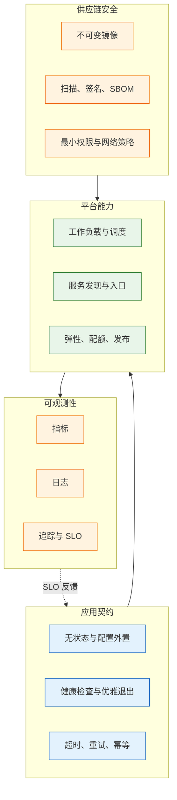

# 云原生架构

---

## 一、云原生架构是什么

### 1.1 核心概念

云原生（Cloud Native）是一组让应用在动态、分布式环境中可靠运行的设计方法。它包含容器化封装、动态调度、声明式接口和面向失败的设计，目标是把交付、扩缩容和故障恢复从人工操作变成平台能力。

云原生不是某个产品的别名，也不能用是否使用 Kubernetes 来判断。真正的判断标准有三条：应用实例能否随时被替换而不丢状态；期望状态能否用配置描述并由平台收敛；故障能否通过指标、日志和追踪被定位。

| 维度 | 传统部署 | 云原生部署 |
|---|---|---|
| 交付单元 | 主机与安装包 | 镜像与不可变制品 |
| 配置 | 写在服务器或代码里 | 外置为配置与密钥 |
| 伸缩 | 人工加机器 | 按指标自动调整 |
| 故障处理 | 登录主机修复 | 替换实例并收敛 |

> **注意**：把应用打成镜像只是第一步。会话仍在本地、配置仍写死在镜像、退出不处理信号，平台的自愈和滚动发布就会变成故障放大器。

### 1.2 与相邻技术的关系

容器解决打包与依赖一致，是云原生的交付单元；Kubernetes 解决调度、服务发现与自愈，是云原生的平台底座；微服务解决拆分粒度，是可选项而非必要条件；DevOps 与持续集成解决交付节奏；SRE 用服务级别目标约束可靠性；服务网格把流量治理从应用代码中剥离。

这些技术经常同时出现，但责任不同。一个模块化单体只要做到无状态、配置外置、可观测和可回滚，同样属于云原生架构；反过来，拆成几十个微服务却共用一个数据库、无法独立发布，只是把单体变成了分布式单体。

| 技术 | 解决的问题 | 与云原生的关系 |
|---|---|---|
| 容器 | 打包与依赖一致 | 交付单元 |
| Kubernetes | 调度、自愈、服务发现 | 平台底座 |
| 微服务 | 拆分与独立发布 | 可选的组织方式 |
| 服务网格 | 流量治理与加密 | 平台能力的补充 |
| SRE | 可靠性目标与运维方法 | 约束与反馈机制 |

### 1.3 架构组成

云原生架构可以拆成四个平面：应用契约、平台能力、可观测性和供应链安全。四者互相约束，缺一层都会让其他层的能力失效。



| 平面 | 主要内容 | 缺失后果 |
|---|---|---|
| 应用契约 | 状态、配置、日志、退出 | 实例无法安全替换 |
| 平台能力 | 调度、服务、弹性、发布 | 容量与发布靠人工 |
| 可观测性 | 指标、日志、追踪、SLO | 故障只能靠猜 |
| 供应链安全 | 镜像、签名、权限、网络 | 漏洞与越权进入生产 |

---

## 二、应用契约与十二要素

十二要素（Twelve-Factor App）是应用契约的经典总结，按构建、状态、运行三组记忆即可。

| 分组 | 覆盖要素 |
|---|---|
| 构建与依赖 | 单一代码库、显式依赖、构建发布运行分离 |
| 状态与配置 | 配置外置、后端服务、无状态进程、端口绑定 |
| 运行与运维 | 并发、可丢弃、环境一致、日志、管理任务 |

### 2.1 无状态与配置外置

无状态不是指应用不保存任何数据，而是指实例本地不保存不可重建的状态。会话放 Redis 或令牌化到客户端，上传文件放对象存储，本地缓存只作为加速层，不作为真相来源。

配置通过环境变量、ConfigMap 或配置中心注入，镜像只承载代码与依赖。同一份镜像用 digest 固定，在测试和生产之间只切换配置，不重新构建。这样发布产物的内容可复现，回滚也只需切回旧 digest。

| 状态类型 | 外置方式 | 常见错误 |
|---|---|---|
| 会话 | Redis、签名令牌 | 写本地内存，Pod 重建即掉线 |
| 文件 | 对象存储、共享存储 | 写容器层，重启即丢 |
| 配置 | 环境变量、配置中心 | 打进镜像，改地址要重建 |
| 定时状态 | 数据库、分布式锁 | 每个副本各跑一次任务 |

> **注意**：环境变量只在容器启动时读取。修改 ConfigMap 或 Secret 后，已有容器不会自动感知，必须滚动重启，或由应用监听挂载文件的变化。

### 2.2 日志与进程模型

应用把日志写到标准输出和标准错误，由平台统一采集、转发和归档。容器内不写日志文件，也不在容器内做轮转，否则容器删除后日志随之消失，磁盘也会被写满。

日志采用结构化格式，至少包含时间、级别、服务名、环境、版本和追踪标识。进程模型遵循可丢弃原则：启动快、随时可停、不依赖本地磁盘和内存中的唯一状态。构建、发布、运行三个阶段分离，同一制品在环境中逐级晋级。

| 要素 | 推荐做法 | 反例 |
|---|---|---|
| 输出 | stdout/stderr 结构化日志 | 写本地文件并自行切割 |
| 字段 | 服务、环境、版本、追踪标识 | 只有一行自由文本 |
| 生命周期 | 快速启动、响应终止信号 | 启动时做长事务迁移 |
| 制品 | 一次构建，逐环境晋级 | 每个环境重新构建 |

### 2.3 一次性任务与启动分离

数据库迁移、数据回填、缓存预热、临时清理属于一次性任务，应交给 Job 或独立的迁移工具执行，不能塞进每个 Pod 的启动脚本。多副本同时执行迁移会争抢锁，轻则失败重试，重则锁表。

初始化依赖用 initContainer 做有限等待，但不要把业务健康检查塞进去。定时任务用 CronJob，并设置并发策略、失败重试上限和过期清理，避免任务堆积。

| 任务类型 | 使用对象 | 关键配置 |
|---|---|---|
| 数据库迁移 | Job 或迁移工具 | 单实例执行、失败可重入 |
| 依赖等待 | initContainer | 超时上限、失败即退出 |
| 定时清理 | CronJob | 禁止并发、保留历史 |
| 数据回填 | Job | 分批、可续跑、限速 |

### 2.4 契约检查表

应用契约要在上线前逐项验证，不能等故障发生后再补。下表可以作为发布评审的固定清单。

| 检查项 | 通过标准 | 验证方式 |
|---|---|---|
| 状态外置 | 删除实例不丢会话与文件 | 随机删 Pod 后走关键路径 |
| 配置外置 | 换环境不重建镜像 | 同 digest 部署到测试环境 |
| 健康检查 | 启动、就绪、存活分离 | 人工制造慢启动与依赖故障 |
| 优雅退出 | 收到终止信号后处理完在途请求 | 发布期间压测观察错误率 |
| 日志 | 平台能按服务与版本检索 | 删除容器后仍能查到日志 |
| 幂等 | 重复请求不产生重复副作用 | 重放同一请求与消息 |
| 超时 | 所有外部调用有上限 | 注入延迟验证 |
| 资源 | requests 与实测用量匹配 | 对比监控与配置 |

---

## 三、平台对象与资源模型

### 3.1 工作负载对象

Kubernetes 用不同的工作负载对象表达不同的运行语义。选错对象，平台的自愈行为就会与预期相反。

| 对象 | 语义 | 适用负载 |
|---|---|---|
| Deployment | 无状态副本，滚动替换 | Web 服务、API |
| StatefulSet | 稳定网络标识与存储 | 数据库、消息队列 |
| DaemonSet | 每个节点一份 | 日志采集、网络插件 |
| Job | 运行至成功 | 迁移、批处理 |
| CronJob | 按计划创建 Job | 定时任务、报表 |

Deployment 的副本没有固定身份，适合可以任意替换的进程。StatefulSet 提供有序启动、稳定域名和独立存储，但不会替应用解决主从选举与数据一致性。把数据库放进 StatefulSet 只解决了调度与挂载，备份、故障切换和升级仍要专门设计。

### 3.2 服务发现与入口

Service 为一组 Pod 提供稳定虚拟地址，Endpoints 或 EndpointSlice 记录就绪的后端。Pod 未通过就绪探针时会被摘除，因此就绪探针直接决定流量是否进入。

集群内访问用 ClusterIP，节点端口用 NodePort，四层对外用 LoadBalancer。七层入口用 Ingress 或 Gateway API，负责域名、路径、证书和灰度。无头 Service 不分配虚拟地址，用于需要直接发现每个 Pod 的场景。

| 对象 | 作用 | 常见错误 |
|---|---|---|
| Service | 稳定访问地址与负载均衡 | selector 与 Pod 标签不匹配 |
| EndpointSlice | 记录就绪后端 | 就绪探针配置错误导致为空 |
| Ingress | 七层路由与证书 | 后端端口与 Service 端口不一致 |
| Gateway API | 更细粒度的入口与灰度 | 控制器未安装，资源不生效 |

### 3.3 资源模型与调度

requests 是调度器预留的资源，也是水平扩缩容计算使用率的基准；limits 是运行时的上限。CPU 超过 limit 会被节流，内存超过 limit 会被终止。只写 limits 不写 requests 时，Kubernetes 通常把 request 设成与 limit 相同，调度按上限预留，集群利用率会明显下降。

| 配置 | 影响 | 风险 |
|---|---|---|
| requests 过小 | 调度密集、实际争抢 | 节点过载、延迟抖动 |
| requests 过大 | 预留浪费、扩容滞后 | 集群成本上升 |
| 只设内存 limit | 内存超限被终止 | 泄漏时反复重启 |
| 设 CPU limit 过低 | 持续节流 | 延迟升高、吞吐下降 |

命名空间用 ResourceQuota 限制总量，用 LimitRange 提供默认值与上下限。配额既防单个团队吃满集群，也防遗漏资源配置。

```yaml
apiVersion: apps/v1
kind: Deployment
metadata:
  name: api
  labels: { app: api }
spec:
  replicas: 3
  revisionHistoryLimit: 5
  strategy:
    rollingUpdate: { maxUnavailable: 0, maxSurge: 1 }
  selector:
    matchLabels: { app: api }
  template:
    metadata:
      labels: { app: api }
    spec:
      terminationGracePeriodSeconds: 40
      securityContext:
        runAsNonRoot: true
        seccompProfile: { type: RuntimeDefault }
      containers:
        - name: api
          # 用 digest 固定制品，REPLACE_ME 换成真实值
          image: registry.example.com/demo/api@sha256:REPLACE_ME
          ports:
            - containerPort: 8080
          envFrom:
            - configMapRef: { name: api-config }
          resources:
            requests: { cpu: 200m, memory: 256Mi }
            limits: { memory: 512Mi }
          securityContext:
            allowPrivilegeEscalation: false
            readOnlyRootFilesystem: true
            capabilities: { drop: ["ALL"] }
          startupProbe:
            httpGet: { path: /healthz, port: 8080 }
            periodSeconds: 2
            failureThreshold: 30
          readinessProbe:
            httpGet: { path: /readyz, port: 8080 }
            periodSeconds: 5
            failureThreshold: 2
          livenessProbe:
            httpGet: { path: /healthz, port: 8080 }
            periodSeconds: 10
            failureThreshold: 3
          lifecycle:
            preStop:
              exec: { command: ["sh", "-c", "sleep 5"] }
          volumeMounts:
            - { name: tmp, mountPath: /tmp }
      volumes:
        - name: tmp
          emptyDir: {}
```

内存 limit 通常应设置，防止泄漏拖垮节点；CPU limit 可以留空，让突发流量使用节点余量，代价是可能影响同节点其他负载。

### 3.4 配置与密钥

ConfigMap 存非敏感配置，Secret 存凭据。Secret 默认只是 Base64 编码，不是加密；真正保护依赖静态加密、访问控制和外部密钥管理。生产环境应把密钥放在密钥管理服务，通过外部密钥算子或初始化注入，不写进 Git 和镜像。

| 对象 | 用途 | 注意点 |
|---|---|---|
| ConfigMap | 普通配置、启动参数 | 修改后需重启生效 |
| Secret | 口令、令牌、证书 | 默认不加密，需开启静态加密 |
| 外部密钥管理 | 集中托管与轮换 | 注意网络与权限边界 |
| 镜像拉取密钥 | 访问私有仓库 | 按命名空间与服务账号绑定 |

```bash
# ========== 创建配置并触发滚动重启 ==========
kubectl create configmap api-config --from-env-file=prod.env \
  --dry-run=client -o yaml | kubectl apply -f -

# 环境变量只在容器启动时读取，必须重启
kubectl rollout restart deployment/api
kubectl rollout status deployment/api --timeout=180s
```

---

## 四、健康检查与生命周期

### 4.1 探针类型与后果

三类探针的失败后果完全不同，混用会把局部故障放大成全站故障。

| 探针 | 失败后果 | 判断内容 | 常见错误 |
|---|---|---|---|
| startupProbe | 重启容器 | 应用是否完成启动 | 慢启动应用未配置，被存活探针提前终止 |
| readinessProbe | 从后端列表摘除 | 是否能接收流量 | 检查下游依赖，下游抖动导致全部摘除 |
| livenessProbe | 重启容器 | 进程是否卡死 | 把下游故障当成自身故障，引发重启风暴 |

就绪探针只回答当前实例能否处理请求，可以检查本地初始化状态、线程池和必要连接；存活探针只回答进程是否还能工作，不应检查数据库和第三方接口。下游不可用时应该返回错误或降级，而不是让平台重启所有实例。

### 4.2 优雅启动与退出

滚动发布和节点缩容都会终止 Pod。终止不是瞬间完成的，平台先摘除后端，再发送终止信号，应用需要在宽限期内停止接收新请求、处理完在途请求、关闭连接池并退出。


只配 preStop 而不改应用，仍可能在退出瞬间丢请求；应用要捕获终止信号，先把就绪状态置为失败，等传播后再停止接收新连接。

### 4.3 探针参数与验证

| 参数 | 含义 | 设置建议 |
|---|---|---|
| periodSeconds | 检查间隔 | 存活检查不宜过密 |
| timeoutSeconds | 单次超时 | 小于检查间隔 |
| failureThreshold | 连续失败次数 | 结合启动时间设定 |
| initialDelaySeconds | 首次延迟 | 有启动探针时可省略 |

启动探针的容忍时间约等于 periodSeconds 乘以 failureThreshold。慢启动应用若只配存活探针，容器会在初始化完成前被反复重启，表现为启动即崩溃。

```bash
# ========== 验证探针端点 ==========
# 镜像内可能没有 curl，按实际基础镜像选择 wget 或应用自带工具
kubectl exec deploy/api -- wget -qO- http://127.0.0.1:8080/readyz

# 查看探针失败事件与退出码
kubectl describe pod -l app=api | sed -n '/Events/,$p'
```

> **注意**：探针路径要区分存活与就绪。把依赖检查放进存活探针，数据库短暂抖动就会触发全部实例重启，故障从依赖层扩散到应用层。

---

## 五、发布、灰度与回滚

### 5.1 发布策略

滚动更新逐批替换实例，成本低，但新旧版本会短暂共存，接口与数据库结构必须兼容。蓝绿部署保留两套完整环境，切换流量快，资源翻倍。金丝雀按比例导入流量，观察指标后逐步扩大。

| 策略 | 资源开销 | 回滚速度 | 适用条件 |
|---|---|---|---|
| 滚动更新 | 低 | 中 | 接口向后兼容 |
| 蓝绿 | 高 | 快 | 有独立环境与切换入口 |
| 金丝雀 | 中 | 快 | 有流量控制与指标门禁 |

滚动更新用 maxUnavailable 与 maxSurge 控制节奏。maxUnavailable 为零表示先起新实例再删旧实例，发布期间容量不下降，代价是需要额外资源；maxSurge 过大则可能瞬间挤占节点资源。

### 5.2 灰度与流量控制

Deployment 本身只能按副本比例近似切流，无法按请求比例、请求头或用户群精确控制。需要精确灰度时，使用入口控制器、Gateway API、服务网格或渐进式发布控制器，把权重、匹配规则和指标判断组合起来。

灰度必须有门禁：错误率、延迟分位数、饱和度和业务指标都在阈值内才扩大比例。没有指标门禁的灰度只是把发布风险摊到更长时间，并不会降低风险。

> **注意**：`kubectl rollout pause` 只暂停批次推进，不改变流量比例，不能当作金丝雀发布使用。

### 5.3 数据库扩展收缩

云原生发布要求新旧版本同时运行，数据库变更不能与代码发布绑成一步。正确顺序是扩展、双写、切换、收缩。


| 阶段 | 动作 | 回退方式 |
|---|---|---|
| 扩展 | 新结构允许为空，旧代码不受影响 | 保留旧结构 |
| 双写 | 新代码写新旧两份，后台回填 | 关闭新写入开关 |
| 切换 | 读路径切到新结构并校验 | 读回旧结构 |
| 收缩 | 确认回滚窗口已过再删除 | 依赖备份恢复 |

迁移由 Job 或独立工具执行，不要让每个副本在启动时执行。多个副本并发迁移会争抢锁，失败重启又会重复执行，最终把一次结构变更拖成事故。

### 5.4 回滚边界

```bash
# ========== 发布与观察 ==========
kubectl apply -f api.yaml
kubectl rollout status deployment/api --timeout=180s
kubectl get pods -l app=api -o wide

# ========== 回滚到上一版本 ==========
kubectl rollout history deployment/api
kubectl rollout undo deployment/api
kubectl rollout status deployment/api --timeout=180s
```

回滚只切换工作负载的 Pod 模板，不会恢复数据库、配置、密钥或外部依赖。数据库已执行破坏性变更时，回滚旧镜像可能直接启动失败。发布前要确认回滚窗口内的数据库仍兼容旧版本，并保留足够的修订历史。

---

## 六、弹性与韧性设计

### 6.1 弹性伸缩

水平 Pod 自动扩缩容按指标调整副本数，前提是指标服务正常、容器设置了 requests、未达到最大副本数。CPU 使用率是相对 requests 的百分比，requests 写小会过早扩容，写大则迟迟不扩。

| 机制 | 作用 | 前提 |
|---|---|---|
| HPA | 按指标调整副本 | 指标可用、requests 准确 |
| VPA | 调整资源配置建议 | 需评估重启影响 |
| 集群自动扩缩容 | 增减节点 | 节点模板与配额可用 |
| PDB | 限制自愿驱逐数量 | 副本数大于最小可用数 |

```bash
# ========== 配置并查看弹性伸缩 ==========
kubectl autoscale deployment/api --cpu-percent=60 --min=3 --max=10
kubectl get hpa api
kubectl describe hpa api
```

PDB 只约束节点维护、升级等自愿驱逐，不能阻止节点故障，也不保证容量足够。把 minAvailable 设成与副本数相同，节点维护会永远卡住。

### 6.2 超时、重试与熔断

| 模式 | 作用 | 缺失后果 |
|---|---|---|
| 超时 | 给每次调用设上限 | 线程与连接被慢依赖耗尽 |
| 重试与退避 | 处理瞬时失败 | 瞬时抖动放大为请求失败 |
| 熔断 | 持续失败时快速失败 | 每个请求都等超时 |
| 舱壁 | 按依赖或租户隔离资源 | 一个慢接口拖垮全部 |
| 限流 | 保护自身与下游 | 突发流量击穿服务 |
| 幂等 | 重试不产生重复副作用 | 重复下单、重复扣款 |

重试只对幂等操作启用，并设置次数上限、指数退避和随机抖动。上游超时应小于调用方的超时预算，否则调用方已经放弃，下游还在继续处理。熔断要有半开状态，恢复后先放少量流量探测，不能永久断开。

### 6.3 容量与降级

副本数要按可用区故障设计。三个副本分布到三个可用区，可以承受单区故障；两个副本放在同一可用区，节点故障就会同时失效。关键服务保留略高于峰值的容量，非关键服务允许在压力下缩容。

降级要有预案和开关：关闭非核心功能、返回缓存结果、缩短数据保留范围、拒绝低优先级请求。降级顺序事先定义，避免故障时临时讨论。

| 场景 | 策略 | 风险 |
|---|---|---|
| 单区故障 | 跨区副本与反亲和 | 容量不足时仍会过载 |
| 依赖变慢 | 超时、熔断、缓存 | 缓存击穿 |
| 突发流量 | 限流、排队、降级 | 排队延迟累积 |
| 节点维护 | PDB 与腾空 | 副本过少导致卡住 |

---

## 七、可观测性与 SLO

### 7.1 三类信号

指标适合告警与趋势，日志适合定位具体事件，追踪适合还原跨服务调用链。三者用服务名、环境、版本和追踪标识关联，缺一项就难以把现象对应到发布。

| 信号 | 关键内容 | 主要用途 |
|---|---|---|
| 指标 | 请求量、错误率、延迟、饱和度 | 告警、容量、SLO |
| 日志 | 结构化字段、错误栈、业务事件 | 定位原因 |
| 追踪 | 调用链、跨度耗时、状态码 | 拆分跨服务延迟 |

指标命名要统一，延迟看 p95 或 p99 而非平均值，平均值会被大量快请求拉低、掩盖长尾。

### 7.2 SLO 与错误预算

SLI 是可直接测量的指标，例如成功请求占比；SLO 是目标值，例如月度可用性百分之九十九点九；错误预算是允许的失败额度，等于一减去 SLO。

| 概念 | 定义 | 用途 |
|---|---|---|
| SLI | 成功数 ÷ 总数 | 度量真实体验 |
| SLO | 目标阈值与窗口 | 约束发布与容量 |
| 错误预算 | 一减去 SLO | 判断能否继续发布 |
| 燃烧率 | 消耗预算的速度 | 多窗口告警 |

错误预算耗尽时应冻结非紧急发布，把精力转向稳定性。告警按燃烧率而不是单点错误率触发，可以同时兼顾灵敏度和噪声。

### 7.3 发布标记与关联

面板和日志必须能区分版本。发布时写入版本标签或注解，日志带上版本字段，追踪记录发布标识，异常出现时才能判断是否与发布相关。

```bash
# ========== 查看修订与镜像 ==========
kubectl rollout history deployment/api
kubectl annotate deployment/api \
  kubernetes.io/change-cause="release=<版本号>" --overwrite

# 确认当前 Pod 使用的镜像 digest
kubectl get pods -l app=api \
  -o jsonpath='{range .items[*]}{.metadata.name}{"\t"}{.status.containerStatuses[0].imageID}{"\n"}{end}'
```

> **运维提示**：发布窗口内把版本标到仪表盘上。错误率上升时，先看时间点是否与发布重合，再决定回滚还是继续定位。

---

## 八、供应链与运行时安全

### 8.1 镜像与不可变交付

标签可以被覆盖，digest 不会。生产部署应使用 digest 固定制品，避免同一标签在不同时间拉到不同内容。镜像只包含运行所需内容，使用精简基础镜像，以非 root 运行，根文件系统只读，临时目录单独挂载。

| 措施 | 目的 | 验证方式 |
|---|---|---|
| digest 部署 | 制品不可变 | 检查 Pod 镜像标识 |
| 非 root | 降低逃逸影响 | 检查运行用户 |
| 只读根文件系统 | 防止落地恶意文件 | 写入应失败 |
| 最小基础镜像 | 缩小漏洞面 | 镜像扫描结果 |

### 8.2 软件物料清单与签名

软件物料清单（SBOM）记录镜像包含的组件与版本，常用 SPDX 或 CycloneDX 格式。构建时生成清单，发布时扫描系统包与应用依赖，发现高危漏洞应阻断晋级。

镜像签名把发布者身份与 digest 绑定，部署时由准入控制验证签名，未签名或签名无效的镜像拒绝运行。扫描、签名、准入三步连起来，才构成可验证的供应链。

| 环节 | 产出 | 失败处理 |
|---|---|---|
| 构建 | 镜像与 SBOM | 缺失则不允许发布 |
| 扫描 | 漏洞清单 | 高危阻断，中危限期修复 |
| 签名 | 发布者与 digest 绑定 | 无签名拒绝部署 |
| 准入 | 策略校验结果 | 记录并告警 |

### 8.3 权限与网络策略

工作负载使用独立服务账号，只授予所需命名空间内的最小权限；不需要访问 API 的服务账号关闭令牌自动挂载。集群管理员权限不授予业务工作负载。

网络策略默认拒绝，再按业务放行入口与出口。只做入口限制而不做出口限制，被入侵的 Pod 仍可扫描内网和访问元数据服务。

| 控制面 | 默认风险 | 加固方式 |
|---|---|---|
| RBAC | 默认权限过宽 | 命名空间级角色绑定 |
| 服务账号 | 令牌自动挂载 | 显式关闭 |
| 网络 | 全部互通 | 默认拒绝加白名单 |
| 容器权限 | 可提权、可挂载宿主路径 | 禁止特权与宿主路径 |

> **安全警告**：特权容器、挂载宿主目录、使用集群管理员服务账号，三者任一都可能导致节点被完全控制。生产集群应启用 Pod 安全标准，并用准入策略阻断违规配置。

---

## 九、演进路径与治理机制

### 9.1 演进路径

从单体到云原生不是一次跳跃。可行路径是先把单体模块化，再把有状态部分交给托管服务，然后上 PaaS 或托管 Kubernetes，最后按压力拆分服务。


| 阶段 | 进入标志 | 退出条件 |
|---|---|---|
| 模块化单体 | 部署仍靠手工 | 构建、配置、日志规范化 |
| 托管数据 | 备份与扩容压力大 | 恢复演练通过 |
| 托管平台 | 多服务需要统一调度 | SLO、灰度、回滚成熟 |
| 服务拆分 | 团队需要独立发布 | 每个服务有 owner 与 SLO |

### 9.2 组织边界与责任

云原生的效率来自责任下沉。每个服务有明确 owner，负责 SLO、值班、容量和成本；平台团队提供标准化的构建、部署、观测和策略能力，而不是替业务团队运维每个服务。

| 角色 | 职责 | 产出 |
|---|---|---|
| 业务团队 | 服务代码、SLO、值班 | 可发布的服务 |
| 平台团队 | 集群、流水线、观测底座 | 自助交付能力 |
| 安全团队 | 基线、扫描、准入策略 | 可验证的合规 |
| SRE | 目标、演练、复盘方法 | 可靠性改进 |

命名空间按团队或环境划分，配合配额与网络策略。不要让所有团队共用一个命名空间，否则权限、配额和故障边界都会混在一起。

### 9.3 治理机制

治理靠固定节奏，而不是一次性制度。策略即代码把标签、资源上限、镜像来源和权限写成可执行规则；版本升级按季度评估，避开已停止维护的版本；故障复盘输出可验证的改进项。

| 机制 | 频率 | 产出 |
|---|---|---|
| 策略评审 | 每月 | 准入规则与例外清单 |
| 版本升级 | 每季度 | 集群与运行时版本计划 |
| 故障演练 | 每半年 | 切换与降级验证报告 |
| 成本复盘 | 每月 | 单位成本与配额调整 |

> **运维提示**：演练要覆盖真实路径：删除实例、封锁节点、切断依赖、回滚发布。只写预案不演练，故障时仍然只能临场决定。

### 9.4 适用边界

两三个人维护三个服务时，托管 PaaS 或单机编排比自建集群更合适。微服务不是默认答案，缺少独立发布与值班能力时，拆分只会得到调用链更长的分布式单体。Serverless 受冷启动、执行时长与连接数限制。多集群和多云只在合规、容灾或明确议价时引入。

---

## 十、常见排障

### 10.1 故障排查表

| 现象 | 最可能原因 | 处理 |
|---|---|---|
| `CrashLoopBackOff` | 配置错误、依赖不可达、启动即退出 | 看上一次日志与退出码 |
| `ImagePullBackOff` | 镜像或 digest 错误、拉取密钥缺失 | 核对镜像地址、密钥与网络 |
| `OOMKilled` | limit 过小、泄漏、堆配置过大 | 看用量与堆转储，调整 limit |
| `Running` 但不 `Ready` | 就绪路径或端口错误、依赖未初始化 | 手动请求就绪端点 |
| 入口返回 502 | 后端列表为空、端口错误 | 查后端地址与就绪状态 |
| 发布卡住 | 配额、PDB、镜像拉取、不可用副本 | 看发布状态与事件 |
| 扩缩容不生效 | 指标缺失、未设 requests、达到上限 | 查指标与伸缩配置 |
| 发布瞬间报错 | 退出竞态、宽限期过短 | 加 preStop、处理终止信号 |
| 配置修改未生效 | 环境变量只在启动时读取 | 滚动重启或热加载 |
| 延迟高且 CPU 被限流 | limit 过低、垃圾回收、邻居干扰 | 看节流指标，调整资源 |
| Pod 被驱逐 | 节点资源压力、未设 limit | 看节点状态，扩容或调 requests |
| 跨服务调用超时 | 超时预算不合理、重试放大 | 统一超时、退避与熔断 |

### 10.2 排查顺序

1. 查看 Pod 状态、重启次数与年龄，判断是启动、运行还是调度问题。
2. 查看事件与退出码，确认是镜像、配置、资源还是依赖。
3. 查看上一次崩溃日志，当前日志往往看不到崩溃前的内容。
4. 查看资源用量与节流，区分容量不足与程序缺陷。
5. 查看后端地址列表，确认 Service 是否真的有可用后端。
6. 对照最近发布与配置变更，必要时先回滚恢复服务。
7. 最后排查节点、网络、存储与云服务，避免一开始就怀疑底层。

> **核心结论**：云原生是应用契约而非 Kubernetes；就绪决定是否接流量，存活决定是否重启；先有观测与回滚，再谈弹性与拆分，否则只是把故障自动化。
