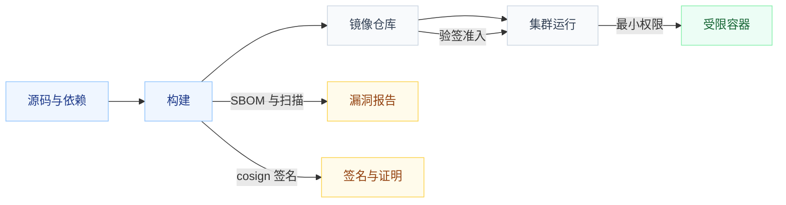
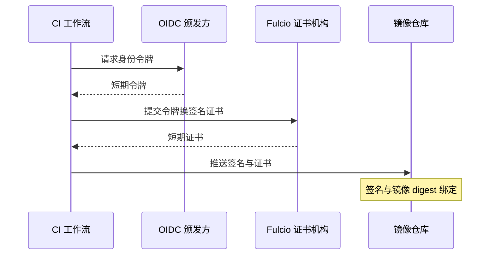

# 容器安全与供应链

> 这篇从容器的四层攻击面讲起，经过镜像漏洞扫描、SBOM 物料清单、cosign 签名与验签、Harbor 私有仓库治理、镜像与 Pod 的最小权限加固，最后落到一条从提交到上线的完整供应链防护案例。
>
> 学完能独立搭建“扫描—出清单—签名—入库—验签—最小权限运行”的容器供应链，并把不合格镜像挡在集群之外。

## 一、容器攻击面与分层防线

容器安全不是一个扫描工具能解决的问题：镜像里的漏洞、构建机的凭据、仓库里的镜像、运行时的权限，任何一层失守都能打到宿主机或横向移动。

### 1.1 四层攻击面

| 层 | 典型风险 | 主要手段 |
|---|---|---|
| 基础镜像与依赖 | 系统包、语言依赖的已知漏洞 | 最小基础镜像、定期扫描 |
| 构建与传输 | 构建机被投毒、镜像被替换 | 固定 digest、签名 |
| 仓库 | 匿名拉取、弱口令、无审计 | 私有仓库、RBAC、扫描 |
| 运行时 | root、特权、可写根文件系统 | 非 root、capabilities、PSS |



链路的关键判断：**签名证明来源，扫描证明内容，SBOM 证明成分，准入证明只跑可信镜像**。四件事缺一件，链条就断。

### 1.2 供应链攻击为什么防不住“只扫漏洞”

扫描回答的是“这个镜像里有没有已知 CVE”，不回答“这个镜像是不是自己人构建的”。攻击者拿到推送凭据后，可以把一个干净但植入后门的镜像推上去，扫描结果可以是零漏洞。签名和摘要锁定防的是这一类替换：镜像内容一变，digest 就变，签名立即失效。

同理，只签名不扫描，等于给一个带已知高危漏洞的镜像盖章。所以两者是互补关系，不是二选一。

### 1.3 版本基线与边界

版本基线（2026-11）：Trivy 0.6x、Syft 1.x、Grype 0.9x、cosign 2.x、Harbor 2.13+、Kubernetes 1.33+、Docker 29.x。所有版本号以实际拉取为准，示例输出中的版本仅作对照。

> 版本基线（2026-11）：Ubuntu 24.04/26.04 LTS，Rocky Linux 9/10；命令以 Ubuntu 为主，RHEL 系用 dnf。

边界：这套流程解决“镜像进入集群前后的可信与合规”，不解决内核提权、容器逃逸的内核加固（归主机安全），也不替代网络策略和运行时检测（归 K8s 网络与可观测性篇）。

## 二、镜像漏洞扫描

这章解决“镜像里到底有什么漏洞、怎么让流水线因为漏洞失败”。工具用 Trivy，规则是分级、可解释、可豁免。

### 2.1 安装

各平台安装方式（工具本身跨平台，扫描目标可以是本地镜像、远程镜像或文件系统）：

| 平台 | 命令 |
|---|---|
| Ubuntu | 官方 apt 仓库或安装脚本 |
| Rocky | 二进制安装 |
| macOS | brew install trivy |
| Windows | scoop install trivy |

Ubuntu 用官方仓库，便于统一升级：

```bash
sudo apt-get install -y wget apt-transport-https gnupg lsb-release
wget -qO - https://aquasecurity.github.io/trivy-repo/deb/public.key | \
  gpg --dearmor | sudo tee /usr/share/keyrings/trivy.gpg > /dev/null
echo "deb [signed-by=/usr/share/keyrings/trivy.gpg] https://aquasecurity.github.io/trivy-repo/deb $(lsb_release -sc) main" | \
  sudo tee /etc/apt/sources.list.d/trivy.list
sudo apt-get update
sudo apt-get install -y trivy
trivy --version
```

不想加仓库时用脚本装二进制（Ubuntu / Rocky 通用）：

```bash
curl -sfL https://raw.githubusercontent.com/aquasecurity/trivy/main/contrib/install.sh | \
  sudo sh -s -- -b /usr/local/bin
```

### 2.2 扫描镜像与读结果

```bash
trivy image registry.example.com/team/app:1.4.2
```

预期输出（节选，示例）：

```text
app:1.4.2 (ubuntu 22.04)
Total: 42 (UNKNOWN: 0, LOW: 18, MEDIUM: 15, HIGH: 8, CRITICAL: 1)

┌──────────────┬────────────────┬──────────┬───────────────┬───────────────────┐
│   Library    │ Vulnerability  │ Severity │ Installed Ver │   Fixed Version   │
├──────────────┼────────────────┼──────────┼───────────────┼───────────────────┤
│ libssl3      │ CVE-2024-6119  │ HIGH     │ 3.0.13-1      │ 3.0.14-1          │
│ zlib1g       │ CVE-2023-45853 │ CRITICAL │ 1:1.2.13      │ 1:1.2.13.dfsg-1   │
└──────────────┴────────────────┴──────────┴───────────────┴───────────────────┘
```

读结果的三个要点：

- 先看 `Fixed Version`：有修复版本的才可行动，空白的通常要等上游；
- 再看基础镜像占比：Debian/Ubuntu 基础镜像的系统包往往贡献大部分 CVE，换 alpine 或 distroless 能砍掉一大半；
- 语言依赖在另一段输出里（`Java`、`npm`、`gomod`），升级依赖版本就能修。

常用过滤：

```bash
# 只看高危以上，按严重级别排序
trivy image --severity HIGH,CRITICAL --scanners vuln registry.example.com/team/app:1.4.2
# 只报有修复方案的，减少噪音
trivy image --ignore-unfixed --severity HIGH,CRITICAL registry.example.com/team/app:1.4.2
# 扫源码目录（不构建镜像也能提前发现依赖漏洞）
trivy fs --scanners vuln .
```

### 2.3 让流水线因为漏洞失败

```bash
# 有 CRITICAL 就以非 0 退出，CI 直接失败；这是门禁的关键参数
trivy image --exit-code 1 --severity CRITICAL --ignore-unfixed \
  registry.example.com/team/app:1.4.2
echo "exit=$?"
```

预期输出：

```text
exit=1
```

分级策略建议（示例，按团队风险承受度调整）：

| 级别 | 处置 | 豁免要求 |
|---|---|---|
| CRITICAL | 阻断发布 | 安全负责人审批 |
| HIGH | 阻断发布 | 有修复计划可临时豁免 |
| MEDIUM | 记录，限期修 | 无需审批 |
| LOW | 记录 | 随版本修复 |

### 2.4 误报与豁免

`.trivyignore` 放在仓库根目录，每行一个 CVE，必须写原因和期限，否则半年后没人知道为什么放行：

```text
# CVE-2023-45853: zlib 的 minizip 组件，运行镜像不含该二进制，2026-12-31 复核
CVE-2023-45853
```

```bash
trivy image --ignorefile .trivyignore --exit-code 1 --severity CRITICAL app:1.4.2
```

> 边界：`.trivyignore` 是团队级豁免，不要放在基础镜像仓库里当"默认放行"；豁免条目必须绑定复核日期。Trivy 默认会自动加载 `.trivyignore`，CI 每周用 `--ignorefile /dev/null` 跑一次真全量扫描作为兜底。

## 三、SBOM 与依赖追溯

这章解决“镜像里到底装了哪些包、出了新 CVE 时能不能立刻查到自己有没有中”。

### 3.1 为什么需要 SBOM

SBOM（Software Bill of Materials，软件物料清单）是镜像成分的机器可读清单。它的价值在“事后追溯”：某个组件爆出 0day 时，不用重新构建和扫描所有镜像，直接对 SBOM 检索即可定位受影响范围。扫描结果是“当时的判断”，SBOM 是“长期的证据”。

| 格式 | 标准 | 适用 |
|---|---|---|
| SPDX JSON | Linux Foundation | 合规存档、对外交付 |
| CycloneDX JSON | OWASP | 安全工具链、依赖分析 |
| Syft JSON | Anchore 私有 | 本地调试 |

### 3.2 生成 SBOM

```bash
# Syft 直接扫镜像，不落盘，输出 SPDX JSON 存进制品库
syft registry.example.com/team/app:1.4.2 -o spdx-json=app-1.4.2.spdx.json
# 同时要 CycloneDX 给安全平台
syft registry.example.com/team/app:1.4.2 -o cyclonedx-json=app-1.4.2.cdx.json
ls -lh app-1.4.2.*.json
```

预期输出（示例）：

```text
-rw-r--r--  1 ci ci  1.2M Nov 13 10:20 app-1.4.2.cdx.json
-rw-r--r--  1 ci ci  2.4M Nov 13 10:20 app-1.4.2.spdx.json
```

也可以从本地目录直接生成，在构建前就固定依赖：

```bash
syft dir:. -o spdx-json=source.spdx.json
```

### 3.3 用 SBOM 反查漏洞

```bash
# Grype 支持直接吃 SBOM，不需要镜像和网络
grype sbom:app-1.4.2.spdx.json --fail-on high
```

预期输出（节选）：

```text
NAME       INSTALLED   FIXED-IN   TYPE  VULNERABILITY  SEVERITY
libssl3    3.0.13-1    3.0.14-1   deb   CVE-2024-6119  High
```

新 CVE 公布后的追溯动作只有一条命令：对所有归档 SBOM 批量检索组件名。镜像不必重新拉取，历史版本也能查。

```bash
# 在 SBOM 归档目录里找某个组件出现过的镜像版本
grep -l '"name": "log4j-core"' sbom/*.spdx.json
```

### 3.4 归档与保留

- SBOM 与镜像同 tag、同 digest 归档，命名 `镜像名-版本.spdx.json`；
- 保留期与镜像一致（通常 ≥ 1 年），因为漏洞披露往往滞后数月；
- SBOM 里可能暴露内部依赖名，对外交付前确认没有敏感信息。

## 四、镜像签名与验签

这章解决“怎么证明这个镜像确实出自自家流水线、且没被替换”。用 cosign 做 OCI 签名，签名存在镜像仓库里，跟 digest 绑定。

### 4.1 cosign 安装与密钥对

```bash
# 通用二进制安装，各平台同法（macOS 可用 brew install cosign）
curl -fsSL -o cosign https://github.com/sigstore/cosign/releases/latest/download/cosign-linux-amd64
sudo install -m 755 cosign /usr/local/bin/cosign
cosign version
```

```bash
# 生成密钥对；私钥必须进密钥管理系统，不能进仓库
cosign generate-key-pair
ls -l cosign.key cosign.pub
```

预期输出（示例）：

```text
Private key written to cosign.key
Public key written to cosign.pub
```

> 警告：`cosign.key` 是签名根的私钥，泄露等于任何人都能签发“可信镜像”。私钥只放在 CI 的密钥服务（Vault、KMS、GitHub Secrets）里，本地生成后立即移走，`.gitignore` 加上 `cosign.key`。

### 4.2 签名必须锁 digest

tag 会漂移，digest 不会。签名对象永远是 `镜像@sha256:...`：

```bash
IMAGE=registry.example.com/team/app
DIGEST=$(docker buildx imagetools inspect $IMAGE:1.4.2 --format '{{json .Manifest.Digest}}' | tr -d '"')
echo "$DIGEST"

# -y 跳过交互确认；--key 指向私钥
cosign sign --key cosign.key -y "$IMAGE@$DIGEST"
```

预期输出（示例）：

```text
Pushing signature to: registry.example.com/team/app
```

验签：

```bash
cosign verify --key cosign.pub "$IMAGE@$DIGEST"
```

预期输出（节选）：

```text
Verification for registry.example.com/team/app@sha256:0f2c... --
The following checks were performed on each of these signatures:
  - The cosign claims were validated
  - The signatures were verified against the specified public key
[{"critical":{"identity":{"docker-reference":"registry.example.com/team/app"}, ...}}]
```

验签失败会以非 0 退出并输出 `no signatures found` 或 `signature verification failed`，可以直接作为发布门禁。

### 4.3 keyless 签名：CI 里不落私钥

更推荐的做法是 keyless（无密钥）签名：CI 用平台颁发的 OIDC 短期证书签名，证书里记录工作流身份，验签时校验身份而不是密钥。



```bash
# 在 GitHub Actions 等支持 OIDC 的环境里，cosign 自动走 keyless
cosign sign -y "$IMAGE@$DIGEST"

# 验签必须指定身份与颁发方，否则任何人的 keyless 签名都能通过
cosign verify "$IMAGE@$DIGEST" \
  --certificate-identity-regexp 'https://github.com/example/team/.github/workflows/release.yml@refs/heads/main' \
  --certificate-oidc-issuer https://token.actions.githubusercontent.com
```

边界：keyless 依赖公网 Fulcio 与 Rekor（透明日志），完全离线环境用密钥对模式；混合环境两套都要能验，准入策略里分别配置。

## 五、私有镜像仓库 Harbor

这章解决“镜像存在哪、谁能推、推上去能不能自动扫”。Harbor 提供 RBAC、复制、代理缓存、扫描和签名展示。

### 5.1 部署（Compose 方式）

Harbor 官方用离线安装包 + 自带 compose 编排，Ubuntu 24.04 上一条命令装完：

```bash
# 版本以官方 releases 为准，示例 2.13
wget https://github.com/goharbor/harbor/releases/download/v2.13.0/harbor-offline-installer-v2.13.0.tgz
tar xzvf harbor-offline-installer-v2.13.0.tgz
cd harbor
cp harbor.yml.tmpl harbor.yml
```

`harbor.yml` 关键项：

```yaml
hostname: registry.example.com

# 生产必须 HTTPS；自签证书要分发 CA 给所有节点与构建机
https:
  port: 443
  certificate: /data/cert/registry.example.com.crt
  private_key: /data/cert/registry.example.com.key

harbor_admin_password: <从密钥管理注入，不用默认值>

# 数据目录放到独立磁盘，镜像增长很快
data_volume: /data/harbor

# 内置 Trivy：推送即扫，漏洞信息在 UI 与 API 可见
trivy:
  ignore_unfixed: false
  skip_update: false
  offline_scan: false
```

```bash
sudo ./install.sh --with-trivy
```

预期输出（节选）：

```text
✔ ----Harbor has been installed and started successfully.----
```

验证：

```bash
docker compose -f /root/harbor/docker-compose.yml ps
curl -sI https://registry.example.com/api/v2.0/health
```

预期输出：

```text
NAME                SERVICE          STATUS
harbor-core         core             running
harbor-db           postgresql       running
harbor-jobservice    jobservice       running
trivy-adapter       trivy            running

HTTP/2 200
```

### 5.2 项目、权限与 Robot 账号

```bash
docker login registry.example.com
docker tag app:1.4.2 registry.example.com/team/app:1.4.2
docker push registry.example.com/team/app:1.4.2
```

权限设计的三条规则：

- 一个人一个账号，按项目授权（Developer 可推，Guest 只读），不共用 admin；
- CI 用 Robot 账号，只给目标项目的 push/pull，权限到期自动失效；
- 生产项目开“不可删除”与 tag 保留策略，防止误删和 tag 覆盖。

Robot 账号用于流水线：

```bash
docker login registry.example.com -u 'robot$ci-pusher' -p "$HARBOR_ROBOT_TOKEN"
```

### 5.3 代理缓存与漏洞策略

代理缓存（Proxy Cache）项目把上游 Docker Hub 的镜像缓存在本地，节点只连内网仓库，既提速也避免外网依赖：

```bash
# 在 Harbor 里创建 proxy cache 项目后，按这个前缀拉取
docker pull registry.example.com/dockerhub-proxy/library/nginx:1.27-alpine
```

项目的漏洞策略有两条常用配置：

- 推送时扫描：镜像入库即出报告，jobservice 异步执行；
- 阻止拉取超过阈值的镜像：注意这是“阻断 pull”，粒度粗，容易把正常发布卡住，建议先只告警，稳定后再阻断。

> 警告：Harbor 的垃圾回收（GC）会删除无 tag 引用的 blob，执行期间仓库应为只读，否则正在推送的镜像可能损坏。GC 放在维护窗口，先 dry run 看回收量。

## 六、镜像与 Pod 加固

这章解决“镜像本身和运行时权限怎么收紧”。原则：能不给的权限一律不给，默认拒绝。

### 6.1 镜像侧加固清单

| 项 | 做法 | 原因 |
|---|---|---|
| 基础镜像 | slim/distroless/固定 digest | 减少攻击面与漂移 |
| 用户 | 显式 USER 非 root | 逃逸后不是宿主 root |
| 构建工具 | 多阶段，产物层不含编译器 | 减少 CVE 与体积 |
| 密钥 | 不写 ENV、不 COPY 进镜像 | 层里删不掉 |
| 端口 | 只监听业务端口 | 减少暴露 |
| 健康检查 | HEALTHCHECK | 编排可判断状态 |

固定基础镜像 digest 的写法：

```bash
# 先查出 digest，再写死到 Dockerfile
docker buildx imagetools inspect eclipse-temurin:21-jre-jammy --format '{{json .Manifest.Digest}}'
```

```dockerfile
# digest 锁定后，上游 tag 被覆盖也不会改变构建输入
FROM eclipse-temurin:21-jre-jammy@sha256:<上一步输出的摘要>
RUN useradd --system --uid 10001 app
WORKDIR /app
COPY --chown=app:app app.jar app.jar
USER 10001
ENTRYPOINT ["java", "-jar", "app.jar"]
```

### 6.2 单容器运行时的最小权限

```bash
docker run -d --name app \
  --user 10001:10001 \
  --read-only --tmpfs /tmp \
  --cap-drop ALL \
  --security-opt no-new-privileges \
  --pids-limit 200 \
  --memory 512m \
  registry.example.com/team/app:1.4.2
```

每个参数都在堵一个口子：`--read-only` 让容器不能改自己的文件系统（配合 tmpfs 给临时目录），`--cap-drop ALL` 去掉全部 Linux 能力（需要绑低端口时只加 `NET_BIND_SERVICE`），`no-new-privileges` 阻止 setuid 提权，`--pids-limit` 防 fork 炸弹。

> 警告：`--privileged` 等于给容器几乎全部宿主权限，还会放开设备访问；除明确的调试场景外禁止使用，更不能用它“解决”权限报错。

### 6.3 Kubernetes Pod 安全标准

Pod Security Standards（PSS）分三档：privileged、baseline、restricted。生产命名空间用 restricted 强制执行：

```yaml
apiVersion: v1
kind: Namespace
metadata:
  name: prod
  labels:
    # enforce 直接拒绝不合规的 Pod；audit 只记录，便于灰度
    pod-security.kubernetes.io/enforce: restricted
    pod-security.kubernetes.io/enforce-version: latest
```

上线前先 dry run 验证命名空间标签能被接受（这只验证标签本身，PSS 只在 Pod 创建/更新时评估，不会回溯校验存量负载）：

```bash
kubectl label --dry-run=server --overwrite ns prod pod-security.kubernetes.io/enforce=restricted

# 存量负载要单独对照：列出仍以 root、未 drop ALL、没配 seccomp 的容器
kubectl -n prod get pod -o json | jq -r '
  .items[] | .metadata.name as $pod
  | .spec.containers[] | select((.securityContext.runAsNonRoot // false) == false)
  | "\($pod) \(.name) runAsNonRoot=false"'
```

工作负载的 securityContext：

```yaml
apiVersion: apps/v1
kind: Deployment
metadata:
  name: app
spec:
  template:
    spec:
      automountServiceAccountToken: false
      containers:
        - name: app
          # digest 示例，部署时替换成签名后的真实摘要
          image: registry.example.com/team/app@sha256:0f2c...9a71
          securityContext:
            runAsNonRoot: true
            runAsUser: 10001
            allowPrivilegeEscalation: false
            readOnlyRootFilesystem: true
            capabilities:
              # 全部丢弃，需要时再单项添加
              drop: ["ALL"]
            seccompProfile:
              type: RuntimeDefault
```

restricted 档要求非 root、禁止提权、`drop: ["ALL"]`（需要时再单项添加如 `NET_BIND_SERVICE`）、必须设置 seccomp；缺一项 Pod 会被 API Server 拒绝，报错信息会直接指出哪条不满足，按报错改即可。

### 6.4 准入层验签

签名只有在校验点才产生价值。Kubernetes 侧用准入控制器（Kyverno 或 Sigstore Policy Controller）校验签名，未签名的镜像直接拒绝创建：

```yaml
apiVersion: kyverno.io/v1
kind: ClusterPolicy
metadata:
  name: verify-image-signature
spec:
  validationFailureAction: Enforce
  rules:
    - name: verify-cosign-key
      match:
        any:
          - resources:
              kinds: ["Pod"]
      verifyImages:
        - imageReferences:
            - "registry.example.com/team/*"
          attestors:
            - entries:
                - keys:
                    publicKeys: |-
                      -----BEGIN PUBLIC KEY-----
                      <cosign.pub 内容>
                      -----END PUBLIC KEY-----
```

片段说明：策略只覆盖 `team` 项目，避免把系统组件拦在门外；`validationFailureAction: Enforce` 会拒绝，先用 `Audit` 观察一周再切。

## 七、最佳实践案例

### 7.1 案例背景

一个 20 人团队维护 6 个 Java 服务，镜像推到 Docker Hub 公共仓库，生产集群从公网拉取。现状：漏洞靠季度安全扫描报告，平均修复周期 6 周；曾发生一次镜像 tag 被覆盖导致回滚拉到了错误版本；审计要求能回答“线上某个镜像由哪次提交构建、包含哪些组件”。目标：在现有 CI（GitLab CI）里加一道 3 分钟内的门禁，做到构建即扫描、入库即签名、部署即验签，且开发者不必改业务代码。约束：CI 单次构建总时长不能超过 15 分钟；团队没有专职安全工程师；Harbor 已部署 2.13。

### 7.2 案例实操

流水线脚本 `ci/release.sh`，按顺序执行，任何一步失败即中止：

```bash
#!/usr/bin/env bash
set -euo pipefail

# 前置：CI 已 docker login 到 registry.example.com，并具备平台颁发的 OIDC 令牌
IMAGE="registry.example.com/team/app"
TAG="${CI_COMMIT_SHORT_SHA}"

# 1) 构建：基础镜像已锁 digest，构建结果可复现；分开 build 与 push，失败点更好定位
docker build -t "$IMAGE:$TAG" .
docker push "$IMAGE:$TAG"

# 2) 取 digest，后续所有操作都锁 digest，避免 tag 漂移
DIGEST=$(docker buildx imagetools inspect "$IMAGE:$TAG" --format '{{json .Manifest.Digest}}' | tr -d '"')
REF="$IMAGE@$DIGEST"
echo "digest=$DIGEST"

# 3) SBOM 归档，出问题时可追溯成分
syft "$REF" -o spdx-json="app-$TAG.spdx.json"

# 4) 扫描门禁：CRITICAL 有修复方案的直接失败，不豁免
trivy image --exit-code 1 --severity CRITICAL --ignore-unfixed "$REF"

# 5) 签名：keyless，CI 身份由 OIDC 证明，仓库里不落私钥
cosign sign -y "$REF"

# 6) 回写签名与 SBOM 到制品库（示例用 curl）
curl -sS -X PUT --upload-file "app-$TAG.spdx.json" \
  "$ARTIFACT_URL/sbom/app-$TAG.spdx.json"
```

在 GitLab CI 里调用：

```yaml
release:
  image: docker:29-cli
  services: [docker:29-dind]
  variables:
    DOCKER_HOST: tcp://docker:2375   # 连到 dind sidecar
    DOCKER_TLS_CERTDIR: ""           # 内网 runner 关掉 sidecar TLS
  script:
    - apk add --no-cache curl bash
    - ./ci/install-tools.sh        # 安装 syft/trivy/cosign，版本固定
    - ./ci/release.sh
  rules:
    - if: $CI_COMMIT_BRANCH == "main"
```

Harbor 侧配置：项目 `team` 开推送扫描、Robot 账号 `robot$ci-pusher` 只给 push/pull、tag 保留最近 20 个版本。扫描结果示例：

```bash
curl -s -u "robot\$ci-pusher:$HARBOR_ROBOT_TOKEN" \
  "https://registry.example.com/api/v2.0/projects/team/repositories/app/artifacts/$TAG?with_scan_overview=true" \
  | jq '.scan_overview'
```

```json
{
  "application/vnd.security.vulnerability.report; version=1.1": {
    "scan_status": "Success",
    "severity": "High",
    "summary": {"Critical": 0, "High": 3, "Medium": 11}
  }
}
```

首次跑流水线时被门禁挡住：

```text
app:1.4.2 (debian 12.7)

Total: 1 (UNKNOWN: 0, LOW: 0, MEDIUM: 0, HIGH: 0, CRITICAL: 1)

┌─────────┬──────────────┬────────────┬──────────────────┬────────────────┐
│ Library │ Vulnerability│ Severity   │ Installed Version│ Fixed Version  │
├─────────┼──────────────┼────────────┼──────────────────┼────────────────┤
│ zlib1g  │ CVE-2023-45853│ CRITICAL   │ 1:1.2.13         │ 1:1.2.13.dfsg-1│
└─────────┴──────────────┴────────────┴──────────────────┴────────────────┘
```

处理方式是升级基础镜像（`apt-get upgrade` 在构建阶段执行并锁 digest），不加豁免。再次构建后：

```text
Total: 0 (UNKNOWN: 0, LOW: 0, MEDIUM: 0, HIGH: 0, CRITICAL: 0)
```

部署侧准入（片段，Kyverno 策略同 6.4），验证：

```bash
kubectl apply -f k8s/deployment.yaml
kubectl get pods -l app=app
```

预期输出：

```text
NAME                   READY   STATUS    RESTARTS   AGE
app-6b8f7c9d4-2xkqz    1/1     Running   0          22s
```

故意用一个未签名的镜像验证门禁（Kyverno 策略声明 `kinds: ["Pod"]`，改 Deployment 本身不会被拦，拒绝发生在 Pod 创建阶段，所以要观察 rollout 与 Pod 事件）：

```bash
kubectl set image deploy/app app=registry.example.com/team/app:unsigned-test
kubectl -n app rollout status deploy/app --timeout=60s
kubectl -n app get events --sort-by=.lastTimestamp | tail -5
```

预期输出（节选）：

```text
deployment "app" image rollout pending: 1 old replicas are pending termination...
error: timed out waiting for the condition

Events:
  Warning  Failed  pod/app-7f9c...  admission webhook "mutate.kyverno.svc-fail"
  denied the request: image verification failed for
  registry.example.com/team/app@sha256:...: no signatures found
```

回滚验证：

```bash
# 回滚同样锁 digest，不依赖 tag
kubectl set image deploy/app app=registry.example.com/team/app@sha256:<上一版摘要>
kubectl rollout status deploy/app --timeout=120s
```

### 7.3 案例结果

上线 4 周后的指标（示例，来自团队周报）：

| 指标 | 改造前 | 改造后 |
|---|---|---|
| 高危以上漏洞平均修复周期 | 6 周 | 3 天 |
| 发布被门禁拦截次数 | 0 | 7 |
| 单次流水线新增耗时 | — | 2 分 40 秒 |
| 镜像来源可追溯 | 无法回答 | SBOM + 签名 |
| tag 覆盖导致的事故 | 1 次/季 | 0 |

失败模式与复盘：

- 第一周门禁误伤两次：策略阈值一度被配成 MEDIUM，两个中危的原生依赖卡住了发布。复盘后把阻断线定在 CRITICAL（HIGH 走周报评审），并要求流水线打印扫描的级别统计，让失败原因一眼可见；
- 有开发者绕过流水线手工 `docker push`，推了一个未签名镜像，部署时被准入拒绝。复盘后收回个人 push 权限，只有 Robot 账号能推生产项目；
- SBOM 一度只留在 CI 临时目录，构建结束即丢。复盘后改为随制品归档，保留 12 个月，并演练了一次“已知组件爆漏洞后的 10 分钟追溯”；
- 最关键的一条：签名、扫描、准入三件事必须同时上线。只签名不验签等于没签，只扫描不拦等于一份报告。
