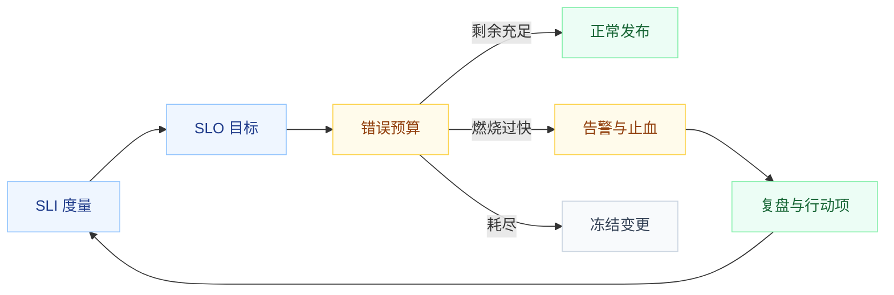
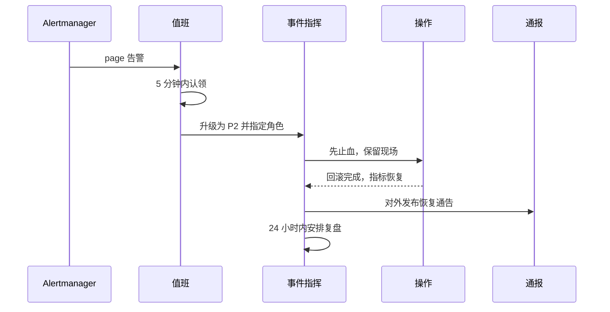

# SRE故障应急与复盘

> 这篇从 SRE 的可靠性契约讲起，经过 SLI/SLO 与错误预算、多窗口燃烧率告警、值班与故障分级、止血手段、无指责复盘和混沌演练，最后落到故障应急现场手册。
>
> 学完能把"服务稳不稳"变成可计算的错误预算，在故障发生的十分钟内完成认领、止血和通报，并产出一份能落地的复盘。

## 一、SRE 的定位与边界

站点可靠性工程（Site Reliability Engineering，SRE）是用软件工程方法管理可靠性的角色与方法：先用 SLI/SLO 把"稳定"定义成可计算的指标，再用错误预算决定"能承担多少风险"，最后用工程手段消除重复劳动。

SRE 与传统运维的分界：

| 维度 | 传统运维 | SRE |
|---|---|---|
| 工作起点 | 告警与工单 | SLO 与错误预算 |
| 稳定性定义 | 主观"别挂" | 可量化的 SLI 目标 |
| 发布节奏 | 稳定优先，少发 | 预算内大胆发，超支则冻结 |
| 重复劳动 | 人肉执行 | 自动化，超过 50% 就还债 |
| 故障之后 | 追责 | 无指责复盘 + 行动项 |

核心闭环：SLI 度量 → SLO 目标 → 错误预算 → 预算决定发布速度 → 告警只在预算被快速消耗时触发 → 故障后复盘改进 SLI。



> 版本基线（2026-11）：Prometheus 3.x、Alertmanager 0.28+、Grafana 12.x、Chaos Mesh 2.7+、Kubernetes 1.33+。SLO 计算方法与告警窗口取自 Google SRE Workbook，工具只影响落地方式。

不适用的场景：

- 生命周期不足三个月的临时系统，算 SLO 的投入大于收益，用可用性巡检即可；
- 没有可观测数据的系统，先补指标再谈 SLO，否则 SLI 只能拍脑袋；
- 强合规场景里"可用性"由合同规定，SLO 要服从 SLA，不能反过来定。

## 二、准备：SLI、SLO 与错误预算

一条可用的 SLO 由三部分组成：SLI 的算式、目标值、统计窗口。三者缺一，SLO 就不可执行。

SLI 的通用形式是"好事件 / 有效事件"：

```text
SLI = 满足条件的事件数 / 总有效事件数
```

| SLI 类型 | 好事件定义 | 适用服务 |
|---|---|---|
| 可用性 | 非 5xx 响应 | 所有 HTTP 服务 |
| 延迟 | P99 低于阈值 | 网关、查询接口 |
| 正确性 | 结果与预期一致 | 计费、对账 |
| 新鲜度 | 数据延迟在阈值内 | 数仓、缓存同步 |
| 吞吐 | 处理量达到承诺 | 消息消费 |

错误预算（Error Budget）是 `1 - SLO` 换算成的时间或请求比例：

| SLO | 30 天允许不可用 | 每周预算 |
|---|---|---|
| 99% | 7 小时 12 分 | 1 小时 41 分 |
| 99.9% | 43 分 12 秒 | 10 分 5 秒 |
| 99.95% | 21 分 36 秒 | 5 分 2 秒 |
| 99.99% | 4 分 19 秒 | 1 分 0 秒 |

Prometheus 侧用记录规则把 SLI 固定成时间序列，避免每次告警重写查询：

```yaml
groups:
  - name: slo.pay.rules
    interval: 30s
    rules:
      # 总请求数：分母只统计"有效事件"，健康检查这类无意义流量要排除
      # 按 service 聚合保留标签，告警与看板才能按服务过滤
      - record: slo:requests:rate5m
        expr: sum by (service) (rate(http_requests_total{job="pay-gateway",path!="/healthz"}[5m]))
      # 坏事件：5xx 才算不满足，4xx 是调用方问题，不计入服务可用性
      - record: slo:errors:rate5m
        expr: sum by (service) (rate(http_requests_total{job="pay-gateway",path!="/healthz",code=~"5.."}[5m]))
      # 错误比例：0 到 1，作为燃烧率与告警的唯一输入
      - record: slo:error_ratio:rate5m
        expr: slo:errors:rate5m / slo:requests:rate5m
      # 其余窗口直接按各自窗口计算，覆盖告警用到的全部长短期窗口
      - record: slo:error_ratio:rate30m
        expr: sum by (service) (rate(http_requests_total{job="pay-gateway",path!="/healthz",code=~"5.."}[30m]))
              / sum by (service) (rate(http_requests_total{job="pay-gateway",path!="/healthz"}[30m]))
      - record: slo:error_ratio:rate1h
        expr: sum by (service) (rate(http_requests_total{job="pay-gateway",path!="/healthz",code=~"5.."}[1h]))
              / sum by (service) (rate(http_requests_total{job="pay-gateway",path!="/healthz"}[1h]))
      - record: slo:error_ratio:rate2h
        expr: sum by (service) (rate(http_requests_total{job="pay-gateway",path!="/healthz",code=~"5.."}[2h]))
              / sum by (service) (rate(http_requests_total{job="pay-gateway",path!="/healthz"}[2h]))
      - record: slo:error_ratio:rate6h
        expr: sum by (service) (rate(http_requests_total{job="pay-gateway",path!="/healthz",code=~"5.."}[6h]))
              / sum by (service) (rate(http_requests_total{job="pay-gateway",path!="/healthz"}[6h]))
      - record: slo:error_ratio:rate1d
        expr: sum by (service) (rate(http_requests_total{job="pay-gateway",path!="/healthz",code=~"5.."}[1d]))
              / sum by (service) (rate(http_requests_total{job="pay-gateway",path!="/healthz"}[1d]))
```

验证规则已生效：

```bash
promtool check rules slo-rules.yaml
curl -s 'http://prometheus.monitoring:9090/api/v1/query?query=slo:error_ratio:rate5m' | jq '.data.result[0].value'
```

预期输出（示例）：

```text
SUCCESS: 8 rules found
[1752470400, "0.00042"]
```

> `service` 标签来自应用指标（或采集侧 relabel 注入）；`sum by (service)` 保证记录规则不把它聚合掉，告警里按服务过滤才有数据。

### 2.1 SLO 规格文档

SLO 要能在团队里被引用，必须落成一份规格文档：谁定的目标、按什么算、超支了怎么办。这份文档放在服务目录里，每次评审一起过。

```markdown
# 支付网关 SLO 规格

- 服务：pay-gateway（生产）
- SLI：非 5xx 且路径非 /healthz 的请求占比（记录规则 slo:error_ratio:*）
- SLO：滚动 30 天错误比例 < 0.1%（99.9%）
- 延迟 SLO：P99 < 400ms，同一窗口
- 错误预算：30 天 43.2 分钟等价
- 超支处理：预算耗尽当周冻结非修复类发布，直到窗口滚动回正
- 评审节奏：每季度复评一次目标值是否仍匹配用户预期
```

窗口与目标的常见搭配：

| 窗口 | 目标上限 | 原因 |
|---|---|---|
| 7 天滚动 | 99% | 新服务，数据不稳 |
| 28 天滚动 | 99.9% | 成熟服务主流 |
| 日历季度 | 99.95% | 合同化 SLA 场景 |

> 边界：窗口选"滚动"还是"日历"决定预算恢复方式：滚动窗口随时间匀速恢复，日历窗口到期一次性重置。跟客户签了 SLA 的服务要对齐日历窗口，否则内部报表与赔偿口径对不上。
>
> SLO 也不是越高越好。99.9% 与 99.99% 的成本差一个数量级，而用户几乎感知不到 30 天 43 分钟与 4 分钟的预算差别（按年折算是 8.76 小时与 52.6 分钟）；目标应取"用户能感知、团队能承担"的交点。窗口默认 28 天或 30 天滚动，太短会被单次事故打穿，太长则失去约束力。

## 三、基于 SLO 的告警

告警只看一件事：错误预算是否在被快速消耗。CPU 高、磁盘 80% 这类资源指标是"原因"，不是"症状"，它们适合看板，不适合半夜叫醒人。

燃烧率（Burn Rate）表示"当前错误率是预算允许速度的几倍"：

```text
燃烧率 = 当前错误比例 / (1 - SLO)
```

99.9% 的 SLO 下，错误比例 1.44% 就是 14.4 倍燃烧率：按这个速度，1 小时烧掉 30 天预算的 2%。

多窗口多燃烧率告警（长窗口确认趋势，短窗口确认仍在发生）：

| 严重度 | 长窗口 | 短窗口 | 燃烧率 | 预算消耗 |
|---|---|---|---|---|
| page | 1h | 5m | 14.4 | 1 小时 2% |
| page | 6h | 30m | 6 | 6 小时 5% |
| ticket | 1d | 2h | 3 | 1 天 10% |
| ticket | 3d | 6h | 1 | 3 天 10% |

```yaml
groups:
  - name: slo.pay.alerts
    rules:
      # 快烧：14.4 倍，1 小时烧掉 2% 预算，必须立刻叫人
      - alert: PayErrorBudgetBurnFast
        expr: |
          slo:error_ratio:rate1h{service="pay"} > (14.4 * 0.001)
          and
          slo:error_ratio:rate5m{service="pay"} > (14.4 * 0.001)
        for: 2m          # 短暂抖动不叫人，持续 2 分钟才算真实故障
        labels:
          severity: page
          service: pay
        annotations:
          summary: "支付网关 1 小时燃烧率超过 14.4 倍"
          runbook: "https://runbook.example.com/pay/error-budget"
      # 慢烧：6 倍，6 小时烧掉 5%，同样要页面，但可以用不同路由
      - alert: PayErrorBudgetBurnMedium
        expr: |
          slo:error_ratio:rate6h{service="pay"} > (6 * 0.001)
          and
          slo:error_ratio:rate30m{service="pay"} > (6 * 0.001)
        for: 15m
        labels:
          severity: page
          service: pay
      # 趋势型：3 倍，一天烧 10%，进工单即可，不该半夜打扰
      - alert: PayErrorBudgetBurnSlow
        expr: |
          slo:error_ratio:rate1d{service="pay"} > (3 * 0.001)
          and
          slo:error_ratio:rate2h{service="pay"} > (3 * 0.001)
        for: 1h
        labels:
          severity: ticket
          service: pay
```

Alertmanager 路由与抑制：

```yaml
route:
  receiver: ticket-queue
  group_by: [alertname, service]
  group_wait: 30s            # 同批告警合并成一条，避免一次故障刷屏
  group_interval: 5m
  repeat_interval: 4h        # 未恢复的工单级告警 4 小时提醒一次
  routes:
    - matchers: [severity="page"]
      receiver: oncall-pager
      group_wait: 10s        # 页面级告警不等待，10 秒内送达
      repeat_interval: 30m
      continue: false
    - matchers: [severity="ticket"]
      receiver: ticket-queue
inhibit_rules:
  # 同一服务已有快烧告警时，抑制慢烧与工单，减少重复信息
  - source_matchers: [alertname="PayErrorBudgetBurnFast"]
    target_matchers: [service="pay", severity=~"page|ticket"]
    equal: [service]
```

> 边界：`for` 不能省。没有 `for` 的告警会把每一次瞬时抖动都变成电话；`for` 太长则吞掉真实故障，page 级 2 分钟、ticket 级 30 分钟以上是常见起点。抑制规则要 `equal` 到足够细的维度，粗粒度 `equal` 会误杀其他服务的告警。

## 四、值班与故障分级

值班的第一原则是"谁认领谁负责到恢复或交接"，不是"谁先看到谁修"。故障必须有唯一指挥，否则多人同时改配置是二次事故的主要来源。

分级决定响应速度与通报范围：

| 级别 | 判据 | 响应 | 通报 |
|---|---|---|---|
| P1 | 核心链路不可用或资金损失 | 5 分钟 | 全员 + 管理层 |
| P2 | 部分用户受影响、SLO 快速燃烧 | 15 分钟 | 团队 + 客服 |
| P3 | 功能降级、有绕行方案 | 1 小时 | 团队 |
| P4 | 无用户影响 | 次工作日 | 工单 |

四个角色（小团队可兼任，但必须显式指定）：

| 角色 | 职责 | 不做什么 |
|---|---|---|
| 事件指挥 IC | 决策、分工、控制节奏 | 不亲自敲命令 |
| 操作 Ops | 执行止血与验证 | 不对外解释 |
| 通报 Comms | 对内对外同步进展 | 不参与技术判断 |
| 记录 Scribe | 时间线、证据、决策 | 不打断处置 |



> 边界：一个人值班时角色合并，但"先止血、后定位"的顺序不能合并。IC 不碰键盘是硬规则——指挥一旦陷进日志，就没人盯着整体节奏和通报。

### 4.1 轮班、交接与升级

值班表按周轮换，交接必须发生在"旧值班确认新人已能独立响应"之后，而不是按日历自动切换。

交接模板（每次换班一条消息，不写就视为未交接）：

```text
【值班交接】11-12 → 11-13
进行中：无 / P3-1421 订单导出慢，已限流，观察中
近期变更：pay-gateway v1.42.0 已发布，金丝雀通过；Redis 主从已切换
风险点：Redis 连接池调参未压测；大促压测 11-15
告警状态：page 0 条，ticket 3 条（已建单）
```

升级路径必须写死"多久没响应就找谁"，不靠人情：

| 级别 | 首次响应 | 未响应升级 | 再升级 |
|---|---|---|---|
| 一线值班 | 5 分钟 | 15 分钟找备份 | 30 分钟找组长 |
| P1 | 5 分钟 | 10 分钟拉 IC | 20 分钟通知总监 |
| 依赖方 | 15 分钟 | 30 分钟找对方值班 | 45 分钟走商务通道 |

```bash
# 值班表以所用平台为准；这里用 PagerDuty Events API 手动发一条测试告警，
# 验证整条链路（事件接入 → 路由 → 通知）在真故障前是通的
curl -s -X POST https://events.pagerduty.com/v2/enqueue \
  -H 'Content-Type: application/json' \
  -d '{"routing_key":"'"$PD_ROUTING_KEY"'","event_action":"trigger","payload":{"summary":"演练：支付网关 P2","source":"sre-drill","severity":"error","custom_details":{"env":"staging"}}}'
```

预期输出（示例）：

```json
{"status":"success","message":"Event processed","dedup_key":"..."}
```

> 边界：值班人数少于 3 人时不要做 7×24 单人轮值，人撑不过两周；改用"工作时间人工 + 非工作时间仅 P1 页面"，并把 P2 降级为工单。备份值班不是"顺便看一眼"，必须和主值班一样收到告警。

## 五、止血优先

故障期的唯一目标是恢复服务，不是找到根因。根因可以事后查，用户流失不会等人。

止血手段按"影响面从小到大、可逆性从强到弱"排序：

| 手段 | 何时用 | 风险 |
|---|---|---|
| 关闭功能开关 | 新功能引发 | 低，秒级 |
| 回滚上一版本 | 发布后出现 | 低，分钟级 |
| 扩容/摘流 | 容量不足、单节点异常 | 低 |
| 限流/降级 | 依赖拖垮主链路 | 中，影响部分用户 |
| 切流量到备用区 | 机房级故障 | 中，容量需预留 |
| 重启 | 状态僵死 | 高，丢现场 |

```bash
# 回滚：先确认上一版本可用，再回退，最后验证
kubectl -n pay rollout history deploy/pay-gateway
kubectl -n pay rollout undo deploy/pay-gateway
kubectl -n pay rollout status deploy/pay-gateway --timeout=180s

# 扩容：先看当前副本与 HPA 上限，避免扩了被 HPA 缩回去
kubectl -n pay get hpa
kubectl -n pay scale deploy/pay-gateway --replicas=12
kubectl -n pay get pods -l app=pay-gateway -o wide

# 摘流：去掉 Service selector 匹配的 app 标签，端点里不再出现，Pod 保留取证
# 直接打 unhealthy 标签没用：端点只看 selector 匹配，不看任意标签
kubectl -n pay get pod pay-gateway-7d9f8c-x2vqm -o yaml > /tmp/pay-pod-snapshot.yaml   # 先留证
kubectl -n pay label pod pay-gateway-7d9f8c-x2vqm app-
```

Nginx 入口限流（保护后端，先限流再扩容）：

```nginx
limit_req_zone $binary_remote_addr zone=pay:10m rate=20r/s;

location /api/pay/ {
    limit_req zone=pay burst=40 nodelay;   # 允许 40 个突发，超出按 limit_req_status 返回 429
    limit_req_status 429;                  # 429 让客户端知道是可重试的限流，不是服务故障
    proxy_pass http://pay_upstream;
}
```

> 边界：重启是最后手段，重启会清掉堆栈、连接池、临时文件这些现场证据；能回滚就不要重启。限流阈值必须来自压测，拍脑袋的阈值会把正常流量也挡掉，制造第二次故障。

### 5.1 通报模板

通报的目标是"让不在一线的人知道影响与进展"，不是解释技术细节。对内每 15 分钟一条，对外只发已确认的事实。

```text
【P2 进行中】支付下单延迟升高
影响：约 3% 下单请求失败，重试可成功
开始时间：2026-11-12 10:02 UTC
已做动作：扩容网关至 12 副本，失败率从 3.1% 降至 1.2%
下一步：调整 Redis 连接池，10:35 前再同步
负责人：IC @ops-a
```

```text
【对外公告】支付服务异常恢复
今日 10:02–10:31 部分用户下单失败，现已恢复。
失败订单不会重复扣款，可在订单页重新提交。
后续将发布故障说明。
```

止血动作完成后的验证要落到数字，不能只写"已恢复"：

```bash
# 以 5 分钟窗口核对，避免刚恢复时的尖峰掩盖问题
curl -s 'http://prometheus.monitoring:9090/api/v1/query?query=slo:error_ratio:rate5m' | jq -r '.data.result[0].value[1]'
kubectl -n pay get pods -l app=pay-gateway --no-headers | awk '{print $2}' | sort | uniq -c
```

预期输出（示例）：

```text
0.0008
     12 1/1
```

12 个副本全部 `1/1`、错误比例 0.08%，才满足"宣布恢复"的条件。

## 六、复盘：无指责与可执行行动项

复盘的目的不是分锅，而是让同类故障不再发生。无指责（Blameless）不是"不追究"，而是假设"人做出那个操作在当时的信息下是合理的"，把注意力放在系统为什么允许这个操作造成大范围影响。

一份合格的复盘包含五块，缺一块就会退化成"事故通报"：

```markdown
# 复盘：支付网关 P2 延迟劣化（2026-11-12）

## 影响
- 时间：2026-11-12 10:02–10:31 UTC（29 分钟）
- 影响面：支付下单接口 P99 从 210ms 升至 2.4s，失败率峰值 3.1%
- 业务：失败订单约 3 200 笔，错误预算消耗 2%

## 时间线（UTC）
- 10:02 告警 PayErrorBudgetBurnFast 触发
- 10:05 值班认领，升级 P2，IC 到位
- 10:09 确认 Redis 连接池耗尽，非发布引起
- 10:14 扩容网关副本 6→12，失败率降至 1.2%
- 10:20 调整连接池上限并重启一半实例
- 10:31 全部指标回到 SLO 内，宣布恢复

## 根因
Redis 主从切换期间客户端重连风暴，连接池上限过低，请求排队导致超时。

## 贡献因素
- 连接池上限按单实例 200 配置，未按故障切换场景评估
- 缺少 Redis 重连的退避与熔断
- 告警只有快烧，没有"连接池饱和度"这一先行指标

## 行动项
| 动作 | 负责人 | 截止 | 状态 |
|---|---|---|---|
| 连接池上限提升至 500 并压测 | @ops-a | 11-19 | 进行中 |
| 增加 Redis 熔断与退避 | @dev-b | 11-26 | 进行中 |
| 增加连接池饱和度看板与预警 | @ops-c | 11-22 | 待开始 |
| 混沌演练注入 Redis 延迟 | @sre-d | 12-03 | 待开始 |
```

行动项的三条硬约束：

- 每条有唯一负责人和日期，不写"团队跟进"；
- 能落到代码、配置、监控、流程四类之一，不写"加强意识"；
- 复盘 24 小时内出初稿，一周内行动项全部建单。

| 行动项类型 | 例子 | 验收方式 |
|---|---|---|
| 代码 | 加熔断、退避 | 单测 + 演练 |
| 配置 | 连接池、超时 | 变更单 + 压测 |
| 监控 | 饱和度指标 | 看板 + 告警规则 |
| 流程 | 发布检查项 | 下一次发布记录 |

> 边界：复盘文档不写"某某操作失误"，写"系统允许单点操作影响全量流量"。把原因归到个人，下一次只会得到更少的信息和更隐蔽的操作。

### 6.1 时间线与证据采集

时间线不许凭记忆补，所有时刻都从系统里取：告警时间来自 Alertmanager，变更时间来自 Git 与 Argo CD，恢复时间来自指标回到阈值。

```bash
# 告警起止：直接从 Alertmanager API 拉，避免手抄错时间
curl -s 'http://alertmanager.monitoring:9093/api/v2/alerts?filter=service%3D%22pay%22' \
  | jq -r '.[] | [.labels.alertname, .startsAt, .endsAt] | @tsv'

# 变更历史：谁在故障前改了什么
argocd app history pay-prod
git log --since='2026-11-12 09:00' --until='2026-11-12 11:00' --oneline

# 指标拐点：恢复判定的客观依据
curl -s 'http://prometheus.monitoring:9090/api/v1/query_range?query=slo:error_ratio:rate5m&start=2026-11-12T10:00:00Z&end=2026-11-12T11:00:00Z&step=60' \
  | jq -r '.data.result[0].values[-1]'
```

复盘会控制在 45 分钟：5 分钟读影响与时间线，20 分钟对齐根因与贡献因素，15 分钟定行动项，5 分钟确认负责人。会议只产出两样东西：一份文档、一张带负责人和日期的行动项表。

> 边界：复盘会不做"如果当时……"的假设推演，只回答"当时的信号是什么、为什么没被看到、系统怎么改"。没有行动项的复盘等于没开，行动项超过 6 条则说明根因没收敛，先合并同类项。

## 七、混沌工程：把故障提前演练

混沌工程是在可控条件下主动注入故障，验证"系统在真实故障下是否仍满足 SLO"。它不是随机破坏，而是有假设、有稳态指标、有中止条件的实验。

实验四要素：

| 要素 | 内容 | 本例 |
|---|---|---|
| 稳态假设 | 什么指标不变 | 错误率 < 0.1%，P99 < 400ms |
| 注入 | 什么故障、多大 | Redis 延迟 200ms |
| 范围 | 影响哪些实例 | 单 Pod，非全量 |
| 中止条件 | 何时停止 | 错误率 > 1% 立即恢复 |

安装 Chaos Mesh：

```bash
helm repo add chaos-mesh https://charts.chaos-mesh.org
helm repo update
# 按集群运行时选择 socket，containerd 是当前主流；装错 socket 会导致注入无效
helm install chaos-mesh chaos-mesh/chaos-mesh -n chaos-mesh --create-namespace \
  --set chaosDaemon.runtime=containerd \
  --set chaosDaemon.socketPath=/run/containerd/containerd.sock
kubectl -n chaos-mesh get pods
```

注入 Redis 网络延迟：

```yaml
apiVersion: chaos-mesh.org/v1alpha1
kind: NetworkChaos
metadata:
  name: pay-redis-delay
  namespace: chaos-mesh
spec:
  action: delay
  mode: one                    # 只打一个 Pod，控制爆炸半径
  selector:
    namespaces: [pay]
    labelSelectors:
      app: pay-gateway
  delay:
    latency: "200ms"
    jitter: "50ms"             # 加抖动，模拟真实网络的非均匀延迟
  direction: to
  target:
    selector:
      namespaces: [pay]
      labelSelectors:
        app: redis
    mode: all
  duration: "5m"               # 到时自动恢复，避免实验忘记收尾
```

```bash
kubectl apply -f pay-redis-delay.yaml
kubectl -n chaos-mesh get networkchaos pay-redis-delay
# 实验期间持续观察 SLI，确认系统按预期降级而不是雪崩
watch -n 5 'curl -s "http://prometheus.monitoring:9090/api/v1/query?query=slo:error_ratio:rate5m" | jq -r ".data.result[0].value[1]"'
```

预期结果（示例）：错误率升至 0.4%，未触发 page 级告警；熔断生效后 P99 稳定在 380ms；实验结束后 1 分钟内指标回落。

第二个常用实验是实例级故障：验证副本被杀后服务是否自动恢复、有没有流量掉零：

```yaml
apiVersion: chaos-mesh.org/v1alpha1
kind: PodChaos
metadata:
  name: pay-pod-kill
  namespace: chaos-mesh
spec:
  action: pod-kill
  mode: one                  # 单副本被杀：HPA 与就绪探针必须把流量摘干净
  selector:
    namespaces: [pay]
    labelSelectors:
      app: pay-gateway
  scheduler:
    cron: "@hourly"          # 定期化：每次实验都是对恢复能力的复检，不是一次性表演
```

```bash
kubectl apply -f pay-pod-kill.yaml
kubectl -n pay get pods -l app=pay-gateway -w
```

预期输出（示例）：

```text
pay-gateway-6b7c9f8d4d-2xk9p   Terminating   1/1   0   3h
pay-gateway-6b7c9f8d4d-7mjq4   Running       0/1   0   0s
pay-gateway-6b7c9f8d4d-7mjq4   Running       1/1   0   12s
```

副本恢复、就绪探针通过、SLI 无异常波动，这条实验才算通过；实验结论记录进季度可靠性报告。

> 边界：混沌实验必须先有稳态指标与中止条件，否则就是制造事故；生产环境首次演练用 `mode: one` + 短时长，并提前通知客服与业务方。没有回滚预案的依赖（数据库主库、支付通道）不做破坏性注入。

## 八、故障应急现场手册

现场手册的用法是"按症状查第一动作"，不是从头读文档。

| 现象 | 最可能原因 | 第一条命令 |
|---|---|---|
| 5xx 突增 | 发布回滚/依赖故障 | `kubectl rollout history` |
| P99 升高但成功率正常 | 连接池、GC、慢查询 | 看连接池与 GC 指标 |
| 错误预算快速燃烧 | 真实故障或流量异常 | 看 `slo:error_ratio` 曲线 |
| 告警风暴 | 级联故障、抑制缺失 | 看 Alertmanager 分组 |
| 单实例异常 | 节点、网络、磁盘 | `kubectl describe pod` |
| 依赖超时 | 下游限流或网络 | `curl -w` 测下游耗时 |
| 发布后异常 | 新版本缺陷 | `kubectl rollout undo` |

```bash
# 一分钟摸清现场：谁在报错、哪个实例、什么错误
kubectl -n pay get pods -o wide
kubectl -n pay top pod
kubectl -n pay logs deploy/pay-gateway --tail=100 | grep -iE 'error|timeout|refused'
kubectl -n pay describe pod <pod> | sed -n '/Events/,$p'
```

上线前可靠性检查清单：

- SLI 有对应指标，SLO 有明确窗口与目标；
- page 级告警有 runbook 链接，且最近 30 天没有"狼来了"式误报；
- 回滚路径经过演练，回滚耗时已知；
- 依赖有超时、重试上限、熔断；
- 值班表与升级路径当周有效。

## 九、最佳实践案例

### 9.1 案例背景

一个支付网关服务，日均 800 万笔请求，SLO 为可用性 99.9%、P99 延迟 400ms。此前只有 CPU/内存告警，故障靠客服反馈；一次 Redis 主从切换导致 40 分钟不可用，事后无人能说清时间线。目标：把告警换成错误预算燃烧率；建立 P1–P4 分级与四角色值班；所有 P2 以上故障 24 小时内出复盘；每季度用混沌演练验证一次依赖故障的降级能力。约束：3 人 SRE 小组，Prometheus 与 Alertmanager 已就绪，Kubernetes 1.33。

### 9.2 案例实操

第一步，落地 SLI 记录规则（第二章的 8 条记录规则）与燃烧率告警（第三章的 3 条规则），提交到监控仓库并由 Argo CD 同步：

```bash
promtool check rules slo-rules.yaml alert-rules.yaml
kubectl -n monitoring create configmap slo-rules --from-file=slo-rules.yaml --dry-run=client -o yaml | kubectl apply -f -
kubectl -n monitoring rollout restart statefulset/prometheus
```

第二步，配置 Alertmanager 路由，把 page 与 ticket 分开：

```yaml
route:
  receiver: ticket-queue
  group_by: [alertname, service]
  routes:
    - matchers: [severity="page"]
      receiver: oncall-pager
      group_wait: 10s
      repeat_interval: 30m
    - matchers: [severity="ticket"]
      receiver: ticket-queue
      repeat_interval: 4h
```

第三步，真实故障处置。10:02 收到告警：

```text
[FIRING] PayErrorBudgetBurnFast
service=pay  error_ratio_1h=0.031  burn_rate=31x  budget_consumed_1h=4.3%
```

值班 10:05 认领并升级 P2，IC 到位后执行现场三板斧：

```bash
kubectl -n pay get pods -o wide
kubectl -n pay top pod
kubectl -n pay logs deploy/pay-gateway --tail=200 | grep -c 'redis timeout'
```

输出（示例）：

```text
NAME                           READY   STATUS    RESTARTS   AGE
pay-gateway-6b7c9f8d4d-2xk9p   1/1     Running   0          3h
pay-gateway-6b7c9f8d4d-9fjl2   1/1     Running   1          3h
...
187
```

`redis timeout` 在 200 行日志里出现 187 次，且与 Redis 主从切换时间吻合。IC 决定先扩容再调池，不重启全部实例：

```bash
kubectl -n pay scale deploy/pay-gateway --replicas=12
kubectl -n pay rollout status deploy/pay-gateway --timeout=180s
kubectl -n pay set env deploy/pay-gateway REDIS_POOL_MAX=500
```

10:31 指标恢复，IC 宣布恢复并让 Comms 发出通告。第四步，24 小时内产出复盘（第六章模板），行动项建单。第五步，一周后用混沌实验验证修复：

```bash
kubectl apply -f pay-redis-delay.yaml
kubectl -n chaos-mesh get networkchaos pay-redis-delay -w
```

实验期间查询 SLI：

```bash
curl -s 'http://prometheus.monitoring:9090/api/v1/query?query=slo:error_ratio:rate5m' | jq -r '.data.result[0].value[1]'
```

预期输出（示例）：

```text
0.0037
```

错误率 0.37%，低于 page 阈值，熔断生效，未产生新的告警。

### 9.3 案例结果

故障持续 29 分钟（10:02–10:31），平均错误率约 1.5%，30 天错误预算消耗 1%（示例），恢复后剩余 99%，当月发布节奏未受影响。告警改造后一个月：page 级告警从每周 23 条降到 4 条，全部为真实故障；MTTA（认领时间）从 11 分钟降到 4 分钟，MTTR 从 47 分钟降到 29 分钟。失败模式复盘：第一次配燃烧率时把 `for` 写成 0，导致压测期间的瞬时错误直接打电话，补上 `for: 2m` 后消失；另一次抑制规则 `equal` 只写了 `severity`，把其他服务的 page 一并抑制，改成按 `service` 对齐后恢复。遗留风险：当前 SLI 只覆盖可用性，慢查询导致的"成功但很慢"仍靠人工看板，下一步把延迟 SLI 纳入同一套燃烧率告警；混沌实验目前只覆盖 Redis，MySQL 主库切换尚未演练。
