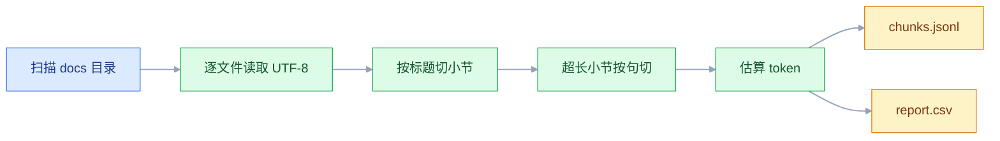
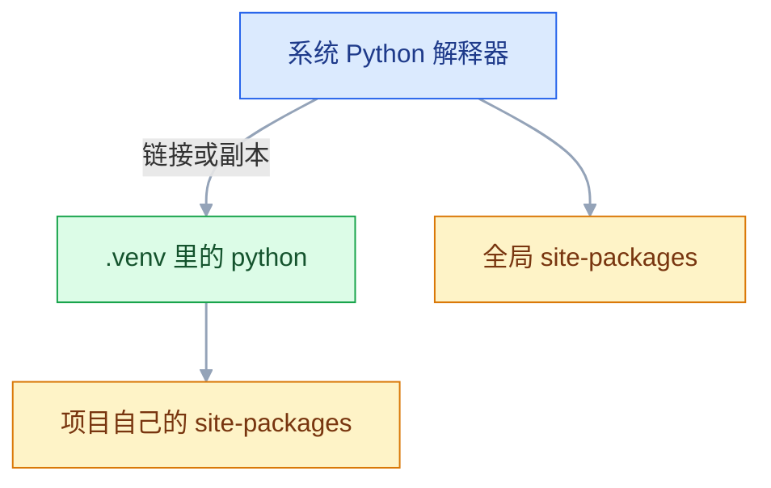
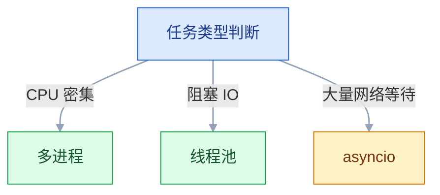

# Python 基础（AI 应用方向）

## 一、工程案例：写一个把文档批量切分并统计 token 的脚本

**场景**：手上 120 份 Markdown / TXT 内部文档（合计约 40 万字符），准备送进检索库。入库前必须回答三个问题：会切成多少块、每块多大、整批大概消耗多少 token。手工复制到网页里数不现实，需要一个能重复跑、结果可对照的脚本。

**产出**：

- `out/chunks.jsonl`：一行一个块，含 `doc_id`、`chunk_id`、`heading`、`text`、`chars`、`tokens`
- `out/report.csv`：一行一个文档，含字符数、块数、token 估算、最大块
- 终端摘要：总块数、token 总量、短块数量、失败文件清单

**验收标准**：换一台机器、换一个目录，三条命令内复现同样的块数与 token 数。

### 1.1 项目骨架

```bash
mkdir -p ~/projects/chunk-stats/{docs,out} && cd ~/projects/chunk-stats
python3 -m venv .venv
source .venv/bin/activate          # Windows: .venv\Scripts\activate
python -V                          # 3.10+，具体以官方当前稳定版为准
python -m pip install -q --upgrade pip
printf '.venv/\nout/\n__pycache__/\n' > .gitignore
```

脚本只依赖标准库。切分与统计属于纯文本处理，先把逻辑跑通，换真实分词器时再加依赖。

| 文件 | 职责 | 不该放什么 |
|---|---|---|
| `chunk_stats.py` | 扫描、切分、统计、导出 | 业务规则、硬编码绝对路径 |
| `docs/` | 输入文档 | 生成物 |
| `out/` | 产物 | 手工修改的内容 |
| `.gitignore` | 排除 `.venv` 与 `out` | 密钥（本脚本不需要） |

### 1.2 切分与统计

```python
#!/usr/bin/env python3
"""批量切分文档并统计 token 估算值。"""
from __future__ import annotations

import argparse, csv, hashlib, json, logging, re, sys
from concurrent.futures import ThreadPoolExecutor
from dataclasses import asdict, dataclass
from pathlib import Path

LOG = logging.getLogger("chunk_stats")
CJK = re.compile(r"[\u4e00-\u9fff\u3040-\u30ff\uac00-\ud7af]")
HEADING = re.compile(r"^(#{1,6})\s+(.*)$")


@dataclass
class Chunk:
    doc_id: str
    chunk_id: str
    heading: str
    text: str
    chars: int
    tokens: int


@dataclass
class DocStat:
    doc_id: str
    path: str
    chars: int
    chunks: int
    tokens: int
    max_chunk: int
    error: str = ""


def setup_logging(verbose: bool = False) -> None:
    handler = logging.StreamHandler(sys.stderr)
    handler.setFormatter(logging.Formatter(
        "%(asctime)s | %(levelname)-5s | %(message)s", "%H:%M:%S"))
    root = logging.getLogger()
    root.handlers = [handler]          # 覆盖而不是追加，避免重复输出
    root.setLevel(logging.DEBUG if verbose else logging.INFO)


def estimate_tokens(text: str) -> int:
    """预算口径：CJK 按字计，拉丁按词计，标点折半。"""
    cjk = len(CJK.findall(text))
    rest = CJK.sub("", text)
    words = len(re.findall(r"[A-Za-z0-9_]+", rest))
    punct = len(re.findall(r"[^\w\s]", rest))
    return cjk + words + punct // 2


def split_long(text: str, max_chars: int) -> list[str]:
    """超长段落按句末标点切，单句仍超长才硬切。"""
    out, buf = [], ""
    for s in re.split(r"(?<=[。！？；.!?;])", text):
        if buf and len(buf) + len(s) > max_chars:
            out.append(buf)
            buf = s
        else:
            buf += s
        while len(buf) > max_chars:
            out.append(buf[:max_chars])
            buf = buf[max_chars:]
    if buf.strip():
        out.append(buf)
    return out


def split_sections(text: str, max_chars: int) -> list[tuple[str, str]]:
    """按 Markdown 标题切；没有标题的文档整体算一节。"""
    sections: list[tuple[str, list[str]]] = []
    heading, buf = "", []
    for line in text.splitlines():
        m = HEADING.match(line)
        if m:
            if heading or any(x.strip() for x in buf):
                sections.append((heading, buf))
            heading, buf = m.group(2).strip(), []
        else:
            buf.append(line)
    if heading or any(x.strip() for x in buf):
        sections.append((heading, buf))

    result: list[tuple[str, str]] = []
    for heading, lines in sections:
        body = "\n".join(lines).strip()
        if not body:
            continue                      # 只有标题的空小节不产块
        for piece in split_long(body, max_chars):
            result.append((heading, piece))     # 同一小节的每块都带标题
    return result


def process(path: Path, root: Path, max_chars: int) -> tuple[DocStat, list[Chunk]]:
    rel = path.relative_to(root).as_posix()
    doc_id = hashlib.sha1(rel.encode("utf-8")).hexdigest()[:12]
    try:
        text = path.read_text(encoding="utf-8")   # 严格解码，不静默丢字
    except (UnicodeDecodeError, OSError) as e:
        LOG.error("读取失败 %s: %s", rel, e)
        return DocStat(doc_id, rel, 0, 0, 0, 0,
                       error=f"{type(e).__name__}: {e}"), []

    chunks = [Chunk(doc_id=doc_id, chunk_id=f"{doc_id}-{i:03d}",
                    heading=h, text=b, chars=len(b), tokens=estimate_tokens(b))
              for i, (h, b) in enumerate(split_sections(text, max_chars), 1)]
    stat = DocStat(doc_id, rel, len(text), len(chunks),
                   sum(c.tokens for c in chunks),
                   max((c.chars for c in chunks), default=0))
    return stat, chunks


def main() -> int:
    ap = argparse.ArgumentParser(description="批量切分文档并统计 token")
    ap.add_argument("--src", default="docs", type=Path)
    ap.add_argument("--out", default="out", type=Path)
    ap.add_argument("--max-chars", type=int, default=600)
    ap.add_argument("--workers", type=int, default=4)
    ap.add_argument("--verbose", action="store_true")
    args = ap.parse_args()

    setup_logging(args.verbose)
    files = [p for p in sorted(args.src.rglob("*"))
             if p.is_file() and p.suffix.lower() in {".md", ".txt"}
             and not p.name.startswith(".")]
    if not files:
        LOG.error("在 %s 下没有找到 .md/.txt", args.src)
        return 2

    args.out.mkdir(parents=True, exist_ok=True)
    with ThreadPoolExecutor(max_workers=args.workers) as pool:
        results = list(pool.map(
            lambda p: process(p, args.src, args.max_chars), files))

    stats = [s for s, _ in results]
    chunks = [c for _, cs in results for c in cs]
    failed = [s for s in stats if s.error]

    with (args.out / "chunks.jsonl").open("w", encoding="utf-8") as f:
        for c in chunks:
            f.write(json.dumps(asdict(c), ensure_ascii=False) + "\n")

    with (args.out / "report.csv").open("w", encoding="utf-8", newline="") as f:
        writer = csv.DictWriter(f, fieldnames=list(asdict(stats[0]).keys()))
        writer.writeheader()
        writer.writerows(asdict(s) for s in stats)

    short = [c for c in chunks if c.chars < 50]
    LOG.info("文档 %d 个，成功 %d，失败 %d",
             len(stats), len(stats) - len(failed), len(failed))
    LOG.info("块 %d 个，字符 %d，token 约 %d", len(chunks),
             sum(c.chars for c in chunks), sum(c.tokens for c in chunks))
    LOG.info("短块 %d 个（阈值 50 字符）", len(short))
    for s in failed:
        LOG.warning("  - %s: %s", s.path, s.error)
    return 0


if __name__ == "__main__":
    raise SystemExit(main())
```

### 1.3 运行与输出

```bash
# 先造两份样本，空仓库也能直接跑
printf '# 制度\n报销需在 30 天内提交。\n\n## 附件\n发票与审批单。\n' > docs/policy.md
printf '没有标题的纯文本也要能切。\n' > docs/notes.txt

python chunk_stats.py --src docs --out out
```

120 份真实文档时的输出示例：

```text
10:21:02 | ERROR | 读取失败 legacy/old_policy.txt: UnicodeDecodeError: 'utf-8' codec can't decode byte ...
10:21:03 | INFO  | 文档 120 个，成功 119，失败 1
10:21:03 | INFO  | 块 1847 个，字符 392481，token 约 311204
10:21:03 | INFO  | 短块 63 个（阈值 50 字符）
10:21:03 | WARNING |   - legacy/old_policy.txt: UnicodeDecodeError: 'utf-8' codec can't decode byte ...
```

失败文件没有被静默跳过：读不到时立刻打一条 ERROR，汇总时再打 WARNING，`report.csv` 里还留一行 `error`。批处理里「少处理了几个文件却显示成功」比直接崩溃更难查。

### 1.4 验收

| # | 检查项 | 命令或检查 | 通过标准 |
|---|---|---|---|
| 1 | 解释器正确 | `python -c "import sys;print(sys.executable)"` | 路径含 `.venv` |
| 2 | 标准库可用 | `python -c "import json, csv, hashlib, concurrent.futures"` | 无报错 |
| 3 | 空目录行为 | `mkdir -p /tmp/empty && python chunk_stats.py --src /tmp/empty; echo "exit=$?"` | 输出 `exit=2`，日志提示没找到文件 |
| 4 | 正常跑通 | `python chunk_stats.py --src docs --out out; echo "exit=$?"` | `exit=0`，块数大于 0 |
| 5 | JSONL 合法 | `python -c "import json;[json.loads(l) for l in open('out/chunks.jsonl',encoding='utf-8')]"` | 无异常 |
| 6 | 计数一致 | `wc -l < out/chunks.jsonl` 与 `python -c "import csv;print(sum(int(r['chunks']) for r in csv.DictReader(open('out/report.csv',encoding='utf-8'))))"` | 两数相等 |
| 7 | 块长受控 | `python -c "import json;print(max(json.loads(l)['chars'] for l in open('out/chunks.jsonl',encoding='utf-8')))"` | 不超过 `--max-chars` |
| 8 | 编码正确 | `python -c "b=open('out/chunks.jsonl','rb').read();print(b[:3]!=b'\xef\xbb\xbf', len(b.decode('utf-8')))"` | 先输出 `True`，解码无异常 |
| 9 | 失败隔离 | 按下文造一个 GBK 文件后重跑 | 退出码仍为 0，失败数为 1 |
| 10 | 结果可复现 | 连跑两次 `shasum -a 256 out/chunks.jsonl`（Linux 用 `sha256sum`） | 两次哈希一致 |

第 8 项不用 `file` 判断编码：不同系统的 `libmagic` 对 JSONL 的识别结果不一致，只验证「无 BOM + 严格 UTF-8 可解码」才是确定的。

第 9 项这样造样本（macOS 自带的 `iconv` 常常不带 GBK，用 Python 写字节更稳）：

```bash
python -c "open('docs/_legacy.txt','wb').write('旧制度：中文内容\n'.encode('gbk'))"
python chunk_stats.py --src docs --out out; echo "exit=$?"
rm docs/_legacy.txt
```

第 10 项能过，靠的是三件事：文件列表 `sorted`、`pool.map` 保序、产物里没有时间戳。任何一处引入「当前时间」或字典遍历顺序，哈希就会漂。

### 1.5 增量与扩展

**增量处理**：`doc_id` 是相对路径的哈希，天然适合做增量键。已有产物里的 `doc_id` 集合就是「已处理」清单，新文件只算差集，旧块不重算。

**新增格式**：把 `process` 里的 `path.read_text` 换成一个按后缀分发的解析函数字典，其余部分不动。解析器只负责「路径进、纯文本出」，切分与统计与格式无关。

**换真实分词器**：`estimate_tokens` 是预算口径，和厂商计费口径一定存在偏差。要精确计费就换成对应模型的分词器，并把「模型名 → 分词器」写进配置；换模型时统计口径必须跟着换，否则历史报表不可比。

**并行的边界**：这里的任务大部分时间在等磁盘和做正则，线程够用。如果每份文档都要跑重计算（比如本地 embedding），GIL 会让线程失效，应换 `ProcessPoolExecutor`，代价是进程启动和参数序列化。



---

## 二、高频问答：会卡住你的地方，也是面试最常问的

### 2.1 `pip install` 成功，`import` 还是 `ModuleNotFoundError`

**现场**

三个路径要对上：`which python`、`python -c "import sys;print(sys.executable)"`、`python -m pip -V`。再让 pip 自己报告装到了哪：`python -m pip show 包名`，看 `Location` 是不是当前虚拟环境目录。终端里到底有几个 `python`，用 `type -a python python3` 列一遍。

**要点**

- 报错不是包没装，是装进了另一个解释器。
- `pip` 与 `python` 是两个入口，IDE、终端、Jupyter 可能各用一套 `site-packages`。
- 安装只作用于某一个环境，养成 `python -m pip install` 的习惯，「用哪个解释器装」就没有歧义。

**追问**

- 怎么确认装到了哪？→ `python -m pip show 包名`，看 `Location` 的路径。
- 终端里的 `python` 指向哪个文件？→ `type -a python python3` 会列出所有命中的路径。
- 激活虚拟环境就够了吗？→ 只改了 `PATH`，IDE 和 Jupyter 仍可能用另一套解释器。

### 2.2 IDE 里能跑，命令行报 `FileNotFoundError`

**现场**

脚本里打印 `Path.cwd()` 与 `Path(__file__).resolve()`，两个值一对比就知道基准是哪个目录。

**要点**

- 不是文件被删，相对路径以「当前工作目录」为基准，不是脚本所在目录。
- IDE 默认把工作目录设成项目根，命令行则是 shell 当前所在目录。
- 修复是把资源锚定到脚本：`BASE = Path(__file__).resolve().parent`，数据目录再由 `--src` 参数传入。

**追问**

- 为什么不写死绝对路径？→ 换机器、换目录就失效，也不能进 Git。
- 为什么不写 `open("data/x.csv")`？→ 它依赖启动位置，同一份代码换个目录跑就崩。
- IDE 里为什么正常？→ 它的工作目录正好是项目根，和相对路径对上了。

### 2.3 `UnicodeDecodeError: 'utf-8' codec can't decode byte ...`

**现场**

`file -I 文件名`（Linux 用 `file -i`）看字符集；`python -c "print(open('x','rb').read(120))"` 看原始字节。

**要点**

- 不是文件损坏，是文件根本不是 UTF-8。UTF-8 对字节序列有合法范围，遇到非法序列直接抛异常。
- 常见来源是 GBK/GB18030 导出的 CSV、记事本存的 ANSI、或误读了二进制文件。
- 不要用 `errors="ignore"` 绕过：它会静默删掉无法解码的字节，中文段落可能少几个字，而且没有任何报错。

**追问**

- 带 BOM 的文件怎么读？→ 用 `utf-8-sig`。
- 为什么不能用 `errors="ignore"`？→ 字节被静默删除，后面查数据缺失时无法回溯是哪一批出的问题。
- 确认了源编码之后怎么处理？→ 用对应编码读入，统一转成 UTF-8 输出。

### 2.4 函数默认参数「记住了」上一次的结果

**现场**

`print(f.__defaults__)`，能看到列表里已经堆了上次的数据。

**要点**

- 不是 Python 的 bug，默认值在 `def` 执行时求值一次，之后所有调用共享同一个对象。
- 默认值属于函数对象，和函数定义一起只创建一次，可变默认值于是成了跨调用的累加器。
- 修复统一用 `None` 哨兵，类里换成 `field(default_factory=...)`。

**追问**

- 为什么 `__defaults__` 里会有上次的数据？→ 它是函数对象上的属性，调用不会重建。
- 类属性里怎么写？→ `field(default_factory=list)`，每次实例化新建一个。
- 不可变默认值有这个问题吗？→ 没有，它不会被原地修改，换值就是重新绑定。

```python
def collect(x, acc=[]):        # ✘ 所有调用共享这一个列表
    acc.append(x)
    return acc

def collect(x, acc=None):      # ✔ 每次调用新建
    acc = [] if acc is None else acc
    acc.append(x)
    return acc
```

### 2.5 `[[0] * 3] * 3` 改一格，三行全变

**现场**

`id(m[0]) == id(m[1])` 返回 `True`，就是共享同一个对象。

**要点**

- 不是创建了三个独立的列表，外层乘号复制的是同一个内层列表的引用。
- 列表乘法只做浅复制，元素是引用。
- 修复用推导式，数值矩阵直接上 NumPy。

**追问**

- 为什么三行会一起变？→ 三行指向同一对象，改哪一行都是改它。
- 怎么一眼确认共享？→ 比较 `id`，相等就是同一个对象。
- 嵌套更深的怎么建？→ 逐层用推导式新建，别用乘法。

```python
m = [[0] * 3] * 3
m[0][0] = 1
print(m)                       # [[1,0,0],[1,0,0],[1,0,0]]

m = [[0] * 3 for _ in range(3)]   # ✔ 每次新建一行
```

### 2.6 循环里 `remove`，总有几个元素漏删

**现场**

用 `[1, 2, 2, 3]` 复现，删完还剩一个 2。

**要点**

- 不是判断条件写错，是边迭代边缩短列表：后面的元素前移，索引却继续加一，于是跳过元素。
- 核实只需最小复现，不用看业务数据。
- 修复优先用推导式重建；必须原地改时倒序遍历或先收集再删。

**追问**

- 倒序遍历为什么就没事？→ 删除只影响还没遍历到的位置，索引不会错位。
- 迭代器看到的不是最新列表吗？→ 看到的是活对象，但索引不会因为长度变化而回退。
- 一定要原地改怎么办？→ 遍历 `list(...)` 的副本，或先收集再统一删。

```python
nums = [1, 2, 2, 3]
for n in nums:
    if n == 2:
        nums.remove(n)         # ✘ 跳过一个 2

nums = [n for n in nums if n != 2]   # ✔ 重建
```

### 2.7 `is` 比较字符串，有时 True 有时 False

**现场**

`a is b` 与 `id(a), id(b)` 一起看；再构造运行时字符串 `a = "".join(["ab", "c"])`，和字面量 `"abc"` 比一次。

**要点**

- `is` 比较的是对象身份，不是值。
- 短字符串驻留、小整数缓存、编译期常量合并，会让两个「碰巧相同」的对象是同一个。
- 规则很简单：`None`、`True`、`False` 用 `is`，其余值比较一律 `==`。

**追问**

- 为什么运行时拼出来的字符串通常不驻留？→ 驻留主要发生在编译期常量和少数场景。
- 两个对象 `==` 为 True 但 `is` 为 False 说明什么？→ 值相同、身份不同，`is` 不能用于值比较。
- 判断空值用什么？→ `is None`，不要用 `== None`。

### 2.8 循环里创建的 lambda，调用时全都用最后一个值

**现场**

`funcs = [lambda: i for i in range(3)]`，`[f() for f in funcs]` 得到 `[2, 2, 2]`。

**要点**

- 不是 lambda 有 bug，闭包按名字延迟绑定，函数体在调用时才去读 `i`，此时循环已结束。
- 所有函数共享同一个 `i`，所以拿到的都是最后一个值。
- 修复用默认参数提前绑定 `lambda i=i: i`，或用 `functools.partial`；要可读性就直接写普通函数。

**追问**

- 默认参数为什么能绑住当时的值？→ 默认值在定义时求值一次（同 2.4）。
- `functools.partial` 怎么用？→ 把当前值固定成位置参数传进去。
- 换成普通函数还有这个问题吗？→ 有，这是闭包语义，不是 lambda 特有。

### 2.9 调用了 `async` 函数，函数体一行都没执行

**现场**

`print(coro)` 显示 `<coroutine object ...>`；解释器还会给出 `RuntimeWarning: coroutine ... was never awaited`。

**要点**

- 不是逻辑没写对，调用协程函数只创建协程对象，不会运行。
- 漏了 `await`，或入口没有事件循环。
- 修复：协程内部用 `await`，程序入口用 `asyncio.run(main())`。

**追问**

- 为什么加 print 也看不到？→ 函数体压根没执行，print 在协程里面。
- Jupyter 里为什么不能再套 `asyncio.run`？→ 它本身已有事件循环，顶层直接 `await`。
- 那个 `RuntimeWarning` 什么时候出现？→ 协程对象被回收时还没被 await。

### 2.10 `except Exception: pass` 之后，问题在更远的地方爆

**现场**

临时改成 `except Exception: logger.exception("上下文"); raise`，看真正的抛出点。

**要点**

- 不是「不崩就对了」，异常和栈被吞掉后，错误状态继续向下传，最终在一个看不出因果的位置失败。
- 只捕获能处理的异常，至少用 `logger.exception` 记录完整栈。
- 不要裸 `except:`，它会连 `KeyboardInterrupt`、`SystemExit` 一起吞掉。

**追问**

- 为什么错误会在很远的地方爆？→ 坏状态继续流转，到某个不相关的位置才触发。
- `logger.exception` 和 `print` 差在哪？→ 前者带完整栈和级别，能直接看到抛出点。
- 捕获了但处理不了怎么办？→ 带上上下文重抛，别吞掉。

### 2.11 金额算出 `0.30000000000000004`

**现场**

`0.1 + 0.2 == 0.3` 返回 `False`；`Decimal("0.1") + Decimal("0.2")` 得到精确值。

**要点**

- 不是 Python 算错了，二进制浮点无法精确表示 0.1、0.2 这类十进制小数，误差在运算中累积。
- 金额用 `Decimal`（从字符串构造）或以「分」为单位的整数。
- 比较浮点用 `math.isclose`，不要用 `round` 掩盖计算误差。

**追问**

- 为什么 `Decimal(0.1)` 也不对？→ 从浮点构造会把已有误差带进去，必须从字符串构造。
- `round` 为什么不行？→ 它只掩盖误差，误差还在，只是看不见。
- 什么场景可以直接用 `float`？→ 科学计算和展示；金额、计数必须精确。

### 2.12 循环里给 `dict` 增删键，抛 `RuntimeError: dictionary changed size during iteration`

**现场**

遍历 `d` 的过程中执行 `del d[k]` 或 `d.pop(k)`，第一次操作就抛 `RuntimeError`；只改值 `d[k] = v` 不会。

**要点**

- 不是别处改了数据，`for k in d` 拿到的是活视图，不是快照。
- 遍历中增删键会改变尺寸，迭代器立刻中止；只改值不改尺寸，所以不报错。
- 修复分三种：要过滤就重建字典，必须原地删就遍历 `list(d)`，只改值则不必绕。

**追问**

- 为什么 `d[k] = v` 不报错？→ 尺寸没变，迭代器不需要重排。
- `list(d)` 为什么安全？→ 先取出键的副本，遍历的是副本。
- 遍历 `set` 也一样吗？→ 一样，`set` 的迭代器盯的也是活对象。

```python
d = {"a": 1, "b": 2}
for k in list(d):             # ✔ 先用键的副本
    if d[k] < 2:
        del d[k]
```
---

## 三、核心知识：从零开始要建立的东西

### 3.1 解释器与执行模型

Python 源码先编译成字节码，再由虚拟机执行；`.pyc` 只是字节码缓存，删掉会自动重建。变量是「名字到对象的绑定」，类型属于对象而不是名字，所以同一个名字可以先后指向不同类型。最小例子：`a = [1]; b = a; b.append(2)` 之后 `a` 也是 `[1, 2]`。

| 概念 | 含义 | 实际影响 |
|---|---|---|
| 源码 `.py` | 人写的文本 | 编码默认 UTF-8 |
| 字节码 `.pyc` | 编译结果 | 放在 `__pycache__`，不要提交 |
| 对象 | 堆上的值 | 有类型、有 `id`、有引用计数 |
| 名字 | 指向对象的标签 | 赋值不复制对象 |

边界：CPython 有 GIL，同一进程内多个线程不能并行执行字节码；`python -O` 会去掉 `assert`，不要把校验逻辑写成 assert。

### 3.2 虚拟环境与依赖解析

虚拟环境本质是一个目录：一个指向基础解释器的链接（Windows 上是解释器副本），加上独立的 `site-packages`。激活脚本只改 `PATH`、`VIRTUAL_ENV` 与提示符，不激活也能直接用 `.venv/bin/python`（Windows 为 `.venv\Scripts\python.exe`）；建立与进入就是 `python3 -m venv .venv` 加 `source .venv/bin/activate`。



| 工具 | 管什么 | 代价 | 适用 |
|---|---|---|---|
| `venv` | 只隔离 Python 包 | 不管 CUDA 等系统库 | 绝大多数项目 |
| `conda` | 连非 Python 依赖一起管 | 体积大、解析慢 | 本地跑 GPU 模型 |
| `uv` | 包与环境，解析快 | 团队需统一约定 | 新项目 |

依赖解析是把所有版本约束求交集，冲突时回溯。`requirements.txt` 通常只写直接依赖（或 `pip freeze` 的全量快照），锁文件记录完整解析结果与哈希；上线要可复现，锁文件必须提交。

边界：不要给系统 Python 装包；`--system-site-packages` 会让隔离失效；同一个环境里混用 conda 与 pip 容易产生「装了两份」的冲突。

### 3.3 对象、名字与引用

赋值只建立绑定，不复制对象。函数传参传的也是对象引用：函数内「重新绑定」不影响外部，函数内「原地修改」会影响外部。

| 操作 | 效果 | 例子 |
|---|---|---|
| `b = a` | 新增一个名字 | 两个名字指向同一对象 |
| `b = a[:]` | 浅拷贝（`list` 等序列） | 外层新对象，内层仍共享 |
| `b = copy.deepcopy(a)` | 深拷贝 | 递归复制，代价高 |
| `a += [x]` | 原地扩展 | 所有引用都看到变化 |
| `a = a + [x]` | 新建对象 | 其他名字不受影响 |

```python
def add_item(items):
    items.append("x")      # 原地修改，外部可见

def rebind(items):
    items = ["x"]          # 只是局部名字换绑，外部不变
```

边界：不可变对象（`int`、`str`、`tuple`）的「修改」都是新建；`tuple` 里若含列表，列表仍可变。

### 3.4 数值表示与精度

`int` 是任意精度整数，`float` 是 IEEE 754 双精度，`bool` 是 `int` 的子类。除法 `/` 永远返回浮点，整除 `//` 向下取整。

| 场景 | 用法 | 注意 |
|---|---|---|
| 计数、索引 | `int` | 不会溢出 |
| 科学计算 | `float` / NumPy | 有舍入误差 |
| 金额 | `Decimal` 或整数分 | 从字符串构造 |
| 判等 | `math.isclose` | 不用 `==` |

```python
from decimal import Decimal
print(Decimal("0.1") + Decimal("0.2"))   # 0.3
print(-7 // 2, -7 % 2)                    # -4 1，向下取整
```

边界：`float("nan")` 与任何值都不相等，包括自己；用 `math.isnan` 判断。`Decimal` 有精度上下文，除法要设位数。

### 3.5 字符串与编码

`str` 是 Unicode 码点序列，`bytes` 是字节序列。写文件、发网络请求时是字节，屏幕上看到的是字符，中间的转换就是编码与解码。

| 现象 | 原因 | 处理 |
|---|---|---|
| `len("中")` 为 1，`len("中".encode())` 为 3 | UTF-8 变长编码 | 按字符计数用 `len(str)` |
| 读文件抛 `UnicodeDecodeError` | 源不是 UTF-8 | 确认编码后用 `gb18030` 等读入 |
| Excel 打开 CSV 乱码 | 缺 BOM | 导出用 `utf-8-sig` |
| 全角数字搜不到 | 字符不同 | `unicodedata.normalize("NFKC", s)` |

```python
s = "制度"
b = s.encode("utf-8")        # b'\xe5\x88\xb6\xe5\xba\xa6'
print(b.decode("utf-8"))     # 制度
```

边界：编码错误分「解码失败」和「解码成功但内容是错的」两类，后者更危险；`errors="replace"` 会插入 `�`，适合展示，不适合入库。

### 3.6 容器类型与复杂度

`list` 有序可重复，`dict` 键值映射且保持插入顺序，`set` 去重且无序，`tuple` 不可变。`dict` 与 `set` 依赖哈希，平均查找为常数时间。

| 操作 | list | dict / set |
|---|---|---|
| 按下标取 | O(1) | 不适用 |
| 按值查找 | O(n) | O(1) 平均 |
| 末尾追加 | O(1) 摊销 | — |
| 中间插入 | O(n) | — |
| 成员判断 | O(n) | O(1) 平均 |

```python
seen = set()
for x in [1, 2, 2, 3]:
    if x not in seen:       # 用 set 判断，别用 list
        seen.add(x)
```

边界：可变对象不能做 `dict` 键或 `set` 元素；`set` 的输出顺序不可依赖；哈希冲突极端情况下退化为线性。

> **面试**：常问「list 和 dict 的查找复杂度差在哪？」答：list 按值查找是 O(n)，dict 和 set 靠哈希平均 O(1)，但可变对象不能做键。

### 3.7 函数参数机制

参数分位置、关键字、默认、可变位置 `*args`、可变关键字 `**kwargs`。`/` 之前的参数只能按位置传，`*` 之后的只能按关键字传。

```python
def call(model, /, prompt, *, temperature=0.3, **extra):
    return {"model": model, "prompt": prompt,
            "temperature": temperature, **extra}

call("m", "hi", temperature=0.7)
```

| 形式 | 收集成 | 调用方式 |
|---|---|---|
| `*args` | tuple | `f(1, 2)` |
| `**kwargs` | dict | `f(a=1, b=2)` |
| `*` | 分隔符 | 后面必须写关键字 |
| `/` | 分隔符 | 前面不能写关键字 |

边界：默认值只求值一次，可变默认值必须用 `None` 哨兵；`**` 合并字典时后者覆盖前者；参数过多说明该拆函数或改传配置对象。

### 3.8 迭代协议与生成器

`for` 的本质是先调 `iter()` 拿迭代器，再反复 `next()`，直到 `StopIteration`。生成器函数用 `yield` 逐次产出，天然惰性，适合大文件与流式数据。

| 概念 | 要求 | 特点 |
|---|---|---|
| 可迭代对象 | 实现 `__iter__` | 可被 `for` 遍历 |
| 迭代器 | 实现 `__next__` | 只能前进，耗尽即止 |
| 生成器 | 函数含 `yield` | 自动实现迭代协议 |

```python
def read_lines(path):
    with open(path, encoding="utf-8") as f:
        for line in f:
            yield line.rstrip("\n")

for line in read_lines("big.txt"):   # 内存里只有一行
    ...
```

边界：生成器只能消费一次；生成器内部的异常会在迭代时抛出；需要多次遍历就返回列表或重新创建生成器。

> **面试**：常问「生成器有什么用？为什么只能消费一次？」答：用 yield 惰性产出，内存与文件大小无关；迭代器只能前进，耗尽即止。

### 3.9 异常与资源释放

异常是对象，沿调用栈向上传播，直到被 `except` 捕获。`else` 在无异常时执行，`finally` 无论如何执行。`with` 依赖上下文管理器协议，退出时一定调用清理。

```python
class ConfigError(Exception):
    """配置缺失，调用方无法自行恢复。"""

try:
    cfg = load_config()
except FileNotFoundError as e:
    raise ConfigError("配置文件不存在") from e
```

| 内置异常 | 典型触发 |
|---|---|
| `ValueError` | 类型对但值不合法 |
| `TypeError` | 类型或参数个数不对 |
| `KeyError` | 字典键不存在 |
| `FileNotFoundError` | 路径不存在 |
| `TimeoutError` | 操作超时 |

边界：`finally` 里的 `return` 会吞掉正在传播的异常；`raise ... from e` 保留因果链；捕获范围越窄越好，捕获后要么处理，要么带上上下文重抛。

### 3.10 模块、包与导入

导入时按 `sys.path` 顺序查找，模块首次导入后缓存在 `sys.modules`，再次导入直接取缓存。包是带 `__init__.py` 的目录（命名空间包可以没有）。

```text
project/
├── pyproject.toml
├── src/myapp/
│   ├── __init__.py
│   ├── config.py
│   └── pipeline.py
└── tests/
```

| 写法 | 含义 |
|---|---|
| `import myapp.config` | 导入模块，用全名访问 |
| `from myapp.config import load` | 导入名字 |
| `from .config import load` | 包内相对导入 |
| `if __name__ == "__main__"` | 仅直接运行时执行 |

边界：脚本所在目录会自动进 `sys.path`，同名模块可能遮蔽标准库；循环导入通常靠延迟导入或拆出公共模块解决；不要用 `sys.path.append` 修结构问题。

### 3.11 类型提示与数据模型

类型提示是给阅读者、IDE 和静态检查器看的，运行时默认不校验。`from __future__ import annotations` 让注解延迟求值，避免前向引用问题。

| 工具 | 运行时校验 | 适用 |
|---|---|---|
| 类型提示 | 否 | 函数签名、IDE 补全 |
| `dataclass` | 否 | 内部配置、简单记录 |
| `TypedDict` | 否 | 描述字典结构 |
| pydantic | 是 | 外部输入、模型输出解析 |

```python
from dataclasses import dataclass, field

@dataclass
class Job:
    name: str
    tags: list[str] = field(default_factory=list)   # 可变默认值用工厂
```

边界：`Any` 用多了等于没有类型；`list[int]` 这类内置泛型要 3.9+（PEP 585），更早的版本用 `typing.List[int]`；外部数据必须在边界处校验，不能靠注解。

### 3.12 装饰器与闭包

装饰器是「接收函数、返回新函数」的可调用对象，`@deco` 等价于 `func = deco(func)`。闭包让内层函数记住外层变量，但记住的是变量本身，不是当时的值。

```python
import functools, time

def timer(func):
    @functools.wraps(func)          # 保留函数名与文档，日志才认得出
    def wrapper(*args, **kwargs):
        start = time.perf_counter()
        try:
            return func(*args, **kwargs)
        finally:
            print(f"{func.__name__} {time.perf_counter() - start:.3f}s")
    return wrapper
```

| 形态 | 结构 | 例子 |
|---|---|---|
| 无参装饰器 | 两层 | `@timer` |
| 带参装饰器 | 三层 | `@retry(times=3)` |
| 类装饰器 | 实现 `__call__` | 需要保存状态 |

边界：异步函数要用 `async def wrapper` 并 `await`，否则拿到的是协程对象；多个装饰器由下往上包裹；缓存装饰器要求参数可哈希。

### 3.13 并发模型

并发解决的是「等待时间重叠」，不是「让单个任务变快」。CPU 密集靠多进程，IO 密集靠线程或协程。

| 模型 | 适用 | 代价 |
|---|---|---|
| `threading` | 阻塞式 IO | 共享内存需加锁，受 GIL 限制 |
| `multiprocessing` | CPU 密集 | 进程启动、数据序列化 |
| `asyncio` | 大量网络等待 | 全链路必须异步，阻塞调用会卡住循环 |

```python
import asyncio

sem = asyncio.Semaphore(5)          # 同时最多 5 个

async def task(i):
    async with sem:
        await asyncio.sleep(0.1)
        return i

async def main():
    return await asyncio.gather(*(task(i) for i in range(20)))

print(len(asyncio.run(main())))
```



边界：协程里调用同步阻塞函数会占住整个事件循环；线程间共享可变状态必须加锁；进程间传大对象开销高，优先传路径或 id。

> **面试**：常问「GIL 下多线程还有用吗？CPU 密集怎么办？」答：IO 密集靠线程或协程，CPU 密集换多进程绕过 GIL。

### 3.14 文件、JSON 与 CSV 的读写边界

文本读写由「编码 + 换行」两个参数决定，其余都是派生问题。找不到文件先查工作目录（见 2.2），读到乱码查编码（见 2.3）。

| 场景 | 写法 | 坑 |
|---|---|---|
| 读文本 | `Path(p).read_text(encoding="utf-8")` | 不写 `encoding` 就由 locale 或 UTF-8 模式决定 |
| 写文本 | `open(p, "w", encoding="utf-8", newline="\n")` | 省略 `encoding` 就按 locale（中文 Windows 为 cp936）；省略 `newline` 时平台会改写换行 |
| 读带 BOM | `open(p, encoding="utf-8-sig")` | 用 `utf-8` 读会把 BOM 留成 `\ufeff` |
| 写 JSONL | `json.dumps(obj, ensure_ascii=False)` | 默认转义非 ASCII，中文全变成 `\uXXXX` |
| 写 CSV | `open(p, "w", encoding="utf-8", newline="")` | 漏 `newline=""` 在 Windows 上每行之间多空行 |
| 读大文件 | `for line in f` | `read()` / `readlines()` 一次全进内存 |

```python
import csv, json
from pathlib import Path

Path("out").mkdir(exist_ok=True)
rows = [{"id": 1, "标题": "制度"}, {"id": 2, "标题": "附件"}]
with open("out/a.csv", "w", encoding="utf-8", newline="") as f:
    w = csv.DictWriter(f, fieldnames=["id", "标题"])
    w.writeheader()
    w.writerows(rows)
with open("out/a.jsonl", "w", encoding="utf-8") as f:
    for r in rows:
        f.write(json.dumps(r, ensure_ascii=False) + "\n")
```

边界：只有二进制（图片、模型权重）才用 `rb`/`wb`；大批量产物先写 `.tmp` 再 `Path.replace`，中断时不会留下半截文件；JSONL 一行一个对象才能边写边读，整体 `json.dump` 一个大列表做不到。

---

## 四、冷门知识汇总

这一节只放「查一次就会、忘了也不致命」的条目；会拖垮批处理的问题都在第二节。

| 知识点 | 为什么冷门 | 用到时的关键词 |
|---|---|---|
| `python -m pip` 与裸 `pip` 的区别 | 环境只有一个时两者等价，出问题时才暴露 | `sys.executable`、`pip -V` |
| `sys.path[0]` 是脚本目录（`python -m` 时是当前目录） | 平时代码简单，不会注意导入搜索顺序 | 同名模块遮蔽、`python -m` |
| `__pycache__` 与 `.pyc` | 自动生成，几乎不用手工干预 | 清理缓存、跨版本字节码不兼容 |
| `-O` 会移除 `assert` | 很少用优化模式启动 | 不要把校验写成 `assert` |
| 小整数缓存与字符串驻留 | 只影响 `is`，正常代码用不到 | `id()`、`sys.intern` |
| `functools.lru_cache` 的键 | 参数不可哈希就报错 | `TypeError: unhashable type` |
| `Decimal` 的上下文精度 | 只有金融场景才碰 | `getcontext().prec` |
| `__slots__` | 小对象省内存，现代项目少用 | 海量实例、内存剖析 |
| 生成器的 `send` / `throw` | 协程式生成器偏底层 | `yield from`、状态机 |
| `contextlib.suppress` | 只在一行忽略特定异常时好用 | 替代空 `except` |
| `logging` 的 `propagate` | 出现重复日志时才查 | 双份输出、handler 继承 |
| `traceback` 模块 | 异常已捕获后想补打栈 | `traceback.format_exc()` |
| `time.perf_counter` 与 `time.time` | 都叫「时间」，用途不同 | 计时用前者，时间戳用后者 |
| `venv` 不复制标准库 | 建好后几乎不打开看目录结构 | `--copies`、迁移环境、容器构建 |
| `re` 的 `\w` 默认匹配 Unicode 字母 | 以为等价于 `[A-Za-z0-9_]`，中文文档上结果差很多 | `re.ASCII`、显式字符集 |
| `dict` 保持插入顺序是 3.7 起的语言保证 | 老代码里常见 `OrderedDict`，以为仍然必需 | `OrderedDict`、`move_to_end` |
