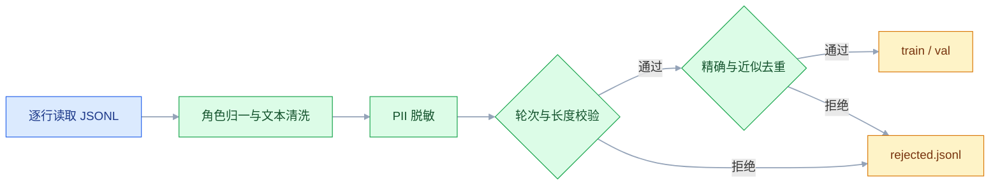

# AI 数据处理

## 一、工程案例：清洗一份客服对话日志，产出可训练的 JSONL 与质量报告

**场景**：从工单系统导出 `tickets.jsonl`，共 32000 行，一行一个工单。字段包括 `ticket_id`、`created_at`、`channel`、`subject`、`messages`、`html_note`。原始数据的问题很集中：正文混着 HTML 标签与实体、全半角混用、手机号和邮箱未脱敏、同一通对话被导出多次、少量行是坏 JSON、`messages` 有时是数组有时是被转义成字符串的数组、角色名有 `customer`/`agent`/`bot`/`system` 四种写法。

**产出**：

- `data/processed/train.jsonl`、`val.jsonl`：可直接用于监督微调的对话样本
- `data/processed/rejected.jsonl`：每条被丢弃的记录及原因
- `data/processed/stats.csv`、`quality_report.md`：样本量、长度分位、拒绝原因分布
- 终端摘要：保留数、拒绝数、主要拒绝原因

**验收标准**：输入行数等于保留数加拒绝数；产物零 PII 残留；训练集与验证集的 `ticket_id` 无交集。

### 1.1 项目与输入样本

```bash
mkdir -p ~/projects/ticket-clean/data/{raw,processed} && cd ~/projects/ticket-clean
python3 -m venv .venv && source .venv/bin/activate
python -m pip install -q --upgrade pip
python -m pip install -q pandas
python -c "import pandas; print(pandas.__version__)"   # 以官方当前稳定版为准
printf '.venv/\ndata/raw/\ndata/processed/\n__pycache__/\n' > .gitignore
```

`data/raw/tickets.jsonl` 的三行样本，分别代表正常、字符串化数组、坏 JSON：

```text
{"ticket_id":"T-1001","created_at":"2026-09-02T10:11:00","messages":[{"role":"customer","content":"<p>你好，订单&nbsp;20260902123456 一直没发货</p>"},{"role":"agent","content":"您好，已为您催促仓库。"}]}
{"ticket_id":"T-1002","created_at":"2026-09-02T10:20:00","messages":"[{\"role\":\"bot\",\"content\":\"请描述问题\"},{\"role\":\"customer\",\"content\":\"发票怎么开？\"}]"}
{"ticket_id":"T-1003","created_at":"2026-09-02T10:31:00","messages":[{"role":"customer","content":"退款
```

第三行在真实文件里就是被截断的一行。流式读取时它只会让这一行失败，不应该拖垮整批。

| 文件 | 职责 |
|---|---|
| `clean.py` | 读取、清洗、脱敏、去重、划分、导出 |
| `data/raw/` | 原始导出，只读，不提交 |
| `data/processed/` | 产物，可重新生成，不提交 |
| `data/processed/quality_report.md` | 每次运行覆盖，随产物一起归档 |

### 1.2 清洗与转换

```python
#!/usr/bin/env python3
"""客服对话日志清洗：产出 SFT JSONL、拒绝样本与质量报告。"""
from __future__ import annotations

import hashlib
import html
import json
import re
import unicodedata
from collections import Counter
from pathlib import Path

import pandas as pd

RAW = Path("data/raw/tickets.jsonl")
OUT = Path("data/processed")
MIN_CHARS, MAX_CHARS = 20, 6000

ROLE_MAP = {"customer": "user", "user": "user", "agent": "assistant",
            "assistant": "assistant", "bot": "assistant", "system": "system"}
TAG = re.compile(r"<[^>]+>")
WS = re.compile(r"[ \t\u3000\xa0]+")
MULTI_NL = re.compile(r"\n{3,}")
ZERO = re.compile(r"[\u200b-\u200f\ufeff]")
PHONE = re.compile(r"(?<!\d)1[3-9]\d{9}(?!\d)")
EMAIL = re.compile(r"[\w.+-]+@[\w-]+\.[\w.]+")
LONG_ID = re.compile(r"(?<!\d)\d{12,}(?!\d)")


def clean_text(value) -> str:
    text = html.unescape(str(value or ""))
    text = TAG.sub(" ", text)
    text = unicodedata.normalize("NFKC", text)
    text = ZERO.sub("", text)
    text = text.replace("\r\n", "\n").replace("\r", "\n")
    text = WS.sub(" ", text)
    text = MULTI_NL.sub("\n\n", text)
    return text.strip()


def mask_pii(text: str) -> tuple[str, int]:
    hits = 0
    for pattern, tag in ((EMAIL, "[EMAIL]"), (PHONE, "[PHONE]"),
                         (LONG_ID, "[ID]")):
        text, n = pattern.subn(tag, text)
        hits += n
    return text, hits


def normalize_messages(raw) -> list[dict]:
    """角色归一、连续同角色合并、空内容丢弃。"""
    if isinstance(raw, str):
        try:
            raw = json.loads(raw)
        except json.JSONDecodeError:
            return []
    if not isinstance(raw, list):
        return []

    out: list[dict] = []
    for item in raw:
        if not isinstance(item, dict):
            continue
        role = ROLE_MAP.get(str(item.get("role", "")).strip().lower())
        content = clean_text(item.get("content", ""))
        if not role or not content:
            continue
        if out and out[-1]["role"] == role:
            out[-1]["content"] += "\n" + content
        else:
            out.append({"role": role, "content": content})
    return out


def to_sample(messages: list[dict], ticket_id: str, created_at: str):
    """裁成「user 开头、assistant 结尾」的一段对话，合并相邻同角色，并补统一 system。"""
    msgs = [m for m in messages if m["role"] != "system"]
    while msgs and msgs[0]["role"] == "assistant":
        msgs.pop(0)
    while msgs and msgs[-1]["role"] != "assistant":
        msgs.pop()
    if len(msgs) < 2 or not any(m["role"] == "user" for m in msgs):
        return None
    merged: list[dict] = []
    for m in msgs:
        if merged and merged[-1]["role"] == m["role"]:
            merged[-1]["content"] += "\n" + m["content"]
        else:
            merged.append(m)
    if len(merged) < 2:
        return None
    system = {"role": "system", "content": "客服助手，回答基于工单上下文。"}
    return {"ticket_id": ticket_id, "created_at": created_at,
            "messages": [system] + merged}


def norm_key(text: str) -> str:
    return hashlib.sha1(re.sub(r"\s+", "", text).encode("utf-8")).hexdigest()


def shingles(text: str, n: int = 3) -> set[str]:
    t = re.sub(r"\s+", "", text)
    return {t[i:i + n] for i in range(max(0, len(t) - n + 1))}


def jaccard(a: set[str], b: set[str]) -> float:
    return len(a & b) / len(a | b) if a and b else 0.0


def split_of(ticket_id: str) -> str:
    h = int(hashlib.sha1(ticket_id.encode("utf-8")).hexdigest()[:8], 16)
    return "val" if h % 100 < 10 else "train"


def main() -> None:
    OUT.mkdir(parents=True, exist_ok=True)
    reject = Counter()
    rejected_rows: list[dict] = []
    seen: set[str] = set()
    buckets: dict[str, list[set[str]]] = {}
    samples: list[dict] = []
    total = 0

    with RAW.open(encoding="utf-8") as f:
        for lineno, line in enumerate(f, 1):
            total += 1
            try:
                rec = json.loads(line)
            except json.JSONDecodeError:
                reject["bad_json"] += 1
                rejected_rows.append({"lineno": lineno, "reason": "bad_json"})
                continue

            tid = str(rec.get("ticket_id") or f"line-{lineno}")
            msgs = normalize_messages(rec.get("messages"))
            if len(msgs) < 2:
                reject["too_few_turns"] += 1
                rejected_rows.append({"lineno": lineno, "ticket_id": tid,
                                      "reason": "too_few_turns"})
                continue

            pii = 0
            for m in msgs:
                m["content"], n = mask_pii(m["content"])
                pii += n

            sample = to_sample(msgs, tid, str(rec.get("created_at", "")))
            if sample is None:
                reject["bad_turn_order"] += 1
                rejected_rows.append({"lineno": lineno, "ticket_id": tid,
                                      "reason": "bad_turn_order"})
                continue

            chars = sum(len(m["content"]) for m in sample["messages"])
            if not MIN_CHARS <= chars <= MAX_CHARS:
                reject["length_out_of_range"] += 1
                rejected_rows.append({"lineno": lineno, "ticket_id": tid,
                                      "reason": "length_out_of_range",
                                      "chars": chars})
                continue

            key = norm_key("\n".join(m["content"] for m in sample["messages"]))
            if key in seen:
                reject["exact_dup"] += 1
                rejected_rows.append({"lineno": lineno, "ticket_id": tid,
                                      "reason": "exact_dup"})
                continue

            first_user = next(m["content"] for m in sample["messages"]
                              if m["role"] == "user")
            bucket = hashlib.sha1(first_user[:40].encode("utf-8")).hexdigest()[:10]
            grams = shingles(first_user)
            if any(jaccard(grams, g) >= 0.9 for g in buckets.get(bucket, [])):
                reject["near_dup"] += 1
                rejected_rows.append({"lineno": lineno, "ticket_id": tid,
                                      "reason": "near_dup"})
                continue

            seen.add(key)
            buckets.setdefault(bucket, []).append(grams)
            sample["split"] = split_of(tid)
            sample["pii_masked"] = pii
            samples.append(sample)

    for split in ("train", "val"):
        rows = [s for s in samples if s["split"] == split]
        with (OUT / f"{split}.jsonl").open("w", encoding="utf-8") as f:
            for row in rows:
                f.write(json.dumps(row, ensure_ascii=False) + "\n")

    with (OUT / "rejected.jsonl").open("w", encoding="utf-8") as f:
        for row in rejected_rows:
            f.write(json.dumps(row, ensure_ascii=False) + "\n")

    df = pd.DataFrame([{
        "ticket_id": s["ticket_id"], "split": s["split"],
        "turns": len(s["messages"]) - 1,
        "chars": sum(len(m["content"]) for m in s["messages"]),
        "pii": s["pii_masked"],
    } for s in samples])
    if df.empty:
        raise SystemExit("没有可用样本，先检查输入文件与过滤阈值")
    df.to_csv(OUT / "stats.csv", index=False, encoding="utf-8-sig")

    lines = ["# 质量报告", "",
             f"- 输入行数：{total}",
             f"- 保留样本：{len(samples)}",
             f"- 拒绝样本：{sum(reject.values())}", "",
             "| 拒绝原因 | 数量 |", "|---|---|"]
    lines += [f"| {k} | {v} |" for k, v in reject.most_common()]
    lines += ["", "| 分位 | 字符数 |", "|---|---|",
              f"| P50 | {df['chars'].quantile(.5):.0f} |",
              f"| P95 | {df['chars'].quantile(.95):.0f} |",
              f"| 最大 | {df['chars'].max()} |"]
    (OUT / "quality_report.md").write_text("\n".join(lines) + "\n",
                                           encoding="utf-8")

    print(f"保留 {len(samples)} 条，拒绝 {sum(reject.values())} 条")
    print("主要拒绝原因：", reject.most_common())


if __name__ == "__main__":
    main()
```

### 1.3 运行与输出

```bash
python clean.py
```

下面的数字是全量 32000 行的结果；用 1.1 的三行样本跑，只会保留 1 条、拒绝 2 条（一条轮次不足、一条坏 JSON），行数守恒同样成立。

```text
保留 28461 条，拒绝 3539 条
主要拒绝原因： [('exact_dup', 1802), ('too_few_turns', 921), ('near_dup', 431), ('length_out_of_range', 302), ('bad_turn_order', 74), ('bad_json', 9)]
```

`data/processed/quality_report.md` 的关键部分：

```text
| 拒绝原因 | 数量 |
|---|---|
| exact_dup | 1802 |
| too_few_turns | 921 |
| near_dup | 431 |
| length_out_of_range | 302 |
| bad_turn_order | 74 |
| bad_json | 9 |

| 分位 | 字符数 |
|---|---|
| P50 | 412 |
| P95 | 2380 |
| 最大 | 5987 |
```

`exact_dup` 占第一位通常是导出逻辑的问题，不是模型的问题。先去工单系统确认「同一会话是否按消息重复导出」，比在清洗脚本里加更复杂的去重规则有效。

### 1.4 验收

| # | 检查项 | 命令或检查 | 通过标准 |
|---|---|---|---|
| 1 | 行数守恒 | `wc -l data/raw/tickets.jsonl` 对比保留数加拒绝数 | 两边相等 |
| 2 | JSONL 合法 | 逐行 `json.loads` | 无异常 |
| 3 | 角色与顺序 | 首条 `system`、末条 `assistant`、相邻角色不同 | 全部通过 |
| 4 | PII 残留 | 用手机号、邮箱正则扫描产物 | 命中数为 0 |
| 5 | 长度受控 | `stats.csv` 的 `chars` 最大值 | 不超过 6000 |
| 6 | 精确去重 | 样本正文归一化后取哈希 | 无重复 |
| 7 | 划分无泄漏 | 对比 train 与 val 的 `ticket_id` 集合 | 交集为空 |
| 8 | 编码正确 | `file -I data/processed/train.jsonl` | UTF-8，无 BOM |
| 9 | 可复现 | 连跑两次取 `shasum -a 256` | 哈希一致 |
| 10 | 人工抽检 | 随机看 20 条 | 无标签、无实体、无半截对话 |

```bash
python - <<'PY'
import json, re
pats = [r"(?<!\d)1[3-9]\d{9}(?!\d)", r"[\w.+-]+@[\w-]+\.[\w.]+",
        r"(?<!\d)\d{12,}(?!\d)"]
for path in ("data/processed/train.jsonl", "data/processed/val.jsonl"):
    bad = 0
    for line in open(path, encoding="utf-8"):
        text = " ".join(m["content"] for m in json.loads(line)["messages"])
        bad += sum(bool(re.search(p, text)) for p in pats)
    print(path, "PII 残留：", bad)
PY
```

行数守恒对不上时，先确认末行是否带换行：`wc -l` 数的是换行符，末行没有换行会少算 1，用 `awk 'END{print NR}'` 复核。

### 1.5 增量与规则变更

**增量**：新导出的日志先按 `ticket_id` 与已有产物比对，只处理新增工单。去重状态（`seen` 与 `buckets`）必须一起持久化，否则新批次里的重复样本会被放进来。

**规则变更**：阈值、脱敏规则、角色映射任何一项改动，都要重跑全量并重新生成报告。只对增量套用新规则，会让同一份数据集里存在两套口径，训练侧无法解释。

**近似去重的边界**：这里按「首条用户消息的前 40 字」哈希分桶，桶内只比较首条用户消息的 3-gram Jaccard，后续轮次不参与判断。分桶键对字符极敏感：前 40 字里改一个标点就会落进另一个桶，短文本的改写重复抓不到；而首条消息相同、后续问题不同的工单会被误判成重复。阈值调到 0.95 更保守，代价是漏掉更多改写；要覆盖短文本，得先去标点再分桶，或直接两两比较。



---

## 二、高频问答：会卡住你的地方，也是面试最常问的

### 2.1 CSV 用 Excel 打开，中文全是乱码

**现场**

`file -I out.csv` 显示 UTF-8；用文本编辑器打开正常，只有 Excel 乱。再看文件头三个字节是不是 `EF BB BF`。

**要点**

- 不是数据本身坏了，是 Excel 在 Windows 上默认按本地编码解析无 BOM 的文件，UTF-8 中文被当成 GBK。
- 显示问题不等于数据问题，换一个编辑器打开就能分清。
- 导出给 Excel 的 CSV 用 `encoding="utf-8-sig"`；给程序读的保持纯 UTF-8。

**追问**

- 为什么只有 Excel 乱？→ 其它编辑器能识别 UTF-8，Excel 按本地编码猜。
- 加了 BOM 有什么副作用？→ BOM 会变成第一列列名的一部分。
- 已经导出的文件怎么救？→ 重新按 `utf-8-sig` 导一遍，别去改字节。

### 2.2 读 CSV 抛 `UnicodeDecodeError`

**现场**

`file -I 文件名`；再读前 200 字节，看有没有二进制头 `D0 CF 11 E0`。

**要点**

- 不是文件损坏，是编码不是 UTF-8；也可能是 `.xls` 被改名成 `.csv`。
- 编码是元数据，文件本身不携带，所以只能探测、不能假定。
- 读入后统一转 UTF-8 落盘，别让编码问题扩散到下游。

**追问**

- 怎么快速验证是国标编码？→ 用 `gb18030` 试读前几行，能读出正常中文就是。
- 二进制头 `D0 CF 11 E0` 说明什么？→ 这是 `.xls` 的文件头，扩展名骗人。
- 前半段 UTF-8、后半段 GBK 怎么办？→ 只能逐行尝试解码并记录异常行，不能整文件假定一种编码。

### 2.3 `SettingWithCopyWarning`，而且赋值根本没生效

**现场**

改完打印原 `df`，看目标列是否变化；变化了才说明写回了原表。

**要点**

- 不是可以忽略的噪音，筛选出来的是副本，链式赋值 `df[df.a > 1]["b"] = 0` 改的是临时对象。
- Pandas 无法保证链式操作改的是原表，所以既警告又可能静默失败。
- 正确写法是一次 `loc` 同时定位行列：`df.loc[df["a"] > 1, "b"] = 0`；确实要独立表时先 `.copy()`。

**追问**

- 新版 Pandas 行为变了吗？→ 默认 Copy-on-Write 后链式赋值一律改不到原表，告警名称与是否告警以官方当前稳定版为准。
- 为什么既警告又可能不生效？→ 返回视图还是副本取决于版本与内部实现，不能依赖。
- 怎么确认这次写成功了？→ 赋值后立刻打印原表检查。

### 2.4 多条件筛选报 `truth value of a Series is ambiguous`

**现场**

看报错行里有没有 `and`；再把条件拆开单独筛一次，确认每个条件本身是对的。

**要点**

- 不是空值问题，`and`/`or` 要求单个布尔值，逐元素逻辑必须用 `&`、`|`、`~`。
- `&` 的优先级高于比较运算符，`df.a > 1 & df.b < 2` 会被解析成 `df.a > (1 & df.b) < 2`。
- 每个条件都要加括号，写成 `(df.a > 1) & (df.b < 2)`。

**追问**

- `dropna` 为什么没用？→ 报错来自运算符语义，不是缺失值。
- 空值会不会触发这个报错？→ 不会；`pd.NA` 参与比较会另报 `Cannot mask with non-boolean array`，先 `fillna(False)`。
- `&` 和 `and` 的本质区别？→ 前者逐元素返回 Series，后者要求整体一个布尔值。

### 2.5 数字列变成 `object`，算平均值报错

**现场**

`df["amount"].head(20).tolist()` 看原始值；`df.dtypes` 确认整列是 `object`。

**要点**

- 不是 Pandas 的 bug，列里混了千分位逗号、货币符号、空格、`-` 或「暂无」，整列被推断成字符串。
- 直接 `astype(float)` 遇到 `"1,234"` 会立刻失败。
- 清洗顺序：先去符号与空格、把 `-`/`暂无` 转成缺失，再 `pd.to_numeric(..., errors="coerce")`。

**追问**

- `errors="coerce"` 的代价是什么？→ 转不了的值变 `NaN`，可能吞掉真实数据。
- 怎么知道吞了多少？→ 统计被转成 `NaN` 的行数，和清洗前对一下。
- 为什么不能先强转再修？→ 强转直接抛异常，连脏值长什么样都看不到。

### 2.6 `merge` 之后行数暴涨

**现场**

比较 `merge` 前后的 `len(df)`；再用 `右表["key"].duplicated().sum()` 看重复键。

**要点**

- 不是数据重复，右表的连接键不唯一，一对多连接把左表行数放大。
- 反过来，键里带前后空格或类型不一致会匹配不上，行数变少。
- 连接前显式写 `validate="one_to_one"` 或 `"many_to_one"`，让不满足的基数直接报错。

**追问**

- 为什么 `drop_duplicates` 不对？→ 事后删重复会把本该保留的行一起删掉，掩盖了基数问题。
- 什么情况下行数会变少？→ 键有空白或类型不同（`"1"` 与 `1`），静默匹配不上。
- `validate` 报错是坏事吗？→ 是好事，比上线后发现统计总量少算便宜。

### 2.7 `read_json(lines=True)` 遇到一行坏数据，整个文件读不出来

**现场**

用 `for line in open(...)` 逐行 `json.loads`，定位到具体行号。

**要点**

- 不是文件坏了，任意一行解析失败都会让整次读取抛异常，已经读到的部分也拿不到。
- 工程上要么先逐行校验、把坏行挑出来，要么直接用生成器读，让每条记录独立成败。
- 批处理里单条失败不应该终止整批。

**追问**

- 为什么已经读到的部分也拿不到？→ 一次读取是一个整体，异常在返回前就抛了。
- 生成器读怎么写？→ 逐行 `json.loads`，坏行记行号后跳过。
- 坏行怎么处理？→ 落拒绝清单并留原因，行数要守恒。

### 2.8 PDF 抽出来是空字符串

**现场**

用阅读器选中文字，选不中就是图片；`len(page.chars)` 为 0 也说明没有字符对象。

**要点**

- 不是库不支持这个 PDF，扫描件没有文字层，`extract_text()` 只能拿到空；也可能是加密或权限限制。
- 没有文字层只能走 OCR：先渲染成图片再识别。
- 有文字层但抽取乱序是版面问题，要按坐标或分栏处理，换库解决不了。

**追问**

- 加密的 PDF 怎么判断？→ 有文字层也抽不出来，看库是不是报密码或权限错误。
- 换一个库能解决乱序吗？→ 不能，双栏、表格属于版面层，得按坐标重建。
- OCR 之后就可靠了吗？→ 不行，识别会引入错字，重要数字与编号必须人工抽检。

### 2.9 去重之后，还是能看到重复内容

**现场**

把两条文本 `repr()` 出来逐字符对比；统计长度与 `ord` 差异。

**要点**

- 不是去重函数写错了，两段文本只差空白、全半角、HTML 实体或零宽字符，哈希自然不同。
- 「看起来一样」不等于「字节一样」。
- 正确顺序是先规范化（`html.unescape`、NFKC、压空白、去零宽），再取哈希。

**追问**

- 顺序反了会怎样？→ 后面的规范化绕过了去重，同一内容算出两个哈希。
- 怎么看到不可见字符？→ `repr()` 或者打印每个字符的 `ord`。
- 规范化会改坏原文吗？→ 会，所以规范化文本只用于比对与检索，展示层保留原文。

### 2.10 读一个大 CSV，内存直接爆掉

**现场**

用 `top`/活动监视器看 RSS 峰值；对比文件大小与进程内存。

**要点**

- 不是内存不够，`read_csv` 默认一次性把全表读进内存，字符串列的对象开销远大于磁盘体积。
- 磁盘大小不等于内存需求。
- 三种办法：`usecols` 只读需要的列、`dtype` 指定更省的类型、`chunksize` 分块处理。

**追问**

- 只是逐条转换还要 DataFrame 吗？→ 不用，标准库逐行读，根本不进 DataFrame。
- 为什么字符串列最占内存？→ Python 对象本身的开销远大于磁盘上的字节。
- 分块之后怎么算全局指标？→ 每块各自聚合，再维护增量状态合并。

### 2.11 用 `errors="ignore"` 读文件，数据悄悄少了

**现场**

对比严格模式失败的位置；统计输出字符数与源文件字节数；再搜一遍 `�`。

**要点**

- 不是「不报错了就解决了」，解码器跳过非法字节，字符被静默删除，行内容变短甚至整段消失。
- 它不会留下任何错误记录，等到发现训练样本缺句、金额少一位时，已经无法回溯是哪一批数据出的问题。
- 宁可让这一行失败并记录，也不要静默丢字。

**追问**

- 怎么定位到底丢了什么？→ 用严格模式跑一遍，异常里带出非法字节的位置。
- 为什么说它比直接报错更危险？→ 报错能定位，静默丢字只能靠事后对账。
- 怎么发现已经丢了？→ 比较输出字符数与源文件字节数，或全量扫替换字符。

### 2.12 `groupby` 之后，结果里找不到原来的列

**现场**

`result.index` 与 `result.columns` 各打印一次。

**要点**

- 不是数据被 `groupby` 删了，分组键默认变成索引，聚合后只剩指标列。
- `as_index=False` 或 `reset_index()` 才能还原成列。
- 要继续做表连接或导出 CSV 时统一 `reset_index()`；要多级分析时保留索引更方便。

**追问**

- 索引和列到底差在哪？→ 索引是行标签，不参与列选择，但影响对齐与导出。
- `reset_index(drop=True)` 和 `reset_index()` 差在哪？→ 前者丢掉旧索引，后者把它变成一列。
- 为什么导出的 CSV 会多一列？→ 索引被当成数据写进去了。
---

## 三、核心知识：从零开始要建立的东西

### 3.1 数据管线与产物形态

一条数据处理管线由「输入 → 解析 → 规范化 → 过滤 → 结构化 → 导出」组成，每一步都应留下可检查的中间产物或计数。只有最终文件、没有过程计数，出问题时无法判断是哪一步丢的数据。

| 阶段 | 输入 | 输出 | 可检查点 |
|---|---|---|---|
| 解析 | 原始文件 | 记录列表 | 解析成功数、失败行号 |
| 规范化 | 记录 | 统一文本 | 替换次数、长度变化 |
| 过滤 | 记录 | 合格记录 | 各原因计数 |
| 结构化 | 合格记录 | 表或对话 | 字段完整性 |
| 导出 | 结构 | JSONL/CSV | 行数、编码、哈希 |

边界：中间产物不是越多越好。能由代码稳定重算的，保留计数与报告即可；需要人工比对或跨团队交接的，才落盘保存。

### 3.2 字符编码与字节边界

文件在磁盘上是字节，程序处理的是字符。编码是「字符到字节」的映射，解码是反向映射。UTF-8 变长，一个中文通常占三个字节；GBK 占两个。映射不合法时，严格模式抛异常，忽略模式静默跳过。

| 场景 | 正确做法 | 常见错误 |
|---|---|---|
| 读入未知编码 | 先探测，再用对应编码严格解码 | 默认 UTF-8 硬读 |
| 写出给 Excel | `utf-8-sig` | 纯 UTF-8 导致乱码 |
| 写出给程序 | `utf-8` | 带 BOM 污染首列 |
| 处理历史数据 | 统一转 UTF-8 后落盘 | 每个环节各用一种编码 |

边界：同一份文件可能前半段 UTF-8、后半段 GBK（多次追加导出造成），这时只能逐行尝试解码并记录异常行，不能整文件假定一种编码。

### 3.3 表格数据模型

DataFrame 是「带标签的二维数组」：行有索引，列有列名，每列一个 dtype。Series 是单列。索引是行标签而不是普通列，但会影响对齐、筛选和导出。

| 概念 | 作用 | 易错点 |
|---|---|---|
| 索引 | 行标签 | 默认整数索引在筛选后不连续 |
| 列名 | 字段名 | 重名列会产生重复选择 |
| dtype | 列的类型 | 混合类型退化为 `object` |
| 视图/副本 | 内存关系 | 链式赋值改不到原表 |

边界：索引重复时，`loc` 可能返回多行；连接、去重、导出前统一 `reset_index(drop=True)`，能避免大量「对不上」的问题。

### 3.4 列类型与缺失值

缺失值在 Pandas 里可能是 `NaN`、`None`、`NaT` 或空字符串，四者语义不同。数值列的缺失通常是 `NaN`，字符串列可能是 `None` 或 `""`，时间列是 `NaT`。

| 类型 | 缺失表示 | 判断 |
|---|---|---|
| 浮点 | `NaN` | `isna()` |
| 整数 | 不能为 `NaN`，会升为浮点或可空整型 | `isna()` |
| 字符串 | `None` / `NaN` / `""` | `isna()` 抓不到空串 |
| 时间 | `NaT` | `isna()` |

边界：`astype(int)` 遇到 `NaN` 会失败；空串不等于缺失，统计缺失率前先决定空串算不算缺失。把「未知」填成 `0` 会污染均值，填成 `"未知"` 又会改变类型。

### 3.5 视图、副本与赋值

Pandas 的筛选返回视图还是副本，取决于版本与内部实现；依赖「它应该是视图」的代码不可靠，所以赋值要么用 `.loc` 一次完成，要么显式 `.copy()`。

```python
df.loc[df["amount"] > 100, "level"] = "high"   # 一次定位行列
sub = df[df["dept"] == "技术"].copy()           # 明确要独立表
sub["level"] = "high"
```

| 写法 | 是否可靠 | 说明 |
|---|---|---|
| `df[df.a > 1]["b"] = 0` | 否 | 链式，可能改副本 |
| `df.loc[cond, "b"] = 0` | 是 | 单次调用 |
| `df["b"][0] = 0` | 否 | 先取列再改，可能副本 |
| `sub = df[...].copy()` | 是 | 明确复制 |

边界：`.copy()` 会复制数据块，但 `object` 列里的列表、字典仍是同一对象，改内部元素会互相影响；需要完全独立时用 `copy.deepcopy`，代价更高。

> **面试**：常问「链式赋值为什么改不到原表？」答：可能拿到副本，赋值要么用一次 loc，要么先 copy；新版默认 Copy-on-Write 后链式一律不生效。

### 3.6 分组聚合语义

`groupby` 是「按键拆分 → 每组计算 → 合并」。分组键默认成为结果索引；`mean`、`median` 只接受数值列，遇到字符串列直接报错；`sum` 对字符串列做的是拼接而不是求和，结果往往不是想要的，显式选列或加 `numeric_only=True` 更稳。

| 需求 | 写法 |
|---|---|
| 每组求和 | `df.groupby("k")["v"].sum()` |
| 多指标 | `df.groupby("k").agg(total=("v", "sum"), n=("v", "size"))` |
| 保留键为列 | `as_index=False` 或 `reset_index()` |
| 自定义 | `agg(lambda s: ...)`，慢，先考虑内置 |

边界：`count()` 只数非空值，`size()` 数行数；两者在有空值时结果不同。分组键含缺失值时，默认会被丢弃，需要 `dropna=False` 才能保留。

### 3.7 连接与键基数

连接的结果行数由键的基数决定：一对一不变，一对多放大，多对多相乘。连接前必须确认键的唯一性和类型一致。

| 关系 | 结果行数 | 典型场景 |
|---|---|---|
| 一对一 | 不变 | 工单表补部门 |
| 一对多 | 放大 | 订单表连接明细 |
| 多对多 | 相乘 | 两边都不是唯一键 |
| 无匹配 | 由 `how` 决定 | 左连接保留左表 |

边界：`how="inner"` 会丢无匹配行，统计总量时容易少算；键有前后空格会静默匹配不上、行数变少，左右键类型不同（`"1"` 与 `1`）通常直接报错。连接前先统一类型、去掉首尾空白。

> **面试**：常问「merge 之后行数为什么会变？」答：由键的基数决定，一对多放大、多对多相乘，键不匹配则变少。

### 3.8 文档解析的文字层与版面层

PDF 有两层信息：文字层（字符、坐标、字体）和版面（栏、表格、页眉页脚）。抽文本只用文字层，遇到双栏会把左右栏交错读成一行；表格会被拍平；扫描件根本没有文字层。

| 现象 | 原因 | 处理 |
|---|---|---|
| 文字顺序错乱 | 双栏或多栏 | 按坐标分栏后拼接 |
| 表格串行 | 表格被当普通文本 | 单独 `extract_tables()` |
| 每页重复短行 | 页眉页脚 | 跨页高频行过滤 |
| 抽取为空 | 扫描件 | 渲染图片后 OCR |

边界：OCR 会引入识别错误，重要数字与编号必须人工抽检；表格转 Markdown 能保住结构，但合并单元格仍需按业务规则展开。

### 3.9 文本规范化

规范化的目标是「语义不变、形式统一」，让相同内容得到相同哈希、相同检索结果。常见步骤有 HTML 反转义、去标签、Unicode NFKC、去零宽字符、压缩空白。

| 步骤 | 处理什么 | 风险 |
|---|---|---|
| `html.unescape` | `&nbsp;`、`&amp;` | 二次反转义可能改变字面量 |
| 去标签 | `<p>`、`<script>` | 正则去标签会误伤 `1 < 2 > 0` |
| NFKC | 全角、兼容字符 | 某些符号会被改写 |
| 去零宽 | 不可见字符 | 可能删掉有意义的连接符 |

边界：规范化顺序影响结果，通常先反转义再去标签、先 Unicode 再压空白；但反转义可能把 `1 &lt; 2 &gt; 0` 变成 `1 < 2 > 0`，再被标签正则当成标签吞掉，正文含裸尖括号时应先去标签再反转义。规范化后的文本用于比对与检索，展示层仍应保留原文。

### 3.10 精确去重与近似去重

精确去重比对归一化后的哈希，快且可解释；近似去重比对相似度，能抓住改写、换标点、加前后缀的重复。

| 方法 | 判据 | 代价 | 适用 |
|---|---|---|---|
| 哈希 | 完全一致 | 低 | 重复导出、复制粘贴 |
| 集合相似度 | Jaccard 阈值 | 中 | 短文本、问答 |
| SimHash | 汉明距离 | 中 | 长文档 |
| 向量相似度 | 余弦阈值 | 高 | 语义重复 |

边界：近似去重一定有误杀。阈值越高越保守；分桶能减少比较次数，但分桶键选错会漏掉跨桶重复。被丢弃的样本要留原因，方便复查。

### 3.11 分块边界与重叠

分块是把长文档切成检索单元。切在句子中间会丢语义，切得太大又会稀释向量。常见策略是优先按标题、其次段落、最后句子，长度只作为兜底。

| 策略 | 边界依据 | 优点 | 缺点 |
|---|---|---|---|
| 按标题 | 文档结构 | 语义完整 | 依赖标题质量 |
| 按段落 | 空行 | 通用 | 块长不均 |
| 按句子 | 句末标点 | 不切断句子 | 块偏小 |
| 固定长度 | 字符数 | 简单 | 必然切断 |

边界：重叠能缓解边界丢信息，但会增加存储与重复召回；中文的字符与 token 比例和英文不同，块长参数不能直接照搬英文语料。

### 3.12 数据集划分与泄漏

训练集与验证集必须按「独立单元」划分。对话数据按 `ticket_id` 划分，不能按消息行随机划分，否则同一通对话的前半段在训练集、后半段在验证集，评估分数会虚高。

| 划分方式 | 是否泄漏 | 说明 |
|---|---|---|
| 按行随机 | 高 | 同一会话被拆开 |
| 按会话 ID | 低 | 推荐 |
| 按时间 | 低 | 更接近线上 |
| 按用户 | 低 | 防止同一用户风格泄漏 |

边界：类别不均衡时要做分层划分，保证验证集覆盖各业务类型；验证集一旦确定就固定下来，不要每次调参重新随机。

> **面试**：常问「训练集和验证集怎么划分才不泄漏？」答：按独立单元划分，对话按 ticket_id，不能按消息行随机。

### 3.13 对话数据格式

监督微调常用「消息数组」格式：每条样本是一个对象，`messages` 里按 `system`、`user`、`assistant` 排列。角色名、顺序、首尾消息都会影响训练框架的解析。

```json
{"messages":[{"role":"system","content":"客服助手，基于工单上下文回答。"},{"role":"user","content":"发票开具流程？"},{"role":"assistant","content":"在订单详情页点击申请开票。"}]}
```

| 字段 | 要求 | 常见错误 |
|---|---|---|
| `role` | 固定枚举 | `customer` 未映射 |
| 顺序 | 相邻角色不同 | 连续两条 `user` |
| 首条 | `system` 或 `user` | 以 `assistant` 开头 |
| 末条 | `assistant` | 以 `user` 结尾 |
| 内容 | 非空、已脱敏 | 空串、残留手机号 |

边界：不同训练框架对 `system` 的支持不一致，有的会忽略；多轮样本要保证每一轮 assistant 都有对应上下文，不能只留最后一轮。

### 3.14 数据质量度量

质量要用可计算的指标描述，而不是「看起来还行」。常用指标分四类：完整性、一致性、唯一性、分布。

| 指标 | 计算 | 健康信号 |
|---|---|---|
| 保留率 | 保留数 / 输入数 | 稳定，突降说明上游变了 |
| 拒绝原因分布 | 按原因计数 | 单一原因突然占大头 |
| 长度分位 | P50 / P95 / 最大 | P95 接近上限说明阈值偏紧 |
| 重复率 | 重复数 / 总数 | 与导出逻辑匹配 |
| PII 残留 | 正则命中数 | 必须为 0 |
| 类别均衡 | 各分类占比 | 不被单一类别垄断 |

边界：指标要跟基线比，绝对值没有意义；每次规则变更后重新建立基线，否则趋势图会把规则变化误判成数据变化。

### 3.15 流式处理与内存

大文件的处理原则是「一次只在内存里放一条或一批」。逐行读、生成器、分块聚合都能把内存压到与文件大小无关。

| 方式 | 内存 | 适用 |
|---|---|---|
| 全量读入 | 与文件同量级 | 小文件、需要全局排序 |
| 逐行生成器 | 常数 | JSONL、日志 |
| 分块 DataFrame | 与块大小相关 | CSV 聚合 |
| 外部排序 | 磁盘 | 超大数据排序 |

边界：流式处理不能回头，需要全局统计时要么两遍扫描，要么维护增量聚合状态；生成器只能消费一次，重复使用要重新创建。

### 3.16 可复现性与版本

同一份输入、同一套代码与参数，必须得到同一份输出。影响复现的常见因素有：文件遍历顺序、随机划分、时间戳、依赖版本、并发顺序。

| 因素 | 控制方式 |
|---|---|
| 遍历顺序 | `sorted()` |
| 随机划分 | 固定种子，或按哈希划分 |
| 时间戳 | 不写进产物，或单独记录 |
| 依赖版本 | 锁文件 |
| 并发 | 结果按输入顺序收集 |

边界：数据版本与代码版本要一起记录。只记代码提交号、不记输入文件哈希，无法判断两次结果差异来自代码还是数据。

---

## 四、冷门知识汇总

| 知识点 | 为什么冷门 | 用到时的关键词 |
|---|---|---|
| `pd.read_csv` 的 `dtype` 预设 | 数据小的时候无所谓，大了才省内存 | `dtype={"id": "string"}` |
| 可空整型 `Int64` | 普通 `int64` 不能存缺失 | `pd.Int64Dtype()` |
| `category` 类型 | 低基数列省内存，但分组行为不同 | `observed=True` |
| `pd.NA` 与 `np.nan` | 多套缺失值体系并存 | `isna()`、`convert_dtypes()` |
| `merge` 的 `validate` | 多数人靠事后检查行数 | `one_to_one`、`many_to_one` |
| `explode` 展开列表列 | 对话、标签常存在列表里 | `df.explode("tags")` |
| JSONL 的 `lines=True` | 普通 JSON 读法会整体失败 | `read_json(..., lines=True)` |
| `chunksize` 迭代 | 只在文件大到内存放不下时才用 | `for chunk in pd.read_csv(...)` |
| Excel 的 `.xls` 与 `.xlsx` | 新项目几乎只遇到后者 | `xlrd`、`openpyxl` |
| PDF 的加密与权限 | 有文字层也可能抽不出来 | `pdfplumber` 的 `password` |
| 表格合并单元格 | 转 Markdown 后结构仍不完整 | `extract_tables()`、人工展开 |
| 全角空格 `\u3000` | 只写 `strip(" ")` 或 `[ \t]+` 时会漏掉 | `strip()`、`[\s\u3000]+` |
| BOM 污染首列 | 常见于 Windows 工具导出的 CSV | `utf-8-sig`、`\ufeff` |
