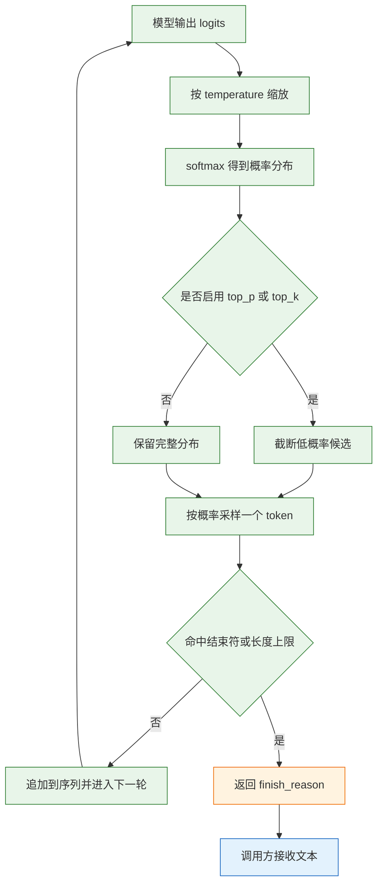
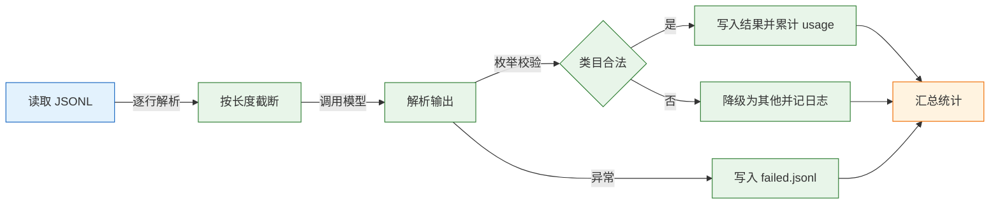
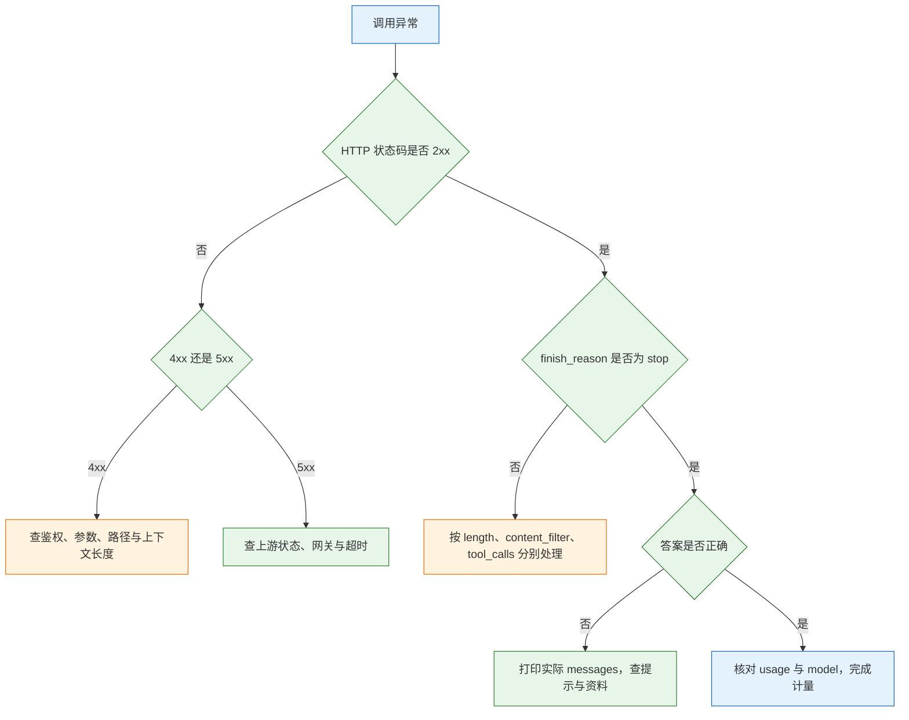

# 大模型基础

大模型是一类以“预测下一个 token”为目标训练出来的神经网络。输入是一段 token 序列，输出是词表上的概率分布；解码策略从分布中选出一个 token，追加到序列末尾，再进入下一轮。理解这条循环，才能理解它为什么能改写、抽取、归纳，却不能保证事实正确，也不能替代数据库和权限系统。
这篇笔记从生成机制讲到接入、计量、流式、成本和排障。目标不是记住术语，而是能独立发出一次可控的请求，读懂响应里的诊断字段，并把一次失败定位到网络、鉴权、参数、上下文或上游中的具体一段。

---

## 一、大模型是什么

### 1.1 核心概念

大模型（Large Language Model，LLM）的“大”指参数规模，通常从十亿级起算。参数是训练得到的权重，推理阶段保持冻结，不会因为一次请求而改变。模型做的事只有一件：根据已经出现的 token，计算下一个 token 在词表上的概率。所谓回答、翻译、写代码，都是这条规则在足够大的语料上训练之后涌现出来的行为。

训练分两段。预训练让模型学会语言结构和世界知识的统计规律，目标是最小化下一个 token 的负对数似然；对齐阶段用指令数据和偏好数据调整输出风格，让它更愿意遵循指令、减少有害内容。预训练决定“知道什么”，对齐决定“怎么回答”。两者都不保证事实正确。

| 概念 | 含义 | 工程影响 |
|---|---|---|
| token | 分词器输出的最小文本单位 | 计费、窗口、截断都按它计算 |
| 词表 | 模型可输出的 token 集合 | 词表外的内容只能由多个 token 拼出 |
| 参数 | 训练得到的权重 | 推理时冻结，不从请求中学习 |
| 预训练 | 在大规模语料上学习下一个 token 分布 | 决定语言能力与知识范围 |
| 对齐 | 用指令与偏好数据调整行为 | 决定是否听指令、是否拒答 |
| 上下文窗口 | 一次请求可容纳的 token 总数 | 输入与输出共用，不是输入专属 |
| 采样 | 从概率分布中选 token 的规则 | 决定输出的稳定性与多样性 |
| 推理 | 用冻结权重完成一次前向计算 | 成本与延迟的来源 |

需要特别区分“训练”和“推理”。调用接口不会让模型记住上一轮内容，会话历史必须由客户端每次重新发送。所谓“模型记住了”，要么是应用层把历史拼进了请求，要么是厂商在服务端做了缓存，二者都不是权重更新。

> **注意**：流畅不等于正确。训练目标奖励“接得像人写的”，不奖励“查证过”。语气笃定和事实为真没有必然关系，这是后面讨论幻觉与校验的起点。

### 1.2 与相邻技术的关系

大模型擅长处理规则难以穷举的语言任务，例如判断一封邮件是投诉还是咨询、从合同里抽出违约金条款、把会议记录压缩成要点。它的弱点是确定性、实时性和副作用：同一个输入两次输出可能不同，训练数据有截止时间，模型本身也不能扣款、改库存或校验权限。

| 技术 | 擅长 | 与大模型的分工 |
|---|---|---|
| 搜索引擎 | 召回最新网页与站点 | 提供事实来源，模型负责组织语言 |
| 规则引擎 | 确定性判断与状态流转 | 承担权限、金额、审批等硬约束 |
| 传统分类器 | 固定标签、低成本、可解释 | 数据充足且边界清晰时更稳 |
| 向量检索 | 按语义相似度召回资料 | 把相关资料放进上下文，降低幻觉 |
| Agent 与工具调用 | 多步骤执行 | 模型输出意图，代码负责执行与校验 |
| 数据库 | 精确存储与查询 | 事实以库为准，模型只做表达 |

这张表的核心意思是：大模型位于“语言层”，不位于“事实层”和“事务层”。检索解决“资料从哪里来”，代码解决“计算和写入怎么做”，权限系统解决“谁能做”。把这些职责压给模型，换成更大的模型也修不好。

判断一个任务该不该交给模型，可以只问一句：答案错了会不会造成不可逆后果。会，就必须加检索、校验、审批或人工确认；不会，才适合让模型直接产出。

幻觉不是偶发故障，而是逐 token 生成的必然产物。模型每一步只根据已生成的前文选下一个 token，一旦开头接受了一个不存在的前提，后面的内容会围绕这个前提继续补全，而且越写越顺。提示里写“不要编造”只能降低概率，不能提供事实来源。

| 幻觉类型 | 典型表现 | 有效手段 | 无效手段 |
|---|---|---|---|
| 事实幻觉 | 编条款号、人名、日期 | 检索原文、逐条引用、回查 | 提示里写“不要编” |
| 引用幻觉 | 引用不存在的文档 | 只允许引用给定编号 | 要求“注明出处” |
| 计算幻觉 | 金额、比例算错 | 计算交给代码或工具 | 要求“仔细计算” |
| 时效幻觉 | 答旧价格、旧政策 | 注入最新资料并标日期 | 换更大模型 |

检索能降低幻觉，但不能消除。检索不到时，正确行为是拒答，而不是让模型“根据常识补全”。拒答要写进提示，并且要有可判定的条件，例如资料中没有答案就输出固定话术。判定的执行仍在代码侧：看到固定话术就走人工流程，而不是把话术当回答直接返回。

### 1.3 请求链路与架构组成

一次远程调用并不是“把问题丢给模型”这么简单。请求要经过接入、鉴权、配额、排队、推理和计量六段，任何一段都可能成为延迟或错误的来源。


推理分两个阶段。**prefill** 把整段输入一次性送入网络，并行计算所有输入位置的表示，并把注意力所需的键值缓存下来；**decode** 每次只生成一个 token，复用已有缓存，因此单步计算量小，但必须串行。这个差异直接决定了两类延迟：输入长主要抬高首 token 时间，输出长主要抬高总时长。

| 组件 | 职责 | 典型故障表现 |
|---|---|---|
| 客户端 | 组装消息、设置超时、解析响应 | 超时过短、按字节切流导致乱码 |
| 接入网关 | TLS 终止、请求体限制、转发 | `502`、`504`、缓冲导致流式不吐字 |
| 鉴权与配额 | 校验密钥、模型权限、余额、限流 | `401`、`403`、`429` |
| 调度与批处理 | 排队、连续批处理、显存调度 | 首字延迟抖动、排队超时 |
| 推理引擎 | prefill、decode、KV Cache 管理 | 长输入慢、长输出慢、显存不足 |
| 计量 | 统计输入输出 token 与费用 | 账单与日志对不上 |

> **运维提示**：排障时先判断卡在哪一段。首 token 很慢但输出很快，多半是输入太长或排队；首 token 正常但总时长很长，多半是输出太长或上游降速。两者的处理手段完全不同。

---

## 二、接入准备与最小请求

### 2.1 环境与密钥配置

先用虚拟环境隔离依赖，再把端点、密钥、模型名放进环境变量。密钥不写进代码、不提交仓库、不打印完整值，是接入阶段最基本的三条纪律。

```bash
# ========== 创建隔离环境 ==========
python3 -m venv .venv
source .venv/bin/activate

# ========== 安装 SDK ==========
# 生产环境应锁定版本，避免自动升级改变默认重试与超时行为
pip install -U openai

# ========== 写入环境变量 ==========
# 端点、密钥、模型名都从环境读取，代码里不出现明文
export API_BASE="https://api.example.com/v1"
export API_KEY="sk-REPLACE_ME"
export MODEL="your-model"

# ========== 验证变量已生效 ==========
# 只打印前缀，避免完整密钥进入终端历史与日志
echo "${API_KEY:0:6}..."
```

| 变量 | 用途 | 常见错误 |
|---|---|---|
| `API_BASE` | 接口根地址，通常带版本段 | 多写或少写 `/v1`，导致 `404` |
| `API_KEY` | 身份凭据 | 复制时带空格、换行或引号 |
| `MODEL` | 模型名或快照名 | 用了未开通的模型，返回 `403` |
| `HTTP_PROXY` | 出网代理 | 本地能通、服务器不通，多半是代理差异 |

> **安全警告**：密钥只放在服务端的环境变量或密钥管理服务中。不要写进前端代码、移动端包体、Git 历史、日志和错误上报。密钥一旦泄露，必须在厂商控制台吊销并重新签发，而不是只改代码。

### 2.2 最小可运行请求

先用 `curl` 验证协议，再接 SDK。`curl` 能排除语言运行时、SDK 版本和框架封装的干扰，是判断“网络与凭据是否可用”的最短路径。

```bash
# ========== 最小聊天请求 ==========
# -sS 静默但保留错误，-i 同时打印响应头，便于看状态码
curl -sS -i "$API_BASE/chat/completions" \
  -H "Authorization: Bearer $API_KEY" \
  -H "Content-Type: application/json" \
  -d '{
    "model": "'"$MODEL"'",
    "messages": [
      {"role": "system", "content": "只回答业务问题，不确定就说不知道。"},
      {"role": "user", "content": "退款一般几天到账？"}
    ],
    "temperature": 0,
    "max_tokens": 200
  }'
```

请求体只有四个关键部分：模型、消息数组、采样参数、输出上限。响应结构如下，字段值每次不同：

```json
{
  "id": "chatcmpl-...",
  "object": "chat.completion",
  "created": 1770000000,
  "model": "your-model-snapshot",
  "choices": [{
    "index": 0,
    "message": {"role": "assistant", "content": "通常 3~5 个工作日。"},
    "finish_reason": "stop"
  }],
  "usage": {"prompt_tokens": 42, "completion_tokens": 18, "total_tokens": 60}
}
```

| 字段 | 含义 | 排障价值 |
|---|---|---|
| `id` | 本次请求的标识 | 向厂商提工单时附上 |
| `model` | 实际服务的模型快照 | 判断上游是否换了版本 |
| `choices[].message` | 生成的消息对象 | 可能含工具调用或拒答内容 |
| `finish_reason` | 结束原因 | 区分正常结束、截断与拦截 |
| `usage` | 输入输出 token 数 | 唯一可信的计费依据 |

三个字段最该看：`finish_reason` 说明“有没有答完”，`usage` 说明“花了多少”，`model` 说明“是谁答的”。日志里缺任何一个，后面都只能靠猜。

> **注意**：部分新模型用 `max_completion_tokens` 取代 `max_tokens`，也有模型不接受 `temperature` 的任意取值。兼容端点上的字段支持范围必须实测，报 `400` 时先核对文档，不要盲目重试。

### 2.3 请求参数的字段约定

| 字段 | 作用 | 操作后果 |
|---|---|---|
| `model` | 选择模型或快照 | 写浮动别名会随上游升级而变，排障要记录实际 `model` |
| `messages` | 承载完整对话 | 历史越长越贵，角色顺序会影响行为 |
| `temperature` | 控制采样随机性 | 抽取与分类设 0，创作再调高 |
| `top_p` | 核采样范围 | 与温度二选一调整，不要同时大改 |
| `max_tokens` | 限制输出长度 | 太小会截断，截断部分仍然计费 |
| `stream` | 是否流式返回 | 只改变传输方式，不改变总 token |
| `tools` | 声明可调用的工具 | 模型只输出调用意图，执行在应用侧 |
| `response_format` | 约束结构化输出 | 支持范围因厂商而异，要实测 |
| `stop` | 停止序列 | 可能把正常内容截掉，慎用 |

参数不是越多越好。每加一个参数，就多一处厂商差异和一处版本兼容风险。生产请求应保持在“模型、消息、温度、输出上限”这四项之内，其余能力按任务单独开启。

---

## 三、token 与上下文预算

### 3.1 分词原理与估算

模型不直接读字符。分词器先把文本切成 token，再映射成整数 ID。主流做法是字节对编码一类的子词算法：从字符或字节出发，反复合并高频片段，最终得到几万到几十万规模的词表。高频词往往是一个 token，生僻字、emoji、代码符号和缩进则可能被拆成多段。

```python
# 仅用于估算，不能当账单；精确值只看响应里的 usage
import tiktoken

# 这是某个具体分词器，不一定等于目标模型使用的分词器
enc = tiktoken.get_encoding("cl100k_base")

samples = [
    "退款申请已提交，3~5 个工作日到账。",
    "The refund has been submitted.",
    '{"order_id": "A1001", "status": "pending"}',
]
for text in samples:
    # 同一段文本在不同分词器下的结果可能差出数成
    print(len(enc.encode(text)), text)
```

| 内容 | 大致密度 | 说明 |
|---|---|---|
| 中文 | 1 字约 1 token | 常用词可能合并，生僻字拆成多段 |
| 英文 | 1 词约 1 token | 长词、专有名词拆成 2~4 段 |
| 代码与 JSON | 2~3 字符约 1 token | 缩进、引号、括号都占位 |
| 数字 | 1~3 位约 1 token | 切分不规则，不能按字符数推算 |

聊天接口的 `usage.prompt_tokens` 通常比正文多出几个百分点，因为角色标记、分隔符和模板也要计入。做预算时按估算值上浮一成留余量，但结算必须用 `usage`。

> **注意**：不同厂商、不同代际的模型使用不同分词器，同一段中文的 token 数可能相差明显。拿一个分词器的结果去乘另一家的单价，是成本估算失真的常见原因。

### 3.2 上下文窗口的分配

上下文窗口是输入与输出共用的池子。窗口上限减去输出预留，才是输入可用的额度；输入额度里还要扣掉系统提示、角色标记、工具定义和模板文本。

```text
可用资料 token ≈ 窗口上限 - 输出预留 - 系统提示 - 历史消息 - 模板开销
```

| 部分 | 典型占用 | 超限后的后果 |
|---|---|---|
| 系统提示与规则 | 数百 token | 挤占资料，规则被稀释 |
| Few-shot 示例 | 数百到数千 token | 示例过多反而干扰判断 |
| 检索资料 | 数千 token | 噪声变多，中段内容容易被忽略 |
| 历史对话 | 随轮次增长 | 每轮重发，成本按轮次叠加 |
| 当前问题 | 数十到数百 token | 一般不是瓶颈 |
| 输出预留 | 数百到数千 token | 不足会中途截断 |

窗口大不等于可以无限塞。注意力在长上下文上的分配并不均匀，关键信息落在中段时被忽略的概率更高，这是长文问答需要“关键段前置、分段处理、要求引用”的原因。资料越多，噪声和相互矛盾也越多，召回率上升不代表答案质量上升。

多轮对话还有一笔隐性成本：第 N 轮要重新发送前 N-1 轮的内容，累计输入量随轮次接近平方增长。长会话必须做截断、摘要或检索，不能靠“窗口够大”硬扛。

### 3.3 截断、摘要与检索

| 策略 | 做法 | 优点 | 代价 |
|---|---|---|---|
| 直接截断 | 只保留前若干 token | 实现简单、延迟低 | 可能丢掉结论与关键条件 |
| 滑动窗口 | 只带最近若干轮 | 保留近期上下文 | 远期约定丢失 |
| 摘要压缩 | 用模型把历史压成要点 | 保留主线、节省 token | 多一次调用，摘要可能失真 |
| 检索注入 | 按问题召回相关片段 | 资料利用率高 | 需要索引与召回质量 |
| 分段处理 | 长文切块分别处理再汇总 | 不受单次窗口限制 | 跨段关系可能丢失 |

截断要按 token 而不是字符，并且必须记录“发生过截断”。静默截断会让模型在缺少前提的情况下继续回答，排查时又看不到原因。

```python
def truncate_to_tokens(text: str, limit: int, enc) -> tuple[str, bool]:
    """按 token 截断，返回截断后的文本与是否发生截断。"""
    ids = enc.encode(text)
    if len(ids) <= limit:
        return text, False
    # 先按 token 截，再解码回文本，避免切出半个多字节字符
    return enc.decode(ids[:limit]), True
```

> **注意**：截断日志至少记录原始 token 数、保留 token 数和被截掉的位置。只记一句“输入过长”，等于把最关键的现场删掉了。

---

## 四、生成参数与采样机制

### 4.1 温度与核采样

模型输出的是 logits，也就是词表中每个 token 的未归一化分数。温度先对 logits 做缩放，再经 softmax 变成概率：温度越低，分布越尖锐，高概率 token 更容易被选中；温度越高，分布越平坦，低概率 token 也有机会出现。温度为零时通常退化为取最大值，但受批处理与浮点误差影响，仍不保证逐位一致。



`top_p` 是核采样：把候选按概率从高到低累加，达到阈值 p 就停止，只在这个最小集合里采样。`top_k` 则固定保留前 k 个候选。两者都在截断长尾，区别是 `top_p` 随分布形状自适应，`top_k` 的候选数固定。

| 参数 | 作用 | 调高的后果 | 建议 |
|---|---|---|---|
| `temperature` | 缩放概率分布 | 输出更发散、更不稳定 | 抽取分类用 0 到 0.3 |
| `top_p` | 限定核采样集合 | 候选更多、更多样 | 一般保持默认或 0.9 左右 |
| `top_k` | 限定候选数量 | 低概率词进入候选 | 需要确定性时调小 |
| `frequency_penalty` | 按出现次数惩罚 | 减少重复、可能跑题 | 长文重复时小幅使用 |
| `presence_penalty` | 按是否出现惩罚 | 鼓励引入新话题 | 创作类任务少量使用 |

> **注意**：温度和 `top_p` 同时大改会让行为难以归因。调参时一次只动一个，并用固定样本对比，否则无法判断变化来自哪个参数。

### 4.2 输出长度与停止条件

`max_tokens` 限制的是输出，不是输入，也不是总 token。它拦不住超长输入，也拦不住重试次数。输出被截断时，已经生成的 token 仍然计费。

| `finish_reason` | 含义 | 处理 |
|---|---|---|
| `stop` | 正常结束或命中停止序列 | 正常，检查是否误命中 |
| `length` | 达到输出上限 | 提高上限、要求分点、拆分任务 |
| `tool_calls` | 模型请求调用工具 | 执行后按 `id` 回传结果 |
| `content_filter` | 被安全策略拦截 | 换表述或转人工，不要原样重试 |
| `null` | 流式尚未结束或端点未实现 | 检查流是否正常收尾 |

停止序列（`stop`）适合切断固定格式的尾巴，例如只要第一段就停。但它按字符串匹配，正文里出现同样片段也会被截断，所以不要在自然语言里使用过于常见的词作为停止符。

### 4.3 参数与任务的匹配

| 任务 | 温度 | 输出上限 | 关键约束 |
|---|---|---|---|
| 分类 | 0 到 0.2 | 很小，只够一个标签 | 枚举校验，越界降级 |
| 抽取 | 0 到 0.3 | 中等 | JSON 解析与字段校验 |
| 改写 | 0.3 到 0.7 | 与原文相当 | 长度上限、事实回查 |
| 归纳 | 0.2 到 0.5 | 中等 | 要求引用原文 |
| 创意生成 | 0.7 以上 | 较大 | 人工筛选，不做自动入库 |
| 代码生成 | 0 到 0.2 | 较大 | 编译与测试验证 |

参数只能降低方差，不能消除错误。分类任务设温度为 0，仍可能输出枚举之外的值；抽取任务要求 JSON，仍可能缺字段。校验必须放在代码里，而不是写在提示里。

---

## 五、流式输出与错误处理

### 5.1 流式输出的协议形态

非流式要等全部生成完才返回，长回答的首屏等待可能很长。流式用 SSE 把增量逐帧推回，首字时间从“总时长”降到“首 token 时间”。它不减少 token，也不降低单价，改变的是等待体验和被超时掐断的概率。

```python
import os

# 假定 client 已按 2.1 节的端点与密钥初始化
# 流式解析的最小写法：按事件迭代，不按字节切包
stream = client.chat.completions.create(
    model=os.environ["MODEL"],
    messages=[{"role": "user", "content": "分三点说明重试的注意事项"}],
    stream=True,
    stream_options={"include_usage": True},   # 部分端点不支持，需实测
)

for chunk in stream:
    if chunk.usage:                           # 通常是最后一个块
        print("\nusage:", chunk.usage)
    if not chunk.choices:                     # usage 块的 choices 为空
        continue
    delta = chunk.choices[0].delta.content
    if delta:
        print(delta, end="", flush=True)      # 立即输出，不要攒到最后
```

| 帧类型 | 特征 | 处理 |
|---|---|---|
| 角色帧 | `delta.role` 为 `assistant` | 忽略或用于初始化界面 |
| 内容帧 | `delta.content` 为非空片段 | 增量拼接并渲染 |
| 工具帧 | `delta.tool_calls` 分片到达 | 按索引与 `id` 聚合后再执行 |
| 结束帧 | `finish_reason` 非空 | 记录结束原因 |
| 计量帧 | `choices` 为空、`usage` 有值 | 落日志，用于计费 |
| 终止标记 | `data: [DONE]` | 结束读取，关闭连接 |

SSE 以空行分隔事件，`data:` 后面才是 JSON。片段可能把多字节汉字切开，必须由支持增量解码的库处理；自己按固定字节数切包，迟早会出现半个汉字。

> **注意**：`[DONE]` 不是所有兼容端点都会发送。客户端要把“连接正常结束”也当成结束条件，否则会一直等到读超时。

### 5.2 错误分类

| 状态码 | 含义 | 是否重试 | 处理 |
|---|---|---|---|
| `400` | 参数错误、上下文超长 | 否 | 修请求，重试只会重复报错 |
| `401` | 密钥无效或过期 | 否 | 更换密钥，核对项目 |
| `403` | 无模型权限或区域不支持 | 否 | 开通权限或换端点 |
| `404` | 路径或模型不存在 | 否 | 检查 `base_url` 与模型名 |
| `408` | 服务端等待请求超时 | 是 | 少见，短暂退避 |
| `413` | 请求体过大 | 否 | 减资料或改分块 |
| `429` | 限流或余额不足 | 是 | 读错误体区分，按 `Retry-After` 退避 |
| `500` | 上游内部错误 | 是 | 退避重试，必要时降级 |
| `502` | 网关收到无效响应 | 是 | 查上游进程与协议 |
| `503` | 服务暂不可用 | 是 | 退避，关注维护窗口 |
| `504` | 网关等待上游超时 | 是 | 查上游耗时与超时配置 |

错误体里通常有 `code`、`type`、`message` 三个字段。只打印一句“调用失败”，会把鉴权、限流和参数错误混成一类，后面的重试策略自然全错。

### 5.3 超时与重试

| 超时层 | 典型值 | 说明 |
|---|---|---|
| 连接超时 | 3 到 5 秒 | DNS、TCP、TLS 都算在这一段 |
| 写超时 | 10 秒 | 请求体很大时才有感 |
| 读超时（非流式） | 60 到 120 秒 | 要覆盖最慢的正常回答 |
| 读超时（流式） | 30 到 60 秒 | 指两帧之间的间隔，不是总时长 |
| 总超时 | 300 秒 | 兜底，防止无限挂起 |

```python
import random
import time

from openai import APIConnectionError, APIStatusError, RateLimitError

def call_with_retry(fn, attempts: int = 4):
    """只对限流、连接错误和 5xx 重试；参数错误立即抛出。"""
    for i in range(attempts):
        try:
            return fn()
        except RateLimitError as e:
            # 优先遵守服务端给出的等待时间
            retry_after = e.response.headers.get("retry-after")
            wait = float(retry_after) if retry_after else min(2 ** i + random.random(), 20)
        except APIConnectionError:
            wait = min(2 ** i, 10)
        except APIStatusError as e:
            if e.status_code not in (500, 502, 503, 504):
                raise
            wait = min(2 ** i, 10)
        time.sleep(wait)                      # 指数退避加抖动，避免同时重试
    raise RuntimeError(f"重试 {attempts} 次仍失败")
```

三个边界必须记住。第一，重试只能留一层：SDK 自带重试、业务重试、网关重试叠在一起，最坏调用次数是乘积。第二，超时后不要立刻重发：上游可能已经算完并计费，只是响应丢在路上。第三，写操作要先查后写，或者携带幂等键，不能靠重试保证唯一。

---

## 六、完整示例：工单分类链路

### 6.1 输入规范与提示设计

分类任务的输出空间很小，适合用来观察完整的接入链路：截断、调用、校验、计量、失败隔离。规则先定清楚：只输出一个类目名，不解释；类目限定在固定枚举内；输入超长时截断并记录；枚举之外的输出一律降级为“其他”。

```text
你是工单分类器。只输出一个类目名，不要解释，不要加标点。
可选类目：退款、物流、账号、其他。无法判断时输出：其他。
```

提示里写“只输出类目名”能降低多余文本，但不能保证。真正的约束在代码侧：解析后做枚举校验，越界就落到“其他”，并把原始输出记进日志，供后续分析。

### 6.2 批量调用与结果校验

```python
import json
import os
import random
import time
from pathlib import Path

from openai import OpenAI, APIConnectionError, APIStatusError, RateLimitError

SYSTEM_PROMPT = (
    "你是工单分类器。只输出一个类目名，不要解释，不要加标点。"
    "可选类目：退款、物流、账号、其他。无法判断时输出：其他。"
)

client = OpenAI(
    api_key=os.environ["API_KEY"],
    base_url=os.environ.get("API_BASE"),
    timeout=60.0,
    max_retries=0,                 # 重试集中在本函数，避免叠加
)
CATS = {"退款", "物流", "账号", "其他"}
stats = {"ok": 0, "fallback": 0, "failed": 0, "prompt": 0, "completion": 0}

def classify(text: str) -> tuple[str, bool, object]:
    last = None
    for i in range(4):
        try:
            resp = client.chat.completions.create(
                model=os.environ["MODEL"],
                temperature=0,
                max_tokens=8,
                messages=[
                    {"role": "system", "content": SYSTEM_PROMPT},
                    # 先截断，防止单条超长把整批拖慢
                    {"role": "user", "content": text[:2000]},
                ],
            )
            stats["prompt"] += resp.usage.prompt_tokens
            stats["completion"] += resp.usage.completion_tokens
            label = (resp.choices[0].message.content or "").strip()
            # 枚举之外一律降级，不让脏值进库
            valid = label in CATS
            return (label if valid else "其他"), valid, resp
        except RateLimitError:
            last = "rate_limited"
            time.sleep(min(2 ** i + random.random(), 20))
        except APIConnectionError:
            last = "connection_error"
            time.sleep(min(2 ** i, 10))
        except APIStatusError as e:
            if e.status_code not in (500, 502, 503, 504):
                raise
            last = f"http_{e.status_code}"
            time.sleep(min(2 ** i, 10))
    raise RuntimeError(f"重试耗尽：{last}")

for line in Path("tickets.jsonl").read_text(encoding="utf-8").splitlines():
    try:
        row = json.loads(line)
        row["category"], valid, _ = classify(row["text"])
        stats["ok" if valid else "fallback"] += 1
        print(row["id"], row["category"])
    except Exception as e:
        # 单条失败不拖垮整批，原文与错误进失败队列
        stats["failed"] += 1
        with open("failed.jsonl", "a", encoding="utf-8") as f:
            f.write(json.dumps({"line": line.strip(), "error": str(e)},
                               ensure_ascii=False) + "\n")

print(stats)
```

这段代码保留了三个不可省略的动作。**截断输入**防止单条超长拖慢整批，截断位置要记录。**枚举校验**把“退款类”“退款问题”这类越界输出统一降级，避免脏值进入业务表。**逐条隔离**让一条失败不影响其余记录，失败行写入独立文件，便于重放。

分类和抽取不要塞进同一次调用。分开调用时，哪一步错了一眼能看出来；合并后一个字段错，整段结果都要重跑。

### 6.3 运行与结果核对

```bash
# ========== 准备输入 ==========
# 每行一个 JSON 对象，至少包含 id 与 text
head -n 3 tickets.jsonl

# ========== 运行批处理 ==========
python classify.py

# ========== 核对失败队列 ==========
# 有内容说明存在接口或解析失败，需要先处理再重放
wc -l failed.jsonl
```



| 指标 | 含义 | 异常时的动作 |
|---|---|---|
| 成功数 | 正常分类的条数 | 明显偏低先查接口 |
| 降级数 | 输出越界被归入“其他” | 偏高说明提示或模型不适配 |
| 失败数 | 重试耗尽或解析失败 | 看 `failed.jsonl` 的错误分布 |
| 输入 token | 累计 `prompt_tokens` | 与预估差异大，检查截断 |
| 输出 token | 累计 `completion_tokens` | 异常高说明模型在解释而非分类 |

---

## 七、成本结构与模型选型

### 7.1 成本构成

费用按 token 双边计费，输入和输出单价通常不同，输出一般更贵。单次成本可以写成：

```text
单次成本 = 输入 token / 1e6 × 输入单价 + 输出 token / 1e6 × 输出单价
```

算例只用于说明算法，单价是假设值：每天 1 万次请求，每次输入 2000 token、输出 500 token，假设输入 0.5 元每百万 token、输出 2 元每百万 token。

```text
输入：10000 × 2000 / 1e6 × 0.5 = 10 元
输出：10000 × 500  / 1e6 × 2   = 10 元
合计：20 元每天，约 600 元每月
```

| 成本项 | 来源 | 控制手段 |
|---|---|---|
| 输入 token | 系统提示、历史、资料、当前问题 | 截断、摘要、检索、前缀缓存 |
| 输出 token | 回答正文、解释、格式化内容 | 限制上限、要求简洁、结构化输出 |
| 重试 | 超时、限流、5xx 后的重复调用 | 只留一层重试，记录重试次数 |
| 失败请求 | 生成到一半断开、被拦截 | 落 `usage`，区分失败类型 |
| 缓存未命中 | 前缀变化导致缓存失效 | 固定内容前置，动态内容后置 |

真正容易失控的是重试和历史重发：超时重试三次，账单就是三倍；十轮会话每轮都带全史，输入量远超预期。成本优化要先看 `usage` 的分布，而不是先换便宜模型。

前缀缓存按输入开头连续匹配，一旦某个 token 不同，后面的缓存全部失效。因此固定内容应放最前：系统提示、工具定义、长期不变的长文档；变化的用户问题放最后。开头拼时间戳、会话 ID 或随机数，会让每次请求都成为新的前缀。缓存命中通常单价更低，但命中部分仍计入 `prompt_tokens`，对账时要单独统计 `cached_tokens`。

### 7.2 延迟构成

```text
总延迟 ≈ 排队时间 + 首 token 时间 + 输出 token 数 × 每 token 时间
```

首 token 时间主要受输入长度、prefill 算力和排队影响；每 token 时间主要受模型规模、批处理并发和输出长度影响。两者要分开测，否则会把“输入太长”误判成“模型太慢”。

| 现象 | 主因 | 手段 |
|---|---|---|
| 首字慢 | 输入太长、排队 | 减资料、错峰、换小模型 |
| 越写越慢 | 输出长、并发高 | 限制输出上限、流式展示 |
| 整体抖动 | 上游负载或网络 | 超时、重试、降级模型 |
| 成本高但延迟低 | 用旗舰模型做简单分类 | 按任务分档，不要一律用最贵 |

### 7.3 模型选型方法

榜单只能筛掉明显不合适的候选，不能替代自己的样本。选型应固定 30 到 50 条真实输入，记录通过率、失败原因、延迟和单次成本四列，再按任务的重要程度加权。

| 维度 | 要确认的问题 | 验证方式 |
|---|---|---|
| 能力 | 分类、抽取、长文归纳是否够用 | 固定样本，规则判定或人工盲评 |
| 上下文 | 最长输入多少，输出留多少 | 用真实最长文档压测 |
| 结构化 | JSON 合法率、字段完整率 | 跑一百次统计解析失败率 |
| 延迟 | 首字与总时长的 P50、P95 | 并发接近线上时测 |
| 价格 | 输入、输出、缓存单价 | 按日调用量折算月成本 |
| 稳定性 | 是否有快照名、弃用周期 | 记录响应中的 `model`，固定快照 |
| 合规 | 数据是否出境、是否留存 | 查合同与区域端点 |

简单分类和抽取先用小模型，失败样本再升级到高档模型重跑，这叫级联，通常比全量使用旗舰便宜。级联的代价是两段延迟、更复杂的日志，以及“降级后输出风格变化”的校验成本。

> **注意**：不要用一次演示的效果决定模型。单条样本的差异很可能来自采样随机性，固定样本、重复多次、看分布，才有比较意义。

---

## 八、常见故障与排查

| 现象 | 最可能原因 | 处理 |
|---|---|---|
| `400 context_length_exceeded` | 输入加输出预留超过窗口 | 截断历史、减资料、调小输出上限 |
| `400` 提示参数不支持 | 模型不接受该字段或取值 | 查文档，删参数或改字段名 |
| `401` 或 `403` | 密钥错误、过期、无模型权限 | 更换密钥，核对项目与区域 |
| `404` | 端点路径或模型名错误 | 检查 `base_url` 是否多写 `/v1` |
| `429` | 限流或余额不足 | 读错误体区分，退避并降低并发 |
| 回答半句就停 | `finish_reason` 为 `length` | 提高输出上限或要求分点回答 |
| `content` 为空 | 拒答、安全拦截或工具调用 | 打印完整消息与 `finish_reason` |
| 两次答案不同 | 采样随机或上游换了快照 | 抽取任务设低温，记录 `model` |
| 金额或比例算错 | 模型做算术 | 改为输出表达式或调用计算工具 |
| 长文中段漏读 | 注意力分配不均 | 分段处理，关键段前置，要求引用 |
| 答旧政策 | 训练数据有截止时间 | 注入最新文档并标日期，检索不到就拒答 |
| 账单高于估算 | 重试、历史重发、隐藏 token | 落 `usage`，按请求维度对账 |
| 中文 token 估少了 | 分词器不同 | 用目标模型实测，按估算上浮留余量 |



排查顺序按“先协议、再结果、后提示”推进：

1. 看 HTTP 状态码与原始错误体，先分清是鉴权、参数、限流还是上游故障。
2. 看 `finish_reason`，判断是正常结束、被截断还是被安全策略拦截。
3. 看 `usage` 与 `model`，确认钱花在哪里、实际服务的是哪个快照。
4. 把实际发出的 `messages` 完整打印出来，核对角色顺序、截断位置和资料内容。
5. 用固定样本复现，区分偶发采样与稳定缺陷。
6. 最后才换模型。多数问题换模型只是把错误变得更贵。

> **注意**：排查时不要只看最终文本。状态码、结束原因、token 用量、实际模型名四个字段合起来，才能还原一次调用到底发生了什么。
