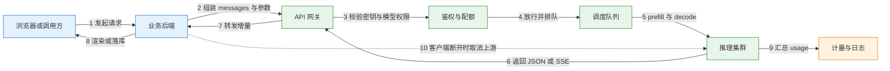
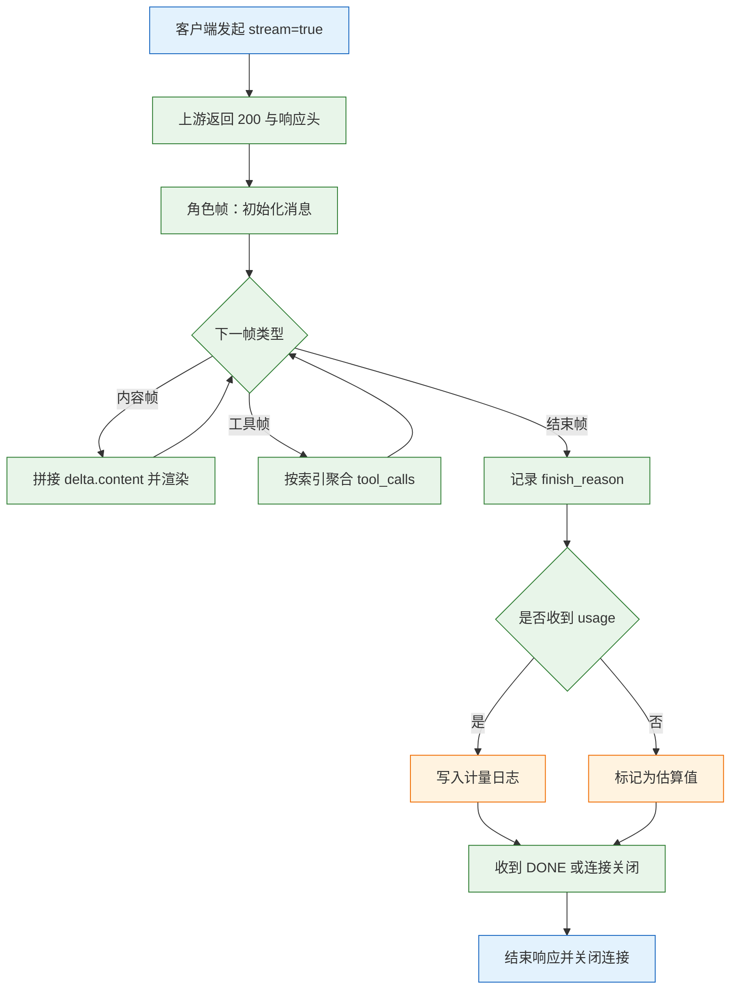
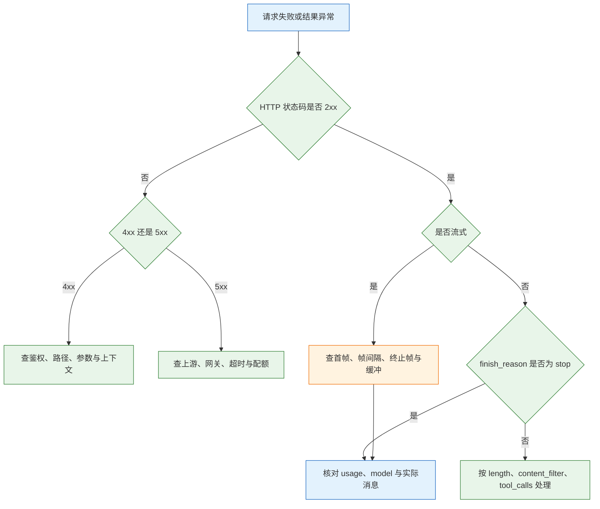

# 模型 API

模型 API 是厂商把推理能力包装成的一份 HTTP 合同：请求体说明“算什么”，响应体说明“算完没有、花了多少”，状态码说明“这次调用是否成立”。它按 token 计费、默认无状态、通常不做幂等，这三点决定了接入代码必须自己保存历史、自己控制重试、自己核对账单。
这篇笔记从端点与鉴权讲到消息结构、流式分帧、并发限流、透传服务和成本核算。读完应当能独立写出一条可观测的调用链路，并在出错时判断问题在协议、配额、上游还是自己的提示与网关。

---

## 一、模型 API 是什么

### 1.1 核心概念

模型 API 是运行在厂商机房里的推理服务对外暴露的接口。调用方发一段 JSON，服务端完成分词、前向计算和采样，把生成结果按 JSON 或 SSE 返回。模型权重不在调用方手里，调用方买到的是“按次或按 token 计量的推理能力”。

接口要解决四件事。**鉴权**确认调用方身份和可用模型；**计量**统计输入输出 token 并计费；**限流**在超出配额时明确拒绝；**协议**规定请求、响应和流式的格式。四者缺一，接口就无法作为生产依赖。

| 概念 | 含义 | 工程影响 |
|---|---|---|
| 端点 | 接口根地址与路径 | 多写或少写版本段会直接 `404` |
| 凭据 | Bearer 密钥或签名 | 泄露等于把账户余额交出去 |
| 消息 | 角色与内容组成的数组 | 服务端不保存，每次都要完整发送 |
| 选择项 | 一次生成结果的候选 | 通常只取第一个，输出 token 按全部候选统计 |
| 结束原因 | 本次生成为何停止 | 区分正常、截断与拦截 |
| 用量 | 输入输出 token 统计 | 唯一可信的计费依据 |
| 快照 | 实际服务的模型版本 | 行为漂移时用来定位 |
| 配额 | 每分钟请求数、token 数或并发数 | 决定批量任务的并发上限 |

“兼容 OpenAI 接口”是行业里常见的说法，指的是请求路径、字段名和响应结构大体一致。兼容降低迁移成本，但不保证行为一致：同样的 `tools` 字段，有的端点完整支持，有的直接忽略；同样的 `stream_options`，有的返回 usage，有的不返回。字段能通过校验，不等于能力存在。

### 1.2 与相邻技术的关系

| 相邻技术 | 负责 | 与模型 API 的边界 |
|---|---|---|
| 自建推理 | 在自己的 GPU 上加载权重 | 省去网络与按量费用，但承担运维与闲置成本 |
| 官方 SDK | 封装协议、鉴权、流式解析 | 不负责业务重试、降级与成本口径 |
| 调用框架 | 统一多供应商、重试、计量 | 增加一层抽象，也增加默认行为与版本风险 |
| API 网关 | TLS、转发、限流、日志 | 不理解 token 语义，无法替代应用侧计量 |
| 检索系统 | 召回资料并注入上下文 | 解决事实来源，不改变接口的无状态性质 |
| 工具服务 | 执行查询、写入、计算 | 模型只输出调用意图，执行与鉴权在服务端 |

这条分工线要划清楚：模型 API 负责“生成”，不负责“记住”“查证”“执行”。把会话历史、事实校验和事务写入寄托在接口上，是接入阶段最常见的认知错误。

它也不提供四项保证：不保存会话，不保证幂等，不保证事实正确，不限制输入成本。`max_tokens` 只限制输出，管不住把整本手册塞进请求，也管不住重试次数。

### 1.3 请求链路与架构组成



链路上有两个容易忽略的事实。第一，流式请求一旦返回 `200` 并开始推送，后续错误就不能再改状态码，只能通过错误事件或直接断流表达；客户端必须能处理“已经收到一半内容后失败”。第二，客户端断开不会自动停止上游生成，必须由后端显式取消，否则会继续计费。

| 组件 | 职责 | 典型故障表现 |
|---|---|---|
| 业务后端 | 鉴权、组装消息、转发、取消 | 密钥泄露、断开未取消、日志缺 usage |
| API 网关 | TLS、请求体限制、连接复用 | `502`、`504`、缓冲导致流式不吐字 |
| 鉴权与配额 | 校验密钥、模型权限、余额 | `401`、`403`、`429` |
| 调度队列 | 排队、批处理、算力分配 | 首字延迟抖动、排队超时 |
| 推理集群 | prefill、decode、KV Cache | 长输入慢、长输出慢、显存不足 |
| 计量与日志 | 统计 token、延迟、错误 | 账单与请求日志对不上 |

> **运维提示**：从调用方到上游至少有三层超时：浏览器到后端、后端到上游、上游网关到推理集群。排障时先确认是哪一层先断开，再调对应参数，不要把所有超时都改成同一个值。

---

## 二、接入与最小请求

### 2.1 端点与鉴权

接入第一步是确认端点、密钥和模型名三者匹配。端点通常由“根地址 + 版本段 + 资源路径”组成，版本段是否已经包含在根地址里，各家不同，复制文档时要连示例一起看。

```bash
# ========== 配置端点与凭据 ==========
# 根地址是否带 /v1 取决于厂商，二者只保留一种写法
export API_BASE="https://api.example.com/v1"
export API_KEY="sk-REPLACE_ME"
export MODEL="your-model"

# ========== 验证鉴权与路径 ==========
# 先打模型列表，确认密钥有效、根地址正确
curl -sS -i "$API_BASE/models" \
  -H "Authorization: Bearer $API_KEY"

# ========== 验证目标模型是否可用 ==========
# 列表里没有不代表不能调用，以实际请求结果为准
curl -sS -i "$API_BASE/chat/completions" \
  -H "Authorization: Bearer $API_KEY" \
  -H "Content-Type: application/json" \
  -d '{"model":"'"$MODEL"'","messages":[{"role":"user","content":"hi"}],"max_tokens":5}'
```

| 检查项 | 正确做法 | 常见错误 |
|---|---|---|
| 根地址 | 与文档示例逐字对照 | 重复拼接 `/v1`，得到 `/v1/v1/...` |
| 认证头 | `Authorization: Bearer <key>` | 少了 `Bearer`，或密钥带换行 |
| 内容类型 | `application/json` | 用了表单类型，服务端解析失败 |
| 模型名 | 用控制台里的准确名称 | 用了展示名、别名或拼错的快照名 |
| 区域 | 密钥与端点属于同一区域 | 跨区调用返回 `403` 或 `404` |

> **注意**：部分兼容端点没有 `/models` 路径，调用它会返回 `404`。这不代表端点不可用，直接改用最小聊天请求验证即可，不要把 `/models` 的结果当成能力清单。

> **安全警告**：厂商密钥只能存在于服务端。浏览器、移动端、桌面客户端都不能持有长期密钥；需要前端直连时，应由后端签发短期令牌或做代理。密钥写入日志、异常上报和 Git 历史同样视为泄露。

### 2.2 最小请求与响应

```bash
# ========== 最小聊天补全请求 ==========
# -N 关闭 curl 缓冲，观察流式时必加
curl -sS -i "$API_BASE/chat/completions" \
  -H "Authorization: Bearer $API_KEY" \
  -H "Content-Type: application/json" \
  -H "X-Request-Id: demo-0001" \
  -d '{
    "model": "'"$MODEL"'",
    "messages": [
      {"role": "system", "content": "只回答业务问题，不确定就说不知道。"},
      {"role": "user", "content": "退款几天到账？"}
    ],
    "temperature": 0,
    "max_tokens": 300,
    "stream": false
  }'
```

```json
{
  "id": "chatcmpl-...",
  "object": "chat.completion",
  "created": 1770000000,
  "model": "your-model-2026-xx-xx",
  "choices": [{
    "index": 0,
    "message": {"role": "assistant", "content": "通常 3~5 个工作日。"},
    "finish_reason": "stop"
  }],
  "usage": {
    "prompt_tokens": 42,
    "completion_tokens": 18,
    "total_tokens": 60
  }
}
```

| 字段 | 用途 | 必须落日志 |
|---|---|---|
| `id` | 请求标识，提工单时使用 | 是 |
| `model` | 实际快照，判断是否换版 | 是 |
| `choices[].message` | 生成内容或工具调用 | 按需，注意脱敏 |
| `finish_reason` | 结束原因 | 是 |
| `usage.prompt_tokens` | 输入计费 | 是 |
| `usage.completion_tokens` | 输出计费 | 是 |

`X-Request-Id` 不是所有厂商都接受，但自建网关通常可以透传。它把调用方日志和上游日志串起来，排障时比时间戳可靠。

### 2.3 兼容端点的能力边界

| 能力 | 常见差异 | 验证方式 |
|---|---|---|
| 流式 | 不支持 `stream_options`，不返回 usage | 开流式跑一次，看末尾有无 usage |
| 工具调用 | 忽略 `tools`，从不返回 `tool_calls` | 用必然触发工具的问题测试 |
| 结构化输出 | 只支持 JSON 对象，不支持 schema | 传完整 schema，看是否 `400` |
| 参数 | 不支持自定义温度、输出上限字段改名 | 从最小参数集开始逐项加 |
| 多模态 | 只收 URL 或只收 base64 | 两种编码各试一次 |
| 错误体 | 不使用标准错误码字段 | 保存原始响应体，不只看一个字段 |

判断顺序是**先确认协议能力，再调提示词**。端点根本不返回 `tool_calls` 时，改一百遍提示也没有用；端点不支持 schema 时，只能在应用侧做解析与重试。

> **注意**：兼容层的字段名相同不代表语义相同。`max_tokens` 在有的端点是硬上限，在有的端点是建议值；`temperature=0` 在有的实现里是贪心解码，在有的实现里只是低概率采样。

---

## 三、消息结构与 token 计量

### 3.1 消息角色与顺序

| 角色 | 作用 | 约束 |
|---|---|---|
| `system` | 设定身份、规则、输出格式 | 通常放在最前，部分端点支持多条 |
| `user` | 用户输入或任务描述 | 与助手消息交替出现 |
| `assistant` | 模型历史回复 | 工具调用时携带 `tool_calls` |
| `tool` | 工具执行结果 | 必须带对应的 `tool_call_id` |
| `developer` | 部分端点用于更高优先级指令 | 支持范围因厂商而异 |

消息数组是完整对话，不是增量。第二轮请求要带上第一轮的用户与助手消息，否则模型看不到上下文。历史越长，输入 token 越多，成本按轮次叠加。

工具调用有严格顺序：助手消息返回 `tool_calls`，应用执行后，把每个结果作为 `tool` 消息追加，`tool_call_id` 必须与请求中的 `id` 一一对应，然后再发下一次请求。缺少结果或 ID 对不上，端点通常直接返回 `400`。

> **安全警告**：不要把未经校验的用户输入直接拼进 `system`。系统消息的优先级更高，一旦被注入“忽略以上规则”，后面的业务约束会失效。用户内容应放在 `user` 角色，并在应用层做输入过滤。

### 3.2 token 计量口径

| 字段 | 含义 | 注意 |
|---|---|---|
| `prompt_tokens` | 输入 token 总数 | 含角色标记、模板与工具定义 |
| `completion_tokens` | 输出 token 总数 | 含被截断的部分 |
| `total_tokens` | 两者之和 | 只用于展示，计费要分开算 |
| `cached_tokens` | 命中前缀缓存的输入 token | 单价通常更低，字段名因厂商而异 |
| `reasoning_tokens` | 推理过程消耗的 token | 部分模型单独计费或单独统计 |

聊天接口的输入 token 总比正文多，因为每条消息都要加角色标记和分隔符，工具定义也要完整计入。做预算时按正文估算再上浮，结算时只认 `usage`。

```python
# 每次调用后落一条结构化日志，字段名统一，便于月底对账
record = {
    "request_id": resp.id,
    "model": resp.model,                       # 实际快照，不是请求里的别名
    "prompt_tokens": resp.usage.prompt_tokens,
    "completion_tokens": resp.usage.completion_tokens,
    "finish_reason": resp.choices[0].finish_reason,
}
```

> **注意**：流式默认可能不返回 usage。需要 `stream_options: {"include_usage": true}` 的端点要显式开启；不支持的端点只能本地估算，并在日志里标记 `estimated=true`，不能把估算值混进真实账单。

### 3.3 采样与长度参数

| 参数 | 作用 | 设置不当的后果 |
|---|---|---|
| `temperature` | 缩放概率分布 | 过高发散，过低重复 |
| `top_p` | 限定核采样集合 | 与温度同时大改难以归因 |
| `max_tokens` | 输出上限 | 过小截断，截断仍计费 |
| `stop` | 停止序列 | 命中正文中的常见词会误截 |
| `presence_penalty` | 惩罚已出现主题 | 过高导致答非所问 |
| `frequency_penalty` | 惩罚高频 token | 过高导致语句破碎 |
| `seed` | 请求可复现的随机种子 | 支持范围有限，不保证跨版本一致 |

部分新模型用 `max_completion_tokens` 取代 `max_tokens`，也有模型只接受默认温度。混用字段会直接 `400`，因此生产代码应把“模型到参数集”的映射做成配置，而不是一套参数打天下。

### 3.4 工具调用与结构化输出

工具调用把“生成”扩展成“生成加执行”。模型不执行函数，只返回函数名和参数；应用负责校验参数、执行、把结果回传。

```json
{
  "type": "function",
  "function": {
    "name": "get_order",
    "description": "按订单号查询订单状态，只读",
    "parameters": {
      "type": "object",
      "properties": {
        "order_id": {"type": "string", "pattern": "^A[0-9]{4}$"}
      },
      "required": ["order_id"],
      "additionalProperties": false
    }
  }
}
```

| 返回字段 | 含义 | 应用动作 |
|---|---|---|
| `id` | 本次工具调用的标识 | 回传结果时原样带回 |
| `type` | 调用类型，通常为 `function` | 按类型分发 |
| `function.name` | 函数名 | 白名单校验，未注册直接拒绝 |
| `function.arguments` | JSON 字符串形式的参数 | 解析后做 schema 与权限校验 |

结构化输出要求模型按给定 schema 生成 JSON。它能提高合法率，但不能替代校验：模型仍可能缺字段、类型错误或填入不存在的枚举值。解析失败要有一次修复重试，仍失败就降级，而不是把异常抛给用户。

> **安全警告**：工具参数来自模型，必须视为不可信输入。订单号要做格式校验，查询要带当前用户的权限条件，写操作要二次确认。不要因为“模型说已经确认过”就跳过服务端鉴权。

---

## 四、流式传输与错误处理

### 4.1 SSE 分帧与增量解析

流式响应使用 Server-Sent Events：每个事件由若干 `字段: 值` 行组成，空行表示事件结束。模型接口通常只用一个 `data:` 字段，内容是 JSON 片段，最后以 `data: [DONE]` 收尾。

```text
data: {"choices":[{"delta":{"role":"assistant","content":""}}]}

data: {"choices":[{"delta":{"content":"通常"}}]}

data: {"choices":[{"delta":{"content":" 3~5 个工作日"}}]}

data: {"choices":[{"delta":{},"finish_reason":"stop"}]}

data: {"choices":[],"usage":{"prompt_tokens":42,"completion_tokens":18}}

data: [DONE]
```

| 帧 | 特征 | 处理 |
|---|---|---|
| 角色帧 | `delta.role` 有值 | 初始化消息对象 |
| 内容帧 | `delta.content` 非空 | 追加并渲染 |
| 工具帧 | `delta.tool_calls` 分片 | 按索引聚合参数片段 |
| 结束帧 | `finish_reason` 非空 | 记录结束原因 |
| 计量帧 | `choices` 为空、`usage` 有值 | 落日志 |
| 终止帧 | `data: [DONE]` | 关闭连接 |



```python
# 按行读取，不按字节切包；多字节字符由解码器保证完整
for line in response.iter_lines():
    if not line:
        continue                                  # 空行是事件分隔，跳过
    if line.startswith(":"):
        continue                                  # 注释行常用作心跳
    if not line.startswith("data:"):
        continue
    payload = line[5:].strip()
    if payload == "[DONE]":
        break
    chunk = json.loads(payload)
    if chunk.get("usage"):
        record_usage(chunk["usage"])
    for choice in chunk.get("choices", []):
        delta = choice.get("delta", {}).get("content")
        if delta:
            yield delta
```

> **注意**：`[DONE]` 不是所有端点都会发送。客户端要把“连接正常结束”也当作结束条件；否则读循环会一直等到超时才退出。

### 4.2 错误码分类

| 状态码 | 含义 | 重试 | 处理 |
|---|---|---|---|
| `400` | 参数错误、上下文超长 | 否 | 修请求，记录错误体 |
| `401` | 密钥无效或过期 | 否 | 更换密钥并核对项目 |
| `403` | 模型未开通、区域不支持 | 否 | 开通权限或换端点 |
| `404` | 路径或模型不存在 | 否 | 检查根地址与模型名 |
| `408` | 服务端等待请求超时 | 是 | 短暂退避 |
| `413` | 请求体过大 | 否 | 减资料或分块 |
| `429` | 限流或余额不足 | 是 | 读错误体区分，按 `Retry-After` 等待 |
| `500` | 上游内部错误 | 是 | 退避，必要时降级 |
| `502` | 网关收到无效响应 | 是 | 查上游进程与协议 |
| `503` | 服务暂不可用 | 是 | 退避，关注维护窗口 |
| `504` | 网关等待上游超时 | 是 | 查上游耗时与超时配置 |

`429` 要区分两种原因：限流和欠费。限流可以退避重试，欠费重试多少次都没用。错误体里的 `code` 或 `type` 通常能区分，读不出来就看账户余额和配额页面。

### 4.3 超时、重试与取消

| 超时层 | 典型值 | 说明 |
|---|---|---|
| 连接 | 3 到 5 秒 | DNS、TCP、TLS 都算在内 |
| 写入 | 10 秒 | 大请求体才有感 |
| 读取（非流式） | 60 到 120 秒 | 覆盖最慢的正常回答 |
| 读取（流式） | 30 到 60 秒 | 两帧之间的间隔，不是总时长 |
| 总时长 | 300 秒 | 兜底，防止无限挂起 |

```python
import asyncio
import random

from openai import APIConnectionError, APIStatusError, RateLimitError

async def call_with_retry(fn, attempts: int = 4):
    """只重试限流、连接错误与 5xx；每次退避带抖动。"""
    for i in range(attempts):
        try:
            return await fn()
        except RateLimitError as e:
            retry_after = e.response.headers.get("retry-after")
            wait = float(retry_after) if retry_after else min(2 ** i + random.random(), 20)
        except APIConnectionError:
            wait = min(2 ** i, 10)
        except APIStatusError as e:
            if e.status_code not in (500, 502, 503, 504):
                raise
            wait = min(2 ** i, 10)
        await asyncio.sleep(wait)
    raise RuntimeError(f"重试 {attempts} 次仍失败")
```

取消要显式做。浏览器关闭页面后，后端如果继续读上游，生成会继续、token 会继续计费。流式转发循环里每收到一行就检查一次客户端是否断开，断开就退出循环，由上下文管理器关闭上游连接。

> **注意**：超时后不要立即重发。上游可能已经完成生成并计费，只是响应在网络上丢失。写操作必须带幂等键，或者先查询再决定是否重试。

---

## 五、并发控制与限流

### 5.1 配额模型

| 配额类型 | 计量单位 | 超限表现 | 控制手段 |
|---|---|---|---|
| RPM | 每分钟请求数 | `429`，错误体提示请求频率 | 令牌桶、队列 |
| TPM | 每分钟 token 数 | `429`，长请求更容易触发 | 限制单请求长度、降低并发 |
| 并发数 | 同时在途请求 | 排队、首字变慢、超时 | 信号量 |
| 日额度 | 每日 token 或金额 | `429` 或 `403` | 预算告警、任务分档 |
| 模型级配额 | 单模型的独立限额 | 换模型后恢复 | 按模型分流 |

配额是账号级还是项目级、按分钟还是按天，各家不同。并发上限不能按机器核数推算，要按账号配额和单请求耗时反推：并发数约等于目标吞吐乘以单请求平均耗时，再留出余量。

### 5.2 并发实现

```python
import asyncio
import os

from openai import AsyncOpenAI

client = AsyncOpenAI(
    api_key=os.environ["API_KEY"],
    base_url=os.environ.get("API_BASE"),
)
sem = asyncio.Semaphore(8)          # 按账号配额设定，不是按 CPU 核数

async def one(text: str) -> str:
    async with sem:                 # 超过并发上限的协程在这里等待
        resp = await client.chat.completions.create(
            model=os.environ["MODEL"],
            temperature=0,
            max_tokens=64,
            messages=[{"role": "user", "content": text}],
        )
        return resp.choices[0].message.content or ""

async def main(items: list[str]) -> None:
    results = await asyncio.gather(*(one(t) for t in items), return_exceptions=True)
    ok = [r for r in results if isinstance(r, str)]
    bad = [r for r in results if not isinstance(r, str)]
    print(f"成功 {len(ok)}，失败 {len(bad)}")
```

| 手段 | 适用场景 | 代价 |
|---|---|---|
| 信号量 | 单进程批处理 | 多进程要各自限，或改用共享令牌桶 |
| 令牌桶 | 按 RPM 或 TPM 精确控制 | 需要 Redis 等共享状态 |
| 队列加 worker | 长任务、可延迟 | 架构复杂，要处理重试与死信 |
| 降级模型 | 高峰期保可用 | 质量下降，要按任务分流 |
| 请求合并 | 多条短请求可聚合 | 增加延迟，输出需要拆分 |

> **注意**：并发不是越大吞吐越高。超过配额后，多出来的请求在排队和重试上消耗时间，P95 反而更差。先用小并发压出单请求延迟，再按配额反推上限。

### 5.3 退避与降级

| 场景 | 策略 | 注意 |
|---|---|---|
| 偶发 `429` | 指数退避加抖动 | 优先遵守 `Retry-After` |
| 持续 `429` | 降低并发、排队 | 不要原地快速重试 |
| `5xx` | 退避后重试，必要时切备用 | 记录切换次数 |
| 首字超时 | 取消并重试一次 | 重试仍慢就降级 |
| 主供应商故障 | 切换到备用端点 | 备用模型要跑同一套校验 |
| 预算接近上限 | 降级到小模型或拒绝新任务 | 提前告警，不要等欠费 |

降级不能静默。主供应商连挂一周而没人发现，通常是因为降级没有打点。日志里至少记录 `provider`、`model`、`retries`、`degraded` 四个字段。

---

## 六、完整示例：流式透传服务

### 6.1 后端转发实现

浏览器不能直连厂商，密钥必须留在后端。后端承担四件事：校验自己的用户会话、按用户限流、原样转发 SSE 帧、客户端断开时取消上游。

```python
import json
import os

import httpx
from fastapi import FastAPI, Request
from fastapi.responses import StreamingResponse

app = FastAPI()
UPSTREAM = os.environ["API_BASE"].rstrip("/") + "/chat/completions"
API_KEY = os.environ["API_KEY"]

@app.post("/api/chat")
async def chat(request: Request):
    body = await request.json()
    payload = {
        "model": os.environ["MODEL"],
        "messages": body["messages"],
        "stream": True,
        "stream_options": {"include_usage": True},
    }

    async def relay():
        # 连接、读帧、写入分别设超时，读超时指两帧之间的间隔
        timeout = httpx.Timeout(connect=5.0, read=60.0, write=10.0, pool=5.0)
        async with httpx.AsyncClient(timeout=timeout) as client:
            async with client.stream(
                "POST", UPSTREAM, json=payload,
                headers={"Authorization": f"Bearer {API_KEY}"},
            ) as resp:
                if resp.status_code != 200:
                    detail = (await resp.aread()).decode("utf-8", "replace")
                    event = {"status": resp.status_code, "detail": detail[:500]}
                    yield f"event: error\ndata: {json.dumps(event)}\n\n"
                    return
                async for line in resp.aiter_lines():
                    # 客户端已断开就退出，async with 会关闭上游连接
                    if await request.is_disconnected():
                        break
                    if not line.startswith("data:"):
                        continue
                    yield line + "\n\n"
                    if line.strip() == "data: [DONE]":
                        return

    return StreamingResponse(
        relay(),
        media_type="text/event-stream",
        headers={"Cache-Control": "no-cache", "X-Accel-Buffering": "no"},
    )
```

这段代码有三个关键点。上游非 `200` 时，因为响应头还没发给浏览器，可以返回一个 `event: error` 事件说明原因。转发时只保留 `data:` 行，过滤心跳注释，避免把无关内容塞给前端。`async with` 保证无论正常结束还是客户端断开，上游连接都会关闭。

> **安全警告**：转发接口必须校验自己的用户身份和额度，不能只靠厂商密钥。否则任何拿到页面的人都能调用该账户。请求体也要限制大小和消息条数，防止有人用超长输入刷爆配额。

### 6.2 网关配置

Nginx 默认会缓冲上游响应，流式会被攒成一次性返回。必须对聊天路径关闭缓冲，并把读超时放大到覆盖最长回答。

```nginx
location /api/chat {
    proxy_pass http://backend:8080;
    proxy_http_version 1.1;

    # 关闭缓冲与缓存，保证每个 SSE 帧立即下发
    proxy_buffering off;
    proxy_cache off;

    # 读超时按最长回答设置，不是按普通接口的 30 秒
    proxy_read_timeout 300s;
    proxy_send_timeout 300s;

    # 清空逐跳连接头，复用上游长连接
    proxy_set_header Connection "";
    proxy_set_header X-Forwarded-For $proxy_add_x_forwarded_for;
}
```

| 指令 | 作用 | 配置错误的后果 |
|---|---|---|
| `proxy_buffering off` | 关闭响应缓冲 | 流式被攒成整包，首字很慢 |
| `proxy_cache off` | 禁止缓存 | 不同用户拿到同一份回答 |
| `proxy_read_timeout` | 等待上游两帧的间隔 | 正常长回答被 `504` 掐断 |
| `proxy_http_version 1.1` | 支持分块与长连接 | 退化为短连接，帧边界异常 |
| `X-Accel-Buffering: no` | 应用侧要求关闭缓冲 | 网关仍按默认策略缓冲 |

### 6.3 调用与验证

```bash
# ========== 观察逐帧输出 ==========
# -N 关闭 curl 自身缓冲，-i 保留响应头
curl -sS -N -i http://127.0.0.1:8080/api/chat \
  -H "Content-Type: application/json" \
  -d '{"messages":[{"role":"user","content":"分三点说明重试的注意事项"}]}'

# ========== 验证客户端断开后上游取消 ==========
# 启动请求后立即按 Ctrl+C，观察后端日志是否在数秒内结束上游连接
```

| 检查点 | 正常表现 | 异常时的排查方向 |
|---|---|---|
| 首帧到达 | 一秒内出现角色帧 | 网关缓冲、上游排队 |
| 内容连续 | 片段逐字出现 | 读超时、上游断流 |
| 结束帧 | `finish_reason` 有值 | 客户端提前断开 |
| 计量帧 | 末尾有 usage | 未开 `include_usage` |
| 连接关闭 | 收到 `[DONE]` 或正常结束 | 端点不发送终止标记 |
| 取消生效 | 断开后上游很快结束 | 转发循环未检查断开状态 |

---

## 七、成本核算与端点选型

### 7.1 计费口径

```text
单次成本 = 未缓存输入 token / 1e6 × 输入单价
        + 缓存命中 token / 1e6 × 缓存单价
        + 输出 token / 1e6 × 输出单价
```

缓存命中 token 是 `prompt_tokens` 的子集，不能和完整输入再相加，否则会重复计算。下面算例只说明算法，单价为假设值：每天 2 万次请求，每次输入 1500 token、输出 300 token，输入 0.8 元每百万、输出 3 元每百万。

```text
输入：20000 × 1500 / 1e6 × 0.8 = 24 元
输出：20000 ×  300 / 1e6 × 3   = 18 元
合计：42 元每天，约 1260 元每月
```

| 成本项 | 来源 | 常见遗漏 |
|---|---|---|
| 输入 token | 系统提示、历史、资料 | 工具定义和模板也计入 |
| 缓存 token | 重复前缀 | 字段名因厂商而异，容易漏记 |
| 输出 token | 回答与推理过程 | 推理模型的思考过程也计费 |
| 重试 | 超时、限流、`5xx` | 重试次数没有单独统计 |
| 失败请求 | 生成到一半断开 | 已生成部分通常仍计费 |
| 闲置并发 | 预留吞吐但未使用 | 只按调用量算，忽略容量成本 |

成本优化的顺序是：缩短输入、减少输出、利用缓存、换小模型、做级联。反过来先换模型，往往把准确率一起换掉，最后还要花人力补校验。

### 7.2 前缀缓存

不少厂商对重复的输入前缀提供更低单价。命中条件是前缀逐 token 一致，从第一个 token 开始连续匹配；中间插入时间戳、会话 ID 或随机数，后面的缓存全部失效。

| 做法 | 是否利于缓存 | 说明 |
|---|---|---|
| 系统提示固定在前 | 是 | 所有请求共享同一段前缀 |
| 工具定义固定在前 | 是 | 定义越长，收益越明显 |
| 长文档放在固定段 | 是 | 同一文档的多次提问可复用 |
| 用户问题放最后 | 是 | 变化部分不影响前面 |
| 开头拼时间戳 | 否 | 每个请求前缀都不同 |
| 开头拼会话 ID | 否 | 缓存命中率接近零 |
| 频繁改系统提示 | 否 | 一改全失效 |

### 7.3 端点选型方法

| 维度 | 确认内容 | 验证方式 |
|---|---|---|
| 协议 | 路径、字段、流式、错误体 | 用最小请求逐项测试 |
| 能力 | 工具、结构化输出、多模态 | 构造必然触发的用例 |
| 配额 | RPM、TPM、并发、日额度 | 压测到出现 `429` 为止 |
| 延迟 | 首字与总时长的 P50、P95 | 接近线上并发时测 |
| 成本 | 输入、输出、缓存单价 | 按真实 token 分布折算 |
| 稳定 | 快照名、弃用周期、状态页 | 记录响应中的 `model` |
| 合规 | 数据区域、留存策略 | 查合同与区域端点 |

选型不要只看单次演示。固定三十到五十条真实输入，记录通过、失败原因、延迟和成本四列，再决定是否采用。简单任务先用小模型，失败样本升级重跑，这种级联通常比全量使用旗舰便宜，但要多付一段延迟和一套更复杂的日志。

> **注意**：端点升级可能改变默认参数和输出风格。生产环境应固定模型快照，升级前用同一套样本回归，不要直接跟随浮动别名。

---

## 八、常见故障与排查

| 现象 | 最可能原因 | 处理 |
|---|---|---|
| `401 invalid api key` | 密钥错误、带空格、用了别的项目 | 重新导出变量，只打印前缀核对 |
| `403` | 模型未开通、区域不支持 | 看错误体，换模型或换端点 |
| `404` | 根地址多了或少了版本段 | 用 `curl -i` 打模型列表验证 |
| `429` | 限流或余额不足 | 读错误体区分，退避并降低并发 |
| `400` 上下文超长 | 输入加输出预留超过窗口 | 截断历史、减资料、降输出上限 |
| 流式不吐字 | 网关缓冲、前端未按 SSE 解析 | 关 `proxy_buffering`，看首帧时间 |
| 流到一半断 | 读超时按总时长算、上游抖动 | 单帧间隔超时与总超时分开设 |
| 回答被截断 | `finish_reason` 为 `length` | 提高上限或分段生成 |
| `content` 为 `None` | 工具调用、拒答、内容过滤 | 打印完整消息与结束原因 |
| 拿不到 usage | 流式未开计量选项 | 开启参数，或估算并标记 |
| 账单是估算的两倍 | 重试叠加、历史重发 | 按请求落 usage，统计重试次数 |
| 中文乱码或半个字 | 自行按字节切 SSE | 用库的增量解码，按行读取 |
| 客户端断开仍计费 | 转发循环未取消上游 | 检查断开状态并关闭连接 |
| 换端点后 JSON 全失败 | 备用端点不支持 schema | 降级也走同一套校验 |



排查顺序按“先直连、再看状态、后看流式、最后改提示”推进：

1. `curl -i` 直连上游，排除自己的代码、SDK 和网关。
2. 看状态码与原始错误体，分清鉴权、路径、参数、限流和上游故障。
3. 看 `finish_reason`、`usage`、`model`，确认结果是否完整、钱花在哪里、服务的是哪个快照。
4. 流式问题单独查：首帧时间、帧间隔、是否收到终止帧、网关是否缓冲、断开是否取消。
5. 打印实际发出的 `messages` 与工具定义，核对角色顺序、截断位置和 schema。
6. 最后才调提示词或换端点，并用固定样本回归。

> **注意**：`200` 只代表请求被接受，不代表答案正确或生成完整。状态码、结束原因、用量和实际模型名要一起看，单看任何一项都可能误判。
