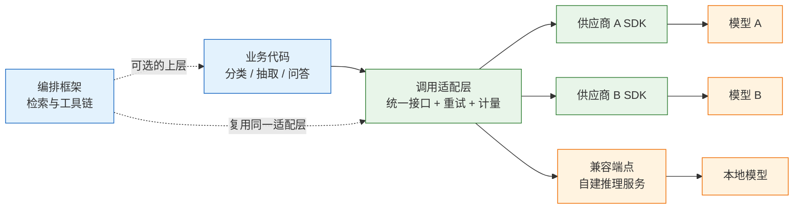
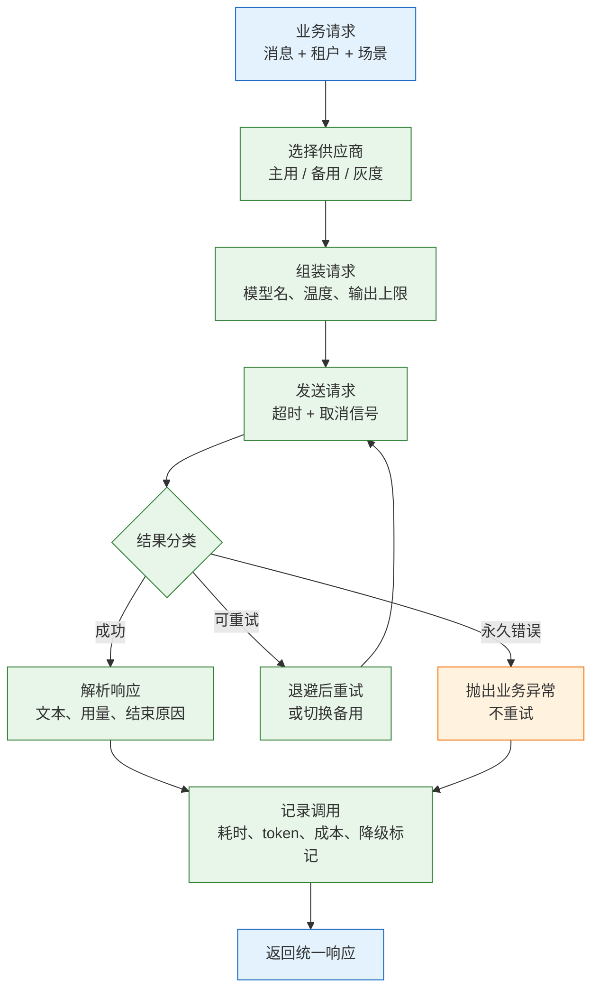

# 模型调用框架

模型调用框架是位于业务代码与厂商 SDK 之间的一层薄适配，把供应商差异、超时、重试、流式、降级和计量从业务逻辑里抽出来，收进一组稳定的接口。它不产生模型能力，也不提升回答质量，只负责让“换一家供应商”和“查一次账单”不再需要改遍全站。

这层抽象是否值得写，取决于接入数量和存续时间。只接一家、只做聊天、预计三个月内下线，直接用官方 SDK 加一个函数更省事；要接两家以上、要给多租户计费、要保证主备切换，薄适配层的收益会迅速超过维护成本。真正需要警惕的是另一种情况：业务尚未稳定就先引入编排 DSL，提示词、工具、状态全部绑在框架版本上，换框架等于重写。

---

## 一、模型调用框架是什么

### 1.1 核心概念

第一版调用通常只有一行：

```python
resp = client.chat.completions.create(model="model-a", messages=msgs)
```

第二周增加备用供应商，代码里出现 `if provider == "a": ... elif provider == "b": ...`；第三周要流式、要重试、要统计成本，分支开始互相缠绕；改一个超时值，要在五个文件里各找一遍。调用框架处理的正是这类**横切关注点**：它们不属于任何单个业务，却出现在每一次模型调用上。

| 概念 | 代码载体 | 职责 | 不负责 |
|---|---|---|---|
| 供应商配置 | `ProviderConfig` | 端点、密钥、模型名、超时 | 业务路由规则 |
| 统一请求 | `messages` / `**kw` | 消息、温度、输出上限 | 提示词内容 |
| 统一响应 | `Reply` | 文本、模型快照、用量、结束原因 | 内容质量判定 |
| 错误分类 | `ProviderError` | 可重试性、状态码、退避提示 | 根因修复 |
| 调用记录 | `CallRecord` | 供应商、耗时、重试、成本 | 账单结算 |

五个对象里，**错误分类**最容易被省略，也最先引发事故。把超时、429、参数错误混成一个 `Exception`，上层只能统一重试；参数错误重试一百次仍然失败，还会把账单放大一百倍。分类之后，重试、降级、告警才有明确的判断依据。

统一响应中的 `model` 字段要保存**实际返回的快照名**，而不是请求时用的别名。供应商在别名背后切换权重或版本时，只有快照名能解释“同一份提示词，昨天和今天为什么不一样”。

### 1.2 与相邻技术的关系

围绕模型调用，常见的五类技术经常被混为一谈。它们的职责差别很大，选错层级会让后续每一次变更都付出代价。

- **裸 HTTP**：用 `httpx` 或 `requests` 直接发 JSON。控制力最强，鉴权、流式帧解析、重连都要自己写，适合只调一家且请求极简的场景。
- **官方 SDK**：负责协议、鉴权、类型定义、流式增量解析，通常自带重试。它不负责团队的成本口径、租户配额和降级顺序。
- **薄适配层**：本文讨论的对象，通常一百到三百行，统一接口、错误分类、主备切换和计量。判断标准是“能否在不改业务的情况下换供应商”。
- **编排框架**：LangChain、LlamaIndex 一类，把检索、工具、链式步骤拼起来，自带模型抽象，也自带版本包袱。它解决的是流程组装，不是调用治理。
- **网关产品**：LiteLLM 代理一类，把多家模型统一到一个兼容端点后面，适合多团队共用配额与密钥，代价是多一次网络跳转和一套需要运维的服务。

| 技术 | 解决的问题 | 与调用框架的边界 | 适用阶段 |
|---|---|---|---|
| 裸 HTTP | 最小依赖、完全可控 | 不含重试与计量 | 单端点验证 |
| 官方 SDK | 协议与流式解析 | 不含跨供应商策略 | 单供应商 |
| 薄适配层 | 统一接口、降级、计量 | 不含提示词与检索 | 两家以上 |
| 编排框架 | 多步流程与组件拼装 | 不保证调用治理 | 原型与 RAG |
| 网关产品 | 集中配额与密钥 | 增加部署与延迟 | 多团队共用 |



顺序不要反。先有稳定的薄适配，再考虑在其上加编排；直接把业务写进 DSL，等要换框架时，提示词、工具、会话状态都会被绑死。反过来，如果连一家供应商都还没跑通，就先搭网关，同样是把精力花在了没有流量的地方。

### 1.3 架构组成

一次调用从进入适配层到返回文本，经过六个可独立替换的环节。把每个环节的失败模式和观测入口先定下来，排障时就不必从头读代码。



| 层 | 组件 | 典型故障 | 排查入口 |
|---|---|---|---|
| 路由 | 供应商选择、灰度比例 | 备用从未触发、流量打错租户 | 调用记录里的 `provider` |
| 组装 | 参数映射、模型别名 | 新参数未透传、别名指向旧快照 | 请求日志中的 `model` |
| 传输 | 连接池、超时、代理 | 首字慢、连接复用失败 | `ttft_ms` 与连接错误类型 |
| 分类 | 状态码与异常映射 | 400 被当成可重试 | `status` 与原始异常名 |
| 解析 | 流式增量、用量字段 | 缺字、usage 为空 | `finish_reason`、chunk 计数 |
| 记录 | 结构化日志、指标 | 账单对不上、无法回溯 | `request_id` 串联 |

层与层之间只传统一对象，不传厂商原始响应。业务代码一旦读取 `resp.choices[0]`，适配层就失去意义；把厂商字段封在适配层内部，升级 SDK 时才只需要改一处。

---

## 二、安装与最小示例

> **版本现状（2026-10）**：OpenAI 兼容接口仍是多供应商接入的事实标准，Python SDK 的 `chat.completions` 路径保持稳定，但各家对流式用量、工具调用、结构化输出的支持并不一致。示例要求 Python 3.10 及以上（使用 `X | None` 语法），本文只使用稳定接口，具体版本与参数以厂商当前文档为准。

### 2.1 环境与依赖

用 uv 管理虚拟环境与锁文件，保证本地、CI 与容器装到同一套依赖。

```bash
# 创建项目，生成 pyproject.toml 与 .venv
uv init model-gateway
cd model-gateway

# 运行时依赖：SDK 负责协议，httpx 用于健康检查与假上游
uv add openai httpx

# 测试依赖：pytest 跑用例，无需额外 mock 库，假上游用标准库即可
uv add --dev pytest

# 确认版本
uv run python -c "import openai, httpx; print(openai.__version__, httpx.__version__)"
```

| 工具 / 包 | 作用 | 缺失时的表现 |
|---|---|---|
| `openai` | 兼容端点客户端、流式解析 | 无法导入 `OpenAI` |
| `httpx` | 连接复用、健康检查 | SDK 仍可用，脚本无法探活 |
| `pytest` | 用例运行器 | 无法收集测试 |
| `uv` | 环境与锁文件 | 依赖版本在机器间漂移 |

密钥只从环境变量读取，不写进代码、配置样例和镜像。下面六个变量在本地用 `export` 注入，在容器里由编排平台注入。

```bash
# 主供应商：端点必须带版本段，通常以 /v1 结尾
export A_BASE="https://api-a.example.com/v1"
export A_KEY="sk-replace-with-real-key"
export A_MODEL="model-a"

# 备用供应商：可以是另一家，也可以是同一家的另一个区域
export B_BASE="https://api-b.example.com/v1"
export B_KEY="sk-replace-with-real-key"
export B_MODEL="model-b"
```

> **安全警告**：密钥不能进入 Git、日志、异常堆栈和前端包。打印配置时只显示末四位；容器镜像里不要用 `ENV` 固化密钥，改用运行时注入或密钥管理服务。

### 2.2 最小调用

先写一个不带任何封装的调用，确认端点、鉴权和响应结构，再往上加抽象。

```python
# minimal.py
import os
from openai import OpenAI

# max_retries=0：把重试权收回到自己的适配层，避免与 SDK 叠加
client = OpenAI(
    base_url=os.environ["A_BASE"],
    api_key=os.environ["A_KEY"],
    timeout=60.0,
    max_retries=0,
)

resp = client.chat.completions.create(
    model=os.environ.get("A_MODEL", "model-a"),
    messages=[{"role": "user", "content": "用一句话解释什么是幂等"}],
    temperature=0,
    max_tokens=200,
)

# 打印关键字段，确认返回结构与预期一致
print(resp.model)
print(resp.choices[0].finish_reason)
print(resp.choices[0].message.content)
print(resp.usage.prompt_tokens, resp.usage.completion_tokens)
```

```bash
# 运行最小示例
uv run python minimal.py
```

预期输出类似：

```text
model-a-2026-09-01
stop
幂等是指同一操作执行多次与执行一次的结果相同。
182 46
```

`max_retries=0` 不是随手写的参数。SDK 默认会对连接错误和 429 做有限次重试，业务层再包一层重试，最坏次数就是两者相乘。账单翻倍时，先确认到底有几层在重试。

### 2.3 端点兼容性验证

在写适配层之前，用两条 `curl` 把协议层的问题排干净。SDK 报错信息经过封装，往往看不出是路径错、鉴权错还是响应结构不兼容。

```bash
# 验证鉴权与模型列表；部分供应商没有 /models，404 不代表不可用
curl -s "$A_BASE/models" \
  -H "Authorization: Bearer $A_KEY" | head -c 300

# 验证聊天补全的请求体与响应结构
curl -s "$A_BASE/chat/completions" \
  -H "Authorization: Bearer $A_KEY" \
  -H "Content-Type: application/json" \
  -d '{"model":"'"$A_MODEL"'","messages":[{"role":"user","content":"hi"}],"max_tokens":5}'
```

| 检查项 | 通过标准 | 常见偏差 |
|---|---|---|
| 路径 | `/chat/completions` 返回 200 | `base_url` 已含 `/v1`，代码又拼一次 |
| 鉴权 | Bearer 令牌被接受 | 使用了 `x-api-key` 而非 Bearer |
| 响应结构 | 含 `choices[0].message.content` | 返回自研 JSON 包装 |
| 用量 | 含 `usage.prompt_tokens` | 字段名不同或完全缺失 |
| 流式 | `stream=true` 返回增量事件 | 一次性返回完整 JSON |

> **注意**：`base_url` 的末尾斜杠与版本段最容易出错。SDK 会在 `base_url` 后拼接 `/chat/completions`，写成 `https://host/v1/` 通常可用，写成 `https://host/v1/chat` 则得到重复路径。出现 404 时先用 `curl` 打出真实路径，不要猜。

---

## 三、核心抽象

### 3.1 统一请求与响应

接口只保留业务真正用到的能力。照抄厂商全量参数，等于把厂商的升级节奏引进业务代码。

```python
# contract.py
from dataclasses import dataclass
from typing import Iterator, Protocol

@dataclass(frozen=True)
class Usage:
    prompt_tokens: int
    completion_tokens: int
    cached_tokens: int = 0

@dataclass(frozen=True)
class Reply:
    text: str
    model: str                 # 实际快照名，不是请求别名
    usage: Usage
    finish_reason: str
    provider: str
    degraded: bool = False

class ChatProvider(Protocol):
    name: str

    def chat(self, messages: list[dict], **kw) -> Reply: ...

    def stream(self, messages: list[dict], **kw) -> Iterator[dict]: ...
```

| 字段 | 来源 | 用途 |
|---|---|---|
| `text` | `choices[0].message.content` | 业务输出 |
| `model` | 响应顶层 `model` | 解释版本漂移 |
| `usage` | 响应 `usage` | 计费与容量分析 |
| `finish_reason` | `choices[0].finish_reason` | 判断截断与内容过滤 |
| `provider` | 适配层写入 | 还原主备切换 |
| `degraded` | 适配层写入 | 标记非主用链路 |

`finish_reason` 为 `length` 表示输出被 `max_tokens` 截断，不是模型答完了；为 `content_filter` 表示被安全策略拦截；为 `tool_calls` 表示模型要求调用工具。业务侧只判断“有没有文本”，会把截断当成完整答案。

### 3.2 错误分类

错误必须分成“可重试”和“永久”两类，因为处理方式完全相反。分类函数只做映射，不做重试，保持纯函数便于测试。

```python
# errors.py
class ProviderError(Exception):
    def __init__(self, msg: str, *, retryable: bool,
                 status: int | None = None,
                 retry_after: float | None = None,
                 cause: str = ""):
        super().__init__(msg)
        self.retryable = retryable
        self.status = status
        self.retry_after = retry_after
        self.cause = cause          # 保留原始异常名，便于分类表校正

RETRYABLE_STATUS = {408, 429, 500, 502, 503, 504}
RETRYABLE_NAMES = {
    "APIConnectionError", "APITimeoutError",
    "ConnectTimeout", "ReadTimeout", "RemoteProtocolError",
}

def classify(exc: Exception) -> ProviderError:
    status = getattr(exc, "status_code", None)
    name = type(exc).__name__
    retryable = status in RETRYABLE_STATUS or name in RETRYABLE_NAMES
    retry_after = None
    response = getattr(exc, "response", None)
    if response is not None:
        raw = response.headers.get("retry-after")
        if raw:
            try:
                retry_after = float(raw)
            except ValueError:
                retry_after = None
    return ProviderError(str(exc), retryable=retryable,
                         status=status, retry_after=retry_after, cause=name)
```

| 错误 | 分类 | 动作 |
|---|---|---|
| 400 参数、上下文超长 | 永久 | 修请求，换供应商也一样失败 |
| 401 / 403 | 永久 | 检查密钥、权限、租户配额 |
| 404 | 永久 | 检查路径、模型名、部署名 |
| 408 | 可重试 | 退避后重试，注意写操作幂等 |
| 429 | 可重试 | 按 `Retry-After` 退避，必要时降级 |
| 5xx | 可重试 | 退避，连续失败切备用 |
| 连接超时、读超时 | 可重试 | 只读请求重试；写操作先查状态 |
| DNS、证书、代理认证 | 永久 | 修网络配置，重试无意义 |

**边界**：不要把所有“没有状态码”的异常都当成可重试。DNS 解析失败、证书校验失败、代理返回 407，重试一百次也不会成功。按异常类型白名单判断，并在日志里保留原始异常名，否则分类表永远无法校正。

### 3.3 流式接口

流式和非流式对外应是两个方法，而不是两套解析逻辑。流式接口必须明确三件事：增量是文本还是事件、结束后如何取得用量、客户端断开时如何取消上游。

```python
# streaming.py
def stream_chat(client, model: str, messages: list[dict]):
    """产出文本增量；最后一个事件携带 usage。"""
    with client.chat.completions.create(
        model=model,
        messages=messages,
        stream=True,
        stream_options={"include_usage": True},
    ) as stream:
        for chunk in stream:
            # 开启 include_usage 后，末尾会有一个 choices 为空、usage 非空的块
            if chunk.usage:
                yield {"type": "usage", "usage": chunk.usage}
            if chunk.choices and chunk.choices[0].delta.content:
                yield {"type": "text", "text": chunk.choices[0].delta.content}
```

| 行为 | 实现方式 | 不定义的后果 |
|---|---|---|
| 增量类型 | 统一为 `{"type": "text"}` 事件 | 前端各自判断字符串与对象 |
| 结束用量 | 依赖 `stream_options` 的末块 | 流式调用无法计费 |
| 取消上游 | 关闭生成器并退出 `with` | 用户已断开，token 仍在消耗 |
| 首字耗时 | 记录第一个文本块的到达时间 | 无法区分排队与生成慢 |

> **注意**：并非所有兼容端点都支持 `stream_options`。不支持时，要么接受流式调用拿不到精确用量，要么按字符数估算并标记 `estimated=true`，不要把估算值混进真实账单。

### 3.4 同步与异步

同步接口适合脚本和批处理，异步接口适合 Web 服务。两者共用同一套配置与错误分类，只在传输层分叉。

```python
# async_client.py
import os
from openai import AsyncOpenAI

async_client = AsyncOpenAI(
    base_url=os.environ["A_BASE"],
    api_key=os.environ["A_KEY"],
    timeout=60.0,
    max_retries=0,
)

async def achat(messages: list[dict]) -> Reply:
    resp = await async_client.chat.completions.create(
        model=os.environ.get("A_MODEL", "model-a"),
        messages=messages,
        temperature=0,
    )
    return Reply(
        text=resp.choices[0].message.content or "",
        model=resp.model,
        usage=Usage(resp.usage.prompt_tokens, resp.usage.completion_tokens),
        finish_reason=resp.choices[0].finish_reason or "unknown",
        provider="primary",
    )
```

| 场景 | 推荐方式 | 原因 |
|---|---|---|
| Web 请求内调用 | `AsyncOpenAI` | 不阻塞事件循环 |
| 批量离线处理 | 同步 SDK + 线程池 | 代码简单，限流容易 |
| 流式推送到前端 | 异步生成器 | 支持断开取消 |
| CPU 密集的后处理 | 独立进程池 | 不占用网络等待的线程 |

在协程里调用同步 SDK，会把事件循环卡住，表现为“并发数上去了，吞吐没变”。这是异步框架里最常见的性能误判。

---

## 四、多供应商配置

### 4.1 配置模型

供应商配置要用结构化对象承载，启动时校验必填项。缺密钥应该在启动阶段失败，而不是等第一个请求进来才报 401。

```python
# providers.py
import os
from dataclasses import dataclass

@dataclass(frozen=True)
class ProviderConfig:
    name: str
    base_url: str
    api_key: str
    model: str
    timeout_s: float = 60.0
    max_output: int = 1024

    @classmethod
    def from_env(cls, name: str, prefix: str) -> "ProviderConfig":
        # 缺任何一个必填变量都会在此处抛 KeyError，属于期望的启动失败
        return cls(
            name=name,
            base_url=os.environ[f"{prefix}_BASE"],
            api_key=os.environ[f"{prefix}_KEY"],
            model=os.environ[f"{prefix}_MODEL"],
            timeout_s=float(os.environ.get(f"{prefix}_TIMEOUT", "60")),
            max_output=int(os.environ.get(f"{prefix}_MAX_OUTPUT", "1024")),
        )

PRIMARY = ProviderConfig.from_env("primary", "A")
BACKUP = ProviderConfig.from_env("backup", "B")
```

| 字段 | 必填 | 说明 |
|---|---|---|
| `base_url` | 是 | 含版本段，不带 `/chat/completions` |
| `api_key` | 是 | 只从环境或密钥服务读取 |
| `model` | 是 | 请求用的模型名或部署名 |
| `timeout_s` | 否 | 覆盖 SDK 默认值，按业务上限设置 |
| `max_output` | 否 | 防止单次输出失控 |

配置对象保持不可变，运行期不修改。需要灰度时新建配置并替换引用，不要在原对象上改字段，否则并发请求会读到半更新状态。

### 4.2 兼容端点核验

“OpenAI 兼容”只保证最基本的请求形状，能力差异仍然存在。接入前按下表逐项验证，不要等上线后才发现流式没有用量。

```bash
# 逐项验证兼容能力：流式、用量、工具调用
curl -sN "$A_BASE/chat/completions" \
  -H "Authorization: Bearer $A_KEY" \
  -H "Content-Type: application/json" \
  -d '{"model":"'"$A_MODEL"'","messages":[{"role":"user","content":"hi"}],"stream":true,"stream_options":{"include_usage":true}}' \
  | tail -n 5
```

| 能力 | 验证方式 | 不兼容时的处理 |
|---|---|---|
| 流式 | `stream=true` 是否逐块返回 | 关闭流式或换端点 |
| 流式用量 | 末块是否含 `usage` | 估算并标记 |
| 工具调用 | 传 `tools` 是否返回 `tool_calls` | 改走提示词解析 |
| 结构化输出 | `response_format` 是否被接受 | 应用层校验并重试 |
| 前缀缓存 | `usage` 是否含缓存命中数 | 成本按全价计算 |

### 4.3 密钥与租户隔离

多租户场景下，密钥不仅是鉴权凭证，也是配额和账单的边界。一个租户一个密钥，才能在上游侧定位超额来源；所有租户共用一个密钥，429 出现时无法判断该限制谁。

| 项目 | 做法 | 反例 |
|---|---|---|
| 存储 | 密钥管理服务或运行时注入 | 写进 `config.yaml` 提交仓库 |
| 轮换 | 双密钥并存，灰度切换 | 直接替换，旧请求全部 401 |
| 粒度 | 按租户或环境独立 | 生产与测试共用一个 Key |
| 日志 | 只记录末四位或哈希 | 打印完整请求头 |

> **安全警告**：调试日志里最常见的事故是打印完整请求体。模型请求往往包含用户原文、合同片段和内部标识，一旦进入集中日志，等于把敏感数据复制到另一个系统。默认只记录长度、哈希和字段名，采样原文必须单独授权并设置保留期。

---

## 五、重试、降级与并发

### 5.1 重试策略

重试要满足五个条件才成立：错误可重试、请求可重复、次数有上限、退避有上限、总耗时不超过业务预算。少一个条件，重试就会从保护机制变成故障放大器。

```python
# retry.py
import random
import time
from errors import ProviderError

def sleep_before(attempt: int, err: ProviderError) -> None:
    # 优先尊重上游给出的 Retry-After，避免在限流窗口内继续打
    if err.retry_after is not None:
        delay = min(err.retry_after, 10.0)
    else:
        # 指数退避加抖动，防止多个实例同时重试形成尖峰
        delay = min(0.5 * (2 ** attempt), 8.0)
        delay *= random.uniform(0.8, 1.2)
    time.sleep(delay)
```

| 参数 | 建议起点 | 设置过大的后果 |
|---|---|---|
| 最大尝试次数 | 2~3 次 | 故障期间请求堆积 |
| 单次超时 | 业务上限的一半 | 重试没有剩余预算 |
| 退避上限 | 8~10 秒 | 用户等待不可接受 |
| 总预算 | 由接口 SLA 决定 | 重试拖垮上游 |
| 抖动比例 | ±20% | 多实例同步重试 |

`Retry-After` 既可能是秒数，也可能是 HTTP 日期。示例只解析秒数，遇到日期格式会退回指数退避；不要把它直接传给 `sleep`，否则会抛类型错误。

> **注意**：超时后的写操作不能直接重试。请求可能已经到达上游并生效，只是响应丢失；重试会生成第二条记录。正确做法是用业务幂等键查询状态，确认未生效后再重试。

### 5.2 降级与熔断

降级不是“出错就换一家”，而是按错误类型和连续失败次数决定。参数错误换供应商仍然失败，只会多花一次钱；主供应商持续 5xx 时继续重试，则会把故障时间拉长。

```python
# breaker.py
import time

class Breaker:
    def __init__(self, threshold: int = 5, cooldown: float = 30.0):
        self.threshold = threshold
        self.cooldown = cooldown
        self.failures = 0
        self.opened_at = 0.0
        self.half_open = False

    def allow(self) -> bool:
        if self.failures < self.threshold:
            return True
        if time.monotonic() - self.opened_at < self.cooldown:
            return False
        # 冷却结束后只放一个探针，避免恢复瞬间被流量打满
        if self.half_open:
            return False
        self.half_open = True
        return True

    def record(self, ok: bool) -> None:
        if ok:
            self.failures = 0
            self.half_open = False
            return
        self.failures += 1
        self.half_open = False
        if self.failures >= self.threshold:
            self.opened_at = time.monotonic()
```

| 状态 | 判定 | 行为 |
|---|---|---|
| 关闭 | 连续失败未达阈值 | 正常走主供应商 |
| 打开 | 达到阈值 | 直接走备用，不再打主用 |
| 半开 | 冷却时间结束 | 放一个试探请求 |
| 恢复 | 试探成功 | 清零失败计数 |

降级发生后必须打点并标记 `degraded=true`。没有这个标记，主供应商连挂一周也可能没人发现，因为业务一直“正常返回”。同时要注意备用模型的输出风格、JSON 合规率和上下文长度都可能不同，关键任务要把降级结果送进同一套校验。

### 5.3 并发与配额

供应商的限流通常按“每分钟请求数”和“每分钟 token 数”双维度计算。只控制并发数，不足以避免 429；长上下文请求会先撞上 token 配额。

```python
# concurrency.py
import asyncio

sem = asyncio.Semaphore(8)

async def bounded(coro):
    # 信号量只限制在途请求数，不替代供应商的 RPM/TPM 配额
    async with sem:
        return await coro
```

| 任务类型 | 并发手段 | 上限依据 |
|---|---|---|
| 在线问答 | 每实例信号量 | 供应商 RPM ÷ 实例数 |
| 离线批量 | 线程池 + 队列 | TPM 与预算 |
| 文档向量化 | 批量接口优先 | 单次批量上限 |
| 流式推送 | 每连接一个任务 | 连接数与内存 |

同步批处理用 `ThreadPoolExecutor(max_workers=8)` 足够；CPU 密集的解析不要和网络请求混在同一个池里，否则线程会被计算占满，网络等待反而排不上队。

---

## 六、可观测性与成本核算

### 6.1 调用记录

没有调用记录，后面所有优化都只能靠猜。记录要能回答四个问题：谁调的、调到哪、花了多少、为什么失败。

```python
# telemetry.py
import json
import logging

log = logging.getLogger("llm")

def record(event: dict) -> None:
    # 单行 JSON，便于日志系统直接解析；不要拼接多行文本
    log.info(json.dumps(event, ensure_ascii=False, separators=(",", ":")))

record({
    "ts": "2026-10-28T10:00:00Z",
    "request_id": "req_123",
    "tenant": "team-a",
    "provider": "primary",
    "model": "model-a-2026-09-01",
    "prompt_tokens": 1820,
    "completion_tokens": 240,
    "cached_tokens": 0,
    "ttft_ms": 620,
    "total_ms": 4100,
    "retries": 0,
    "degraded": False,
    "finish_reason": "stop",
    "cost": 0.0014,
})
```

| 字段 | 回答的问题 | 缺失后果 |
|---|---|---|
| `request_id` | 用户投诉的那一次发生了什么 | 无法与业务日志串联 |
| `provider` / `model` | 是否发生降级或快照切换 | 质量波动无法归因 |
| `ttft_ms` / `total_ms` | 慢在首字还是慢在生成 | 排队与生成混为一谈 |
| `retries` / `degraded` | 账单为何翻倍、质量为何变化 | 成本与故障都说不清 |
| `finish_reason` | 答完了还是被截断 | 把截断当成完整答案 |
| `cached_tokens` | 前缀缓存是否生效 | 缓存收益无法验证 |

### 6.2 指标与日志

日志负责单次回溯，指标负责趋势判断。两者都要有，不能互相替代。

| 指标 | 定义 | 告警参考 |
|---|---|---|
| 成功率 | 成功请求 ÷ 总请求 | 5 分钟低于 99% |
| P95 首字耗时 | 首个文本块到达时间 | 超过业务上限 |
| 重试率 | 重试次数 ÷ 请求数 | 突增说明上游不稳 |
| 降级率 | `degraded=true` 占比 | 持续大于 1% |
| 每租户成本 | 日成本 ÷ 活跃租户 | 环比翻倍 |
| 截断率 | `finish_reason=length` 占比 | 突增说明输出上限偏小 |

> **注意**：只记录总耗时，会把网关排队、网络传输和模型生成混成一个数字；只记录 token 总数，会算错输入与输出的成本比例。两类拆分都必须在上线前完成，事后补字段无法还原历史请求。

### 6.3 成本核算

价格表随时间变化，不要写死在代码里。按“输入、缓存输入、输出”三段维护，月底对账时差异才能落到具体模型。

```python
# pricing.py
# 示例单价，单位：元 / 百万 token，实际以厂商当期价目为准
PRICES = {
    "model-a": {"in": 0.5, "cached_in": 0.1, "out": 2.0},
    "model-b": {"in": 0.8, "cached_in": 0.2, "out": 3.0},
}

def cost_of(model: str, prompt: int, completion: int, cached: int = 0) -> float:
    # 快照名带日期后缀，取基础名匹配价目表
    base = model.split("-2026")[0]
    p = PRICES.get(base)
    if p is None:
        return 0.0
    fresh = max(prompt - cached, 0)
    return (fresh * p["in"] + cached * p["cached_in"] + completion * p["out"]) / 1e6
```

| 成本段 | 计费依据 | 常见误算 |
|---|---|---|
| 输入 | `prompt_tokens - cached_tokens` | 把缓存命中按全价算 |
| 缓存输入 | `cached_tokens` | 未获取该字段 |
| 输出 | `completion_tokens` | 只看总 token |
| 重试 | 每次重试单独计费 | 只按成功请求计费 |

成本函数的价值不在算得绝对准确，而在**统一口径**。所有供应商都按同一套三段式记录，差异才能定位到模型和租户，而不是月底只剩一句“这个月怎么这么贵”。

---

## 七、完整示例

### 7.1 网关实现

下面的实现保留配置、分类、重试、降级、流式和用量记录六条主线，可以直接运行。为便于单文件执行，示例重复声明了 `Usage` 与 `Reply`；实际项目从 `contract.py` 导入。日志写到标准输出，生产环境替换为结构化日志采集即可。

```python
# gateway.py
import json
import time
import uuid
from dataclasses import dataclass

from openai import OpenAI

from errors import ProviderError, classify
from providers import BACKUP, PRIMARY, ProviderConfig
from retry import sleep_before

@dataclass(frozen=True)
class Usage:
    prompt_tokens: int
    completion_tokens: int
    cached_tokens: int = 0

@dataclass(frozen=True)
class Reply:
    text: str
    model: str
    usage: Usage
    finish_reason: str
    provider: str
    degraded: bool = False

class Gateway:
    def __init__(self, primary: ProviderConfig, backup: ProviderConfig,
                 max_attempts: int = 2):
        self.chain = [primary, backup]
        self.max_attempts = max_attempts
        self.clients = {
            cfg.name: OpenAI(base_url=cfg.base_url, api_key=cfg.api_key,
                             timeout=cfg.timeout_s, max_retries=0)
            for cfg in self.chain
        }

    def chat(self, messages: list[dict], tenant: str = "default") -> Reply:
        request_id = f"req_{uuid.uuid4().hex[:12]}"
        started = time.monotonic()
        last: ProviderError | None = None
        attempts = 0

        for idx, cfg in enumerate(self.chain):
            client = self.clients[cfg.name]
            for attempt in range(self.max_attempts):
                attempts += 1
                try:
                    # 每次尝试独立计时，ttft 在非流式下等于总耗时
                    t0 = time.monotonic()
                    resp = client.chat.completions.create(
                        model=cfg.model,
                        messages=messages,
                        temperature=0,
                        max_tokens=cfg.max_output,
                    )
                    elapsed = int((time.monotonic() - t0) * 1000)
                    usage = resp.usage
                    # 部分兼容端点不返回 usage，按 0 记录，由指标侧告警
                    prompt = usage.prompt_tokens if usage else 0
                    completion = usage.completion_tokens if usage else 0
                    cached = 0
                    details = getattr(usage, "prompt_tokens_details", None)
                    if details is not None:
                        cached = getattr(details, "cached_tokens", 0) or 0
                    reply = Reply(
                        text=resp.choices[0].message.content or "",
                        model=resp.model,
                        usage=Usage(prompt, completion, cached),
                        finish_reason=resp.choices[0].finish_reason or "unknown",
                        provider=cfg.name,
                        degraded=idx > 0,
                    )
                    self._log(request_id, tenant, reply, attempts,
                              elapsed, int((time.monotonic() - started) * 1000))
                    return reply
                except Exception as exc:
                    err = classify(exc)
                    last = err
                    # 永久错误换供应商也一样失败，直接抛出
                    if not err.retryable:
                        self._log_fail(request_id, tenant, cfg.name,
                                       attempts, err)
                        raise err from exc
                    if attempt + 1 < self.max_attempts:
                        sleep_before(attempt, err)
        if last is None:
            raise RuntimeError("未配置任何供应商")
        self._log_fail(request_id, tenant, "all", attempts, last)
        raise last

    def _log(self, rid, tenant, reply, attempts, elapsed, total):
        print(json.dumps({
            "request_id": rid, "tenant": tenant, "provider": reply.provider,
            "model": reply.model, "prompt_tokens": reply.usage.prompt_tokens,
            "completion_tokens": reply.usage.completion_tokens,
            "cached_tokens": reply.usage.cached_tokens,
            "ttft_ms": elapsed, "total_ms": total, "retries": attempts - 1,
            "degraded": reply.degraded, "finish_reason": reply.finish_reason,
        }, ensure_ascii=False))

    def _log_fail(self, rid, tenant, provider, attempts, err):
        print(json.dumps({
            "request_id": rid, "tenant": tenant, "provider": provider,
            "retries": attempts - 1, "status": err.status,
            "error": err.cause or type(err).__name__, "retryable": err.retryable,
        }, ensure_ascii=False))

if __name__ == "__main__":
    gw = Gateway(PRIMARY, BACKUP)
    out = gw.chat([{"role": "user", "content": "用一句话解释重试预算"}])
    print(out.text)
```

### 7.2 故障注入验证

用标准库起一个假上游，按次数返回 429 和正常响应，把 `A_BASE` 指过去，就能验证重试次数、退避和日志字段，不需要真实 Key。

```python
# fake_upstream.py
import json
from http.server import BaseHTTPRequestHandler, HTTPServer

calls = {"n": 0}

class Handler(BaseHTTPRequestHandler):
    def do_POST(self):
        calls["n"] += 1
        if calls["n"] <= 2:
            body = json.dumps({"error": {"message": "rate limited"}}).encode()
            self.send_response(429)
            self.send_header("retry-after", "1")
        else:
            body = json.dumps({
                "id": "chatcmpl-fake", "object": "chat.completion",
                "created": 0, "model": "fake-model-2026-01-01",
                "choices": [{"index": 0, "finish_reason": "stop",
                             "message": {"role": "assistant", "content": "ok"}}],
                "usage": {"prompt_tokens": 10, "completion_tokens": 2,
                          "total_tokens": 12},
            }).encode()
            self.send_response(200)
        self.send_header("content-type", "application/json")
        self.send_header("content-length", str(len(body)))
        self.end_headers()
        self.wfile.write(body)

    def log_message(self, *args):
        pass

HTTPServer(("127.0.0.1", 8899), Handler).serve_forever()
```

```bash
# 终端 1：启动假上游
uv run python fake_upstream.py

# 终端 2：指向假上游，主备都设成同一地址，观察重试
export A_BASE="http://127.0.0.1:8899/v1"
export A_KEY="test-key"
export A_MODEL="fake-model"
export B_BASE="http://127.0.0.1:8899/v1"
export B_KEY="test-key"
export B_MODEL="fake-model"
uv run python gateway.py
```

预期日志类似：

```json
{"request_id":"req_ab12cd34ef56","tenant":"default","provider":"backup","model":"fake-model-2026-01-01","prompt_tokens":10,"completion_tokens":2,"cached_tokens":0,"ttft_ms":3,"total_ms":1012,"retries":2,"degraded":true,"finish_reason":"stop"}
```

| 注入场景 | 预期行为 | 验证字段 |
|---|---|---|
| 前两次 429，第三次 200 | 主用重试两次后切备用 | `provider=backup`、`retries=2` |
| 主供应商持续 500 | 达到次数后切备用 | `provider=backup`、`degraded=true` |
| 返回 400 | 不重试，直接抛出 | `retryable=false` |
| 响应缺 `usage` | 记录为 0，由指标告警 | `prompt_tokens=0` |
| 客户端断开流式 | 上游请求被取消 | 连接关闭日志 |

这套验证要跑三类断言：重试次数精确、降级标记正确、日志里的 `provider` 与 `model` 能还原路径。只跑通“正常返回”不算验收。

---

## 八、工程实践

### 8.1 目录与依赖

适配层应该小到一个人一天能读完。文件按职责拆开，不按供应商拆开；新增一家供应商只加配置，不改流程代码。

```text
model-gateway/
├── pyproject.toml
├── uv.lock
├── .env.example           # 只有变量名和占位符
├── gateway/
│   ├── __init__.py
│   ├── providers.py       # 供应商配置与启动校验
│   ├── contract.py        # Reply、Usage、Protocol
│   ├── errors.py          # 错误分类
│   ├── retry.py           # 退避与预算
│   ├── breaker.py         # 熔断状态
│   ├── telemetry.py       # 日志与指标
│   └── gateway.py         # 编排：路由、重试、降级
└── tests/
    ├── test_classify.py
    └── test_gateway.py
```

| 目录 | 放什么 | 不应该放 |
|---|---|---|
| `providers.py` | 端点、超时、模型名 | 业务提示词 |
| `contract.py` | 统一数据结构 | 厂商原始响应 |
| `errors.py` | 分类映射 | 重试循环 |
| `retry.py` | 退避算法 | 供应商选择 |
| `gateway.py` | 调用编排 | 具体业务规则 |

### 8.2 测试策略

| 测试类型 | 做法 | 覆盖的问题 |
|---|---|---|
| 分类单测 | 构造带 `status_code` 的异常 | 400 是否被误判可重试 |
| 契约测试 | 假上游返回标准响应 | 字段解析是否完整 |
| 故障注入 | 429、500、超时、缺字段 | 重试与降级路径 |
| 黄金样本 | 固定输入对比输出结构 | 升级 SDK 后行为漂移 |
| 成本回归 | 固定用量对比计算结果 | 价目表与分段口径 |

测试里不要调用真实模型。真实模型输出不稳定，断言只能写“非空”，等于没测。假上游可以精确控制状态码、延迟和响应体，才能验证边界。

> **注意**：升级 SDK 后先跑契约测试和黄金样本，再谈上线。SDK 的大版本升级可能改默认超时、重试策略和流式事件结构，这些变化不会在业务代码里报错，只会让账单和延迟悄悄变化。

### 8.3 上线检查

| 检查项 | 通过标准 | 失败后果 |
|---|---|---|
| 超时 | 每层都有上限，且小于上游 SLA | 请求永久挂起 |
| 重试 | 只有一层，次数有上限 | 账单翻倍、故障放大 |
| 密钥 | 运行时注入，日志脱敏 | 泄露与合规事故 |
| 降级 | 有标记、有告警 | 主供应商故障被掩盖 |
| 计量 | 每次调用都有 usage 记录 | 成本无法归因 |
| 关闭 | 退出时等待在途请求 | 流式连接被截断 |

> **安全警告**：调用记录默认不保存用户原文和模型完整输出。需要排障采样时，单独开启开关、限定租户、设置保留期，并对姓名、手机号、证件号做脱敏。日志系统的访问权限不应大于业务数据库。

---

## 九、常见故障与排查

| 现象 | 最可能原因 | 处理 |
|---|---|---|
| 换 `base_url` 后 404 | 路径重复 `/v1` 或漏版本段 | `curl` 打真实路径，对照文档 |
| 重试后账单翻倍 | SDK、框架、业务三层都在重试 | 只留一层，记录 `retries` |
| 备用供应商从不触发 | 429 未归入可重试 | 补分类表并做故障注入 |
| 降级后 JSON 解析全失败 | 备用模型不支持结构化输出 | 降级结果走同一套校验 |
| 异步批处理像串行 | 协程里调用同步 SDK | 改 `AsyncOpenAI` 或线程池 |
| 流式偶发缺字 | 自行按字节切帧 | 用 SDK 的增量解码 |
| 流式结束后没有用量 | 端点不支持 `stream_options` | 估算并标记 `estimated` |
| 本地能跑、服务器超时 | 代理、出网白名单、DNS | 在服务器上 `curl -v` 复现 |
| 升级 SDK 后行为变化 | 默认参数或流式结构改变 | 锁版本，跑黄金样本 |
| 两边输出风格不一致 | 降级未标记、提示未适配 | 记录 `degraded`，按供应商调提示 |
| 429 集中在整点 | 批量任务同时启动 | 加抖动，错开调度 |
| 成本比预估高很多 | 输入重复计费、缓存未命中 | 检查前缀顺序与 `cached_tokens` |

排查顺序：

1. 在故障机器上用 `curl` 直连端点，确认 DNS、代理、鉴权和路径，排除网络层。
2. 查调用记录的 `provider`、`status`、`retries`、`degraded`，确认请求走到了哪一层。
3. 区分“没调通”和“调通了但答错”：前者查协议与错误分类，后者查提示词、模型快照和输出校验。
4. 对流式问题单独抓包或打印 chunk 序列，确认是上游缺块还是本地解析丢字。
5. 复现账单异常时，按 `request_id` 对齐业务日志、适配层日志和上游账单，确认重试次数。
6. 最后才升级 SDK、换供应商或调整框架，并跑固定样本对比，避免把故障换成另一种行为漂移。

> **核心结论**：调用框架的价值是收拢横切关注点，不是替业务写提示词；适配层要小到能一天读完。重试只能留一层，参数错误不重试，408、429 与 5xx 才退避，超时后的写操作先查后写。每次调用都要记录实际模型快照、用量、首字耗时、重试次数和结束原因，否则优化只能靠猜。
