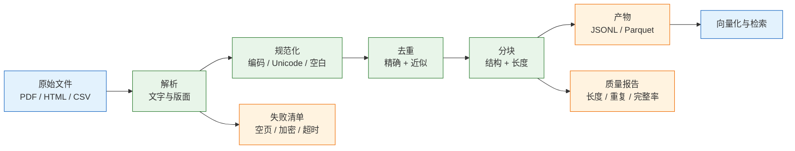
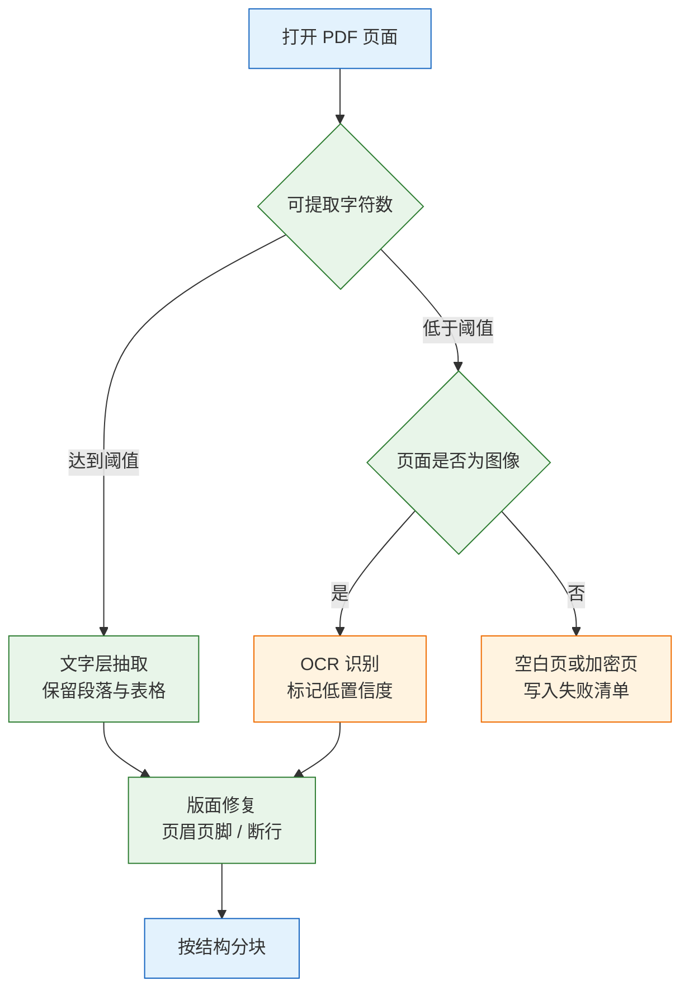

# Python 与 AI 数据处理

Python 在 AI 链路里的第一职责不是调用模型，而是把原始资料加工成模型和检索系统可以稳定消费的数据。PDF 抽出来的是乱码、表格列被读成字符串、同一段话在库里存了七份、分块把一句条件拦腰截断，这些问题都会在检索和问答阶段被误判成“模型不行”。

一条可靠的数据管线要同时产出两类东西：**干净的数据**和**说明数据怎么来的报告**。前者进入向量库或训练集，后者记录解析失败率、重复率、块长度分布和元数据完整率。没有报告，出了问题只能靠抽样猜；没有数据契约，换一个人接手就要重读全部脚本。

---

## 一、Python 与 AI 数据处理是什么

### 1.1 核心概念

AI 数据处理是把异构原始资料转换为带元数据、可校验、可复现的结构化产物的过程。它处理的是字节、编码、版面、类型和边界，不处理模型能力，也不替代检索算法。

一份两百页的产品手册进入知识库，实际要经过六个阶段。每个阶段都会出现“命令成功、数据有问题”的情况，因此每个阶段都要有明确的产物和检查点。

| 阶段 | 产物 | 典型坏数据 |
|---|---|---|
| 解析 | 按页或按节的文本 | 扫描页抽出空串、表格串成一行 |
| 规范化 | 统一编码与空白后的文本 | BOM、零宽字符、全半角混用 |
| 类型治理 | 带正确类型的表 | 金额是字符串、日期格式混杂 |
| 去重 | 唯一文档与唯一块 | 同一内容多个版本 |
| 分块 | 带位置的片段 | 标题与正文分离、条件句被截断 |
| 校验 | JSONL 与质量报告 | 元数据缺失、乱码入库 |

五个概念贯穿整条链路：

- **数据契约**：产物必须有哪些字段、字段是什么类型、缺失时是否允许。契约先于代码，后续所有解析器都向它对齐。
- **内容标识**：用内容哈希而不是文件名标识文档。文件名会改，内容不会；同一文件复制两份，哈希相同。
- **位置信息**：块在原文中的字符偏移或页码。没有位置，引用无法回查，用户点“查看原文”只能跳到文件首页。
- **质量报告**：把解析失败、空页、重复、块长度分布量化。它不判断语义，但能拦住绝大多数低级错误。
- **管线版本**：解析器、规范化规则、分块参数和代码版本。数据变了还是代码变了，要靠版本号区分。

> **注意**：数据处理的目标不是“把文件读进来”，而是“让下游能判断这条数据可不可信”。只写 `chunks.jsonl` 不写报告，等于把校验责任推给检索阶段，而检索阶段没有原文上下文。

### 1.2 与相邻技术的关系

数据处理经常和爬虫、ETL、特征工程、RAG 混在一起。它们的输入输出不同，混用会导致工具选错、检查点缺失。

- **爬虫**：负责获取网页与文件，处理反爬、限速、增量抓取。它输出原始字节，不保证内容可读。
- **ETL**：负责批量抽取、转换、加载，强调调度、依赖和幂等。数据处理借它的工程方法，但多了版面与自然语言处理。
- **特征工程**：把结构化数据转成模型特征，服务于训练与预测。它关注数值分布，不关注段落是否完整。
- **RAG 检索**：消费分块与向量，负责召回和排序。数据质量决定它的上限，但它无法修复缺失的正文。
- **数据标注**：为样本打标签，服务于评测与微调。它依赖清洗后的数据，否则标注员在错误文本上工作。

| 技术 | 输入 | 输出 | 与数据处理的边界 |
|---|---|---|---|
| 爬虫 | URL、站点 | 原始文件 | 不负责解析与清洗 |
| ETL | 结构化数据源 | 数仓表 | 不处理版面与断行 |
| 特征工程 | 清洗后的表 | 特征矩阵 | 不做文本分块 |
| RAG | 块与向量 | 召回结果 | 不修复上游缺失 |
| 标注 | 干净样本 | 标签 | 不承担解析 |

Python 在这一层的位置，是把解析库、表格库、文本库和并发工具编排成一条可重复执行的管线。它不追求单次脚本的巧妙，追求的是同一批输入跑两次得到同一批输出。

### 1.3 架构组成



| 组件 | 职责 | 失败表现 | 排查入口 |
|---|---|---|---|
| 解析器 | 抽取文字、表格、页码 | 空页、乱序、表格丢失 | 单页字符数与原文对照 |
| 规范化 | 统一编码、空白、字符形态 | 检索匹配不到、显示异常 | `bad_char_ratio` |
| 去重器 | 文档级与块级去重 | top_k 全是重复 | 重复率与内容哈希 |
| 分块器 | 按结构切分并加重叠 | 片段缺主语、超长截断 | 块长度 P95 与抽样 |
| 校验器 | 字段、长度、乱码断言 | 产物不可用 | 不合格块清单 |
| 报告器 | 汇总质量指标 | 问题无法定位 | 报告与产物同目录 |

架构上有一条重要约束：**解析与清洗分离，清洗与分块分离**。解析器只负责把文件变成页文本，不做业务判断；清洗只做可逆的字符变换，并保留原文；分块只消费清洗后的文本。这样替换 PDF 解析库时，不需要重写分块逻辑。

---

## 二、环境与最小示例

### 2.1 版本与依赖

> **版本现状（2026-10）**：Python 3.11 及以上是数据处理管线的常见基线；pandas 2.x、pypdf 6.x 为当前稳定系列，Polars 与 DuckDB 更新较快。具体版本以官方发布记录为准，生产环境用锁文件固定。

```bash
# 创建项目与环境
uv init doc-pipeline
cd doc-pipeline

# 核心依赖：表格与 PDF
uv add pandas pypdf

# 可选：大文件与列式产物
uv add polars duckdb pyarrow

# 测试依赖
uv add --dev pytest
```

| 包 | 用途 | 适用边界 |
|---|---|---|
| `pandas` | 表格读取、类型转换、连接 | 单机内存能放下的数据 |
| `pypdf` | 文字层 PDF 抽取 | 不做版面分析与 OCR |
| `polars` | 惰性求值、大文件扫描 | 需要改写法，API 不同 |
| `duckdb` | 直接用 SQL 查 CSV/Parquet | 适合聚合，不适合版面 |
| `pyarrow` | Parquet 读写 | 需要列式存储时 |

> **注意**：`pypdf` 只抽文字层。扫描件抽出来是空串，不会报错；必须用字符数判断并分流到 OCR，不能因为“命令没抛异常”就认为解析成功。

### 2.2 最小可运行示例

下面这段代码完成三件事：按顺序尝试编码、做字符规范化、把结果写成 JSONL。它足以验证环境，也确立了后续所有模块共用的两个函数。

```python
# minimal.py
import json
import re
import unicodedata
from pathlib import Path

ZW = dict.fromkeys(map(ord, "\u200b\u200c\u200d\ufeff\u2060"), None)

def decode(raw: bytes) -> str:
    # 顺序：先吃 BOM，再严格 UTF-8，最后覆盖 GBK/GB2312 的 gb18030
    for enc in ("utf-8-sig", "utf-8", "gb18030"):
        try:
            return raw.decode(enc)
        except UnicodeDecodeError:
            continue
    raise RuntimeError("三种编码均无法解码，检查文件是否损坏或加密")

def normalize(s: str) -> str:
    s = unicodedata.normalize("NFKC", s)
    s = s.translate(ZW)
    s = s.replace("\r\n", "\n").replace("\r", "\n")
    s = re.sub(r"[ \t\u00a0]+", " ", s)
    s = re.sub(r"\n{3,}", "\n\n", s)
    return s.strip()

text = normalize(decode(Path("faq.csv").read_bytes()))
rows = [{"id": "doc-001", "text": text, "chars": len(text)}]
Path("docs.jsonl").write_text(
    "\n".join(json.dumps(r, ensure_ascii=False) for r in rows) + "\n",
    encoding="utf-8",
)
print("chars:", len(text))
```

```bash
# 运行并检查产物
uv run python minimal.py
wc -l docs.jsonl
head -c 300 docs.jsonl
```

预期输出类似：

```text
chars: 1842
1 docs.jsonl
{"id": "doc-001", "text": "# 常见问题\n\n退款申请提交后……", "chars": 1842}
```

`ensure_ascii=False` 保留中文原文，文件更小且便于抽查；默认的 `True` 虽然程序可读，但转义序列无法肉眼核对。

### 2.3 目录与产物结构

```text
doc-pipeline/
├── pyproject.toml
├── uv.lock
├── input/                  # 原始文件，只读
├── work/                   # 中间产物，可重建
│   ├── pages/              # 按文档缓存的页文本
│   └── failed.jsonl        # 解析失败清单
├── out/
│   ├── chunks.jsonl        # 最终块
│   ├── report.json         # 质量报告
│   └── manifest.json       # 版本与参数
└── src/
    ├── parse.py            # PDF / HTML / 文本解析
    ├── clean.py            # 编码与规范化
    ├── chunk.py            # 去重与分块
    └── validate.py         # 断言与报告
```

| 目录 | 内容 | 是否进版本库 |
|---|---|---|
| `input/` | 原始文件 | 不进，单独归档 |
| `work/` | 可重建的中间结果 | 不进 |
| `out/` | 最终产物与报告 | 按需，产物通常不进 |
| `src/` | 管线代码 | 进 |
| `tests/` | 固定样本与断言 | 进 |

**原始文件只读**是硬约束。任何清洗都写新文件，不覆盖输入；否则一次错误的规范化会让原始数据永久丢失，无法回滚。

---

## 三、编码与文本规范化

### 3.1 字节解码

编码错误的典型表现是 `UnicodeDecodeError`，但更危险的是“能解码、内容是乱码”。解码顺序要有明确依据，不能靠猜。

```python
# decode.py
from pathlib import Path

def decode_bytes(raw: bytes) -> tuple[str, str]:
    # 返回文本与实际使用的编码，便于写入报告
    for enc in ("utf-8-sig", "utf-8", "gb18030"):
        try:
            return raw.decode(enc), enc
        except UnicodeDecodeError:
            continue
    # replace 保留可解码部分，用 U+FFFD 标记坏字节；ignore 会静默删数据
    return raw.decode("utf-8", errors="replace"), "utf-8-replace"

text, used = decode_bytes(Path("faq.csv").read_bytes())
print(used, text.count("\ufffd"))
```

| 编码 | 适用场景 | 风险 |
|---|---|---|
| `utf-8-sig` | Excel 导出的 CSV、带 BOM 的文本 | 无 BOM 时等同 UTF-8 |
| `utf-8` | 标准 UTF-8 文件 | 遇到 GBK 内容立即失败 |
| `gb18030` | 简体中文旧系统 | 可能把非文本字节解成汉字 |
| `utf-8` + `replace` | 兜底 | 产生替换字符，必须计数 |

> **注意**：`errors="ignore"` 会把无法解码的字节直接删掉，长度变短但程序不报错。数据少了、句子断了，直到检索效果变差才会被发现。要容错就用 `replace`，并把 `\ufffd` 的数量写进质量报告。

### 3.2 Unicode 规范化

```python
# clean.py
import re
import unicodedata

ZW = dict.fromkeys(map(ord, "\u200b\u200c\u200d\ufeff\u2060"), None)

def normalize(s: str) -> str:
    s = unicodedata.normalize("NFKC", s)       # 兼容字符归一，全角转半角
    s = s.translate(ZW)                         # 删除零宽字符
    s = s.replace("\r\n", "\n").replace("\r", "\n")
    s = re.sub(r"[ \t\u00a0]+", " ", s)         # 连续空白压成一个
    s = re.sub(r"\n{3,}", "\n\n", s)            # 最多保留一个空行
    return s.strip()
```

| 处理 | 作用 | 副作用 |
|---|---|---|
| NFKC | 全角字母数字转半角，兼容字符归一 | 中文全角标点变半角，`①` 变 `1` |
| 删除零宽 | 修复复制文本的隐形字符 | 不能误删换行与制表符 |
| 压缩空白 | 让同一句话只有一个版本 | 代码块缩进会被破坏 |
| 统一换行 | 避免分块时残留 `\r` | 无 |

NFKC 对中文文本有一个容易忽略的副作用：`，`、`：`、`（）` 会被转换成 ASCII 标点。对检索通常无害，对需要逐字排版的场景则会改变原文。合同、法条、出版稿件应保留 `raw` 字段，只对检索字段做 NFKC；或者改用 NFC，再单独处理全角字母数字。

> **注意**：规范化必须可重复执行。`normalize(normalize(x)) == normalize(x)` 是基本要求；如果规则里包含“删除连续重复行”这类有状态操作，第二次执行结果会不同，增量处理就会产生两套文本。

### 3.3 乱码与语种画像

有些文件编码能解开，但内容是乱码。看字符分布比读内容更快，也更适合批量判断。

```python
# profile.py
import re

def profile(text: str) -> dict:
    n = max(len(text), 1)
    cjk = len(re.findall(r"[\u4e00-\u9fff]", text))
    bad = len(re.findall(r"[\ufffd\u0000-\u0008\u000b\u000c\u000e-\u001f]", text))
    return {
        "cjk_ratio": round(cjk / n, 3),
        "bad_ratio": round(bad / n, 4),
        "chars": len(text),
    }

# 中文文档 cjk_ratio 通常大于 0.3；接近 0 且 bad_ratio 高，基本是解码错了
# 大量出现 "中" 这类字符，说明 UTF-8 字节被按 latin-1 解码
```

| 指标 | 正常范围 | 异常含义 | 动作 |
|---|---|---|---|
| `cjk_ratio` | 中文文档大于 0.3 | 接近 0 | 检查编码与语种 |
| `bad_ratio` | 接近 0 | 大于 0.001 | 定位替换字符位置 |
| 空页率 | 小于 5% | 突增 | 检查扫描件与加密 |
| 平均页字符数 | 稳定 | 骤降 | 解析器或版面变化 |

画像放在解析后、入库前。乱码一旦进入向量库，后续所有检索都在错误文本上打分，重跑的成本远高于在入口拦一次。

---

## 四、表格数据与类型治理

### 4.1 读取与类型声明

表格问题的根源多半在读取阶段：没有声明类型，pandas 只能推断，推断结果取决于前几百行。订单号、邮编、身份证号这类“看起来像数字”的字段，必须在读入时就固定为字符串。

```python
# tables.py
import pandas as pd

df = pd.read_csv(
    "orders.csv",
    dtype={"order_id": "string", "user_id": "string", "zip": "string"},
    usecols=["order_id", "user_id", "amount", "paid_at", "zip"],
    na_values=["", "-", "N/A", "null"],
    keep_default_na=True,
)
print(df.dtypes)
print(df.shape)
```

| 参数 | 作用 | 不设置的后果 |
|---|---|---|
| `dtype` | 固定列类型 | 前导零丢失、ID 变浮点 |
| `usecols` | 只读需要的列 | 内存翻倍、脏列干扰 |
| `na_values` | 补充缺失标记 | `-` 被当成有效值 |
| `keep_default_na` | 保留默认缺失集合 | 空串与 `NaN` 混用 |

> **注意**：`dtype="string"` 与 `dtype=str` 不同。前者是 pandas 的可空字符串类型，能保留 `pd.NA`；后者会把缺失值变成 `"nan"` 字符串，后续 `isna()` 失效。

### 4.2 类型转换与缺失值

```python
# convert.py
df["amount"] = pd.to_numeric(df["amount"], errors="coerce")
# 混合格式在 pandas 2.x 需要 format="mixed"，否则会直接抛错
df["paid_at"] = pd.to_datetime(
    df["paid_at"], errors="coerce", utc=True, format="mixed")

print("金额缺失:", df["amount"].isna().sum())
print("时间缺失:", df["paid_at"].isna().sum())
print(df["amount"].describe())
```

`errors="coerce"` 把无法转换的值变成缺失，而不是让整列转换失败。代价是脏值被“吞掉”，所以转换后必须统计缺失量，并与转换前对比。

| 脏值 | `to_numeric` 结果 | 处理建议 |
|---|---|---|
| `"1,234.50"` | `NaN` | 先去千分位再转 |
| `"¥88"` | `NaN` | 去货币符号 |
| `"-"` | `NaN` | 视为缺失 |
| `""` | `NaN` | 视为缺失 |
| `"00123"` | `123` | 读入时就用字符串 |

时间字段要统一时区。`utc=True` 把带偏移的时间转成 UTC，无偏移的按 UTC 解释；如果原始时间实际是本地时间，这个假设会带来数小时偏差。跨时区数据必须保留原始时区字段，或在读入时显式转换。

### 4.3 连接与基数校验

`merge` 行数暴涨几乎都是一对多键造成的。事后对账很贵，事前做基数检查很便宜。

```python
# join.py
left = pd.read_csv("orders.csv", dtype={"user_id": "string"})
right = pd.read_csv("users.csv", dtype={"user_id": "string"})

print("左表重复键:", left["user_id"].duplicated().sum())
print("右表重复键:", right["user_id"].duplicated().sum())

merged = left.merge(
    right,
    on="user_id",
    how="left",
    validate="many_to_one",   # 右表键重复时直接报错
    indicator=True,           # 标记匹配来源，便于查未命中
)
print(merged["_merge"].value_counts())
```

| `validate` 取值 | 约束 | 适用 |
|---|---|---|
| `one_to_one` | 两边键都唯一 | 主键对主键 |
| `one_to_many` | 左唯一、右可重复 | 主表对明细 |
| `many_to_one` | 左可重复、右唯一 | 明细对主表 |
| `many_to_many` | 不检查 | 会产生笛卡尔积，慎用 |

连接键的类型必须一致。一边是 `"00123"`，另一边是 `123`，在 pandas 里可能都能连上，但在数据库或向量库的过滤条件里会对不上。把类型统一放在读取阶段，不要留到连接时临时转换。

### 4.4 大文件处理

| 场景 | 手段 | 注意 |
|---|---|---|
| 单文件大于内存 | `read_csv(chunksize=...)` 分块 | 聚合要跨块累计 |
| 只需部分列 | `usecols` + `dtype` | 先看列名再读 |
| 多次分析同一份数据 | 转 Parquet | 列式压缩，读取快 |
| 复杂聚合 | DuckDB 直接查 CSV/Parquet | 避免把数据搬进 Python |
| 超大宽表 | Polars 惰性扫描 | API 与 pandas 不同 |

```python
# 分块统计，内存只保留累计值
total = 0
for chunk in pd.read_csv("orders.csv", usecols=["amount"], chunksize=100_000):
    total += pd.to_numeric(chunk["amount"], errors="coerce").fillna(0).sum()
print(total)
```

分块处理时，任何依赖全量排序或全局去重的步骤都不能直接做。要么两遍扫描，要么落中间文件，要么改用支持外存的引擎。把 `chunksize` 当成“万能解”会在去重和分位数上出错。

---

## 五、文档解析与版面结构

### 5.1 PDF 类型判断

PDF 按可抽取性分为三类，加密文件另外处理。判断依据是**抽出来的字符数**，不是文件名，也不是文件大小。



| 类型 | 特征 | 抽取手段 | 主要风险 |
|---|---|---|---|
| 文字层 PDF | 能选中文字、复制不乱 | `pypdf` / `pdfplumber` | 分栏顺序错、页眉混入 |
| 扫描件 | 选中是图片、复制为空 | OCR | 错字、表格结构丢失 |
| 混合型 | 部分页是图 | 逐页判断字符数 | 漏判导致整页为空 |
| 加密 PDF | 打开需要密码 | 解密后处理 | 无法解密则跳过并记录 |

阈值没有统一标准。中文页面少于 20~50 个字符通常可疑；表格页、封面页天然字符少，不能用单一阈值一刀切。把低字符页记入清单，人工抽查后再决定是否 OCR。

### 5.2 文字层抽取

```python
# pdf_text.py
from pypdf import PdfReader

def extract_pages(path: str, min_chars: int = 50) -> list[str]:
    pages = []
    for i, page in enumerate(PdfReader(path).pages, 1):
        text = (page.extract_text() or "").strip()
        if len(text) < min_chars:
            # 只告警，不在这里决定 OCR；由上游按清单分流
            print(f"[warn] 第 {i} 页仅 {len(text)} 字符")
        pages.append(text)
    return pages
```

`extract_text()` 返回的是内容流中的文字，不保证阅读顺序。双栏排版可能先输出左栏全部再输出右栏，表格可能按单元格逐行输出。需要版面坐标时用 `pdfplumber` 的 `extract_words()` 或 `extract_tables()`，按 `x0`、`top` 排序后再拼接。

### 5.3 页眉页脚与断行修复

页眉页脚的特征是“同一行在多页重复”。先统计，再删除，不要用固定行号，因为不同文件的页眉位置不同。

```python
# layout.py
from collections import Counter

def strip_repeated(pages: list[str], ratio: float = 0.3) -> list[str]:
    counts = Counter()
    for page in pages:
        # 每页只计一次，避免长页面把计数抬高
        for line in {ln.strip() for ln in page.splitlines() if ln.strip()}:
            if len(line) <= 80:
                counts[line] += 1
    threshold = max(2, int(len(pages) * ratio))
    drop = {line for line, n in counts.items() if n >= threshold}
    return ["\n".join(ln for ln in p.splitlines() if ln.strip() not in drop)
            for p in pages]
```

断行修复只对中文行做，且要排除标题、列表和表格。规则越激进，误合并越多。

```python
# 中文行尾没有句末标点、下一行以中文开头时，才考虑接回
def repair_cjk_lines(text: str) -> str:
    out: list[str] = []
    for line in text.splitlines():
        prev = out[-1] if out else ""
        if (prev and line
                and "\u4e00" <= prev[-1] <= "\u9fff"
                and "\u4e00" <= line[0] <= "\u9fff"
                and prev[-1] not in "。！？；："
                and not line.startswith(("#", "-", "*", "|", ">"))
                and not line[:1].isdigit()):
            out[-1] = prev + line
        else:
            out.append(line)
    return "\n".join(out)
```

| 修复 | 判断依据 | 误伤 |
|---|---|---|
| 去页眉页脚 | 多页重复且长度短 | 重复的正文小标题 |
| 中文接行 | 行尾无标点、下行中文开头 | 列表项、表格行 |
| 英文连字符 | 行尾 `-` 且下一行小写 | 真实连字符词 |
| 保留标题层级 | `#`、编号、字号 | 无标记的纯文本 |

**结构必须保留**。标题层级、列表符号、表格行列是分块的依据；全部拍平成一个长字符串，等于把最便宜的语义信号丢掉。解析阶段多保留一行标记，分块阶段就少一次猜测。

### 5.4 OCR 分流

| 工具 | 适用 | 代价 |
|---|---|---|
| Tesseract | 印刷体、批量、离线 | 中文识别率依赖语言包 |
| PaddleOCR | 中文、表格、版面分析 | 依赖较重，部署复杂 |
| 云 OCR | 手写、复杂版面 | 第三方留存与合规风险 |

OCR 结果必须带置信度。低置信度文本不能直接入库，应进入人工复核清单；整页置信度偏低时，宁可标记失败，也不要把错字喂给检索。

> **安全警告**：内部合同、病历、身份证等文件上传到第三方 OCR 或 embedding 服务，等于把原始数据复制给外部。先做数据分级，敏感文件走本地模型或私有部署，并在合同中确认对方是否留存、是否用于训练。

---

## 六、去重与分块

### 6.1 精确去重

```python
# dedup.py
import hashlib

def exact_key(text: str) -> str:
    # 压缩空白并转小写，避免排版差异造成假重复
    s = " ".join(text.split()).lower()
    return hashlib.sha256(s.encode("utf-8")).hexdigest()

seen, unique = set(), []
for doc in docs:
    key = exact_key(doc["text"])
    if key not in seen:
        seen.add(key)
        unique.append(doc)
```

精确去重只能抓完全一致的文本。改一个标点、多一行版权声明就会漏掉。文档级去重放在分块前，省的是后续解析与向量化成本；块级去重放在分块后，能抓“同一段被不同章节引用”。

> **注意**：`lower()` 对中文没有影响，但会让英文代码标识符、URL 路径失去大小写差异。技术文档去重时，大小写可能是语义的一部分，应只压缩空白，不转小写。

### 6.2 近似去重

```python
# near_dedup.py
def shingles(text: str, k: int = 5) -> set[str]:
    s = "".join(text.split())
    return {s[i:i + k] for i in range(max(0, len(s) - k + 1))}

def jaccard(a: str, b: str, k: int = 5) -> float:
    A, B = shingles(a, k), shingles(b, k)
    return len(A & B) / len(A | B) if A | B else 1.0
```

| 方法 | 原理 | 优点 | 代价 |
|---|---|---|---|
| SimHash | 特征压成 64 位指纹，比汉明距离 | 快、可分桶 | 短文本不稳定 |
| MinHash + LSH | 估计词集合 Jaccard | 适合长文、可并行 | 要调 shingle 与阈值 |
| 逐对 Jaccard | 直接算集合交并 | 实现简单 | O(n²)，只适合小批量 |

阈值 0.8 以上通常算重复，但“重复”要看业务。产品手册的不同版本可能 95% 相似，却必须都保留；新闻转载、同一公告的多个镜像则应该合并。去重前先定义是“内容冗余”还是“版本差异”。

> **注意**：不足 5 个字的文本，5-shingle 集合为空，`jaccard` 会返回 1.0，把所有短文本判成重复。短文本不要用 shingle 近似去重，改用精确哈希或业务主键。

### 6.3 分块策略

分块的目标是“一块能独立回答一个问题”。三种策略各有适用面，实际管线通常是组合：先按结构切，再对超长块按句子递归切。

| 策略 | 做法 | 优点 | 缺点 |
|---|---|---|---|
| 固定长度 | 每 N 字符切，带重叠 | 块大小均匀 | 切断句子和表格 |
| 按结构 | 按标题、段落、列表切 | 语义完整 | 块大小不均 |
| 递归切分 | 标题 → 段落 → 句子 | 兼顾结构与长度 | 实现复杂 |

```python
# split.py
import re

def split_paragraphs(text: str, max_chars: int = 800) -> list[str]:
    out: list[str] = []
    for para in text.split("\n\n"):
        para = para.strip()
        if not para:
            continue
        if len(para) <= max_chars:
            out.append(para)
            continue
        # 超长段按句末标点切，单句仍超长才硬切
        buf = ""
        for sent in re.split(r"(?<=[。！？；.!?])\s*", para):
            if len(buf) + len(sent) <= max_chars:
                buf += sent
            else:
                if buf:
                    out.append(buf)
                while len(sent) > max_chars:
                    out.append(sent[:max_chars])
                    sent = sent[max_chars:]
                buf = sent
        if buf:
            out.append(buf)
    return out
```

参数从业务出发，不按感觉调：

- **块大小**：中文 300~800 字是常见起点；问答型知识偏小，叙述型偏大。最终按召回率与答案完整度调。
- **重叠**：10%~20%。重叠太大，检索结果全是近似重复，白占 `top_k`；加了重叠后块会略超 `max_chars`，预算要留出余量。标题开启的新块不加重叠，避免把上一节内容带进本节。
- **元数据**：每块必须带 `doc_id`、`title`、`section`、`char_start`、`source`。没有这些，引用无法回溯。
- **边界**：标题不要并进上一块；表格不要按字符切；代码块不要压空白。

### 6.4 表格与代码块

表格按字符切是最常见的错误。半张表进入检索，模型无法解释列含义。正确做法是先转成“表头 + 一行”的文本，再按行组分块。

```python
def table_rows_to_text(headers: list[str], rows: list[list[str]]) -> list[str]:
    # 每行都重复表头，块独立后仍能解释字段含义
    return [
        "；".join(f"{h}：{v}" for h, v in zip(headers, row) if v)
        for row in rows
    ]
```

| 内容类型 | 分块方式 | 附加元数据 |
|---|---|---|
| 正文 | 按段落与句子 | 章节、偏移 |
| 表格 | 表头 + 行组 | 表名、列名、行号 |
| 代码 | 按函数或代码块 | 语言、文件路径 |
| 列表 | 整组保留 | 列表标题 |

代码块要保留缩进与换行，不能走“压缩空白”的规范化。管线里应先用标记把代码块隔离，清洗完再放回；否则 Python 的缩进被压成一行，示例代码全部失效。

---

## 七、并发、流式与可复现

### 7.1 JSONL 流式读写

JSONL 一行一个对象，适合流式处理，也便于追加与抽样。坏行不能阻断整批。

```python
# jsonl.py
import json
from pathlib import Path

def read_jsonl(path: str):
    with Path(path).open(encoding="utf-8") as f:
        for lineno, line in enumerate(f, 1):
            line = line.strip()
            if not line:
                continue
            try:
                yield json.loads(line)
            except json.JSONDecodeError as e:
                # 跳过但保留行号，最后汇总失败率
                print(f"[skip] 第 {lineno} 行: {e}")

def write_jsonl(path: str, rows) -> int:
    n = 0
    with Path(path).open("w", encoding="utf-8") as f:
        for row in rows:
            f.write(json.dumps(row, ensure_ascii=False) + "\n")
            n += 1
    return n
```

| 现象 | 原因 | 处理 |
|---|---|---|
| 读到一半报 JSON 错 | 单行被截断 | 跳过并记录行号 |
| 中文变转义序列 | `ensure_ascii=True` | 设为 `False` |
| 文件末尾多空行 | 追加写未去重 | 读时跳过空行 |
| 内存持续上涨 | 一次性 `read_text` | 逐行迭代 |

### 7.2 并发模型

| 任务 | 手段 | 原因 |
|---|---|---|
| 读文件、调 API | 线程池或 asyncio | 时间花在 IO 等待 |
| PDF 解析、OCR | 进程池 | CPU 密集，受 GIL 限制 |
| 向量化 | 批量 + 有限并发 | 单条调用浪费往返 |
| 大表聚合 | DuckDB / Polars | 减少 Python 层循环 |

```python
# parallel.py
from concurrent.futures import ProcessPoolExecutor

def parse_one(path: str) -> dict:
    return {"path": path, "pages": extract_pages(path)}

if __name__ == "__main__":
    # Windows 与 macOS 的 spawn 模式要求入口有 __main__ 保护
    with ProcessPoolExecutor(max_workers=4) as ex:
        results = list(ex.map(parse_one, paths, chunksize=4))
```

并发顺序会影响输出顺序。`ex.map` 按输入顺序返回，适合需要稳定排序的产物；`as_completed` 按完成顺序返回，适合边处理边写。无论哪种，写入文件时都要按 `doc_id` 排序，否则同一批数据跑两次，产物行序不同，diff 全是噪声。

### 7.3 可复现与清单

产物旁边必须留一份“怎么来的”。缺少版本号，出了问题无法判断是数据变了还是代码变了。

```json
{"pipeline": "docs-v3", "parser": "pypdf-6.x", "normalize": "NFKC+v2",
 "chunk_chars": 800, "overlap": 150, "input_sha256": "6f1c...",
 "code_version": "git:3a91c2f", "created_at": "2026-10-29T02:00:00Z"}
```

| 字段 | 作用 | 缺失后果 |
|---|---|---|
| `pipeline` | 管线名称与主版本 | 无法区分新旧产物 |
| `parser` | 解析库与版本 | 解析行为变化无法归因 |
| `normalize` | 规范化规则版本 | 文本差异说不清 |
| `chunk_chars` / `overlap` | 分块参数 | 无法重建同一批块 |
| `input_sha256` | 输入集合指纹 | 不知道跑的是哪批文件 |
| `code_version` | 代码提交 | 无法回滚到产出时的逻辑 |

固定随机种子只解决采样问题，解决不了并发顺序和库版本差异。真正的可复现靠“输入指纹 + 参数 + 代码版本”三件套，而不是一句 `random.seed(42)`。

### 7.4 内存与中间产物

解析后的页文本建议落盘缓存，键为“文件哈希 + 解析器版本”。同一份 PDF 在调分块参数时不必重复解析，调试一次能省几分钟到几十分钟。

| 中间产物 | 格式 | 复用场景 |
|---|---|---|
| 页文本 | JSONL / 每文档一个 txt | 调分块参数 |
| 表格 | Parquet | 调类型与连接 |
| 块 | JSONL | 调向量模型 |
| 报告 | JSON | 发布门禁 |

缓存键必须包含解析器版本；升级后仍命中旧缓存，会得到“代码已换、数据没变”的假象。

---

## 八、完整示例

### 8.1 管线实现

下面的脚本把解析、规范化、文档级去重、按结构分块、元数据与质量报告串成一条可执行管线。PDF 解析延迟导入，纯文本目录也能直接运行；示例合并为单文件，生产环境按 2.3 节的目录拆分。

```python
# ingest.py
from __future__ import annotations

import hashlib
import json
import re
import sys
import unicodedata
from dataclasses import asdict, dataclass
from pathlib import Path
from statistics import quantiles

ZW = dict.fromkeys(map(ord, "\u200b\u200c\u200d\ufeff\u2060"), None)
SENT_END = re.compile(r"(?<=[。！？；.!?])\s*")

def normalize(text: str) -> str:
    text = unicodedata.normalize("NFKC", text)
    text = text.translate(ZW)
    text = text.replace("\r\n", "\n").replace("\r", "\n")
    text = re.sub(r"[ \t\u00a0]+", " ", text)
    text = re.sub(r"\n{3,}", "\n\n", text)
    return text.strip()

def digest(text: str) -> str:
    # 内容哈希不转小写，避免英文技术文档因大小写差异被误合并
    return hashlib.sha256(" ".join(text.split()).encode("utf-8")).hexdigest()

def read_pages(path: Path) -> list[str]:
    if path.suffix.lower() == ".pdf":
        from pypdf import PdfReader      # 延迟导入，纯文本管线不需要该依赖
        return [(page.extract_text() or "") for page in PdfReader(str(path)).pages]
    raw = path.read_bytes()
    for enc in ("utf-8-sig", "utf-8", "gb18030"):
        try:
            return [raw.decode(enc)]
        except UnicodeDecodeError:
            continue
    return [raw.decode("utf-8", errors="replace")]

@dataclass
class Chunk:
    chunk_id: str
    doc_id: str
    title: str
    section: str
    text: str
    char_start: int
    source: str

def split_long(para: str, max_chars: int) -> list[str]:
    if len(para) <= max_chars:
        return [para]
    out, buf = [], ""
    for sent in SENT_END.split(para):
        if not sent:
            continue
        if len(buf) + len(sent) <= max_chars:
            buf += sent
            continue
        if buf:
            out.append(buf)
        while len(sent) > max_chars:     # 单句超长只能硬切
            out.append(sent[:max_chars])
            sent = sent[max_chars:]
        buf = sent
    if buf:
        out.append(buf)
    return out

def chunk_text(text: str, doc_id: str, title: str, source: str,
               max_chars: int = 800, overlap: int = 150) -> list[Chunk]:
    blocks: list[tuple[str, int, str, bool]] = []
    cursor, section = 0, "正文"
    for raw in text.split("\n\n"):
        idx = text.find(raw, cursor)
        cursor = idx + len(raw)
        para = raw.strip()
        if not para:
            continue
        start = idx + (len(raw) - len(raw.lstrip()))
        first = para.splitlines()[0].strip()
        # 要求编号至少带一个小数点，避免把 "2026 年展望" 误判为标题
        is_heading = first.startswith("#") or bool(
            re.match(r"^\d+(\.\d+){1,3}\s+\S", first))
        if is_heading:
            section = first.lstrip("# ").strip()
        for piece in split_long(para, max_chars):
            blocks.append((piece, start, section, is_heading))

    merged: list[tuple[str, int, str]] = []
    for piece, start, sec, is_heading in blocks:
        prev = merged[-1] if merged else None
        # 连续标题合并，避免产生只有一行标题的碎块
        heading_only = bool(prev) and all(
            ln.startswith("#") for ln in prev[0].splitlines() if ln.strip())
        if (is_heading and prev and heading_only
                and len(prev[0]) + len(piece) + 2 <= max_chars):
            merged[-1] = (prev[0] + "\n\n" + piece, prev[1], sec)
        # 标题开启新块，避免下一节内容并入上一节
        elif (not is_heading and prev
                and len(prev[0]) + len(piece) + 2 <= max_chars):
            merged[-1] = (prev[0] + "\n\n" + piece, prev[1], prev[2])
        else:
            merged.append((piece, start, sec))

    chunks: list[Chunk] = []
    for i, (body, start, sec) in enumerate(merged):
        actual, actual_start = body, start
        first = body.splitlines()[0].strip() if body else ""
        starts_heading = first.startswith("#") or bool(
            re.match(r"^\d+(\.\d+){1,3}\s+\S", first))
        # 标题是自然边界，不在新节开头拼接上一节内容
        if i > 0 and overlap > 0 and not starts_heading:
            # 从规范化全文截取重叠，保证 char_start 与实际文本严格对应
            ov = min(overlap, start)
            actual = text[start - ov:start] + "\n" + body
            actual_start = start - ov
        chunks.append(Chunk(
            chunk_id=f"{doc_id}#c{i:04d}", doc_id=doc_id, title=title,
            section=sec, text=actual, char_start=actual_start, source=source,
        ))
    return chunks

def parse_doc(path: Path) -> tuple[str, dict]:
    # 先解析并计算文档哈希，去重后再分块，避免重复文档白跑分块
    pages = [normalize(p) for p in read_pages(path)]
    empty = [i + 1 for i, p in enumerate(pages) if len(p) < 20]
    text = "\n\n".join(p for p in pages if p)
    doc_id = digest(text)[:12]
    return text, {"doc_id": doc_id, "pages": len(pages), "empty_pages": empty}

def p95(values: list[int]) -> int:
    if not values:
        return 0
    return values[0] if len(values) < 2 else int(quantiles(values, n=20)[18])

def main(indir: str, outdir: str) -> None:
    src, out = Path(indir), Path(outdir)
    out.mkdir(parents=True, exist_ok=True)
    all_chunks: list[Chunk] = []
    docs, failed, seen, dups = 0, 0, set(), 0
    pages_total, empty_pages = 0, 0

    for path in sorted(src.glob("*")):
        if path.suffix.lower() not in {".pdf", ".txt", ".md"}:
            continue
        docs += 1
        try:
            text, meta = parse_doc(path)
        except Exception as exc:         # 单文件失败不阻断整批
            failed += 1
            print(f"[fail] {path.name}: {type(exc).__name__}: {exc}")
            continue
        pages_total += meta["pages"]
        empty_pages += len(meta["empty_pages"])
        if meta["doc_id"] in seen:       # 文档级精确去重
            dups += 1
            continue
        seen.add(meta["doc_id"])
        all_chunks.extend(chunk_text(
            text, meta["doc_id"], path.stem, path.name))

    with (out / "chunks.jsonl").open("w", encoding="utf-8") as f:
        for c in all_chunks:
            f.write(json.dumps(asdict(c), ensure_ascii=False) + "\n")

    lengths = [len(c.text) for c in all_chunks]
    meta_ok = sum(1 for c in all_chunks
                  if c.doc_id and c.title and c.section
                  and c.source and c.char_start >= 0)
    joined = "".join(c.text for c in all_chunks)
    cjk = len(re.findall(r"[\u4e00-\u9fff]", joined))
    bad = len(re.findall(r"[\ufffd\u0000-\u0008\u000b\u000c\u000e-\u001f]", joined))
    report = {
        "pipeline": "docs-v1",
        "docs_total": docs, "docs_failed": failed,
        "pages_total": pages_total, "empty_pages": empty_pages,
        "parse_fail_rate": round(failed / docs, 4) if docs else 0,
        "empty_page_rate": round(empty_pages / pages_total, 4) if pages_total else 0,
        "chunks_total": len(all_chunks),
        "exact_dup_docs": dups,
        "exact_dup_rate": round(dups / docs, 4) if docs else 0,
        "chunk_len_p50": sorted(lengths)[len(lengths) // 2] if lengths else 0,
        "chunk_len_p95": p95(lengths),
        "metadata_complete_rate": round(meta_ok / len(all_chunks), 4) if all_chunks else 0,
        "cjk_ratio": round(cjk / max(len(joined), 1), 4),
        "bad_char_ratio": round(bad / max(len(joined), 1), 6),
    }
    manifest = {
        "pipeline": "docs-v1", "parser": "pypdf", "normalize": "NFKC+v1",
        "chunk_chars": 800, "overlap": 150, "docs_total": docs,
        "input_sha256": hashlib.sha256(
            "".join(sorted(seen)).encode("utf-8")).hexdigest(),
    }
    (out / "manifest.json").write_text(
        json.dumps(manifest, ensure_ascii=False), encoding="utf-8")
    (out / "report.json").write_text(
        json.dumps(report, ensure_ascii=False, indent=2), encoding="utf-8")
    print(json.dumps(report, ensure_ascii=False, indent=2))

if __name__ == "__main__":
    main(sys.argv[1] if len(sys.argv) > 1 else "input",
         sys.argv[2] if len(sys.argv) > 2 else "out")
```

### 8.2 运行与产物

```bash
# 输入目录放 PDF、TXT 或 Markdown
uv run python ingest.py input out

# 查看块数与报告
wc -l out/chunks.jsonl
cat out/report.json
head -n 1 out/chunks.jsonl
```

单块产物类似：

```json
{"chunk_id": "19cc6b3236f9#c0001", "doc_id": "19cc6b3236f9", "title": "handbook",
 "section": "3.2 到账时间", "text": "退款审核通过后 3~5 个工作日到账……",
 "char_start": 61, "source": "handbook.md"}
```

`char_start` 是**规范化后全文**的偏移，不是原始 PDF 的字节位置。用户点“查看原文”时，要先用同一套 `normalize` 处理原文再定位；或者额外保存页码与页内偏移。把两种坐标混用，引用会稳定地偏几十个字。

### 8.3 质量报告解读

| 指标 | 算法 | 红线（示例） |
|---|---|---|
| 解析失败率 | 失败文件数 / 总文件数 | 大于 5% 人工核查 |
| 空页率 | 空页 / 总页数 | 突增说明扫描件或加密 |
| 块长度 P95 | 分位数 | 超过模型上限 1/4 要重切 |
| 文档重复率 | 重复文档 / 总数 | 大于 10% 查采集源 |
| 元数据完整率 | 必填字段齐全的块占比 | 必须 100% |
| 乱码率 | 替换字符 / 总字符 | 大于 0.1% 回查解码 |

这些红线是起点，不是标准。真正该看的是“检索命中率有没有提升”。质量报告负责定位问题在哪一环，不负责证明数据对业务有效。

> **注意**：`cjk_ratio` 按块文本计算，表格数字多的文档天然偏低；判断异常要和同类文档比较。

---

## 九、工程实践

### 9.1 数据契约与产物断言

契约先写清楚，再写解析器。字段缺失、长度异常、乱码这三类问题，几秒钟就能扫出来，没必要等到检索阶段。

| 字段 | 类型 | 必填 | 用途 |
|---|---|---|---|
| `chunk_id` | string | 是 | 唯一标识与增量更新 |
| `doc_id` | string | 是 | 文档归属与删除 |
| `text` | string | 是 | 检索与生成 |
| `char_start` | int | 是 | 引用定位 |
| `section` | string | 是 | 上下文与过滤 |
| `source` | string | 是 | 回查原始文件 |

```python
# validate.py
def validate_chunk(c: dict) -> list[str]:
    errs = []
    if not c.get("chunk_id") or not c.get("doc_id"):
        errs.append("缺 chunk_id 或 doc_id")
    if not 50 <= len(c.get("text", "")) <= 4000:
        errs.append(f"块长度异常: {len(c.get('text', ''))}")
    if "\ufffd" in c.get("text", ""):
        errs.append("含替换字符，可能解码错误")
    if not c.get("section") or not c.get("source"):
        errs.append("缺 section 或 source")
    if c.get("char_start", -1) < 0:
        errs.append("char_start 非法")
    return errs
```

断言不检查语义，但能拦住引用断链、块太长被截断、乱码入库。把校验放进 CI 或发布脚本，不合格就失败，不要只打印警告。

### 9.2 增量处理与幂等

全量重跑在数据量上来后不可接受。增量处理的关键是**内容哈希做主键**，而不是文件路径或修改时间。

| 场景 | 做法 | 注意 |
|---|---|---|
| 文件新增 | 计算哈希，写入新文档 | 哈希冲突概率可忽略 |
| 文件修改 | 新哈希视为新文档，旧文档删除 | 保留版本关系 |
| 文件重命名 | 哈希不变，只更新 `source` | 不要重复入库 |
| 文件删除 | 按 `doc_id` 删除全部块 | 先删块再删文档 |
| 解析器升级 | 新 `pipeline` 版本重建 | 不要覆盖旧产物 |

块 ID 用 `doc_id + 序号` 生成，保证同一份输入重复执行得到同一组 ID。删除旧文档依赖 `source → doc_id` 映射，映射缺失时只能全量重建。写入向量库时按 `chunk_id` upsert，再按 `doc_id` 清理旧块；顺序反了会出现“新块已写、旧块未删”的重复召回。

> **注意**：用文件修改时间判断变更不可靠。复制、解压、同步都会改时间，内容却没变；反过来，脚本原地改内容也可能保留时间。以内容哈希为准。

### 9.3 安全与合规

| 风险 | 场景 | 措施 |
|---|---|---|
| 敏感信息 | 合同、病历、身份证 | 入库前检测与脱敏 |
| 数据外泄 | 第三方 OCR、embedding | 分级、私有部署、合同约束 |
| 恶意文件 | PDF 解析漏洞、压缩炸弹 | 沙箱、大小与页数上限 |
| 权限越界 | 检索返回无权文档 | 元数据带租户，查询时过滤 |

> **安全警告**：脱敏要在分块前做，并覆盖 `text`、`title`、`section`；只处理正文，标题里的客户名仍会入库。

---

## 十、常见故障与排查

| 现象 | 最可能原因 | 处理 |
|---|---|---|
| CSV 第一列名带 `\ufeff` | Excel 导出带 BOM | 用 `utf-8-sig` 读 |
| `UnicodeDecodeError` | 编码不是 UTF-8 | 依次试 `utf-8-sig`、`gb18030` |
| 数字列是 `object` | 混入 `-`、`¥`、千分位 | `to_numeric(errors="coerce")` 后查缺失 |
| `merge` 后行数暴涨 | 连接键一对多 | `validate=` 加基数检查 |
| PDF 抽出空串 | 扫描件、加密、无文字层 | 逐页看字符数，分流 OCR |
| 分块后答案缺主语 | 按字符硬切 | 改按段落切，加 10%~20% 重叠 |
| 检索全是重复内容 | 只做精确去重 | 加近似去重或按 `doc_id` 去重 |
| 处理到一半内存爆 | 全量读取 | 分块、流式、先 `usecols` |
| 两次运行结果不同 | 并发顺序、随机采样 | 固定排序，产物带管线版本 |
| 中文检索匹配不到 | 全角、零宽、空白不一致 | 入库与查询共用 `normalize` |
| 引用位置偏移 | 混用原始与规范化坐标 | 统一坐标或同时存页码 |
| 标题层级全丢 | 解析后拍平 | 保留 `#`、编号与列表符号 |
| 表格答案只覆盖半张表 | 按字符切表格 | 表头 + 行组转文本 |

排查顺序：

1. 打开产物，随机抽五条，把 `text` 与原文同一位置对照，确认解析没有丢内容。
2. 看质量报告：先看空页率与解析失败率，再看重复率与块长度分布，定位是哪一环。
3. 用同一句话在原文和产物里各搜一次，区分“解析丢了”和“检索没命中”。
4. 检查元数据：`doc_id`、`section`、`char_start` 是否能回查到唯一位置。
5. 复现乱码时，打印原始字节的十六进制与解码后的码点，确认是哪一步引入替换字符。
6. 最后才怀疑向量模型、相似度阈值和提示词；上游文本错了，换模型只会换一种错法。

> **核心结论**：模型效果差先查数据，解析错、类型错、重复多、块断裂这四类占上游问题的大半。编码先试 `utf-8-sig` 再试 `gb18030`，永远不要用 `errors="ignore"` 静默丢数据。分块为检索服务，块要能独立成义，必须带 `doc_id` 与位置，否则引用无法回查。
