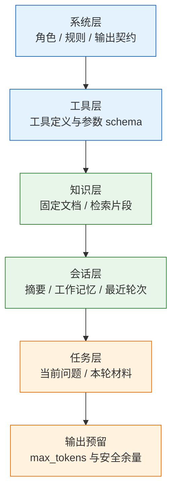
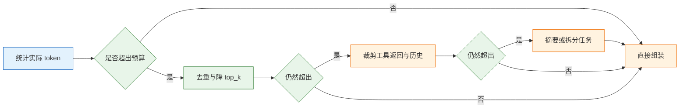

# 上下文工程

---

## 一、上下文工程是什么

### 1.1 核心概念

上下文工程（Context Engineering）是对模型单次调用可见信息的选择、组织、压缩与版本化管理。它处理的不是“怎么措辞”，而是“这一轮让模型看见什么、看见多少、按什么顺序看见”。

上下文窗口不是仓库，而是工作台。桌面上放什么、放几份、哪份压在最上面，决定这一轮能做什么；窗口变大只是桌面变大，不会自动让重要文件浮上来。

同一个模型、同一句问题，换一组上下文，答案可以从“准确引用第 3 条”变成“泛泛而谈”。差别集中在三个决策：

| 决策 | 要回答的问题 | 失败后的表现 |
|---|---|---|
| 给什么 | 哪些资料与当前问题相关 | 答案空泛或答非所问 |
| 给多少 | 关键几段，还是几十段噪声 | 关键段被淹没，成本上升 |
| 放哪里 | 开头、结尾，还是长文中段 | 约束与证据被忽略 |

上下文工程与提示工程的分工是：提示词规定“怎么问、按什么标准答”，上下文决定“依据什么答”。两者都影响结果，但修改位置不同，排障时必须先分清。

它不解决三类问题：资料本身不存在，检索不到就是没有，堆更多无关文本只会更差；模型能力上限，需要多步推理的任务不会因为资料变多而自动分解；成本约束，上下文越长，每轮越贵，而且随轮次累积。

> **注意**：上下文长度与答案质量不是单调关系。相关资料增加通常有益，无关资料增加会稀释关键信息，并提高模型误用材料的概率。判断依据只能用固定样本实测，不能按“塞得下就塞”处理。

### 1.2 与相邻技术的关系

上下文工程位于检索、记忆、提示词、缓存和模型能力之间。它从这些系统取材料，再把材料组织成一次调用的输入。

| 技术 | 解决的问题 | 与上下文工程的关系 |
|---|---|---|
| 提示工程 | 任务如何表达、输出如何约束 | 消费上下文，不决定材料来源 |
| 检索增强 | 从外部知识库取相关片段 | 提供候选材料，需重排与去重 |
| 会话记忆 | 跨轮次保留目标与结论 | 提供状态，需压缩后注入 |
| 前缀缓存 | 复用重复前缀，降低费用与延迟 | 约束上下文的排列顺序 |
| 微调 | 把领域模式写入权重 | 减少示例依赖，不替代事实材料 |

常见误区是把“窗口大”当成“读得全”。窗口只保证内容能放进去，不保证模型均等使用；也不保证费用可接受。另一个误区是把检索结果直接拼进提示，跳过选择、去重、排序，等于把检索系统的误差原样传给模型。

### 1.3 组成结构

一次调用的上下文可以按稳定性分层：越稳定的内容越靠前，越动态的内容越靠后。这个顺序同时服务两个目标：模型阅读时先看到规则，缓存系统复用时命中前缀。



各层的职责与变化频率不同：

- **系统层**：角色、硬规则、输出契约。每轮都发，内容基本不变，是缓存的主要对象。
- **工具层**：工具名、描述、参数 schema。按意图动态挂载，顺序必须稳定。
- **知识层**：固定知识库与检索片段。检索片段每轮变化，是预算的主要消耗项。
- **会话层**：摘要、结构化状态、最近若干轮。随轮次增长，需要压缩策略。
- **任务层**：当前问题与本轮输入。必须紧贴生成位置，不能被长材料推到中段。
- **输出预留**：为回答保留的 token。预留不足会导致答案截断，且无法通过重试补救。

> **注意**：输入与输出共用同一个窗口。预算时先扣掉输出预留与安全余量，再分配各输入区块；只按“窗口上限”塞输入，长回答必然被截断。

---

## 二、上下文窗口的结构

### 2.1 窗口构成

窗口由消息、工具定义、材料块和输出额度共同占用。不同部分的计费方式与变化频率不同，优化手段也不同。

| 部分 | 内容 | 变化频率 | 计费特征 |
|---|---|---|---|
| 系统提示 | 角色、规则、契约 | 低 | 每轮固定支出 |
| 工具定义 | 名称、描述、参数 | 中 | 每轮固定支出 |
| 示例 | 少样本输入输出 | 低 | 每轮固定支出 |
| 检索资料 | 文档片段、引用编号 | 高 | 随结果波动 |
| 对话历史 | 用户与助手消息 | 高 | 随轮次累积 |
| 输出预留 | 回答长度上限 | 低 | 按实际生成计费 |

系统提示与工具定义属于“固定成本”，优化一次，所有请求受益；检索资料与历史属于“变动成本”，需要每轮决策。优化顺序应先处理变动成本，因为它的波动远大于固定部分。

### 2.2 预算分配

预算从窗口上限倒推：先扣输出预留，再扣安全余量，剩余部分才分给输入区块。安全余量用于吸收分词误差、工具调用消息和临时追加内容。

| 区块 | 预算上限 | 超限动作 | 设定依据 |
|---|---|---|---|
| 系统提示 | 窗口的 5% 至 10% | 合并规则、移出长说明 | 每轮固定成本 |
| 工具定义 | 窗口的 5% 至 15% | 按意图分组挂载 | 工具数量与 schema 长度 |
| 示例 | 窗口的 0% 至 15% | 减到 3 条以内 | 任务复杂度 |
| 检索资料 | 窗口的 30% 至 50% | 降 top_k、重排、去重 | 资料密度 |
| 会话历史 | 窗口的 10% 至 25% | 摘要 + 最近轮次 | 任务跨度 |
| 输出预留 | 窗口的 10% 至 20% | 提高预留或缩短要求 | 回答长度 |

比例只是起点，不是标准答案。表中各区块上限是独立约束，不能相加后同时取满；实际分配始终受“窗口减去输出预留与安全余量”的总量限制。短问答可以把资料压到 20%，长文分析可以提到 50%；多工具 Agent 的工具层可能超过 15%，此时应减少同时暴露的工具，而不是压缩系统规则。

> **注意**：预算表要用真实 `usage.prompt_tokens` 校准。不同分词器对中文、代码、符号的切分差异很大，按字符数估算只能用于排布，不能用于承诺成本。

### 2.3 超限处置

超限时按固定顺序减载，先删最不影响当前任务的内容。顺序错了会删掉关键证据，留下大量重复背景。

| 超限程度 | 首选动作 | 禁止动作 |
|---|---|---|
| 轻微超出 | 去掉重复段落与低分片段 | 直接截断最后一段 |
| 中度超出 | 裁剪工具返回、压缩历史 | 删系统规则 |
| 严重超出 | 降低 top_k、改用摘要或分次提问 | 把资料切成半句 |
| 极端超出 | 拆分任务，多次调用 | 只提高输出预留 |

减载的目标是“整块取舍”，不是“按字符截断”。一段被切成半句的材料，既不能引用，也可能改变原意。分次提问优于一次塞满：每次只带当前子问题需要的材料，让模型在每轮都有完整证据。



---

## 三、上下文的选择与排序

### 3.1 选择维度

选择材料不能只看向量相似度。相似度高只说明用词接近，不代表能回答当前问题。按五个维度逐项筛查，任何一项不满足都要降权或删除。

| 维度 | 判断问题 | 不满足时的处理 |
|---|---|---|
| 相关性 | 这段能回答当前问题吗 | 相似但答非所问，删除 |
| 权威性 | 官方文档还是用户评论 | 冲突时以官方为准 |
| 时效性 | 有没有更新版本 | 旧版本标日期或删除 |
| 互补性 | 与已选内容重复吗 | 只留信息更全的一条 |
| 可引用性 | 能否给出来源 | 无出处的结论不进事实段 |

一个常见错误是只按相似度取前 10。问“退款多久到账”，检索会把所有含“退款”的段落排前面，包括“退款申请入口”“退款失败原因”，真正写时效的那段可能排第 7。解决办法是元数据过滤加交叉编码器重排，而不是把 top_k 调到 50。

> **安全警告**：检索材料与用户上传文档都可能携带提示注入，例如要求模型忽略规则、输出系统提示或调用工具。材料只能作为数据进入上下文，块内指令一律不执行；进入上下文前还要脱敏，令牌、身份证号、内部地址不得原样拼接，必要时用占位符替换并保留映射表。

### 3.2 去重与冲突

同一文档的相邻块经常高度重叠。选中一块后，把与它字符重叠超过一半的块降权，可以腾出位置给其他文档。重叠阈值是启发式参数，要按文档切分粒度调整。

资料冲突比资料重复更危险。模型不会自动知道哪份文件更新，必须把优先级写进上下文。

| 冲突类型 | 判定依据 | 处理方式 |
|---|---|---|
| 版本冲突 | 发布日期、版本号 | 最新版本优先，旧版标注日期 |
| 来源冲突 | 官方文档与二手转述 | 官方优先，转述仅作补充 |
| 口径冲突 | 统计范围、时间窗口 | 保留两者并注明口径差异 |
| 事实冲突 | 同一字段不同取值 | 标为待确认，不强行二选一 |

> **注意**：冲突材料不能简单都塞进去让模型“自己判断”。模型倾向于选择更靠前或更具体的说法，与真实性无关；优先级规则必须在材料块外显式声明。

### 3.3 位置效应

长上下文里，模型对开头和结尾更敏感，中间段落容易被跳过。这个现象在多项公开评测中被观察到，强度随模型、语言和长度变化，不能当成固定常数。


操作含义有四条：

- **关键约束放开头，并在结尾重复一次**，不要只写在中间。
- **资料在前、问题在后**是默认顺序，让问题紧贴生成位置；若模型习惯先看问题再找资料，可改为问题在前，用固定样本测，不凭感觉。
- **引用编号紧贴资料**，写在段落开头，而不是文末汇总；否则模型引用时对不上号。
- **资料分段并标来源**，每段带标题、编号、日期；一大段连续文本会让模型无法区分边界。

位置效应不是“把重要内容放开头”就结束。资料之间的相对顺序也影响选择：先放直接证据，再放背景，最后放反例；把结论性材料放在中段，等于主动降低它的权重。

---

## 四、上下文的压缩与状态

### 4.1 压缩手段

压缩不是删字，而是保留“下一轮仍然需要的信息”。常用手段各有代价，选择依据是任务跨度与可恢复性。

| 手段 | 做法 | 保留内容 | 主要代价 |
|---|---|---|---|
| 滑窗 | 只留最近 N 轮 | 近期意图 | 早期约束丢失 |
| 摘要 | 旧轮次压成要点 | 结论、数字、未完成项 | 多一次调用，细节丢失 |
| 结构化状态 | 只存字段，不存原文 | 目标、进度、关键值 | 需提前设计 schema |
| 检索 | 需要时再取回片段 | 与当前问题相关的原文 | 依赖检索质量 |
| 工具裁剪 | 只回前 N 条加总数 | 结论与规模 | 可能丢长尾 |

压缩必须留住三样：结论、关键数字、来源标识。丢掉“为什么得出这个结论”，下一轮模型会重新推理，甚至推翻自己。

### 4.2 结构化工作记忆

工作记忆是一段放在系统层的短状态，比原始历史更省，也更稳定。它把“做到哪一步、已知什么、还差什么”写成字段，避免模型翻二十轮历史。

```text
任务：核对 2026-W42 的预算
已完成：查工单（12 单，完成 7）；查预算（apollo 支出 18420.50 / 25000）
待办：生成周报，需引用工单与预算来源
约束：金额保留两位小数；不确定项标「待确认」
```

| 字段 | 内容 | 更新时机 |
|---|---|---|
| 任务 | 当前目标与范围 | 任务切换时 |
| 已完成 | 已确认的事实与数字 | 每轮结束后 |
| 待办 | 未完成项与依赖 | 状态变化时 |
| 约束 | 格式、口径、禁止项 | 需求变更时 |

工作记忆要短，字段要稳定。把整段对话摘要塞进状态，等于换一种形式保留噪声；只写结论不写来源，下一轮又无法核对。

### 4.3 工具返回裁剪

工具返回是上下文膨胀的常见来源。一次查询返回几百条记录，模型真正需要的往往只是总数、前几条样本和分布特征。

| 返回类型 | 裁剪方式 | 必须保留 |
|---|---|---|
| 列表查询 | 前 N 条加总数 | 总数、排序依据、截断说明 |
| 详情查询 | 只留任务相关字段 | 主键、状态、时间 |
| 日志与堆栈 | 首尾各若干行 | 错误类型、关键帧 |
| 表格数据 | 聚合后返回 | 维度、指标、样本量 |

裁剪要显式告诉模型“结果被截断”，否则它会把前 N 条当成全集。分页参数与总数一起返回，模型才能判断是否需要继续查询。

> **安全警告**：上下文中的敏感信息会被模型复述、写入日志或带入下游工具。身份证号、银行卡号、访问令牌、内部地址在进入上下文前必须脱敏或用占位符替换；系统提示与工具返回同样适用，不能因为“只在内部使用”而省略。

---

## 五、多轮会话与前缀缓存

### 5.1 历史增长

每轮都重发全部消息，单轮输入随轮次线性增长，累计输入成本接近轮次平方。十轮之后，账单里大部分是重复内容。

| 策略 | 输入规模 | 主要风险 |
|---|---|---|
| 全量保留 | 随轮次线性增长 | 成本高，旧信息干扰 |
| 只留最近 3 轮 | 基本恒定 | 指代断裂，早期约束丢失 |
| 摘要加最近 3 轮 | 缓慢增长 | 摘要可能丢关键数字 |
| 状态加按需检索 | 最小 | 需要设计状态结构 |

选择策略要看任务是否依赖早期信息。客服会话通常只需最近几轮；长流程审批必须保留目标、已提交材料与审批意见，适合结构化状态。

### 5.2 前缀缓存

不少厂商对重复前缀提供折扣，机制与最小可缓存长度各不相同，具体以所接厂商文档为准。通用做法是把固定内容放最前，动态内容放最后。

```text
✔ [系统提示][工具定义][固定知识库] … [本轮问题]
✘ [时间戳][本轮问题][系统提示][工具定义]
```

| 缓存失效原因 | 表现 | 处理 |
|---|---|---|
| 前缀含时间戳 | 每轮都未命中 | 时间戳移到末尾或移除 |
| 资料每轮重排 | 前缀不断变化 | 固定排序，变动部分后置 |
| 工具顺序变化 | 序列化结果不同 | 按名称排序后序列化 |
| 系统提示拼接随机 ID | 前缀哈希变化 | 随机 ID 放 user 消息 |

缓存命中率低时，先检查前缀是否每轮都在变，再检查请求是否被负载均衡打散到不同节点。缓存是成本优化，不是正确性机制；命中与否不应改变回答内容。

### 5.3 工具定义占用

工具 schema 不是免费的。一个工具的名称、描述与参数，常见占用一百到四百 token；挂十个工具，每轮固定支出就是一两千 token，还会挤占资料。

| 工具数量 | 典型占用 | 建议 |
|---|---|---|
| 1 至 3 个 | 数百 token | 可全部常驻 |
| 4 至 10 个 | 一千至三千 token | 按意图分组挂载 |
| 10 个以上 | 三千 token 以上 | 检索式工具选择或子 Agent |

两个操作手段：按意图分组暴露，客服会话只挂订单查询与退款工具；保持工具顺序稳定，按名称排序后再序列化。动态挂载会让同一句话在不同会话里可用工具不同，排障时必须把当轮工具清单写进日志。

---

## 六、上下文的版本与评测

### 6.1 版本标识

上下文是每轮动态生成的，但生成规则必须可版本化。否则同一个问题两次结果不同，无法判断是模型波动还是材料变化。

| 字段 | 说明 | 记录位置 |
|---|---|---|
| `context_version` | 拼装规则版本 | 调用日志 |
| `retrieval_config` | top_k、阈值、重排模型 | 调用日志 |
| `doc_ids` | 本轮引用的材料编号 | 调用日志 |
| `context_hash` | 拼装结果的哈希 | 调用日志 |

除上述字段，还要记录压缩策略、历史轮数、工具清单与输出预留。上下文版本与提示词版本分开管理，排障时才能定位是“规则变了”还是“材料变了”。

### 6.2 评测样本设计

上下文评测关注“材料是否被正确使用”，不是只看最终答案像不像。样本要覆盖材料充分、材料不足、材料冲突、材料超长五类情形。

| 样本类型 | 构造方式 | 观察指标 |
|---|---|---|
| 单证据 | 只有一段能回答问题 | 是否引用正确段落 |
| 多证据 | 需要合并两段以上 | 是否覆盖全部要点 |
| 无证据 | 资料中不存在答案 | 是否拒答而非编造 |
| 冲突证据 | 两段给出不同结论 | 是否按优先级取舍 |
| 超长材料 | 关键段位于中段 | 是否仍然找到 |

单证据样本用于验证基本引用能力，无证据样本用于验证拒答，冲突样本用于验证优先级规则。三类都通过，才能说明上下文组织有效。

### 6.3 评测记录表

评测记录按“上下文版本 × 样本集”一行，指标分开记录。不要只写一个“准确率”，否则无法看出是检索没选到、排序放错，还是模型不会用。

| 版本 | 样本集 | 关键段命中 | 引用正确 |
|---|---|---|---|
| `ctx-v1.0` | `meeting-20` | 按实际运行填写 | 按实际运行填写 |
| `ctx-v1.1` | `meeting-20` | 同上，中段样本单列 | 同上 |

配套记录 token 用量与延迟：输入 token 中位数、超预算比例、首字延迟。上下文优化如果只降低成本却让引用正确率下降，属于退化，不应发布。

> **注意**：评测样本与示例材料必须隔离。把评测问题对应的段落放进少样本示例，模型会记住答案，指标虚高，线上换一批材料立即失效。

---

## 七、上下文拼装与完整示例

### 7.1 拼装模板

拼装结果按固定区块输出，区块标题与顺序不变。模型能据此区分规则、材料、状态与问题，日志也能按区块统计占用。

```text
【系统规则】
[角色、硬约束、输出契约]

【工作记忆】
[任务、已完成、待办、约束]

【参考资料】
[1] 标题｜来源｜日期
正文……

[2] 标题｜来源｜日期
正文……

【对话历史】
user: ……
assistant: ……

【当前问题】
[本轮问题]

【输出要求】
[格式、长度、引用方式]
```

区块之间用空行与固定标题分隔，不用连续分隔线。材料块内的编号必须与引用要求一致，模型只能引用给定编号。

### 7.2 拼装实现

下面的实现按预算装填：资料按分数从高到低整块放入，放不下就跳过；历史从最近往前取；输出预留单独扣除。

```python
def est_tokens(text: str) -> int:
    """粗估：中文约 1 字 1 token，英文约 3.5 字符 1 token。只用于预算。"""
    cjk = sum(1 for ch in text if "\u4e00" <= ch <= "\u9fff")
    other = len(text) - cjk
    return int(cjk + other / 3.5) + 8

def build_context(system: str, docs: list[dict], history: list[dict],
                  question: str, window: int = 16000,
                  out_reserve: int = 2000) -> str:
    budget = window - out_reserve
    used = est_tokens(system) + est_tokens(question)
    picked = []
    for d in sorted(docs, key=lambda x: -x["score"]):
        t = est_tokens(d["text"])
        if used + t > budget:
            continue          # 放不下整块跳过，不硬切
        picked.append(d)
        used += t
    hist, hused = [], 0
    for m in reversed(history):
        t = est_tokens(m.get("content") or "")
        if used + hused + t > budget:
            break
        hist.append(m)
        hused += t
    hist.reverse()
    blocks = [f"[{i}] {d['title']}\n{d['text']}"
              for i, d in enumerate(picked, 1)]
    return (system + "\n\n【参考资料】\n" + "\n\n".join(blocks)
            + "\n\n【对话历史】\n"
            + "\n".join(f"{m['role']}: {m.get('content') or ''}" for m in hist)
            + "\n\n【当前问题】\n" + question)
```

| 参数 | 含义 | 调整依据 |
|---|---|---|
| `window` | 模型窗口上限 | 以厂商文档为准 |
| `out_reserve` | 输出预留 | 回答长度与截断风险 |
| `score` | 资料相关性分数 | 重排结果，不是原始相似度 |
| `history` | 历史消息 | 已按时间正序传入 |

估算只用于预算，真实计费看响应中的 `usage.prompt_tokens`。估算偏低时先调大输出预留，不要等接口报超限才发现。

### 7.3 完整示例：会议记录问答

输入是一份一万八千字的会议转写，问题是“上线时间为什么从十月推到十一月”。整篇塞入容易得到“为了更充分测试”这类概括，正确做法分四步。

1. **切段**：按发言人与议题切分，每段带时间戳、说话人、议题标签。
2. **检索**：用“上线”“延期”“风险”等词召回，取 8 段，去重后剩 5 段。
3. **排序**：明确提到日期的两段放最前，背景讨论放后面，问题放最后。
4. **引用**：每个结论后标段号，对不上就回答“记录中没有明确说明”。


目标输出形态：

```text
结论：上线从 10-19 推到 11-02，原因是支付回调联调未通过 [2]。
依据：10-14 的评审记录提到「回调签名验签失败，需重联」[2]；
      10-16 的日报确认「延期两周」[4]。
未确认：是否影响灰度范围，记录中未提及。
```

同一份记录，塞全文得到“概括”，选段加引用得到“可核对的结论”。前者读起来更顺，后者才能拿去开会。差别不在模型，而在材料是否被选中、排序、编号。

---

## 八、上下文反模式

### 8.1 反模式对照

| 反模式 | 表现 | 后果 | 替代做法 |
|---|---|---|---|
| 全量灌入 | 能塞多少塞多少 | 关键段被淹没 | 按预算选择与重排 |
| 只按相似度 | top_k 越大越好 | 噪声与重复上升 | 元数据过滤加去重 |
| 硬切文本 | 按字符截断资料 | 语义残缺，无法引用 | 整块取舍或分次提问 |
| 历史全留 | 每轮重发全部消息 | 成本按轮次累积 | 摘要加最近轮次 |
| 前缀变动 | 时间戳放最前 | 缓存不命中 | 固定内容前置 |
| 来源缺失 | 材料无编号无日期 | 无法核对与追责 | 每段标来源与编号 |

### 8.2 改造顺序

| 步骤 | 动作 | 验证方式 |
|---|---|---|
| 1 | 打印实际上下文，统计各区块 token | 与 usage 对齐 |
| 2 | 去掉无关与重复材料 | 关键段仍在 |
| 3 | 给材料编号并绑定引用 | 引用可回查 |
| 4 | 关键约束前置并在结尾重复 | 约束类样本通过 |
| 5 | 压缩历史，注入工作记忆 | 多轮任务不丢目标 |
| 6 | 固定前缀顺序，测缓存命中 | 命中率与费用变化 |

> **注意**：改造顺序不能颠倒。先压缩历史再检查材料，会把“材料没选对”误判成“历史太长”；先调提示词再检查上下文，会把“没给证据”误判成“模型不会”。

---

## 九、常见失败模式与排查

### 9.1 失败模式表

| 现象 | 最可能原因 | 处理 |
|---|---|---|
| 答案泛泛而谈 | 资料太多，关键段被淹没 | 降 top_k，加重排，关键段前置 |
| 引用不存在的段 | 编号与资料未绑定 | 编号写在段首，只允许引用给定编号 |
| 长文中段漏读 | 位置效应 | 关键段放首尾或分次提问 |
| 多轮后忘记约束 | 历史被截断 | 约束放系统层，工作记忆每轮注入 |
| 成本随轮次暴涨 | 全量重发历史 | 摘要加最近轮次，或状态化 |
| 缓存不命中 | 前缀含时间戳或随机 ID | 固定内容前置，动态内容后置 |
| 资料冲突时乱选 | 未规定优先级 | 写明来源与日期优先级 |
| 答案缺主语 | 按字符硬切材料 | 整块取舍，不切句子 |
| 工具结果挤爆窗口 | 返回全量数据 | 只回前 N 条加总数与截断说明 |
| 材料中的指令被执行 | 提示注入 | 材料只作数据，权限收口 |
| 换模型后效果变化 | 位置敏感度不同 | 用同一样本重跑，不照搬顺序 |

### 9.2 处置顺序

1. 打印实际拼出的上下文，确认资料真的进入、顺序正确、编号与引用一致。
2. 用 `usage.prompt_tokens` 核对预算，定位超支区块。
3. 把关键段单独给模型，能答对说明是“没选到或没放对”，不是模型不会。
4. 检查历史与工具返回是否挤占资料，先裁剪变动成本。
5. 最后才调整提示措辞或更换模型，并用同一批样本回归。

> **核心结论**：上下文是预算，不是仓库；先减无关材料，再压历史，最后才动系统规则；关键证据要放对位置、标清来源、留好引用。
