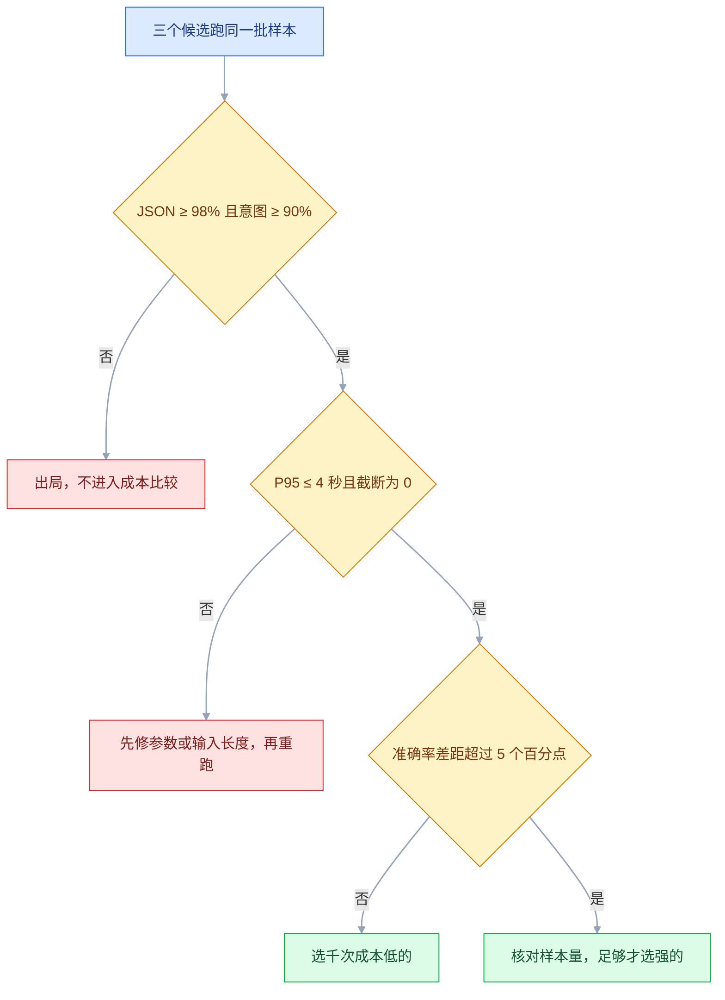
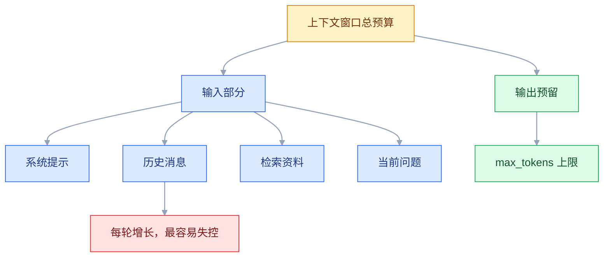
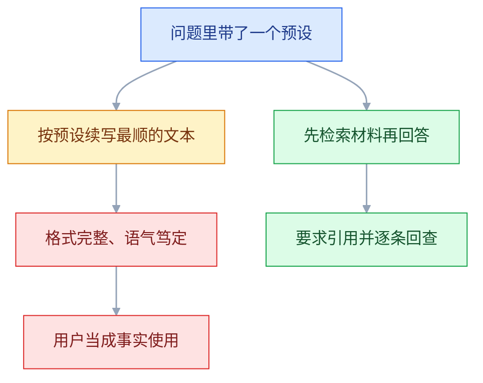

# 大模型基础

## 一、工程案例：给电商客服选一个模型并写出书面结论

**场景**：客服系统要加两个能力——工单意图分类（退款 / 物流 / 投诉 / 咨询）和首响草稿。日均 3000 次调用，要求分类准确率不低于 90%、草稿必须能解析成固定 JSON、单次 P95 延迟低于 4 秒。候选三个模型：一个便宜档、一个中档、一个旗舰档，全部走 OpenAI 兼容端点。

**为什么要跑这一遍**：三个候选的单价差一个数量级，但客服这类任务在便宜档上往往只差一两个百分点。不测就选，要么多花钱，要么上线后返工。**选型的证据只能来自自己的样本，不能来自榜单。**

**产出**：一个可重跑的 `bench/` 目录、一份 `out/report.md`、一句能写进评审会的结论。

```text
llm-bench/
├── .env                 # 两个平台的 Key，不进 Git
├── data/cases.jsonl     # 40 条真实工单（已脱敏）
├── pricing.json         # 单价，从官网价目页抄
├── bench.py             # 跑批 + 打分 + 出报告
└── out/report.md        # 产物
```

### 1.1 准备样本与价目

样本从线上工单里随机抽 40 条，人工标好意图和「回答里必须出现的关键事实」。**必须用真实文本**，自己编的样本测不出真实分布。

```bash
mkdir -p ~/projects/llm-bench/data ~/projects/llm-bench/out && cd ~/projects/llm-bench
git init -q                    # 验收第 1 项要用 git 判断 .env 有没有进仓库
python3.12 -m venv .venv && source .venv/bin/activate
pip install httpx python-dotenv
printf 'DEEPSEEK_API_KEY=sk-xxx\nDASHSCOPE_API_KEY=sk-xxx\n' > .env
echo .env >> .gitignore
```

```json
{"id": "t01", "text": "上周买的键盘坏了，想退，但过了 7 天", "intent": "refund", "must_contain": ["7 天", "检测"]}
{"id": "t02", "text": "快递显示签收但我没收到", "intent": "logistics", "must_contain": ["核实", "补发"]}
{"id": "t03", "text": "客服态度太差了，我要投诉", "intent": "complaint", "must_contain": ["抱歉", "反馈"]}
```

把 40 条按上面的格式写进 `data/cases.jsonl`（一行一条，UTF-8），`wc -l data/cases.jsonl` 应输出 40；少写几条也能跑，但结论的分辨率会跟着下降。

`pricing.json` 里每个候选只放输入、输出两个单价，单位统一成「元 / 百万 token」。**单价一律现查官网，不要沿用别人文章里的数字**；价格没填就写 `0`，报告里会标成「待填价」，不允许拿 0 当结论。

```json
{
  "cheap":  {"in": 0.0, "out": 0.0},
  "mid":    {"in": 0.0, "out": 0.0},
  "strong": {"in": 0.0, "out": 0.0}
}
```

### 1.2 跑批脚本

```python
# bench.py —— 三个候选跑同一批样本，输出可比较的表
import asyncio, json, os, statistics, time
from pathlib import Path

import httpx
from dotenv import load_dotenv

load_dotenv()
ROOT = Path(__file__).parent
CASES = [json.loads(x) for x in (ROOT / "data/cases.jsonl").read_text(encoding="utf-8").splitlines() if x.strip()]
PRICE = json.loads((ROOT / "pricing.json").read_text(encoding="utf-8"))

CANDIDATES = {
    "cheap":  {"base_url": "https://dashscope.aliyuncs.com/compatible-mode/v1",
               "model": "qwen-turbo", "key": "DASHSCOPE_API_KEY"},
    "mid":    {"base_url": "https://api.deepseek.com/v1",
               "model": "deepseek-chat", "key": "DEEPSEEK_API_KEY"},
    "strong": {"base_url": "https://dashscope.aliyuncs.com/compatible-mode/v1",
               "model": "qwen-max", "key": "DASHSCOPE_API_KEY"},
}

SYSTEM = (
    "你是电商客服。只输出一个 JSON 对象，不要代码块、不要解释。字段："
    '{"intent": "refund|logistics|complaint|inquiry", "reply": "给用户的中文回复，80 字内"}'
)


def parse_json(text: str) -> dict | None:
    cleaned = text.strip().strip("`").strip()          # 去掉可能存在的代码围栏
    if cleaned.startswith("json"):
        cleaned = cleaned[4:].lstrip()
    try:
        obj = json.loads(cleaned)
    except json.JSONDecodeError:
        return None
    return obj if isinstance(obj, dict) else None


async def one(client: httpx.AsyncClient, sem: asyncio.Semaphore, name: str, case: dict) -> dict:
    spec = CANDIDATES[name]
    async with sem:                                   # 并发闸门，防止打成 429
        resp = None
        for attempt in range(4):                      # 只重试网络类与 5xx
            start = time.perf_counter()               # 只计本次尝试，退避等待不算延迟
            try:
                resp = await client.post(
                    f"{spec['base_url']}/chat/completions",
                    headers={"Authorization": f"Bearer {os.environ[spec['key']]}"},
                    json={"model": spec["model"],
                          "messages": [{"role": "system", "content": SYSTEM},
                                       {"role": "user", "content": case["text"]}],
                          "temperature": 0, "max_tokens": 300},
                    timeout=httpx.Timeout(60.0, connect=5.0))
            except (httpx.ConnectError, httpx.ReadTimeout):
                await asyncio.sleep(2 ** attempt)
                continue
            if resp.status_code in (429, 500, 502, 503, 504):
                await asyncio.sleep(2 ** attempt)
                continue
            break
        else:
            return {"id": case["id"], "ok": False, "error": "重试耗尽"}
        if resp.status_code != 200:                   # 401/400 等：不重试，也不解析
            return {"id": case["id"], "ok": False, "error": f"HTTP {resp.status_code}"}

        latency = time.perf_counter() - start
        body = resp.json()
        usage = body.get("usage") or {}
        content = (body["choices"][0]["message"].get("content") or "")
        obj = parse_json(content)
        reply = (obj or {}).get("reply", "")
        return {
            "id": case["id"], "ok": resp.status_code == 200,
            "json_ok": obj is not None,
            "intent_ok": bool(obj) and obj.get("intent") == case["intent"],
            "contain_ok": all(k in reply for k in case["must_contain"]),
            "latency": latency,
            "in_tokens": usage.get("prompt_tokens", 0),
            "out_tokens": usage.get("completion_tokens", 0),
            "finish": body["choices"][0].get("finish_reason"),
            "raw": content[:200],
        }


def summarize(name: str, rows: list[dict]) -> dict:
    ok = [r for r in rows if r["ok"]]
    n = max(len(ok), 1)
    lat = sorted(r["latency"] for r in ok)
    p95 = lat[min(len(lat) - 1, int(len(lat) * 0.95))] if lat else 0.0
    in_tok = statistics.mean([r["in_tokens"] for r in ok]) if ok else 0
    out_tok = statistics.mean([r["out_tokens"] for r in ok]) if ok else 0
    p = PRICE[name]
    cost_1k = (in_tok * p["in"] + out_tok * p["out"]) / 1_000_000 * 1000
    return {
        "name": name, "n": len(ok),
        "json_rate": sum(r["json_ok"] for r in ok) / n,
        "intent_acc": sum(r["intent_ok"] for r in ok) / n,
        "contain_rate": sum(r["contain_ok"] for r in ok) / n,
        "p50": statistics.median(lat) if lat else 0.0,
        "p95": p95,
        "in_tok": in_tok, "out_tok": out_tok,
        "cost_1k": cost_1k,
        "truncated": sum(r["finish"] == "length" for r in ok),
    }


async def main() -> None:
    sem = asyncio.Semaphore(5)
    async with httpx.AsyncClient() as client:
        jobs = [(name, c) for name in CANDIDATES for c in CASES]
        results = await asyncio.gather(*(one(client, sem, n, c) for n, c in jobs))
    by_model: dict[str, list[dict]] = {}
    for (name, _), r in zip(jobs, results):
        by_model.setdefault(name, []).append(r)

    rows = [summarize(n, rs) for n, rs in by_model.items()]
    lines = ["| 候选 | JSON 合法率 | 意图准确率 | 关键事实覆盖 | P50(s) | P95(s) | 平均输入 | 平均输出 | 千次成本(元) | 截断数 |",
             "|---|---|---|---|---|---|---|---|---|---|"]
    for r in rows:
        cost = "待填价" if r["cost_1k"] == 0 else f'{r["cost_1k"]:.2f}'
        lines.append(f'| {r["name"]} | {r["json_rate"]:.0%} | {r["intent_acc"]:.0%} | '
                     f'{r["contain_rate"]:.0%} | {r["p50"]:.2f} | {r["p95"]:.2f} | '
                     f'{r["in_tok"]:.0f} | {r["out_tok"]:.0f} | {cost} | {r["truncated"]} |')
    (ROOT / "out/report.md").write_text("\n".join(lines) + "\n", encoding="utf-8")
    print("\n".join(lines))


if __name__ == "__main__":
    asyncio.run(main())
```

```bash
python bench.py && cat out/report.md
```

`latency` 只统计最后一次成功尝试的耗时，重试的退避等待不算进去——否则偶尔一次 429 就能把 P95 顶过门槛线。重试本身要看另外的日志。

跑完得到这样一张表（数字是示例，重跑会变，只示范读法）：

| 候选 | JSON 合法率 | 意图准确率 | 关键事实覆盖 | P50(s) | P95(s) | 平均输入 | 平均输出 | 千次成本(元) | 截断数 |
|---|---|---|---|---|---|---|---|---|---|
| cheap | 97% | 88% | 82% | 0.9 | 1.8 | 410 | 96 | 待填价 | 0 |
| mid | 100% | 93% | 95% | 1.4 | 2.9 | 410 | 118 | 待填价 | 0 |
| strong | 100% | 94% | 96% | 2.6 | 3.6 | 410 | 121 | 待填价 | 0 |

**判定顺序**：先过门槛，再判断差距是否超过噪声，最后才比成本。



**读法**：门槛先卡掉不合格的候选（`cheap` 的意图 88%、JSON 97% 都不过，成本再低也不能用）；过门槛后看差距，40 条样本上 1 个百分点**在噪声范围内**，不构成理由；最后比千次成本，只有差距超过 5 个百分点且样本量足够时才谈「贵一点换质量」；截断数不为 0 说明 `max_tokens` 给小了，先把参数修好再比较，否则测的是参数不是模型。

**写进评审会的结论**（三句话，可直接抄）：

> 40 条真实工单上，`cheap` 档意图准确率 88%、JSON 合法率 97%，未达 90% / 98% 门槛，不适合独立承担分类与草稿。`mid` 与 `strong` 均过门槛，准确率差 1 个百分点、P95 差 0.7 秒，差异不足以支撑数倍单价。**结论：主用 `mid`，`cheap` 仅用于「是否转人工」这类二分类预判，`strong` 保留为复杂投诉的兜底。**

### 1.3 验收（7 项全过才算这份报告可信）

| # | 检查项 | 命令或检查 | 通过标准 |
|---|---|---|---|
| 1 | Key 没进仓库 | `git status --short` 与 `git check-ignore .env` | `.env` 不出现在待提交列表，且被 ignore |
| 2 | 样本是真实的 | 抽查 `data/cases.jsonl` 任意 5 条 | 能对上线上工单号，已脱敏 |
| 3 | 参数一致 | 读 `bench.py` 的请求体 | 三个候选的 `temperature`、`max_tokens`、`system` 完全相同 |
| 4 | 失败没被算成差评 | 在 `summarize` 里临时打印 `len(rows)` 与 `len(ok)` | 两者相等；有失败时单独列出，不混进准确率分母 |
| 5 | 单价已替换 | 打开 `out/report.md` | 成本列不是「待填价」 |
| 6 | 可重跑 | 隔一天再 `python bench.py` | 结论方向不变；若翻转，说明样本量不够 |
| 7 | 截断为零 | 报告最后一列 | 全部为 0 |

> 第 6 项最重要：**一次跑出来的排名不算结论**。同一批样本隔天再跑，如果 `mid` 和 `strong` 互换位置，说明差距小于噪声，正确结论是「两者打平，选便宜的」。

### 1.4 这套方法复用到别的场景

换场景只改三处：`SYSTEM`（输出契约）、`cases.jsonl`（样本与判定字段）、`CANDIDATES`（候选与端点）。判定逻辑从「意图 + 关键词」换成「字段是否齐全」「金额是否一致」「是否引用了材料」都行。

**样本量的边界**：40 条能筛掉明显不合适的候选，**不能证明 1~2 个百分点的差异**。要证明小差距，样本至少几百条，并且要双人标注、算一致性。这一点在评审会上要主动说，否则报告会被当成过度承诺。

---

## 二、高频问答：会卡住你的地方，也是面试最常问的

### 2.1 同一个问题问两次，答案不一样

**现场**

固定 `temperature=0`、`seed`（若支持）连跑 5 次比较输出；再看响应里的 `model` 字段是否与请求一致。

```python
# ask() 是本项目对 /chat/completions 的封装，只透传参数
for i in range(5):
    print(ask("把「我要退款」分类为退款/咨询/投诉，只答类别名", temperature=0))
```

**要点**

- 不是模型坏了，默认 `temperature > 0`，每一步都按概率采样。
- 即使设为 0，批处理顺序、浮点累加、MoE 路由也会带来细微差异。
- 跨厂商、跨版本不可能保证逐字一致；要可复现得同时控制参数、固定提示，并在应用层缓存结果。

**追问**

- 怎么确认后端没偷偷换模型？→ 看 `model` 字段和 `system_fingerprint`（部分厂商提供）。
- `temperature=0` 就是确定性的吗？→ 不是，它只是退化成取概率最高的那个。
- 要逐字一致怎么办？→ 只能缓存结果，别指望重新生成。

### 2.2 编造不存在的条款号、订单号、引用

**现场**

把材料整段删掉再问同一个问题，看它是否照样给出编号和金额。

```python
print(ask("根据《差旅规定》第 17 条，住宿上限多少？"))          # 无材料：编出条款和金额
print(ask("根据材料回答，没有就说未提及。\n【材料】...第 17 条：一线 500 元"))  # 有材料：照抄
```

**要点**

- 不是它记错了训练数据，它在续写「最像答案的文本」，条款号这种高置信格式的占位符最容易被凭空生成。
- 幻觉不是「记错」，是「生成」。
- 核实只有一个办法：要求它给出处，然后逐条回查原文；给不出或对不上，就当没有这条信息。

**追问**

- 给了材料就不会编吗？→ 会，RAG 降低幻觉不消除幻觉，检索错、片段截断都会让它编得更像真的。
- 怎么让它说「不知道」？→ 提示里明确给出这条出路，并给一个固定句式。
- 高风险场景怎么兜？→ 金额、医疗、法律必须有人复核或代码校验。

### 2.3 报 `context_length_exceeded`（HTTP 400）

**现场**

看报错里的 `requested` 与上限；或对实际发出的 `messages` 算 token。

```python
import tiktoken
enc = tiktoken.get_encoding("cl100k_base")     # 仅用于估算，切法与目标模型不同（见 3.1）
total = sum(len(enc.encode(m["content"])) for m in messages) + max_tokens
print(total, "超过窗口就必然 400")
```

**要点**

- 不是模型太小，是输入加预留输出超过窗口，两者共用一个池子。
- 多轮对话里历史每轮都在累加，往往第 10 轮才炸。
- 400 是不可重试错误，重试一百次也一样；要算的是「这次实际发了多少 token」，不是「文档有多长」。

**追问**

- 换更大窗口能解决吗？→ 只是把爆炸点往后推，长会话照样会撞。
- 错误码各厂商一样吗？→ 名字不同（`context_length_exceeded`、`invalid_request_error` 等），以上限字段和报错文案为准。
- 怎么把预算压下来？→ 截断、摘要或改检索，不是调重试次数。

### 2.4 中文预算按英文经验估，月底超支一大截

**现场**

同一句话中英文各发一次，对比 `usage.prompt_tokens`；再用自己的日志汇总与账单对账。

```python
for text in ["请把上个月的订单退款", "Please refund last month's order"]:
    print(len(text), tokens_of(text))     # 字符数与 token 数不成固定比例；tokens_of 用目标模型的分词器，或直接看 usage
```

**要点**

- 不是厂商计费有问题，同一段意思中文的 token 数大约是英文的 1.5~2 倍，具体取决于分词器。
- 按「4 字符 1 token」估中文一定低估。
- 正确做法是用真实请求的 `usage` 建单价模型，不要用字符数乘系数。

**追问**

- 为什么字符数和 token 数不成固定比例？→ 分词器按子词切，不同内容的密度不同。
- 预算要留余量吗？→ 要，`prompt_tokens` 还含角色标记和模板开销，留 5%~10%。
- 估算库能直接当账单吗？→ 不能，`tiktoken` 只是估算，精确值只有 `usage` 给得出。

### 2.5 多轮对话到第三句就「失忆」

**现场**

发请求前打印完整 `messages`，看上一轮问答在不在里面。

```python
print(json.dumps(messages, ensure_ascii=False, indent=2))
# 只有一条 user → 模型当然不知道「那」指什么
```

**要点**

- 不是上下文太短，请求是无状态的，历史没被回传；也可能是滑窗把关键轮次截掉了。
- 另一种常见情况是只传了 `user` 没传 `assistant`，模型看不到自己上一轮说过什么。
- 网页版「记得」是前端每次把历史一起发过去，不是模型的能力。

**追问**

- 为什么模型不知道「那」指什么？→ `messages` 里只有一条 user，没有指代对象。
- 历史会带来什么成本？→ 每轮都重发，第 N 轮要付前 N-1 轮的钱。
- 滑窗怎么裁才不丢关键信息？→ 按完整消息对裁，别把工具调用和结果拆开。

### 2.6 要求输出 JSON，解析经常失败

**现场**

打印原始 `content` 与 `finish_reason`，先看是不是 `length`。

```python
raw = resp.choices[0].message.content
print(repr(raw[:200]), resp.choices[0].finish_reason)
```

**要点**

- 不是模型不听话，输出常被 json 代码块包裹、前后带了「好的，以下是」，或者被 `max_tokens` 截断导致括号没闭合。
- 核实顺序：先看 `finish_reason`，再看有没有多余文字，最后才考虑结构化输出能力或换模型。
- 换模型不解决截断和提示歧义。

**追问**

- `finish_reason=length` 说明什么？→ 输出被截断，任何模型都吐不出完整 JSON。
- 围栏怎么处理？→ 正则剥掉代码块标记再 `json.loads`。
- 怎么从根上稳住？→ JSON 模式或 schema 约束，入口处再做字段与枚举校验。

### 2.7 让它算金额、统计行数，结果差得离谱

**现场**

同一题让它「写出计算过程」和「调用代码算」，对比两个结果。

```python
# 让它输出表达式，由你的代码执行，而不是让它心算
"请只输出 Python 表达式，不要计算结果：订单 3 件，单价 129.9，运费 12"
```

**要点**

- 不是数学不好，数字在模型眼里是 token，不是数值；多位数进位、求和、计数都不是它的强项。
- 反复强调「仔细算」只会让它更自信地写错。
- 凡是金额、税率、库存，一律外部计算。

**追问**

- 让它输出表达式行不行？→ 行，它只输出表达式，由你的代码执行。
- 为什么统计行数也不行？→ 计数同样是逐 token 生成，不是数组运算。
- 怎么验收结果？→ 拿计算器或代码复算，不要看它写的过程。

### 2.8 关键信息在长文中段，模型就是看不见

**现场**

把同一段关键材料分别放开头、中间、结尾各问一次，比较命中率。

**要点**

- 不是上下文够大就能读到，长上下文里中间位置的信息利用率往往明显低于开头和结尾。
- 这是注意力分布的问题，「装得下」不等于「读得到」。
- 工程解法：结论和约束放开头，问题放结尾，中间只放支撑材料。

**追问**

- 那还需要大窗口吗？→ 需要，但预算要按有效信息算，不是按上限算。
- 怎么验证自己的场景？→ 做位置对照实验，看命中率差多少。
- 分块处理能绕开吗？→ 能缓解，代价是跨块关系丢失。

### 2.9 用旗舰做分类，账单翻倍但准确率没涨

**现场**

同一批 50 条样本，两个档位各跑一遍，人工盲评。

**要点**

- 不是「贵有贵的道理」，分类、打标、格式转换这类任务答案空间很小，小模型和旗舰通常只差几个百分点。
- 没有度量就默认「贵=好」，是最容易多花钱的地方。
- 盲评是必须的：不告诉评分人哪条来自哪个模型，否则会被文风带偏。

**追问**

- 差几个百分点算白花钱？→ 先看过不过门槛，再看差距是否超过噪声。
- 样本要多少条？→ 筛掉明显不合适的 40 条够，要证明 1~2 个百分点得几百条。
- 榜单能代替自测吗？→ 不能，榜单题目和业务重合度低，只适合初筛。

### 2.10 问最新政策，答的是旧版本

**现场**

问一个明确发生在截止日之后的事件，看它是否给出旧答案或含糊其辞。

**要点**

- 不是模型在骗人，训练数据有截止日期，之后的事它没有参数化知识，只能用旧模式续写。
- 这不是幻觉，是知识边界。
- 工程上把最新政策放进上下文或检索结果，而不是指望模型自己更新。

**追问**

- 知识截止时间在哪查？→ 厂商文档里的说明，以当前文档为准。
- 参数化知识和上下文知识怎么分工？→ 会变的事实走上下文，通用常识和语言能力靠参数。
- 微调能记住新政策吗？→ 能，但每次知识更新都要重训，不划算。

### 2.11 回答写到一半突然停住

**现场**

看 `finish_reason`，同时看 `completion_tokens` 是否正好等于上限。

```python
if resp.choices[0].finish_reason == "length":
    log.warning("输出被截断，考虑调大 max_tokens 或要求更简短")
```

**要点**

- 不是网络断了，`max_tokens` 到了，`finish_reason` 为 `length`，内容被硬截断。
- 重试还是同样的长度，因为截断是参数决定的。
- 修法：按任务调大 `max_tokens`，同时在提示里约束输出更简短。

**追问**

- 推理模型为什么更容易截断？→ 思考 token 通常也占这个额度。
- 怎么提前发现？→ 把 `finish_reason` 打进日志，出现 `length` 就告警。
- 只调大上限行吗？→ 不行，成本会失控，要和提示约束一起做。

### 2.12 高峰期超时、空响应变多

**现场**

按分钟统计状态码与耗时分布；看厂商状态页；换一个时段复测。

**要点**

- 不是自己的代码有 bug，厂商侧容量紧张或触发限流，表现为 429、5xx、长时间无首字节。
- 只看单次报错看不出趋势，必须拉时间序列。
- 同一分钟内多个请求一起慢，问题在上游；只有某类请求慢，才回头看自己的输入长度。

**追问**

- 怎么区分限流和容量不足？→ 看响应头和错误体，429 带限额信息，5xx 多是上游故障。
- 高峰期要不要加重试？→ 要，但必须退避加抖动，否则把上游打得更惨。
- 降级怎么做？→ 换小模型或压缩 `max_tokens`，先保住可用性。

### 2.13 换个模型名就 400：不支持 `temperature` / `max_tokens`

**现场**

只发 `model` + `messages` 的必填字段，跑通后逐个把参数加回去，哪个触发 400 就是哪个。

```python
body = {"model": spec["model"], "messages": messages}          # 最小请求体先跑通
for extra in ({"temperature": 0}, {"max_tokens": 300}):        # 再逐个加回，定位被拒的字段
    print(extra, probe(body | extra))                          # probe() 发一次请求，返回状态码与 error.message
```

**要点**

- 不是 Key 没权限，部分推理模型不接受 `temperature`、`top_p`，输出上限的字段名也可能从 `max_tokens` 换成 `max_completion_tokens` 一类。
- 多传一个不认识的字段就 400。
- 核实就看 400 的 `error.message`，它通常直接点名哪个字段不认识。

**追问**

- 参数契约是通用的吗？→ 不是，主路径字段大致通用，扩展字段各写各的。
- 字段名和支持范围以什么为准？→ 厂商当前文档，不要沿用旧教程。
- 怎么减少这种返工？→ 最小请求体先跑通，再逐个加回参数。
---

## 三、核心知识：从零开始要建立的东西

### 3.1 分词器与 token

模型不读字符，读 **token**——由分词器（tokenizer）切出来的子词片段。主流做法是 BPE 一类的子词算法：高频词整块保留，低频词拆成更小的片段。

| 内容类型 | 大致密度 | 原因 |
|---|---|---|
| 英文单词 | 一个常见词约 1 个 token，长词拆成 2~4 个 | 词表按词频构建 |
| 中文 | 一个汉字约 1 个 token，常用词可能合并 | 词表里中文条目有限 |
| 代码 / JSON | 每 2~3 个字符约 1 个 token | 缩进、引号、冒号、括号都单独占位 |
| 数字 | 常常一位或几位一个 token | 数字串切分不规则 |

**同一段文本，不同模型的分词器结果不同**，所以 `tiktoken` 只能估算，不能当账单。精确值只有响应里的 `usage` 给得出。

```python
# 估算可以，但要知道它在估
import tiktoken
enc = tiktoken.get_encoding("cl100k_base")   # OpenAI 系的分词器，与你的目标模型无关
print(len(enc.encode("你好，世界")))          # 只代表这个分词器的切法
```

**边界**：聊天接口的 `usage.prompt_tokens` 通常比「消息正文的 token 数」略多，因为还要算角色标记、分隔符和模板开销。做预算时留 5%~10% 余量。

### 3.2 上下文窗口的预算构成

窗口是**输入 + 输出共用的一个池子**，不是「输入额度」和「输出额度」各一份。



| 策略 | 做法 | 代价 | 适用 |
|---|---|---|---|
| 滑窗截断 | 只留 system + 最近 N 轮 | 早期信息直接丢 | 闲聊、短周期会话 |
| 摘要压缩 | 旧对话先总结成一段 | 多一次调用，细节丢 | 长会话、会议记录 |
| 检索 | 只放相关片段 | 要一套检索系统 | 知识库问答 |
| 分块处理 | 长文切块分别处理再汇总 | 跨块关系丢失 | 长文档抽取 |

**边界**：窗口大不等于有效。装得下 20 万字，不代表中间那 2 万字会被读到（见 2.8）。预算应该按「有效信息」算，不是按「上限」算。

### 3.3 下一 token 预测

自回归生成：模型读入已有文本，输出词表上每个 token 的概率，选一个接上去，再把新文本喂回去，循环到结束符或上限。

```text
输入：客服回复应该
概率：先 0.21 / 您 0.18 / 请 0.12 / 我 0.09 ...
选中「先」→ 输入变成「客服回复应该先」→ 再预测下一个
```

这解释了三件事：

1. **流畅不等于正确**：训练目标只奖励「接得像人写的」，不奖励「查证过」。
2. **错误会自我强化**：一旦编出一个订单号，后面的内容会围绕这个假前提继续编。
3. **长度影响成本**：输出是逐 token 生成的，说得越长越贵、越慢。

**边界**：模型没有「先想好整段再写」的默认行为（推理模型是另一套机制，见 3.9）。所以要求「先列要点再展开」确实能改善结果，因为它把思考变成了可见的中间 token。

> **面试**：常问「模型为什么会产生幻觉？」答：它按概率续写最像答案的文本，训练目标奖励「像人写的」，不奖励「查证过」。

### 3.4 采样与温度

概率分布出来后，怎么选下一个 token 由采样参数决定。

| 参数 | 作用 | 典型取值 | 什么时候动 |
|---|---|---|---|
| `temperature` | 对概率做缩放，越高越平 | 抽取 0，客服 0~0.3，创作 0.8~1.0 | 要稳定就调低 |
| `top_p` | 只在累计概率前 p 的候选里选 | 0.9~1.0 | 与温度二选一 |
| `top_k` | 只在前 k 个候选里选 | 部分厂商支持 | 抑制离谱词 |
| `frequency_penalty` | 惩罚已出现过的 token | 0~0.5 | 重复啰嗦时 |
| `presence_penalty` | 惩罚已出现过的话题 | 一般 0 | 想让内容发散时 |
| `seed` | 固定随机种子 | 部分厂商支持 | 需要复现时 |

**温度低不等于确定**：`temperature=0` 通常退化成「取概率最高的那个」，但并行批处理、浮点误差、专家路由仍可能让两次结果不同。**要逐字复现，只能缓存。**

**边界**：温度和 `top_p` 同时大幅调整会互相掩盖效果。调参时一次只动一个，并且用同一批样本对比。

> **面试**：常问「temperature 调到 0 就能复现吗？」答：通常退化成取概率最高的 token，但批处理、浮点误差和专家路由仍可能不同，逐字复现只能缓存。

### 3.5 无状态请求与消息数组

服务端不保存任何会话。每次请求都是一份完整的 `messages`，模型只看这一份。

| role | 谁写 | 作用 | 注意 |
|---|---|---|---|
| `system` | 开发者 | 角色、规则、输出格式 | 放最前，通常一条 |
| `user` | 用户 | 问题、指令、粘贴的材料 | 可多条 |
| `assistant` | 模型 | 之前的回答 | 多轮时必须回传 |
| `tool` | 工具 | 工具执行结果 | 需要工具调用时出现 |

```python
messages = [
    {"role": "system", "content": "你是客服，只答业务问题。"},
    {"role": "user", "content": "退款要几天？"},
    {"role": "assistant", "content": "3~5 个工作日。"},
    {"role": "user", "content": "周五申请呢？"},     # 没有前两条，「周五」就没有指代对象
]
```

**成本含义**：历史每轮都重发，第 N 轮要付前 N-1 轮的钱。10 轮对话的累计输入 token 大致按平方增长，长会话必须做截断或摘要。

**安全含义**：`assistant` 消息是你可以伪造的。如果把用户输入拼进 `assistant` 角色，等于替模型「回忆」了一段它没说过的话。用户输入永远只进 `user`。

### 3.6 幻觉的形成路径



三类最常见的幻觉：

| 类型 | 表现 | 抑制手段 |
|---|---|---|
| 事实幻觉 | 编条款、编人名、编日期 | 检索材料 + 要求引用 + 回查 |
| 引用幻觉 | 给了链接或书名，但不存在 | 只允许引用材料内的编号 |
| 指令幻觉 | 声称「已帮你退款」「已发送邮件」 | 执行动作必须由代码完成，模型只输出意图 |

**为什么「说不知道」很难**：训练语料里「顺着问题往下写」的样本远多于「指出前提错误」的样本。要让它弃权，必须在提示里明确给出这条出路，并给它一个固定句式。

**边界**：RAG 降低幻觉，不消除幻觉。检索错了、片段被截断、多个片段冲突，都会让模型编得更像真的。高风险场景（金额、医疗、法律）必须有人复核或代码校验。

> **面试**：常问「RAG 能消除幻觉吗？」答：只能降低，检索错、片段截断、片段冲突都会让它编得更像真的。

### 3.7 知识截止与检索增强

模型的知识分两种：**参数化的**（训练进权重，会过期、说不清来源）和**上下文的**（这次请求里给的，可追溯）。

| | 参数化知识 | 上下文知识 |
|---|---|---|
| 来源 | 训练语料 | 本次请求的 messages |
| 新鲜度 | 停在截止日 | 你给什么就是什么 |
| 可追溯 | 不能 | 能指到具体段落 |
| 更新成本 | 重新训练或微调 | 改文档即可 |
| 适合 | 通用常识、语言能力 | 公司制度、产品参数、实时数据 |

检索增强的链路是：文档切块 → 向量化入库 → 按问题检索 Top-K → 重排 → 拼进提示 → 要求依据材料作答。**每一环都会引入误差**，检索没召回，后面全错。

**边界**：检索不是万能。问题需要跨多个文档推理、或者答案需要聚合统计时，单靠 Top-K 片段不够，要配合结构化查询或代码计算。

### 3.8 参数规模与能力档位

| 档位 | 典型部署 | 适合 | 不适合 |
|---|---|---|---|
| 小（几 B 到十几 B） | 单卡、量化后更小 | 分类、抽取、格式转换、简单问答 | 多步推理、长文综述 |
| 中（几十 B） | 多卡或云端 | 客服、摘要、常规代码 | 最难的一档推理 |
| 旗舰（百 B 以上或未公开） | 云端 API | 复杂推理、Agent、长文 | 高频简单任务（太贵） |
| 推理特化 | 云端 API | 数学、规划、多步校验 | 低延迟场景 |

两个容易误解的点：

- **参数量不等于能力**：训练数据质量、后训练方法、是否蒸馏，影响都很大。不同家族的 70B 和 30B 完全可能反过来。
- **总参数不等于激活参数**：MoE 架构总参数很大，但每次只激活一部分，所以「大而不慢」是可能的。

**边界**：选型看的是「这个任务上的通过率 + 延迟 + 单价」，参数量只是解释性能差异的一个维度。

### 3.9 推理模型与思考预算

推理模型在给出最终答案前，会先生成一段思考内容（有的厂商通过独立字段返回，有的混在正文里）。这段内容也计费，通常按输出 token 算，具体字段名与计费口径以厂商当前文档为准。

| | 普通模型 | 推理模型 |
|---|---|---|
| 首个答案 token 延迟 | 低 | 高（要先想） |
| 输出 token | 少 | 多（思考部分计入） |
| 适合 | 分类、改写、客服 | 数学、代码调试、多步规划 |
| 不适合 | 简单高频任务 | 低延迟、强格式约束 |

**工程注意**：思考内容可能出现在 `reasoning_content` 之类的扩展字段里，此时 `content` 可能为空。取正文要兜底，日志要分别记两段 token。

**边界**：推理模型不是「更聪明的通用模型」。简单任务上它更慢更贵，效果未必更好；而且思考过程不保证忠实反映真实推理，不要把它当审计依据。

### 3.10 指令遵循与提示结构

提示不是「聊天」，是**规格说明**。稳定的结构通常包含五块：

```text
① 角色与边界：你是谁、只做什么、不做什么
② 输入材料：用分隔符包起来，标明这是资料不是指令
③ 任务：一句话说清要产出什么
④ 输出契约：字段、类型、长度、缺省值
⑤ 弃权规则：材料不足时输出什么
```

| 写法 | 效果 |
|---|---|
| 规则堆在最后 | 容易被长材料淹没 |
| 材料与指令混在一起 | 材料里的「忽略以上」会被当指令 |
| 只写「要准确」 | 无法验收，模型也不知道标准 |
| 给出一个正例 + 一个反例 | 格式稳定性提升最明显 |

**边界**：指令有优先级，`system` 通常高于 `user`，但这不是硬保证。用户输入里的「忽略之前的指令」属于提示注入，必须在应用层隔离，不能只靠提示词防守。

### 3.11 结构化输出的约束层级

从弱到强有四层，可靠性依次上升：

| 层级 | 做法 | 可靠性 | 代价 |
|---|---|---|---|
| 提示要求 | 在提示里写「只输出 JSON」 | 低，常带解释文字 | 无 |
| JSON 模式 | 厂商保证输出是合法 JSON | 中，字段仍可能缺 | 少量兼容性限制 |
| Schema 约束 | 按给定 schema 生成 | 高，字段与类型受控 | 支持的 schema 子集有限 |
| 应用校验 + 重试 | 解析后按业务规则校验 | 最高 | 要写校验与重试逻辑 |

```python
obj = parse_json(raw)
if obj is None or obj.get("intent") not in INTENTS:
    obj = retry_once_with_error_feedback(raw)     # 把错误原因回喂一次
```

**边界**：Schema 约束保证「格式对」，不保证「内容对」。金额、枚举值、外键仍然要业务校验。重试要有上限，否则模型一直错就一直烧钱。各家支持的 schema 子集不同，以厂商当前文档为准。

### 3.12 微调、检索与换模型的分工

| 现象 | 该动哪里 | 原因 |
|---|---|---|
| 不知道公司制度、产品参数 | 检索 | 这是事实问题，权重里没有 |
| 格式总不对、话术不像品牌 | 提示，再考虑微调 | 这是行为问题 |
| 复杂推理做不对 | 换更强的模型 | 微调不会让它变聪明 |
| 太贵 | 换小模型 + 分流 | 成本问题不是能力问题 |
| 输出太长 | `max_tokens` + 提示约束 | 参数问题 |

微调的真实代价：要几百到几万条高质量样本、要评测集、要版本管理，而且**每次知识更新都要重训**。绝大多数「模型不懂我们业务」的问题，检索能解决，不需要微调。

**边界**：微调擅长「稳定风格、固定格式、专有分类体系」，不擅长「注入会变的事实」。用微调记知识，等于把文档烧进权重，更新一次疼一次。

### 3.13 计费口径与成本结构

```text
单次成本 = (命中缓存输入 × 缓存单价 + 未命中输入 × 输入单价 + 输出 × 输出单价) / 1000000
月成本   = 日请求数 × 30 × 单次成本
日请求数 = 日活 × 人均次数 × 重试系数
```

单价单位是「元 / 百万 token」，所以整条公式最后要除以 10⁶；缓存命中与未命中是输入的两个部分，不能相加成两份输入。

| 计费项 | 说明 | 容易踩的坑 |
|---|---|---|
| 输入 | 系统提示 + 历史 + 检索 + 问题 | 历史每轮重发，长会话翻倍 |
| 输出 | 生成的全部 token | 推理模型的思考部分也算 |
| 缓存命中 | 相同前缀可能打折 | 前缀被时间戳打断就失效 |
| 重试 | 成功的重试照常计费 | 失败请求通常不计，但流式中断可能已计 |
| 批处理 | 离线批量通常更便宜 | 有延迟，不能用于实时 |

**边界**：所有单价都随厂商调整，公式稳定、数字不稳定。做预算时把单价做成配置（以厂商当前文档为准），每月核对一次账单；应用侧日志记 `usage`，与账单对不上时先查「有没有漏记流式最后一帧」。

### 3.14 评测集与选型维度

| 维度 | 量化方式 | 通过标准示例 |
|---|---|---|
| 正确性 | 人工标注 + 自动比对 | 意图准确率 ≥ 90% |
| 格式合规 | 解析成功率 | ≥ 98% |
| 忠实度 | 回答是否都能在材料里找到依据 | 无依据句占比 < 5% |
| 延迟 | P50 / P95 | P95 ≤ 4 秒 |
| 成本 | 千次调用费用 | 在预算内 |
| 稳定性 | 同题多次运行的一致率 | ≥ 95% |

**方法上的三个要求**：样本来自真实分布；评分人不知道答案来自哪个模型（盲评）；同一批样本跑两次看结论是否翻转。

**边界**：公开榜单适合初筛，不适合定案。榜单题目和你业务的重合度往往很低，而且存在针对榜单的过拟合。**能在评审会上站住的，只有自己样本上的数字。**

### 3.15 模型版本、别名与弃用

请求里写的模型名常常是**别名**，指向某个具体快照。厂商升级别名时，你的输出可能悄悄变化。

| 概念 | 含义 | 工程动作 |
|---|---|---|
| 别名 | 如 `xxx-chat`，指向当前稳定版 | 生产可用，但要监控输出变化 |
| 快照 | 带日期或版本号的具体权重 | 要求稳定时锁定快照 |
| 弃用 | 老快照下线 | 订阅厂商公告，留切换预案 |
| 响应 `model` 字段 | 实际服务的模型 | 记进日志，对账与排障都要 |

**边界**：锁快照能稳定，但会错过修复；跟别名能拿到改进，但要承担行为漂移。折中是：主链路锁快照，评测环境跟别名，每次别名升级先跑一遍评测集。

### 3.16 多模态输入的基本单位

图片、音频进入模型前会被切成 token 或特征块，计费与上下文占用都按这个单位算。

| 输入 | 计量方式 | 注意 |
|---|---|---|
| 图片 | 按分辨率切块折算 token | 图越大越贵，先压缩到够用 |
| PDF 扫描件 | 先 OCR 或按页转图 | OCR 错字会直接变成错误事实 |
| 音频 | 按秒或特征帧折算 | 长录音先切片 |
| 视频 | 抽帧后按图片算 | 帧率越高越贵 |

**边界**：模型「看见」不等于「读准」。小字、表格线、手写体是弱项；金额、编号这类关键字段要单独校验，或者走 OCR + 规则。

---

## 四、冷门知识汇总

下表都是查一次就能解决的点；会直接卡住请求的故障见第二节。

| 知识点 | 为什么冷门 | 用到时的关键词 |
|---|---|---|
| 聊天模板开销 | 正文之外还有角色标记和分隔符，估算总差一点 | `chat template`、`usage.prompt_tokens` 比正文多 |
| 分词器不一致 | 同一段文本在不同模型上 token 数不同，估算只能近似 | `tokenizer`、`cl100k_base` 只用于估算 |
| 特殊 token | 模型词表里有保留标记，用户输入里出现可能干扰生成 | `special tokens`、`<\|im_start\|>` |
| MoE 的激活参数 | 总参数看着吓人，实际每次只算一部分 | `active parameters`、专家路由 |
| 量化 | 本地部署显存不够时的常规手段，精度有损 | `4bit`、`GGUF`、`AWQ` |
| 蒸馏 | 小模型学大模型的输出分布，便宜且够用 | `distillation`、教师模型 |
| 前缀缓存 | 固定前缀命中后大幅降价，但时间戳会打断前缀 | `prompt caching`、缓存命中价 |
| 思考内容字段 | 推理模型把过程放扩展字段，正文可能为空 | `reasoning_content`、`content is None` |
| 结构化输出的 schema 子集 | 各家支持的字段类型不同，复杂嵌套会退化 | `json_schema`、`strict` |
| 批处理接口 | 离线任务便宜很多，但有完成时限 | `batch`、`24h 内返回` |
| 模型别名漂移 | 名字没变，行为变了，只有对比评测才发现 | `alias`、`snapshot`、`model` 字段 |
| `stop` 与 `logit_bias` | 业务里很少用，但截掉多余尾巴、屏蔽固定脏词很省事 | `stop`、`logit_bias` |
| `finish_reason` 的 `content_filter` | 被安全策略拦下的响应会带着它，`content` 可能为空 | `content_filter`、空回复 |
| `seed` 的复现范围 | 只在同一模型版本内近似，换版本或换批次就失效 | `seed`、快照锁定 |
| 多模态图片计费 | 按分辨率切块，压缩图片能直接省钱 | `image tokens`、`detail` 参数 |
