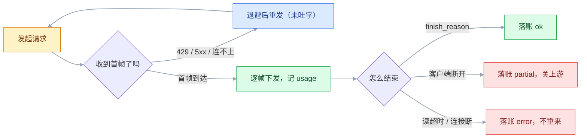
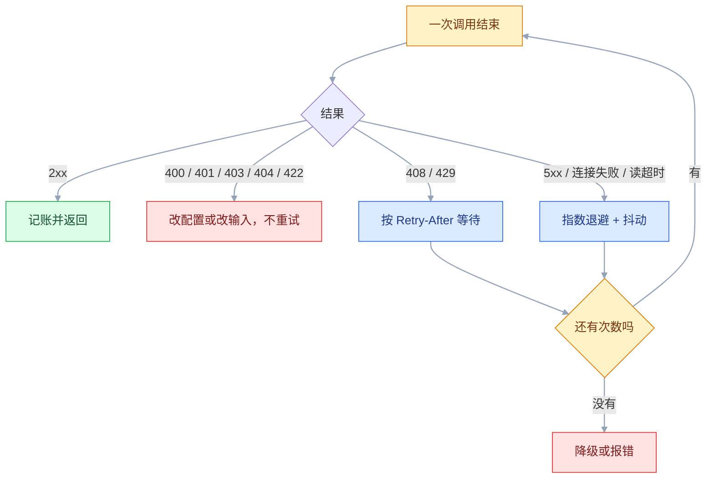
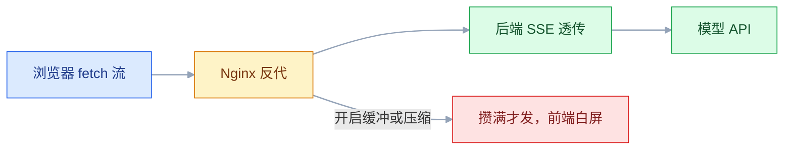

# 模型 API

## 一、工程案例：写一个带流式、重试、超时、token 计费的调用封装

**场景**：内部 AI 助手要上线，前端是网页，后端是 FastAPI。需求很具体：回答要像打字机一样往外吐；网络抖动、限流、上游 5xx 要自动扛过去；长回答不能卡死；每次调用的 token 和费用要能按用户、按模型汇总；月底能和厂商账单对上。

**为什么不能直接 `client.chat.completions.create()` 了事**：裸调用没有超时分层、没有重试分类、没有首字延迟、没有用量落账。上线第一天就会遇到「429 把整个请求打挂」「用户关页面后上游还在生成」「账单比日志多三成」这三件事。

**产出**：一个 `gateway/` 包，对外只暴露 `LLM.chat()` 和 `LLM.stream()`；一份 `out/usage.jsonl` 账本；一套可复现的验收步骤（`cli.py` + 假上游 + 账本）。

```text
llm-gateway/
├── .env                     # 只放本地演示值，进 .gitignore
├── requirements.txt         # httpx fastapi uvicorn
├── gateway/
│   ├── __init__.py
│   └── client.py            # Endpoint + LLM：超时、重试、流式、计费
├── app.py                   # 1.5 的 SSE 透传接口
├── tests/mock_upstream.py   # 假上游：可造 401、400、429 与 SSE 帧
├── cli.py                   # 手工验证入口
└── out/usage.jsonl          # 每次调用一行，运行时生成
```

```bash
printf 'httpx\nfastapi\nuvicorn\n' > requirements.txt   # Python 3.9+
pip install -r requirements.txt
set -a; source .env; set +a        # 把 Key 注入当前进程（cli.py 也会自己读 .env）
```

### 1.1 接口约定与请求形状

```python
# gateway/client.py（类型定义，与本文件其余代码同一模块）
@dataclass(frozen=True)
class Endpoint:
    name: str          # 业务侧别名，进账本
    base_url: str      # 兼容端点前缀，换厂商只改这里
    model: str
    key_env: str       # 环境变量名，不存 Key 本身
    price_in: float    # 元 / 百万 token，抄厂商当前价目页
    price_out: float   # 价格会变，别写死在代码里，用配置注入
```

请求就是一次 POST，四个部分缺一不可：端点路径、鉴权头、JSON 体、超时。

```bash
# 换成你所用厂商的 base_url 与 Key；下面的响应形状以兼容端点为例
curl -sS https://api.deepseek.com/v1/chat/completions \
  -H "Content-Type: application/json" \
  -H "Authorization: Bearer $LLM_API_KEY" \
  -d '{"model":"deepseek-chat",
       "messages":[{"role":"system","content":"你是简洁的客服助手。"},
                   {"role":"user","content":"退款几天到账？"}],
       "temperature":0.3,"max_tokens":200,"stream":false}'
```

```json
{
  "id": "chatcmpl-9f8a...",
  "model": "deepseek-chat",
  "choices": [{"index": 0,
               "message": {"role": "assistant", "content": "一般 3~5 个工作日。"},
               "finish_reason": "stop"}],
  "usage": {"prompt_tokens": 32, "completion_tokens": 12, "total_tokens": 44}
}
```

流式时同一个端点返回的是 SSE 文本流：每帧一个 `data:` 行，**帧与帧之间必须有一个空行**（即 `\n\n`），最后 `data: [DONE]`：

```text
data: {"choices":[{"index":0,"delta":{"content":"一般"}}]}

data: {"choices":[{"index":0,"delta":{"content":" 3~5 个工作日"}}]}

data: {"choices":[{"index":0,"delta":{},"finish_reason":"stop"}]}

data: {"choices":[],"usage":{"prompt_tokens":32,"completion_tokens":12}}

data: [DONE]
```

**四个必须记住的差异**：流式给的是 `delta`（增量）不是 `message`（完整）；`usage` 可能只在最后一帧出现，部分厂商还需要显式请求；`[DONE]` 是纯文本标记，不是 JSON；少数兼容端点根本不发 `[DONE]`，只能靠连接关闭或 `finish_reason` 判断结束。逐项字段以厂商当前文档为准。

### 1.2 封装实现

```python
# gateway/client.py
"""统一调用层：超时分层、分类重试、流式透传、用量落账。"""
import asyncio, json, os, random, time
from dataclasses import dataclass
from pathlib import Path
from typing import Optional

import httpx

MAX_ATTEMPTS = 4
RETRY_STATUS = {408, 429, 500, 502, 503, 504}
TIMEOUT = httpx.Timeout(connect=5.0, read=60.0, write=10.0, pool=5.0)


class Fatal(Exception):
    """不可重试：401/403/400/404，改请求或改配置才有用。"""


class Exhausted(Exception):
    """可重试但这一次没成；wait 是服务端建议的等待秒数。"""

    def __init__(self, msg: str, wait: Optional[float] = None):
        super().__init__(msg)
        self.wait = wait


def backoff(attempt: int) -> float:
    return min(2 ** attempt, 20) + random.uniform(0, 0.5)   # 随机抖动，打散同时重试


def retry_after(headers: httpx.Headers, attempt: int) -> float:
    raw = headers.get("retry-after")
    try:
        return min(float(raw), 30.0) if raw else backoff(attempt)
    except ValueError:
        return backoff(attempt)                              # HTTP 日期格式，解析失败就退回退避


class LLM:
    def __init__(self, ep: "Endpoint", ledger: str = "out/usage.jsonl"):
        self.ep = ep
        self.ledger = Path(ledger)
        self.ledger.parent.mkdir(parents=True, exist_ok=True)
        self.http = httpx.AsyncClient(
            timeout=TIMEOUT,
            limits=httpx.Limits(max_connections=20, max_keepalive_connections=10))

    # ---------- 公共 ----------
    def _url(self) -> str:
        return f"{self.ep.base_url.rstrip('/')}/chat/completions"

    def _headers(self) -> dict:
        key = os.environ.get(self.ep.key_env, "").strip()   # 前后空格是 401 头号原因
        if not key:
            raise Fatal(f"缺少环境变量 {self.ep.key_env}")
        return {"Authorization": f"Bearer {key}", "Content-Type": "application/json"}

    def _record(self, usage: Optional[dict], ttft: Optional[float],
                latency: float, status: str) -> None:
        u = usage or {}
        pin, pout = self.ep.price_in, self.ep.price_out
        # 简化：缓存命中的输入也按原价算，得到成本上限（口径见 3.11）
        cost = (u.get("prompt_tokens", 0) * pin + u.get("completion_tokens", 0) * pout) / 1_000_000
        row = {"ts": time.strftime("%Y-%m-%dT%H:%M:%S%z"), "endpoint": self.ep.name,
               "model": self.ep.model, "in": u.get("prompt_tokens", 0),
               "out": u.get("completion_tokens", 0), "cost": round(cost, 8),
               "ttft": None if ttft is None else round(ttft, 3),
               "latency": round(latency, 3), "status": status}
        with self.ledger.open("a", encoding="utf-8") as f:
            f.write(json.dumps(row, ensure_ascii=False) + "\n")   # 一行一条，进程崩了也不丢

    # ---------- 非流式 ----------
    async def chat(self, messages: list[dict], *, temperature: float = 0.3,
                   max_tokens: int = 600) -> dict:
        payload = {"model": self.ep.model, "messages": messages,
                   "temperature": temperature, "max_tokens": max_tokens, "stream": False}
        start = time.perf_counter()
        for attempt in range(MAX_ATTEMPTS):
            try:
                r = await self.http.post(self._url(), headers=self._headers(), json=payload)
            except httpx.TransportError as exc:      # 连接、读写、协议中断都在这一类
                err = f"{type(exc).__name__}: {exc}"
            else:
                if r.status_code < 400:
                    body = r.json()
                    self._record(body.get("usage"), None, time.perf_counter() - start, "ok")
                    return body
                if r.status_code not in RETRY_STATUS:
                    self._record(None, None, time.perf_counter() - start, f"fatal-{r.status_code}")
                    raise Fatal(f"HTTP {r.status_code}: {r.text[:300]}")
                err = f"HTTP {r.status_code}"
                if attempt < MAX_ATTEMPTS - 1:
                    await asyncio.sleep(retry_after(r.headers, attempt))
                continue
            if attempt < MAX_ATTEMPTS - 1:
                await asyncio.sleep(backoff(attempt))
        self._record(None, None, time.perf_counter() - start, "exhausted")
        raise Exhausted(f"重试 {MAX_ATTEMPTS} 次仍失败：{err}")
    # ---------- 流式（单次尝试） ----------
    async def _stream_once(self, messages: list[dict], temperature: float, max_tokens: int):
        payload = {"model": self.ep.model, "messages": messages,
                   "temperature": temperature, "max_tokens": max_tokens,
                   "stream": True, "stream_options": {"include_usage": True}}
        start = time.perf_counter()
        ttft, usage, status = None, None, "ok"
        headers = self._headers()                         # 缺 Key 直接抛，不落账
        try:
            async with self.http.stream("POST", self._url(), headers=headers, json=payload) as r:
                if r.status_code >= 400:
                    body = (await r.aread()).decode("utf-8", "replace")
                    if r.status_code in RETRY_STATUS:
                        status = f"retry-{r.status_code}"   # 落账时能看出失败类型
                        raise Exhausted(f"HTTP {r.status_code}: {body[:200]}",
                                        retry_after(r.headers, 0))
                    status = f"fatal-{r.status_code}"
                    raise Fatal(f"HTTP {r.status_code}: {body[:200]}")
                async for line in r.aiter_lines():
                    if not line.startswith("data:"):
                        continue                          # 忽略空行、注释行、retry: 行
                    data = line[5:].strip()
                    if data == "[DONE]":
                        break
                    try:
                        chunk = json.loads(data)
                    except json.JSONDecodeError:
                        continue                          # 不完整帧，跳过而不是崩
                    if chunk.get("usage"):
                        usage = chunk["usage"]            # 最后一帧才有，是整次总量
                    for choice in chunk.get("choices") or []:
                        piece = (choice.get("delta") or {}).get("content")
                        if piece:
                            if ttft is None:
                                ttft = time.perf_counter() - start
                            yield piece
        except (asyncio.CancelledError, GeneratorExit):
            status = "partial"                            # 客户端断开：已生成的部分照算
            raise
        except httpx.HTTPError:
            status = "error"                              # 读超时、连接断在流中间
            raise
        finally:
            self._record(usage, ttft, time.perf_counter() - start, status)

    # ---------- 流式（带重试） ----------
    async def stream(self, messages: list[dict], *, temperature: float = 0.3,
                     max_tokens: int = 800):
        """只在「还没向前端吐出任何字符」时重试；已经吐了就绝不重来。"""
        for attempt in range(MAX_ATTEMPTS):
            emitted = False
            inner = self._stream_once(messages, temperature, max_tokens)
            try:
                async for piece in inner:
                    emitted = True
                    yield piece
                return
            except Fatal:
                raise
            except (Exhausted, httpx.TransportError) as exc:
                if emitted:
                    raise                                 # 重来会让用户看到重复内容
                if attempt == MAX_ATTEMPTS - 1:
                    raise
                wait = getattr(exc, "wait", None) or backoff(attempt)
                await asyncio.sleep(wait)
            finally:
                await inner.aclose()                      # 断开就收上游，_stream_once 落 partial

    async def aclose(self) -> None:
        await self.http.aclose()
```

| 部分 | 为什么这么写 |
|---|---|
| `TIMEOUT` 分四段 | 连接 5 秒、读取 60 秒、写 10 秒、连接池 5 秒。只设一个总超时，排障时看不出卡在哪一层 |
| `RETRY_STATUS` | 只有 408/429 和 5xx 值得重试；401/400 重试一百次结果一样 |
| `retry_after` | 服务端给了 `Retry-After` 就听它的，比自己的退避更准；非流式和流式都用它，格式解析失败才退回退避 |
| 抖动 | 固定 1/2/4 秒会让并发请求同时重试，形成第二波峰值；抖动必须是随机的，`attempt % 2` 只是固定错峰 |
| `_record` 追加写 | 一行一条 JSON，进程崩了也只丢最后一行；比内存累加可靠 |
| 失败也落账 | 流式每次尝试都落一行（`retry-429` / `partial` / `error`），否则「重试了 3 次」在账本上完全看不见 |
| 流式重试条件 | 已经发出字符再重试，用户会看到「退款 3~5 天」重复两遍 |
| 内层 `aclose` | 用户关页面时立刻关上游，否则本地停了、厂商还在生成，这一段照计费 |

流式调用其实只有几个状态，重试规则就长在状态转移上：**首字之前的失败可重发，首字之后只能续写或报错**。



### 1.3 用假上游验收

真厂商没法按需造 401、400 和 429，所以写一个假上游；`cli.py` 只是小外壳，内部调 `LLM.chat` 或 `LLM.stream`。

```python
# tests/mock_upstream.py
import asyncio, json, os
from fastapi import FastAPI, Request
from fastapi.responses import JSONResponse, StreamingResponse

app = FastAPI()
KEY = os.environ.get("MOCK_KEY", "sk-test")   # 与 .env 里的 LLM_API_KEY 一致
hits = {"n": 0}

@app.post("/reset")
def reset():
    hits["n"] = 0                             # 让 429 场景可重复跑
    return {"ok": True}

@app.post("/v1/chat/completions")
async def chat(req: Request):
    if req.headers.get("authorization") != f"Bearer {KEY}":
        return JSONResponse({"error": {"message": "invalid api key"}}, status_code=401)
    body = await req.json()
    if sum(len(m.get("content", "")) for m in body["messages"]) > 4000:
        return JSONResponse({"error": {"code": "context_length_exceeded"}}, status_code=400)
    hits["n"] += 1
    if hits["n"] <= 2:                        # 前两次必 429，带 1 秒 Retry-After
        return JSONResponse({"error": {"message": "rate limited"}},
                            status_code=429, headers={"retry-after": "1"})
    if body.get("stream"):
        async def gen():
            for piece in ["一般", " 3~5 个工作日", "到账。"]:
                yield f'data: {json.dumps({"choices": [{"delta": {"content": piece}}]})}\n\n'
                await asyncio.sleep(0.3)
            yield ('data: ' + json.dumps({"choices": [], "usage":
                   {"prompt_tokens": 32, "completion_tokens": 9}}) + "\n\n")
            yield "data: [DONE]\n\n"
        return StreamingResponse(gen(), media_type="text/event-stream")
```

`cli.py` 是最小外壳，负责读 `.env`、装配 `Endpoint`、打印或逐字输出：

```python
# cli.py
import argparse, asyncio, os, sys
from gateway.client import Endpoint, Exhausted, Fatal, LLM

def load_env(path: str = ".env") -> None:
    if os.path.exists(path):
        for line in open(path, encoding="utf-8"):
            line = line.strip()
            if line and not line.startswith("#") and "=" in line:
                k, v = line.split("=", 1)
                os.environ.setdefault(k.strip(), v.strip())

async def main() -> int:
    p = argparse.ArgumentParser()
    p.add_argument("question")
    p.add_argument("--base-url", default=os.environ.get("LLM_BASE_URL", "http://127.0.0.1:9000/v1"))
    p.add_argument("--model", default=os.environ.get("LLM_MODEL", "mock-1"))
    p.add_argument("--stream", action="store_true")
    a = p.parse_args()
    llm = LLM(Endpoint(name="cli", base_url=a.base_url, model=a.model,
                       key_env="LLM_API_KEY", price_in=0.0, price_out=0.0))
    messages = [{"role": "user", "content": a.question}]
    try:
        if a.stream:
            async for piece in llm.stream(messages):
                print(piece, end="", flush=True)
            print()
        else:
            body = await llm.chat(messages)
            print(body["choices"][0]["message"]["content"])
    except (Fatal, Exhausted) as exc:
        print(f"[失败] {type(exc).__name__}: {exc}", file=sys.stderr)
        return 1
    finally:
        await llm.aclose()
    return 0

if __name__ == "__main__":
    load_env()
    sys.exit(asyncio.run(main()))
```

`.env` 只放演示值（真实 Key 不进仓库）：

```bash
LLM_BASE_URL=http://127.0.0.1:9000/v1
LLM_MODEL=mock-1
LLM_API_KEY=sk-test
```

```bash
uvicorn mock_upstream:app --app-dir tests --port 9000 &
curl -s -X POST http://127.0.0.1:9000/reset          # 每次验收前重置
python cli.py --stream "退款几天到账"
tail -n 3 out/usage.jsonl
```

期望看到：前两次 429 各等 1 秒，第三次成功；终端逐字打印「一般 3~5 个工作日到账。」；账本共 3 行——两行 `status: retry-429`（`in/out` 为 0，因为没拿到 usage），一行 `status: ok` 且 `in/out` 为 32/9、`ttft` 接近 0（假上游第一帧立即发出）、`latency` 约 1 秒（两段 0.3 秒 + 请求开销）。真实厂商的 `ttft` 通常几百毫秒，以实测为准。

### 1.4 验收（8 项全过才算能接前端）

| # | 检查项 | 命令或检查 | 通过标准 |
|---|---|---|---|
| 1 | 429 自动恢复 | `curl -X POST :9000/reset` 后跑 `cli.py --stream` | 最终成功，账本新增 3 行（2 条 `retry-429` + 1 条 `ok`），总耗时 ≥ 2 秒（两次各等 1 秒） |
| 2 | 401 不重试 | `.env` 里把 `LLM_API_KEY` 改成 `sk-wrong` | 立即抛 `Fatal`，最新 1 条为 `fatal-401`，不进入重试 |
| 3 | 400 不重试 | `python cli.py "$(python -c 'print("长"*5000)')"` | 抛 `Fatal`，最新 1 条为 `fatal-400` |
| 4 | 首字延迟 | 看账本第 3 行的 `ttft` | `ttft` < 1 秒，`latency - ttft` 与帧数×0.3 秒大致吻合 |
| 5 | 用量落账 | `tail out/usage.jsonl` | 成功行 `in/out` 为 32/9，与最后一帧 `usage` 一致 |
| 6 | 中断不重来 | 流式中途 `Ctrl-C` | 已打印内容不重复；账本出现 `partial`（`kill -9` 时可能来不及落盘） |
| 7 | 超时可观测 | 把 `TIMEOUT` 的 `read` 改成 3 秒，假上游里加 `await asyncio.sleep(5)` | 每次尝试 3 秒失败，4 次后抛 `Exhausted`，账本 `status: exhausted` |
| 8 | 密钥不入日志 | `grep -r "sk-" out/ gateway/ cli.py app.py` | 无命中（`.env` 不在搜索范围） |

> 第 6 项最容易被忽略：**客户端断开后，上游可能还在生成**，token 照算。要么在检测到断开时主动关闭上游连接，要么接受这部分损耗并记进账本，不能当没发生。

### 1.5 接前端：SSE 透传

后端不解析内容，只做转发与记账，把增量重新包成自己的帧格式再写给浏览器（鉴权在进入端点前完成，这里省略）。

```python
# app.py（片段）
import json, os
from fastapi import FastAPI
from fastapi.responses import StreamingResponse

from gateway.client import Endpoint, LLM

app = FastAPI()
# 进程内复用同一个客户端；每请求新建会丢掉连接池，还会多一次 TLS 握手
llm = LLM(Endpoint(name="cs-bot",
                   base_url=os.environ["LLM_BASE_URL"],
                   model=os.environ["LLM_MODEL"],
                   key_env="LLM_API_KEY",
                   price_in=float(os.environ.get("LLM_PRICE_IN", "0")),
                   price_out=float(os.environ.get("LLM_PRICE_OUT", "0"))))

@app.post("/api/chat")
async def chat(body: dict):
    async def gen():
        async for piece in llm.stream(body["messages"]):
            yield f"data: {json.dumps({'delta': piece}, ensure_ascii=False)}\n\n"
        yield "data: [DONE]\n\n"
    return StreamingResponse(gen(), media_type="text/event-stream",
                             headers={"Cache-Control": "no-cache",
                                      "X-Accel-Buffering": "no"})   # 关掉 Nginx 缓冲
```

客户端断开时 `gen()` 被取消或关闭，异常会向上抛进 `LLM.stream()`，`_stream_once` 因此在 `finally` 里落一条 `partial` 并关闭上游连接——不需要再手工 `aclose`。进程退出时调用一次 `await llm.aclose()` 即可。

```bash
uvicorn app:app --port 8000
curl -N -s http://127.0.0.1:8000/api/chat -H 'Content-Type: application/json' \
  -d '{"messages":[{"role":"user","content":"退款几天到账"}]}'
```

`X-Accel-Buffering: no` 是给 Nginx 看的；没有它，Nginx 会攒够一个缓冲区才往下发，前端看起来就是「等了 8 秒，一次全出来」。压缩（gzip）也会造成同样的效果，SSE 响应应显式关闭压缩。

---

## 二、高频问答：会卡住你的地方，也是面试最常问的

### 2.1 401：`invalid api key` / `Authentication Fails`

**现场**

打印 Key 的长度与前 6 位（不要打印全文）；`echo -n "$KEY" | wc -c` 看有没有多余字符。

```python
key = os.environ["LLM_API_KEY"]
print(len(key), repr(key[:6]), key == key.strip())
```

**要点**

- 不是 Key 过期了，九成是复制时带了空格或换行。
- 其次是 `.env` 没加载、变量名写错、`Bearer` 后面少了空格；文案随厂商不同，含义都是「凭证没通过」。
- 401 重试没有意义，最多浪费配额和日志。

**追问**

- 怎么确认变量真的注入到进程了？→ 容器里 `env` 看一眼。
- 确认是 Key 本身的问题怎么办？→ 去平台吊销重建，别把同一个错误再复制一遍。
- 为什么要控制打印内容？→ 日志里的完整 Key 等于泄露，只看长度和前几位。

### 2.2 429：`Rate limit reached` / `insufficient balance`

**现场**

看响应头里的限额与重置时间（`retry-after`、`x-ratelimit-*`）；按秒统计自己的请求数；再读一遍响应体。

```python
if r.status_code == 429:
    raw = r.headers.get("retry-after")
    try:
        wait = float(raw) if raw else 2.0   # 多数是秒数
    except ValueError:
        wait = 2.0                          # 少数是 HTTP 日期，兜底
    await asyncio.sleep(min(wait, 30))
```

**要点**

- 不是加机器、加并发能解决的，已经超过厂商的 RPM/TPM/QPS 限额。
- 也可能是并发突刺，一秒内打完了一分钟的额度；少数厂商余额不足也用 429 表达。
- 加并发只会让 429 更多；余额不足这类重试一辈子都不会成功。

**追问**

- 限额按什么口径算？→ 按请求数还是 token 数，窗口是一分钟还是一天，要先问清。
- 为什么长输入更容易触发？→ 按 TPM 限流的平台，长输入更早撞线。
- 余额不足怎么处理？→ 充值或降级，不是退避。

### 2.3 流式接口写好了，前端就是不吐字

**现场**

`curl -N` 直连后端看是否逐字输出；再经过 Nginx 看是否变成一次性输出。

```bash
curl -N -s http://127.0.0.1:8000/api/chat -H 'Content-Type: application/json' -d '{"messages":[...]}'
```

**要点**

- 不是后端流式没生效，中间层在缓冲：Nginx 的 `proxy_buffering`、gzip、CDN、前端读的是 `response.text()`。
- 核实要逐层缩短链路：直连后端 → 过 Nginx → 过 CDN → 浏览器。
- 哪一层开始变成一次性输出，问题就在那一层。

**追问**

- Nginx 怎么关缓冲？→ `proxy_buffering off` 加响应头 `X-Accel-Buffering: no`。
- 压缩为什么也影响？→ gzip 会攒块，SSE 响应要显式关闭压缩。
- 前端怎么改？→ 用 `response.body.getReader()` 逐块读，不能用 `response.text()`。

### 2.4 流到一半断了，用户看到半句话

**现场**

账本里找 `status: partial` 的记录；对比上游请求日志与账单。

```python
# 端点：async def chat(body: dict, request: Request)
async def gen():
    async for piece in llm.stream(messages):     # messages 来自请求体
        yield f"data: {json.dumps({'delta': piece}, ensure_ascii=False)}\n\n"
        if await request.is_disconnected():
            break      # 退出生成器 → 上游连接被关闭 → 账本落 partial
```

**要点**

- 不是纯网络问题，上游超时、连接被中间设备掐断、或客户端关闭页面都会这样。
- 此时上游可能已生成完整回答并计费，断连有三笔账：用户拿半截、你付全款、重试可能再付一次。
- 产品策略要提前定：提示「回答中断，点击继续」，还是重新生成。

**追问**

- 怎么让上游立刻停？→ 检测到断开就退出生成器，上游连接跟着关闭。
- 已生成的部分还算钱吗？→ 算，账本必须落 `partial`。
- 能自动重试吗？→ 不能，会重复内容，也会重复计费。

### 2.5 长回答必超时：`httpx.ReadTimeout`

**现场**

记录耗时与输出 token 的关系，看是否集中在长回答上。

```python
# 读超时是「两次收到数据之间」的上限，不是总时长
httpx.Timeout(connect=5.0, read=60.0, write=10.0, pool=5.0)
```

**要点**

- 不是把 `timeout` 调到 300 秒就行，非流式要等整段生成完才返回，回答越长越容易撞读超时。
- `read` 管的是相邻两次读之间的间隔，不是总时长；流式下每来一帧就重置。
- 所以改流式比调大超时更有效，后者只会让故障恢复变慢。

**追问**

- 怎么区分连不上和连上了没数据？→ 看是 `connect` 还是 `read` 先超时。
- 流式下同一份超时为什么更宽松？→ 每帧到达都会重置 `read` 计时。
- 非流式又必须用怎么办？→ 按输出长度给 `read` 留够预算，并把耗时与 token 数记进日志。

### 2.6 `message.content` 是 `None`

**现场**

打印完整 `message` 对象，看有哪些字段。

**要点**

- 不是模型返回了空，思考型模型把过程放在独立字段（如 `reasoning_content`，字段名以厂商文档为准），正文可能为空。
- 也可能是模型选择了工具调用，内容在 `tool_calls` 里。
- 代码里统一写 `content or ""` 兜底，再看有没有 `tool_calls`。

**追问**

- 怎么确认是工具调用？→ 看 `finish_reason` 是否为 `tool_calls`。
- 思考内容会逐帧给吗？→ 不一定，也可能只在单独字段，先抓一帧完整报文再写解析。
- 换个模型能解决吗？→ 不能，这是字段位置问题，不是能力问题。

### 2.7 Key 写进前端，第二天被刷爆

**现场**

打开 DevTools 的 Network 面板，看请求头里有没有 `Authorization: Bearer sk-`。

**要点**

- 不是「打包压缩后看不到」，浏览器里的任何字符串用户都能看到。
- Key 一旦离开服务器就等于公开。
- 正确结构是前端调自己的后端，后端持有 Key、做鉴权与配额，再转发给厂商。

**追问**

- 泄露后的第一动作是什么？→ 去平台吊销，不是改代码。
- 后端放环境变量就绝对安全吗？→ 不是，能读进程环境的人就能拿到，真正隔离要靠密钥管理服务。
- 怎么防再犯？→ `.env` 进 `.gitignore`，上线前全仓搜一遍 `sk-`。

### 2.8 并发跑批，一个失败全批崩

**现场**

看异常栈是不是来自某一个请求；统计成功数是否远小于总数；再看上游日志里是否其实有大量成功调用。

```python
results = await asyncio.gather(*(one(c) for c in cases), return_exceptions=True)
ok = [r for r in results if not isinstance(r, BaseException)]
```

**要点**

- 不是 `gather` 不好用，它默认在第一个异常时立刻向上抛。
- 其余任务并不会被取消，会继续跑完，但结果已经拿不到了，整批看起来「全崩」。
- 批量任务要「部分成功」，就得显式 `return_exceptions=True`，再逐条分类重试。

**追问**

- 为什么判断要用 `BaseException`？→ `CancelledError` 也会混进结果，它不是 `Exception` 的子类。
- 其余任务真的停了吗？→ 没有，继续跑完并计费，所以账本会多出消耗。
- 怎么统计真实失败率？→ 统计失败数与失败类型，不是看总耗时。

### 2.9 流式调用拿不到 `usage`，账单对不上

**现场**

抓最后一帧看有没有 `usage`；账本里流式记录的 `in/out` 是否为 0。

```python
payload["stream_options"] = {"include_usage": True}
```

**要点**

- 不是厂商多算了钱，流式默认不返回用量，需要显式请求（如 `stream_options.include_usage`）。
- 它只在最后一帧出现，那一帧的 `choices` 是空数组。
- 先补采集，再谈对账。

**追问**

- 为什么账本里是 0？→ 在 `finish_reason` 那一帧就 `break` 了，没等到后面的 `usage` 帧。
- `usage` 要多帧累加吗？→ 不要，它是整次请求的总量，累加会翻倍。
- 端点不理这个字段怎么办？→ 少数兼容端点会忽略或直接 400，这时只能把用量标成「未知」。

### 2.10 回答被截断，`finish_reason` 是 `length`

**现场**

看 `finish_reason`，再看 `completion_tokens` 是否等于上限。

**要点**

- 不是模型能力不行，`max_tokens` 到了上限；流式下也会静默停止，不报错。
- 推理模型的思考 token 通常也占这个额度。
- 修法按任务给足上限，同时在提示里约束长度，两者要一起做。

**追问**

- 只调大上限行吗？→ 不行，成本会失控。
- 推理模型为什么要多留额度？→ 否则正文还没开始就被截断。
- 怎么监控？→ 把 `finish_reason` 打进日志，出现 `length` 就告警。

### 2.11 400 报上下文超长，重试了很多次

**现场**

报错里通常带 `context_length_exceeded`；算一下实际发送的 token。

**要点**

- 不是「重试几次也许就过了」，输入加输出超过窗口是确定性错误，重试结果完全一样。
- 4xx 改请求，5xx 才重试。
- 上下文超长要先截断、摘要或改检索，不是调重试次数。

**追问**

- 为什么 400 不该进重试集合？→ 请求本身有问题，再发一百次也一样。
- 怎么算这次实际发了多少？→ 对真正发出去的 `messages` 算 token，加上预留输出。
- 截断策略怎么选？→ 滑窗、摘要、分块，看会话长度和是否需要早期信息。
---

## 三、核心知识：从零开始要建立的东西

### 3.1 HTTP 请求的组成

一次模型调用就是标准 HTTPS 请求：客户端组装 JSON，服务端做鉴权与限额检查，然后排队推理，最后一次性返回 JSON 或逐帧返回 SSE。中间任何一环失败，都会以状态码的形式回到客户端。

| 组成 | 内容 | 出错时的表现 |
|---|---|---|
| 方法 + 路径 | `POST /v1/chat/completions` | 404，通常是 `base_url` 多写或少写了 `/v1` |
| 请求头 | `Authorization`、`Content-Type` | 401 / 415 |
| 请求体 | `model`、`messages`、采样参数、`stream` | 400，字段名或类型不对 |
| 超时 | 连接、读取、写入、连接池 | 连接类异常，或长时间无响应 |
| 响应 | JSON 或 SSE 流 | 解析失败、半截内容 |

**边界**：`base_url` 的拼法各家不同，有的带 `/v1`，有的带 `/api/paas/v4`。统一在配置里存完整前缀，代码只拼 `/chat/completions`，不要在两处各拼一半。

### 3.2 消息角色与对话模板

| role | 内容来源 | 作用 | 常见错误 |
|---|---|---|---|
| `system` | 开发者 | 角色、规则、输出格式 | 写成用户口吻，被后续消息覆盖 |
| `user` | 终端用户 | 问题与材料 | 把材料里的指令当可信内容 |
| `assistant` | 模型 | 历史回答、少样本示例 | 用用户输入伪造，等于替模型编记忆 |
| `tool` | 代码 | 工具返回结果 | 与 `tool_calls` 的 id 对不上 |

服务端会把 `messages` 套进**对话模板**（chat template），加上角色标记和分隔符再送进模型。所以消息条数越多、模板开销越多，`prompt_tokens` 会略大于正文之和；不同厂商的模板不同，同一段对话的 token 数也不同。

**边界**：角色是「约定」不是「权限」。模型可能被用户输入说服而偏离 `system`，真正的权限控制必须在代码里做。

### 3.3 兼容协议的范围

OpenAI 风格的 `/chat/completions` 已成为事实标准，但「兼容」有明确边界。

| 层面 | 是否通用 | 说明 |
|---|---|---|
| 端点路径 | 通用 | `/chat/completions`，前缀各家不同 |
| 请求字段 | 大部分通用 | `model`、`messages`、`temperature`、`max_tokens`、`stream` |
| 响应结构 | 通用 | `choices`、`message`、`usage`、`finish_reason` |
| 流式格式 | 多数通用 | SSE + `data: [DONE]`，少数端点不发 `[DONE]` |
| 错误码语义 | 大致通用 | 401/429/400/5xx 含义一致，文案不同 |
| 扩展功能 | 不通用 | 思考过程、结构化输出、缓存、批处理参数各写各的 |

**实践原则**：主链路只用公共字段；扩展字段集中在少数函数里，换厂商时只改那一处。**每接一个新端点，先用 curl 打一次，确认它真的兼容**，不要假设。

### 3.4 鉴权与密钥生命周期

| 阶段 | 做法 | 反面做法 |
|---|---|---|
| 生成 | 控制台创建，按用途命名（如 `prod-cs-bot`） | 所有人共用一个 Key |
| 存储 | 服务端环境变量、K8s Secret、云 KMS | 写进代码、写进前端、提交 Git |
| 轮换 | 定期换，旧 Key 观察一段时间再删 | 一年不换 |
| 泄露 | 立即吊销 + 查账单 + 排查调用来源 | 只改本地文件 |

**边界**：环境变量不是绝对安全，能读进程环境的人就能拿到。真正隔离要靠密钥管理服务和最小权限；本地 `.env` 只用于开发，且必须在 `.gitignore` 里。

### 3.5 响应结构与结束原因

| 字段 | 含义 | 必须检查 |
|---|---|---|
| `id` | 请求唯一标识 | 报障时提供给厂商 |
| `model` | 实际服务的模型 | 可能与请求别名不同，记日志 |
| `choices[0].message.content` | 正文 | 可能为空 |
| `choices[0].finish_reason` | 结束原因 | `stop` 正常，`length` 截断，`tool_calls` 要调工具 |
| `usage.prompt_tokens` | 输入计费口径 | 与自估差异大说明估算有问题 |
| `usage.completion_tokens` | 输出计费口径 | 推理模型的思考部分也计入 |

**边界**：`usage` 是厂商口径，不是你的业务口径。按用户计费时，还要加上你自己的加价、缓存折扣、失败重试的摊销。

### 3.6 SSE 帧格式

SSE 是一条长连接上不断到达的文本行，解析规则只有下面几条。

| 元素 | 作用 | 解析注意 |
|---|---|---|
| `data:` 前缀 | 载荷标记 | 去掉前缀再 `json.loads` |
| 空行 | 帧分隔 | 跳过，不要当结束 |
| `[DONE]` | 流结束 | 纯文本，不是 JSON |
| `delta` | 增量内容 | 可能只有角色、只有 `finish_reason`、或为空 |
| `usage` 帧 | 用量 | 可能 `choices` 为空数组 |
| `retry:` | 重连建议 | 手写解析时忽略 |

**边界**：一个 TCP 包不等于一行，一行也不等于一帧。必须按行缓冲，不能用「读一次 = 一帧」的假设写代码。生产环境用 SDK 或成熟的 SSE 解析库。

### 3.7 超时的四个层次

| 层次 | 管什么 | 典型值 | 症状 |
|---|---|---|---|
| `connect` | 建立 TCP/TLS | 5 秒 | 立刻失败，通常是网络或 DNS |
| `read` | 相邻两次收到数据 | 60 秒 | 连上了但迟迟没内容 |
| `write` | 发送请求体 | 10 秒 | 大请求上传卡住 |
| `pool` | 等连接池空位 | 5 秒 | 高并发下突然大量超时 |

```python
httpx.Timeout(connect=5.0, read=60.0, write=10.0, pool=5.0)
```

**关键区别**：非流式下 `read` 近似等于「等完整回答」；流式下每来一帧就重置，所以同一个 60 秒对流式更宽松。**长回答优先改流式，而不是把超时调到 300 秒**——后者会让故障恢复变慢。

> **面试**：常问「超时为什么不能只设一个总时长？」答：连接、读取、写入、连接池四段独立，只设总时长时卡在 DNS 或连接池的那段不受控。

### 3.8 重试的分类与退避



| 错误 | 重试 | 原因 |
|---|---|---|
| 401 / 403 | 否 | 凭证问题，重试无用 |
| 400 / 404 / 422 | 否 | 请求本身有问题 |
| 408 / 429 | 是 | 临时性，通常带等待提示 |
| 500 / 502 / 503 / 504 | 是 | 上游故障或过载 |
| 连接失败 / 读超时 | 是 | 网络抖动 |
| 已开始输出后的中断 | 否 | 重来会重复内容，只能续写或报错 |

**边界**：重试次数不是越多越好。4 次尝试、累计等待 10 秒以内（1+2+4 秒再加抖动）是常见配置；再长用户已经走了。重试必须有上限、有抖动、有日志，否则故障时会把上游打得更惨。

同一个码在不同厂商语义可能不同，**读响应体的错误信息，不要只看码**：403 多是模型未开通或地域限制，404 多是 `base_url` 或模型名错，429 既可能是「太快」也可能是「余额不足」。除 408/429 这类明确临时的 4xx 之外，其余 4xx 都不重试，5xx 才退避重试。

> **面试**：常问「哪些错误该重试，哪些不该？」答：408、429、5xx 和连接失败可重试，4xx 的参数与鉴权错误不重试，已开始输出后的中断也不重试。

### 3.9 幂等性与重复计费

模型接口本身**不保证幂等**：同一个请求发两次，就是两次生成、两次计费。

| 场景 | 是否会重复计费 | 处理 |
|---|---|---|
| 超时后重试（上游其实已生成） | 可能 | 业务侧幂等键去重，或接受损耗 |
| 429 后重试 | 通常不会（请求被拒） | 正常重试 |
| 流式中断后重连 | 已生成部分照算 | 记录 partial，别盲目重发 |
| 用户双击提交 | 会 | 前端按钮置灰 + 后端幂等键 |

**边界**：厂商侧的 `id` 只能用于对账和排障，不能拿来当幂等键——它是一次请求的标识，不是一次业务意图的标识。幂等要自己在业务层做：用「用户 + 问题」的哈希做键，短窗口内复用结果。

> **面试**：常问「模型接口是幂等的吗？重试会不会重复计费？」答：不幂等，同一次请求发两次就是两次生成两次计费；幂等键要在业务层自己加。

### 3.10 并发控制与限流口径

| 限流口径 | 含义 | 应对 |
|---|---|---|
| RPM | 每分钟请求数 | 控制提交速率，别秒杀 |
| TPM | 每分钟 token 数 | 长输入要单独限，不能只数请求 |
| QPS | 每秒请求数 | 令牌桶平滑 |
| 并发连接 | 同时进行的请求 | 信号量 |
| 日/月额度 | 累计用量 | 预算告警 + 降级 |

**边界**：信号量控的是「同时进行」，不是「每分钟总数」。5 个并发、每个 2 秒，实际是 150 RPM。要同时满足 RPM 和并发限制，得再加一个速率限制器（令牌桶），只压并发数会在长请求上失守。

### 3.11 用量字段与计费口径

```text
单次费用 = 命中缓存输入 × 缓存单价 + 未命中输入 × 输入单价 + 输出 × 输出单价
```

| 字段 | 计费归属 | 注意 |
|---|---|---|
| `prompt_tokens` | 输入 | 含系统提示、历史、检索材料 |
| `completion_tokens` | 输出 | 含推理模型的思考 token |
| `total_tokens` | 两者之和 | 不能直接乘一个单价 |
| 缓存命中 token | 输入（折扣价） | 字段名各家不同 |
| 成功返回的重试 | 各自计费 | 账本要能区分「一次业务请求」和「几次上游调用」 |

**对账方法**：按天汇总账本的 `in/out`，分别乘单价，与厂商账单比。差异超过 5% 就查三件事：流式最后一帧有没有记、失败重试有没有漏记、缓存折扣有没有算错。

### 3.12 前缀缓存机制

多数平台对「相同前缀」有缓存价：system 提示、固定的少样本示例、同一份长文档，命中后按折扣计费。

| 做法 | 效果 |
|---|---|
| 固定内容放最前，变量放最后 | 前缀稳定，命中率高 |
| 提示里插入当前时间戳 | 每次都不同，缓存永远不命中 |
| 把用户问题拼在 system 前面 | 前缀被污染 |
| 长文档每次重发但内容不变 | 适合缓存，省钱明显 |

**边界**：缓存有存活时间（分钟级到小时级），也有最小长度要求。**别为了缓存把变量硬塞到最后导致语义混乱**，先保证正确性。

### 3.13 反向代理与流式透传



要透传流式，四件事必须同时成立：

| 层 | 配置 | 作用 |
|---|---|---|
| 后端响应头 | `Content-Type: text/event-stream` + `X-Accel-Buffering: no` | 声明流，并让 Nginx 不缓冲 |
| Nginx | `proxy_buffering off;` | 关闭代理缓冲 |
| 压缩 | 对 SSE 关闭 gzip | 压缩会攒块 |
| 前端 | 用 `response.body.getReader()` 逐块读 | `response.text()` 会等全部结束 |

**边界**：HTTP/1.1 下浏览器对同一域名有连接数限制，多个流会互相挤占；HTTP/2 好一些，但代理层仍可能缓冲。**上线前一定用真实链路（含 CDN）验一遍**，本地直连通过不算数。

---

## 四、冷门知识汇总

| 知识点 | 为什么冷门 | 用到时的关键词 |
|---|---|---|
| `x-request-id` 响应头 | 平时不看，报障时厂商第一句就问 | `x-request-id`、`request id` |
| `Retry-After` 的两种格式 | 可能是秒数也可能是 HTTP 日期，`float()` 直接崩 | `retry-after`、解析失败要兜底 |
| `stream_options` | 不显式请求就没有用量，账单永远对不上（2.9 有完整例子） | `include_usage`、最后一帧 |
| `max_tokens` 改名 `max_completion_tokens` | 部分新模型/新端点只认新名，报 unknown parameter | `max_completion_tokens`、参数弃用 |
| `finish_reason=tool_calls` | 不接工具时几乎遇不到，一接就绕不开 | `tool_calls`、`tool_call_id` |
| 思考字段 | 正文为空时才知道它存在（2.6 有排查步骤） | `reasoning_content`、`content is None` |
| 结构化输出的严格模式 | 各家支持的 schema 子集不同 | `json_schema`、`strict` |
| 代理环境变量 | 本地能跑、容器里连不上，常是它 | `HTTPS_PROXY`、`NO_PROXY` |
| 连接池上限 | 高并发下大量 `pool timeout` 才发现 | `max_connections`、`pool` |
| SSE 的 `retry:` 行 | 手写解析时会被当成 JSON 报错 | `retry:`、`EventSource` |
| 模型别名漂移 | 名字没变、行为变了，只有对比才看得出 | `alias`、`snapshot` |
| 流式 `usage` 的语义 | 它是整次请求的总量，不是增量，多帧累加会翻倍 | `usage` 帧、累计值 |
| 多模型网关（LiteLLM、One API） | 团队少于 3 个、没有成本归属需求时用不上 | 虚拟 Key、配额、路由降级 |
