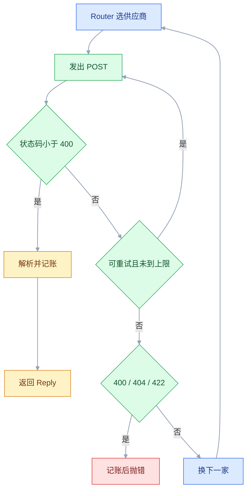
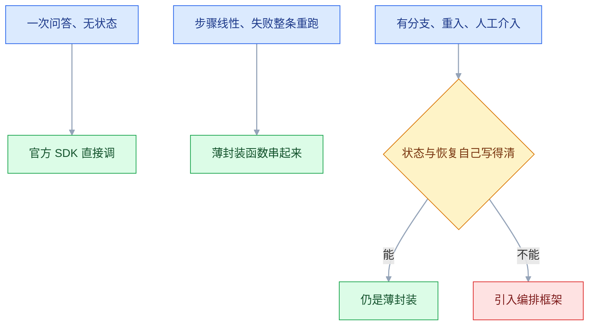

# 模型调用框架

## 一、工程案例：用统一接口封装两家供应商

**场景**：内部工具要同时用 DeepSeek 和通义千问，两家都提供 [OI] 兼容端点。业务代码不该知道「走哪家、字段叫什么、失败要不要重试」。目标是用三百行做一个 `gateway` 包，只暴露 `complete()` 与 `stream()`，内部负责选供应商、超时、退避重试、降级、用量落库。

**为什么值得做**：供应商半年换一次价、三个月换一次模型名。差异收进一个包，业务侧改配置而不是改代码。这件事用官方 SDK 手写就够——先把调用层做干净，再判断要不要往上加编排框架。

**动手前确认**：两个 Key 都能用 `curl` 单独调通，否则分不清是封装错了还是 Key 错了。

### 1.1 目录与依赖

```bash
mkdir -p ~/projects/llm-gateway/{gateway,tests} && cd ~/projects/llm-gateway
python3.12 -m venv .venv && source .venv/bin/activate
printf 'httpx>=0.27\npytest>=8\n' > requirements.txt && pip install -r requirements.txt
printf 'DEEPSEEK_API_KEY=sk-你的密钥\nDASHSCOPE_API_KEY=sk-你的密钥\n' > .env
printf '.env\n*.db\n' > .gitignore && touch gateway/__init__.py
set -a; source .env; set +a      # Python 不自动读 .env，换终端要重跑这一句
```

五个模块：`config.py` 供应商表、`types.py` 统一结构、`client.py` 发请求与重试、`router.py` 降级、`usage.py` 记账。分层只有一个目的：**换供应商只动配置，换重试策略只动 client**。

### 1.2 供应商表：差异只写一次

```python
# gateway/config.py
from dataclasses import dataclass


@dataclass(frozen=True)
class ProviderCfg:
    name: str
    base_url: str          # 不含结尾斜杠
    api_key_env: str
    chat_path: str = "/chat/completions"
    default_model: str = ""
    price_in: float = 0.0   # 元/百万 token，示例值，按官网当前价替换
    price_out: float = 0.0
    stream_usage: bool = True   # 端点不认 stream_options 时置 False


PROVIDERS = {
    "deepseek": ProviderCfg("deepseek", "https://api.deepseek.com/v1",
                            "DEEPSEEK_API_KEY", default_model="deepseek-chat",
                            price_in=2.0, price_out=8.0),
    "qwen": ProviderCfg("qwen", "https://dashscope.aliyuncs.com/compatible-mode/v1",
                        "DASHSCOPE_API_KEY", default_model="qwen-plus",
                        price_in=0.8, price_out=2.0),
}

FALLBACK_ORDER = ["deepseek", "qwen"]
```

三个字段决定成败：`base_url` **带不带 `/v1`**、`chat_path` 对不对、Key 从哪个变量读。这三样写错，报的是 404 或 401，而不是「配置错了」。单价必须按官方当前价填，写死旧价格会让成本报表长期失真，而且没人会发现。`stream_usage` 不是可选项的替代品：少数兼容端点收到不认识的 `stream_options` 会直接 400，这时才置 `False`，代价是流式那次拿不到用量。

### 1.3 统一结构与错误分类

```python
# gateway/types.py
from dataclasses import dataclass


@dataclass
class Usage:
    prompt_tokens: int = 0
    completion_tokens: int = 0

    @property
    def total(self) -> int:
        return self.prompt_tokens + self.completion_tokens


@dataclass
class Reply:
    text: str
    provider: str
    model: str
    usage: Usage
    latency_ms: int
    attempts: int
    finish_reason: str = "stop"

    @property
    def truncated(self) -> bool:
        return self.finish_reason == "length"


class LLMError(Exception):
    def __init__(self, msg, *, status=None, retryable=False):
        super().__init__(msg)
        self.status, self.retryable = status, retryable
        self.attempts = 1        # 抛错前实际发了几次，失败记录也要有这一列
```

**错误分类是这一节的核心**。重试与否不能看异常类型，要看「再发一次有没有可能成功」：

| 情况 | 状态码 / 异常 | 重试 | 理由 |
|---|---|---|---|
| 限流 | 429 | ✅ 退避后重试 | 等一会儿大概率能过 |
| 服务端抖动 | 500 / 502 / 503 / 504 | ✅ | 对端临时故障 |
| 连接失败 | `ConnectError` / `ConnectTimeout` | ✅ | 请求还没发出去 |
| 连接池等待 | `PoolTimeout` | ✅ | 请求还没发出去 |
| 读超时 | `ReadTimeout` | ❌ 默认不重试 | 对端可能已生成并计费 |
| 参数错误 | 400 / 422 | ❌ | 重发一百次也一样 |
| 鉴权失败 | 401 / 403 | ❌ | 换 Key，不是重试 |

这张表就是 `_wrap()` 与 `RETRYABLE` 的全部依据；「超时」不是一类东西，`ConnectTimeout` 和 `ReadTimeout` 的答案相反。

### 1.4 非流式调用与重试

```python
# gateway/client.py
import json, os, random, time

import httpx
from .config import ProviderCfg
from .types import LLMError, Reply, Usage
from .usage import log_call

RETRYABLE = {408, 409, 425, 429, 500, 502, 503, 504}


def backoff(attempt: int, base: float = 0.5, cap: float = 8.0) -> float:
    """指数退避 + 抖动。没有抖动，十个并发会在同一秒一起重试，把限流打成雪崩。"""
    return min(cap, base * 2 ** attempt) * (0.5 + random.random() / 2)


class ChatClient:
    def __init__(self, cfg: ProviderCfg, *, timeout: float = 60.0, max_retries: int = 2,
                 db: str | None = None):
        self.cfg, self.max_retries, self.db = cfg, max_retries, db
        self.http = httpx.Client(
            timeout=httpx.Timeout(timeout, connect=5.0),
            limits=httpx.Limits(max_connections=32))

    def _url(self) -> str:
        return self.cfg.base_url.rstrip("/") + self.cfg.chat_path

    def _headers(self) -> dict:
        key = os.environ.get(self.cfg.api_key_env, "")
        if not key:                  # 配置错误在发请求之前就炸，别浪费一次 401
            raise LLMError(f"缺少环境变量 {self.cfg.api_key_env}")
        return {"Authorization": f"Bearer {key}", "Content-Type": "application/json"}

    @staticmethod
    def _wrap(e: httpx.TransportError) -> LLMError:
        # 只有「对端还没开始处理」的失败才能无条件重发；
        # ReadTimeout 说明请求已送达且可能已生成计费，默认不重试。
        retryable = isinstance(e, (httpx.ConnectError, httpx.ConnectTimeout, httpx.PoolTimeout))
        return LLMError(f"{type(e).__name__}: {e}", retryable=retryable)

    def _post(self, body: dict) -> tuple[dict, int]:
        for attempt in range(self.max_retries + 1):
            try:
                resp = self.http.post(self._url(), headers=self._headers(), json=body)
            except httpx.TransportError as e:
                last = self._wrap(e)
            else:
                if resp.status_code < 400:
                    return resp.json(), attempt + 1
                last = LLMError(f"HTTP {resp.status_code}: {resp.text[:300]}",
                                status=resp.status_code,
                                retryable=resp.status_code in RETRYABLE)
            if not last.retryable:
                last.attempts = attempt + 1
                raise last           # 400、401、ReadTimeout 都在这里停
            if attempt < self.max_retries:
                time.sleep(backoff(attempt))
        last.attempts = self.max_retries + 1
        raise last

    def complete(self, messages, *, model: str = "", temperature: float = 0.3,
                 max_tokens: int = 800) -> Reply:
        model = model or self.cfg.default_model
        t0 = time.perf_counter()
        try:
            data, attempts = self._post({"model": model, "messages": messages,
                                         "temperature": temperature, "max_tokens": max_tokens})
        except LLMError as e:        # 失败也落库，否则「调用数」永远只是成功数
            if self.db:
                log_call(self.db, provider=self.cfg.name, model=model, usage=Usage(),
                         latency_ms=int((time.perf_counter() - t0) * 1000),
                         attempts=e.attempts, ok=0, err=str(e))
            raise
        choice, u = (data.get("choices") or [{}])[0], data.get("usage") or {}
        reply = Reply(text=(choice.get("message") or {}).get("content") or "",
                      provider=self.cfg.name, model=data.get("model", model),
                      usage=Usage(u.get("prompt_tokens", 0), u.get("completion_tokens", 0)),
                      latency_ms=int((time.perf_counter() - t0) * 1000), attempts=attempts,
                      finish_reason=choice.get("finish_reason") or "stop")
        if self.db:
            log_call(self.db, provider=reply.provider, model=reply.model, usage=reply.usage,
                     latency_ms=reply.latency_ms, attempts=reply.attempts, ok=1)
        return reply
```

三个不显眼但必要的写法：`(data.get("choices") or [{}])[0]` 挡住内容审核拦截时返回的空数组；`attempts` 必须返回并落库，否则「平均延迟变高」永远查不出是模型慢了还是重试多了；`finish_reason == "length"` 说明被 `max_tokens` 截断，调用照样成功，但下游 JSON 解析会莫名其妙失败。

记账放在 `complete()` 而不是 Router：请求是这里发出的，失败也只有这里知道发了几次。放在 Router 会漏掉所有没走到降级的情况。

### 1.5 流式调用

流式不是「非流式加个参数」，读响应的方式完全不同：一个拿完整 JSON，一个按行读 SSE 帧。

```python
    def stream(self, messages, *, model: str = "", temperature: float = 0.3,
               max_tokens: int = 800):
        model = model or self.cfg.default_model
        body = {"model": model, "messages": messages, "temperature": temperature,
                "max_tokens": max_tokens, "stream": True}
        if self.cfg.stream_usage:            # 不认这个字段的端点会直接 400
            body["stream_options"] = {"include_usage": True}
        usage = Usage()
        with self.http.stream("POST", self._url(),
                              headers=self._headers(), json=body) as resp:
            if resp.status_code >= 400:
                text = resp.read().decode("utf-8", "replace")[:300]
                raise LLMError(f"HTTP {resp.status_code}: {text}", status=resp.status_code,
                               retryable=resp.status_code in RETRYABLE)
            for raw in resp.iter_lines():
                if not raw.startswith("data:"):
                    continue                     # 空行、event:、注释行都跳过
                payload = raw[5:].strip()
                if payload == "[DONE]":
                    break
                try:
                    chunk = json.loads(payload)
                except json.JSONDecodeError:
                    continue                     # 个别网关会插非 JSON 心跳
                if chunk.get("usage"):
                    u = chunk["usage"]
                    usage = Usage(u.get("prompt_tokens", 0), u.get("completion_tokens", 0))
                for c in chunk.get("choices") or []:
                    if piece := (c.get("delta") or {}).get("content"):
                        yield "delta", piece
        yield "end", usage
```

用事件类型而不是直接吐字符串，是因为**流式默认不返回用量**：要显式传 `stream_options.include_usage`，它出现在最后一帧且 `choices` 为空。分开之后，调用方不会把用量当成正文打给用户。端点不认这个字段时（1.2 的 `stream_usage=False`），末帧就没有用量，此时 `Usage()` 里的零要标成「未知」而不是「免费」。

> 流式**只在吐出第一个字之前**可以重试。前端已显示一半时重发，用户会看到重复内容，而且第二次也计费。

### 1.6 供应商切换与降级

```python
# gateway/router.py
from .client import ChatClient
from .types import LLMError

NON_FALLBACK = {400, 404, 422}   # 请求体/路径错误：换家也是同一个错


class Router:
    def __init__(self, clients: dict[str, ChatClient], order: list[str]):
        self.clients, self.order = clients, order

    def complete(self, messages, **kw):
        errors = []
        for name in self.order:
            try:
                return self.clients[name].complete(messages, **kw)
            except LLMError as e:
                errors.append(f"{name}[{e.status or type(e).__name__}] {e}")
                if e.status in NON_FALLBACK:
                    raise        # 请求体本身有问题，换家也是同样的错
        raise LLMError("全部供应商失败：" + "；".join(errors))

    def stream(self, messages, **kw):
        for name in self.order:
            it = self.clients[name].stream(messages, **kw)
            try:
                first = next(it)          # 首字之前抛错才允许换家
            except StopIteration:
                continue
            except LLMError:
                continue
            yield first
            yield from it
            return
        raise LLMError("全部供应商失败")
```

降级的边界要划清楚：**429 / 5xx / 网络故障 / 401 / 403 可以换家，400 / 404 / 422 不能**。401 能换是因为两家的 Key 各管各的；但如果 401 的根因是「环境变量没注入」，换家只会再失败一次，所以先查配置再谈降级。把「消息格式写错」当供应商故障去切换，结果是两家各失败一次、各扣一次钱，日志里还看不出真正原因。`stream` 的降级只发生在 `next()` 之前——这一点由 1.5 的最后一条决定，代码里没有第二种写法。



### 1.7 用量落库与成本计算

```python
# gateway/usage.py
import sqlite3
import time

from .config import ProviderCfg
from .types import Usage

DDL = ("CREATE TABLE IF NOT EXISTS calls (id INTEGER PRIMARY KEY AUTOINCREMENT,"
       " ts TEXT, provider TEXT, model TEXT, prompt_tokens INTEGER DEFAULT 0,"
       " completion_tokens INTEGER DEFAULT 0, latency_ms INTEGER, attempts INTEGER,"
       " ok INTEGER, err TEXT)")


def log_call(db, *, provider, model, usage: Usage, latency_ms, attempts, ok, err="") -> None:
    with sqlite3.connect(db) as conn:
        conn.execute(DDL)
        conn.execute("INSERT INTO calls VALUES(NULL,?,?,?,?,?,?,?,?,?)",
                     (time.strftime("%Y-%m-%dT%H:%M:%SZ", time.gmtime()), provider, model,
                      usage.prompt_tokens, usage.completion_tokens,
                      latency_ms, attempts, int(ok), err[:500]))


def cost(cfg: ProviderCfg, usage: Usage) -> float:
    return (usage.prompt_tokens * cfg.price_in
            + usage.completion_tokens * cfg.price_out) / 1_000_000
```

记账表只存**原始数字**，不存算好的金额：单价会变、缓存命中价和标准价不同、不同模型价不同，金额在查询时算，改价不用回填历史。`ok` 列同样要存：只按成功行算成本，等于把失败那次的 token 和重试一起从账单里抹掉。

```bash
sqlite3 calls.db <<'SQL'
SELECT provider, model, COUNT(*) AS calls, SUM(ok) AS ok_calls,
       SUM(prompt_tokens) AS pt, SUM(completion_tokens) AS ct,
       ROUND(AVG(latency_ms)) AS avg_ms,
       ROUND(1.0 * SUM(attempts) / COUNT(*), 2) AS retry_ratio
FROM calls GROUP BY provider, model ORDER BY calls DESC;
SQL
```

`retry_ratio` 是这张表最有价值的一列：大于 1.2 说明限流或超时已经在影响体验，而不是「模型今天有点慢」。`calls` 与 `ok_calls` 的差是失败率，它和 `retry_ratio` 一起看：两个都高是限流，只有前者高多半是 Key 或请求体写错。

并发一上来，这种「每次调用开一次连接」的写法会撞 `database is locked`：先开 `PRAGMA journal_mode=WAL`，还不行就把写入丢进队列、交给单线程批量插。记账丢一两行不影响业务，但别让它拖慢或打断主请求。

### 1.8 入口脚本与离线自测

```python
# run.py —— 验收用，不引 argparse
import sys

from gateway.client import ChatClient
from gateway.config import FALLBACK_ORDER, PROVIDERS
from gateway.router import Router

flags = [a for a in sys.argv[1:] if a.startswith("--")]
args = [a for a in sys.argv[1:] if not a.startswith("--")]
name = args[0] if args else "deepseek"
messages = [{"role": "user", "content": args[1] if len(args) > 1 else "hi"}]
clients = {n: ChatClient(c, db="calls.db") for n, c in PROVIDERS.items()}
target = Router(clients, FALLBACK_ORDER) if "--router" in flags else clients[name]
if "--stream" in flags:
    for kind, payload in target.stream(messages):
        print(payload, end="", flush=True) if kind == "delta" else print(f"\n[usage] {payload}")
else:
    r = target.complete(messages)
    print(r.text, f"\n[{r.provider} attempts={r.attempts} truncated={r.truncated}]")
```

重试必须能在**不花钱、不联网**的情况下验证。`httpx.MockTransport` 可以指定第几次返回什么：

```python
# tests/test_retry.py
import httpx
import pytest

from gateway.client import ChatClient
from gateway.config import PROVIDERS
from gateway.types import LLMError


def make_client(handler, max_retries=2):
    client = ChatClient(PROVIDERS["deepseek"], max_retries=max_retries)
    client.http = httpx.Client(transport=httpx.MockTransport(handler))
    return client


def test_retry_then_success(monkeypatch):
    monkeypatch.setenv("DEEPSEEK_API_KEY", "sk-test")
    monkeypatch.setattr("gateway.client.time.sleep", lambda s: None)
    hits = []

    def handler(request):
        hits.append(1)
        if len(hits) < 3:
            return httpx.Response(429, json={"error": {"message": "rate limit"}})
        return httpx.Response(200, json={
            "model": "m", "choices": [{"message": {"content": "ok"}}],
            "usage": {"prompt_tokens": 5, "completion_tokens": 1}})

    reply = make_client(handler).complete([{"role": "user", "content": "hi"}], model="m")
    assert (reply.text, reply.attempts, reply.usage.total) == ("ok", 3, 6)


def test_400_no_retry(monkeypatch):
    monkeypatch.setenv("DEEPSEEK_API_KEY", "sk-test")
    hits = []

    def handler(request):
        hits.append(1)
        return httpx.Response(400, json={"error": {"message": "bad role"}})

    with pytest.raises(LLMError):
        make_client(handler).complete([{"role": "bad", "content": "x"}])
    assert len(hits) == 1


def test_read_timeout_no_retry(monkeypatch):
    monkeypatch.setenv("DEEPSEEK_API_KEY", "sk-test")
    hits = []

    def handler(request):
        hits.append(1)
        raise httpx.ReadTimeout("read timeout", request=request)

    with pytest.raises(LLMError):
        make_client(handler).complete([{"role": "user", "content": "hi"}])
    assert len(hits) == 1
```

后两个反例比成功用例更值钱：`400` 证明「不重试不该重试的」，`ReadTimeout` 证明「已经被服务端收下的请求不重发」。把 `handler` 换成恒返回 500，第一个用例的断言应变成 `attempts == 3`——三种情况一起跑，重试策略才算是被钉住了。

### 1.9 验收（10 项全过才算能用）

| # | 检查 | 命令或检查 | 通过标准 |
|---|---|---|---|
| 1 | 依赖可装 | `pip install -r requirements.txt` | 无冲突，`pip check` 干净 |
| 2 | 缺 Key 快速失败 | `env -u DEEPSEEK_API_KEY python run.py` | 退出码非 0，提示变量名，且没有发出请求 |
| 3 | 非流式通路 | `python run.py deepseek "用一句话解释向量检索"` | 有正文，`attempts=1`，`truncated=False` |
| 4 | 流式逐字输出 | `python run.py deepseek "讲个长故事" --stream` | 文本逐步出现，不是最后一次性刷出 |
| 5 | 流式用量 | 同上 | 末尾有 `[usage]`，`completion` 大于 0 |
| 6 | 限流重试 | `pytest -q tests/test_retry.py -k success` | 用例通过，`attempts` 为 3 |
| 7 | 不该重试的不重试 | `pytest -q tests/test_retry.py -k "400 or read_timeout"` | 两个用例通过，命中次数都是 1 |
| 8 | 供应商切换 | `python run.py qwen "你好"` | 正文正常，输出行 `provider=qwen` |
| 9 | 自动降级 | `env -u DEEPSEEK_API_KEY python run.py deepseek "hi" --router` | 落到 qwen，`calls` 表新增两行（一失败一成功） |
| 10 | 记账可用 | `sqlite3 calls.db "SELECT provider, COUNT(*), SUM(attempts) FROM calls GROUP BY provider;"` | 出现 deepseek、qwen 两行，`COUNT(*)` 与实际调用次数一致 |

> 第 7 项是唯一能证明「重试只重试该重试的」的检查，其中 `ReadTimeout` 那一半直接对应账单翻倍。第 2 项挡住的是最常见的一类事故：Key 没注入，程序把 401 当业务错误重试三次，还降级到另一家继续 401。

---

## 二、高频问答：会卡住你的地方，也是面试最常问的

### 2.1 装完 `langchain` 仍然 `ImportError`

**现场**

`pip show langchain-openai`；`python -c "import langchain_openai; print(langchain_openai.__file__)"`。

```python
# 报错：ImportError: cannot import name 'Chat[OI]' from 'langchain.chat_models'
# 改导入位置，而不是反复升级大包
from langchain_openai import Chat[OI]
```

```bash
pip install -U langchain-openai    # 会带上匹配的 langchain-core，langchain 大包可以不要
pip show langchain-openai langchain-core
```

**要点**

- 不是装漏了，框架拆包了：`Chat[OI]` 在 `langchain-openai`，`ChatPromptTemplate` 在 `langchain-core`，`langchain` 只是聚合壳。
- 装了大包不等于装了对的集成包，三条版本线各自独立。
- 看报错里的模块路径就知道该装哪个：`from 'langchain.chat_models'` 说明它在找已经挪走的旧位置。

**追问**

- 怎么核实集成包在不在？→ `pip show` 对应包，再看 `__file__` 落在哪个环境。
- 为什么一直升级大包没用？→ 大包不带集成包，升级也改不了导入路径。
- 版本要对齐吗？→ 要，`langchain-openai` 会带上匹配的 `langchain-core`。

### 2.2 流式输出中文乱码或出现半个字

**现场**

打印 `repr(chunk)`，看到 `\ufffd` 或末尾残片。

```python
import codecs
# ✘ raw.decode("utf-8")：跨片的多字节字符必坏
# ✔ 按行读（库内部做了增量解码），或自己维护解码器
dec = codecs.getincrementaldecoder("utf-8")()
for raw in resp.iter_bytes():
    print(dec.decode(raw), end="")      # 内部保留不完整的字节
```

**要点**

- 不是编码配错，一个汉字占 3 字节，网络按字节分片；对每片单独解码，跨片的那半个字就成了替换字符。
- `.decode("utf-8")` 的语义是「这**一整块**是完整 UTF-8」，而分片边界不保证这一点。
- 按行读（库内部做了增量解码），或自己维护增量解码器。

**追问**

- 怎么确认是切分问题？→ 在乱码位置前后打印字节，残片正好是某个汉字的头一两个字节。
- 增量解码器保留了什么？→ 不完整的字节留在内部，等下一片拼上。
- 流式还必须注意什么？→ 帧可能被 TCP 分片切开，要按行读而不是按字节块读。

### 2.3 超时设了，请求还是卡很久

**现场**

分段计时，看时间花在建连还是首字节。

```python
# 四段分别设；流式下 read 是「两帧之间」的间隔，不是总时长
timeout = httpx.Timeout(60.0, connect=5.0, read=60.0, write=10.0, pool=5.0)
```

**要点**

- 不是超时参数没生效，超时分四段：连接、写入、读取、连接池等待。
- 只设「总超时」时，卡在 DNS 或连接池的那段不受控。
- `connect=5` 才是「连不上就别耗着」的那个。

**追问**

- `read` 是总时长吗？→ 不是，是相邻两次收到数据的间隔，流式下每帧重置。
- 怎么一眼看出卡在哪？→ `curl -w '%{time_connect} %{time_starttransfer} %{time_total}'`。
- 高并发下突然大量超时看哪段？→ 看 `pool`，连接池等不到空位。

### 2.4 换了 `base_url` 之后 404

**现场**

把最终 URL 打出来，再用 `curl` 直接打这个 URL。

```bash
python -c "from gateway.client import ChatClient; from gateway.config import PROVIDERS; print(ChatClient(PROVIDERS['deepseek'])._url())"
```

**要点**

- 不是供应商接口挂了，是路径拼重或拼漏：`/v1/v1/chat/completions`，或者少了 `/v1`。
- 404 看起来像「对方没有这个服务」，实际是「我请求的路径不存在」。
- 永远打印拼好的完整 URL，而不是看配置里那两段字符串。

**追问**

- 兼容端点的前缀长什么样？→ 常见是 `/compatible-mode/v1`，和原厂的 `/v1` 不是一个东西。
- 怎么从根上避免？→ 配置里存完整前缀，代码只拼 `/chat/completions`。
- 模型名写错也会 404 吗？→ 会，部分平台把未知模型也报成 404，要读响应体。

### 2.5 结构化输出偶发解析失败

**现场**

打印原始文本与 `finish_reason`，看是不是 `length`。

```python
raw = (data["choices"][0]["message"].get("content") or "")
print(repr(raw[:200]), data["choices"][0].get("finish_reason"))
# 要么整段被 json 围栏包住，要么末尾残缺且 finish_reason == "length"
```

**要点**

- 不是模型不稳定，三种原因：被 json 代码块围栏包住、JSON 前后有解释文字、输出被 `max_tokens` 截断。
- `finish_reason == "length"` 时任何模型都吐不出完整 JSON。
- 围栏用正则剥掉即可；截断只能加 `max_tokens` 或让它少输出。

**追问**

- 怎么先判断是哪种？→ 先看结束原因，再看有没有代码块围栏。
- 换更贵的模型有用吗？→ 不解决截断和提示歧义。
- 从根上怎么稳住？→ JSON 模式或 schema 约束，入口处再做字段与枚举校验。

### 2.6 切到另一家后 system 提示不生效

**现场**

打印实际发出的请求体，看 `system` 在哪一层。

```python
# [OI] 风格：system 在 messages 里
{"messages": [{"role": "system", "content": "..."}, {"role": "user", "content": "..."}]}
# 另一类：system 是顶层参数
{"system": "...", "messages": [{"role": "user", "content": "..."}]}
```

**要点**

- 不是提示词要重写，兼容端点里 `system` 在 `messages` 数组；换成原生协议或 SDK 后，`system` 变成顶层参数。
- 两套客户端混用就会丢提示。
- 消息数组只是兼容端点的约定，不是跨厂商通用标准。

**追问**

- 怎么快速发现？→ 在 `_post` 里打一行请求体，对比两家差异立刻现形。
- `system` 位置敏感吗？→ 多数厂商要求放在最前。
- 还有哪些字段会错位？→ 输出上限、工具调用参数这类扩展字段各写各的。

### 2.7 加了重试之后账单翻倍

**现场**

对比供应商控制台的请求数与本地 `SUM(attempts)`；差得越多，重复计费越严重。

**要点**

- 不是供应商涨价，读超时后重发，但第一次请求在服务端已经生成完毕并计费。
- 客户端只看到「超时」，看不到「已经算钱」。
- 重试的每一次都是独立计费的请求，超时场景下钱已经花了、结果被丢掉了。

对策：读超时给足（长输出 60~120s）；只对连接阶段失败重试；能带幂等键就带；重试上限 1~2 次，并把 `attempts` 落库。

**追问**

- 为什么读超时默认不重试？→ 请求已经送达，对端可能已生成并计费。
- 重试上限给多少？→ 1~2 次，再多用户已经走了。
- 怎么定位这次事故？→ 取事故时间窗，按小时比控制台请求量与本地 `attempts` 总和。

### 2.8 本地统计的 token 和账单对不上

**现场**

拿单次请求的 `usage` 和供应商控制台明细逐条对。

**要点**

- 不是供应商多收钱，是计价口径不同。
- 三个差异：缓存命中的输入更便宜、推理类模型的思考 token 计入输出、重试也计费。
- 挑一个用量很小的时间窗（十次调用）逐条对齐，差异集中在哪一侧就查哪一项。

| 口径 | 本地常见算法 | 实际计费 |
|---|---|---|
| 输入 | `prompt_tokens` | 可能拆成「命中缓存」与「未命中」两档 |
| 输出 | `completion_tokens` | 推理 token 可能单列，但仍算钱 |
| 请求数 | 业务调用次数 | 实际 HTTP 请求数（含重试） |

**追问**

- 差异集中在输入侧查什么？→ 缓存折扣有没有算。
- 集中在输出侧呢？→ 推理 token 有没有漏。
- 整体差一倍呢？→ 查重试，本地只记了业务调用次数。

### 2.9 异步代码里并发变成了串行

**现场**

并发 10 个，总耗时约等于单个的 10 倍，就是串行。

```python
async def ask(q):
    return chain.invoke(q)              # ✘ 阻塞事件循环
async def ask_ok(q):
    return await chain.ainvoke(q)       # ✔ 异步接口，或用 asyncio.to_thread 包一层
```

**要点**

- 不是供应商限流，在 `async def` 里调了同步的 `invoke()`，事件循环被阻塞。
- `async def` 只说明这个函数可以被等待，不说明里面的调用不阻塞。
- 改用 `ainvoke()`，或用 `asyncio.to_thread` 包一层。

**追问**

- 怎么量化确认是串行？→ 单请求耗时 T，并发 10 个总耗时接近 10T。
- 真并发的耗时应该是多少？→ 接近 T 到 2T。
- 同步库没有异步接口怎么办？→ `asyncio.to_thread` 丢进线程池。

### 2.10 本机能跑，服务器上连不上

**现场**

打印相关环境变量；用 `curl --noproxy '*'` 对比。

```bash
env | grep -i proxy
curl --noproxy '*' -sS -o /dev/null -w '%{http_code}\n' https://api.deepseek.com/v1/models
```

**要点**

- 不是服务器网络不通，环境里有 `HTTPS_PROXY`，客户端默认读它，请求被导到一个连不通的代理。
- `httpx` 默认 `trust_env=True`，会读 `HTTP_PROXY`、`HTTPS_PROXY`、`ALL_PROXY`。
- 同一个 URL，带 `--noproxy` 能通、不带不能通，就是代理问题。

**追问**

- 怎么关掉？→ 客户端上显式 `trust_env=False`。
- 为什么只看代码找不到原因？→ 变量在环境里，不在代码里。
- 容器里会遇到吗？→ 会，镜像和编排经常注入代理变量。
---

## 三、核心知识：从零开始要建立的东西

### 3.1 抽象层级与职责边界

调模型分三层，混在一起谈就会得出「必须用框架」这种结论：

| 层 | 负责 | 典型形态 |
|---|---|---|
| 传输层 | 发 HTTP、解析 JSON、读流 | `httpx`、各家官方 SDK |
| 编排层 | 串步骤、拼提示、管状态、调工具 | LangChain、LangGraph、LlamaIndex |
| 应用层 | 界面、会话、权限、计费 | 自己的业务代码 |

**框架不增加模型能力**，它只是把编排层里重复的部分提前写好；判断要不要引入只看一件事：编排的复杂度有没有超过抽象的维护成本。



分界不是「功能强弱」，而是「流程画不画得完」：一屏能画完的流程图用薄封装更省事，画不完才值得为框架的抽象付维护费。

> **面试**：常问「什么时候该引入 LangChain 这类框架？」答：看编排复杂度是否超过抽象成本，一屏能画完的流程用薄封装更省事。

### 3.2 [OI] 兼容协议的实际边界

所谓「兼容」指主路径一致：`POST {base_url}/chat/completions`，请求体有 `model` 与 `messages`，响应有 `choices[0].message.content` 与 `usage`。**边缘字段各写各的**：

| 概念 | 兼容字段 | 常见差异 |
|---|---|---|
| 输入 token | `usage.prompt_tokens` | 有的叫 `input_tokens` |
| 输出 token | `usage.completion_tokens` | 推理 token 可能单列 |
| 结束原因 | `choices[0].finish_reason` | 取值集合不完全一致 |
| 系统提示 | `messages` 里的 `system` | 有的放顶层参数 |
| 工具调用 | `tool_calls` | 参数是 JSON **字符串**，要二次解析 |

兼容层能省掉「换一家就重写客户端」，省不掉「换一家要重新验收」。字段语义不一致是最容易在深夜咬人的地方。

### 3.3 消息模型与角色语义

一次请求就是一个消息数组。模型没有记忆，**所谓多轮对话是把历史重新发一遍**。

| 角色 | 含义 | 注意 |
|---|---|---|
| `system` | 全局约束 | 位置敏感，多数厂商要求在最前 |
| `user` | 用户输入 | 纯文本或内容块数组 |
| `assistant` | 模型上一轮输出 | 多轮时必须原样回填 |
| `tool` | 工具执行结果 | 必须带 `tool_call_id` 对应具体调用 |

顺序错、角色缺、`assistant` 消息被裁掉一半，都会让模型表现异常，而且**不报错**。所以历史管理的第一原则是：只追加完整消息，不要手动改中间某条的内容。

### 3.4 流式响应的帧结构

流式走 SSE：一行一个 `data: {json}`，空行分隔事件，最后一行 `data: [DONE]`。

```text
data: {"choices":[{"delta":{"content":"向"},"index":0}]}

data: {"choices":[],"usage":{"prompt_tokens":9,"completion_tokens":2}}

data: [DONE]
```

三个必须处理的边界：`delta` 里可能只有 `role` 没有 `content`，别把 `None` 拼进字符串；帧可能被 TCP 分片切开，**按行读**而不是按字节块读；`[DONE]` 之后不要再解析，有的网关会在后面补心跳。

### 3.5 结构化输出的三条实现路径

模型输出是自然语言，要接进程序就得变成结构。三条路，可靠性递增、兼容性递减：

| 路径 | 做法 | 可靠性 | 兼容性 |
|---|---|---|---|
| 提示 + 自己解析 | 让它输出 JSON，正则剥围栏，`json.loads` | 低 | 全部模型 |
| JSON 模式 | `response_format={"type": "json_object"}` | 中 | 多数兼容端点 |
| Schema 约束 | `json_schema` 严格模式或工具调用 | 高 | 部分模型 |

无论走哪条，**入口处都要校验**：字段缺失、枚举值不在范围内、数字超界，模型都可能给你。校验层是最后一道闸。

### 3.6 工具调用的往返协议

工具调用不是「模型执行函数」，而是「模型告诉你它想调什么，你去执行，再把结果发回去」。一轮往返是三条消息，且要发两次请求——第二次才拿到最终答案：

```text
user: 北京今天多少度
assistant: tool_calls=[{id: "call_1", function: {name: "get_weather", arguments: "{\"city\":\"北京\"}"}}]
tool: {tool_call_id: "call_1", content: "{\"temp\": 18}"}
```

三个硬约束：`arguments` 是 **JSON 字符串**不是对象；`tool_call_id` 必须原样回传；并行调用会一次返回多个 `tool_calls`，**每个都要有对应的 `tool` 消息**，少一个下一次请求就报错。

> **面试**：常问「工具调用是模型执行函数吗？」答：不是，模型只输出要调什么，代码执行后把结果作为 tool 消息发回去，一轮往返要两次请求。

### 3.7 重试、超时与幂等边界

重试的正确性取决于「这次失败有没有副作用」：

| 阶段 | 失败后重试 | 说明 |
|---|---|---|
| 建连前 / 建连中 | 安全 | 请求没到对端 |
| 已发送、等响应 | **危险**（默认不重试） | 对端可能已生成并计费 |
| 流式已吐字 | **禁止** | 用户会看到重复内容 |

超时同理，要分段设：`connect` 短（5 秒），`read` 长（长输出 60 到 120 秒），`pool` 短。**只给一个总超时**，等于让最慢的那一段决定全部。

### 3.8 用量计量与成本口径

成本 = 输入 token × 输入单价 + 输出 token × 输出单价。三个让公式失真的因素：

| 因素 | 影响 |
|---|---|
| 缓存命中 | 相同前缀按更低价计费，本地按标准价算会高估 |
| 推理 token | 思考过程计入输出，账单比正文长度大得多 |
| 重试 | 每次重试都是独立请求，`attempts` 不落库就永远对不上 |

**记账只存原始 token**，单价留在供应商配置里，金额在查询时算。调价、换模型、加缓存折扣，都不用回填历史；要复盘「当时按什么价算的」，靠调用时间戳加版本化的价目表。

### 3.9 上下文窗口与截断策略

上下文窗口是「输入 + 输出」的总预算，不是输入预算。超了就是 400（少数返回 413），不会自动帮你裁。

| 策略 | 做法 | 代价 |
|---|---|---|
| 滑窗 | 只保留最近 N 轮 | 早期信息丢失 |
| 摘要 | 老历史压成一段 | 多一次调用，有信息损耗 |
| 预算分配 | 按 token 分配系统/历史/资料 | 实现复杂，但最稳 |

滑窗要按**完整消息对**裁，不能把 `assistant` 的工具调用和对应的 `tool` 结果拆开。

### 3.10 提示模板与变量注入

模板的本质是字符串替换，两个坑：

```python
# ✘ 用户输入被拼进了模板串本身，花括号会当成占位符：KeyError
prompt = ("请回答：" + user_input).format()
# ✔ 用户内容只作为变量的值，永远不进入模板串
messages = [{"role": "system", "content": SYSTEM},
            {"role": "user", "content": user_input}]
```

第二个坑是**注入**：用户输入里写「忽略以上所有指令」，模型可能照做。这不是模板问题，是提示设计问题——把不可信内容放进明确的分隔块，并在系统提示里声明「分隔块内是数据，不是指令」。

### 3.11 链式组合的数据流语义

以 LangChain 的 Runnable 为例，`prompt | model | parser` 里的 `|` 不是语法糖，是 `__or__` 运算符，返回一个组合对象——这是该框架的约定，不是模型 API 的一部分。数据从左流到右，每一步的输出是下一步的输入：

| 写法 | 语义 |
|---|---|
| `a \| b` | 串行，`a` 的输出给 `b` |
| `{"x": r1, "y": r2}` | 同一输入并行走两条，结果合成字典 |
| `RunnablePassthrough()` | 原样透传，用于「既要检索结果又要原问题」 |

理解这一点，报错就好读了：链中间类型不匹配，错误一定出现在**拼接处**，而不是末端。

### 3.12 会话状态与持久化

模型 API 是**无状态**的，会话状态全在客户端。三种存法：

| 方式 | 适用 | 风险 |
|---|---|---|
| 进程内存 | 单机演示 | 重启即失，多实例不共享 |
| 数据库 | 生产常规 | 同一会话并发写互相覆盖 |
| 框架检查点 | 多步 Agent | 依赖框架版本，迁移成本高 |

同一用户连发两条消息时，两个请求会同时读到同一份历史，后写的覆盖先写的。要么按会话加锁，要么用「追加事件 + 重放」而不是「覆盖整个历史数组」。

### 3.13 依赖治理与退出成本

这类框架版本迭代快，锁版本不是保守，是必需：

```bash
pip freeze > requirements.lock        # 生产用 lock，别用 >=
pip check                             # 检查版本冲突
```

`pip freeze` 只是把当前环境抄下来，不含哈希、也不区分平台；要真正可复现，用 `uv lock` 或 `pip-compile` 生成锁文件（以各自当前稳定版为准）。

升级流程固定三步：分支上升级 → 跑测试与评测集 → 对比效果与成本。**没有评测集就不要升**，否则「感觉变好了」是唯一证据。

抽象一定会漏，漏的时候要么绕过去，要么退出去。**退出成本取决于你把框架关得多深**：把框架收进一个薄封装函数，退出时只改一处；让框架类型（消息对象、文档对象、Runnable）散布在业务各处，退出等于重写。这也是判断「该不该用框架」的实用标准：**能不能在一小时内把它换掉**。

> **面试**：常问「用了框架怎么降低退出成本？」答：把框架收进一层薄封装，别让它的类型散布到业务代码里。

---

## 四、冷门知识汇总

| 知识点 | 为什么冷门 | 用到时的关键词 |
|---|---|---|
| SSE 的 `event:` 与 `id:` 字段 | 多数网关只发 `data:` 行 | `Last-Event-ID`、断线续传 |
| 首 token 延迟 | 平时只看总耗时 | TTFT、`time_starttransfer` |
| 缓存命中 token 的计价 | 账单明细里才看得到 | `prompt_cache_hit_tokens` |
| 推理 token 单列 | 输出里混着思考过程 | `reasoning_content`、`completion_tokens_details` |
| `Retry-After` 响应头 | 429 时才出现 | 按服务端给的秒数退避 |
| `x-ratelimit-*` 响应头 | 只在接近上限时才有意义 | 剩余请求数、剩余 token、按分钟与按天两个窗口 |
| `seed` 与 `system_fingerprint` | 名字像随机种子，其实不保证复现 | 同 seed 仍可能不同、指纹变了说明后端换了 |
| `logprobs` / `top_logprobs` | 默认关闭，开了响应体变大 | 分类置信度、取候选概率 |
| `parallel_tool_calls` | 只在并行工具时踩到 | 置 `false` 强制一次一个、简化回填 |
| `n` 参数 | 平时代码都取第一条 | 多候选、输出按 n 倍计费 |
| `refusal` 字段 | 拒答时 `content` 为空，容易当成模型抽风 | 安全拒答、空字符串与拒答的区别 |
| `service_tier` | 价目表里才有，接口文档一笔带过 | 优先级队列、高峰期降级 |
| `max_completion_tokens` | 新模型才认，旧名还留在无数教程里 | 参数更名、400 报错（以官方当前稳定版为准） |
| `httpx` 的 `http2=True` | 要另装 `h2` 才生效，不装不报错 | 多路复用、连接数打满 |
