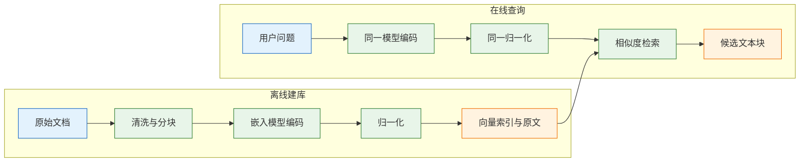
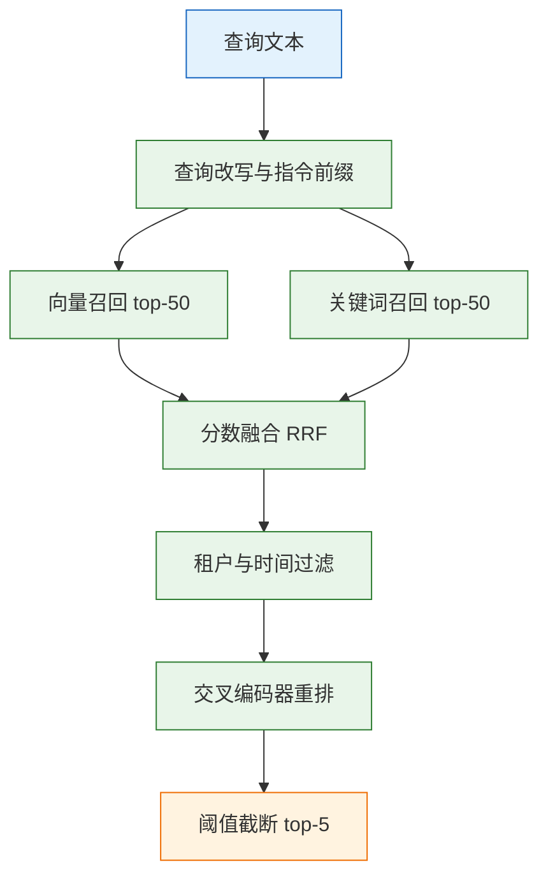
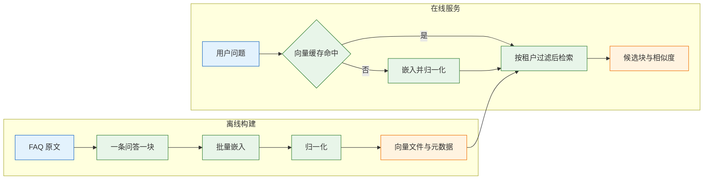

# Embedding

---

## 一、Embedding 是什么

> Embedding（嵌入）把文本映射为定长浮点向量，让“语义相近”变成“距离相近”。它解决同义改写与跨表述召回，不解决精确匹配、否定判断和事实正确。工程上最关键的不是榜单分数，而是入库与查询使用同一模型、同一版本、同一归一化方式。

### 1.1 核心概念

Embedding 模型是一个编码器：输入一段文本，输出一条固定长度的浮点向量。向量里的每一维没有独立含义，整体方向承载语义。两段文本意思接近，向量夹角就小；内容无关，夹角就大。检索系统正是利用这个性质，把“找相关段落”变成“找最近向量”。

一条向量从文本到入库，要经过分词、截断、编码、池化、归一化五步。任何一步在文档侧和查询侧不一致，两边就不在同一个坐标空间里，距离失去意义。这是 Embedding 最常见的故障来源，比模型选错更隐蔽。

向量空间由模型在训练语料上构造，不是人工定义的语义坐标。近义句会被拉到相近方向，反义句却未必被推远，因为训练目标通常只要求“匹配对更近”，不要求“相反更远”。所以距离只能当作召回信号，不能当作事实判断或情感判断。把相似度直接展示给用户，更容易造成误解。

| 概念 | 含义 | 工程后果 |
|---|---|---|
| 维度 | 向量的分量个数 | 存储与索引内存随维度线性增长 |
| 上下文窗口 | 单次可编码的 token 上限 | 超出部分被截断，后半段永远召回不到 |
| 池化 | 把 token 向量合成一条句向量 | 同模型不同池化方式的结果不可比 |
| 归一化 | 把向量缩放到单位长度 | 决定余弦、点积、欧氏距离是否等价 |
| 模型快照 | 模型的具体版本标识 | 版本漂移会让旧索引整体失效 |

由此得到三条不可违反的规则：

- **同模型同版本**：入库与查询必须调用同一个模型快照，不能一边用旧版、一边用新版。
- **同归一化**：入库前归一化，查询时也要归一化；两边都做或都不做，不能只做一边。
- **原文同存**：向量不能还原文本，引用、高亮、重建都依赖原文和分块参数。

### 1.2 与相邻技术的关系

Embedding 只负责“把语义变成可比较的数值”，它不生成答案，也不负责排序和权限。把它放进检索链路，要分清它与相关技术的分工。

| 技术 | 输出 | 擅长 | 与 Embedding 的边界 |
|---|---|---|---|
| BM25 | 词项匹配分 | 编号、错误码、专有名词 | 不理解同义改写 |
| Embedding | 定长向量 | 同义、跨语言、口语化提问 | 不擅长精确串与否定 |
| 交叉编码器 | 相关性分数 | 对候选精排 | 无法预先建索引，只能在线算 |
| 大语言模型 | 自然语言答案 | 归纳、生成、解释 | 不负责从海量文档中召回 |
| 向量数据库 | 近邻结果 | 大规模相似检索 | 不产生向量，只组织向量 |

三者的顺序是固定的：Embedding 生产向量，向量数据库组织并检索向量，重排模型校准候选顺序，生成模型消费最终上下文。任何一层缺失，都会表现为“答得不对”，但根因位置完全不同。

Embedding 也不解决权限。检索前必须按用户和租户过滤，不能先取出全量再在提示里要求模型保密。向量近似不等于业务相关：“退款流程”和“退款时效”在向量空间里很近，却回答两个不同问题，这类差异要靠重排和评测解决。

### 1.3 链路组成



链路左右对称：离线侧把文档变成向量，在线侧把问题变成向量，两侧共用同一个编码器和同一套预处理。索引里同时保存向量和原文，向量负责召回，原文负责引用与重算。

组成可以拆成四块：

- **预处理**：去页眉页脚、按结构分块、控制长度，决定进入模型的内容质量。
- **编码器**：模型本体，负责把 token 序列变成隐状态。
- **后处理**：池化与归一化，决定向量的数值形态。
- **索引与存储**：向量库存向量和过滤字段，对象存储或业务库存原文。

---

## 二、环境准备与最小示例

### 2.1 运行环境与依赖

> **版本现状（2026）**：Python 取 3.11 及以上，`openai` SDK 为 1.x 系列，`numpy` 为 2.x 系列。具体小版本以安装时为准；调用方式以厂商当前文档为准，接口字段可能增减。

```bash
# 创建隔离环境，避免污染系统 Python
python -m venv .venv
source .venv/bin/activate

# 云端接口方案：只需要 SDK 与数值库
pip install -U openai numpy

# 本地离线方案：额外安装推理框架
pip install -U sentence-transformers
```

| 依赖 | 用途 | 备注 |
|---|---|---|
| `openai` | 调用兼容 OpenAI 协议的嵌入接口 | 也可指向自建网关 |
| `numpy` | 向量归一化、相似度计算 | 注意 2.x 与旧代码的兼容性 |
| `sentence-transformers` | 本地加载开源嵌入模型 | 首次运行会下载权重 |
| `torch` | 本地推理后端 | 由上一个包自动带入 |

### 2.2 调用嵌入接口

```python
import os
import numpy as np
from openai import OpenAI

# 密钥与地址从环境变量读取，不写进代码和镜像
client = OpenAI(
    api_key=os.environ["EMBED_API_KEY"],
    base_url=os.environ.get("EMBED_BASE_URL"),  # 留空则走官方地址
)

def embed(texts: list[str]) -> np.ndarray:
    resp = client.embeddings.create(
        model=os.environ["EMBED_MODEL"],  # 固定快照名，不用会漂移的别名
        input=texts,
        # dimensions=1024,                # 仅部分模型支持降维，按模型卡决定
    )
    # 批量接口不保证返回顺序，按 index 重排后再取向量
    items = sorted(resp.data, key=lambda d: d.index)
    return np.asarray([d.embedding for d in items], dtype=np.float32)

vecs = embed(["退款审核通过后 3~5 个工作日到账。"])
print(vecs.shape, np.linalg.norm(vecs, axis=1))
```

输出类似：

```text
(1, 1536) [1.]
```

维度随模型变化，这里只是 1536 维模型的形态。多数托管接口返回单位长度向量，但兼容网关不一定做归一化；若第二项明显不等于 1，就不要假设它已归一化，后续统一自行处理。

关键点在 `sorted(..., key=lambda d: d.index)`。批量请求的返回数组在协议上带 `index` 字段，顺序不应当作稳定契约。依赖返回顺序拼接向量，会在并发或网关改写时把向量与文本错配，且错误不会报错，只会表现为召回质量下降。

### 2.3 本地模型离线方案

数据不能出内网，或需要完全离线运行时，用开源模型在本地编码。模型名与规格以模型卡为准，下面的中文小模型是 512 维、最大 512 token 的典型配置。

```python
from sentence_transformers import SentenceTransformer

# 首次运行会下载权重，之后可离线加载
model = SentenceTransformer("BAAI/bge-small-zh-v1.5")

vecs = model.encode(
    ["退款审核通过后 3~5 个工作日到账。"],
    normalize_embeddings=True,  # 直接输出单位向量
    batch_size=32,
)
print(vecs.shape)
```

本地模型的优势是成本固定、数据不出域；代价是要自己管 GPU、模型版本和推理服务。CPU 推理在几万条的建库规模上可以接受，百万级以上要评估吞吐和批大小。

> **注意**：本地模型换了权重文件，即使目录名没变，向量空间也可能变化。部署时把权重哈希写进索引元数据，升级前先做小流量对比。

### 2.4 最小验证

装好之后先做一次端到端验证，确认“编码—归一化—排序”这条最短路径成立，再谈建库。

```python
docs = [
    "退款审核通过后 3~5 个工作日到账。",
    "发票可在订单完成后 30 天内申请。",
    "修改收货地址请在发货前联系客服。",
]
question = "钱多久能退回来"

D = embed(docs)
q = embed([question])[0]

# 两边都做 L2 归一化，后续才能直接用点积当余弦
D = D / np.maximum(np.linalg.norm(D, axis=1, keepdims=True), 1e-12)
q = q / max(float(np.linalg.norm(q)), 1e-12)

sims = D @ q
for score, text in sorted(zip(sims, docs), reverse=True):
    print(f"{score:.4f}  {text}")
```

预期第一条是退款时效那条，分数数值随模型与语料变化。若第一条不是它，按下面的顺序检查，而不是立刻换模型。

| 检查项 | 期望 | 异常处理 |
|---|---|---|
| 向量维度 | 与模型卡一致 | 网关降维或返回截断，核对参数 |
| 向量模长 | 接近 1 | 未归一化，统一在应用层补做 |
| 同义句相似度 | 明显高于无关句 | 检查语言、前缀、是否截断 |
| 返回顺序 | 与输入一一对应 | 按 `index` 重排，不依赖数组顺序 |

---

## 三、模型选型与向量规格

### 3.1 选型维度

选型不是找榜单第一，而是找“在自己的语料上达到业务阈值的最便宜模型”。下面七个维度按影响从大到小排列。

中文场景先确认模型是否在中文语料上训练过。通用多语言模型能覆盖日常表达，但法律、医疗、制造等术语密集的领域，通用模型的向量区分度会下降；此时领域微调模型或混合关键词检索往往比换更大的通用模型有效。榜单分数来自公开语料，不能替代内部样本。

| 维度 | 判断依据 | 工程影响 |
|---|---|---|
| 语言 | 中文、多语言、代码 | 跨语言检索必须用多语言模型 |
| 最大输入 | 512 或 8192 token | 决定分块上限，超长会截断 |
| 对称性 | 问题对问题，还是问题对文档 | 非对称模型要分开编码 |
| 指令前缀 | 是否需要 `query:`、`passage:` | 漏加前缀会明显掉召回 |
| 维度 | 768、1024、1536、3072 | 存储与内存线性增长 |
| 部署形态 | 云接口或本地权重 | 决定成本结构与数据边界 |
| 版本策略 | 是否提供固定快照 | 换版本必须全量重算 |

### 3.2 对称与非对称检索

对称模型衡量“两段文本像不像”，适合去重、聚类、相似问题推荐。非对称模型衡量“这段文档能不能回答这个问题”，适合查询到段落。把对称模型用于检索，分数会整体偏低、区分度差，表现为“相似度都在 0.7 以上，但排序混乱”。

部分模型还要求给查询和文档加不同前缀。例如 E5 系列使用 `query: ` 与 `passage: `，中文 BGE 系列建议给查询加检索指令。前缀属于模型协议的一部分，漏加不会报错，只会让效果下降。是否需要前缀、用什么措辞，只能查模型卡，不能靠猜。

> **注意**：前缀要同时体现在建库脚本和查询服务里。只在查询侧加、建库侧不加，等于人为制造两个空间。

### 3.3 维度与存储成本

向量占用按“条数 × 维度 × 每维字节”估算。以 1536 维、float32 为例，每条 6,144 字节：

```text
100 万条 × 1536 维 × 4 字节 ≈ 6.1 GB
HNSW 图结构常见再乘 1.3 ~ 1.5
```

高维不一定更准。维度是模型训练时确定的，盲目截断会破坏语义；支持 Matryoshka 表示的模型可以按 512、1024 等前缀维度截断，代价是召回下降，必须用自己的样本测。降维之前先确认模型是否支持，不要对普通向量直接切掉后半段。

维度还通过索引放大成本。HNSW 的内存不只存原始向量，还要存图结构和对齐填充；维度越高，单节点越大，同样内存能容纳的节点越少，图更容易频繁换入换出。容量估算要按“原始向量 + 索引放大 + 副本数”三项相加，不能只算第一项。

### 3.4 相似度度量与归一化

| 度量 | 公式 | 取值范围 | 适用 |
|---|---|---|---|
| 余弦相似度 | `a·b / (‖a‖‖b‖)` | -1 ~ 1 | 最常用，只看方向 |
| 点积 | `a·b` | 随模长变化 | 模型训练即用点积且向量已归一化 |
| 欧氏距离 | `‖a-b‖` | 0 ~ ∞，越小越近 | 图像、部分模型 |

三者有一个重要关系：向量归一化后，余弦相似度等于点积，欧氏距离的排序也与前两者一致。因此统一归一化能消除大量“换一个库结果就变”的问题。

```python
def l2norm(mat: np.ndarray) -> np.ndarray:
    # 防止零向量导致除零；归一化后点积即余弦
    norm = np.linalg.norm(mat, axis=-1, keepdims=True)
    return mat / np.maximum(norm, 1e-12)
```

> **注意**：pgvector 的 `<=>` 是余弦距离，等于 `1 - 余弦相似度`，越小越相似；`<#>` 是负内积，`<->` 是欧氏距离。把距离当相似度倒序排，会稳定地返回最不相关的块。

---

## 四、批处理、截断与成本控制

### 4.1 批量与限流

逐条调用会把网络往返放大几十倍。批量调用能显著提高吞吐，但要同时受单请求条数、总 token 数和并发数三个上限约束。

```python
import random
import time

def embed_batched(texts: list[str], batch: int = 64, retries: int = 4) -> np.ndarray:
    out = []
    for start in range(0, len(texts), batch):
        part = texts[start:start + batch]
        for attempt in range(retries):
            try:
                out.append(embed(part))
                break
            except Exception:
                if attempt == retries - 1:
                    raise
                # 指数退避加随机抖动，避免限流时所有任务同时重试
                time.sleep((2 ** attempt) + random.random())
    return np.vstack(out)
```

重试要按批进行，不要把整个库从头再跑一遍。建库任务还应记录已完成批次，失败后从断点续传，否则一次限流会让成本翻倍。

### 4.2 截断与输入上限

不同实现对超长输入的处理不同：有的静默截断，有的直接报错。静默截断最危险，因为任务成功、向量也生成了，只是后半段内容永远进不了索引。

```python
def clip(text: str, max_chars: int = 350) -> str:
    # 分块阶段就按模型上限的七成预留余量，抵消分词差异
    if len(text) <= max_chars:
        return text
    print(f"[warn] 截断 {len(text)} -> {max_chars}")
    return text[:max_chars].rstrip()
```

字符数只是粗估。中文一个字通常对应一个到一个多 token，代码和英文缩写更高。可靠做法是用模型实际的分词器计数，并在分块阶段保证块长度不超过上限的 70%。

截断要尽量发生在分块阶段，而不是编码阶段。分块器按句号、段落或标题边界切，截断时至少保留完整句子；直接把一段话砍在半句，会让向量同时带上半个主题，检索时既不像上文也不像下文。对表格和代码块，宁可单独成块并缩短其他块，也不要从中间切开。

### 4.3 缓存与重建成本

| 阶段 | 触发频率 | 主要成本 | 优化手段 |
|---|---|---|---|
| 建库 | 一次性或按批 | 全量 token | 去重、减块、控制重叠 |
| 查询 | 每次请求 | 单条 token 与延迟 | 缓存热点问题向量 |
| 重建 | 换模型、换分块 | 全量 token 加停机 | 新表双写、灰度切换 |

最贵的不是查询，是重建。选型时先回答一个问题：一年内会不会换模型或改分块。如果会，索引产物里必须保留原文、分块参数、模型名、维度和归一化方式，保证随时可以重算。

查询缓存的键不能只用问题文本。正确做法是把模型名、维度、归一化方式、指令前缀一起编进键；否则换模型后缓存仍返回旧向量算出的结果，错误难以复现。

---

## 五、向量存储与量化

### 5.1 存储格式

| 格式 | 1536 维每条占用 | 相对精度 | 适用 |
|---|---|---|---|
| float32 | 6,144 B | 基准 | 默认，兼容性最好 |
| float16 | 3,072 B | 几乎无损 | 省一半内存，需引擎支持 |
| int8 | 1,536 B | 略降 | 大规模、可接受小幅召回损失 |
| binary | 192 B | 明显下降 | 粗筛后再用全精度精排 |

格式选择受引擎能力约束：pgvector 提供 `halfvec` 类型，可直接以半精度存储和索引；有些引擎只在索引层做量化，原始向量仍保留 float32。前者省的是存储和内存，后者省的是索引内存，估算时不能混为一谈。选之前先确认引擎支持哪种，避免为了省空间把精度压到不可用。

### 5.2 量化实现

量化不是免费压缩。int8 要按向量维度或按向量本身取缩放因子，binary 要把相似度计算换成汉明距离；方式用错，召回会无声下降。

```python
def quantize_int8(mat: np.ndarray) -> tuple[np.ndarray, np.ndarray]:
    # 每个向量单独取尺度，避免不同模长的向量共用一把尺子
    scale = np.abs(mat).max(axis=1, keepdims=True) / 127.0
    q = np.round(mat / np.maximum(scale, 1e-12)).astype(np.int8)
    return q, scale.squeeze(1)

def dequantize_int8(q: np.ndarray, scale: np.ndarray) -> np.ndarray:
    # 还原后再归一化，用于精排
    return q.astype(np.float32) * scale[:, None]
```

上线前用同一批查询对比量化前后的 top-10 重合率，再决定是否接受。只在离线指标上看起来没问题不够，真实查询的长尾更容易暴露损失。

### 5.3 原文与元数据配套

向量库只存向量和少量过滤字段，原文放在对象存储或业务库。两边用 `chunk_id` 关联，回查时一次取回。把原文、向量、权限字段混成一张大表，会让备份、迁移和权限审计都变重。

| 字段 | 作用 | 缺失后果 |
|---|---|---|
| `chunk_id` | 向量与原文的关联键 | 无法引用、无法回查 |
| `doc_id` | 文档级去重与更新 | 文档删除后残留孤儿块 |
| `text` | 引用、高亮、重算 | 只能返回相似度，不能给依据 |
| `tenant` | 租户隔离 | 跨租户泄露 |
| `section` | 定位章节 | 引用无法精确到条款 |
| `model_version` | 判断索引是否过期 | 换模型后新旧混用 |

---

## 六、检索流程与混合召回



### 6.1 向量召回步骤

一次向量召回包含五步：查询预处理、编码、归一化、近邻搜索、取回原文。前四步在检索服务里完成，最后一步通常要访问业务库或对象存储。

1. 预处理：去掉无意义前缀，按模型要求加查询指令。
2. 编码：调用与入库相同的模型，批量大小按吞吐调整。
3. 归一化：与入库保持同一方式，记录在索引清单里。
4. 近邻搜索：按过滤条件缩小范围，再按距离取候选。
5. 回表：用 `chunk_id` 取原文、标题、章节和更新时间。

候选数量由 `top_k` 控制。召回阶段取 30 到 50 条，是为了给重排留选择空间；直接取 3 条再重排，等于让重排在没有候选的情况下做决定。

### 6.2 混合召回与融合

纯向量对编号、错误码、人名不敏感。生产检索通常并行跑向量和 BM25，再融合两路结果。融合不必调分数尺度，用倒数排名融合（RRF）更稳。

```python
def rrf(vector_ids: list[str], keyword_ids: list[str], k: int = 60, top_n: int = 5):
    scores: dict[str, float] = {}
    for rank, cid in enumerate(vector_ids, 1):
        scores[cid] = scores.get(cid, 0.0) + 1.0 / (k + rank)
    for rank, cid in enumerate(keyword_ids, 1):
        scores[cid] = scores.get(cid, 0.0) + 1.0 / (k + rank)
    # 只按名次融合，避免两路分数量纲不同
    return sorted(scores.items(), key=lambda kv: kv[1], reverse=True)[:top_n]
```

### 6.3 阈值与候选参数

| 参数 | 起点 | 调大后 | 调小后 |
|---|---|---|---|
| `top_k` | 30 ~ 50 | 召回升，重排变慢 | 正确块进不来 |
| 相似度阈值 | 用标注集测 | 漏召回，拒答变多 | 噪声混入 |
| 重排保留数 | 3 ~ 5 | 上下文变长，成本升 | 信息不足 |
| 缓存 TTL | 按更新频率 | 旧结果留存 | 命中率下降 |

阈值没有通用值。同一个 0.75，在不同模型、不同语料上的含义完全不同；只能用自己的正负样本分布定，且要随模型版本重新校准。

---

## 七、完整链路：FAQ 语义检索服务



### 7.1 离线建库

```python
import json
from pathlib import Path

def build_index(records: list[dict], out_dir: str = "index") -> None:
    texts = [r["text"] for r in records]
    vecs = embed_batched(texts, batch=64)
    vecs = l2norm(vecs)  # 入库统一归一化

    out = Path(out_dir)
    out.mkdir(exist_ok=True)
    np.save(out / "vectors.npy", vecs)

    with (out / "chunks.jsonl").open("w", encoding="utf-8") as f:
        for r in records:
            f.write(json.dumps(r, ensure_ascii=False) + "\n")

    # 清单是重建与排障的依据，必须和向量一起落盘
    (out / "manifest.json").write_text(json.dumps({
        "model": os.environ["EMBED_MODEL"],
        "dim": int(vecs.shape[1]),
        "normalized": True,
        "count": len(records),
    }, ensure_ascii=False), encoding="utf-8")
```

建库前先按 `doc_id` 和正文哈希去重。FAQ 里重复问答很常见，重复块会让 top-k 被同一内容占满，看起来召回高，实际覆盖的问题少。

增量更新要按文档粒度做，不能只追加新块。文档改版后旧块仍然留在索引里，检索会同时返回新旧两个版本，模型可能引用已失效的条款。正确做法是给每个 `doc_id` 维护版本号，写入新块后按 `doc_id` 删除旧版本，再用文档版本校验索引是否一致。

### 7.2 在线查询

```python
MANIFEST = json.loads((Path("index") / "manifest.json").read_text(encoding="utf-8"))

def search(question: str, tenant: str, top_k: int = 20) -> list[tuple[str, float]]:
    if MANIFEST["model"] != os.environ["EMBED_MODEL"]:
        raise RuntimeError("索引模型与当前模型不一致，拒绝查询")

    q = l2norm(embed([question]))[0]
    vecs = np.load("index/vectors.npy")
    with open("index/chunks.jsonl", encoding="utf-8") as f:
        chunks = [json.loads(line) for line in f]

    sims = vecs @ q
    # 先按租户过滤再排序，避免其他租户内容进入候选
    allowed = np.array([c["tenant"] == tenant for c in chunks])
    idx = np.flatnonzero(allowed)
    order = idx[np.argsort(-sims[idx])[:top_k]]
    return [(chunks[i]["chunk_id"], float(sims[i])) for i in order]
```

这段实现是全量扫描，适合几万条以内的 FAQ 或作为基线。上了百万级要换成 ANN 索引，但“先过滤再排序”的顺序不能变。

> **安全警告**：租户条件必须由服务端从会话中取，不能接受客户端传入的 `tenant` 参数；否则改一个请求体就能读到其他租户的文档。过滤要发生在检索阶段，不能检索完再在提示里删。

### 7.3 运行与验证

| 模块 | 输入 | 输出 | 典型失败 |
|---|---|---|---|
| 建库 | FAQ 记录 | 向量文件、元数据 | 重复块、维度不一致 |
| 编码 | 文本 | 单位向量 | 前缀漏加、超长截断 |
| 检索 | 查询向量、租户 | 候选块 | 过滤顺序错误 |
| 缓存 | 问题、模型版本 | 查询向量 | 键缺版本，换模型后脏读 |

验证时准备三条查询：一条能明确命中、一条只有同义表述、一条资料里没有。前两条看排序，第三条看最低分是否明显低于正样本，作为阈值初值。

---

## 八、评测与优化

### 8.1 评测指标

| 指标 | 定义 | 用途 |
|---|---|---|
| Recall@k | 前 k 条包含正确块的查询占比 | 判断检索是否给对材料 |
| MRR | 正确块排名倒数的均值 | 判断正确块排得多靠前 |
| nDCG@k | 按位置折损的相关性增益 | 多相关块场景更合适 |
| 距离分布 | 正负样本的相似度分布 | 判断阈值是否可分 |

先看 Recall@20。若 Recall@20 都不到 0.8，生成层再强也没有材料可用；若 Recall@20 高而 Recall@5 低，问题在排序或块太大，不在编码器。

指标之间要一起看。Recall 高但 MRR 低，说明正确块进了候选却排在后面，优先加重排；Recall 和 MRR 都低，先查分块与编码；Recall 高、引用准确率低，则是拼装和生成的问题。只看一个总分，无法判断该改哪一层。

### 8.2 评测集构造

评测集的质量决定结论的可信度。常见错误是拿文档原句当问题，词面高度重合，Recall 虚高。

- **来源**：从真实提问、客服记录、搜索日志里抽，保留口语和错别字。
- **标注**：一条问题可以对应多个正确块，只标一个会低估召回。
- **负样本**：留 5 到 10 条资料中无答案的问题，用于测拒答和阈值。
- **分层**：单跳、跨段、否定、时间敏感各留几条，分开统计。

规模不必大，50 到 100 条即可启动；关键是持续维护，每次换模型、改分块都用同一套回归。

### 8.3 调优顺序

1. 固定评测集与分块，只换模型，得到基线。
2. 看失败样本：正确块不在 top-20，先查解析、分块、前缀和截断。
3. 正确块在 top-20 但排后，加混合召回或重排。
4. 排序稳定后，再调阈值和 `top_k`，控制上下文长度。
5. 最后才考虑降维、量化等成本手段，并复测召回。

| 候选方案 | 配置 | Recall@5（示例） | 结论 |
|---|---|---|---|
| A | 1536 维 / 40 ms | 0.86 | 可用 |
| B | 1024 维 / 30 ms | 0.82 | 省存储，需重排 |
| C | 3072 维 / 70 ms | 0.87 | 收益不抵成本 |

表中数字仅用于说明比较方法，必须用自有语料重跑。选型的终点是“达到业务阈值的最便宜方案”，不是最高分。

---

## 九、常见故障与排查

| 现象 | 最可能原因 | 处理 |
|---|---|---|
| 相似度普遍在 0.8 以上 | 向量未归一化或模型不匹配 | 统一归一化，核对模型与维度 |
| 换模型后结果全乱 | 入库与查询模型不一致 | 新建索引全量重算，禁止混用 |
| 长文档后半段搜不到 | 输入被静默截断 | 分块，块长控制在上限七成 |
| 订单号、错误码搜不到 | 语义模型不擅精确串 | 加 BM25 或元数据过滤 |
| 否定句答反 | 向量不区分极性 | 交叉编码器重排加规则校验 |
| 召回全是重复块 | 分块重叠过大、未去重 | 降重叠，按正文哈希去重 |
| 建库成本超预期 | 块太多、重复内容多 | 先去重再编码，减少无效块 |
| 查询延迟高 | 维度高、候选多、索引参数激进 | 降维或量化，调小候选数 |
| 刚更新文档仍返回旧内容 | 索引未重建、缓存未失效 | 记录文档版本，更新后失效缓存 |
| 相似度高但答非所问 | 语义近、任务不同 | 改用非对称模型，增加重排 |

排查顺序：

1. 用一条确定能找到的问题，打印 top-10 的原文，先分清“没召回”还是“召回但排后”。
2. 核对入库与查询的模型名、版本、指令前缀、归一化方式是否完全一致。
3. 检查块长度与截断日志，确认内容完整进入模型。
4. 检查过滤条件与索引参数，排除候选被过滤空或索引未命中。
5. 以上都正常，再换模型或加混合召回，且必须用同一评测集对比。
