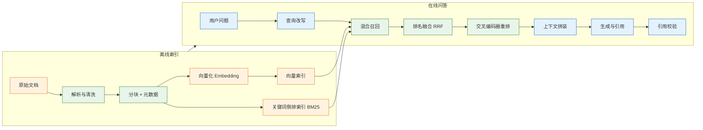
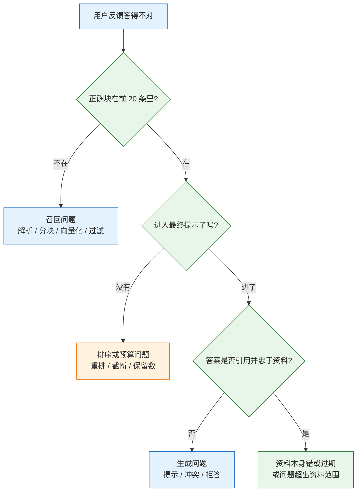

# RAG 优化

---

## 一、RAG 优化是什么

### 1.1 核心概念

RAG 优化是在一条已经能跑通的“检索→拼装→生成”链路上，用可测量的方式定位答案错误的环节，再用最小改动把该环节的指标抬到业务阈值以上。它研究的不是“还能再加哪个模型”，而是**在固定预算内判断哪一层值得改、改到什么程度停止**。

三个基本判断：

- **优化对象是链路，不是单点。** 解析、分块、索引、召回、排序、拼装、生成任一层退化，用户看到的都是“答得不对”。
- **优化依据是分层指标。** Recall@k 衡量正确材料有没有进候选，MRR 与 nDCG 衡量排序质量，引用准确率衡量答案是否可核。
- **优化有停止条件。** 达到阈值后继续叠加手段，延迟与维护成本上升，收益趋近于零。

> **注意**：RAG 优化不修复资料缺失、权限模型错误、业务口径冲突。这三类问题要在数据层与产品层解决，调检索参数无效。

### 1.2 与相邻技术的关系

| 技术 | 解决的问题 | 与 RAG 优化的边界 |
|---|---|---|
| RAG 基础链路 | 把私有资料送进模型 | 提供基线，优化在其上做增量 |
| Embedding | 把文本映射为向量 | 换模型属于召回层手段 |
| 向量数据库 | 存储向量并做近邻检索 | 索引参数影响召回率与延迟 |
| 重排模型 | 对候选片段精排 | 只在正确块已进候选时有效 |
| 微调 | 改变模型行为与输出格式 | 不补事实，事实问题仍靠检索 |
| 长上下文 | 一次放入更多资料 | 与 RAG 是替代关系，不是优化手段 |

边界要分清：**微调解决“怎么说”，RAG 解决“说什么”，RAG 优化解决“该说的有没有送到模型面前”。** 三者混用会让归因失效，比如检索没召回却去微调模型，指标不会动。

### 1.3 链路与架构组成



链路上的六层各有可调对象，改动前先确认目标层：

| 层次 | 可调对象 | 典型手段 | 观测指标 |
|---|---|---|---|
| 数据层 | 解析规则、分块边界、元数据 | 按条款切、父子块、补字段 | 块完整率、可追溯率 |
| 召回层 | 向量模型、BM25、过滤条件 | 混合检索、元数据前置过滤 | Recall@20 |
| 排序层 | 融合算法、重排模型、保留数 | RRF、交叉编码器 | MRR、nDCG@5 |
| 拼装层 | 预算、编号、压缩 | 动态编号、按句压缩 | 正确块入提示比例 |
| 生成层 | 提示、拒答、输出结构 | 引用约束、冲突规则 | 答案正确率、引用准确率 |
| 评测层 | 样本、标注、回归流程 | 分层抽样、固定基线 | 指标可复现性 |

---

## 二、失败归因与基线测量

### 2.1 失败分层

“答得不对”是用户描述，不是工程结论。把一次失败拆成四个可回答的问题：正确块在不在候选里、排第几、有没有进最终提示、模型有没有按资料回答。



判断顺序不能反。召回没达标时先加重排，最多把第 15 名提到第 8 名，仍然进不了 top-5；正确块没进提示时改提示词，也只是让模型在残缺材料上换一种说法。

### 2.2 基线指标

基线不是“感觉还能用”，而是一组在固定样本、固定配置下记录下来的数字。没有基线，任何改动都无法判断是优化还是退化。

| 层 | 指标 | 计算口径 | 用途 |
|---|---|---|---|
| 召回 | Recall@20 | 前 20 条覆盖的正确块数 / 该问题正确块总数 | 判断材料是否进候选 |
| 排序 | MRR | 首个正确块排名的倒数，按问题平均 | 判断第一名准不准 |
| 排序 | nDCG@5 | 按位置折损的增益与理想排序之比 | 比较两个重排方案 |
| 拼装 | 入提示率 | 正确块出现在最终提示中的问题数 / 总问题数 | 判断预算与截断 |
| 生成 | 答案正确率 | 与标准答案比对后通过的问题数 / 总问题数 | 业务验收 |
| 生成 | 引用准确率 | 引用段落能支持结论的条数 / 总引用条数 | 判断可核性 |
| 生成 | 正确拒答率 | 无答案问题中正确拒答数 / 无答案问题总数 | 判断是否硬编 |

基线配置要写成指纹一并保存：分块大小与重叠、Embedding 模型及版本、距离度量、`top_k`、是否重排、重排模型、提示版本。只记一个 Recall 数字，三周后无法复现。

测量时要在同一进程、同一批样本、同一组参数下跑完，避免中途换模型或重建索引；每次运行保存原始排名，而不只是汇总分数。只存均值无法判断收益来自哪几条样本，也无法发现某类问题被整体拉高掩盖。

### 2.3 单条样本的归因方法

先固定一条失败样本，把每一步的中间结果打印出来。下面的函数只做观测，不参与线上链路：

```python
def explain(question: str, gold_id: str, retriever, prompt_hits, answer: str):
    """打印一条失败样本在召回、排序、拼装三层的状态。"""
    hits = retriever.search(question, k=20)          # 候选与分数一起返回
    ids = [doc_id for doc_id, _ in hits]
    rank = ids.index(gold_id) + 1 if gold_id in ids else None

    print("question:", question)
    print("gold_rank:", rank or "未召回")
    print("top5:", ids[:5])
    print("in_prompt:", gold_id in [h["id"] for h in prompt_hits])
    print("answer:", answer[:200])
    if rank is None:
        return "召回层：查解析、分块、Embedding、过滤条件"
    if rank > 5:
        return "排序层：查融合权重、重排模型、候选数"
    if gold_id not in [h["id"] for h in prompt_hits]:
        return "拼装层：查预算截断、去重、排序后保留数"
    return "生成层：查提示、冲突规则、引用约束"
```

| 观测结果 | 归因 | 首个动作 |
|---|---|---|
| `gold_rank` 为空 | 召回失败 | 抽 5 个块对照原文，查解析与分块 |
| `gold_rank` 大于 5 | 排序失败 | 加混合检索或重排，不换生成模型 |
| 排名靠前但 `in_prompt=False` | 拼装失败 | 查预算、去重逻辑、保留数 |
| 两项都正常但答案错 | 生成失败 | 查提示与实际引用，最后才换模型 |

> **注意**：`explain` 里的检索必须和线上一字不差，包括过滤条件和查询改写。用另一套参数复现，得到的归因无效。

---

## 三、查询侧优化

### 3.1 查询改写

用户问题常带指代、省略和口语结构。“那它多久到账”里的“它”在向量空间里没有对应实体，直接检索只能命中泛化段落。改写要补全实体、统一术语、保留原问题，不改业务含义。

| 问题形态 | 改写动作 | 风险 |
|---|---|---|
| 多轮指代 | 用上一轮实体替换代词 | 指代错人，整条链路跑偏 |
| 口语表达 | 换成文档里的标准术语 | 术语替换过度，丢失原意 |
| 省略条件 | 补全时间、产品、地区 | 补出用户没说的条件 |
| 拼写错误 | 纠正专有名词 | 把产品名改成另一个产品 |

改写结果要和原问题**同时检索**，再用 RRF 合并。只使用改写结果，一旦改写引入原文没有的实体，召回会整体偏向错误主题。

```python
def rewrite_query(question: str, history: list[dict], client, model: str) -> list[str]:
    """返回原问题与改写问题；改写失败时退化为原问题。"""
    if not history:
        return [question]
    recent = history[-4:]                              # 只带最近两轮，控制输入
    resp = client.chat.completions.create(
        model=model,
        temperature=0,
        messages=[
            {"role": "system", "content": (
                "把用户问题改写成可独立检索的句子。只补全代词和省略的主语，"
                "保留原意，不添加用户未提到的条件。只输出改写后的句子。")},
            *recent,
            {"role": "user", "content": question},
        ],
        max_tokens=120,
    )
    rewritten = (resp.choices[0].message.content or "").strip()
    return [question, rewritten] if rewritten and rewritten != question else [question]
```

改写结果要过一遍实体校验：新出现的订单号、日期、产品名必须能在原问题或历史里找到，找不到就丢弃改写分支。多轮对话里还要区分用户新说的实体和上一轮遗留的实体，后者只能补全，不能覆盖。

### 3.2 多查询与 HyDE

多查询是让模型生成几个同义问法，分别检索后融合；HyDE 是先让模型写一段假答案，再用假答案的向量去检索。两者都扩大查询覆盖面，也都会放大成本与跑偏风险。

| 手段 | 做法 | 成本与适用 | 主要风险 |
|---|---|---|---|
| 多查询 | 生成 3 个同义问法，分别检索 | 3 倍检索；问法覆盖不足时 | 同义问法重复，候选挤占 |
| HyDE | 生成假答案再检索 | 一次生成；问题短或资料表述不同时 | 假答案编出细节，召回跑偏 |
| 查询扩展 | 加同义词、缩写全称 | 很低；术语不统一时 | 扩展词过多引入噪声 |
| 回退查询 | 改写失败时用原问题重查 | 一次检索；所有场景 | 无 |

多查询合并必须用排名融合，不能简单拼接 top-k。两路各返回 10 条，直接拼成 20 条，同一段会在不同问法下重复出现，占满上下文。

### 3.3 意图路由与实体抽取

多知识库场景先分类再检索，比在一个大索引里混搜更稳。分类器的输出是有限集合，可以穷举、可以评测；检索范围缩小后，噪声和权限问题同时下降。

| 用户意图 | 路由目标 | 可抽取的过滤条件 |
|---|---|---|
| 制度咨询 | 制度库 | 部门、生效日期、地区 |
| 订单查询 | 订单库 | 订单号、手机号后四位 |
| 产品参数 | 产品手册库 | 型号、版本、语言 |
| 故障排查 | 工单与日志库 | 服务名、错误码、时间窗 |

实体抽取的产物必须经过校验再进过滤条件。订单号长度不对、日期超出范围时，宁可不过滤，也不要把错误条件传下去——过滤后为空，用户得到的是“未找到”，而不是可解释的失败。

---

## 四、索引侧优化

### 4.1 分块结构

分块的目标是**一块能独立回答一个问题，并且能追溯回原文**。块太大，向量被多个主题平均，细节召回下降；块太小，条件从句与主语分离，模型读到半句话。

| 方式 | 检索与送入单位 | 优点 | 代价 |
|---|---|---|---|
| 固定长度 | 块检索、块送入 | 实现简单 | 易切断句子与表格 |
| 按条款 | 条款检索、条款送入 | 边界清晰、可引用 | 长条款仍需再切 |
| 父子块 | 子块检索、父块送入 | 细节召回 + 完整上下文 | 存储与 token 翻倍 |
| 句子窗口 | 单句检索、前后 N 句送入 | 定位精准 | 窗口大小要调 |

条文类文档按“章→条”切，再对超长条款按句子合并到上限；代码保留 `doc_id` 与原文偏移，条款号、生效日期在入库时补进元数据。下面的函数只在超长时按句切分：

```python
import re

def split_clause(text: str, doc_id: str, max_chars: int = 600):
    """按中文句末标点合并句子，尽量不切断条款。"""
    sentences = re.split(r"(?<=[。；！？])", text)
    chunks, buf = [], ""
    for sent in sentences:
        sent = sent.strip()
        if not sent:
            continue
        if len(buf) + len(sent) <= max_chars:
            buf += sent
        else:
            if buf:
                chunks.append(buf)
            buf = sent
    if buf:
        chunks.append(buf)

    out, cursor = [], 0
    for i, c in enumerate(chunks, 1):
        start = text.find(c, cursor)             # 从上一块末尾继续找，避免重复文本错位
        out.append({
            "id": f"{doc_id}#{i}",
            "text": c,
            "doc_id": doc_id,
            "char_start": start,                 # 用于回查原文
        })
        cursor = start + len(c)
    return out
```

这里按拼接后的字符串回查偏移，适合无空格的中文条款；原文含大量空白或经过清洗时，偏移应由解析器在切分时直接给出，不能靠回查。

> **注意**：重叠不是越多越好。10%~20% 的重叠能补跨块条件，超过 30% 会让 top-k 里出现大量近似重复块，既浪费预算又干扰排序。

### 4.2 元数据过滤

时间、版本、租户、文档类型这些条件，能过滤就不要靠语义。检索前加 `WHERE`，比在提示里写“请优先使用最新版本”可靠得多。

| 过滤方式 | 执行位置 | 优点 | 缺点 |
|---|---|---|---|
| 前置过滤 | 向量检索前缩小集合 | 快、结果干净 | 条件错误时直接空结果 |
| 后置过滤 | 检索后删除不匹配项 | 不影响召回 | top-k 被无效项占满 |
| 混合过滤 | 先粗过滤再检索 | 平衡 | 实现复杂 |

**边界**：过滤条件太严会把正确答案排除。只查 `status='active'`，而答案在刚归档的文档里；只查最近 30 天，而制度三个月未更新。过滤条件要跟业务确认，缺失值要单独处理，不能默认丢弃。

前置过滤的代价是候选集合变小，条件写错时没有兜底；后置过滤保留召回，但 top-k 会被无效项占满，重排前要先把无效项剔除。生产上常把租户、权限这类硬条件前置，把时间、类型这类软条件做成可放宽的过滤。

### 4.3 混合检索与 RRF

向量检索擅长同义改写与长自然语言，BM25 擅长订单号、错误码、专有名词。两路各取候选，再按排名融合，能覆盖单一方法的盲区。

| 查询类型 | 纯向量 | 纯 BM25 | 混合 |
|---|---|---|---|
| 同义改写 | 好 | 差 | 好 |
| 订单号、错误码 | 差 | 好 | 好 |
| 专有名词 | 中 | 好 | 好 |
| 长自然语言 | 好 | 中 | 好 |

RRF 只使用排名，不使用原始分数，避免余弦相似度与 BM25 分数量纲不同的问题。公式为 `score(d) = Σ 1 / (k + rank_i(d))`，`k` 常取 60。

```python
def rrf(rankings: list[list[str]], k: int = 60, weights=None) -> list[tuple[str, float]]:
    """rankings: 每路的 doc_id 列表，已按相关性降序；weights: 每路权重。"""
    weights = weights or [1.0] * len(rankings)
    score: dict[str, float] = {}
    for weight, ranking in zip(weights, rankings):
        for rank, doc_id in enumerate(ranking, 1):
            score[doc_id] = score.get(doc_id, 0.0) + weight / (k + rank)
    return sorted(score.items(), key=lambda x: -x[1])
```

两路检索的完整封装如下。BM25 用 `jieba` 分词，向量用归一化后的点积，两路各取 50 条后融合：

```python
import jieba
import numpy as np
from rank_bm25 import BM25Okapi
from sentence_transformers import SentenceTransformer

class HybridRetriever:
    def __init__(self, docs: list[dict], model_name: str = "BAAI/bge-small-zh-v1.5"):
        self.docs = docs
        self.ids = [d["id"] for d in docs]
        self.bm25 = BM25Okapi([jieba.lcut(d["text"]) for d in docs])
        self.model = SentenceTransformer(model_name)
        self.matrix = self.model.encode(
            [d["text"] for d in docs],
            normalize_embeddings=True,               # 归一化后点积即余弦
            batch_size=32,
        )

    def search(self, query: str, k: int = 50) -> list[tuple[str, float]]:
        bm25_scores = self.bm25.get_scores(jieba.lcut(query))
        bm25_rank = [self.ids[i] for i in np.argsort(bm25_scores)[::-1][:k]]

        q = self.model.encode([query], normalize_embeddings=True)[0]
        dense_scores = self.matrix @ q
        dense_rank = [self.ids[i] for i in np.argsort(dense_scores)[::-1][:k]]

        return rrf([dense_rank, bm25_rank], weights=[1.0, 1.0])
```

> **注意**：入库与查询必须使用同一个 Embedding 模型、同一套归一化方式。换了模型只重建查询侧，向量空间不对齐，召回会整体崩掉。

---

## 五、重排与上下文拼装

### 5.1 重排模型选型

向量检索是粗筛，重排是精排。交叉编码器把“问题 + 单段”拼在一起送进模型打分，能识别否定、条件和细粒度差异，代价是无法预计算，只能对少量候选逐条推理。

| 方案 | 延迟 | 成本 | 适用 |
|---|---|---|---|
| 向量相似度 | 毫秒 | 低 | 召回 |
| BM25 | 毫秒 | 低 | 召回、混合 |
| 交叉编码器 | 20~200ms | 中 | top-20 精排 |
| 大模型打分 | 0.5~3s | 高 | 离线评估、少量高价值查询 |

```python
from sentence_transformers import CrossEncoder

reranker = CrossEncoder("BAAI/bge-reranker-base", max_length=512)

def rerank(query: str, candidates: list[dict], top_n: int = 5,
           floor: float | None = None) -> list[dict]:
    """对候选逐条打分；给出 floor 时丢弃低于阈值的项。"""
    if not candidates:
        return []
    pairs = [(query, c["text"]) for c in candidates]
    scores = reranker.predict(pairs, batch_size=16)   # 返回 numpy 数组
    ranked = sorted(zip(candidates, scores), key=lambda x: -float(x[1]))
    return [
        {**c, "rerank_score": float(s)}
        for c, s in ranked[:top_n]
        if floor is None or float(s) >= floor
    ]
```

> **注意**：`floor` 不能照搬别人的 0.5。不同重排模型的分数分布不同，阈值要在自己的评测集上按“正确块分数分布”和“无关块分数分布”的交界处标定。

### 5.2 重排参数

三个参数决定重排的收益与代价：

| 参数 | 起点 | 调大的后果 | 调小的后果 |
|---|---|---|---|
| 候选数 | 20 | 延迟线性上升 | 正确块进不来，重排没得选 |
| 保留数 | 3~5 | 上下文噪声多、token 贵 | 多跳问题缺材料 |
| 分数下限 | 评测集标定 | 正确块被误丢，拒答率升 | 无关块混入，幻觉增加 |

面向用户的问答要算 P95，不要只看平均值。重排把单次检索从几十毫秒推到几百毫秒，在并发高时会被放大；后台批处理可以放宽候选数，交互链路要把候选数压住。

候选数与保留数要一起调：只加候选不加保留数，等于把噪声留给模型；只减保留数不降候选数，等于让重排白做。批量推理能摊薄单条延迟，但交互请求仍要按单条 P95 估算。

### 5.3 上下文压缩与编号

拼装要解决三件事：编号与段落绑定、来源与日期可见、总长度受控。编号必须在拼装时动态生成，不能写死在文档里；否则检索结果一变，引用全错位。

```python
def build_context(hits: list[dict], max_chars: int = 4000) -> tuple[str, dict]:
    """按预算拼装资料，返回文本与编号到来源的映射。"""
    blocks, used, mapping = [], 0, {}
    for i, h in enumerate(hits, 1):
        block = (
            f"[{i}]（来源：{h['source']}；生效：{h.get('effective_at', '未知')}）\n"
            f"{h['text']}"
        )
        if used + len(block) > max_chars:
            break                                     # 放不下就停，不截半句
        blocks.append(block)
        mapping[str(i)] = {"id": h["id"], "source": h["source"]}
        used += len(block)
    return "\n\n".join(blocks), mapping
```

上下文压缩用于减少噪声与 token，但压缩会删条件。把“除已拆封商品外，七日内可退”压成“七日内可退”，结论就反了。压缩规则要保留否定词、数字、时间、条件从句；压缩后必须回查原句。

| 压缩方式 | 做法 | 保留要求 |
|---|---|---|
| 句子筛选 | 只留与问题相关的句子 | 保留所在条款的标题 |
| 抽取式摘要 | 从原文抽句，不改写 | 否定与条件句整句保留 |
| 生成式摘要 | 模型改写 | 高风险，需人工抽检 |
| 不压缩 | 控制块大小与保留数 | 最稳，token 最高 |

---

## 六、生成侧约束

### 6.1 引用约束

引用不是装饰，而是把结论绑定到可核对的段落。提示里要给出编号、来源、日期，并要求每条结论后标注编号；编号只能来自资料。

```text
【资料】
[1]（来源：差旅制度 v3#17；更新：2026-03-01）
一线城市住宿上限 500 元/晚，需提供发票。

【要求】
1. 只根据资料回答，不使用资料外的知识。
2. 每条结论后标 [编号]，编号必须来自上方资料。
3. 资料不足时回答“资料中未提及”，并说明缺少什么。
4. 资料冲突时优先采用生效日期较新的那条，并注明生效日期。
```

| 做法 | 作用 | 不做会怎样 |
|---|---|---|
| 编号紧贴段落 | 引用可定位 | 模型引用对不上号 |
| 标来源与日期 | 冲突时能裁决 | 新旧版本混用 |
| 明确拒答话术 | 没有答案时不编 | 用常识补全，产生幻觉 |
| 要求逐条引用 | 答案可回查 | 无法判断依据 |

> **注意**：要求引用能降低幻觉，但不能消除。引用也可能是假的，上线前要抽检“引用段落是否真的支持该结论”，并把引用准确率纳入回归。

### 6.2 冲突裁决与拒答

同一问题命中两份说法不同的文档时，不能让模型自由选择。优先级要写成明确规则，并在资料里带上可比较的字段。

| 冲突类型 | 裁决规则 | 需要的元数据 |
|---|---|---|
| 新旧版本 | 生效日期新者优先 | `effective_at`、`version` |
| 总则与细则 | 细则优先，总则兜底 | `doc_type`、`section` |
| 地区差异 | 用户所属地区优先 | `region` |
| 官方与非官方 | 官方发文优先 | `authority` |

生效日期要有明确语义：是发布日、生效日还是失效日，字段名要区分。只有 `updated_at` 时，不能直接把它当生效日期用；文档修订但条款未变，优先顺序不应改变。

拒答要固定话术，并给出补充路径。拒答率是双向指标：太低说明模型在用常识补全，太高说明召回或阈值出了问题。评测集里必须包含无答案问题，否则拒答能力无法验证。

### 6.3 结构化输出

把答案、引用、置信度、缺失项放进固定结构，才能自动校验。不同厂商对 JSON Schema 的支持程度不同，服务端仍要校验，不能假设模型一定返回合法 JSON。

```python
import json

def parse_answer(raw: str, allowed_ids: set[str]) -> dict:
    """解析并校验模型输出；引用越界视为失败。"""
    data = json.loads(raw)
    if not isinstance(data, dict):
        raise ValueError("输出不是 JSON 对象")
    answer = (data.get("answer") or "").strip()
    citations = data.get("citations") or []
    if not answer:
        raise ValueError("空答案")
    for cid in citations:
        if cid not in allowed_ids:
            raise ValueError(f"引用越界: {cid}")
    confidence = min(1.0, max(0.0, float(data.get("confidence", 0.0))))
    return {
        "answer": answer,
        "citations": citations,
        "confidence": confidence,
        "missing": data.get("missing") or [],
    }
```

| 字段 | 类型 | 校验规则 |
|---|---|---|
| `answer` | 字符串 | 非空，不含资料外编号 |
| `citations` | 字符串数组 | 必须属于本次资料编号 |
| `confidence` | 0~1 | 越界截断，不参与放行判断 |
| `missing` | 字符串数组 | 拒答时说明缺什么 |

---

## 七、评测体系

### 7.1 指标定义

| 指标 | 公式或做法 | 看什么 |
|---|---|---|
| Recall@k | 前 k 条覆盖的正确块数 / 该问题正确块总数 | 材料有没有进候选 |
| MRR | `mean(1 / 首个正确块排名)` | 第一条准不准 |
| nDCG@k | `DCG / IDCG`，`DCG = Σ rel_i / log2(i+1)` | 多个相关块的排序 |
| 引用准确率 | 引用能支持结论的条数 / 总引用数 | 答案是否可核 |
| 答案正确率 | 与标准答案比对通过数 / 总数 | 业务验收 |
| 正确拒答率 | 无答案问题中正确拒答数 / 总数 | 会不会硬编 |

nDCG 的意义用一个例子说明：三条结果里第 1、3 条相关，`DCG = 1/log2(2) + 1/log2(4) = 1.5`；理想排序是两条都靠前，`IDCG = 1 + 1/log2(3) ≈ 1.63`；`nDCG ≈ 0.92`。它比 Recall 更敏感于“相关结果排得靠不靠前”，适合比较两个重排方案。

```python
import math

def recall_at_k(gold: list[str], ranked: list[str], k: int = 10) -> float:
    return len(set(gold) & set(ranked[:k])) / len(gold)

def mrr(gold: list[str], ranked: list[str]) -> float:
    for i, doc_id in enumerate(ranked, 1):
        if doc_id in gold:
            return 1.0 / i
    return 0.0

def ndcg_at_k(gold: list[str], ranked: list[str], k: int = 5) -> float:
    dcg = sum(1 / math.log2(i + 1)
              for i, doc_id in enumerate(ranked[:k], 1) if doc_id in gold)
    ideal = sum(1 / math.log2(i + 1) for i in range(1, min(len(gold), k) + 1))
    return dcg / ideal if ideal else 0.0
```

### 7.2 评测集构造

样本量决定结论的可信度：30 条能看出方向，100 条才能比较两个方案。样本要覆盖单跳、多跳、否定、时间敏感、表格、无答案六类，只测简单问题，指标会虚高。

| 类型 | 示例特征 | 标注内容 |
|---|---|---|
| 单跳 | 一个条款直接回答 | 正确块 id |
| 多跳 | 需要两份文档拼接 | 全部必要块 id |
| 否定 | 含“除……外”“不适用” | 正确块 id + 条件 |
| 时间敏感 | 新旧版本并存 | 正确块 id + 生效日期 |
| 表格 | 表头与数据行需要保持对应 | 正确块 id + 表格结构 |
| 无答案 | 资料中确实没有 | 空 gold，期望拒答 |

标注要标到块 id，不要只写标准答案。只标答案，检索层无法单独评测；模型答对了也可能是背出来的。样本从真实用户问题里抽，不要用文档标题反推问题，那会泄漏分块边界。

### 7.3 评测执行

每次只改一个变量，其余配置冻结，用同一批样本重跑。评测脚本要记录每条问题的排名与指标，方便对比失败集合，而不是只看一个总分。无答案样本要排除在召回统计之外，否则空 gold 会让分母为零，拒答能力由正确拒答率单独看。

```python
def evaluate(search_fn, gold: dict[str, list[str]], k: int = 10) -> dict:
    rows = []
    for question, gids in gold.items():
        if not gids:                    # 无答案样本不进召回统计
            continue
        ranked = [doc_id for doc_id, _ in search_fn(question, k=k)]
        rows.append({
            "question": question,
            "ranked": ranked,
            "recall": recall_at_k(gids, ranked, k),
            "mrr": mrr(gids, ranked),
            "ndcg": ndcg_at_k(gids, ranked, 5),
        })
    n = len(rows)
    return {
        "n": n,
        "recall": sum(r["recall"] for r in rows) / n,
        "mrr": sum(r["mrr"] for r in rows) / n,
        "ndcg": sum(r["ndcg"] for r in rows) / n,
        "rows": rows,
    }
```

**边界**：指标只能比较同一批样本、同一套标注、同一份配置。换了评测集，分数不可直接比；上线后要用线上问题持续补充样本，否则指标会停在“当初那 100 条”上。

---

## 八、完整优化示例

### 8.1 环境与数据准备

示例只依赖公开库，语料是六条制度条款，目的是把“基线→混合→重排→评测”跑通，不调用付费 API；首次运行会下载 Embedding 与重排模型，需要可访问模型仓库的网络。

```bash
python3.12 -m venv .venv && source .venv/bin/activate
pip install "sentence-transformers>=3.0" "rank-bm25>=0.2.2" jieba numpy
```

> **版本现状（2026）**：示例使用 `sentence-transformers` 3.x、`rank-bm25` 0.2.x 与 Python 3.12；模型名仅作示例，选用前确认仓库可用性与许可。

```python
DOCS = [
    {"id": "travel#17", "text": "一线城市住宿上限 500 元/晚，需提供发票。",
     "source": "差旅制度 v3#17", "updated_at": "2026-03-01", "effective_at": "2026-03-01"},
    {"id": "travel#18", "text": "二线城市住宿上限 350 元/晚，超标部分自理。",
     "source": "差旅制度 v3#18", "updated_at": "2026-03-01", "effective_at": "2026-03-01"},
    {"id": "refund#3.2", "text": "退款审核通过后 3~5 个工作日到账。",
     "source": "退款政策#3.2", "updated_at": "2026-01-10", "effective_at": "2026-01-10"},
    {"id": "refund#3.3", "text": "退款失败常见原因是银行卡状态异常，需联系发卡行。",
     "source": "退款政策#3.3", "updated_at": "2026-01-10", "effective_at": "2026-01-10"},
    {"id": "invoice#12", "text": "发票需在订单完成后 30 天内申请，逾期不再补开。",
     "source": "发票说明#12", "updated_at": "2025-12-20", "effective_at": "2025-12-20"},
    {"id": "address#4", "text": "发货前可修改收货地址，发货后需联系快递。",
     "source": "配送说明#4", "updated_at": "2025-11-05", "effective_at": "2025-11-05"},
]

GOLD = {
    "上海住宿一晚最多报多少": ["travel#17"],
    "退款几天能到账": ["refund#3.2"],
    "退款失败怎么办": ["refund#3.3"],
    "发票最晚什么时候申请": ["invoice#12"],
    "发货后还能改地址吗": ["address#4"],
    "北京住宿标准是多少": ["travel#17"],
}
```

### 8.2 基线链路

基线用纯向量 top-10，不重排、不过滤。先量出召回与排序，再决定加什么。

```python
from sentence_transformers import SentenceTransformer
import numpy as np

model = SentenceTransformer("BAAI/bge-small-zh-v1.5")
matrix = model.encode(
    [d["text"] for d in DOCS], normalize_embeddings=True, batch_size=16)

def vector_search(query: str, k: int = 10):
    q = model.encode([query], normalize_embeddings=True)[0]
    scores = matrix @ q
    order = np.argsort(scores)[::-1][:k]
    return [(DOCS[i]["id"], float(scores[i])) for i in order]

baseline = evaluate(vector_search, GOLD, k=10)
print(baseline["recall"], baseline["mrr"])
```

基线跑完先看失败集合：如果 `travel#17` 与 `travel#18` 互相挤占，说明两条块结构高度相似，向量区分度不足；如果 `refund#3.2` 与 `refund#3.3` 互相挤占，说明两块共享“退款”主题，需要 BM25 补充关键词区分。不要在这一步改提示。

### 8.3 混合检索与重排

在基线之上只加一个变量：混合检索。确认收益后，再加交叉编码器重排。

```python
hybrid = HybridRetriever(DOCS)
hybrid_result = evaluate(hybrid.search, GOLD, k=10)

def hybrid_rerank(query: str, k: int = 10):
    candidates = [{"id": i, **next(d for d in DOCS if d["id"] == i)}
                  for i, _ in hybrid.search(query, k=20)]
    ranked = rerank(query, candidates, top_n=k)       # 阈值在评测集上标定后再传 floor
    return [(c["id"], c["rerank_score"]) for c in ranked]

rerank_result = evaluate(hybrid_rerank, GOLD, k=10)
print(baseline["recall"], hybrid_result["recall"], rerank_result["recall"])
```

### 8.4 结果对比与读法

下表是示例数字，只说明迭代顺序与量级，不是通用收益；实际数值随语料、模型、标注变化。

| 步骤 | 改动 | Recall@10 / 答案正确率 | 备注 |
|---|---|---|---|
| 基线 | 向量 top-10，无重排 | 0.62 / 0.55 | 分块 800 字，重叠 200 |
| 1 | 按条款切，重叠降到 80 | 0.74 / 0.63 | 收益最大，成本几乎为零 |
| 2 | 加 BM25，RRF 融合 | 0.81 / 0.69 | 订单号类问题改善 |
| 3 | 交叉编码器重排 20→5 | 0.86 / 0.78 | 延迟增加约 120ms |
| 4 | 逐条引用 + 拒答 | 0.86 / 0.84 | 幻觉下降，拒答变多 |
| 5 | 上下文压缩 | 0.86 / 0.84 | token 降约 35% |

读法：第 1 步没有加任何模型，收益最大；第 3 步开始才值得上重排；第 5 步只降成本，不再涨正确率。如果第 3 步后 Recall 不涨，说明正确块本来就不在候选里，回到第 1、2 步，别继续调重排参数。

---

## 九、优化代价与边界

### 9.1 成本与延迟

| 手段 | 延迟与成本 | 实现复杂度 | 先决条件 |
|---|---|---|---|
| 改分块 | 无 / 无 | 低 | 有原文与结构 |
| 元数据过滤 | 降低 / 降低 | 低 | 元数据完整 |
| 混合检索 | +10~50ms / 增加索引 | 中 | 有 BM25 索引 |
| 查询改写 | +0.3~1s / 一次调用 | 中 | 小模型可用 |
| 多查询 | 3 倍检索 / 3 倍成本 | 中 | 有融合逻辑 |
| 重排 | +50~200ms / 增加算力 | 中 | 候选里有正确块 |
| 上下文压缩 | +0.5~2s / 一次调用 | 高 | 压缩不丢条件 |
| 换生成模型 | 视模型 / 视模型 | 低 | 前几层已达标 |

### 9.2 停止条件

优化顺序是：分块与过滤 → 混合检索 → 重排 → 提示与拒答 → 压缩 → 换模型。越靠前越便宜，收益越确定。停止条件要在开工前写下来：

- 召回层：Recall@20 达到业务约定值，且失败样本里不再出现“正确块完全缺席”。
- 排序层：MRR 与 nDCG@5 连续两轮改动不再提升。
- 生成层：答案正确率与引用准确率达到验收线，无答案样本全部正确拒答。
- 体验层：P95 延迟在预算内，单次成本不超过上限。

继续加手段的收益低于维护成本时就停。Recall 已很高、答案已满足业务，再加多查询与 HyDE 只会让延迟翻倍。优化的终点是“达到阈值”，不是“把所有技巧都用上”。

阈值要按业务分层设定：面向客户的问答看答案正确率与拒答体验，内部检索看 Recall 与 MRR；同一套阈值套到所有场景，会导致一个场景过度优化、另一个场景长期不达标。

### 9.3 回滚

回滚要连索引、参数、提示一起回滚。只回滚代码、不回滚新写入的向量或新分块参数，等于把两套数据混在一起，问题更难查。

| 对象 | 回滚方式 | 注意 |
|---|---|---|
| 索引 | 别名切回旧索引 | 旧索引保留至少一个版本周期 |
| 分块参数 | 配置中心回退 | 新块 id 与旧块 id 不能混用 |
| 提示 | 版本号回退 | 提示与输出解析器要成对回退 |
| 模型 | 锁定快照或固定版本 | 别名会漂移，生产不用浮动标签 |

---

## 十、常见故障与排查

| 现象 | 最可能原因 | 处理 |
|---|---|---|
| 加了重排没提升 | 正确块不在候选里 | 先测 Recall@20，修召回 |
| 混合后结果更差 | 两路权重失衡、重复占位 | 用 RRF，按 `doc_id` 去重 |
| 查询改写后跑偏 | 改写引入原文没有的实体 | 限制改写只做同义与补全，保留原问题 |
| 多查询成本翻倍 | 每次都 3 路检索 | 只对低置信查询启用 |
| 父子块 token 爆 | 父块太大、命中太多 | 限制父块数，压缩后再拼 |
| 过滤后为空 | 条件太严、元数据缺失 | 放宽条件，缺失值单独处理 |
| 引用全是 `[1]` | 编号没随资料变化 | 拼装时动态生成编号 |
| 压缩后答反 | 否定词、条件被删 | 压缩保留否定、数字、条件句 |
| 拒答率飙升 | 阈值太高、召回下降 | 看 Recall，再调阈值 |
| 离线好线上差 | 样本泄漏、查询分布不同 | 用线上真实问题重建评测集 |
| 更新文档后仍答旧内容 | 索引没重建、缓存没失效 | 增量管线记录 `doc_version` |
| 不同用户看到同一答案 | 检索没带租户过滤 | 查询层强制注入权限条件 |

排查顺序：

1. 固定一条失败样本，打印检索候选、每路排名、融合分数、重排分数、最终提示与 token 数。
2. 判断正确块在哪一步丢掉：召回、融合、重排，还是预算截断。
3. 只改那一层，其他配置冻结，重跑同一批样本。
4. 指标涨了再上线；没涨就回滚，不要叠加第二个改动。
5. 连续两次改动无效时，回到数据层抽块对照原文，确认解析没有把内容弄丢。
