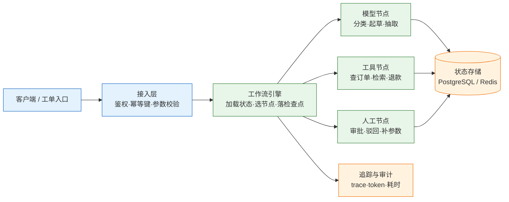
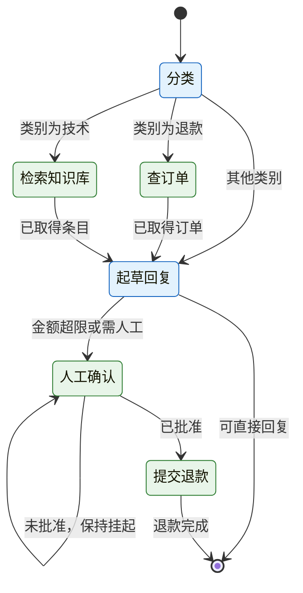
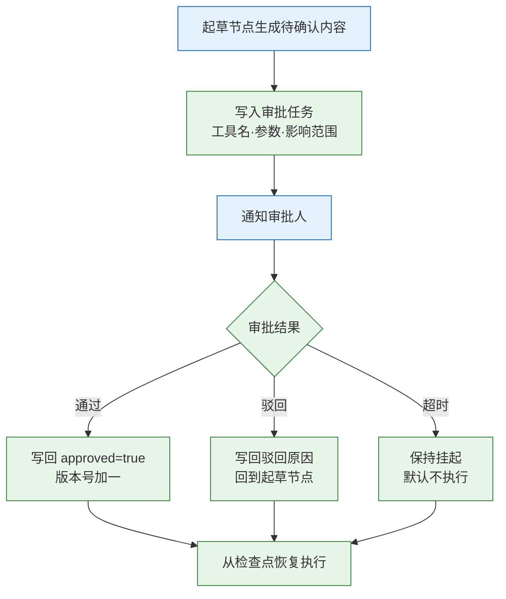
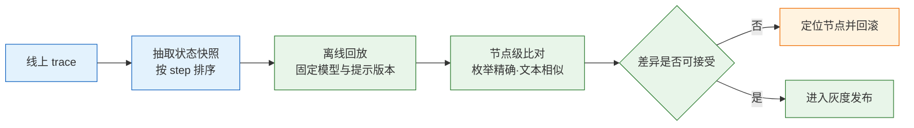

# Agent 工作流

---

## 一、Agent 工作流是什么

### 1.1 核心概念

Agent 工作流（Agent Workflow）把任务拆成有名字的节点，用代码描述先后顺序与分支条件，只在需要语义判断的节点调用模型。执行路径由编排层决定，不由模型临时决定。它带来四个结果：同一输入走同一条路径、节点可单独测试、调用次数可预估、崩溃后能从检查点继续。

工作流的最小模型只有三样东西：状态、节点、边。状态是一张随流程传递的表，字段就是节点之间的契约；节点是一个把状态映射为新状态的函数，负责计算和调用外部能力；边是一个根据状态返回下一个节点名的函数，负责全部路由判断。三者分开之后，改分支不需要改节点，改节点不会影响路由。

| 要素 | 定义 | 缺失后的表现 |
|---|---|---|
| 状态 | 跨节点传递的结构化数据 | 节点靠全局变量传参，无法恢复 |
| 节点 | 单一职责的处理函数 | 逻辑散落，无法定位失败点 |
| 边 | 状态到下一节点的映射 | 分支写进节点，路径不可枚举 |
| 检查点 | 落盘的状态与下一节点 | 崩溃后从头重跑，副作用重复 |

工作流与“把模型调用串起来”的区别在于约束。分类节点只能返回枚举值，起草节点只能写正文，金额判断写在边或节点末尾，不交给模型自由裁量。约束越明确，行为越稳定，能覆盖的任务也越窄。

> **注意**：工作流不是“更复杂的提示词”。如果一条链路里模型仍然可以自由选择下一个工具、自由决定何时结束，那它是 Agent，只是外层包了一个函数。判断依据是控制流归谁所有，不是代码里有没有 `while`。

### 1.2 与相邻技术的关系

工作流与 Agent 是同一坐标系的两端。Agent 由模型在循环里选择下一步，适合路径无法预先枚举的任务；工作流把路径写进边，适合步骤已知、分支有限、有合规要求的任务。两者可以嵌套：工作流里放一个 Agent 节点处理开放式子问题，Agent 也可以把固定流程注册成工具。嵌套时必须在文档里写清楚哪一层拥有终止权。

RAG 链是工作流的无分支特例：改写、召回、重排、生成，顺序固定。规则引擎与 BPMN 则把条件或审批外置成配置，适合规则频繁变动、业务人员需要读图的场景。

| 技术 | 决策者 | 主要优势 | 与本主题的关系 |
|---|---|---|---|
| Agent | 模型逐步决策 | 能处理未枚举路径 | 工作流的对照形态，可嵌入 |
| RAG 链 | 代码固定顺序 | 实现简单、延迟稳定 | 工作流的无分支特例 |
| 规则引擎 | 配置中的条件 | 规则可热更新 | 可替代工作流中的判断边 |
| BPMN | 流程定义与人工任务 | 业务可读、审批标准 | 负责人审环节的建模 |
| 任务队列 | 投递与消费 | 异步、削峰、重试 | 工作流的调度底座 |

### 1.3 架构组成

一个可上线的工作流分五层：接入层做鉴权、幂等键和入口校验；引擎层负责调度与检查点；节点层放模型、工具与人工任务；存储层保存状态、幂等结果和审计；观测层把各节点串成 trace。



引擎只做调度，不写业务判断。它不知道“退款金额超过一千要人工”，只知道执行完 `draft` 后调用 `route`，由 `route` 返回 `human`。把业务规则放进引擎，会让引擎随业务膨胀；把调度逻辑放进节点，会让节点承担两份职责。

| 层 | 职责 | 典型故障 |
|---|---|---|
| 接入层 | 鉴权、幂等键、入口校验 | 重复提交产生两条流程 |
| 引擎层 | 调度、检查点、终止条件 | 死循环、状态覆盖 |
| 节点层 | 模型与工具的实际调用 | 超时、参数错、副作用重复 |
| 存储层 | 状态、幂等结果、审计 | 版本冲突、写入丢失 |
| 观测层 | trace、指标、成本归集 | 无法复现、账单拆不开 |

---

## 二、状态机与编排模型

### 2.1 状态字段契约

状态字段不是越多越好。每加一个字段，就多一处“谁写、何时失效、旧数据缺它怎么办”的问题。设计时先问：后续哪个节点真的会读它；它能否从别的字段推导；失效时的默认值是什么。

| 状态字段 | 写入方 | 读取方 | 不变量 |
|---|---|---|---|
| `ticket_id` | 入口 | 所有节点 | 全程不变，兼作幂等键前缀 |
| `category` | `classify` | 路由 | 只能是三个枚举值之一 |
| `order` | `query_order` | 起草、金额判断 | 查不到时为空字典，不是 `None` |
| `reply` | `draft` | 出口 | 不超过 300 字 |
| `need_human` | 任意节点 | 路由 | 一旦为真，只能进人工节点 |
| `steps` | 引擎 | 引擎 | 超过 8 直接失败 |

工具返回的原始 JSON 不要整个塞进状态。一次订单查询可能返回上百行嵌套结构，全部保留会让检查点膨胀、回放难以比对，还会把无关的用户信息带进提示词。在节点里抽取后续要用的字段，原始响应写归档表。

状态还要有版本。字段增删时，旧检查点仍可能被恢复，读取方必须给缺失字段默认值。更稳妥的做法是加 `schema_version`，恢复时先迁移成当前结构，再进入引擎。

> **注意**：`need_human=True` 之后仍然继续执行工具节点，是常见事故。人工确认的含义是“暂停并等待”，不是“记一笔然后照常退款”。这个判断必须放在路由里，不能只放在提示词里。

### 2.2 节点与边的职责划分

节点只负责“算”，边只负责“判断”。节点接收状态并返回新状态，可以调模型、查数据库和内部 API，但不读全局变量、不决定下一步、不写流程状态。边接收状态，返回已注册的节点名，不做网络调用。

| 关注点 | 节点 | 边 |
|---|---|---|
| 输入 | 当前状态 | 当前状态 |
| 输出 | 新状态 | 下一个节点名 |
| 允许的动作 | 调模型、查库、调工具 | 读字段、比较、查表 |
| 禁止的动作 | 决定下一节点、写检查点 | 网络调用、修改状态 |
| 测试方式 | 固定输入比对输出 | 枚举状态比对目标节点 |

路由返回值必须白名单校验。节点注册表是唯一来源，结果不在表内就抛错并落审计。

```python
# edges.py —— 路由只做判断，返回值必须已注册
NODES = {"classify", "query_order", "search_kb", "draft", "human", "refund"}

def route(name: str, s: State) -> str:
    # 终止条件优先于业务分支，防止状态异常时继续执行
    if s.steps > 8:
        raise RuntimeError("步数超限")
    if s.need_human and not s.approved and name != "human":
        return "human"
    if name == "classify":
        # 枚举查表，不用连续的 if/elif，新增类别只改表
        return {"refund": "query_order", "tech": "search_kb"}.get(s.category, "draft")
    if name == "human":
        return "refund" if s.approved else "end"
    nxt = "end" if name in ("draft", "refund") else "draft"
    if nxt != "end" and nxt not in NODES:
        raise ValueError(f"未注册节点 {nxt}")
    return nxt
```

### 2.3 五种编排形态

编排形态决定调用次数、延迟结构和失败传播方式。先画路径，再判断属于哪一种形态；形态确定后，成本和并发上限基本能算出来。

| 形态 | 结构 | 调用次数 | 适合 | 主要风险 |
|---|---|---|---|---|
| 链式 | A→B→C | 固定 | 抽取→校验→入库 | 上游错一路错 |
| 路由 | 分类→分支 | 1 + 分支 | 客服分流、意图分发 | 分类错走错链 |
| 并行 | 扇出→汇总 | 1 + N 并发 | 多源检索、多视角评审 | 结果覆盖、限流 |
| 编排者-工作者 | 主节点派活 | 不确定 | 子任务可拆分 | 成本翻倍 |
| 评估-优化 | 生成→打分→重写 | 2~3 轮 | 文案、代码修复 | 打分器与目标不一致 |

路由的准确率决定整条链路的命中率。类别定义必须互斥且可判定；定义重叠时模型只能靠猜，补 few-shot 不如先写清边界。

并行最容易出静默错误：两个分支都写 `state["summary"]`，后完成的覆盖先完成的，而且不报错。汇总时显式检查键冲突。

```python
# fan_in.py —— 并行分支汇总，重复键直接失败
def fan_in(results: list[dict]) -> dict:
    out = {}
    for r in results:
        for k, v in r.items():
            if k in out:
                raise ValueError(f"并行分支重复写字段 {k}")   # 静默覆盖最难查
            out[k] = v
    return out
```

评估-优化循环必须有停止条件：最多两轮重写，且分数不再上升就停。没有停止条件的“再改一版”会把一次生成变成四次，成本翻倍而质量不变。

### 2.4 无框架状态机实现

不依赖框架也能实现完整状态机。下面的代码包含节点、边、检查点、人工暂停与断点恢复，只用标准库，可直接运行；生产环境把关键词分类换成模型调用即可。

```python
# flow.py —— 纯 Python 状态机：节点、边、断点、人工确认
import json
from dataclasses import dataclass, field, asdict
from pathlib import Path

@dataclass
class State:
    ticket_id: str
    text: str
    category: str = ""
    order: dict = field(default_factory=dict)
    reply: str = ""
    need_human: bool = False
    approved: bool = False
    steps: int = 0
    next_node: str = "classify"

def classify(s: State) -> State:
    # 生产环境换成一次模型调用 + 枚举校验；这里用关键词保证可离线跑
    rules = {"退款": "refund", "退货": "refund", "报错": "tech", "登录": "tech"}
    s.category = next((v for k, v in rules.items() if k in s.text), "other")
    return s

def query_order(s: State) -> State:
    # 真实实现查订单服务；查不到时返回空 dict，由下游判断
    s.order = {"order_no": "A1024", "amount_cny": 1299, "status": "paid"}
    return s

def search_kb(s: State) -> State:
    s.order = {"kb": "重置密码：设置-安全-修改密码；仍失败转人工。"}
    return s

def draft(s: State) -> State:
    if s.category == "refund":
        s.reply = f"订单 {s.order.get('order_no')} 可退 {s.order.get('amount_cny')} 元，已提交审核。"
        s.need_human = s.order.get("amount_cny", 0) > 1000      # 金额红线
    elif s.category == "tech":
        s.reply = s.order.get("kb", "未找到相关说明，转人工。")
    else:
        s.reply = "已记录，稍后由人工回复。"
        s.need_human = True
    return s

def human_gate(s: State) -> State:
    if not s.approved:
        if not s.reply.endswith("（待人工确认）"):
            s.reply += "（待人工确认）"                          # 实际用审批任务 + 持久化
        return s
    s.reply = s.reply.replace("（待人工确认）", "") + "（已人工确认）"
    return s

def refund(s: State) -> State:
    # 演示用退款；生产由 6.2 的适配器替换，幂等键在适配器里
    s.order["refund"] = {"refund_no": f"R{s.order.get('order_no')}"}
    return s

NODES = {"classify": classify, "query_order": query_order, "search_kb": search_kb,
         "draft": draft, "human": human_gate, "refund": refund}
Path("state").mkdir(exist_ok=True)

def route(name: str, s: State) -> str:
    if s.steps > 8:
        raise RuntimeError("步数超限")
    # 未批准转人工
    if s.need_human and not s.approved and name != "human":
        return "human"
    if name == "classify":
        return {"refund": "query_order", "tech": "search_kb"}.get(s.category, "draft")
    if name == "human":
        return "refund" if s.approved else "end"
    return "end" if name in ("draft", "refund") else "draft"

def run(s: State) -> State:
    name = s.next_node                              # 从断点继续，而不是从头重跑
    while name != "end":
        s.steps += 1
        s = NODES[name](s)
        if name == "human" and not s.approved:       # 人工未批，停在这里等下一次恢复
            s.next_node = "human"
            Path(f"state/{s.ticket_id}.json").write_text(
                json.dumps(asdict(s), ensure_ascii=False), encoding="utf-8")
            break
        name = route(name, s)
        s.next_node = name
        Path(f"state/{s.ticket_id}.json").write_text(
            json.dumps(asdict(s), ensure_ascii=False), encoding="utf-8")
    return s

def resume(ticket_id: str, approved: bool) -> State:
    s = State(**json.loads(Path(f"state/{ticket_id}.json").read_text(encoding="utf-8")))
    if s.next_node == "human" and not approved:
        return s                                    # 未批准，保持挂起
    s.approved = approved
    return run(s)

if __name__ == "__main__":
    out = run(State(ticket_id="t1", text="上周买的键盘想退款"))
    print(out.category, out.need_human, out.reply)
    print(resume("t1", approved=True).reply)
```

状态转移关系可以直接画出来。圆圈是节点，箭头上的文字是路由条件，条件之外没有隐含路径。



预期输出：

```text
refund True 订单 A1024 可退 1299 元，已提交审核。（待人工确认）
订单 A1024 可退 1299 元，已提交审核。（已人工确认）
```

这段实现有三个刻意设计。节点不判断“下一步”，路由只看状态；每步落盘，进程挂了能从 `state/t1.json` 恢复；`steps > 8` 在路由里兜底，防的是路由写错导致的环。文件落盘只适合单机演示，多实例要换成数据库并加版本号。

> **注意**：`resume` 从 `next_node` 继续，而不是重新执行整条流程。如果恢复时把 `next_node` 重置为 `classify`，已经查过的订单会重查，已经发出的通知会重发；有副作用的节点重跑一次就是一次事故。

---

## 三、工具调用与错误处理

### 3.1 工具契约

工具契约的四部分缺一不可。

| 契约项 | 要求 | 常见错误 |
|---|---|---|
| 名称 | 动词加名词，全局唯一 | `do_it`、`helper` 之类无法区分 |
| 描述 | 写清触发条件与禁用条件 | 只写“查询订单”，模型逢单就查 |
| 参数 | 类型、枚举、必填项、范围 | 金额用字符串，模型传入“约一千” |
| 返回 | 成功与失败同构，带错误码 | 失败时抛异常，模型看到堆栈 |

返回信封统一成 `{"ok": true, "data": ...}` 或 `{"ok": false, "error_code": "...", "retryable": false}`。模型不需要看堆栈和内部主机名，只需要知道“这次没查到”以及“能不能再试”。错误码同时写给引擎，由引擎决定重试还是转人工。

参数必须在服务端校验。JSON Schema 只约束类型和必填项，业务约束要单独写：金额上限、日期范围、订单归属、租户隔离。模型生成的参数一律视为不可信输入。

> **注意**：工具返回给模型的内容要压缩。检索返回二十条、每条五百字，会占用大量输入 token 并稀释重点。只回传前三条的摘要与出处，完整结果留在归档表里，需要时再按 id 取。

### 3.2 节点级失败与重试

失败要按节点处理，不能重跑整条流程。分类节点超时只重试分类；订单查过、回复起草过，重跑只会重复计费。引擎捕获异常时必须知道当前节点名，才能局部重试。

| 失败点 | 策略 | 说明 |
|---|---|---|
| 模型超时 / 429 | 退避重试 2 次 | 只重试当前节点，不重跑整条 |
| 分类结果不在枚举 | 回喂一次“只能选这三个值” | 仍失败走 `other` 加人工 |
| 查库失败 | 重试 1 次，仍失败置 `degraded` | 不要用空结果继续编 |
| 工具参数错 | 不重试，记日志转人工 | 重试还是同样的参数 |
| 人工驳回 | 终止或回到上一节点 | 不要自动改成“通过” |
| 死循环 | `steps` 上限加边白名单 | 路由只能返回已注册节点 |

重试只对幂等节点开放：检索、查订单可以重试，发邮件、退款、发券不行。给节点打标签，引擎按标签决定策略。

```python
# retry.py —— 只对可重试节点做指数退避，带抖动
import random, time

RETRYABLE = {"classify", "search_kb", "query_order"}

def run_node(name: str, state, attempts: int = 3):
    for i in range(attempts):
        try:
            return NODES[name](state)
        except RetryableError:
            # 副作用节点不重试；参数错误不在 RetryableError 里
            if name not in RETRYABLE or i == attempts - 1:
                raise
            # 抖动避免多个实例在同一时刻再次打满上游
            time.sleep(min(2 ** i, 8) * (0.5 + random.random()))
```

重试次数不是越多越好。三次尝试已覆盖多数瞬时抖动；继续加会把一次故障放大成三倍流量。重试要有总预算：单节点最多三次，整条流程最多二十秒，超出就降级并告警。

### 3.3 幂等与副作用

工作流引擎通常只能保证“至少执行一次”。进程在“副作用已发生、状态尚未落盘”之间崩溃，恢复时节点会被再执行一次。要接近“恰好一次”，靠的是幂等键加结果表，而不是更谨慎的重试。

| 副作用 | 幂等键 | 补偿动作 |
|---|---|---|
| 发送通知 | `thread_id:notify:channel` | 查发送记录，已发则跳过 |
| 提交退款 | `thread_id:refund:order_no` | 按退款单号查询状态 |
| 发放优惠券 | `thread_id:coupon:user_id` | 以券码唯一约束去重 |
| 写入工单系统 | `thread_id:sync:version` | 按外部 id 做 upsert |

幂等键由流程 id、节点名和关键参数哈希组成。执行前先插入唯一键，成功才调用外部接口，调用成功把结果写回同一行。第二次执行插入冲突，直接返回上次结果。插入后崩溃会留下无结果的记录，需要超时清理。

需要跨外部系统时，用事务性发件箱：意图与状态同事务写入，worker 读取意图调用接口，成功后标记完成。进程崩溃后意图还在，外部接口按幂等键去重。

> **安全警告**：退款、发券、删除数据这类节点，必须同时具备人工确认、金额或范围上限、幂等键三样。只加重试不叫可靠，叫重复扣款；只加确认不设上限，叫把风险交给审批人肉眼核对。

### 3.4 循环与越权防护

> **安全警告**：工作流最贵的事故有两类：停不下来和越权。前者烧掉模型额度，后者泄露或修改不属于当前用户的数据。两者都要在引擎层设硬约束，不能依赖提示词。

| 风险 | 机制 | 建议阈值 |
|---|---|---|
| 无限循环 | 步数上限加边白名单 | 单流程不超过 8 到 12 步 |
| 成本失控 | 单流程 token 与金额预算 | 超出即终止并转人工 |
| 越权查询 | 租户与用户 id 由服务端注入 | 模型参数中不出现身份字段 |
| 越权写入 | 工具侧二次鉴权 | 每次调用校验资源归属 |
| 路径漂移 | 节点与边版本化 | 发布前跑固定评测集 |

身份信息不能由模型填写。输入里可以出现“当前用户是张三”，但工具调用的 `tenant_id`、`user_id` 必须从会话上下文注入，并校验资源归属。把身份放进参数，等于把越权入口交给可能被提示注入的文本。

```python
# guard.py —— 引擎侧硬约束，任何节点都无法绕过
class Budget:
    def __init__(self, max_steps=10, max_tokens=20000, max_cost=0.05):
        self.steps = self.tokens = 0
        self.max_steps, self.max_tokens, self.max_cost = max_steps, max_tokens, max_cost

    def charge(self, tokens: int, unit_price: float) -> None:
        self.steps += 1
        self.tokens += tokens
        # 三个维度任一超限都终止，避免只防住其中一种浪费
        if (self.steps > self.max_steps or self.tokens > self.max_tokens
                or self.tokens * unit_price > self.max_cost):
            raise BudgetExceeded("流程预算超限")
```

预算按流程累计，不按单次调用。单次看着都便宜，十几次叠加才出现在账单上。超限时不要静默返回空结果，要落审计并转人工。

> **安全警告**：工具权限按最小化授予。只读的检索节点不应持有退款接口的凭证；处理单租户的流程不应使用跨租户的管理员密钥。凭证按节点隔离，泄露时的爆炸半径才可控。

---

## 四、断点恢复与人工确认

### 4.1 检查点存储

检查点要回答两个问题：执行到哪，下一站是谁。只存状态不存 `next_node`，恢复时只能从头推断；只存 `next_node` 不存状态，恢复后节点拿不到输入。两者必须一起写，并且写入要原子。

| 存储 | 适用 | 注意 |
|---|---|---|
| 内存 | 本地调试、单元测试 | 进程退出即丢 |
| Redis | 单机或小集群，要求低延迟 | 设 TTL，避免状态永久堆积 |
| PostgreSQL | 需要审计、跨重启、多实例 | 一个 `thread_id` 一行，JSONB 存状态 |

```sql
-- schema.sql —— 状态与版本放在同一行，恢复时用版本号做乐观锁
CREATE TABLE workflow_state (
  thread_id   text PRIMARY KEY,
  state       jsonb NOT NULL,
  next_node   text  NOT NULL,
  version     bigint NOT NULL DEFAULT 0,
  updated_at  timestamptz NOT NULL DEFAULT now()
);

-- 恢复前先抢版本，两个执行器只有一个能成功
UPDATE workflow_state
   SET state = $1, next_node = $2, version = version + 1, updated_at = now()
 WHERE thread_id = $3 AND version = $4;
```

检查点写在“节点执行完成之后、下一节点开始之前”，副作用节点还要保证“副作用发生后立刻写”。先写状态再执行，崩溃会留下“看似完成、实际没执行”的假记录；副作用后不写，恢复会重复执行。两者之间的窗口只能靠幂等键兜住。

### 4.2 恢复语义

恢复的起点是 `next_node`，不是流程开头。已经产生副作用的节点不能重跑；确实无法判断是否执行过时，用幂等键查询外部系统的真实状态，再决定跳过还是重试。

| 崩溃位置 | 状态表现 | 恢复动作 |
|---|---|---|
| 节点执行前 | 检查点指向该节点 | 正常执行 |
| 副作用已发生、状态未写 | 检查点仍指向上一个节点 | 查幂等结果或外部状态，跳过重复调用 |
| 状态已写、路由未算 | `next_node` 为空或旧值 | 用状态重新计算路由，不重跑节点 |
| 人工审批已通过、未恢复 | `approved=true`、`next_node=human` | 直接进入下一节点 |
| 检查点写入冲突 | 版本号不匹配 | 拒绝本次恢复，交给持锁方 |

同一个 `thread_id` 可能被重复恢复：用户连点两次“通过”、回调重投、运维手动重放。恢复前先拿版本号做乐观锁，版本不匹配就拒绝。幂等键解决“重复调用外部接口”，乐观锁解决“两个执行器同时改状态”，两者不能互相替代。

> **注意**：恢复接口要幂等。重复调用恢复不应产生第二封通知或第二笔退款；接口返回“已在处理中”比返回 500 更利于调用方判断。

### 4.3 人工确认节点

人工确认要停在执行前，不是执行后补一个“是否满意”。确认页必须展示工具名、完整参数、影响范围和不可逆后果；只写“执行退款操作”的确认框，等于让审批人签一张空白支票。



| 确认项 | 要求 | 反例 |
|---|---|---|
| 确认对象 | 具体参数与金额 | “执行退款操作” |
| 默认结果 | 超时保持挂起 | 超时自动通过 |
| 驳回处理 | 允许修改参数后重提 | 驳回后从头跑 |
| 审计字段 | 审批人、时间、参数、理由 | 只留一条聊天记录 |

人工节点延迟按小时算，不要放进同步 HTTP 请求里等。写审批任务表、发通知、立即返回“待确认”，由回调触发恢复。确认记录独立落审计表，含审批人、时间、参数、决定和理由。

> **安全警告**：审批人不能是发起人本人，也不能由模型扮演。高金额或高风险操作要双人复核；审批链接要一次性、带过期时间，不能长期有效。

---

## 五、观测与评测

### 5.1 追踪字段

字段要能复现、归因、对账。

| 字段 | 用途 |
|---|---|
| `thread_id` / `ticket_id` | 串起所有节点，复现问题 |
| `node` / `step` | 定位卡在哪一步 |
| `model` / `prompt_version` | 行为变化时能归因 |
| `in_tokens` / `out_tokens` | 成本归集与异常检测 |
| `latency_ms` | 找慢节点 |
| `status` / `error_code` | 失败率与失败分类 |
| `need_human` / `approved` | 人工介入率与审批结果 |
| `checkpoint_version` | 判断是否发生重复恢复 |

每个节点一条 span，父 span 是整条流程。span 只记录输入输出的摘要，全文放归档表，按 `thread_id` 和 `step` 关联；摘要至少保留枚举值、金额、订单号、错误码。

### 5.2 指标定义

工作流的指标分三层：业务层看完成率与人工介入率，引擎层看节点错误率与恢复成功率，成本层看单工单成本与重试放大倍数。三层要一起看，否则会出现“成功率高但全靠人工兜底”的假象。

| 指标 | 定义 | 采集方式 |
|---|---|---|
| 流程完成率 | 到达终止节点的工单占比 | 按 `thread_id` 聚合最终状态 |
| 节点错误率 | 节点抛错次数除以执行次数 | 每个 span 的 `status` |
| 人工介入率 | 进入人工节点的工单占比 | `need_human=true` 计数 |
| 恢复成功率 | 恢复后到达终止节点的比例 | 恢复事件与最终状态关联 |
| P95 单节点延迟 | 各节点耗时的 95 分位 | span 时长直方图 |
| 单工单成本 | 所有节点 token 折价之和 | 按 `thread_id` 汇总 |
| 重试放大倍数 | 实际调用次数除以理论步数 | 引擎计数 |

### 5.3 回放与评测

回归靠回放，不靠感觉。取出线上 trace 的状态快照，逐节点重放并比对输出，而不是只比最终回复；节点级比对能直接指出“分类没变、检索少了一条、起草变长了”。



评测集按任务构造，不追求大而全。分类节点每类准备二十到五十条边界样本，检索节点准备有标准出处的问答对，起草节点用评分表而非单一相似度。评分表至少含事实正确、引用可追溯、格式合规三项。

新增节点先影子跑：同一条工单双跑新旧流程，只记录不返回，对比五十到一百条再切。影子运行会带来额外成本，所以要限定时长和流量比例，不能长期挂着。

> **注意**：回放时模型版本必须固定。供应商的模型别名会自动升级，同一份快照在不同时间回放可能得到不同结果；不锁版本，差异无法归因。

### 5.4 成本核算

按工单核算才能定价与设预算。

```text
单工单成本 = Σ(各节点输入 token × 输入单价 + 输出 token × 输出单价) / 10^6
月成本     = 日工单数 × 30 × 单工单成本 × (1 + 重试率)
```

工作流的成本优势来自调用次数固定。一旦在节点里加一轮“自我检查”，成本立刻翻倍；加之前先问这轮检查抓到了多少错。节点级降档同样有效：分类用便宜的小模型，起草用强模型，按节点分别设上限。

| 节点 | 模型档位 | 触发条件 |
|---|---|---|
| 分类 | 小模型 | 类别少、定义清晰 |
| 检索改写 | 小模型 | 查询短、领域固定 |
| 起草 | 强模型 | 面向用户、需要语气 |
| 校验 | 小模型或规则 | 格式、枚举、长度 |

---

## 六、完整示例：退款工单工作流

### 6.1 流程设计

示例沿用第二节的状态机，把节点替换成生产适配器：分类改为模型调用并校验枚举，查订单增加超时与重试，退款增加幂等键与审计，人工确认改为审批任务。流程本身不变，变的是每个节点与外部的交互方式。

| 节点 | 输入 | 输出 | 副作用 |
|---|---|---|---|
| `classify` | 工单文本 | 三类枚举 | 无 |
| `query_order` | 工单号、用户 id | 订单摘要 | 无 |
| `search_kb` | 查询词 | 条目与出处 | 无 |
| `draft` | 类别、订单、条目 | 回复正文、是否人工 | 无 |
| `human` | 待确认参数 | 批准或驳回 | 审批记录 |
| `refund` | 订单号、金额、幂等键 | 退款单号 | 资金变动 |

### 6.2 工程装配

下面的适配器把模型调用、重试、幂等和审计接到 2.4 的引擎上。数据库用 SQLite 便于本地运行，生产换成 PostgreSQL 并加连接池；模型调用使用 OpenAI 兼容接口，未配置密钥时自动退回关键词分类，保证示例可离线验证。

```python
# adapters.py —— 生产节点：枚举校验、幂等退款、审计
import json, os, sqlite3, hashlib
from flow import State, NODES

DB = sqlite3.connect("workflow.db")
DB.executescript("""
CREATE TABLE IF NOT EXISTS idem(key TEXT PRIMARY KEY, result TEXT);
CREATE TABLE IF NOT EXISTS audit(thread_id TEXT, node TEXT, action TEXT,
                                 detail TEXT, created_at TEXT DEFAULT CURRENT_TIMESTAMP);
""")

CATEGORIES = {"refund", "tech", "other"}
_rule_classify = NODES["classify"]          # 保存规则分类，避免兜底时递归调用自身

def idem_key(s: State, node: str, **params) -> str:
    # 键包含流程、节点与关键参数，参数不同视为不同副作用
    raw = json.dumps(params, sort_keys=True, ensure_ascii=False)
    return f"{s.ticket_id}:{node}:{hashlib.sha256(raw.encode()).hexdigest()[:12]}"

def refund_once(s: State, order_no: str, amount: int) -> dict:
    key = idem_key(s, "refund", order_no=order_no)   # 一单只退一次，金额不入键
    # 先占位，唯一键挡住并发；pending 由对账任务用同一键重试
    DB.execute("INSERT OR IGNORE INTO idem(key, result) VALUES(?, ?)",
               (key, '{"status":"pending"}'))
    DB.commit()
    row = DB.execute("SELECT result FROM idem WHERE key=?", (key,)).fetchone()
    if json.loads(row[0]).get("status") != "pending":
        return json.loads(row[0])             # 已完成，直接返回上次结果
    # 真实实现调用支付网关，并把同一个幂等键传给网关去重
    result = {"refund_no": f"R{order_no}", "amount": amount}
    DB.execute("UPDATE idem SET result=? WHERE key=?",
               (json.dumps(result, ensure_ascii=False), key))
    DB.commit()
    DB.execute("INSERT INTO audit(thread_id, node, action, detail) VALUES(?,?,?,?)",
               (s.ticket_id, "refund", "refund", json.dumps(result, ensure_ascii=False)))
    DB.commit()
    return result

def classify_llm(s: State) -> State:
    # 有密钥走模型，无密钥走关键词，两条路径都输出同一组枚举
    if not os.environ.get("LLM_API_KEY"):
        return _rule_classify(s)
    from openai import OpenAI
    client = OpenAI(base_url=os.environ["LLM_BASE_URL"],
                    api_key=os.environ["LLM_API_KEY"])
    prompt = "把工单分到 refund、tech、other 之一，只输出类别名。"
    r = client.chat.completions.create(
        model=os.environ["LLM_MODEL"],
        messages=[{"role": "system", "content": prompt},
                  {"role": "user", "content": s.text}],
        temperature=0,
    )
    label = (r.choices[0].message.content or "").strip().lower()
    # 枚举校验失败落到 other，交给人工，不让脏值进入路由
    s.category = label if label in CATEGORIES else "other"
    return s

def refund_node(s: State) -> State:
    # 只在人工批准后由边触发；恢复重放时由幂等键挡住重复退款
    s.order["refund"] = refund_once(s, s.order["order_no"], s.order["amount_cny"])
    return s

NODES["classify"] = classify_llm
NODES["refund"] = refund_node
```

```python
# main.py —— 先加载引擎，再加载适配器，顺序不能反
import flow, adapters
out = flow.run(flow.State(ticket_id="t1", text="上周买的键盘想退款"))
print(out.category, out.need_human, out.reply)
```

适配器通过替换 `NODES` 接入，2.4 的 `human` 批准边指向 `refund`。只有批准后才走到退款节点，未批准仍停在 `human`；边写错会出现“显示已批准、资金未动”。

### 6.3 运行与验证

```bash
# 安装依赖并跑通离线流程
python3.12 -m venv .venv && source .venv/bin/activate
pip install "openai>=1.40"

# 第一次运行：金额 1299 超限，停在人工节点
python main.py

# 查看落盘状态，确认 next_node 为 human
cat state/t1.json

# 恢复并批准；必须先导入适配器，否则退款节点仍是演示实现
python -c "import adapters; from flow import resume; print(resume('t1', True).reply)"
sqlite3 workflow.db "select count(*) from idem;"
```

输出类似：

```text
refund True 订单 A1024 可退 1299 元，已提交审核。（待人工确认）
订单 A1024 可退 1299 元，已提交审核。（已人工确认）
1
```

计数为一说明幂等键生效；再执行一次恢复，计数仍应为一。变成二就检查键里是否混入了随机值或时间戳。

### 6.4 扩展点

| 扩展 | 改动点 | 注意 |
|---|---|---|
| 新增类别 | 分类枚举、路由表、评测集 | 三处必须同步，否则走默认分支 |
| 多租户 | 状态加 `tenant_id`，工具注入身份 | 身份不进入模型参数 |
| 异步执行 | 引擎换成队列消费者 | 检查点仍要版本号 |
| 流程版本化 | 状态加 `flow_version` | 旧流程按旧图恢复 |
| 接入审批系统 | 人工节点换成外部任务 id | 回调要验签与幂等 |

---

## 七、适用边界与选型

### 7.1 判断标准

判断标准：写代码时能不能把路径画出来。能画出来、分支有限、每步输入输出可定义，就用工作流；画不出来才考虑 Agent。

| 信号 | 选工作流 | 选 Agent |
|---|---|---|
| 步骤数量 | 固定且可枚举 | 随中间结果变化 |
| 分支条件 | 可用字段判定 | 需要语义理解才能判断 |
| 合规要求 | 每步要留痕、要审批 | 以结果为主 |
| 调用成本 | 必须可预估 | 可接受波动 |
| 失败复现 | 需要按节点回放 | 接受整条 trace 排查 |

### 7.2 不适用场景

开放式故障排查不适合工作流。日志、指标、文档来回查，下一步取决于上一步看到什么，预先枚举所有路径不现实。硬写成工作流，会得到一个巨大的分支树，维护成本高于收益。

创意类任务不适合工作流。文案改几轮、改成什么样，无法在写代码时确定；可以拆成“生成、打分、重写”三段，但段内迭代应交给模型。

| 场景 | 原因 | 替代方案 |
|---|---|---|
| 开放式故障排查 | 路径依赖中间观察 | Agent 加步数与预算上限 |
| 多轮创意改写 | 迭代次数不确定 | 生成加评估循环，设停止条件 |
| 一次性数据迁移 | 无恢复与审批需求 | 顺序脚本加日志 |
| 强实时对话 | 多节点串行延迟高 | 单次调用加轻量工具 |

### 7.3 演进路径

工作流通常从脚本开始，逐步长出状态、检查点、审批和调度。每一阶段都由具体痛点触发，不提前建设。

| 阶段 | 形态 | 触发条件 |
|---|---|---|
| 一 | 顺序脚本 | 步骤固定、失败可重跑 |
| 二 | 单机状态机 | 需要暂停、恢复、分支 |
| 三 | 持久化加审批 | 有副作用、有合规要求 |
| 四 | 队列加多实例 | 吞吐上来、需要削峰 |
| 五 | 平台化 | 多条流程复用节点与观测 |

到第四阶段才需要分布式调度。过早耗在框架配置；过晚会发现状态写不进、任务堆在内存。

---

## 八、常见故障与排查

### 8.1 故障表

| 现象 | 最可能原因 | 处理 |
|---|---|---|
| 路由永远走同一分支 | 分类字段没写回状态，或枚举值拼错 | 打印路由前的完整状态 |
| 流程停不下来 | 边里出现环，且没有步数上限 | 注册节点白名单加 `steps` 上限 |
| 恢复后重复发邮件 | 恢复点选在副作用节点之前 | 副作用后立刻落盘，或加幂等键 |
| 并行结果只剩一个 | 多分支写同一字段 | 汇总时检查键冲突 |
| 人工节点不暂停 | 判断写在节点内部而不是边 | 把 `need_human` 变成路由条件 |
| 分类准确率低 | 类别定义重叠、没有 few-shot | 先修类别定义，再补每类两个例子 |
| 改了提示后整条变差 | 节点共用一个大提示 | 每个节点独立提示、独立版本号 |
| 状态 JSON 越来越大 | 把工具原始返回全存进去 | 只存后续要用的字段 |
| 上游 429 集中爆发 | 并行分支没限流 | 信号量加队列 |
| 恢复时报字段缺失 | 状态结构升级，旧数据没有默认值 | 加 `schema_version` 与迁移函数 |
| 两条流程同时改同一单 | 恢复没有乐观锁 | 版本号条件更新，冲突即拒绝 |

### 8.2 排查顺序

1. 找到 `thread_id`，按 `step` 排序看状态变化，确认停在哪一步。
2. 看路由输入和输出，确认是走错边还是节点算错。
3. 用落盘状态单独重跑出错节点，不要重跑整条流程。
4. 再查提示版本、模型版本、工具返回与上游状态码。
5. 核对检查点与幂等表，确认是否发生重复执行或版本冲突。
6. 最后才怀疑框架；多数问题在状态契约和路由表里。

> **核心结论**：路径能画出来就用工作流，Agent 是给画不出来的任务留的出口；节点只算、边才判断；能停、能恢复、不重跑副作用，这三点决定工作流能否上生产。
