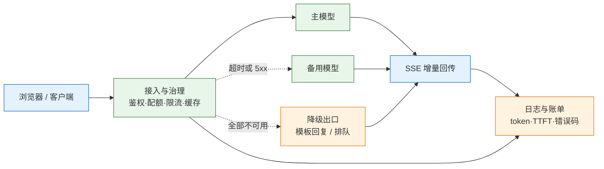
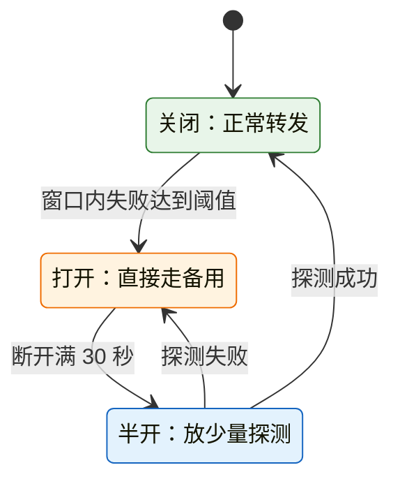
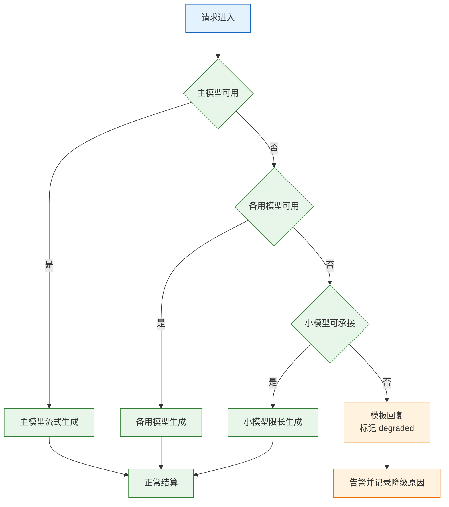
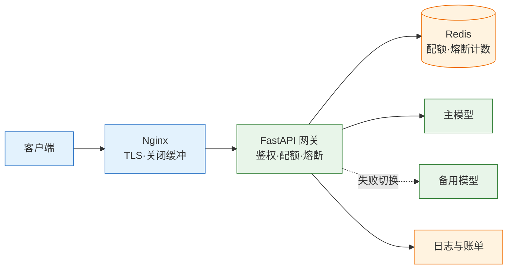

# AI 应用工程

---

## 一、AI 应用工程是什么

### 1.1 核心概念

AI 应用工程是把一次模型调用做成可长期运行的服务所需的工程实践。它关心的不是“模型能不能答对”，而是高峰期会不会塌、账单会不会失控、供应商故障时能不能降级、出了事能不能按请求查到原因。模型在这里不是神秘能力，而是一个有配额、有延迟、会失败、按用量计费的外部依赖，和数据库、缓存、消息队列同级。

一个能演示的脚本与一个能上线的服务，差距集中在六层：入口是否鉴权并识别租户，流量是否有并发闸门和租户级限流，成本是否按请求记账并按日熔断，延迟是否把首字与生成分开测量，故障是否有超时、重试、切换与降级，审计是否留下请求 id、模型版本与输入输出摘要。

| 层 | 演示形态 | 生产必须补齐 |
|---|---|---|
| 入口 | 直接暴露模型密钥 | 鉴权、租户识别、请求体大小限制 |
| 流量 | 无限制 | 并发闸门、按租户限流、排队上限 |
| 成本 | 不统计 | 逐次记 token、按租户归集、日预算熔断 |
| 延迟 | 只看总耗时 | 首 token 与逐 token 分开测 |
| 故障 | 报错就报错 | 超时、重试、切备用、降级话术 |
| 审计 | 无日志 | 请求 id、模型版本、摘要、留存策略 |

补齐顺序按事故概率排：成本与限流最先，被刷一次就会疼；其次可观测，没有日志无法排障；缓存与语义路由属于优化项，缺了只是慢和贵。限流和记账缺了，是会停机的事故。

> **注意**：AI 应用工程不改变模型能力边界。提示词、检索、微调解决“答得准不准”，本节解决“服务稳不稳、贵不贵、能不能查”。两类问题混在一起讨论，通常会导致该限流时去改提示词。

### 1.2 与相邻技术的关系

模型 API 提供推理能力，AI 应用工程在其外面包一层可控的服务边界。模型 API 的计费单位是 token，超时与限流由供应商决定；应用层要把这些外部特性翻译成自己的配额、重试和降级策略。直接把供应商错误码透传给前端，用户看到的是不可理解的失败。

推理部署解决“模型跑在哪里”，包括 GPU 调度、批处理、量化与显存管理。它关心吞吐和显存利用率；AI 应用工程关心请求如何排队、如何计费、如何切换模型。自建推理时两者会重叠，但职责仍然可分：推理服务暴露兼容接口，应用层继续做网关。

传统后端能力可以直接复用。鉴权、租户、幂等、限流、日志、告警都有成熟组件，不需要为 AI 另造一套。真正新增的是 token 计量、流式传输、模型路由和生成质量评测；这四样才需要专门设计。

| 相邻技术 | 解决的问题 | 与本主题的关系 |
|---|---|---|
| 模型 API | 提供推理能力与计费口径 | 被调用的外部依赖 |
| 推理部署 | GPU、批处理、量化 | 自建模型的运行底座 |
| API 网关 | 鉴权、限流、路由 | 可承载部分职责 |
| 传统后端 | 事务、幂等、可观测 | 直接复用，不重复建设 |
| MLOps | 训练、评测、模型版本 | 提供模型侧证据 |

### 1.3 架构组成

一条完整的请求链路包含接入、治理、模型池、回传与结算五段。接入层做鉴权和租户识别；治理层做配额、限流、缓存和模型映射；模型池包含主模型、备用模型和降级出口；回传层用 SSE 把增量内容推给客户端；结算层把用量、延迟、错误写入日志与账单。



网关不一定要独立部署，但它承担的职责必须有人做：统一密钥、统一模型名、统一计量。没有这一层，每个业务自己拿密钥，账单拆不开，出事也停不掉。

| 层 | 职责 | 失效后的表现 |
|---|---|---|
| 接入 | 鉴权、租户识别、体积限制 | 密钥泄露、超大请求打满 |
| 治理 | 配额、限流、缓存、模型映射 | 成本失控、429 集中爆发 |
| 模型池 | 主备切换、降级 | 单一供应商故障即全站不可用 |
| 回传 | SSE 分帧、断连检测 | 首字延迟、重复计费 |
| 结算 | 用量落库、账单归集 | 只知道总账，无法定位功能 |

---

## 二、请求链路与流式网关

### 2.1 请求生命周期

一次请求从进入到结束要经过八个动作：校验请求体、识别租户、检查配额、查缓存、选择模型、建立上游流、逐帧回传、结算用量。每个动作都有超时预算，预算之和必须小于客户端愿意等待的时间，否则会出现“服务还在算、用户已经走”。

| 阶段 | 典型预算 | 超时后的动作 |
|---|---|---|
| 接入与鉴权 | 50ms | 直接拒绝，不进入模型 |
| 配额与缓存 | 30ms | 缓存故障时放行并告警 |
| 连接上游 | 5s | 切备用或降级 |
| 首 token | 按业务设定 | 超过阈值切备用 |
| 整段生成 | 不超过 300s | 截断并标记 |

首 token 时间（TTFT）要从请求发出算到第一个内容 token，不是算到 HTTP 响应头。有的网关先回 200，再等上游出字，这段等待必须计入；否则报表很好看，用户仍在等。

### 2.2 SSE 协议结构

流式回传使用 SSE：一帧一条 `data:`，空行分隔，最后一帧是 `[DONE]`。增量内容放在 `choices[0].delta.content`，结束原因放在 `finish_reason`。

```text
data: {"choices":[{"delta":{"content":"上海"}}]}

data: {"choices":[{"delta":{"content":"是一线城市"}}]}

data: {"choices":[{"delta":{},"finish_reason":"stop"}]}

data: [DONE]
```

| 字段 | 含义 | 常见问题 |
|---|---|---|
| `delta.content` | 本次增量文本 | 为空帧不代表结束 |
| `finish_reason` | 停止原因 | `length` 表示被截断 |
| `usage` | 用量统计 | 流式下不一定每帧都有 |
| `[DONE]` | 流结束标记 | 客户端需单独处理 |

三个常见断点：Nginx 默认缓冲会把流攒起来，用户看到一次性吐出；读超时按非流式配置会在长回答中途切断；用户关闭页面后上游还在生成、还在计费。三者分别对应关闭缓冲、放宽读超时、监听断开并取消上游。

> **注意**：`usage` 在流式响应里不一定出现。有的端点要求在请求中加 `stream_options.include_usage`，有的不支持；以上游当前文档为准。拿不到就按字符估算，但要在报表里标注“估算”。

### 2.3 网关职责

网关的核心不是转发，而是把“不可控的上游”变成“可控的内部服务”。它至少承担六项职责：密钥托管、模型名映射、租户配额、用量计量、缓存、故障切换。

| 职责 | 不做会怎样 | 实现位置 |
|---|---|---|
| 密钥托管 | 密钥散落在各业务，泄露难回收 | 网关环境变量或密钥管理服务 |
| 模型名映射 | 换模型要改所有调用方 | 配置表：内部名到供应商名 |
| 租户配额 | 单个租户刷爆全局额度 | Redis 计数加原子扣减 |
| 用量计量 | 账单只有总额，无法归因 | 从 `usage` 或估算落库 |
| 缓存 | 重复问题重复付费 | 精确缓存优先，语义缓存谨慎 |
| 故障切换 | 供应商抖动即全站失败 | 超时、熔断、备用模型 |

模型名映射要锁快照。供应商的别名可能自动升级，行为漂移最难排查；内部名指向具体版本，升级时先跑评测集。

### 2.4 流式代理实现

下面的代理实现主备切换、TTFT 记录、客户端断开取消与用量解析。它使用 OpenAI 兼容接口，不绑定某一家供应商；只有暂时性错误才切模型，400、401、403 换模型没有意义。

```python
# app.py —— 主模型失败切备用；记录 TTFT 与 usage；客户端断开即停止
import json, os, time
import httpx
from fastapi import FastAPI, Request
from fastapi.responses import StreamingResponse

app = FastAPI()
BASE = os.environ["LLM_BASE_URL"].rstrip("/")
KEY = os.environ["LLM_API_KEY"]
MODELS = [os.environ.get("LLM_MODEL", "qwen-plus"),
          os.environ.get("LLM_FALLBACK", "qwen-turbo")]

@app.post("/v1/chat")
async def chat(req: Request):
    body = await req.json()

    async def gen():
        for model in MODELS:
            started = time.monotonic()
            ttft = None
            usage = None
            try:
                timeout = httpx.Timeout(300.0, connect=5.0)
                async with httpx.AsyncClient(timeout=timeout) as client:
                    payload = {**body, "model": model, "stream": True}
                    async with client.stream("POST", f"{BASE}/chat/completions",
                                             headers={"Authorization": f"Bearer {KEY}"},
                                             json=payload) as r:
                        if r.status_code != 200:
                            await r.aread()
                            # 只有暂时性错误才值得换模型
                            if r.status_code in (408, 429) or r.status_code >= 500:
                                continue
                            yield f'data: {{"error":"upstream_{r.status_code}"}}\n\n'
                            return
                        async for line in r.aiter_lines():
                            if await req.is_disconnected():   # 用户走了就别再烧 token
                                return
                            if not line.startswith("data: "):
                                continue
                            data = line[6:]
                            if data == "[DONE]":
                                yield "data: [DONE]\n\n"
                                break
                            obj = json.loads(data)
                            if obj.get("usage"):
                                usage = obj["usage"]          # 部分供应商在末帧返回
                            choice = (obj.get("choices") or [{}])[0]
                            if ttft is None and choice.get("delta", {}).get("content"):
                                ttft = int((time.monotonic() - started) * 1000)
                            yield f"data: {data}\n\n"
                        print(json.dumps({"model": model, "ttft_ms": ttft,
                                          "total_ms": int((time.monotonic() - started) * 1000),
                                          "usage": usage}, ensure_ascii=False))
                        return
            except httpx.HTTPError as e:
                print(json.dumps({"model": model, "error": type(e).__name__}))
                continue
        yield 'data: {"error":"all_upstreams_failed"}\n\n'

    return StreamingResponse(gen(), media_type="text/event-stream",
                             headers={"X-Accel-Buffering": "no", "Cache-Control": "no-cache"})
```

前置的 Nginx 必须关闭缓冲并放宽读超时，否则应用层写得再对，用户仍会看到“转圈很久、一次吐出”。

```nginx
location /v1/ {
    proxy_pass http://api:8000;
    proxy_buffering off;
    proxy_cache off;
    proxy_read_timeout 300s;
    proxy_set_header X-Accel-Buffering no;
}
```

```bash
# 启动后验证逐帧输出，-N 关闭 curl 自身缓冲
uvicorn app:app --port 8000

curl -N -X POST http://127.0.0.1:8000/v1/chat \
  -H 'content-type: application/json' \
  -d '{"messages":[{"role":"user","content":"用一句话解释 SSE"}]}'
```

预期逐帧打印 `data: ...`，最后一行 `data: [DONE]`；日志里出现 `ttft_ms`。如果只在最后一次性出现，先查 Nginx 的 `proxy_buffering`，再查客户端是否自行聚合。

---

## 三、容量、限流与配额

### 3.1 并发与 QPS 换算

并发不是 QPS。一个请求占用连接数秒，QPS 乘以停留时间才是同时占用的连接数。容量估算要按峰值和长尾分别算。

```text
平均并发 ≈ QPS × 平均生成时长（秒）
峰值并发 ≈ 峰值 QPS × P95 时长
需要容量 = 峰值并发 × 1.5（留突发余量）
```

日十万请求、峰值 20 QPS、平均 6 秒，平均并发约 120；按 P95 10 秒算峰值 200，再留 1.5 倍就是 300。供应商配额只有 60，就必须排队、分流到两家，或把非实时任务挪到批处理。

| 指标 | 定义 | 用途 |
|---|---|---|
| 平均并发 | QPS × 平均时长 | 日常容量与成本 |
| 峰值并发 | 峰值 QPS × P95 时长 | 限流与配额申请 |
| 排队长度 | 等待执行的请求数 | 过载保护阈值 |
| 供应商配额 | 合同或账号上限 | 分流与批处理依据 |

### 3.2 三层限流

只有速率限制不够。一个请求可以带十万字输入，速率没超，钱照烧。限流要同时按次数和 token，并区分并发、速率、预算三层。

| 层 | 限什么 | 单位 | 超了怎么办 |
|---|---|---|---|
| 并发 | 同时在跑的请求数 | 全局 / 实例 | 排队（有上限）或 503 |
| 速率 | 请求频率 | 租户 / 用户 / IP | 429 加 `Retry-After` |
| 预算 | token 或金额 | 租户 / 日 / 月 | 降级到小模型，或直接拒绝 |

并发闸门保护的是上游连接数和本地内存；速率限制保护的是公平性；预算保护的是账单。三者缺一，都会留下一种可被利用的入口：不限并发会在高峰把上游打满，不限速率会被单个租户拖垮，不限预算会被长输入慢慢烧穿。

### 3.3 分布式配额

配额放在 Redis，用原子操作，不要“先读再写”。多实例部署时，限流状态必须在共享存储里；放在进程内存里，三个副本就等于额度乘三，这是上线后最常见的“限流突然不生效”。

```text
INCRBY  quota:{tenant}:{yyyymmdd}:tokens  {本次用量}
EXPIRE  quota:{tenant}:{yyyymmdd}:tokens  172800
```

两条命令之间存在窗口：如果进程在 `INCRBY` 后、`EXPIRE` 前崩溃，键可能没有过期时间。用 Lua 把扣减与过期写成一个原子操作：

```lua
-- quota.lua：原子扣减，并确保键始终带过期时间
local used = redis.call('INCRBY', KEYS[1], ARGV[1])
if redis.call('TTL', KEYS[1]) < 0 then
  redis.call('EXPIRE', KEYS[1], ARGV[2])
end
return used
```

| 存储 | 适用 | 风险 |
|---|---|---|
| 进程内存 | 单实例、本地调试 | 多副本额度翻倍 |
| Redis | 多实例、低延迟 | 故障时配额失效，需降级策略 |
| 数据库 | 强一致、低频扣减 | 热点行与延迟 |
| 网关托管配额 | 不想自建 | 粒度与导出能力受限 |

> **注意**：扣减额度要按“预估用量”先扣，响应结束后按实际用量修正。只在实际用量出来后扣，会让并发的多个请求同时通过检查，瞬间超出配额。

### 3.4 排队与过载保护

排队也要有上限。队列长度超过并发数的两倍就直接 503；一个请求在队列里等 30 秒才开始，用户早走了，连接却还占着，最后是雪崩。

| 策略 | 触发条件 | 动作 |
|---|---|---|
| 队列上限 | 等待数大于并发数两倍 | 立即 503，带重试时间 |
| 请求截止时间 | 超过端到端预算 | 取消上游，返回降级 |
| 按租户隔离 | 单租户占用超过比例 | 限制该租户并发 |
| 负载 shedding | CPU 或连接数超阈值 | 丢弃低优先级请求 |

过载保护要早于崩溃。等到上游 429、连接池耗尽再处理，恢复时间会很长；在入口按队列长度拒绝，能把系统维持在一个可服务的水平。

---

## 四、错误处理与降级

### 4.1 错误分类

错误先分类，再决定动作。把所有非 2xx 都重试，会把参数错误放大成三倍无效请求；把所有错误都切备用，会让备用模型也背上同样的坏参数。

| 状态 | 含义 | 动作 |
|---|---|---|
| 连接失败 / 读超时 | 网络或上游过载 | 退避重试，再切备用 |
| 408 | 上游超时 | 重试一次，缩短输入 |
| 429 | 限流 | 读 `Retry-After`，降并发 |
| 500 / 502 / 503 | 上游故障 | 重试一次，仍失败切备用 |
| 400 | 请求格式或参数错 | 不重试，修请求 |
| 401 / 403 | 密钥或权限问题 | 不重试，修配置 |
| 404 | 模型名或路径错 | 不重试，查映射表 |

### 4.2 重试与退避

重试要带抖动，否则多个实例会在同一时刻再次打满上游。重试还要有总预算：一次请求最多三次尝试、总耗时不超过 20 秒；超过就返回降级结果并告警。

```python
# retry.py —— 指数退避加抖动，只重试暂时性错误
import asyncio, random

RETRYABLE = {408, 429, 500, 502, 503, 504}

async def with_retry(fn, attempts: int = 3, base: float = 0.5):
    for i in range(attempts):
        try:
            return await fn()
        except Exception as e:
            status = getattr(e, "status_code", None)
            # 参数错误、鉴权错误重试也不会成功
            if status is not None and status not in RETRYABLE:
                raise
            if i == attempts - 1:
                raise
            # 抖动避免重试风暴，封顶 8 秒
            await asyncio.sleep(min(base * 2 ** i, 8) * (0.5 + random.random()))
```

| 参数 | 建议 | 说明 |
|---|---|---|
| 最大尝试次数 | 3 | 覆盖多数瞬时抖动 |
| 单次退避上限 | 8s | 防止等待过长 |
| 总耗时预算 | 20s | 超过即降级 |
| 抖动比例 | 50% | 打散重试时刻 |

重试只对幂等请求安全。流式请求已经输出一半时重试整段，会造成重复内容；正确做法是提示用户重试，或从已输出的偏移继续。带副作用的工具调用不能靠重试保证正确，必须用幂等键。

### 4.3 熔断与降级链

熔断用简单阈值就够：30 秒窗口内错误率超过 50% 且请求数超过 20，断开 30 秒，期间直接走备用。不要一上来就上复杂自适应算法；阈值可解释、可回滚，比“智能”更重要。



降级链要有尽头，且每级都说人话：

```text
主模型 → 备用模型（同档） → 小模型（限长度） → 模板回复（“当前繁忙，已记录”）
```



模板回复不是失败，是保住可用性。但要在响应里带 `degraded: true`，让前端和监控都知道这次不是正常结果。降级比例要监控：超过 5% 且持续 5 分钟就告警，否则用户已经在吃模板回复，团队还不知道。

> **安全警告**：降级不能绕过审核与权限。备用模型同样要过内容安全策略，模板回复不能拼接用户隐私；为了“先返回”而跳过审核，会把一次可用性事件变成一次合规事件。

### 4.4 流中断与半截输出

流式响应最尴尬的状态是“已经输出一半，然后断了”。此时重试整段会重复，静默结束会让用户以为答案完整。

| 场景 | 处理 | 用户提示 |
|---|---|---|
| 上游在首 token 前断开 | 切备用或重试 | 无感，最多一次重试 |
| 已输出部分内容后断开 | 不重试整段，标记未完成 | “回答未完成，可重试” |
| 客户端主动断开 | 取消上游，停止计费 | 无 |
| 审核拦截中途内容 | 停止输出并替换 | “内容无法展示” |

客户端断开要真正取消上游请求。仅停止读取，上游仍会生成并计费；在服务端监听断开事件并关闭流，才能止损。

---

## 五、成本控制

### 5.1 成本模型

```text
单次成本 = (输入 token × 输入单价 + 输出 token × 输出单价) / 10^6
月成本   = 日请求数 × 30 × 单次成本 × (1 + 重试率)
```

单价按官网当前价目填进配置，不要写死在代码里。成本要归集到功能：同一租户下，聊天、摘要、批量抽取的单价和用量完全不同，日志加一个 `feature` 字段，否则只知道总账涨了，不知道该砍哪块。

| 成本项 | 来源 | 控制手段 |
|---|---|---|
| 输入 token | 历史、检索、系统提示 | 截断、去重、前缀缓存 |
| 输出 token | 生成长度 | `max_tokens`、格式约束 |
| 重试 | 失败重发 | 退避、熔断、幂等 |
| 缓存未命中 | 前缀变化 | 固定前缀、变量后置 |

### 5.2 三个杠杆

1. **截断输入**：历史只留最近 N 轮，检索只放 Top-3。输入通常占总成本的大头。
2. **限制输出**：`max_tokens` 按任务设，客服回复 300 就够，不要给 4000。
3. **前缀缓存**：系统提示和工具定义固定放最前，命中缓存后输入单价下降；中间插时间戳会让缓存全失效。

| 杠杆 | 做法 | 注意 |
|---|---|---|
| 截断输入 | 保留最近轮次与高分片段 | 别截掉约束条件 |
| 限制输出 | 按任务设上限 | 过小会截断，看 `finish_reason` |
| 前缀缓存 | 固定前缀、变量后置 | 时间戳与随机 id 会破坏命中 |
| 模型降档 | 简单任务用小模型 | 先评测再切 |

### 5.3 缓存分层

缓存分两种：精确缓存要求请求体完全一致，风险低；语义缓存按向量相似度命中，收益高但风险高。缓存键要带模型版本和提示版本，否则改了提示仍命中旧答案。

| 类型 | 命中条件 | 风险 |
|---|---|---|
| 精确缓存 | 请求体完全一致 | 低；需带模型与提示版本 |
| 语义缓存 | 向量相似度超阈值 | 高；个性化、权限、时效问题不能缓存 |

> **安全警告**：语义缓存最容易出的事故是“张三问的答案给了李四”。带用户数据、订单、权限的请求，一律不做语义缓存；缓存键必须包含租户 id，且租户之间物理隔离。为了节省一点输入成本而共享缓存，等于用越权换折扣。

### 5.4 预算熔断

预算按租户、按日、按月三层设置。达到 80% 时降级到小模型，达到 100% 时拒绝新请求并告警；不要等到账单出来才发现。

| 阈值 | 动作 | 告警 |
|---|---|---|
| 日预算 80% | 非核心功能切小模型 | 通知租户负责人 |
| 日预算 100% | 拒绝新请求，保留只读 | 立即告警 |
| 单请求超限 | 截断输入或拒绝 | 记审计 |
| 增速异常 | 对比七日均值 | 触发排查 |

> **安全警告**：预算熔断必须由网关强制执行，不能依赖前端提示或模型自觉。没有硬上限的 AI 服务，一次异常流量就能把当月预算烧完；熔断触发后要保留审计记录与恢复入口。

---

## 六、观测与评测

### 6.1 指标定义

| 指标 | 定义 | 采集方式 |
|---|---|---|
| TTFT | 请求发出到首个内容 token | 流式客户端记首帧 |
| TPOT | 首 token 后每 token 平均间隔 | 总时长除以输出 token |
| 错误率 | 非 2xx 加流中断占比 | 网关按分钟聚合 |
| 单请求成本 | 输入输出 token 折价 | 从 `usage` 落库 |
| 降级比例 | `degraded=true` 占比 | 响应标记统计 |
| 缓存命中率 | 命中次数除以总请求 | 缓存层计数 |

TTFT 的低负载目标是 800ms 以内、P95 在 2s 以内；TPOT 常见目标是 50ms 以内，约合每秒 20 token。目标要按业务和供应商调整，不能把别处的数字当承诺。用户感知的是 TTFT，不是总耗时：一个 8 秒生成、0.6 秒首字的回答，比 3 秒才开口的回答“感觉快”。

### 6.2 日志字段

| 字段 | 为什么 |
|---|---|
| `request_id` / `trace_id` | 串起网关、应用、上游 |
| `tenant_id` / `user_id` | 归集成本、定位越权 |
| `model` / `prompt_version` | 行为变了能归因 |
| `in_tokens` / `out_tokens` | 对账 |
| `ttft_ms` / `total_ms` | 区分慢在首字还是生成 |
| `status` / `error_code` | 失败分类 |
| `cache_hit` / `degraded` | 判断优化是否生效 |
| `finish_reason` | `length` 说明截断，`content_filter` 说明被拦 |

提示词要版本化，`prompt_version=v7` 跟着请求走。改了提示却没版本号，线上变差时无法确认是哪次改动。灰度按 `tenant_id` 哈希分流，不要按请求随机；同一用户一会儿新提示一会儿旧提示，反馈没法看。

日志默认不要存全文：存输入输出的哈希、长度和脱敏摘要，需要排障时按 `request_id` 临时开启全文并设七天过期。日志本身也是泄露源，尤其是把用户原话、订单号、手机号直接打进去。

### 6.3 评测集与灰度

上线前的评测要覆盖三类样本：常见问题、边界问题、对抗输入。评测集不追求大，追求能定位；每个样本带标准答案或评分规则，改一次提示就跑一遍。

| 阶段 | 动作 | 通过标准 |
|---|---|---|
| 离线评测 | 固定评测集跑新旧版本 | 关键项不退化 |
| 影子流量 | 双跑只记录不返回 | 差异可解释 |
| 灰度 | 按租户哈希放量 5% | 错误率与成本不超阈 |
| 全量 | 逐步扩到 100% | 观察一个完整周期 |

变更管理只有两条硬规则：模型名锁快照，升级前在同一套评测集上跑一遍；提示词、参数、模型三样一起改，等于没做实验，一次只改一样。

### 6.4 告警规则

| 告警 | 条件 | 处理 |
|---|---|---|
| 错误率 | 5 分钟内超过 5% | 查上游状态与自身变更 |
| TTFT | P95 超过目标两倍 | 查输入长度与上游排队 |
| 降级比例 | 超过 5% 持续 5 分钟 | 查主模型与熔断状态 |
| 预算 | 日用量超过 80% | 降档并通知租户 |
| 配额拒绝 | 429 比例突增 | 查是否被刷或限额过小 |
| 缓存命中 | 降至 0 并持续 | 查前缀是否被动态字段破坏 |

告警要带租户、模型、请求样例三个维度，否则值班只能看到“错误率上升”，无法判断影响面。

---

## 七、完整示例：可上线的对话服务

### 7.1 组件划分

示例由 Nginx、FastAPI 网关、Redis 和两个模型端点组成。Nginx 负责关闭缓冲与 TLS 终止；网关负责鉴权、配额、熔断、流式转发与记账；Redis 保存配额与熔断状态；模型端点按主备配置。



| 组件 | 作用 | 故障影响 |
|---|---|---|
| Nginx | TLS、缓冲控制、超时 | 流式变批量、长回答被切 |
| 网关 | 鉴权、配额、熔断、记账 | 全部请求不可用 |
| Redis | 共享配额与熔断状态 | 配额失效，需降级放行 |
| 主模型 | 正常生成 | 切备用，延迟上升 |
| 备用模型 | 兜底生成 | 降级到小模型或模板 |

### 7.2 代码实现

下面的网关把配额、熔断、主备切换和用量日志放在一条链路里。租户从请求头读取，生产环境应替换为 JWT 或网关注入并验签；Redis 故障时选择放行并告警，避免配额系统成为单点。

```python
# gateway.py —— 鉴权、日配额、熔断、主备流式转发
import json, os, time
import httpx
import redis.asyncio as redis
from fastapi import FastAPI, HTTPException, Request
from fastapi.responses import StreamingResponse

app = FastAPI()
rds = redis.from_url(os.environ["REDIS_URL"], decode_responses=True)
BASE = os.environ["LLM_BASE_URL"].rstrip("/")
KEY = os.environ["LLM_API_KEY"]
MODELS = [os.environ.get("LLM_MODEL", "qwen-plus"),
          os.environ.get("LLM_FALLBACK", "qwen-turbo")]
DAILY_CAP = int(os.environ.get("DAILY_TOKEN_CAP", "2000000"))

def tenant_of(req: Request) -> str:
    # 示例用请求头；生产必须验签 JWT 或信任网关注入头
    tenant = req.headers.get("x-tenant-id", "")
    if not tenant:
        raise HTTPException(status_code=401, detail="missing tenant")
    return tenant

async def take_quota(tenant: str, estimate: int) -> int:
    key = f"quota:{tenant}:{time.strftime('%Y%m%d')}:tokens"
    # Lua 保证扣减与过期原子执行
    used = await rds.eval("""
        local used = redis.call('INCRBY', KEYS[1], ARGV[1])
        if redis.call('TTL', KEYS[1]) < 0 then
            redis.call('EXPIRE', KEYS[1], ARGV[2])
        end
        return used
    """, 1, key, estimate, 172800)
    return int(used)

async def settle_quota(tenant: str, estimate: int, usage: dict | None) -> None:
    # 按上游返回的实际总量补扣或退还，usage 缺失时保留预估值
    if not usage:
        return
    actual = int(usage.get("total_tokens", 0))
    key = f"quota:{tenant}:{time.strftime('%Y%m%d')}:tokens"
    await rds.incrby(key, actual - estimate)

async def breaker_open() -> bool:
    return await rds.get("breaker:primary") == "1"

async def note_result(ok: bool) -> None:
    if ok:
        await rds.delete("breaker:fail", "breaker:primary")
        return
    fails = await rds.incr("breaker:fail")
    await rds.expire("breaker:fail", 30)
    if fails >= 20:                       # 30 秒窗口内失败达到阈值即断开
        await rds.set("breaker:primary", "1", ex=30)

@app.post("/v1/chat")
async def chat(req: Request):
    tenant = tenant_of(req)
    body = await req.json()
    try:
        used = await take_quota(tenant, 1000)     # 先按预估扣，结束时再修正
    except Exception:
        used = 0                                  # 配额存储故障时放行并告警
    if used > DAILY_CAP:
        raise HTTPException(status_code=429, detail="daily quota exceeded",
                            headers={"Retry-After": "60"})

    async def gen():
        order = MODELS[1:] if await breaker_open() else MODELS
        for model in order:
            started, ttft, usage = time.monotonic(), None, None
            try:
                timeout = httpx.Timeout(300.0, connect=5.0)
                async with httpx.AsyncClient(timeout=timeout) as client:
                    payload = {**body, "model": model, "stream": True}
                    async with client.stream("POST", f"{BASE}/chat/completions",
                                             headers={"Authorization": f"Bearer {KEY}"},
                                             json=payload) as up:
                        if up.status_code != 200:
                            await up.aread()
                            if up.status_code in (408, 429) or up.status_code >= 500:
                                await note_result(False)
                                continue
                            # 4xx 是请求或配置问题，不计入熔断
                            yield f'data: {{"error":"upstream_{up.status_code}"}}\n\n'
                            return
                        async for line in up.aiter_lines():
                            if await req.is_disconnected():
                                return                       # 客户端走了，停止计费
                            if not line.startswith("data: "):
                                continue
                            data = line[6:]
                            if data == "[DONE]":
                                yield "data: [DONE]\n\n"
                                break
                            obj = json.loads(data)
                            if obj.get("usage"):
                                usage = obj["usage"]
                            choice = (obj.get("choices") or [{}])[0]
                            if ttft is None and choice.get("delta", {}).get("content"):
                                ttft = int((time.monotonic() - started) * 1000)
                            yield f"data: {data}\n\n"
                        await note_result(True)
                        await settle_quota(tenant, 1000, usage)
                        print(json.dumps({"tenant": tenant, "model": model,
                                          "ttft_ms": ttft, "usage": usage,
                                          "total_ms": int((time.monotonic() - started) * 1000)}))
                        return
            except httpx.HTTPError as e:
                await note_result(False)
                print(json.dumps({"tenant": tenant, "model": model,
                                  "error": type(e).__name__}))
                continue
        yield 'data: {"error":"all_upstreams_failed","degraded":true}\n\n'

    return StreamingResponse(gen(), media_type="text/event-stream",
                             headers={"X-Accel-Buffering": "no", "Cache-Control": "no-cache"})
```

### 7.3 本地验证

```bash
# 启动 Redis 与网关
docker run -d --name ai-redis -p 6379:6379 redis:7-alpine

export LLM_BASE_URL="https://<your-endpoint>/v1"
export LLM_API_KEY="sk-..."
export LLM_MODEL="qwen-plus"
export LLM_FALLBACK="qwen-turbo"
export REDIS_URL="redis://127.0.0.1:6379/0"

uvicorn gateway:app --port 8000

# 正常请求：应逐帧返回
curl -N -X POST http://127.0.0.1:8000/v1/chat \
  -H 'content-type: application/json' -H 'x-tenant-id: t1' \
  -d '{"messages":[{"role":"user","content":"用一句话解释 SSE"}]}'

# 鉴权失败：返回 401
curl -i -X POST http://127.0.0.1:8000/v1/chat \
  -H 'content-type: application/json' -d '{"messages":[]}'

# 配额：把 DAILY_TOKEN_CAP 设为 1500 后连续请求，第二次应返回 429
```

预期输出结构：

```text
data: {"choices":[{"delta":{"content":"SSE"}}]}

data: {"choices":[{"delta":{"content":" 是服务器向客户端推送事件的协议"}}]}

data: [DONE]
```

日志应包含 `tenant`、`model`、`ttft_ms`、`usage`。如果 `usage` 为空，先确认上游是否支持 `stream_options.include_usage`，再决定是否按字符估算。

### 7.4 上线检查

| 检查项 | 要求 | 证据 |
|---|---|---|
| 鉴权 | 租户来自可信身份，不信任客户端自填 | 网关验签配置 |
| 配额 | 原子扣减，多实例共享 | Redis 计数与压测 |
| 超时 | 连接、首字、整段分别设置 | 配置与故障演练 |
| 降级 | 主备与模板链路可切换 | 断网演练记录 |
| 记账 | 每次请求可归集到租户与功能 | 日志字段与账单 |
| 审计 | 敏感内容脱敏，留存符合要求 | 日志样例与保留策略 |

---

## 八、适用边界

### 8.1 不需要独立网关的场景

单团队、单模型、低流量、无多租户的内部工具，不必先搭独立网关。直接在应用里做超时、重试和日志，成本更低；但要把密钥放在服务端，不能下发到浏览器。

| 条件 | 做法 | 风险 |
|---|---|---|
| 单模型、低流量 | 应用内封装客户端 | 换模型要改代码 |
| 无多租户 | 全局配额 | 单用户可刷爆 |
| 内部工具 | 基础日志与超时 | 出事后缺审计 |
| 原型阶段 | 先跑通，再补限流 | 不要接公网 |

### 8.2 自建与托管

| 维度 | 自建网关 | 托管网关 |
|---|---|---|
| 控制力 | 高，可定制路由与计量 | 受产品能力限制 |
| 运维 | 需要值班与扩容 | 供应商负责可用性 |
| 成本 | 人力加机器 | 按调用或席位计费 |
| 数据 | 全量留在自己侧 | 需确认日志与留存 |
| 迁移 | 代码自持，迁移可控 | 依赖供应商接口 |

### 8.3 演进路径

| 阶段 | 形态 | 触发条件 |
|---|---|---|
| 一 | 应用内直连模型 | 单团队、低流量 |
| 二 | 统一客户端封装 | 多业务复用密钥与日志 |
| 三 | 独立网关 | 多租户、配额、审计 |
| 四 | 多供应商路由 | 可用性或成本要求 |
| 五 | 平台化 | 多个产品共享计量与评测 |

不要跳过第二阶段直接上平台。没有统一的客户端封装，网关会长出一堆业务特例；没有稳定的计量口径，多供应商路由只会让账单更乱。

---

## 九、常见故障与排查

### 9.1 故障表

| 现象 | 最可能原因 | 处理 |
|---|---|---|
| 首字很慢，总时长正常 | 输入太长、上游排队、没开流式 | 压输入、看上游 TTFT、确认 `stream: true` |
| 流式变成一次性输出 | Nginx 或网关缓冲 | 关 `proxy_buffering`，回 `X-Accel-Buffering: no` |
| 并发一上来就 429 | 没限并发、重试无退避 | 信号量加指数退避加抖动 |
| 账单远超预估 | 长输入、长输出、重试计费、被刷 | 按租户看 token 分布，先限流再优化 |
| 多实例后限流失效 | 计数在进程内存 | 迁到 Redis，原子操作 |
| 缓存命中率 0 | 请求带时间戳或随机 id | 固定前缀，变量放最后 |
| 供应商故障导致全站不可用 | 没有备用与降级 | 配降级链，超时切备用 |
| 回答被截断 | `max_tokens` 太小 | 看 `finish_reason=length`，调大或约束输出 |
| 日志里没有 token | 流式最后一帧没解析 | 单独处理 `usage` 帧，或开启对应参数 |
| 审核不生效 | 只审完整输出，流式边生成边发 | 分句缓冲审核，或先审后发 |
| 用户关闭页面仍计费 | 没监听断开并取消上游 | 监听断开事件，关闭上游流 |
| 配额突然不生效 | Redis 故障后被放行 | 加降级开关与告警，恢复后校准 |

### 9.2 排查顺序

1. 用 `request_id` 找到这次请求的完整日志，确认租户、模型与状态码。
2. 分清慢在首字还是生成：看 `ttft_ms` 与 `total_ms`。
3. 看上游状态码与错误体，别只看自己的 5xx。
4. 看输入 token 是否异常大，检查历史与检索是否截断。
5. 核对配额、缓存与熔断状态，确认是否被限流或走了降级。
6. 最后才调模型参数；多数问题在入口、网关和输入长度。

> **核心结论**：先限流和记账，再谈效果；流式问题多半在网关缓冲与超时，不在模型；降级不是失败，是可用性，但必须让调用方知道这次是降级结果。
