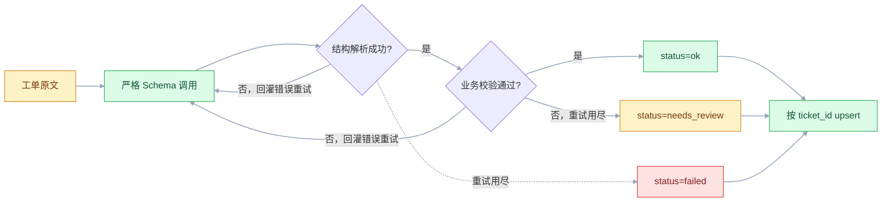
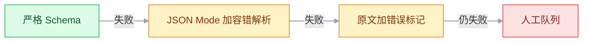

# 结构化输出

## 一、工程案例：让模型稳定产出可入库的工单分类 JSON

**场景**：客服系统每天进 2 万条工单，正文是用户随手打的一段话。运营要按「问题类型 / 紧急度 / 关联订单 / 是否转人工」四个维度筛选统计。过去靠关键词打标，规则表 300 多条，新人不敢改，改一条要回归三天。现在换成模型直接产出结构化字段，程序校验后入库。

**产出物**：一张 `ticket_classification` 表，加一个 `POST /classify` 接口。接口返回的 JSON 能直接 `INSERT`，中间不需要任何字符串切割。

**动手前确认**：模型账号可用、Python 3.10+（代码里用了 `X | None` 这类标注，3.9 会在导入时报 `TypeError`）、`pydantic>=2`、`openai` SDK、有一个能写测试数据的库。下面每一步都能单独跑。

### 1.1 先定表，再定 Schema

表结构是最终契约，Schema 只是把它翻译成模型读得懂的形式。**先写 DDL 再写 Pydantic**，能避开「Schema 很漂亮、入库时发现没地方放」这类返工。

字段与 Schema 一一对应，另外多三列：`model` 记模型名，`raw_output` 存模型原始 JSON，`status` 记程序判定结果（ok / needs_review / failed）。

```sql
CREATE TABLE ticket_classification (
    id          bigserial PRIMARY KEY,
    ticket_id   text NOT NULL UNIQUE,
    category    text,
    urgency     text,
    order_id    text,
    need_human  boolean,
    confidence  numeric(3,2),
    summary     text,
    model       text NOT NULL,
    raw_output  jsonb,
    status      text NOT NULL DEFAULT 'ok',
    created_at  timestamptz NOT NULL DEFAULT now(),
    CONSTRAINT ok_row_must_be_complete CHECK (
        status <> 'ok' OR (category IS NOT NULL AND urgency IS NOT NULL
                           AND need_human IS NOT NULL AND confidence IS NOT NULL
                           AND summary IS NOT NULL))
);
```

业务列全部可空，因为 `failed` 行只留原文、没有分类结果；用 `CHECK` 把「`ok` 行必须完整」这条规矩交给数据库，比只在代码里保证可靠。`raw_output` 和 `status` 不是给业务看的，是给排障看的：出问题时要能回答「模型当时到底输出了什么」。

`raw_output` 用 `jsonb` 有个副作用：它不保留 key 顺序和空白，要逐字节复现原始输出得另加一列 `raw_text`。日常排障看 `jsonb` 够用，只有争论「模型到底有没有多给字段」时才需要原文。

### 1.2 Schema 就是入库契约

```python
# ticket_schema.py
from typing import Literal, Optional
from pydantic import BaseModel, ConfigDict, Field


class TicketLabel(BaseModel):
    """一条工单的分类结果。字段与 ticket_classification 表一一对应。"""

    model_config = ConfigDict(extra="forbid")   # 原生 schema 就带 additionalProperties: false

    category: Literal["物流查询", "退换货", "售前咨询", "投诉", "其他"] = Field(
        description="问题类型，必须从五个选项中选一个；无法判断时选「其他」")
    urgency: Literal["高", "中", "低"] = Field(
        description="紧急度。涉及资金损失、人身安全、已付款未发货为「高」；"
                    "影响正常使用为「中」；其余为「低」")
    order_id: Optional[str] = Field(
        default=None,
        description="文本中出现的订单号，只填数字，8~20 位；没有提到订单号时填 null")
    need_human: bool = Field(
        description="是否需要人工介入。投诉、要求赔偿、情绪激烈时为 true")
    confidence: float = Field(
        description="你对本次分类的把握，0 到 1 之间的小数，不要填百分数")
    summary: str = Field(
        description="一句话概括用户诉求，不超过 60 字，只使用原文信息")
```

四个字段类型选得有理由：`category` / `urgency` 用 `Literal` 让枚举进 Schema；`order_id` 用 `Optional` 表达「原文没有」；`confidence` 用 `float` 而不是字符串，省掉一次转换。`extra="forbid"` 是给严格模式准备的：默认情况下 Pydantic 的原生 schema 不写 `additionalProperties`，开了它才和后面 `strict: true` 的要求一致。

`order_id` 有默认值，Pydantic 原生 schema 因此不会把它列进 `required`（这是规范行为，不是 bug）；SDK 转严格版时会补回去，细节见 3.4。

### 1.3 调用与真实响应片段

```python
# classify.py
import os
from openai import OpenAI
from ticket_schema import TicketLabel

client = OpenAI(api_key=os.environ["OPENAI_API_KEY"])

SYSTEM = """你是电商客服工单分类器。只依据工单原文判断，不要推测原文没有的信息。
原文没提到的字段填 null。订单号只填数字，不要带「订单」二字。"""


def classify_once(text: str, hint: str = "") -> tuple[TicketLabel, str]:
    """返回 (解析后的对象, 模型原始 JSON 字符串)。hint 是上一轮的错误描述。"""
    messages = [{"role": "system", "content": SYSTEM},
                {"role": "user", "content": f"<ticket>\n{text}\n</ticket>"}]
    if hint:
        # 错误提示单独成一条消息，不能塞进 <ticket>，否则会被当成工单原文的一部分
        messages.append({"role": "user", "content": f"<retry_hint>\n{hint}\n</retry_hint>"})
    resp = client.chat.completions.parse(
        model="gpt-4o-mini",
        temperature=0,
        messages=messages,
        response_format=TicketLabel,
    )
    msg = resp.choices[0].message
    if getattr(msg, "refusal", None):
        raise ValueError(f"模型拒绝回答：{msg.refusal}")
    if msg.parsed is None:
        raise ValueError("模型返回空结构")
    return msg.parsed, msg.content or ""
```

`chat.completions.parse` 需要较新的 `openai` SDK，方法位置和参数随版本调整过，**以厂商当前文档为准**；跑不通先升级 SDK，不要改 Schema。

请求发出去时，SDK 会把 Pydantic 模型转成 JSON Schema 放进 `response_format`，关键部分是这样：

```json
{"type": "json_schema",
 "json_schema": {"name": "TicketLabel", "strict": true,
   "schema": {"type": "object",
     "properties": {"category": {"type": "string", "enum": ["物流查询", "退换货", "售前咨询", "投诉", "其他"]},
                    "urgency": {"type": "string", "enum": ["高", "中", "低"]},
                    "order_id": {"anyOf": [{"type": "string"}, {"type": "null"}]},
                    "need_human": {"type": "boolean"},
                    "confidence": {"type": "number"},
                    "summary": {"type": "string"}},
     "required": ["category", "urgency", "order_id", "need_human", "confidence", "summary"],
     "additionalProperties": false}}}
```

六个属性一个不少，`required` 才能和它对上——`required` 里出现 `properties` 没有的 key，严格模式直接 400。

模型返回的是一条普通 assistant 消息，`content` 是 JSON 字符串，SDK 已经替你解析并按模型校验过一遍。原始内容长这样：

```json
{
  "category": "物流查询",
  "urgency": "高",
  "order_id": "202610110087",
  "need_human": true,
  "confidence": 0.93,
  "summary": "用户称下单三天仍未发货，要求当天给出物流单号"
}
```

对应的输入是：

```text
我10月8号下的单，订单号202610110087，到现在还没发货，今天再不发货我就退款了
```

### 1.4 校验：Schema 管形状，代码管业务

Schema 能保证「`confidence` 是数字」，但保证不了「它在 0 到 1 之间」——`minimum` / `maximum` 在严格模式下不一定被接受，即便接受也不该指望它兜业务。**形状之外的一切都写在代码里**：

```python
# validate.py
import re
from ticket_schema import TicketLabel


def validate_business(label: TicketLabel) -> list[str]:
    """返回错误列表，空列表表示通过。"""
    errors: list[str] = []

    if not 0.0 <= label.confidence <= 1.0:
        errors.append(f"confidence 越界：{label.confidence}")
    if label.order_id is not None and not re.fullmatch(r"\d{8,20}", label.order_id):
        errors.append(f"order_id 不是 8~20 位纯数字：{label.order_id!r}")
    if len(label.summary) > 60:
        errors.append(f"summary 超长：{len(label.summary)} 字")
    # 业务规则：投诉必须转人工
    if label.category == "投诉" and not label.need_human:
        errors.append("category=投诉 但 need_human=false，与业务规则冲突")
    # 业务规则：没有订单号却判成物流查询，多半是猜的
    if label.category == "物流查询" and label.order_id is None:
        errors.append("category=物流查询 但 order_id 为空，需人工确认")
    return errors
```

这里有个取舍：`category=物流查询 但 order_id 为空` 到底算错误还是算正常？用户完全可能问「你们一般几天发货」而不给单号。**这条规则的价值不在拦截，而在把这类样本筛出来给人看**。所以它返回的不是异常，是 `needs_review` 标记。

### 1.5 重试：把错误回灌给模型

重试不是「再问一遍」，是把**上一次错在哪**写进下一轮 Prompt。不带错误信息的重试，等于用同样的输入赌不同的随机数。

```python
# retry.py
import time
from openai import APIConnectionError, APITimeoutError, RateLimitError
from pydantic import ValidationError
from ticket_schema import TicketLabel
from classify import classify_once
from validate import validate_business


def classify_with_retry(text: str, max_attempts: int = 3
                        ) -> tuple[TicketLabel | None, str | None, list[str]]:
    """返回 (最后一轮的解析对象, 最后一轮的原始输出, 最后一轮错误)。

    label 不为 None 但 errors 非空，说明结构对、业务规则没过，应该打 needs_review
    而不是丢掉——这正是 1.6 里 failed 与 needs_review 的分界。
    """
    hint = ""
    last_label: TicketLabel | None = None
    last_raw: str | None = None
    last_errors: list[str] = []
    for attempt in range(1, max_attempts + 1):
        try:
            label, raw = classify_once(text, hint)
            last_label, last_raw = label, raw
            errors = validate_business(label)
            if not errors:
                return label, raw, []
            last_errors = errors
            hint = ("上一次输出未通过业务校验，问题：" + "；".join(errors)
                    + "。请核对原文后重新输出，不要改动原文没有的信息。")
        except (ValidationError, ValueError) as e:
            last_label, last_raw = None, None
            last_errors = [f"{type(e).__name__}: {e}"]
            hint = (f"上一次输出无法解析（{type(e).__name__}: {e}）。"
                    f"请严格按给定结构输出，字段一个不少，类型不要变。")
        except (APIConnectionError, APITimeoutError, RateLimitError) as e:
            # 网络/限流不是模型的错，不写 hint，退避后原样重发
            last_label, last_raw = None, None
            last_errors = [f"{type(e).__name__}: {e}"]
            hint = ""
        if attempt < max_attempts:
            time.sleep(2 ** (attempt - 1))     # 1s / 2s，末轮失败不再空等
    return last_label, last_raw, last_errors
```

网络异常必须单独捕获：只接 `ValidationError` 的话，断网时异常会直接穿过 `safe_classify`，失败样本根本落不了库，验收第 8 项永远过不了。

三类错误的收敛速度差别很大，下面这组数只是量级示意，换成你自己的样本重测：

| 错误类型 | 一次重试后通过率 | 说明 |
|---|---|---|
| `summary` 超长 | 高（多数一次就改对） | 明确说了字数，模型能改 |
| `order_id` 带中文 | 高 | 说清「只填数字」就能改 |
| `category` 与 `need_human` 冲突 | 低（常改错方向） | 模型对业务规则的理解不稳定 |

第三类说明一件事：**能被 Prompt 修的错误才值得重试**。规则类的冲突，重试三次不如直接进人工队列。

### 1.6 降级：失败样本进人工队列

三个 `status` 在流程里的位置，值得先画出来再看代码：



```python
# pipeline.py
import logging
from retry import classify_with_retry

log = logging.getLogger(__name__)


def safe_classify(ticket_id: str, raw_text: str) -> dict:
    text = (raw_text or "").strip()
    if not text:
        return {"ticket_id": ticket_id, "status": "failed", "code": "empty_input",
                "errors": [], "data": None, "raw": None}      # 不调用模型，成本 0
    if len(text) > 6000:
        log.warning("ticket %s 原文 %d 字，截断到 6000", ticket_id, len(text))
        text = text[:6000]

    label, raw, errors = classify_with_retry(text)
    if label is None:
        return {"ticket_id": ticket_id, "status": "failed", "code": "extract_failed",
                "errors": errors, "data": None, "raw": raw}
    if errors:
        return {"ticket_id": ticket_id, "status": "needs_review", "code": "business_check",
                "errors": errors, "data": label.model_dump(), "raw": raw}
    return {"ticket_id": ticket_id, "status": "ok", "code": "ok",
            "errors": [], "data": label.model_dump(), "raw": raw}
```

三种 `status` 对应三种后续动作：`ok` 直接入库给运营用；`needs_review` 入库但打标，运营在工作台里能看到并改；`failed` 只存原文，等人工补录。**关键是 `failed` 不能静默丢**——丢了就等于「这条工单从来没进过系统」，对账时对不上。

注意 `failed` 行没有 `category`、`confidence` 这些值，落库时是 `NULL`。所以统计类目分布、置信度分布时，条件里必须带 `status <> 'failed'`，否则 `NULL` 会被算进某个分组，报表口径就歪了。


### 1.7 落库与幂等

```python
# store.py
from sqlalchemy import text
from sqlalchemy.orm import Session
from pipeline import safe_classify

SQL = text("""
INSERT INTO ticket_classification
    (ticket_id, category, urgency, order_id, need_human, confidence,
     summary, model, raw_output, status)
VALUES
    (:ticket_id, :category, :urgency, :order_id, :need_human, :confidence,
     :summary, :model, CAST(:raw_output AS jsonb), :status)
ON CONFLICT (ticket_id) DO UPDATE SET
    category   = EXCLUDED.category,
    urgency    = EXCLUDED.urgency,
    order_id   = EXCLUDED.order_id,
    need_human = EXCLUDED.need_human,
    confidence = EXCLUDED.confidence,
    summary    = EXCLUDED.summary,
    raw_output = EXCLUDED.raw_output,
    status     = EXCLUDED.status
""")


def save(session: Session, ticket_id: str, raw_text: str, model: str = "gpt-4o-mini") -> str:
    r = safe_classify(ticket_id, raw_text)
    d = r["data"] or {}
    session.execute(SQL, {
        "ticket_id": ticket_id,
        # 失败样本没有分类结果，就传 NULL；不要用「其他 / 低 / 0」占位，
        # 否则这些假值会混进类目分布和置信度分布
        "category": d.get("category"),
        "urgency": d.get("urgency"),
        "order_id": d.get("order_id"),
        "need_human": d.get("need_human"),
        "confidence": d.get("confidence"),
        "summary": d.get("summary"),
        "model": model,
        "raw_output": r.get("raw"),            # 模型原始 JSON 字符串，原样入库
        "status": r["status"],
    })
    session.commit()
    return r["status"]
```

`ON CONFLICT` 是必须的：上游重投、定时任务重跑、人工补跑都会让同一 `ticket_id` 进来第二次。没有它，唯一索引直接报错；有它，结果是覆盖而不是重复——包括 `failed` 重跑成功后被 `ok` 覆盖，这正是想要的。

`raw_output` 直接收字符串（`CAST` 交给数据库），所以 `safe_classify` 返回的 `raw` 必须是模型的原始输出，不能是 `model_dump()` 的结果。前者能回答「模型当时到底写了什么」，后者只能回答「SDK 解析出了什么」——多出来的字段、被丢掉的解释文字，只有在原文里才看得到。


### 1.8 验收（9 项全过才算交付）

| # | 检查 | 命令或检查 | 通过标准 |
|---|---|---|---|
| 1 | Schema 能生成 | `python -c "import json,ticket_schema;print(json.dumps(ticket_schema.TicketLabel.model_json_schema(),ensure_ascii=False))"` | 输出含 `enum` 与 `"additionalProperties": false`；`required` 含 category/urgency/need_human/confidence/summary 五个，`order_id` 因有默认值不在其中（SDK 转 strict 后补齐为六个） |
| 2 | 正常工单 | `python -c "from pipeline import safe_classify;print(safe_classify('t1','订单号202610110087还没发货'))"` | `status=ok`、`code=ok`，`category=物流查询`、`order_id=202610110087` |
| 3 | 空输入 | 同上，把第二个参数换成 `''` | `code=empty_input`，且无网络请求（断网跑也照样返回） |
| 4 | 越界置信度 | 构造 `confidence=1.4` 的 `TicketLabel` 跑 `validate_business` | 返回 `confidence 越界` |
| 5 | 订单号带中文 | 构造 `order_id="订单20261011"` 后跑 `validate_business` | 返回 `不是 8~20 位纯数字` |
| 6 | 重试生效 | 在 `classify_once` 里临时打印 `messages`，用会触发校验失败的样本跑一次 | 第二条请求含 `<retry_hint>`，且 hint 在 `<ticket>` 之外 |
| 7 | 幂等 | 同一 `ticket_id` 连跑两次 `save` | 表里仍 1 行，`created_at` 不变，`status` 取最后一次 |
| 8 | 失败不丢 | 断网跑一次 `save` | 表里有该 `ticket_id`，`status=failed`，业务列为 `NULL` |
| 9 | ok 行必完整 | `SELECT count(*) FROM ticket_classification WHERE status='ok' AND (category IS NULL OR confidence IS NULL)` | 0（由 `ok_row_must_be_complete` 约束保证，这里只做回归） |

第 4、5 项要真的构造非法对象，不能只靠「跑一遍真实工单看看」。**验收的重点是失败路径**，成功路径本来就大概率能过。第 9 项不要写成「`category IS NULL` 计数为 0」——`failed` 行本来就是 `NULL`，那样写必然失败，也会逼着你去填假值。


### 1.9 上线后盯三个数

| 指标 | 算法 | 阈值动作 |
|---|---|---|
| 解析成功率 | `status != 'failed'` 占比（分母是全部进件） | 低于 95% 查 Schema 或模型 |
| 人工复核率 | `needs_review` / (`ok` + `needs_review`)，失败样本不进分母 | 高于 15% 查业务规则是否过严 |
| 人工改判率 | 复核时改了 `category` 的比例 | 高于 10% 说明模型对该类目不可靠，先降级为人工 |

第三个数字最容易被忽略，但它是唯一能说明「模型判得对不对」的指标。前两个只说明「流程跑通没有」。算业务列的分布和均值时统一加 `status <> 'failed'`，别把 `failed` 行的 `NULL` 卷进去。


---

## 二、高频问答：会卡住你的地方，也是面试最常问的

### 2.1 Prompt 里写了「只输出 JSON」，还是 `json.loads` 报错

**现场**

把 `content` 原样打印出来，看第一个字符是不是 `{`：

```python
print(repr(resp.choices[0].message.content[:80]))
# '好的，以下是结果：' 后面跟着代码块标记和 JSON
```

**要点**

- 这是把「指令遵循」当成了「格式保证」：指令遵循是概率问题，格式保证要靠解码约束。
- 自然语言补全的本性会加三样东西：开头的「好的，以下是结果」、Markdown 代码块包裹、末尾补一句解释。这三件事都不违反「输出 JSON」这句话。
- 能救回的做法是截取子串：从第一个 `{` 或 `[` 到最后一个 `}` 或 `]`，再交给 `json.loads`；不要真的去剥首尾大括号，那会把 JSON 自己的结构也剥掉。
- 判断方法是看原始字符串的头尾：头不是 `{`、尾不是 `}`，就属于包裹问题。

**追问**

- 为什么这三样不违反指令？→ 「输出 JSON」没说不能带前后缀。
- 截取时要注意什么？→ 取第一个 `{` 到最后一个 `}`，别剥大括号本身。
- 不靠解码约束只靠提示会怎样？→ 概率性失败，永远有残留。

### 2.2 换成 JSON Mode 后，字段名变成中文了

**现场**

对比 `resp.choices[0].message.content` 里的 key 和你 Schema 里的 key：

```json
{"商品名称": "机械键盘", "价格": 299, "到货城市": "杭州"}
```

**要点**

- JSON Mode 只保证「是合法 JSON」，字段名从哪来完全靠 Prompt 里的字段说明。说明写得含糊，模型就用自己觉得顺的名字。
- 它解决的是「能不能解析」，不是「字段对不对」，别高估。
- 20 条样本上统计 key 集合完全一致的比例：JSON Mode 通常只有六七成；Structured Outputs 在正常返回时接近 100%，但截断和拒答要单独统计。
- 字段名要稳，只能上 Schema 约束。

**追问**

- JSON Mode 到底保证什么？→ 只保证语法合法。
- Structured Outputs 为什么也不是 100%？→ 还会碰上截断和拒答，两类都要单独算。
- 已有系统怎么过渡？→ 入库前做 key 白名单校验，不一致就重试或打标。

### 2.3 严格模式一开就报 Schema 不合法

**现场**

看报错文本里点名了哪个字段；或直接把 Schema 打印出来逐条比对：

```python
import json
from ticket_schema import TicketLabel
print(json.dumps(TicketLabel.model_json_schema(), ensure_ascii=False, indent=2))
# 检查三处：additionalProperties 是否为 false
#           required 是否覆盖 properties（原生 schema 会漏掉有默认值的字段，SDK 转 strict 时才补齐）
#           有没有 allOf / not / if-then 这类不支持的写法
```

**要点**

- 这是请求构造错误，不是服务端抽风，重试一百次结果一样：400 不是 500。
- `strict` 的硬要求：每个 object 显式 `additionalProperties: false`、`required` 列全所有属性、不用 `allOf` / `not` / `if-then`、不支持递归引用。
- 「可选」不是「不在 required 里」，而是类型里允许 `null`（`anyOf: [X, null]`）且仍在 `required` 里。
- 经 SDK 转 strict 后一般合规；把 `model_json_schema()` 的原样输出手抄进请求，最容易漏 `additionalProperties`——原生 schema 默认不写它，除非模型配了 `extra="forbid"`。

**追问**

- 400 该重试吗？→ 不该，确定性失败。
- 可选字段的正确写法？→ `anyOf: [X, null]` 且列进 `required`。
- 为什么手抄 schema 容易漏？→ 原生 schema 默认不写 `additionalProperties`。

### 2.4 金额差 100 倍，或者日期格式每次不一样

**现场**

抽 30 条带金额和日期的样本，看 `amount` 的数量级分布、`date` 的字符形态有几种。

| 写法 | 结果 |
|---|---|
| `amount: float` | 有时 299，有时 29900（分） |
| `amount: float = Field(description="金额，单位元，只填数字")` | 稳定为元 |
| `deadline: str = Field(description="日期，格式 YYYY-MM-DD")` | 稳定为 ISO 形态 |

**要点**

- 以为类型对了内容就对了是错的：`{"type": "number"}` 只约束「是数字」，不携带「元还是分」这个信息，模型只能猜。
- 日期同理，`"2026/11/20"`、`"11月20日"`、`"2026-11-20"` 都是合法字符串。
- 单位、格式、缺失语义都要写进 `description`，一句话说清「是什么、什么格式、没有怎么办」。
- 判断依据是看分布而不是看单条——单条看起来对，可能只是恰好猜对。

**追问**

- 类型对了为什么内容还会错？→ 类型不含单位和格式。
- 怎么发现是普遍问题还是个例？→ 看 30 条的数量级分布和日期形态种类。
- description 写多长合适？→ 一句说清单位、格式、没有怎么办，写小作文收益递减。

### 2.5 期望数组，拿到一个对象

**现场**

用「只有一条」的输入跑 10 次，看 `type(result["items"])`。

```python
items = data["items"]
if isinstance(items, dict):        # 容错：单条被拍平
    items = [items]
```

**要点**

- 只有一条数据时，模型倾向「省掉一层数组」。
- 这不是 Schema 违背（严格模式下不会发生），而是 Prompt 方式或 JSON Mode 下的常见退化。
- 之前只测了多条的场景，所以没发现。
- 用 JSON Mode 就必须在 Prompt 里写「即使只有一条也返回数组」，并在代码里保留上面那三行兜底。

**追问**

- 严格模式下会出现吗？→ 不会。
- 怎么构造这个用例？→ 只给一条数据的输入，连跑十次。
- 兜底和 Prompt 哪个必须？→ 用 JSON Mode 时两个都要。

### 2.6 原文没提的信息，模型自己编了一个

**现场**

找几条原文明确没有该字段的样本，看输出是 `null`、空串，还是有值：

```python
# ✘ 结构逼着模型编
phone: str = Field(description="手机号")
# ✔ 允许「没有」，模型才不需要编
phone: Optional[str] = Field(default=None, description="手机号；原文没有则填 null")
```

**要点**

- 把编造归因于模型能力是错的，这里是 Schema 设计的锅。
- 字段必填且非空，模型为了满足结构只能填一个「看起来合理」的值，结构压力直接转化成内容编造。
- 解法是给「没有」留合法值：`Optional` + 默认 `None`，并在 `description` 里写明「原文没有则填 null」。
- 判断依据是统计「原文无此信息」的样本里该字段非空的比例，比例高就是必填设计的问题。

**追问**

- 为什么必填会诱发编造？→ 不填就过不了结构，模型只能补一个合理值。
- 怎么区分模型幻觉和 Schema 逼的？→ 看原文无此信息的样本里非空比例。
- 业务上不允许 NULL 怎么办？→ 用哨兵值并在入库前统一转 NULL。

### 2.7 枚举值越界，出来一个「物流」

**现场**

统计所有出现的 `category` 取值，看有多少不在白名单里：

```python
ALLOWED = {"物流查询", "退换货", "售前咨询", "投诉", "其他"}
bad = [r for r in rows if r["category"] not in ALLOWED]
```

**要点**

- 用 Prompt 去补 Schema 该做的事，是这里最常见的错。
- Prompt 里列的选项和 Schema 里的 `enum` 不是同一份数据，模型看到的是自然语言描述，容易做同义压缩（「物流查询」→「物流」）。
- 正确做法是把枚举写进 Schema（`Literal` 或 `enum`），让解码阶段就不可能产出别的值。
- 已经上线的系统要在入库前做一次白名单映射：`物流` 归到 `物流查询`，归不进去的落到 `其他` 并打 `needs_review`。

**追问**

- 加一句「必须从选项里选」为什么没用？→ 那是自然语言建议，不是解码约束。
- 存量脏值怎么处理？→ 白名单映射，归不进去的打 `needs_review`。
- `Literal` 和 `enum` 有区别吗？→ 最终都变成 Schema 里的 `enum`，选一种写就行。

### 2.8 重试三次，错误一模一样

**现场**

看重试请求的 messages，第二轮是否包含第一轮的错误描述：

```python
# ✘ 无效重试
for _ in range(3):
    r = call(text)
# ✔ 有效重试
hint = f"上一次输出未通过校验：{errors}。请修正后重新输出。"
r = call(f"{text}\n\n{hint}")
```

**要点**

- 重试时只重发了原文，没告诉模型上次错在哪；同样的输入加 `temperature=0`，输出几乎必然相同。
- 重试不是「再摇一次骰子」，在 `temperature=0` 下它是确定性函数。
- 有效的重试要把 `errors` 写进下一轮，且单独成一条消息、放在原文之外。
- 核实方式很直接：打印每一轮实际发出的 messages，两轮完全一致就等于没重试。

**追问**

- `temperature=0` 下重试还有意义吗？→ 只有带上错误信息才有。
- 错误提示放哪？→ 单独一条消息，不能混进业务原文。
- 哪些错误不值得重试？→ 规则冲突类，重试三次不如进人工队列。

### 2.9 输出到一半断了，JSON 不完整

**现场**

看 `resp.choices[0].finish_reason` 是否为 `length`，以及 `usage.completion_tokens` 是否贴着上限：

```python
if resp.choices[0].finish_reason == "length":
    raise ValueError("输出被截断，需要提高 max_tokens 或缩小 Schema")
```

**要点**

- 撞上了 `max_tokens`：`content` 在半个字符串处截断，`json.loads` 必然失败。
- 只看异常类型（JSON 解析失败）不看结束原因，就会去改 Prompt，而真正该改的是预算。
- `finish_reason` 是判断「为什么停」的可靠信号：`stop` 正常结束、`length` 被截断、`content_filter` 被内容策略拦下、`tool_calls` 是模型要调工具。
- 超时根本不产生 `finish_reason`，它抛的是连接异常，别在同一处判断。

**追问**

- 超时会看到 `length` 吗？→ 不会，超时是连接异常。
- `content_filter` 时 `content` 是什么样？→ 空，而不是半截。
- 怎么预防？→ 把 `finish_reason` 和 `usage` 一起打进日志。

### 2.10 `parsed` 是 `None`，但也没报错

**现场**

检查 `getattr(msg, "refusal", None)`：

```python
msg = resp.choices[0].message
if getattr(msg, "refusal", None):
    log.warning("refusal: %s", msg.refusal)
    return {"status": "refused"}
```

**要点**

- 模型触发了拒答，SDK 把内容放进了 `message.refusal`，`parsed` 就留空。这不是异常，是正常返回。
- 把拒答当成故障是错的判断；它是业务分支之一：记录、告知用户、必要时转人工。
- 不要为了消掉 `parsed is None` 去改写 Prompt 绕过拒答。
- 判断方法看 `refusal` 有没有值，有值就是拒答，没有值才是真的空返回。

**追问**

- 为什么不当异常处理？→ 它是模型正常返回的一种结果。
- 拒答率突然升高说明什么？→ 先查输入是否踩到内容策略，再看 Prompt 是否被改坏。
- 该重试吗？→ 不值得，重试只会重复拒答。

### 2.11 放宽 Schema 之后，脏数据悄悄进了库

**现场**

对历史数据跑一次分布统计：枚举列的取值种类、数值列的 min/max、字符串列的长度分布：

```sql
SELECT category, count(*) FROM ticket_classification
WHERE status <> 'failed' GROUP BY 1 ORDER BY 2 DESC;       -- failed 行 category 为 NULL
SELECT min(confidence), max(confidence) FROM ticket_classification
WHERE status <> 'failed';
```

**要点**

- Schema 从 `Literal` 改成 `str`、从 `float` 改成 `str` 之后，模型输出的一切都能通过校验，下游没有对应的兜底，脏值就直接落表。
- 把「减少校验失败」当目标是错的：校验失败是信号，不是噪音；把它消掉的最省事办法就是删掉校验。
- 这条低频但致命：一次放宽可能几个月都看不出问题，发现时数据已经没法回溯。
- 处理方向是改 Schema 或 Prompt，而不是删校验；任何超出预期的取值都当成事故查。

**追问**

- 校验失败率高该怎么降？→ 改 Schema 和 description，不是放宽类型。
- 已经落库的脏数据怎么发现？→ 定期跑分布统计，看取值种类和 min/max。
- 为什么说它致命？→ 发现时历史数据已经无法回溯。
---

## 三、核心知识：从零开始要建立的东西

### 3.1 约束强度的三个层级

同样叫「让模型输出 JSON」，可靠性差了一个数量级，因为约束发生的位置不同。

| 层级 | 约束位置 | 保证什么 | 不保证什么 |
|---|---|---|---|
| Prompt 要求 | 输入文本 | 模型大概率照做 | 前后没解释、没包裹、字段对 |
| JSON Mode | 解码器 | 输出是合法 JSON | 字段名、类型、必填项 |
| Structured Outputs | 解码器 + Schema | 形状完全符合 Schema | 内容是否符合事实 |
| 业务校验 | 你的代码 | 业务规则成立 | 语义是否正确 |

四层是叠加关系，不是替代关系。上了 Structured Outputs 也仍然要写业务校验——它能保证 `confidence` 是数字，保证不了它是 0.93 还是 1.4。

> **面试**：常问「JSON Mode 和 Structured Outputs 差在哪？」答：前者只保证是合法 JSON，后者按 Schema 约束形状，但都不保证内容正确。

### 3.2 JSON Schema 的最小完备集

不需要背规范，日常只用这几个关键字：

| 关键字 | 作用 | 例子 |
|---|---|---|
| `type` | 限定类型 | `"string"` / `"number"` / `"integer"` / `"boolean"` / `"array"` / `"object"` / `"null"` |
| `properties` | 对象有哪些字段 | 每个字段一份子 Schema |
| `required` | 哪些字段必须出现 | `["category", "urgency"]` |
| `enum` | 取值白名单 | `["高", "中", "低"]` |
| `items` | 数组元素形状 | `{"type": "string"}` |
| `anyOf` | 至少满足一个（严格模式用它表达可空） | `[{"type": "string"}, {"type": "null"}]` |
| `$defs` / `$ref` | 复用子结构 | 嵌套模型生成 |
| `additionalProperties` | 是否允许额外字段 | 严格模式必须 `false` |
| `description` | 给模型看的说明 | 单位、格式、找不到怎么办 |

`minimum` / `maximum` / `pattern` / `format` 属于「看起来该有、实际不可靠」的一类：有的服务直接报错，有的接受但不当作解码约束。**把它们当注释，别当校验**；具体支持哪几个关键字，以厂商当前文档为准。

`anyOf` 不是「恰好一个」，那是 `oneOf`（严格模式通常不支持）。要让字段可空，写 `anyOf: [X, null]`，不要写两个互斥分支指望模型自己挑。


### 3.3 严格模式的四条硬规矩

`strict: true` 不是「更严格一点」，是一组具体的结构要求，违反任意一条就是 400：

1. 每个 object 都要显式 `additionalProperties: false`；
2. `required` 必须列出 `properties` 的全部 key；
3. 不允许 `allOf`、`not`、`if/then` 这类组合子，联合类型只用 `anyOf`；
4. 不允许递归引用（自己套自己）。

第 2 条最反直觉：**「可选」不是「不在 required 里」**，而是「类型里允许 `null`」。Pydantic 原生 schema 会把带默认值的字段排除在 `required` 外，SDK 做 strict 转换时再补回去，所以最终形态是 `anyOf: [X, null]` 且在 `required` 里。

```python
class M(BaseModel):
    a: str
    b: Optional[str] = None

# 原生 schema：required 只有 ["a"]，b 带 "default": null
# SDK 转 strict 后：required 是 ["a", "b"]，b 的类型是 anyOf: [string, null]
```

四条规矩是「厂商当前实现」的快照：关键字支持范围会随版本变化，升级 SDK 或换模型后拿真实请求试一次，别拿这张表当永久契约。


> **面试**：常问「strict 模式下可选字段怎么写？」答：类型里允许 null 且仍列进 required，不在 required 里不算可选。

### 3.4 Pydantic 到 Schema 的映射

| Python 写法 | 生成的 Schema | 是否进 required |
|---|---|---|
| `name: str` | `{"type": "string"}` | 是 |
| `score: float` | `{"type": "number"}` | 是 |
| `tag: Literal["a", "b"]` | `{"type": "string", "enum": ["a", "b"]}` | 是 |
| `note: Optional[str] = None` | `{"anyOf": [{"type": "string"}, {"type": "null"}], "default": null}` | 原生否（有默认值），SDK 转 strict 后是 |
| `tags: list[str]` | `{"type": "array", "items": {"type": "string"}}` | 是 |
| `edu: Education` | `{"$ref": "#/$defs/Education"}` | 是 |
| `extra: dict[str, str]` | `{"type": "object", "additionalProperties": {"type": "string"}}` | 是（且常被严格模式拒绝） |

`model_json_schema()` 是排查的第一入口：字段名、枚举、required 全在这里，比读代码可靠；它是 Pydantic 原生输出，和 SDK 转换后的严格版可能差一个 `required`；SDK 的转换细节以官方当前文档为准。

### 3.5 description 承载的信息

Schema 管形状，`description` 管语义。模型判断「这个字段该填什么」几乎全靠这句话。

| 差的描述 | 好的描述 | 补上了什么 |
|---|---|---|
| 价格 | 商品价格，单位元，只填数字，不含货币符号 | 单位、格式 |
| 日期 | 截止日期，格式 YYYY-MM-DD；原文说「下个月」时按当前日期推算 | 格式、推算规则 |
| 订单号 | 订单号，8~20 位纯数字；原文没有则填 null | 格式、缺失语义 |
| 类型 | 问题类型，从五个枚举中选；无法判断时选「其他」 | 兜底策略 |
| 数量 | 采购数量，整数；「一批」「若干」等模糊表述填 null | 模糊表述处理 |

描述一句话说清「是什么、什么格式、没有怎么办」就够；写小作文每次多几百 token，收益却递减。

### 3.6 可选性与空值语义

同一个「没有」，有三种表达，含义完全不同：

| 表达 | 含义 | 入库后 |
|---|---|---|
| 字段缺失 | 模型没输出这个字段 | 严格模式下不会发生 |
| `null` | 明确表示「原文没有」 | 数据库 `NULL`，可区分 |
| `""` / `0` / `"UNKNOWN"` | 一个占位值 | 和真实空值混在一起，无法区分 |

**优先 `null`**。只有一种情况用哨兵值：这个字段在业务上不允许 `NULL`，比如 `order_id` 是非空列，那就用 `"UNKNOWN"` 并在入库前转成 `NULL`，转换点写在一处。

```python
order_id: str = Field(description="订单号；原文没有时填字符串 UNKNOWN")
...
db_order_id = None if label.order_id == "UNKNOWN" else label.order_id
```

### 3.7 枚举与判别式联合

当一个字段有几种「形态」，用带标签的联合类型比用一个大对象塞所有字段稳得多：

```python
class TextBlock(BaseModel):
    type: Literal["text"] = "text"
    content: str

class ImageBlock(BaseModel):
    type: Literal["image"] = "image"
    url: str

class Doc(BaseModel):
    blocks: list[TextBlock | ImageBlock]
```

`type` 这个字段叫判别式（discriminator）：它先定分支，再校验该分支的字段。好处是模型不会「两个分支的字段都填一点」，校验器也知道该按哪套规则查。

反面写法是一个类里同时有 `content` 和 `url`、两个都 `Optional`：模型经常两个都填或都不填，代码里得补一堆互斥判断。

### 3.8 动态键的替代方案

`dict[str, float]`（键名任意）在严格模式里是最麻烦的结构，因为 `additionalProperties` 必须是 `false`。替代方案是数组：

```python
# ✘ 动态键
metrics: dict[str, float]        # {"2026-01": 1.2, "2026-02": 1.5}

# ✔ 数组 + 显式字段
class Metric(BaseModel):
    month: str = Field(description="月份，YYYY-MM")
    value: float = Field(description="指标值")

class Report(BaseModel):
    metrics: list[Metric]
```

数组版本多了几个字节，换来的是：严格模式全支持、顺序稳定、能校验、能直接映射成数据库行。**唯一需要动态键的场景是「键本身就是数据且无法枚举」**，那种情况一般也不该让模型生成。

### 3.9 失败谱系与定位顺序

输出失败不是一个问题，是一族问题。按发生位置分五层，定位顺序从外往里：

| 层 | 现象 | 首查 |
|---|---|---|
| 传输 | 超时、连接重置 | 网络、`timeout` 参数 |
| 解码 | `finish_reason=length`、内容截断 | `max_tokens`、Schema 大小 |
| 语法 | `JSONDecodeError`、前后有解释文字 | 是否用了 JSON Mode |
| 语义 | 能解析但字段名/类型/枚举不对 | Schema 与 description |
| 业务 | 结构全对但规则不成立 | 代码里的业务校验 |

排障时**先看 `finish_reason`**：拿得到响应就说明传输已经成功，`length` 一步排除解码层，`content_filter` / `tool_calls` 也会直接在这里露出来。剩下三类看原始 `content` 就能区分：解析不了是语法层，解析了但 key 不对是语义层，key 对了但值不合规是业务层。拿不到响应（抛异常）才是传输层，此时根本没有 `finish_reason` 可看，所以「先看 finish_reason」只对拿到了响应的那些失败成立。


### 3.10 校验的四层分工

| 层 | 谁做 | 例子 | 失败后 |
|---|---|---|---|
| 形状 | Schema / Pydantic | 类型、必填、枚举 | 抛异常，重试 |
| 语义 | 代码 | 置信度 0~1、日期可解析、金额非负 | 抛异常或打标 |
| 业务 | 代码 + 领域规则 | 投诉必须转人工、物流查询必须有单号 | 打 `needs_review` |
| 事实 | 人工 / 交叉核对 | 订单号在库里真的存在 | 人工队列 |

前三层能自动化，第四层不能。**把事实校验伪装成 Schema 校验最危险**：订单一同步延迟，正常工单就全被判失败；它该异步做，失败只打标不阻断。

### 3.11 重试的机制与上限

重试有效的三个前提：错误可描述、错误可修正、模型有随机性以外的信息增益。

```python
for attempt in range(max_attempts):
    try:
        return call(prompt_with_hint)
    except Recoverable as e:
        hint = describe(e)
        time.sleep(base * (2 ** attempt))
```

| 错误 | 值得重试吗 | 原因 |
|---|---|---|
| 输出被截断 | 不值得 | 提高 `max_tokens` 才是解法 |
| 字段名漂移 | 值得 | 回灌错误描述能纠正 |
| 枚举越界 | 值得（严格模式下不该出现） | 明确列出合法值 |
| 业务规则冲突 | 一次，然后放弃 | 模型对规则理解不稳定 |
| 拒答 | 不值得 | 重试只会重复拒答 |
| 400 参数错误 | 不值得 | 确定性失败 |

上限 2~3 次；超过 3 次还失败，问题在 Prompt 或 Schema，不在运气。退避用指数（1s、2s、4s），避免限流时把重试打成雪崩。

> **面试**：常问「哪些错误值得重试？」答：可描述、可修正的才值得；截断、拒答、400 重试只是重复付费。

### 3.12 降级链与人工队列



降级的核心不是「多兜几层」，而是**每层都留下可观测的痕迹**：哪一层接住的、错误是什么、原文是什么。没有痕迹的降级等于把问题埋起来。

```python
return {"ok": False, "stage": "json_mode", "error": str(e), "need_manual_review": True}
```

### 3.13 评测集与置信度

没有评测集，所有「效果不错」都是感觉。最小可用的评测集：

```python
EVAL = [
    ("订单号202610110087还没发货", "物流查询", "高"),
    ("这个键盘能便宜点吗", "售前咨询", "低"),
    ("收到的杯子是碎的，必须赔", "投诉", "高"),
    # 30~50 条，覆盖每个类目至少 5 条，含 5 条「其他」
]

hits = 0
for text, cat, urg in EVAL:
    r = classify_with_retry(text)[0]
    hits += bool(r and r.category == cat and r.urgency == urg)
print(f"完全正确率 {hits}/{len(EVAL)} = {hits/len(EVAL):.1%}")
```

同时输出 `confidence` 的意义在于**分流**：高置信度直接入库，低置信度进复核队列。这条策略让「准确率 85%」的模型在业务上变得可用——因为剩下 15% 有人看。

| 置信度区间 | 处理 | 预期占比 |
|---|---|---|
| ≥ 0.85 | 直接入库 | 70%~85% |
| 0.6~0.85 | 入库 + 抽检 | 10%~20% |
| < 0.6 | 全部人工 | 5%~10% |

阈值用评测集标定：看每个阈值下的准确率，选准确率与人工量都能接受的点。

---

## 四、冷门知识汇总

| 知识点 | 为什么冷门 | 用到时的关键词 |
|---|---|---|
| `model_json_schema()` | 平时只看代码，出问题才需要看模型实际收到什么 | 打印 Schema、比对 `required` |
| `model_validate_json()` | 反向校验用得多，日常少用 | 把字符串校验成对象 |
| `model_dump(exclude_none=True)` | 落库时想省掉空字段才想起来 | 序列化、去空 |
| `ensure_ascii=False` | 只在自己再序列化时才是问题 | `json.dumps`、中文转义 |
| 递归 Schema 不支持 | 树形结构（组织架构、评论楼中楼）才会撞上 | 拍平、限制深度、父子表 |
| 批量抽取的分片 | 单次抽 50 条会截断，需要分批 | 分批、游标、`max_tokens` |
| Zod 与 Pydantic 的对应 | 两套类型系统各写一份，很少同时维护 | `z.enum` / `.nullable()` / `.describe()` |
| `jsonb` 不保留 key 顺序和空白 | 只有要逐字节复现模型原文时才发现 | 另开 `text` 列、`raw_text` |
| JSON Mode 要求 messages 里出现「JSON」 | 不开 JSON Mode 就不必管，开了才知道有这条硬要求 | `json_object`、`response_format` |
| `finish_reason=content_filter` | 少见，但出现时 `content` 是空而不是半截 | 内容策略、空返回 |
| `json_schema_extra={"examples": [...]}` | 想给模型看样例时才想起 Schema 里有这个位 | `examples`、`Field` |
| `model_json_schema(mode="validation")` | 默认就是 validation，serialization 的差异（默认值、别名）对接外部系统才撞上 | `mode="serialization"`、`by_alias` |

`json_object` 与 `content_filter` 这两条是厂商行为，各家的触发条件不完全一样，**以厂商当前文档为准**。

