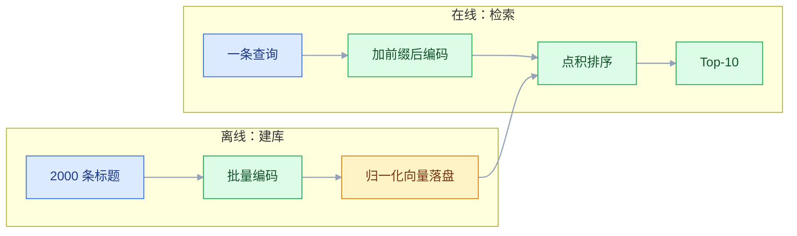
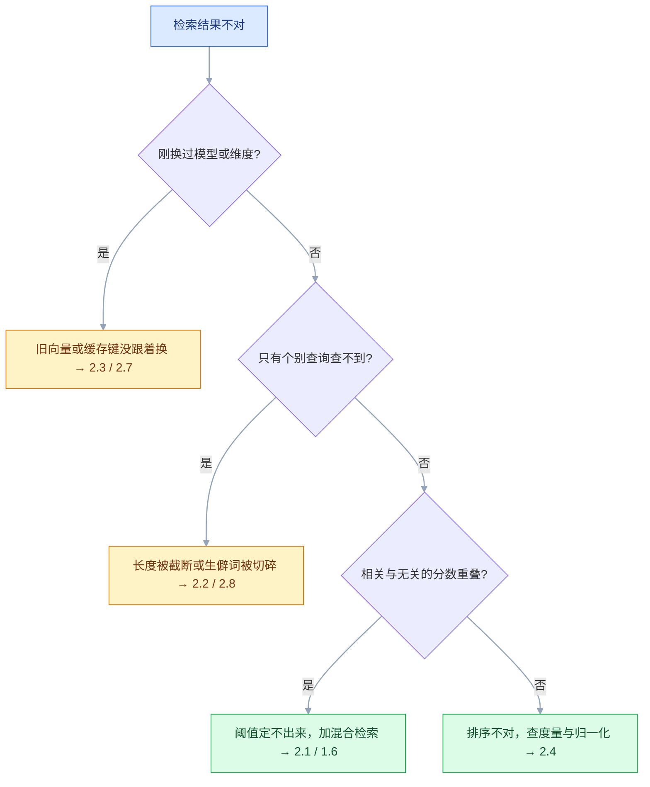

# Embedding

## 一、工程案例：给 2000 条商品标题做语义检索，用 Recall@10 选出模型与维度

**场景**：一个二手的数码商品库，`titles.csv` 里有 2000 条商品标题，字段是 `id, title, brand, model, price`。买家搜「苹果手机充电快不快」时，标题里写的是「iPhone 15 Pro 支持 27W 快充」，`LIKE '%充电快%'` 返回 0 条：同一个意思在标题里以「快充」出现，语序一变字符匹配就失效，「苹果」和「iPhone」更是两个词。目标是把这 2000 条做成一个能用的语义检索，并且**用数字回答两个问题**：选哪个模型、用多少维。

**为什么必须量化**：模型选型靠「感觉搜得挺准」是最常见的翻车方式。同一批数据换一个模型，Top-10 里可能少两条相关商品，而人眼看 Top-3 是看不出来的。Recall@10 会把这件事变成一个可比的小数。

**约束**：单机、无 GPU，2000 条向量要能全部常驻内存。这个量级下任何方案都跑得动，所以**评测的重点不是速度，而是召回**——速度留给数据量涨到十万级以后再谈。

### 1.1 环境与数据

```bash
python3.12 -m venv .venv && source .venv/bin/activate
pip install sentence-transformers numpy pandas rank-bm25 jieba tqdm
```

```python
# 00_check_data.py —— 先看清数据长什么样，再谈模型
import pandas as pd

df = pd.read_csv("titles.csv")
print(df.shape)                            # 期望 (2000, 5)
print(df["title"].str.len().describe())    # 长度分布，决定要不要分块
print("重复:", df["title"].duplicated().sum(), "空值:", df["title"].isna().sum())
```

三个数字必须先看：**长度分布**（超过模型最大输入长度的比例）、**重复率**（去重能直接减少评测噪声）、**空值**（空字符串送进模型会报错或被编码成无意义向量）。标题平均不到 30 个字，远小于 512 token 的常见上限，所以这一篇**不需要分块**——分块是长文档的问题。这个判断要在动手前做完，否则会白写一堆切分逻辑。

### 1.2 评测集：200 条查询 + 人工标注

没有标注就没有 Recall。2000 条标题配 200 条查询，每条查询标 1~5 个相关商品，格式一行一个 JSON，`relevant` 里是 `titles.csv` 的行号（0 起）：

```json
{"query": "苹果手机充电快不快", "relevant": [31, 44]}
{"query": "适合学生党的便宜平板", "relevant": [87, 92, 118]}
```

标注的三种来源，按可靠性排序：

| 来源 | 做法 | 适用 |
|---|---|---|
| 人工标注 | 抽样 200 条查询，人眼从候选里挑相关 | 上线前的验收，最可信 |
| 点击日志 | 用真实搜索的点击反推相关 | 有流量之后，规模大但有偏 |
| 规则生成 | 按「同品牌 + 同型号」自动构造 | 冷启动，只能测粗粒度召回 |

规则生成的标注只认「同品牌 + 同型号」这种字面信号，恰好是 BM25 最擅长、向量模型最弱的地方：它会**系统性低估**向量模型，也会把混合检索的增益算歪。冷启动阶段可以用来验证流程跑通，但结论只能当参考。

```python
# 01_load_eval.py
import json

def load_labels(path: str = "labels.jsonl") -> tuple[list[str], list[set[int]]]:
    queries, relevant = [], []
    with open(path, encoding="utf-8") as f:
        for line in f:
            row = json.loads(line)
            queries.append(row["query"])
            relevant.append(set(row["relevant"]))
    return queries, relevant

QUERIES, LABELS = load_labels()
assert len(QUERIES) == len(LABELS)
assert all(len(s) > 0 for s in LABELS), "有查询没有任何相关项，Recall 会被拉低"
```

### 1.3 编码：批量、归一化、落盘

离线建库和在线查询走的是同一条编码链路，只有两处不同：批量大小与查询前缀。



三个候选模型，覆盖 512 / 768 / 1024 三档维度，都是中文检索常用的尺寸：

```python
# 02_encode.py
import numpy as np
from sentence_transformers import SentenceTransformer

MODELS = [
    "BAAI/bge-small-zh-v1.5",     # 512 维
    "BAAI/bge-base-zh-v1.5",      # 768 维
    "BAAI/bge-large-zh-v1.5",     # 1024 维
]
QUERY_PREFIX = "为这个句子生成表示以用于检索相关文章："

def encode(model_name: str, texts: list[str], query: bool = False) -> np.ndarray:
    m = SentenceTransformer(model_name)
    if query:
        # BGE 的检索用法：查询侧加指令前缀，文档侧不加
        texts = [QUERY_PREFIX + t for t in texts]
    v = m.encode(texts, batch_size=64, normalize_embeddings=True,
                 convert_to_numpy=True, show_progress_bar=False)
    return v.astype(np.float32)

if __name__ == "__main__":
    import pandas as pd
    texts = pd.read_csv("titles.csv")["title"].tolist()
    for name in MODELS:
        dv = encode(name, texts)
        tag = name.split("/")[-1]
        np.save(f"vec_{tag}.npy", dv)
        print(f"{tag:24s} shape={dv.shape}  {dv.nbytes / 1024 / 1024:.2f} MiB")
```

```text
bge-small-zh-v1.5        shape=(2000, 512)  3.91 MiB
bge-base-zh-v1.5         shape=(2000, 768)  5.86 MiB
bge-large-zh-v1.5        shape=(2000, 1024) 7.81 MiB
```

三个细节决定这份代码能不能用：

- **`normalize_embeddings=True`**：不归一化，后面就只能算余弦，用不了「矩阵乘 = 相似度矩阵」这个加速；归一化之后点积就是余弦，一次 `@` 出全部分数。
- **查询加前缀、文档不加**：BGE 系列训练时就是这么配对的。查询侧漏掉前缀，召回率会稳定掉几个点，而且掉得没有规律，很难靠调阈值补回来。
- **`float32` 落盘**：`float16` 能省一半空间，但 2000 条本来就只有几 MB，没必要在这上面引入精度问题。数据量到百万级再考虑。

### 1.4 指标：Recall@10 与 MRR

两个指标回答两个不同的问题：

| 指标 | 回答的问题 | 计算 |
|---|---|---|
| **Recall@10** | 相关商品有多少被找回来了 | 命中数 / 该查询的相关总数 |
| **MRR** | 第一条相关的排多靠前 | 第一条相关的排名取倒数，再对查询求平均 |
| **命中率@10** | 至少命中一条的查询占比 | 命中查询数 / 总查询数 |

**Recall@10 是主指标**：检索的下游是给人看或给模型读，Top-10 里漏掉的相关项就是真丢了的。MRR 只反映排序质量，一个把唯一相关项排在第 9 位的系统 MRR 只有 0.11，但 Recall@10 是满分——两者要一起看。

```python
# 03_eval.py
import numpy as np

def recall_at_k(scores: np.ndarray, labels: list[set[int]], k: int = 10) -> float:
    k = min(k, scores.shape[1])
    topk = np.argpartition(-scores, kth=k - 1, axis=1)[:, :k]
    return float(np.mean([len(set(topk[i].tolist()) & labels[i]) / len(labels[i])
                          for i in range(scores.shape[0])]))

def mrr(scores: np.ndarray, labels: list[set[int]]) -> float:
    ranks = []
    for i in range(scores.shape[0]):
        order = np.argsort(-scores[i])
        pos = next((r for r, idx in enumerate(order) if idx in labels[i]), None)
        ranks.append(1.0 / (pos + 1) if pos is not None else 0.0)
    return float(np.mean(ranks))

def report_scores(name: str, scores: np.ndarray, labels: list[set[int]],
                  dim: int = 0) -> dict:
    return {"model": name, "dim": dim,
            "Recall@10": round(recall_at_k(scores, labels, 10), 4),
            "MRR": round(mrr(scores, labels), 4)}

def report(name: str, qv: np.ndarray, dv: np.ndarray, labels: list[set[int]]) -> dict:
    return report_scores(name, qv @ dv.T, labels, dv.shape[1])   # 都归一化过，点积 = 余弦
```

`argpartition` 是 O(n)，`argsort` 是 O(n log n)。2000 条时两者都是瞬间，但同一段代码搬到十万条、几百个查询的批量评测里，差别就出来了——评测脚本会被反复跑几十次，这里省下的时间是纯赚的。

跑完三个模型，把结果并排放：

```python
if __name__ == "__main__":
    from importlib import import_module
    import pandas as pd
    lab = import_module("01_load_eval")      # 模块名以数字开头，只能用 import_module
    enc = import_module("02_encode")
    rows = []
    for name in ["bge-small-zh-v1.5", "bge-base-zh-v1.5", "bge-large-zh-v1.5"]:
        dv = np.load(f"vec_{name}.npy")
        qv = enc.encode(f"BAAI/{name}", lab.QUERIES, query=True)
        rows.append(report(name, qv, dv, lab.LABELS))
    print(pd.DataFrame(rows).to_string(index=False))
    print("一条命令复现: python 02_encode.py && python 03_eval.py")
```

```text
              model  dim  Recall@10     MRR
  bge-small-zh-v1.5  512     <实测>  <实测>
   bge-base-zh-v1.5  768     <实测>  <实测>
  bge-large-zh-v1.5 1024     <实测>  <实测>
```

**分数不写死**：它取决于标题的写法、查询的口语化程度、标注的松紧。任何一篇笔记里给出的「某模型 Recall 0.87」都不能直接搬到另一个数据集上，只能作为量级参考。

### 1.5 维度扫描：三档模型 + Matryoshka 截断

上一步混了两个变量：模型变大和维度变高。要单独看维度的影响，得固定模型、只改维度，这只有支持 Matryoshka 的模型才能做——训练时就让前 N 维本身是可用向量，可以直接截断。

```python
# 04_dim_sweep.py —— 固定一个支持 MRL 的模型，只扫维度；需要 OPENAI_API_KEY
import numpy as np
import pandas as pd
from importlib import import_module
from openai import OpenAI

ev = import_module("03_eval")
lab = import_module("01_load_eval")
client = OpenAI()            # 从环境变量 OPENAI_API_KEY 读取，不要写死在代码里

def embed_dim(texts: list[str], dim: int, batch: int = 256) -> np.ndarray:
    vecs = []
    for i in range(0, len(texts), batch):
        resp = client.embeddings.create(model="text-embedding-3-small",
                                        input=texts[i:i + batch], dimensions=dim)
        vecs.extend(d.embedding for d in resp.data)
    v = np.array(vecs, dtype=np.float32)
    return v / np.linalg.norm(v, axis=1, keepdims=True)

texts = pd.read_csv("titles.csv")["title"].tolist()
for dim in (256, 512, 1024, 1536):
    dv = embed_dim(texts, dim)
    qv = embed_dim(lab.QUERIES, dim)
    r = ev.report(f"3-small@{dim}", qv, dv, lab.LABELS)
    r["存储 MiB"] = round(2000 * dim * 4 / 1024 / 1024, 2)
    print(r)
```

```text
{'model': '3-small@256',  'dim': 256,  'Recall@10': <实测>, 'MRR': <实测>, '存储 MiB': 1.95}
{'model': '3-small@512',  'dim': 512,  'Recall@10': <实测>, 'MRR': <实测>, '存储 MiB': 3.91}
{'model': '3-small@1024', 'dim': 1024, 'Recall@10': <实测>, 'MRR': <实测>, '存储 MiB': 7.81}
{'model': '3-small@1536', 'dim': 1536, 'Recall@10': <实测>, 'MRR': <实测>, '存储 MiB': 11.72}
```

**读这张表的方法**：找 Recall 开始变平的拐点。如果 512 → 1024 只涨了不到 1 个百分点，就没必要付双倍存储；如果 256 → 512 涨了 5 个点，说明 256 压得太狠。**拐点因数据而异，必须自己扫。**

`dimensions` 只改输出向量，**不改按输入 token 计费的价格**：这一轮把语料编码了 4 遍，embedding 成本就是单次的 4 倍。想省钱就先抽 300~500 条文档把拐点扫出来，再全量跑最终选定的那一档。

⚠️ **只有声明支持 Matryoshka 的模型能这样截断**。拿一个普通 BERT 类模型，把 1024 维向量强行切前 512 维，等于把后半段语义扔掉，效果是断崖式下跌而不是平缓下降。判断方法：模型卡或论文声明支持 MRL / Matryoshka，或者 API 自带 `dimensions` 参数，才可截断；否则只能换模型。

### 1.6 基线对照：BM25 与混合检索

只看向量模型的绝对分数没有意义，得有基线。BM25 是关键词检索的强基线，`rank_bm25` 二十行就能跑：

```python
# 05_hybrid.py
import jieba
import numpy as np, pandas as pd
from rank_bm25 import BM25Okapi

TEXTS = pd.read_csv("titles.csv")["title"].tolist()

def tokenize(text: str) -> list[str]:
    return [w for w in jieba.lcut(text) if w.strip()]

bm25 = BM25Okapi([tokenize(t) for t in TEXTS])

def bm25_scores(queries: list[str]) -> np.ndarray:
    return np.array([bm25.get_scores(tokenize(q)) for q in queries], dtype=np.float32)

def rrf_fuse(vec_scores: np.ndarray, kw_scores: np.ndarray,
             k: int = 60, w_vec: float = 1.0, w_kw: float = 1.0) -> np.ndarray:
    """倒数排名融合：只看名次，不看原始分数，避免两套分数量纲不一致。"""
    n_q, n_d = vec_scores.shape
    fused = np.zeros_like(vec_scores)
    for i in range(n_q):
        vr = np.argsort(-vec_scores[i])
        kr = np.argsort(-kw_scores[i])
        for rank, idx in enumerate(vr):
            fused[i, idx] += w_vec / (k + rank + 1)
        for rank, idx in enumerate(kr):
            fused[i, idx] += w_kw / (k + rank + 1)
    return fused

if __name__ == "__main__":
    from importlib import import_module
    ev = import_module("03_eval")
    enc = import_module("02_encode")
    lab = import_module("01_load_eval")

    dv = np.load("vec_bge-small-zh-v1.5.npy")
    qv = enc.encode("BAAI/bge-small-zh-v1.5", lab.QUERIES, query=True)
    vec_s = qv @ dv.T
    kw_s = bm25_scores(lab.QUERIES)
    rows = [("BM25", kw_s, 0),
            ("纯向量 bge-small", vec_s, dv.shape[1]),
            ("混合 RRF 1:1", rrf_fuse(vec_s, kw_s), dv.shape[1])]
    for name, s, dim in rows:
        print(ev.report_scores(name, s, lab.LABELS, dim))
```

```text
                        Recall@10     MRR
BM25（纯关键词）             <实测>   <实测>
纯向量（bge-small）          <实测>   <实测>
混合（RRF, 1:1）            <实测>   <实测>
```

RRF 的 `k=60` 是原论文的经验值，作用是压低头部名次的差距，让两路结果都能进榜。**权重不要凭感觉调**，`w_vec` / `w_kw` 各试 0.5 / 1 / 2 三档就够，200 条查询上过拟合的空间很小，但也没必要精调。混合检索的收益来源很具体：型号、品牌、规格这类**低频精确 token**，BM25 一拍就中，向量模型经常把它糊掉；口语化改写这类**字面不重合**的查询，向量模型赢。两者错开的正是对方最弱的地方。

### 1.7 验收

| # | 检查项 | 命令或检查 | 通过标准 |
|---|---|---|---|
| 1 | 维度一致 | `dv.shape[1] == 模型声明维度` | 相等，且落盘文件名带模型名 |
| 2 | 归一化生效 | `np.linalg.norm(dv, axis=1).max()` | 与 1 的偏差 < 1e-5 |
| 3 | 评测集规模 | `len(LABELS)` | ≥ 100，每条查询至少 1 个相关项 |
| 4 | 基线已记录 | BM25 的 Recall@10 | 有数字，不能空着 |
| 5 | 目标模型达标 | Recall@10 | ≥ 0.80 且比 BM25 高 ≥ 0.15 |
| 6 | 查询延迟 | 单条编码 + 检索 p95 | ≤ 50 ms（bge-small、CPU、2000 条文档） |
| 7 | 存储预算 | `2000 × dim × 4` 字节 | 在内存预算内，留 2 倍余量 |
| 8 | 混合检索有效 | RRF 的 Recall@10 | 不低于纯向量，否则不上 |
| 9 | 可重建 | 一条命令重跑 02~03 | 换模型后 10 分钟内出新的对比表 |
| 10 | 缓存键含模型 | 抽查 `hash` 入参 | 含模型名与维度，换模型自动失效 |

第 5 项的两个条件缺一不可。「Recall@10 = 0.82」听起来不错，但如果 BM25 已经有 0.80，说明这个数据集的关键词覆盖率本来就高，向量没带来增量，上向量只是增加了成本和延迟。

### 1.8 结论怎么写

选型结论不是「BGE 最好」，而是一句带条件的话：

```text
在 2000 条数码标题、200 条口语化查询上：
  bge-small-zh-v1.5（512 维）Recall@10 = X，MRR = Y，单条 p95 = Z ms
  升级到 base/large 的增益为 +A / +B 个百分点，存储与延迟代价为 ...
  混合检索（BM25 + 向量，RRF 1:1）相对纯向量的增益为 +C 个百分点
  → 选 small + 混合检索：增益主要来自关键词补位，模型规模不是瓶颈
```

这段话写清了**在什么数据上、比什么基线、涨了多少、付了什么代价**。换个数据集四个数字都会变，但写法不变。

---

## 二、高频问答：会卡住你的地方，也是面试最常问的

这一节按「先分诊、再动手」排：检索结果不对时，先判断属于哪一类，再去改对应的那一处。绝大多数结论都不是「换一个更大的模型」。



### 2.1 相似度分数全挤在 0.7~0.9，分不出好坏

**现场**

把已知相关和已知无关的两组分数各看一遍分布（直方图或分位数），再算一次分开度：

```python
rel = np.array([scores[i, j] for i, js in enumerate(LABELS) for j in js])
irr = np.array([scores[i, j] for i, js in enumerate(LABELS)
                for j in range(scores.shape[1]) if j not in js])
print("相关 均值/10/50/90 分位:", rel.mean(), np.percentile(rel, [10, 50, 90]))
print("无关 均值/10/50/90 分位:", irr.mean(), np.percentile(irr, [10, 50, 90]))
print("分开度:", np.percentile(rel, 10) - np.percentile(irr, 90))
```

**要点**

- 相似度分数的绝对值没有跨数据集的意义，要看的是**相关与不相关的分布是否分开**，不是绝对值高低。
- 多数文本模型的分数本来就挤在高位窄区间，换大模型只会把整条分布往上推，两组仍然重叠，阈值照样定不出来。
- 分开度取「相关组 10 分位 − 无关组 90 分位」，明显为正才存在一个可用的全局阈值。
- 为零或为负时先看无关组：如果有大量「同品牌不同型号」，那是标注粒度的问题，不是模型的问题。

**追问**

- 那阈值到底定多少？→ 用库内、库外两组问题的最高相似度取中间值，不是抄一个常数。
- 分布分不开一定要换模型吗？→ 先加混合检索，关键词能补上向量糊掉的精确匹配。
- 为什么换更大的模型没用？→ 分数整体平移，重叠区还在。

### 2.2 长文档后半段永远检索不到

**现场**

用分词器数 token，看超过上限的比例；再把同一文档的首段和尾段分别编码，看文档向量更像哪一段——像首段，就说明尾部根本没进模型。

```python
import numpy as np, pandas as pd
from transformers import AutoTokenizer

texts = pd.read_csv("titles.csv")["title"].tolist()
tok = AutoTokenizer.from_pretrained("BAAI/bge-large-zh-v1.5")
n = [len(tok.encode(t)) for t in texts]
print("超过 512 的比例:", float(np.mean(np.array(n) > 512)))
```

**要点**

- 输入超过模型最大长度会被**静默截断**，BGE 系列常见上限是 512 token，一篇 5000 字的文章只有开头进了模型。
- 不同库的行为不一样——有的报错，有的截断，有的取首尾两段拼接，**不确认就不知道自己在哪一种里**。
- 模型压根没看到后半段，能力再强也无从发挥；修法是分块，不是换模型。

**追问**

- 怎么快速确认是截断而不是语义能力差？→ 只拿最后一段当查询，看能不能召回它自己。
- 截断了为什么不能直接换长上下文模型？→ 检索单元仍然要小，块太大语义会被稀释。
- 分块怎么切？→ 300~500 字起步、按标题切，用「边界句能不能召回」验证。

### 2.3 换模型后继续用旧向量

**现场**

先看维度，再看同一条文本在旧、新模型下的相似度：

```python
old = np.load("vec_bge-small-zh-v1.5.npy")       # 旧模型建的库
new = encode("BAAI/bge-base-zh-v1.5", texts)     # 新模型重算
print(old.shape, new.shape)          # 维度不同就已经不能混
# 维度相同也要看：同一条文本在两套模型下的相似度明显低于 1，且没有可依赖的关系
print(float(old[0] @ new[0]))        # 两边都归一化过，点积即余弦
```

**要点**

- 不同模型的向量空间**互不相容**，连维度都可能不同。混着用等于在两个不同的坐标系里比距离，结果无意义。
- Embedding 不是「文本的一种属性」，而是「某个模型对文本的一种投影」。换模型 = 换投影 = 全部重算，没有例外。
- 库里存一列 `model_name`，查询时校验与当前模型一致，不一致直接拒绝服务而不是返回错误结果。

**追问**

- 维度相同就能混用吗？→ 不能，空间不同，相似度接近随机数。
- 怎么迁移？→ 新表用新模型灌全量，同一评测集对比达标后双写切流。
- 为什么不能只改表维度？→ 旧向量在新空间里没有意义，只是「能存进去」。

### 2.4 余弦相似度和点积排出来的顺序不一样

**现场**

算一遍 `np.linalg.norm(v, axis=1)`，看是否全为 1；再对同一批数据分别用两种度量排序，取 Top-10 求交集。

**要点**

- 只有在向量**已归一化**时点积才等于余弦。未归一化时点积受模长影响，长向量会被系统性抬高。
- 等价性有前提，前提不成立时「等价」是错觉。很多向量库的内积度量默认就要求调用方自己归一化，库不会替你做。
- 交集不是 10 就说明有差异，再去看模长分布；修法是在入库前统一归一化，之后三种度量随便挑。

**追问**

- 归一化之后三种度量还有区别吗？→ 排序一致，选库支持得最好的那个。
- 归一化丢了什么？→ 模长信息，长度本身有意义的场景不能归一化。
- 为什么不早点统一归一化？→ 半路才补，索引和缓存里的旧向量都要重算。

### 2.5 批量请求报 400

**现场**

看响应体的 `error.message` 与 `error.code`，不要只看状态码。定位具体那条用二分法：把批次对半切，哪一半失败就继续切。

**要点**

- 400 是「请求内容不合法」，不是「服务不可用」；重试同样的请求只会得到同样的 400。
- 三种常见原因——单批条数超上限、单条超长度、数组里有空字符串或 `None`，报错文案常常只提其中一个。
- 生产代码里应当在送批之前就做清洗和长度检查，而不是等 400 再补救。

**追问**

- 400 和 429 怎么区分处理？→ 400 改请求，429 是限流，可以退避重试。
- 一批多大合适？→ 100~500 是稳妥区间，撞上上限就减半重试。
- 空字符串为什么不能直接送？→ 会被拒，或被编码成无意义的零向量。

### 2.6 本地模型第一次运行卡住不动

**现场**

看 `~/.cache/huggingface` 的体积是否在增长；`nvidia-smi` 看显存：

```bash
du -sh ~/.cache/huggingface/hub/* 2>/dev/null
export HF_ENDPOINT=https://hf-mirror.com     # 网络不通时的镜像入口
```

**要点**

- 第一次运行卡住，多半是在下载权重（几百 MB 到 1 GB 以上），或者下载失败后在重试。
- `SentenceTransformer(...)` 在下载阶段是静默的，没有任何输出不代表没有进展；当成死循环去 kill，下次还得从头下。
- 也可能是显存不足，进程卡在内存分配或换页上，要分开看。

**追问**

- 生产环境怎么避免启动时下载？→ 权重固化到镜像或本地路径，启动只加载不下载。
- 怎么确认是在下载而不是死锁？→ 看缓存目录体积有没有变大。
- 下载反复失败怎么办？→ 配镜像端点，或把缓存目录离线拷过去。

### 2.7 缓存命中率很高，但检索结果不对

**现场**

抽查缓存里某条记录的 `model` 字段与当前配置是否一致；换模型后跑一次全量，命中率应当接近 0。

**要点**

- 缓存键没带模型名，换了模型后同样的文本命中旧模型的向量，看上去「有结果」，实际是在错误的向量空间里检索。
- 清缓存能「解决」问题，但下次换模型还会再犯，根因在键的设计。
- 命中率高本身不是好事——如果换了模型命中率还是 100%，那一定是键设计错了。

**追问**

- 键里应该放什么？→ 模型名 + 维度 + 原文，原文要原样参与哈希。
- 为什么不能先 `strip()` 再算？→ 两条路径算出两个键，命中率会莫名变低。
- 增量更新的合理命中率是多少？→ 文档少量改动后 80% 以上，首次全量是 0%。

### 2.8 型号、订单号、人名搜不准

**现场**

构造两条只差一位数字的文本，看相似度是否高得离谱；再在评测集里单独切一个「精确匹配」子集，看纯向量的 Recall。

**要点**

- 这类 token 在训练语料里出现次数极少，模型没有为它学到稳定的方向。
- 「A1234」和「A1235」在子词层面几乎一样，向量也几乎一样，这是表示方式的固有限制，不是模型规模能解决的。
- 精确匹配子集上纯向量的 Recall 通常显著低于整体，而 BM25 在这一子集上接近满分——这就是上混合检索的直接依据。

**追问**

- 加大模型能救吗？→ 不能，再大的模型也不会为每个 SKU 单独学一个方向。
- 给 jieba 加自定义词典有用吗？→ 对 BM25 有用，对向量没用。
- 还有别的办法吗？→ 精确索引或 `LIKE`，编号类查询本来就不该交给向量。

### 2.9 降维之后效果断崖

**现场**

查模型卡是否声明支持 MRL / Matryoshka，或 API 是否提供 `dimensions` 参数；不支持就只能换模型。

**要点**

- 用了**不支持 Matryoshka** 的模型直接截断前 N 维，是断崖的根因。
- 普通模型的信息分散在所有维度上，没有按重要性排过序，截断等于丢掉一部分语义，不是「精度略降」。
- 同一模型分别用原生维度和截断维度各跑一次 Recall：差 1~2 个点可接受，超过 10 个点就是截断错了。

**追问**

- 怎么判断能不能截断？→ 模型卡声明 MRL，或 API 自带 `dimensions` 参数。
- 截断能省编码时间或 API 费用吗？→ 不能，省的是存储、内存带宽和建库时间。
- 512 维查询能和 1024 维文档比吗？→ 不能，同一条数据只能选一个维度入库。

### 2.10 否定句和极性判断错得离谱

**现场**

取几组只差否定词的句子，看相似度：

```python
pairs = [("这个产品很好用", "这个产品不好用"),
         ("支持退款", "不支持退款")]
for a, b in pairs:
    v = encode("BAAI/bge-small-zh-v1.5", [a, b])   # 1.3 的 encode，已归一化
    print(f"{float(v[0] @ v[1]):.3f}  {a} / {b}")
```

**要点**

- 「好用」和「不好用」在子词层面高度重叠，模型捕捉的是**主题**而不是**极性**，这是嵌入表示的共性。
- 换成更大的模型，相似度还是会很高——它们说的确实是同一件事，只是态度相反。语义相似和情感相反可以同时成立。
- 凡是业务上需要判断「有没有」「能不能」「是否」的场景，都不要用相似度阈值，改用大模型判定或专门的情感/蕴含模型。

**追问**

- 为什么同主题会相似？→ 向量编码的是共现模式，不含真假和态度。
- RAG 里的否定条件怎么办？→ 交给生成侧判断，或把条件做成结构化过滤。
- 微调能解决吗？→ 能缓解，但每加一个极性维度都要重新标注训练。

### 2.11 中文同义句的相似度反而不高

**现场**

打印分词结果，看中文是否被切得很碎；或直接换成中文模型对比同一组句子。

**要点**

- 用了以英文为主的模型（例如 `all-MiniLM-L6-v2`），它的分词器把中文切成大量单字或字节，语义单元被打碎。
- 语言不匹配是选型问题，不是能力问题；同一个模型在英文上可能很好，在中文上就是另一个水平。
- 拿十组同义句各算一遍平均相似度：中文模型均值更高，好句对和坏句对拉得开；英文模型把两者压在同一个窄区间里。

**追问**

- 多语言模型一定行吗？→ 看目标语言在训练语料里的占比，不是看它宣称支持多少种语言。
- 怎么一眼看出分词有问题？→ 打印 token，中文被切成单字基本就是。
- 换中文模型要付什么代价？→ 全量重算向量，索引与缓存一起重建。

### 2.12 自己取 BERT 的 `[CLS]` 当句向量，检索几乎不可用

**现场**

随机抽 100 对不相关的句子算相似度，看均值和最小值；再用同一套向量在评测集上算 Recall@10。

**要点**

- 原始 BERT 的 `[CLS]` 是为下一句预测训练的，不是「把整句压成一个可比较的向量」。
- 没有经过句对对比训练，取 `[CLS]` 或末层直接平均得到的向量各维高度相关，任意两句相似度都偏高、彼此差别很小。
- 问题不在参数量，在训练目标和 pooling；换成更大的 base 模型，这种各向异性照样存在。

**追问**

- 换成 mean pooling 就好了吗？→ 不够，pooling 之外还要有对比学习目标。
- 想用原始 BERT 怎么办？→ 自己在句对上做对比学习，否则直接用发布好的句向量模型。
- 模型卡里的 pooling 为什么重要？→ 选错等于换了个模型，向量分布完全不同。

---

## 三、核心知识：从零开始要建立的东西

### 3.1 向量与嵌入空间的几何直觉

Embedding 是一个函数：文本 → 固定长度的浮点数数组。这个数组就是空间里的一个点，语义相近的文本落得近。

```text
"如何申请退款"   → [0.021, -0.043, 0.087, ...]   1536 个数
"退货流程是什么" → [0.019, -0.038, 0.091, ...]   方向几乎一致
"今天股市大涨"   → [-0.061, 0.022, -0.014, ...]  方向差很远
```

三个必须建立的直觉：

- **单维不可解释**。没有哪一维对应「科技」或「负面」，语义分布在所有维的**组合**上。所以不能靠「看第 37 维」来调试。
- **距离只在同一空间内有意义**。跨模型比较相似度，等于拿两把不同刻度的尺子量同一根棍子。
- **空间是训练出来的，不是定义出来的**。同一句话在两个模型里的坐标毫无关系，见 3.14。

### 3.2 余弦相似度、点积与归一化

```text
cos(a, b) = (a · b) / (‖a‖ × ‖b‖)
a · b     = Σ ai × bi
‖a‖       = sqrt(Σ ai²)
```

余弦只看夹角，把模长除掉；点积两个都看；欧氏距离看绝对位置。

| 度量 | 关注 | 取值范围 | 适用 |
|---|---|---|---|
| 余弦相似度 | 方向 | [-1, 1] | 文本检索的默认选择 |
| 点积 | 方向 + 模长 | 无界 | 向量已归一化时，与余弦等价且更快 |
| 欧氏距离 | 绝对位置 | [0, +∞) | 模长本身携带信息时（如图像特征） |

**归一化的作用**：把每个向量除以自己的模长，全部落到单位球面上。此后 `点积 = 余弦`，而点积可以用一次矩阵乘法批量算完：

```python
dv /= np.linalg.norm(dv, axis=1, keepdims=True)   # 归一化
scores = qv @ dv.T                                 # 一次算出全部相似度
```

`keepdims=True` 不能省。省掉之后广播维度对不上，会得到一个形状错误的结果或者直接报错。除零也要防：全零向量的模长是 0，要么过滤掉，要么加一个极小值。

**边界**：归一化会丢掉模长信息。如果业务上「向量长度」本身有意义（某些推荐场景里长度反映热度），就不能归一化，那时必须用欧氏距离或原始点积。

> **面试**：常问「余弦相似度和点积什么时候等价？」答：向量归一化之后等价，否则点积会被模长带偏。

### 3.3 距离度量的选择边界

三条实用规则，按优先级：

1. **文本检索默认余弦**。文本长度差异大，模长主要反映长度而不是语义，除掉它更稳。
2. **向量已归一化时，三者排序一致**，选库支持得最好的那个（通常点积最快）。
3. **模型卡指定了度量就听模型的**。有些模型训练时用的就是点积或欧氏，换度量会掉点。

一个容易忽略的换算：余弦**距离** = `1 - 余弦相似度`，所以距离越小越相似；点积作为「距离」用时通常取负值，`<#>` 在 pgvector 里就是负内积，同样升序排列。

### 3.4 模型选型的三条硬约束

选型先过筛子，再比效果：

| 约束 | 判断方法 | 不过关的后果 |
|---|---|---|
| 语言 | 训练语料是否覆盖目标语言 | 中文用英文模型，分数挤在一起，阈值失效 |
| 最大长度 | 模型卡里的 max tokens | 长文档被静默截断，后半段检索不到 |
| 维度与部署 | 维度决定存储；本地模型要 GPU/内存 | 成本超预算，或内网环境根本拉不到权重 |

过了筛子再比三件事：**评测集上的 Recall**、**单条延迟**、**能不能换**（是否支持自定义维度、是否有可平替的开源模型）。第三点常被忽略——选了一个没有平替的闭源模型，两年后它下线或涨价，迁移成本会远高于当初省下的那点效果。

常见的中文候选（维度以模型卡为准）：BGE 系列 small/base/large 三档，BGE-M3 支持更长输入与多语言，M3E 系列偏轻量，`text-embedding-3-*` 走 API 且支持 `dimensions` 降维，通义千问（Qwen）系列在国内网络下更省事。**具体维度、价格、效果都以官方当前版本为准**，不要抄笔记里的数字。

### 3.5 分词器与最大输入长度

模型看到的不是字符，是 token。中文一个字常常是 1 个 token 上下，英文一个词可能被切成几个子词，代码和符号切得更碎。三件事由此而来：

- **长度限制按 token 算，不按字符算**。按字符截断，中文大致安全，英文和代码会超。
- **生僻词会被切碎**。新品名、缩写、型号在词表里没有，会被拆成若干子词，语义被稀释——根因见 2.8。
- **不同模型的分词器不同**，同一个 `max_tokens` 在不同模型上对应的字符数不一样。

截断要按 token 做：

```python
ids = tok.encode(text)
text = tok.decode(ids[:MAX_TOKENS]) if len(ids) > MAX_TOKENS else text
```

`MAX_TOKENS` 要留出余量，不要贴着上限写——有些实现会给特殊 token 预留位置，卡在边界上会偶发报错。

### 3.6 查询侧与文档侧的非对称编码

不少检索模型是**非对称**训练的：查询短、口语化，文档长、书面化，两侧的编码方式不同。这个差异通过前缀表达。

| 模型族 | 查询侧 | 文档侧 |
|---|---|---|
| BGE 中文（v1.5 系列） | 加「为这个句子生成表示以用于检索相关文章：」 | 不加 |
| E5 系列 | 加 `query: ` | 加 `passage: ` |
| 多数通用模型 | 不加 | 不加 |

**判断方法**：看模型卡。没写就两种都试，在评测集上比 Recall，差 2 个点以上就说明有影响。

**最容易犯的错**：只给查询加、忘了文档侧也要加（E5），或者两侧都加（BGE）。前缀是训练时配对学出来的，用错等于给模型喂了分布外的输入。

### 3.7 分块粒度与重叠

长文档必须切，切法直接决定召回上限。

| 粒度 | 后果 |
|---|---|
| < 100 字 | 语义不完整，「退款」这种块放到哪里都像 |
| 300~500 字 | 一个完整小节，检索的常用区间 |
| > 1000 字 | 语义被稀释，一个块里混了好几个主题 |
| 无重叠 | 跨块的一句话被切断，两边都不完整 |
| 重叠 50~100 字 | 边界处的内容至少在一个块里是完整的 |

重叠不是越多越好：重叠 50% 等于向量数翻倍，存储和编码成本都翻倍，而收益在边界处才体现。**先按 10%~20% 起步，用「边界句能不能召回」这个测试来调。**分块还要考虑结构：按标题层级切通常优于按固定字数切，因为标题本身就是天然的语义边界；表格、代码块要整块保留，切一半的表格比不切更糟。

### 3.8 维度、存储与检索成本

```text
存储 = 条数 × 维度 × 每维字节数
float32 = 4 字节，float16 = 2 字节
```

| 条数 | 512 维 f32 | 1024 维 f32 | 1536 维 f32 |
|---|---|---|---|
| 1 万 | 19.5 MiB | 39.1 MiB | 58.6 MiB |
| 100 万 | 1.91 GiB | 3.81 GiB | 5.72 GiB |
| 1000 万 | 19.1 GiB | 38.1 GiB | 57.2 GiB |

**存储和每次查询要读的字节数随维度线性增长，编码耗时不会**。编码时间由 token 数和模型层数决定，把 1024 维截成 512 维省不下编码时间，换小一号的模型才行；API 按输入 token 计费，`dimensions` 调小也不降价。所以降维真正省的是存储、内存带宽和向量库的构建/加载时间。但降维有下限：经验上 256 维以下，中文细粒度语义（区分「退款」和「退货」）开始明显退化；具体拐点用 1.5 的扫描结果定，不要照抄数字。

### 3.9 Matryoshka 表示学习

普通模型的信息分散在所有维度上，没有按重要性排序，截断就是丢信息。Matryoshka（俄罗斯套娃）在训练时加了一个约束：**前 N 维本身就要能独立完成检索任务**，N 取 64、128、256……多个值一起训。

效果是同一个向量可以按需截取：

```python
resp = client.embeddings.create(
    model="text-embedding-3-small", input=texts, dimensions=512)
len(resp.data[0].embedding)      # 512
```

| | 普通模型截断 | Matryoshka 截断 |
|---|---|---|
| 前 N 维的含义 | 只是原向量的前 N 个数 | 一个独立的、可用的低维表示 |
| 效果变化 | 断崖下跌 | 平缓下降，通常几个点内 |
| 能否混用不同维度 | 不能 | 不能（同一条数据只能选一个维度入库） |

**边界**：Matryoshka 只保证「前 N 维可用」，不保证「任意 N 维组合可用」。要 512 维就取前 512 维，不能跳着取。而且同一批数据必须统一维度，512 维的查询向量不能和 1024 维的文档向量比。

> **面试**：常问「为什么普通模型不能直接截断维度？」答：信息分散在所有维度，只有 Matryoshka 训练过的前 N 维才独立可用。

### 3.10 批处理、并发与吞吐

单条调用和批量调用的成本差在网络往返，不在计算：100 条逐条调用是 100 次往返，分 5 批每批 20 条只有 5 次。**100~500 条一批**是稳妥区间——太大容易撞上单请求上限，一次失败整批重来；太小则省不下往返。并发受服务方的速率限制（RPM/TPM）约束，本地 GPU 的并发也不会线性提升吞吐，单进程批量编码通常比多进程抢一张卡更高效。

### 3.11 向量缓存的幂等设计

缓存的三条设计原则，缺一条就会在某个时刻咬人：

| 设计 | 原因 |
|---|---|
| 键包含模型名与维度 | 换模型后自动失效，绝不会把旧向量当新向量用 |
| 持久化（SQLite/Redis） | 进程重启后缓存还在，增量更新才有意义 |
| 只对未命中项调用 | 一批里部分命中时，不整批重算 |

```python
def cache_key(model: str, dim: int, text: str) -> str:
    return hashlib.sha256(f"{model}|{dim}|{text}".encode()).hexdigest()
```

文本要**原样**参与哈希，不要先做 `strip()` 或小写化再算——清洗应当在入库前统一做一次，而不是在缓存层偷偷做。否则同一段文本在两条路径上算出两个键，命中率会莫名变低。

命中率的合理预期：首次全量 0%；文档少量改动后的增量更新能到 80% 以上；查询侧取决于重复提问的比例，通常不高。**命中率突然变高要警惕**，多半是键设计错了。

### 3.12 检索评测的指标体系

| 指标 | 定义 | 什么时候看 |
|---|---|---|
| Recall@K | Top-K 里命中的相关项 / 全部相关项 | 主指标，衡量漏没漏 |
| Precision@K | Top-K 里相关项的比例 | 下游对噪声敏感时看 |
| MRR | 第一条相关的排名倒数均值 | 只有一个正确答案时看 |
| nDCG@K | 按位置折损的增益累计 | 相关性有分级（很相关/一般）时看 |
| 命中率@K | 至少命中一条的查询占比 | 快速看「有没有完全失败」 |

**评测集的三条纪律**：

1. **每条查询至少一个相关项**，否则这条查询的 Recall 恒为 0，会把均值拉低而毫无信息。
2. **相关项要来自真实分布**，不要只挑那些「一看就能搜到」的。
3. **样本量至少 100 条查询**。20 条查询上 1 条的差异就是 5 个百分点，噪声比信号大。

**离线指标和线上效果会背离**。离线 Recall 涨了，线上点击没涨，通常是标注的相关性和用户真正想要的不是一回事。上线前留一个小的线上 A/B，比把离线指标刷到 0.95 更有价值。

### 3.13 混合检索与倒数排名融合

两路检索的分数不可比：BM25 的分值没有固定上界，余弦在 [-1, 1]。直接加权相加要先归一化，而归一化本身会引入新的偏差。RRF 绕开了这个问题——**只用名次**：

```text
score(d) = Σ_lanes  w / (k + rank(d))     k 常取 60
```

| 融合方式 | 优点 | 缺点 |
|---|---|---|
| RRF | 不需要分数可比，鲁棒 | 丢掉了分数的绝对信息 |
| 分数归一化后加权 | 保留分数信息 | 归一化方式影响大，要调参 |
| 学习排序 | 效果上限最高 | 需要训练数据与线上特征 |

工程上的默认选择是 RRF：**几乎不用调参，效果稳定**。`k=60` 压低头部差距，让两路的前几名都有机会进最终榜；`k` 调小会更偏向各路的第一名。如果评测显示 BM25 的 Recall 只有向量的三分之一，混合的增益可能被噪声吃掉——**先测再加**。

### 3.14 向量空间的不可迁移性

四件不能跨的事：

| 不能跨 | 后果 |
|---|---|
| 不同模型 | 空间无关，相似度是随机数 |
| 同一模型的不同版本 | 权重变了，空间通常也变了，必须重算 |
| 同一模型的不同维度 | 512 维查询不能比 1024 维文档 |
| 微调前后的同一模型 | 微调改变了空间，旧向量全部作废 |

推论：**库表里必须有一列记录模型标识**（名字 + 版本 + 维度），并在查询入口校验。这一列的成本几乎为零，省下的是某天「检索结果全乱但不知道为什么」的几天排查。迁移的做法是双写，顺序固定：


不要在旧表上 `ALTER` 维度然后指望旧数据还能用——旧向量在新空间里就是一组随机数。

### 3.15 语义表示的失效边界

五类明确不该交给 Embedding 的判断：

| 场景 | 原因 | 替代 |
|---|---|---|
| 精确编号（订单号、身份证、IMEI） | 差一位数字的向量几乎相同 | 精确索引、`LIKE`、全文索引 |
| 数值比较（价格 < 100） | 数字没有稳定的语义方向 | SQL 的 `WHERE` |
| 否定与极性 | 主题相同、态度相反，向量仍然很近 | 大模型判定、情感模型 |
| 多跳推理 | 单向量表示的是一段文本的整体，不含推理链 | 检索 + 大模型推理 |
| 极短查询（一两个词） | 上下文不足，方向不稳定 | 查询扩展、混合检索 |

一个常被忽略的边界：**Embedding 衡量的是训练数据里的共现模式，不是事实**。两个经常一起出现的概念会被判为相似，即使它们在事实上相反或无关。所以它适合做「候选召回」，不适合做「最终判定」。

> **面试**：常问「Embedding 不适合做哪类判断？」答：精确编号、数值比较、否定极性、多跳推理和极短查询。

### 3.16 聚类、去重与异常检测

同一套向量，换个用法就是另一个工具。

**聚类**：编码 → K-Means → 人工看每簇样本起名字。`K` 用轮廓系数选，> 0.5 结构清晰，0.3~0.5 合理，< 0.2 基本没结构。

**去重**：算两两相似度，超过阈值就连边，用并查集合并成组。两两比较是 O(n²)，十万条以上要先按长度、首字符、品牌分桶，只在桶内比较，否则光相似度矩阵就撑不住。

**异常检测**：算每个样本与整体中心的相似度，最低的一批就是离群点。这个方法对「中心」的定义很敏感，数据本身分多个簇时，用「到最近邻的距离」比「到全局中心的距离」更稳。

**聚类结果不要直接当分类用**。簇号是无意义的整数，每次重跑都可能变；要落库的话，存「簇的代表样本」或人工命名后的标签，不要存簇号。

---

## 四、冷门知识汇总

| 知识点 | 为什么冷门 | 用到时的关键词 |
|---|---|---|
| 余弦距离 = 1 - 余弦相似度 | 多数人只记相似度，写 SQL 排序时才需要距离 | `<=>`（余弦距离）、`1 - (embedding <=> q)`（转回相似度） |
| 负内积作为距离 | 内积越大越相似，但索引要求「越小越近」，所以要取负 | `<#>`、`vector_ip_ops` |
| MTEB / C-MTEB 榜单 | 榜单以英文通用语料为主，中文和垂直领域的排名另算 | `MTEB`、`C-MTEB` |
| pooling 方式 | 模型卡指定 `[CLS]` 还是 mean，选错等于换了个模型 | `pooling_mode_mean_tokens`、`1_Pooling/config.json` |
| fp16 在 CPU 上可能更慢 | 没有 fp16 向量化指令的 CPU 要来回转换，半精度反而更慢 | `torch.float16`、`bfloat16` |
| float16 存储 | 省一半内存，但部分库只支持 float32 索引 | `halfvec`、`fp16` |
| 全零向量 | 空文本编码后可能是零向量，除零得到 NaN | `np.linalg.norm` 为 0 的判断 |
| 维度写在表结构里 | 建表时写死，换模型要改表 | `vector(1536)` |
| 相似度矩阵的对角线 | 自己和自己算出来不一定是 1（未归一化时是模长平方） | `np.fill_diagonal` |
| 轮廓系数的采样 | 十万条以上算全量轮廓系数很慢，要采样 | `sample_size` |
| 并查集的路径压缩 | 朴素实现会退化成链，大组时变慢 | `parent[x] = parent[parent[x]]` |
| 查询扩展 | 短查询召回差时，用同义词或大模型改写再检索 | HyDE、同义词表 |
| 多向量表示 | 一条文档用多个向量（标题/摘要/正文各一个）提升召回 | ColBERT、multi-vector |
| 评测集的泄漏 | 标注时看过模型结果，会不自觉地把模型答对的标为相关 | 盲标、双人标注 |
