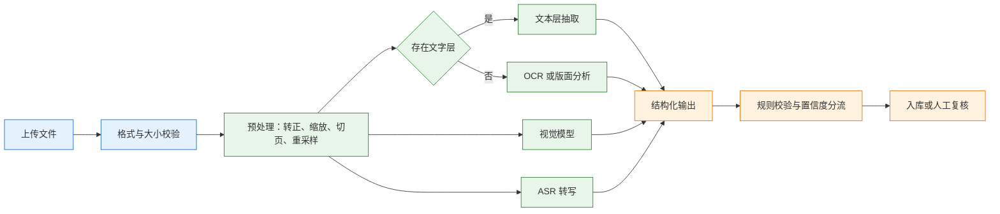
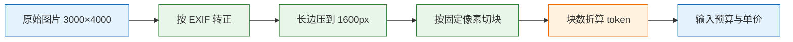
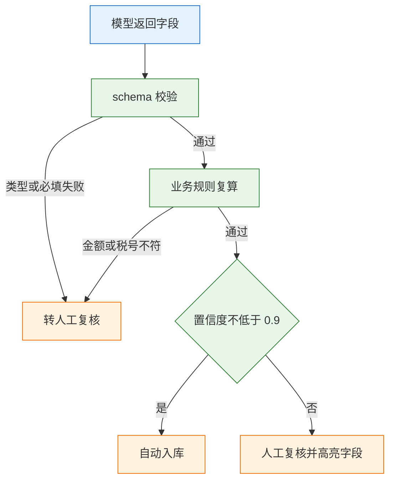

# 多模态

---

## 一、多模态是什么

多模态指系统同时处理文本、图像、音频、视频等一种以上输入形态。工程上更准确的定义是：把非文本输入折算成模型可计量的 token 或可读文本，与文本指令一起送入模型，再把输出收敛成可校验的结构。

它解决三类问题：

- **非文本入口**：扫描件、拍照、截图、录音本身不是文本，必须先转成机器可读内容。
- **版面与语义合并**：一张发票既有文字，也有位置、印章、表格线，纯文本解析会丢掉关系。
- **跨形态检索**：用文字找图、用图找相似图、用语音指令触发流程。

它不解决：

- **精确读数**：视觉模型擅长“看懂大概”，不擅长逐字读准金额、单号、小数点。
- **合规授权**：识别能力不等于可以处理身份证、病历、人脸，数据边界由业务决定。
- **无限分辨率**：超过模型有效分辨率的细节不会因为图更大而变得更清楚。
- **确定性**：同一张图两次调用可能给出不同字段，必须靠规则与缓存收敛。

### 1.1 核心概念

| 概念 | 含义 | 典型实现 |
|---|---|---|
| 模态 | 输入或输出的形态 | 文本、图像、音频、视频、文档 |
| 视觉语言模型 | 同时接受图像与文本的生成模型 | 各家多模态聊天模型 |
| OCR | 把图像中的文字转成字符 | Tesseract、PaddleOCR 类 |
| 版面分析 | 识别标题、段落、表格、单元格位置 | 版面模型、坐标输出 |
| ASR | 语音转文字 | 各家语音识别接口、本地引擎 |
| 图像 token | 图片按块折算后的计量单位 | 按像素切块或固定档位 |

多模态模型、OCR、文档解析是三件不同的事。OCR 只回答“这里有哪些字”，版面分析回答“这些字属于哪一栏哪一格”，视觉模型回答“这张图整体在说什么”。把三者混为一谈，就会出现“模型说看懂了，金额却少一位”的问题。

### 1.2 与相邻技术的关系

| 技术 | 输入 | 输出 | 与多模态的边界 |
|---|---|---|---|
| 文本模型 | 纯文本 token | 文本 | 不处理像素与声波，成本最低 |
| OCR | 图像 | 字符与坐标 | 不负责语义判断，快且便宜 |
| 版面分析 | 图像 | 区域、表格结构 | 不负责字段含义 |
| 视觉语言模型 | 图像 + 文本 | 文本或 JSON | 语义强，逐字精度弱 |
| ASR | 音频 | 带时间戳文本 | 不处理画面 |
| 文档解析库 | PDF、Office | 文本、段落 | 依赖文件内部结构 |

判断顺序只有一条：**能拿到文字层就不要 OCR，能 OCR 就不要用视觉模型。** 电子 PDF 自带文字层时，`pdftotext` 的成本几乎为零；扫描件才需要 OCR；只有“需要理解画面内容”时才调用视觉模型。三者组合通常比单用更稳：OCR 给字，视觉模型给语义，规则做最终裁决。

### 1.3 处理链路与架构组成



链路上每一段都有独立故障：

- **上传层**：扩展名与实际内容不符、文件过大、压缩包套娃。
- **预处理层**：EXIF 方向未转正、透明通道变黑底、切页丢页。
- **识别层**：分辨率不足、旋转、印章遮挡、多栏串行。
- **解析层**：模型返回被代码围栏包住、字段名漂移、数字变成字符串。
- **校验层**：规则缺失，错误结果直接入库。

> **注意**：不要用文件扩展名判断真实类型。手机改名的 `.jpg` 可能是 HEIC，PDF 可能是纯图片扫描件，音频可能是带视频轨的容器。读取文件头再决定走哪条链路。

---

## 二、输入路线与模态格式

### 2.1 模态类型与首选路线

| 输入 | 首选 | 何时换路线 | 主要代价 |
|---|---|---|---|
| 电子 PDF（有文字层） | `pdftotext -layout` | 版面错乱、表格跨页 | 几乎为零，最快 |
| 扫描件、拍照 | 专用 OCR | 手写、印章、复杂表格 | 需预处理，版式要还原 |
| 图表、界面截图、商品图 | 多模态模型 | 需要精确读数时加 OCR | 按图块计费，慢 |
| 长音频 | ASR + 文本模型 | 说话人分离、情绪 | 按秒计费 |
| 视频 | 抽帧 + ASR | 动作识别 | 帧率越高越贵 |

路线选择的依据是“这一步到底需要什么”。需要字符时用 OCR，需要版面时用版面分析，需要语义时用视觉模型。三条路线可以串联，但不要为了省事把纯文本任务也送进视觉模型，那样既贵又慢，还多一层识别误差。

### 2.2 图像输入格式

常见格式是 JPEG、PNG、WebP。工程上统一转成 RGB 的 JPEG 最稳：

- **JPEG**：有损压缩，体积小，适合照片；反复保存会累积噪点。
- **PNG**：无损，适合截图与带文字的图；体积大，透明通道要压成白底。
- **WebP**：体积更小，但部分端点不支持，跨厂商时先转 JPEG。

传输方式有两种：base64 内联和文件上传。base64 的写法必须带 MIME 前缀：

```text
data:image/jpeg;base64,/9j/4AAQSkZJRgABAQ...
```

少了 `data:image/jpeg;base64,` 这一段，端点会把整串当成普通文本，模型就会回答“看不到图片”。

| 参数 | 建议值 | 原因 |
|---|---|---|
| 长边 | 压到 1600px 左右 | 覆盖多数票据与截图，继续放大收益递减 |
| 质量 | JPEG 85 | 肉眼几乎无损，体积明显下降 |
| 色彩 | RGB 三通道 | 去掉 alpha，避免透明区域变黑 |
| 方向 | 按 EXIF 转正 | 手机照片常带旋转标记 |
| 单请求图片数 | 以端点文档为准 | 多图会挤占上下文并放大计费 |

> **注意**：`thumbnail()` 只缩不放。小图强行放大不会增加信息，只会增加 token。压缩前先转正、裁掉空白边，再缩放。

> **安全警告**：多模态入口会同时放大两类风险。一类是图片里夹带文字指令，诱导模型忽略系统提示，属于图像形式的提示注入；另一类是证件、人脸、色情或暴力内容被直接送进第三方。入口要做文字与图像的双重审核，命中策略的请求直接拒绝并留痕，不能只依赖模型自身的拒答。

### 2.3 文档与音视频格式

PDF 分两类：带文字层的“电子 PDF”和只有像素的“扫描 PDF”。前者直接抽文本，后者必须先转图。转图分辨率决定 OCR 上限：

| 类型 | 参数 | 建议 | 说明 |
|---|---|---|---|
| PDF 转图 | DPI | 200~300 | 低于 200 小字糊，高于 300 收益有限 |
| PDF 转图 | 格式 | PNG | 避免二次 JPEG 压缩 |
| 音频 | 采样率 | 16kHz | ASR 通常足够，原始 48kHz 先降采样 |
| 音频 | 声道 | 单声道 | 立体声对识别无帮助，只增加体积 |
| 视频 | 抽帧 | 1fps + 场景切换 | 全帧送成本随帧率线性上涨 |

音频常见格式是 WAV、MP3、M4A、AAC。WAV 无压缩、解析简单，适合切片后临时文件；MP3、M4A 体积小，适合上传。视频容器里可能同时有音轨和视频轨，处理时要分开取：音轨送 ASR，视频轨抽帧送视觉模型。

---

## 三、图像 token 计量与成本

### 3.1 token 折算原理

图片的 token 通常按**分辨率切块**折算：图越大、细节参数越高，块越多。各家切法不同，以当前文档为准，但工程结论一致：

| 输入 | 计量方式 | 成本杠杆 |
|---|---|---|
| 图片 | 按像素切块或固定档位 | 长边压到 1600px，裁掉空白边 |
| 扫描 PDF | 每页转图后按图算 | 只送有内容的页，先判空白页 |
| 音频 | 按秒或特征帧 | 切片、静音裁剪、先 ASR 再送文本 |
| 视频 | 抽帧数乘单帧成本 | 1fps 加场景切换，不全送 30fps |

一个粗略的量级：按 512 像素切块，1024×1024 约 4 块，每块几百 token，一张约 1000~1500 token；同样的图按 3000×4000 原尺寸送，块数可能翻 5~6 倍。这个数字只用于预算，实际以端点返回的 `usage` 为准。



压缩、切块、计量是三个独立环节。压缩在客户端做，切块规则在服务端，计量结果只在 `usage` 里看得到。把三者混在一起估，预算一定偏。

### 3.2 成本预算方法

先算清单页成本，再决定是否全量上线。假设一天 3000 页、每页 1500 token、输入单价 2 元/百万：

```text
输入成本 = 3000 × 1500 ÷ 1,000,000 × 2 = 9 元/天
```

看起来不多，但真实账单还要加三块：失败重试、双模型交叉校验、人工复核。工程上通常按估算的三倍做预算，再拿一周的真实 `usage` 校准。

```text
单页总成本 = 识别 token × 单价 + 重试摊销 + 人工复核时长 × 人力单价
```

> **注意**：不要用“一张图等于固定价”做预算。同一张图压到 1600px 与按原图送，费用可能差数倍，而识别率未必更高。超过模型有效分辨率的部分只是白花钱。

---

## 四、视觉模型调用方式

### 4.1 请求结构

主流端点沿用聊天补全协议，把图片放进 `content` 数组，与文本并列：

```json
{
  "model": "qwen-vl-plus",
  "temperature": 0,
  "max_tokens": 500,
  "response_format": {"type": "json_object"},
  "messages": [
    {
      "role": "user",
      "content": [
        {"type": "text", "text": "只输出 JSON，字段见约定，看不清填 null。"},
        {"type": "image_url", "image_url": {"url": "data:image/jpeg;base64,<BASE64>"}}
      ]
    }
  ]
}
```

| 字段 | 作用 | 常见错误 |
|---|---|---|
| `model` | 选择视觉模型 | 用了纯文本模型，图片被忽略 |
| `content` 数组 | 混合文本与图片 | 仍写成字符串，图片丢失 |
| `image_url.url` | base64 或可访问 URL | 缺 MIME 前缀、URL 需鉴权 |
| `temperature` | 采样随机性 | 抽取任务没设 0，两次结果不同 |
| `max_tokens` | 输出上限 | 太小导致 JSON 被截断 |
| `response_format` | 结构化约束 | 端点只支持 `json_object`，不支持 schema |

> **注意**：`response_format` 与图片 base64 的大小上限各厂商不同，以当前文档为准。超限时先压图或改用文件上传接口，不要靠调大超时硬扛。

### 4.2 结构化输出与解析

即使提示里写了“只输出 JSON”，返回仍可能被代码围栏包住，或在前后加一句说明。解析要按三层处理：

1. 去掉首尾空白与 ` ```json ` 围栏。
2. 尝试 `json.loads`，失败则把错误信息回喂一次，要求只输出 JSON。
3. 两次都失败就转人工，不要在生产里用正则硬猜字段。

```python
import json, re

def parse_json(text: str) -> dict:
    text = text.strip()
    # 剥掉可能存在的 Markdown 代码围栏
    text = re.sub(r"^```(?:json)?\s*|\s*```$", "", text)
    return json.loads(text)
```

字段名漂移也很常见：提示里写 `invoice_no`，返回 `invoiceNumber`。解决办法是把字段名、类型、必填项写进 schema，并在解析后做一次键名映射与缺失检查，而不是只靠提示词约束。

### 4.3 并发与限流

视觉模型的单请求耗时往往高于文本模型，配额也通常更低。批量处理时并发要单独设：

| 限制 | 表现 | 应对 |
|---|---|---|
| 每分钟请求数 | 429，错误体提示 rate limit | 信号量限 3~5，指数退避 |
| 每分钟图片数 | 429，但请求数未超 | 按图片张数计数，不只按请求数 |
| 单请求大小 | 413 或连接被重置 | 压图、拆页、改文件上传 |
| 上下文长度 | 400，提示 token 超限 | 减少每请求页数，先 OCR 再送文本 |
| 并发连接 | 超时、TLS 握手失败 | 连接池上限与配额对齐 |

并发不是越大吞吐越高。超过配额后，多出来的请求在排队和重试上浪费时间，P95 反而更差。先用小并发压出单请求延迟，再按配额反推上限。

### 4.4 调用错误与限制

| 错误 | 含义 | 处理 |
|---|---|---|
| 400 | 字段类型错、图片格式不支持 | 打印原始 body，用最小请求体复现 |
| 401 或 403 | Key 无效、无该模型权限 | 核对项目与区域，不要重试 |
| 413 | 请求体或图片超过端点上限 | 压图、改文件上传、拆页 |
| 429 | 请求数或图片数配额耗尽 | 退避降并发，区分配额类型 |
| 5xx | 上游推理异常 | 有限重试，连续失败切备用 |

> **注意**：4xx 不要重试。重试只会重复报错，已经产生的输入 token 仍可能计费。只有 429 与 5xx 值得退避，且重试层数只能保留一层。

---

## 五、OCR 与版面还原

### 5.1 文字层检测

先确认 PDF 里有没有文字层，再决定走哪条路：

```bash
# 有文字层：直接抽取，-layout 保留大致列位置
pdftotext -layout invoice.pdf -

# 扫描件：按 300dpi 转图，一页一个文件
pdftoppm -r 300 -png scan.pdf page

# 查看前几页产物，确认页数与命名
ls page-*.png | head -3
```

`pdftotext` 输出为空或全是乱码，说明是扫描件；`-layout` 能保留大致的列位置，但复杂表格仍会串行。判断文字层不要只看第一页，封面有文字、正文是扫描图的 PDF 很常见，要逐页判断并在结果里记录页码。

### 5.2 预处理与错误来源

预处理是确定性代码，比换模型便宜。常用步骤：转灰度、按 DPI 缩放、去噪、二值化、裁边、方向校正。

| 现象 | 原因 | 处理 |
|---|---|---|
| 整页乱码 | 旋转 90 度或 180 度、倾斜 | 方向检测加旋转校正 |
| 数字串位 | 低分辨率、压缩噪点 | 300dpi 重转，灰度去噪 |
| 表格列错位 | 纯文本 OCR 丢列关系 | 版面分析，输出 HTML 或坐标 |
| 金额少一位 | 小数点、千分位、印章遮挡 | 数字区域单独识别加规则复算 |
| 多栏串行 | 阅读顺序错 | 按栏切块，再按坐标排序 |
| 手写认不出 | 训练分布不含手写 | 专用手写 OCR 或直接人工 |

同一张图，预处理前后识别率能差十几个点。倾斜校正和去噪尤其明显：拍照件不校正，后面的字段抽取再强也救不回来。

> **注意**：二值化不是越激进越好。浅色印章、细体小字在强二值化后会整片消失，先保留灰度版本，对比两种结果的字符数再定。

### 5.3 表格与版面分析

表格是分水岭。纯文本 OCR 出来是一串词，列关系全丢；需要表格结构时，用版面模型或专用表格识别，输出带行列坐标的 JSON，再自己拼。

```json
{
  "page": 1,
  "tables": [
    {
      "bbox": [72, 310, 540, 520],
      "rows": 8,
      "cols": 4,
      "cells": [
        {"r": 0, "c": 0, "text": "项目", "bbox": [72, 310, 180, 340]},
        {"r": 0, "c": 3, "text": "金额", "bbox": [430, 310, 540, 340]}
      ]
    }
  ]
}
```

**不要指望视觉模型把 20 行表格逐格读对。** 超过 10 行就该拆页或改用结构化 OCR；需要合计时，让代码按单元格数值求和，再与票面合计比对。

---

## 六、结构化结果校验

### 6.1 业务规则校验

模型给的是“候选值”，能不能入库由代码决定：

| 校验 | 规则 | 抓什么 |
|---|---|---|
| 金额合计 | 不含税加税额等于含税 | 识别错位、模型编造 |
| 税号 | 长度与校验位 | 少一位、字母 O 与数字 0 混淆 |
| 日期 | 在合理区间，不晚于今天 | 年份识别错 |
| 发票号 | 唯一索引 | 重复报销 |
| 必填 | 关键字段非空 | 模型偷懒填 null |

金额必须用 `Decimal` 计算。二进制浮点在 `0.1 + 0.2` 上就会产生尾差，票据金额动辄几十万，几分钱的误差足以让整单校验失败。

### 6.2 schema 约束

把字段契约固化成 schema，不要只写在提示里：

```json
{
  "type": "object",
  "required": ["invoice_no", "date", "amount", "tax", "total"],
  "properties": {
    "invoice_no": {"type": "string", "minLength": 8},
    "date": {"type": "string", "pattern": "^\\d{4}-\\d{2}-\\d{2}$"},
    "amount": {"type": "number", "minimum": 0},
    "tax": {"type": "number", "minimum": 0},
    "total": {"type": "number", "minimum": 0},
    "confidence": {"type": "number", "minimum": 0, "maximum": 1}
  }
}
```

schema 只保证类型和必填，金额关系仍要靠业务规则；两层都要有。端点不支持 schema 时，退化为 `json_object` 加本地校验，不能省掉校验。

### 6.3 置信度分流

置信度按业务定阈值，典型三档：

```text
confidence ≥ 0.9 且规则全过  → 自动入库
0.6 ~ 0.9 或规则告警         → 人工复核，只高亮问题字段
< 0.6 或关键字段缺失         → 退回重拍，不计入准确率
```

评估要报两个数：**字段准确率**（单个字段对的比例）和**整单通过率**（所有字段都对的比例）。一张发票 8 个字段、每个字段 97%，整单只有约 78%；只报字段准确率会严重高估体验。



分流顺序不能颠倒：先 schema 再业务规则，最后才看置信度。低置信度但规则全过的单子仍可进人工快速确认，高置信度但金额对不上的单子必须拦下。

> **注意**：模型自报的 `confidence` 是生成出来的数字，不是校准过的概率。它只能当排序信号，不能当唯一门槛。规则告警优先级应高于置信度。

---

## 七、完整示例：发票字段抽取

### 7.1 环境与依赖

```bash
# 建虚拟环境，固定 Python 小版本，避免依赖漂移
python3.12 -m venv .venv && source .venv/bin/activate

# 安装 SDK 与图像库
pip install "openai>=1.40" "pillow>=10"

# 端点、密钥、模型名全部走环境变量，不写进代码
export LLM_BASE_URL="https://<your-endpoint>/v1"
export LLM_API_KEY="sk-..."
export VLM_MODEL="qwen-vl-plus"
```

### 7.2 代码实现

```python
# extract.py —— 压图 → 视觉模型抽取 → 规则校验
import base64, io, json, os, re
from decimal import Decimal
from PIL import Image, ImageOps
from openai import OpenAI

client = OpenAI(base_url=os.environ["LLM_BASE_URL"], api_key=os.environ["LLM_API_KEY"])
MODEL = os.environ["VLM_MODEL"]

PROMPT = """你是发票录入器。只输出 JSON，字段：
{"invoice_no": str, "date": "YYYY-MM-DD", "amount": number, "tax": number,
 "total": number, "tax_id": str, "confidence": 0-1}
看不清的字段填 null，不要猜。金额单位元，保留两位小数。"""

def to_data_url(path: str, max_edge: int = 1600) -> str:
    img = Image.open(path)
    img = ImageOps.exif_transpose(img)        # 按 EXIF 转正，手机照片常带旋转标记
    if img.mode in ("RGBA", "LA"):            # 透明 PNG 先合成到白底
        bg = Image.new("RGB", img.size, (255, 255, 255))
        bg.paste(img, mask=img.split()[-1])
        img = bg
    else:
        img = img.convert("RGB")              # 去掉其他色彩模式，统一按 JPEG 编码
    img.thumbnail((max_edge, max_edge))       # 只缩不放
    buf = io.BytesIO()
    img.save(buf, format="JPEG", quality=85)
    return "data:image/jpeg;base64," + base64.b64encode(buf.getvalue()).decode()

def parse_json(text: str) -> dict:
    text = re.sub(r"^```(?:json)?\s*|\s*```$", "", text.strip())
    return json.loads(text)                   # 解析失败由调用方转人工

def extract(path: str) -> dict:
    resp = client.chat.completions.create(
        model=MODEL, temperature=0, max_tokens=500,
        response_format={"type": "json_object"},
        messages=[{"role": "user", "content": [
            {"type": "text", "text": PROMPT},
            {"type": "image_url", "image_url": {"url": to_data_url(path)}},
        ]}])
    return parse_json(resp.choices[0].message.content)

def validate(inv: dict) -> list[str]:
    errs = []
    if inv.get("amount") is None or inv.get("tax") is None or inv.get("total") is None:
        return ["关键金额缺失"]
    amount, tax, total = (Decimal(str(inv[k])) for k in ("amount", "tax", "total"))
    if amount + tax != total:                  # 用 Decimal，避免浮点差几分
        errs.append(f"合计不符：{amount}+{tax}!={total}")
    if not (inv.get("invoice_no") or "").strip():
        errs.append("发票号为空")
    if (inv.get("confidence") or 0) < 0.8:
        errs.append("置信度低")
    return errs

if __name__ == "__main__":
    try:
        inv = extract("invoice.jpg")
    except (json.JSONDecodeError, ValueError) as e:
        raise SystemExit(f"解析失败，转人工：{e}")   # 生产环境改为写入复核队列
    print(json.dumps(inv, ensure_ascii=False))
    print("problems:", validate(inv) or "none")
```

### 7.3 运行与结果

```bash
python extract.py
```

预期输出（字段值随图片变化）：

```json
{"invoice_no": "24312000000012345678", "date": "2026-09-18", "amount": 943.4, "tax": 56.6, "total": 1000.0, "tax_id": "91310000XXXXXXXXXX", "confidence": 0.93}
problems: none
```

| 检查项 | 命令或动作 | 预期 |
|---|---|---|
| 压缩是否生效 | 打印 data URL 长度 | 明显小于原图 base64 |
| 请求是否成功 | 看 `resp.usage` | `prompt_tokens` 含图片块 |
| 字段是否齐全 | 对 schema 校验 | 必填键都存在 |
| 金额是否自洽 | `validate()` | 返回空列表 |
| 是否可复现 | 同图跑两次 | 设 `temperature=0` 后结果一致 |

这段代码只覆盖单页单图。生产上要再加三件事：按页循环、失败重试一次、把原图哈希与结果一起落库，便于复现。

---

## 八、音视频处理

### 8.1 音频输入与 ASR

| 参数 | 建议 | 说明 |
|---|---|---|
| 采样率 | 16kHz | 多数 ASR 足够，原始高采样先降 |
| 声道 | 单声道 | 立体声不提升识别率 |
| 切片 | 按静音切，30~60 秒 | 太长漏句，太短丢上下文 |
| 时间戳 | 每段保留起止秒 | 回溯时能定位原音频 |
| 热词 | 产品名、人名、型号 | 比事后纠错便宜 |
| 数字 | 金额、电话、单号二次确认 | ASR 的稳定弱项 |

切片要按静音边界切，不能按固定秒数硬切，否则一句话会被切成两半。切完保留每段的起止时间，最终文本按时间排序拼接。

### 8.2 视频抽帧策略

视频不要整段送。1fps 抽帧加场景切换检测，通常足够回答“发生了什么”；需要读屏幕文字时，对关键帧做 OCR。帧率翻倍，成本翻倍，信息量未必增加。

```bash
# 每秒 1 帧，输出到 frames 目录
ffmpeg -i input.mp4 -vf fps=1 frames/frame-%04d.jpg

# 只取场景切换帧，阈值按素材调整
ffmpeg -i input.mp4 -vf "select='gt(scene,0.3)'" -vsync vfr frames/scene-%04d.jpg
```

帧文件名要带时间偏移，结果里才能回指原视频位置。抽帧后先做模糊与黑屏过滤，再送模型，能省掉大量无效调用。

### 8.3 实时语音约束

实时语音是另一套约束：要 VAD 判断说话起止，静音 300ms 左右判一句结束；用户打断时立刻停止播放并丢弃未发出的生成结果。等一整段录完再识别，延迟按秒计，对话就没法用了。

ASR 的中间结果可以先上屏，最终结果再覆盖，用户感知会快很多。代价是界面会闪动，需要在句末做一次稳定替换，而不是每个字都改。

> **安全警告**：身份证、银行卡、人脸、病历、录音都属于敏感信息。能本地 OCR 或本地 ASR 就不要传到第三方；必须外发时先裁掉无关区域、加水印、走单独的数据通道，并确认供应商不留存、不训练。这一条不解决，识别率再高也不能上线。

---

## 九、评估与适用边界

### 9.1 分层评估指标

| 指标 | 算法 | 用途 |
|---|---|---|
| 字段准确率 | 字段完全相等的比例 | 定位哪个字段弱 |
| 整单通过率 | 全部字段正确且校验通过 | 真实自动化率 |
| 拒识率 | 转人工或退回的比例 | 控制人工成本 |
| 单页成本 | token 加重试加人工 | 判断能否铺开 |
| P95 延迟 | 上传到出结果 | 影响用户体验 |

### 9.2 评测集设计

评测集必须覆盖版式：电子票、扫描件、拍照倾斜、印章遮挡、手写、多页、空白页。只用清晰电子票测出来的准确率，上线遇到手机拍照往往明显下降。

标注至少 100 页，两个人独立标，不一致的字段当场裁决；按版式分组报准确率，不要只报一个总数。哪个版式掉得最狠，就补哪类样本或加预处理，而不是笼统地换一个更强的模型。

### 9.3 适用边界

| 场景 | 是否适合多模态 | 原因 |
|---|---|---|
| 纯文本问答 | 不适合 | 贵、慢，还多一层识别误差 |
| 固定版式票据 | 部分适合 | 模板加 OCR 更稳，模型只补异常 |
| 复杂版面、图表理解 | 适合 | 需要语义与空间关系 |
| 逐字读金额、单号 | 不适合单用 | 必须 OCR 加规则复算 |
| 长视频内容检索 | 适合抽帧 | 全量送成本不可控 |
| 敏感证件识别 | 谨慎 | 优先本地处理，控制留存 |

多模态只用在“必须看图或听声”的那一步，其余交给文本模型。链路越短，故障点越少，成本也越低。

---

## 十、常见故障与排查

### 10.1 故障表

| 现象 | 最可能原因 | 处理 |
|---|---|---|
| 模型说“看不到图片” | base64 缺 MIME 前缀，或字段类型错 | 打印请求体前 200 字符核对 |
| 上传后进程内存暴涨 | 大图直接 base64，字符串复制多份 | 先缩到 1600px，改流式上传 |
| 识别结果方向错 | EXIF 旋转未处理 | 读 EXIF 后转正，或方向分类 |
| 多页 PDF 只处理第一页 | 只转了一页 | 逐页转图，页码写进结果 |
| 金额总是差几分 | 浮点、四舍五入、税额倒算 | 用 Decimal，规则复算 |
| 输出字段缺失 | `max_tokens` 太小、schema 没约束 | 看 `finish_reason`，加 schema 与重试 |
| 图片 token 超上下文 | 分辨率过高、一次送多页 | 压图、拆页、限制每请求页数 |
| 并发一高就 429 | 视觉模型配额低 | 信号量限 3~5，排队加退避 |
| 表格列全串了 | 用了纯文本 OCR | 换版面或表格识别，或拆列 |
| 同一张票两次结果不同 | 温度未设 0、图片被重新压缩 | 固定参数，缓存原图哈希 |

### 10.2 排查顺序

1. 把送出的图存下来，人眼看是否清晰、方向是否正确。
2. 单独跑 OCR，看文字层是否可用。
3. 打印模型原始返回，确认是识别错还是解析错。
4. 用规则复算，定位是哪个字段错。
5. 最后才换模型或调提示。

> **安全警告**：落盘的原图与中间产物同样属于敏感数据。排查用的临时图片要设保留期，排查结束删除；日志里不要打印完整 base64 或身份字段。
