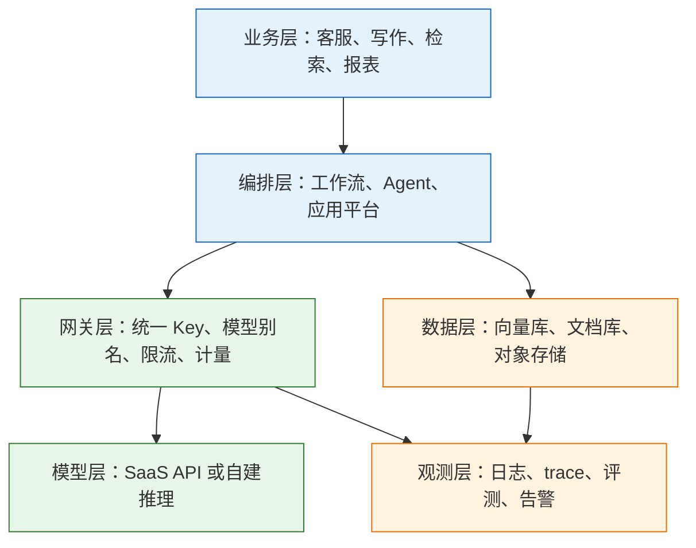
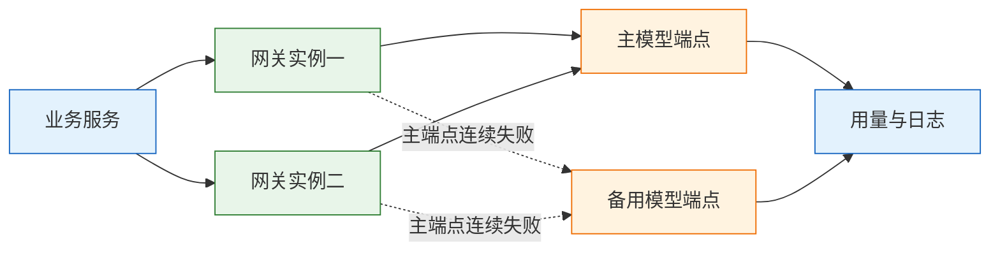
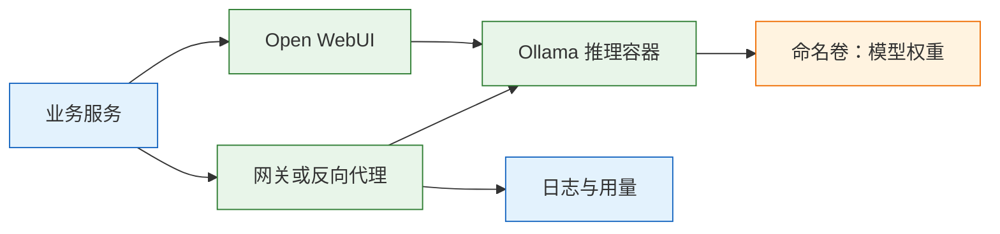

# 常用 AI 技术

---

## 一、常用 AI 技术是什么

常用 AI 技术不是某一个模型或某一个框架，而是围绕模型 API 形成的一组工程组件：接入网关、编排层、推理引擎、向量库、应用平台与观测体系。它们共同把“模型能生成文本”变成“业务系统可以稳定调用、计量、排障的服务”。

这组技术解决四个问题：

- **接入统一**：多供应商、多模型、多租户共用一套入口，Key 不下发到业务代码。
- **能力补齐**：模型本身无状态、无记忆、无检索，需要外部组件补上知识、工具与状态。
- **成本可控**：按 token 计量、按租户限额、按任务选择模型，避免账单失控。
- **故障可查**：每次调用的模型、耗时、状态、用量都有记录，出事能定位到层。

它不解决：

- **模型能力上限**：组件再完整，也不能让弱模型回答它不知道的事实。
- **业务正确性**：检索、提示、规则都要业务自己定义，平台不提供答案。
- **组织权限**：谁能看哪份文档、谁能调哪个模型，仍要由权限系统决定。
- **零运维**：每加一个组件，就多一套部署、升级、备份与告警。

### 1.1 核心概念

| 组件 | 职责 | 典型形态 |
|---|---|---|
| 模型 API | 提供生成、嵌入、语音等能力 | 厂商 HTTP 接口、自建推理服务 |
| 模型网关 | 统一鉴权、别名、限流、计量 | LiteLLM、OneAPI 类，或自研代理 |
| 编排层 | 组织多步调用、状态与分支 | 代码工作流、Agent 框架、应用平台 |
| 推理引擎 | 在自有 GPU 上加载并服务模型 | vLLM、SGLang、Ollama |
| 向量库 | 存储向量并做相似度检索 | pgvector、Qdrant、Milvus |
| 应用平台 | 拖拽式搭建问答与流程 | Dify、Coze、n8n 类 |
| 观测体系 | 日志、trace、评测、告警 | 结构化日志、Langfuse 类工具 |

这些组件的共同点是“可替换”。选型的核心不是找到最强的一个，而是让每一层都能在两周内换掉。换不掉的组件，会在涨价、停服或限流时把整个产品拖住。

### 1.2 与相邻技术的关系

| 概念 | 与本文的关系 | 边界 |
|---|---|---|
| 模型 API | 整条链路的底座协议 | 只负责单次生成，不保存会话 |
| RAG | 使用向量库与模型的一种方式 | 本文讲组件选型，不展开检索算法 |
| Agent | 使用编排层与工具的一种方式 | 本文讲运行载体，不展开循环设计 |
| MLOps | 覆盖训练、评测、发布 | 本文只涉及推理侧与观测 |
| 传统后端 | 提供业务库、权限、任务队列 | AI 组件不替代业务主库 |

一句话区分：模型 API 是“能力”，RAG 与 Agent 是“用法”，网关、推理引擎、向量库是“承载用法的组件”。选型讨论的是承载方式，不是应用形态。

### 1.3 技术栈分层架构



| 层 | 职责 | 典型选择 | 必须自建的条件 |
|---|---|---|---|
| 接入网关 | 鉴权、别名、限流、计量 | 云厂商网关、LiteLLM 类 | 多供应商、统一账单、按租户限流 |
| 编排 | 多步调用、状态、分支 | 代码、应用平台 | 复杂状态、要接内部系统 |
| 模型 | 生成与嵌入 | SaaS API、vLLM、Ollama | 数据不能出内网、长期高频、要定制 |
| 数据 | 检索与留存 | pgvector、Qdrant、Milvus、ES | 已有 Postgres 时优先 pgvector |
| 观测 | 排障与评测 | 结构化日志、Langfuse 类 | 有合规留存要求、要接内部告警 |

**先补缺口，不要补工具。** 已经有 Postgres 就别急着上 Milvus；已经有一个供应商、日请求几千，就别自建网关。每加一层都要有人维护。

---

## 二、接入形态与输入输出

### 2.1 SaaS API 的输入输出

SaaS API 是最小可用形态：一个 HTTPS 端点，Bearer 鉴权，JSON 请求体，JSON 或 SSE 响应。

```json
{
  "model": "chat-default",
  "messages": [
    {"role": "system", "content": "只回答业务范围内的问题。"},
    {"role": "user", "content": "退款几天到账？"}
  ],
  "temperature": 0,
  "max_tokens": 300,
  "stream": false
}
```

| 字段 | 作用 | 注意 |
|---|---|---|
| `model` | 选择模型或别名 | 浮动别名会随上游升级而变，日志要记实际值 |
| `messages` | 完整对话历史 | 历史越长越贵，角色顺序会影响行为 |
| `temperature` | 采样随机性 | 抽取与分类设 0 |
| `max_tokens` | 输出上限 | 只限输出，不限输入 |
| `stream` | 是否流式 | 只影响传输，不影响总 token |
| `tools` | 工具清单 | 模型只输出调用意图，执行在业务侧 |

响应里最该看的是 `finish_reason` 与 `usage`。前者说明有没有被截断、有没有触发工具调用，后者是计费与容量分析的唯一依据。只打印 `content`，排障时等于什么都没留。

### 2.2 自建推理的输入输出

自建推理通常暴露 OpenAI 兼容端点，请求体与 SaaS 基本一致，差异集中在三处：模型名是本地的权重标识、并发受显存约束、可用参数由引擎实现决定。

| 部署形态 | 适用 | 代价 |
|---|---|---|
| 单机容器 | 开发验证、离线工具 | 无高可用，重启即中断 |
| 单机多卡 | 中小流量、私有化交付 | 要调张量并行与显存分配 |
| 多副本加负载均衡 | 生产、要滚动升级 | 要处理会话粘性与模型版本一致 |
| 托管推理服务 | 不想管 GPU | 仍受供应商配额与区域限制 |

> **注意**：兼容协议不等于行为一致。同一个 `max_tokens` 字段，有的引擎支持，有的改名，有的直接忽略；上线前用最小请求体逐项验证，不要假设换 `base_url` 就能无缝迁移。

### 2.3 网关的请求与响应

业务只认网关地址，网关再按别名转发到具体供应商。请求头通常带租户标识与追踪 id，响应头回传实际模型与用量。

```yaml
# 网关别名配置示例，字段名以所选网关的文档为准
model_list:
  - model_name: chat-default          # 业务使用的稳定别名
    litellm_params:
      model: openai/<provider-model>  # 实际上游模型
      api_base: https://<endpoint>/v1
      api_key: os.environ/PROVIDER_KEY
  - model_name: chat-fallback
    litellm_params:
      model: openai/<backup-model>
      api_base: https://<backup-endpoint>/v1
      api_key: os.environ/BACKUP_KEY
```

| 能力 | 作用 | 缺失后的表现 |
|---|---|---|
| 模型别名 | 换模型不改业务代码 | 每次升级都要改所有服务 |
| 统一鉴权 | Key 只存在网关 | Key 散落在各服务，无法轮换 |
| 按租户限流 | 防止单客户打满全站 | 一个客户拖垮所有人 |
| 用量落库 | 账单可拆分 | 月底对不上账 |
| 超时与重试 | 屏蔽上游抖动 | 供应商一抖，用户立刻感知 |

网关自己也会挂。要么双实例，要么在业务侧保留直连备用开关；不要让它成为唯一入口却没有副本。

---

## 三、SaaS API 与自建推理的取舍

### 3.1 成本结构

| 维度 | SaaS API | 自建推理 |
|---|---|---|
| 起步成本 | 几乎为零 | GPU 采购或租用加部署 |
| 单位成本 | 按 token，线性上涨 | 固定成本，跑满后边际低 |
| 数据边界 | 数据出内网，依赖合同 | 数据留在自己机房 |
| 弹性 | 供应商给多少用多少 | 受显存与并发限制 |
| 延迟 | 受网络与排队影响 | 内网可控，但要自己调 |
| 运维 | 无 | 驱动、CUDA、模型、监控全要管 |
| 故障责任 | 供应商 SLA | 自己兜 |

成本公式只有一条，但要算全：

```text
自建月成本 = GPU 月租或折旧 + 运维人力 + 带宽与存储
API 月成本 = 月 token 量 × 单价 ÷ 1,000,000
临界点：月 token 量 = 自建月成本 ÷ 单价 × 1,000,000
```

### 3.2 盈亏平衡测算

用一组假设值感受量级：24GB 单卡月租 3000 元，7B 模型 4bit 量化吞吐 1500 token/s，按 50% 利用率、每月 720 小时，约产出 19 亿 token，折合每百万 token 约 1.5 元，不含人力与电费。再假设 API 单价 2 元/百万：

| 月 token 量 | API 月成本 | 自建月成本 | 结论 |
|---|---|---|---|
| 1000 万 | 20 元 | 3000 元 | API 明显更省 |
| 5 亿 | 1000 元 | 3000 元 | API 仍更省 |
| 15 亿 | 3000 元 | 3000 元 | 接近临界点 |
| 30 亿 | 6000 元 | 3000 元 | 跑满后自建更省 |

这些数字只用于判断量级，实际要替换成当前报价与实测吞吐。**先估月 token 量，再看临界点**；月用量只有千万级时，自建没有任何成本理由。

### 3.3 非成本因素

| 因素 | 倾向 SaaS | 倾向自建 |
|---|---|---|
| 数据不能出内网 | 不可行 | 必须 |
| 需要定制权重 | 不可行 | 必须 |
| 供应商限流严格 | 风险高 | 可控 |
| 团队没有 GPU 运维 | 合适 | 负担重 |
| 流量波动大 | 弹性好 | 闲置浪费 |
| 长期稳定高负载 | 成本高 | 更划算 |

很多团队自建不是为了省钱，而是为了不被限流、不把数据交出去。把这两项折算成非成本收益，再和运维负担放在一起看，结论通常比单纯算账清楚。

---

## 四、模型网关的部署方式

### 4.1 核心能力

| 能力 | 是否必须 | 不做的后果 |
|---|---|---|
| 模型别名 | 必须 | 换模型要改所有服务 |
| 超时与重试 | 必须 | 供应商抖动直接传到用户 |
| 按租户限流 | 多租户必须 | 一个客户打满全站 |
| 用量落库 | 必须 | 账单拆不开 |
| 语义缓存 | 可选 | 命中率低时只是多一层故障 |
| 提示词管理 | 可选 | 改了无法归因 |

网关的第一价值不是“转发”，而是“把变化挡在业务之外”。模型升级、供应商切换、配额调整都发生在网关，业务只认稳定别名。

### 4.2 别名与配置

别名映射要落库，不要只写在网关的 YAML 里。一条映射至少包含：别名、实际模型、生效时间、回滚版本、变更人。

```json
{
  "alias": "chat-default",
  "target": "<provider-model-snapshot>",
  "effective_at": "2026-10-01T00:00:00Z",
  "rollback_to": "<previous-snapshot>",
  "changed_by": "ops"
}
```

改映射前先跑评测集，改完观察错误率与首 token 时间。没有这两步，别名只是把“改代码”换成了“改配置”，风险并没有减少。

> **注意**：别名不要指向浮动版本。上游的“最新”随时会变，昨天通过的评测今天可能不成立。生产别名应指向带日期的快照。

### 4.3 高可用与降级



| 故障 | 表现 | 处理 |
|---|---|---|
| 网关单实例宕机 | 连接被拒、502 | 双实例加健康检查 |
| 主模型 429 | 错误率突升 | 退避后切备用，别立即全量切 |
| 主模型 5xx | 首字超时、半截断流 | 限流加熔断，恢复后逐步放量 |
| 参数不兼容 | 切模型后 400 | 最小请求体先验证，再逐项加回 |
| 重试叠加 | 账单翻倍、P95 恶化 | 只保留一层可控重试 |

重试要算总次数：SDK 自带两次、业务再两次、网关再两次，最坏是八次调用。切模型时先切 5% 流量，观察错误率与延迟，再逐步放大。

### 4.4 网关的错误与限制

| 现象 | 来源 | 处理 |
|---|---|---|
| 400 参数错误 | 业务与上游字段契约不一致 | 最小请求体先跑通，再逐项加回 |
| 401 鉴权失败 | Key 过期、未注入、项目不对 | 轮换 Key，检查环境变量与权限 |
| 429 限流 | 租户配额或上游配额耗尽 | 读错误体区分来源，退避并降并发 |
| 502 或 504 | 网关到上游超时或连接失败 | 查网关日志，调整超时与熔断 |
| 200 但内容为空 | 上游拒答、内容过滤、工具调用 | 看 `finish_reason` 与完整 message |

> **注意**：网关超时时间必须大于上游 P99，否则正常的长回答会被网关先掐断。流式请求的读超时要按帧间隔设，不要复用非流式的总超时。

---

## 五、本地推理引擎

### 5.1 引擎对比

| 维度 | Ollama | vLLM、SGLang 类 |
|---|---|---|
| 定位 | 开发机、单用户 | 生产、多并发 |
| 安装 | 一条命令 | Docker 加 GPU 驱动 |
| 并发 | 弱 | 连续批处理，吞吐高 |
| 量化 | GGUF，选择多 | 以引擎支持为准 |
| 接口 | 自带 API，兼容 OpenAI | OpenAI 兼容 |
| 适合 | 本地试模型、离线工具 | 对外服务、压测、多卡 |

开发机验证用 Ollama 足够；上线要压 50 并发，直接上 vLLM。用 Ollama 扛生产并发，常见结果是排队到超时。

### 5.2 容器化部署

```yaml
services:
  ollama:
    image: ollama/ollama:${OLLAMA_TAG:?pin a version from official docs}
    ports: ["11434:11434"]
    volumes: ["ollama:/root/.ollama"]
    deploy:
      resources:
        reservations:
          devices: [{driver: nvidia, count: 1, capabilities: [gpu]}]

  open-webui:
    image: ghcr.io/open-webui/open-webui:${WEBUI_TAG:?pin a version from official docs}
    ports: ["3000:8080"]
    environment:
      OLLAMA_BASE_URL: http://ollama:11434   # 用服务名，不用 localhost
    depends_on: [ollama]

volumes:
  ollama:                                     # 模型文件必须挂命名卷
```

镜像 tag 与模型名以官方当前文档和模型库为准，不要照抄旧文章。`${VAR:?message}` 的写法是让变量缺失时直接报错，避免误用浮动标签。

> **注意**：容器里的 `localhost` 指向容器自己。容器访问宿主机上的 Ollama 要用 `host.docker.internal`；Linux 上可能还需要 `--add-host=host.docker.internal:host-gateway`。

### 5.3 验证与调用

```bash
# 写入固定版本，缺变量时 compose 会直接失败
printf 'OLLAMA_TAG=<tag>\nWEBUI_TAG=<tag>\nLOCAL_MODEL=<model>\n' > .env

# 导出到当前 shell，后续命令才能读到 $LOCAL_MODEL
set -a; . ./.env; set +a

# 启动并拉取模型
docker compose up -d
docker compose exec ollama ollama pull "$LOCAL_MODEL"

# 查看本地模型清单
curl -s http://127.0.0.1:11434/api/tags | head
```

```python
# 用 OpenAI 兼容接口调用本地模型
import os
from openai import OpenAI

client = OpenAI(
    base_url="http://127.0.0.1:11434/v1",   # 本地引擎的兼容端点
    api_key="ollama",                        # 本地通常不校验，占位即可
    timeout=60.0,
    max_retries=1,
)

resp = client.chat.completions.create(
    model=os.environ["LOCAL_MODEL"],
    messages=[{"role": "user", "content": "用一句话说明什么是量化"}],
    temperature=0,
    max_tokens=120,
)
print(resp.choices[0].message.content)
print(resp.usage)                            # 本地引擎可能不返回，缺失时按估算记
```

| 检查项 | 命令 | 预期 |
|---|---|---|
| GPU 是否可见 | `nvidia-smi` | 列出显卡与显存 |
| 容器是否运行 | `docker compose ps` | 两个服务均为 running |
| 模型是否加载 | `ollama list` | 出现目标模型 |
| 接口是否通 | `curl /api/tags` | 返回 JSON 列表 |
| 显存是否够 | `nvidia-smi` 观察占用 | 留出上下文余量 |

---

## 六、向量库与检索组件

### 6.1 选型维度

| 选项 | 优势 | 代价 | 适合 |
|---|---|---|---|
| pgvector | 与业务库同事务、备份简单 | 超大规模与高并发不如专用库 | 已有 Postgres、百万级以内 |
| Qdrant | 过滤强、部署轻 | 多一套运维 | 中小规模、要复杂过滤 |
| Milvus | 十亿级、分布式 | 组件多、运维重 | 大规模、专门团队 |
| Elasticsearch | 全文加向量混合 | 资源占用高 | 已有 ES、混合检索 |

选型先问三个数：向量条数、QPS、过滤条件复杂度。**十万条以内、已有 Postgres，pgvector 几乎总是更省事**；十亿级才轮到 Milvus。不要为了“以后可能很大”提前上分布式。

### 6.2 与业务库的边界

| 数据 | 存放位置 | 原因 |
|---|---|---|
| 原文、权限、版本 | 业务库 | 事务、审计、权限过滤都在这 |
| 向量与分块 id | 向量库 | 只做相似度检索 |
| 过滤字段 | 向量库 | 租户、文档类型、时间 |
| 原始文件 | 对象存储 | 体积大，不进数据库 |
| 调用日志 | 日志系统 | 可检索、可过期 |

向量库不是主库。删文档时要同步删向量，否则会出现“原文已删、回答还在引用”。同步建议走事件或定时对账，不要依赖应用代码里两处删除都写对。

```text
删除顺序：业务库标记删除 → 发事件 → 删向量 → 校验条数 → 完成
失败处理：事件重试，定时对账补删；不要先删业务库再删向量
```

### 6.3 模型版本一致性

换 embedding 模型必须全量重建：维度不同连表都写不进去，同一维度也不能混用，因为两个模型的向量空间不可比。

| 变更 | 影响 | 处理 |
|---|---|---|
| 换模型且维度不同 | 旧表无法写入 | 新建表或新列，全量重嵌入 |
| 换模型但维度相同 | 向量不可比，召回骤降 | 仍要全量重建，不能混查 |
| 升级模型版本 | 行为可能漂移 | 锁版本号，重建后对比再切 |
| 修改分块策略 | 分块 id 全变 | 重建并保留旧索引回滚 |

查询与入库必须锁同一个模型版本，版本号写进表结构或元数据。升级时新建一列或一张表，跑完对比再切；直接原地覆盖，出问题没有回退路径。

---

## 七、应用平台与锁定风险

### 7.1 适用场景

Dify、Coze、n8n 这类平台的价值是让不写代码的人把流程搭出来：拖节点、连知识库、配提示词、发 API。适合验证和运营侧自助配置。

| 场景 | 适合平台 | 风险 |
|---|---|---|
| 一周内验证问答或 FAQ | 是 | 验证完可能推倒重来 |
| 运营改提示词、改分流 | 是 | 版本与回滚要确认 |
| 复杂状态、人工审批 | 部分 | 平台表达力不够，最后写代码 |
| 核心交易链路 | 否 | 锁定、审计、性能都难保证 |
| 数据不能出内网 | 看部署形态 | 必须私有化，SaaS 版直接排除 |

### 7.2 导出与私有化

用平台前先确认三件事：能不能导出工作流与提示词？能不能私有化部署？限流与日志能不能接出来？答不上来，就只把它当原型工具。

| 检查项 | 可接受 | 不可接受 |
|---|---|---|
| 工作流导出 | 结构化文件，可版本管理 | 只能截图或手抄 |
| 提示词导出 | 明文，可 diff | 加密绑定平台 |
| 私有化 | 支持离线镜像 | 只能 SaaS |
| 日志 | 可接自建采集 | 只在平台内看 |
| 账号体系 | 可接企业 SSO | 独立账号孤岛 |

平台适合验证，不适合核心链路。验证阶段的产物要能迁移：提示词、评测集、知识库原文都要有独立副本，否则平台一停，业务归零。

---

## 八、可观测与评测体系

### 8.1 最小日志集

最小可用的一套不需要买产品：

| 要记的 | 放哪 | 用途 |
|---|---|---|
| 请求 id、租户、模型、token、耗时、状态 | 结构化日志 | 排障、对账 |
| 完整上下文，脱敏且短期 | 对象存储 | 复现 badcase |
| 用户反馈 | 业务库 | 采样回填评测集 |
| 离线评测结果 | CI 产物 | 发布门槛 |

四个指标要每天看：首 token 时间、P95 总耗时、错误率、每租户 token 用量。前两个决定体验，后两个决定成本和容量。

```json
{
  "request_id": "req-...",
  "tenant": "t-42",
  "model": "<actual-model>",
  "prompt_tokens": 812,
  "completion_tokens": 96,
  "ttft_ms": 640,
  "total_ms": 2100,
  "status": 200,
  "retry": 0
}
```

> **注意**：流式响应默认可能不返回 usage，账单会漏记。要么开 `include_usage`，要么在网关按字符数估算并标注“估算”，不要静默当成 0。

### 8.2 工具边界

| 需求 | 自建 | 上工具 |
|---|---|---|
| 单次请求耗时定位 | 结构化日志加 trace_id 就够 | 有界面更快，但不是必需 |
| 管理 300 条评测集 | CSV 或 JSONL 加脚本 | 数据集版本、协作标注 |
| 对比两个版本 | 跑批脚本加报告 | 自动 diff、图表 |
| 线上 badcase 回填 | 手工导出 | 一键入集 |
| 合规留存 | 自己控存储与脱敏 | 要看部署形态与数据边界 |

工具解决的是协作与展示，不解决“指标定义”。指标没定清楚，换三个平台也还是不知道好坏。

---

## 九、完整示例：本地推理服务链路

### 9.1 环境准备

```bash
# 确认显卡驱动与容器运行时可用
nvidia-smi
docker --version
docker compose version

# 确认磁盘能放下模型权重，7B 4bit 通常也要数 GB
df -h "$(docker info --format '{{.DockerRootDir}}')"

# 准备变量文件，所有 tag 固定，不使用 latest
printf 'OLLAMA_TAG=<tag>\nWEBUI_TAG=<tag>\nLOCAL_MODEL=<model>\n' > .env

# 导出到当前 shell，供后续 pull 与 curl 使用
set -a; . ./.env; set +a
```

下面沿用 5.2 节的 compose 文件，不再重复贴出。

### 9.2 部署与验证

```bash
# 启动 Ollama 与 WebUI
docker compose up -d

# 拉取模型，观察进度与显存
docker compose exec ollama ollama pull "$LOCAL_MODEL"

# 验证原生接口
curl -s http://127.0.0.1:11434/api/tags | head

# 验证 OpenAI 兼容接口，最小请求体先跑通
curl -s http://127.0.0.1:11434/v1/chat/completions \
  -H 'Content-Type: application/json' \
  -d '{"model":"'"$LOCAL_MODEL"'","messages":[{"role":"user","content":"你好"}],"max_tokens":32}'
```



### 9.3 业务接入

```python
# client.py —— 带超时、重试与用量日志的最小客户端
import json, logging, os, time
from openai import OpenAI, APIConnectionError, APIStatusError, RateLimitError

logging.basicConfig(level=logging.INFO, format="%(message)s")
client = OpenAI(
    base_url=os.environ["LLM_BASE_URL"],   # 指向网关，不直连引擎
    api_key=os.environ["LLM_API_KEY"],
    timeout=60.0,
    max_retries=0,                         # 重试由本函数统一控制，避免叠加
)

def chat(prompt: str, attempts: int = 3) -> str:
    for i in range(attempts):
        try:
            resp = client.chat.completions.create(
                model="chat-default",      # 稳定别名，不写具体权重
                messages=[{"role": "user", "content": prompt}],
                temperature=0,
                max_tokens=256,
            )
            logging.info(json.dumps({
                "model": resp.model,
                "prompt_tokens": getattr(resp.usage, "prompt_tokens", None),
                "completion_tokens": getattr(resp.usage, "completion_tokens", None),
                "finish_reason": resp.choices[0].finish_reason,
            }, ensure_ascii=False))       # 用量必须落日志，账单靠它
            return resp.choices[0].message.content or ""
        except RateLimitError:
            time.sleep(min(2 ** i, 8))     # 限流才退避重试
        except APIConnectionError:
            time.sleep(min(2 ** i, 5))
        except APIStatusError as e:
            if e.status_code not in (500, 502, 503, 504):
                raise                      # 4xx 重试没有意义
            time.sleep(min(2 ** i, 5))
    raise RuntimeError("重试耗尽")

if __name__ == "__main__":
    print(chat("用三句话说明本地推理的适用边界"))
```

### 9.4 验收清单

| 验收项 | 方法 | 通过标准 |
|---|---|---|
| 模型可加载 | `ollama list` | 目标模型存在 |
| 兼容接口可用 | `curl /v1/chat/completions` | 返回 200 与内容 |
| 业务可调用 | 运行 `client.py` | 输出文本且日志有 usage |
| 重启不丢模型 | `docker compose restart` | 无需重新拉取 |
| 并发有上限 | 小并发压测 | 无 OOM，P95 可接受 |
| 日志可对账 | 查一条请求日志 | 模型、token、耗时齐全 |

---

## 十、适用边界与选型顺序

### 10.1 分阶段落地

| 阶段 | 组合 | 目标 |
|---|---|---|
| 第 1 周 | SaaS API 加直接调用加结构化日志 | 跑通一个真实场景 |
| 第 2 至 3 周 | 加网关与 50 条评测集 | 能控成本、能对比 |
| 第 4 周 | 加缓存、降级、告警与人工复核 | 能扛小流量、出事能查 |
| 之后 | 按数据边界决定是否自建推理 | 不为技术而技术 |

不要一次接五个平台。每接一个，就多一套 Key、账单、故障和升级；先把一条链路跑稳。每个阶段都要有可验收的产物：一条能跑的调用、一份 50 条评测、一张按租户拆开的账单。没有产物的“已接入”，等于没接。

### 10.2 退出成本

| 层级 | 替换周期目标 | 退出条件 |
|---|---|---|
| 模型 | 两周内 | 别名可切，评测可跑 |
| 网关 | 两周内 | 配置可导出，业务只认别名 |
| 向量库 | 一个月内 | 有重建脚本，原文在业务库 |
| 应用平台 | 一个月内 | 工作流与提示词可导出 |
| 推理引擎 | 一个月内 | 接口兼容，权重可迁移 |

选型还要留退路：任何一层都要有明确的替换周期，最长不超过一个月。换不掉的组件，就会在涨价、停服或限流时把整个产品拖住。

---

## 十一、常见故障与排查

### 11.1 故障表

| 现象 | 最可能原因 | 处理 |
|---|---|---|
| 平台部署了但调不通模型 | 容器里 `localhost` 指向自己，或 Key 未注入 | 用服务名，检查环境变量与出网 |
| 知识库上传了但问不到 | 分段太大或太小、embedding 与查询不一致 | 看召回原文，先修检索 |
| `docker compose down -v` 后数据没了 | 卷被删 | 数据库与上传目录必须挂命名卷并备份 |
| 本地拉模型很慢或失败 | 网络、镜像源、磁盘不足 | 换可用源，先看 `df -h` |
| WebUI 连不上 Ollama | 地址写成 `localhost`、端口未映射 | 用 `http://ollama:11434` |
| 网关切模型就 400 | 参数契约不同 | 最小请求体先跑通，再逐项加回 |
| 改了提示没生效 | 平台缓存、版本没发布、走了旧别名 | 看响应里的模型与版本字段 |
| 向量检索很慢 | 没建索引、过滤字段没索引、Top-K 太大 | 建 HNSW 或 IVF，加过滤索引，降 K |
| 账单对不上 | 网关漏记流式 usage、重试未计 | 补最后一帧解析，单独记重试 |
| 内部代码贴到公网工具 | 没有数据边界规范 | 分级：敏感代码只走私有化 |

### 11.2 排查顺序

1. 确认请求到了哪一层：业务、网关、模型或检索。
2. 看网关日志的模型、状态码、耗时。
3. 单独 `curl` 模型端点，排除业务代码。
4. 检索问题就看召回的原文，不要先改提示。
5. 最后才换工具或换模型。

> **安全警告**：网关日志会记录提示词与返回内容，其中可能含密钥、身份证号、内部代码。日志要脱敏、设保留期、按角色授权；不要为了排障把完整请求体长期明文保存。
