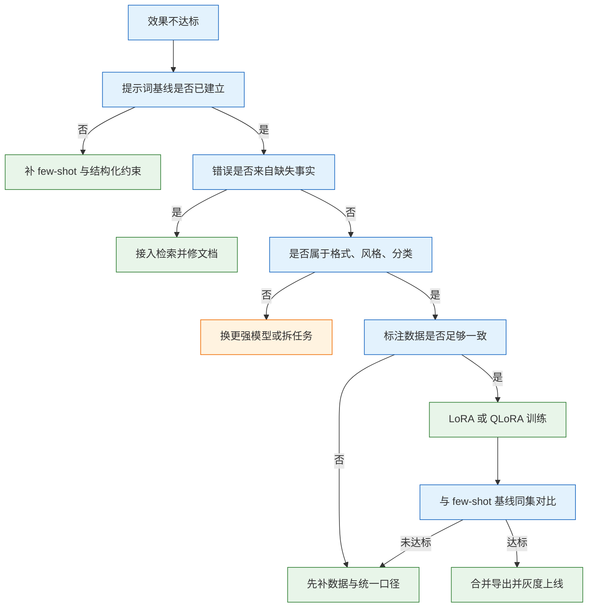
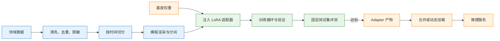
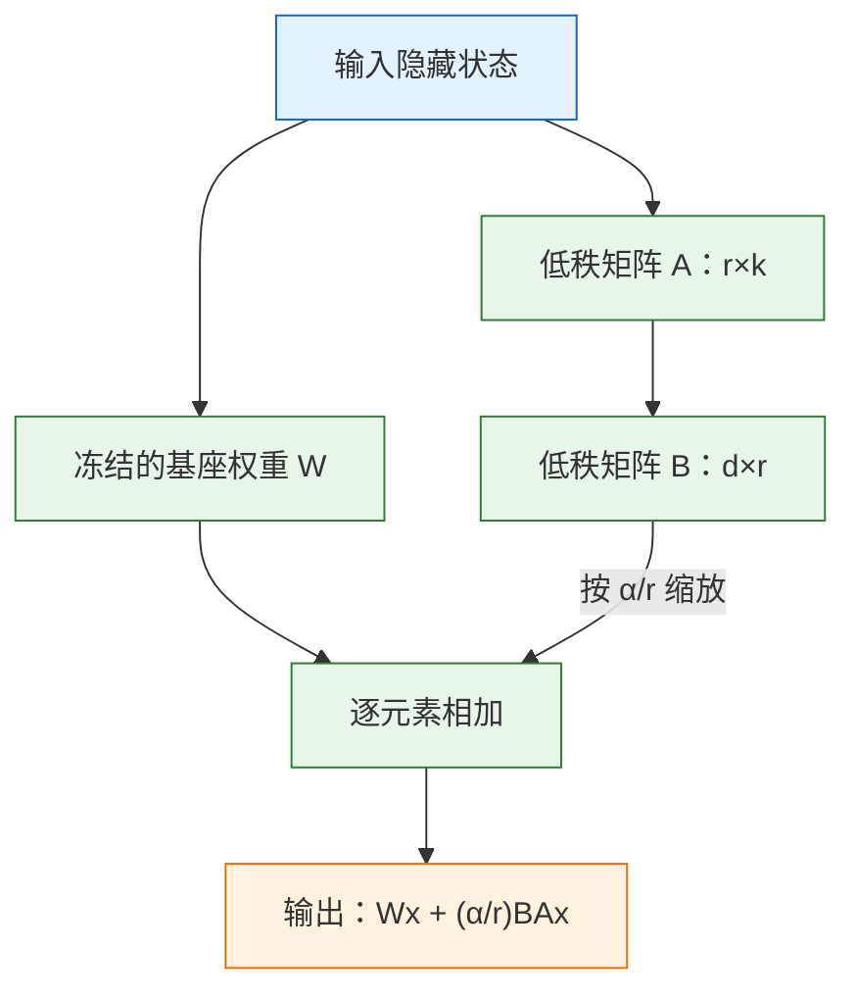

# 模型微调

> 微调改变的是模型的行为分布，不是知识库，也不是推理能力。它适合把“说话方式、输出格式、分类口径”固定下来；事实查询交给检索，复杂推理交给更强的模型。

---

## 一、模型微调是什么

### 1.1 核心概念

微调（Fine-tuning）是在一个已经完成预训练的基座模型上，用领域数据继续做梯度更新，让模型的输出分布向目标任务靠拢。预训练学到通用语言规律，微调只把这些能力重新加权到具体任务上。

微调要先区分三件事：

- **知识**：事实、参数、政策条款。知识会过期，写进权重后无法单独修改，适合放在检索库。
- **行为**：语气、格式、分类口径、拒答策略。行为稳定但难用提示约束时，才值得训练。
- **能力**：推理深度、代码水平、长文理解。微调不会凭空增加能力上限，只会让已有能力更容易被调用。

监督微调（Supervised Fine-Tuning，SFT）是最常见的形式：给模型成对的输入与期望输出，用交叉熵损失训练。偏好优化（如 DPO）则在 SFT 之后，用“更好/更差”的回答对继续调整，让输出风格向偏好靠拢。

| 概念 | 含义 | 观察方式 |
|---|---|---|
| 基座模型 | 未针对任务微调的预训练权重 | `config.json` 中的模型结构 |
| SFT | 用输入输出对做监督训练 | 训练日志中的 loss |
| PEFT | 只训练少量新增参数 | 可训参数占比 |
| LoRA | 用低秩矩阵表示权重增量 | adapter 文件大小 |
| QLoRA | 量化基座加 LoRA | 显存占用与量化配置 |
| 灾难性遗忘 | 新任务覆盖旧能力 | 通用能力回归集 |

微调不是“把公司文档喂进去”的同义词。文档进权重后，更新一条政策就要重训一次，而且无法追溯答案来自哪一段。检索增强生成（RAG）把文档放在外部索引里，改一条生效一条，这两条路线解决的是不同问题。

### 1.2 与相邻技术的关系

把微调放回技术栈里，它只是“改变模型参数”的一种手段，前后还有提示工程、检索、蒸馏和偏好优化。

| 技术 | 改什么 | 适合解决的问题 | 代价 |
|---|---|---|---|
| 提示工程 | 输入上下文 | 格式、角色、简单约束 | 不改变权重，稳定性有限 |
| 检索增强 | 外部知识库 | 事实过期、私有文档 | 依赖切分与召回质量 |
| 监督微调 | 模型参数 | 固定风格、分类、结构化输出 | 需要标注与评测 |
| 蒸馏 | 学生模型参数 | 降本、提速、固化教师行为 | 教师错误会被继承 |
| 偏好优化 | 模型参数 | 回答偏好、语气、拒答边界 | 需要高质量偏好对 |
| 继续预训练 | 模型参数 | 注入大规模领域语料 | 成本高，易遗忘通用能力 |

判断顺序应该从便宜到昂贵：先写提示词基线，再补检索，最后才考虑训练。没有基线，训完无法回答“提升了多少”；而大多数“模型不懂业务”的问题，few-shot 加检索就能解决。

| 现象 | 该动哪里 | 原因 |
|---|---|---|
| 不知道公司制度、产品参数 | 检索（RAG） | 事实会变，权重里没有 |
| 输出格式总不对 | 提示 + 结构化输出 | 格式是约束问题，不必训练 |
| 话术不像品牌、风格不稳 | 提示，再考虑微调 | 这是行为问题，微调有效 |
| 十几个意图总混淆 | 微调或换模型 | 有标注数据时微调性价比高 |
| 复杂推理做不对 | 换更强模型 | 微调不会增加推理能力 |
| 太贵、太慢 | 小模型 + 蒸馏/微调 | 成本问题，不是能力问题 |
| 要模型记住昨天的新政策 | 检索 | 每次更新都重训不划算 |

还有一条常被忽略的路线：**蒸馏**。用强模型批量生成答案，再让小模型学习，适合“任务明确、量大、要降本”的场景。它的风险是教师模型的错误会被一起学走，蒸馏集同样要抽检和评测，不能直接上线。



### 1.3 训练链路组成

一次完整的微调不是“跑一条训练命令”，而是一条从数据到服务的链路。任何一环错位，最后都会表现为“训练正常、线上没用”。



| 环节 | 输入 | 输出 | 常见故障 |
|---|---|---|---|
| 数据清洗 | 原始日志、标注文件 | 去重后的 JSONL | 标签非法、重复样本 |
| 模板渲染 | 对话消息 | 带特殊 token 的序列 | 模板与基座不匹配 |
| 权重加载 | 基座目录 | 可训练模型 | 磁盘不足、格式不支持 |
| 训练循环 | 批次样本 | checkpoint | 显存溢出、loss 不降 |
| 评测 | 固定测试集 | 指标报告 | 测试集泄漏 |
| 导出 | adapter + 基座 | 合并权重 | 精度损失、配置遗漏 |

模板渲染是最容易被低估的一环。对话模型在训练时见过固定的角色标记和结束符，推理时也必须用同一套。模板选错，模型看到的是“没有见过的对话格式”，表现为训练 loss 正常、推理输出乱码或不停重复。分词后还要确认标签位置：SFT 通常只对 assistant 回复计算损失，用户输入部分被掩码为 `-100`，否则模型会学会复述问题。

---

## 二、环境与依赖

> **版本现状（2026）**：训练侧主流组合是 PyTorch 2.x 加 CUDA 12.x，消费级与数据中心卡都能覆盖。LLaMA-Factory 以官方当前稳定版为准，字段名可能随版本调整，升级后先跑一遍最小样本再上正式数据。

### 2.1 硬件与驱动检查

微调的第一道约束是显存，第二道是磁盘，第三道才是算力。开始前先确认，避免下载几十 GB 权重才发现卡不支持。

| 显存档位 | 可训练的 7B 方案 | 说明 |
|---|---|---|
| 16GB | QLoRA，短序列 | 需降 batch 与 `cutoff_len` |
| 24GB | QLoRA 较舒适，LoRA 紧张 | 常见单卡起点 |
| 32GB | LoRA 较舒适 | 可放宽序列长度 |
| 48GB | LoRA 或小模型全量 | 取决于优化器与并行策略 |
| 80GB | 7B 全量或多卡训练 | 仍需 ZeRO 或 FSDP |

这些是量级判断，不是保证值。激活显存随批次、序列长度、是否开启梯度检查点变化，实际占用以训练日志和 `nvidia-smi` 为准。

```bash
# ========== 显卡与驱动 ==========
# 查看显卡型号、显存总量与驱动版本
nvidia-smi

# 只取关键字段，便于记录到实验台账
nvidia-smi --query-gpu=index,name,memory.total,driver_version \
  --format=csv

# 查看当前卡上的进程，确认没有别的任务占显存
nvidia-smi --query-compute-apps=pid,process_name,used_memory \
  --format=csv

# ========== 系统资源 ==========
# 查看内存，数据预处理与权重合并都吃内存
free -h

# 查看模型目录所在磁盘的剩余空间
df -h /data

# 若安装了完整 CUDA Toolkit，查看编译器版本；只装 PyTorch 时可跳过
nvcc --version
```

> **注意**：`nvidia-smi` 右上角的 `CUDA Version` 是驱动支持的最高运行时版本，不是已安装的 CUDA 版本。PyTorch 自带上千个 CUDA 运行时库，只要它的构建版本不超过这个上限即可，不必单独安装完整 CUDA Toolkit。

多卡机器还要看卡间互联。`nvidia-smi topo -m` 显示 `NVLink` 时，张量并行和全量训练的通信代价可控；显示 `SYS` 或走 PCIe 时，跨卡带宽会成为瓶颈。单卡能跑通的配置，乘卡数并不等于线性加速。

### 2.2 Python 环境与框架安装

训练环境必须隔离。系统 Python 里同时装多个版本的 `torch`、`transformers`、`flash-attn`，冲突往往在 import 阶段才暴露，排查成本很高。

```bash
# ========== 创建隔离环境 ==========
# 使用 Python 3.12，版本过低会缺类型语法，过高可能没有对应轮子
python3.12 -m venv .venv
source .venv/bin/activate
python -V

# 升级打包工具，避免旧 pip 解析不到新轮子
pip install -U pip wheel

# ========== 安装 PyTorch ==========
# 先从 nvidia-smi 确认驱动上限，再到 pytorch.org 选择对应 CUDA 版本的命令
# 下面以 CUDA 12.4 轮子为例，实际按官方选择器替换
pip install torch --index-url https://download.pytorch.org/whl/cu124

# 验证 GPU 是否可见、数量是否正确
python -c "import torch; print(torch.__version__, torch.cuda.is_available(), torch.cuda.device_count())"

# ========== 安装训练框架 ==========
# llamafactory 附带训练、评测、导出命令
pip install "llamafactory[torch,metrics]"

# 确认命令可用
llamafactory-cli version
```

| 依赖 | 作用 | 验证方式 |
|---|---|---|
| Python 3.10–3.12 | 运行时 | `python -V` |
| PyTorch | 张量计算与自动求导 | `torch.cuda.is_available()` |
| Transformers | 模型与分词器加载 | `transformers.__version__` |
| PEFT | LoRA 注入与保存 | `peft.__version__` |
| Datasets | 数据加载与缓存 | 训练日志中的样本数 |
| Accelerate | 设备放置与混合精度 | 启动日志中的 device |
| bitsandbytes | 4bit 量化 | 量化配置生效 |

> **注意**：`bitsandbytes` 在部分新版显卡或非 NVIDIA 平台上支持不完整，QLoRA 启动时报 `no kernel image is available` 多为版本不匹配。先升级到官方说明的版本，再考虑换卡或改用其他量化后端。

依赖版本要落盘。训练完成后执行 `pip freeze > requirements-lock.txt`，并把 Python、CUDA、驱动版本一起记进实验记录。三个月后复现同一个 adapter，缺一个版本都可能得到不同的 loss 曲线。

### 2.3 基座模型获取与校验

基座模型通常从 Hugging Face 或 ModelScope 下载。国内网络访问 Hugging Face 不稳定时，可以设置镜像端点，但镜像只解决传输问题，不解决权重可信问题。

```bash
# ========== 安装下载工具 ==========
pip install -U huggingface_hub

# ========== 国内网络可选镜像 ==========
# 只影响下载端点，不改变文件内容
export HF_ENDPOINT=https://hf-mirror.com

# ========== 下载权重到本地目录 ==========
# 指定具体仓库与本地路径，避免每次启动重复下载
hf download Qwen/Qwen2.5-7B-Instruct \
  --local-dir /data/models/Qwen2.5-7B-Instruct

# ========== 校验文件完整性 ==========
# 查看目录结构与文件大小
ls -lh /data/models/Qwen2.5-7B-Instruct

# 计算权重哈希，与发布页给出的校验值比对
sha256sum /data/models/Qwen2.5-7B-Instruct/*.safetensors
```

| 文件 | 作用 | 缺失后果 |
|---|---|---|
| `config.json` | 模型结构、层数、头数 | 无法实例化模型 |
| `tokenizer.json` | 分词规则 | 分词结果与训练不一致 |
| `tokenizer_config.json` | 特殊 token 与模板 | 对话格式错位 |
| `*.safetensors` | 权重分片 | 加载中断或数值缺失 |
| `model.safetensors.index.json` | 分片索引 | 只加载部分层 |
| `generation_config.json` | 默认生成参数 | 采样行为与预期不同 |

> **安全警告**：模型权重是代码之外的第二类供应链风险。只从官方仓库或可信镜像下载，优先使用 `safetensors` 格式；`.bin` 反序列化可以执行任意代码，来路不明的“优化版”“破限版”可能被改过安全对齐或植入后门。下载后核对哈希，不要把权重目录挂到公网可读的位置。

目录里如果只有 `pytorch_model.bin` 而没有 `safetensors`，加载时会走 pickle 反序列化。生产环境应优先使用官方 safetensors 版本。

---

## 三、数据构造与参数配置

### 3.1 监督微调数据格式

SFT 数据是一问一答，或者带 system 的多轮对话。主流格式有两种：Alpaca 风格用 `instruction/input/output` 三个字段，ShareGPT 风格用 `messages` 数组。多轮、带系统提示的场景更适合后者。

```json
{"messages": [{"role": "system", "content": "你是工单分类器，只输出 JSON。"},
              {"role": "user", "content": "快递三天没动，能催一下吗"},
              {"role": "assistant", "content": "{\"intent\": \"催发货\"}"}]}
```

| 字段 | 作用 | 常见错误 |
|---|---|---|
| `role` | 区分 system、user、assistant | 角色拼写不一致 |
| `content` | 该轮文本 | 混入 HTML 或控制字符 |
| `system` | 全局约束 | 每条样本写的约束不同 |
| `assistant` | 期望输出 | 末尾缺结束符或多空格 |

训练时框架会把消息渲染成基座自己的对话模板，再拼接成一条 token 序列。system 提示应当全量统一：如果一半样本要求“只输出 JSON”，另一半没有，模型学到的就是随机行为。输出里的字段顺序、空格、是否带解释，也要在标注规范里写死。

标签只放在 assistant 段。用户问题部分被掩码，不参与损失计算；如果整条序列都算损失，模型会同时学会“生成问题”，推理时容易出现自问自答。多数框架用 `train_on_prompt: false` 或模板自带的掩码逻辑控制这一点，配置后要打印一条样本的标签确认。

### 3.2 数据清洗与切分

数据质量决定上限，超参数只决定能否接近上限。清洗要用代码做，不靠肉眼抽查；肉眼只能看几十条，而重复、错标、超长样本往往藏在后面。

| 数据问题 | 表现 | 处理 |
|---|---|---|
| 重复或近重复 | 训练 loss 很低，线上不涨 | 按输入加输出哈希去重 |
| 标注不一致 | 同类样本答案互相矛盾 | 双人标 100 条，先统一口径 |
| 分布偏差 | 只覆盖简单句 | 按线上真实分布抽样 |
| 类别不平衡 | 少数类永远错 | 补真实样本，不要复制粘贴 |
| 缺拒答样本 | 什么都敢答 | 加 5%~10% 无法判断或转人工 |
| 训练测试同源 | 分数虚高 | 按时间或来源切分 |

```python
import hashlib, json

seen, kept, bad = set(), [], 0
for line in open("data/ticket_cls.jsonl", encoding="utf-8"):
    row = json.loads(line)
    msgs = row["messages"]
    if msgs[-1]["role"] != "assistant":
        bad += 1; continue
    head = msgs[-2]["content"].strip()
    tail = msgs[-1]["content"].strip()
    try:
        label = json.loads(tail)["intent"]
    except Exception:
        bad += 1; continue                       # 标签不是合法 JSON，直接剔除
    key = hashlib.sha256((head + "\x00" + tail).encode()).hexdigest()
    if key in seen:
        continue
    seen.add(key); kept.append(row)

print("kept", len(kept), "dropped", bad)
```

去重按“输入 + 输出”整体做；只按输出哈希，会把不同问题的相同答案误删。标签解析失败的样本要计数，超过 1% 说明标注流程有问题，先修数据再训。长度也要看分布：超过 `cutoff_len` 的样本会被截断，如果截掉的是输出后半段，模型学到的是残缺答案。

切分按时间：用 1 到 6 月的数据训练，7 月的数据测试。随机切分会让同一工单的改写版本同时落在两边，分数不可信。验证集从训练时间段内再切一小部分，用于早停；测试集只留最终评估，调参期间不要反复看。

> **注意**：不要把线上日志直接当训练集。里面有错答、重复、提示注入和测试数据。先按“人工确认过正确”筛一遍，再做手机号、身份证、地址等脱敏，否则等于把线上的错误和隐私一起教给模型。

### 3.3 数据规模与配比

规模上没有神奇数字。分类任务每类 50 到 200 条通常能看出方向；风格模仿要几百到几千条；格式约束几十条就可能见效，但无法证明泛化。**30 条也能训，但只能证明流程通了，不能证明有效。**

| 任务类型 | 起步量 | 判断依据 |
|---|---|---|
| 固定格式输出 | 100~300 条 | JSON 合法率与字段完整率 |
| 单标签分类 | 每类 50~200 条 | 逐类召回与混淆矩阵 |
| 多标签或细粒度分类 | 每类 200 条以上 | 边界类别的区分度 |
| 风格与话术模仿 | 500~3000 条 | 人工偏好与盲评 |
| 领域问答 | 1000 条以上 | 事实正确率与拒答率 |

数据配比同样重要。全量领域数据会让通用能力快速退化，常见做法是混入 5%~10% 的通用指令数据作为回放；业务要求强拒答时，再加 5%~10% 的“无法判断、转人工”样本。比例要通过通用能力回归集验证。

类别不平衡时不要复制少数类样本。复制只会让模型更自信地背下同样几句话，不会增加多样性。正确做法是补真实样本，或者调整损失权重，并在评测时看逐类指标而不是总体准确率。

### 3.4 微调超参数

LoRA 的超参数不多，但彼此耦合。秩决定容量，alpha 决定增量的缩放，学习率决定能否收敛，epoch 决定是否过拟合。

| 参数 | 常用范围 | 调大或调小的后果 |
|---|---|---|
| `r`（秩） | 8~32 | 大：容量强、易过拟合、显存涨；小：欠拟合 |
| `alpha` | 通常 2×r | 相对缩放，改 r 时一起调 |
| `dropout` | 0.05~0.1 | 防过拟合，太大收敛慢 |
| `target_modules` | 全部线性层 | 只挂 q/v 省显存，效果打折 |
| `learning_rate` | LoRA 1e-4~2e-4 | 太高发散，太低 loss 不动 |
| `epochs` | 2~3 | 多了背答案 |
| `cutoff_len` | 2048~4096 | 长了显存涨，短了截断样本 |
| `batch_size` | 单卡 1~4 | 受显存限制，靠累积补 |
| `gradient_accumulation` | 4~16 | 线性放大有效批次 |

有效批次等于 `per_device_train_batch_size × gradient_accumulation_steps × 卡数`。在显存不变的前提下，增大累积步数等价于增大批次，但优化器更新次数减少；学习率通常要随有效批次适度上调，否则收敛变慢。

`cutoff_len` 要覆盖业务样本的 P99 长度，而不是直接拉满模型上限。序列长度对显存的影响近似线性，对注意力的计算影响更高；把 8192 降到 2048，往往比换一张卡更快解决问题。截断策略也要选：从右侧截断可能切掉答案，长样本应优先保留开头与结尾，或在预处理阶段拆成多段。

---

## 四、训练流程与原理

### 4.1 参数高效微调原理

全量微调要更新所有参数。以 7B 模型为例，fp16 权重约 14GB，加上梯度、fp32 主权重和 Adam 的一阶二阶矩，优化器状态按每参数 8 到 12 字节估算，总需求远超单张 24GB 卡，通常需要多卡配合 ZeRO 或 FSDP。

LoRA 的思路是冻结原权重，只训练一个低秩增量：

```text
全量：W' = W + ΔW，ΔW 与 W 同尺寸
LoRA：W' = W + (α/r) · B·A，B 是 d×r，A 是 r×k，r 远小于 d
```



A 用随机高斯初始化，B 初始化为零，因此训练开始时增量恰好为零，模型行为与基座完全一致。这个设计让 LoRA 可以安全地挂在任意已训练模型上，不会在第一步就打乱输出分布。

| 方法 | 可训参数 | 显存特点 | 适用场景 |
|---|---|---|---|
| 全量微调 | 100% | 权重、梯度、优化器状态全占 | 数据充足、追求上限 |
| LoRA | 通常不到 1% | 基座仍以 fp16 加载 | 单卡、多任务切换 |
| QLoRA | 与 LoRA 相同 | 基座压到 4bit | 显存紧张 |
| 前缀微调 | 极少 | 占用随前缀长度 | 多任务共享基座 |
| 适配器层 | 少量 | 推理有额外延迟 | 早期 PEFT 方案 |

目标模块决定“改哪里”。常见做法是覆盖注意力与 MLP 的全部线性层，即 `q_proj/k_proj/v_proj/o_proj/gate_proj/up_proj/down_proj`；只挂 `q_proj,v_proj` 省显存，但容量有限。不同模型的层名不同，用 `lora_target: all` 让框架自动匹配，再打印可训参数确认非零。

秩不是越大越好。任务越接近“固定映射”，需要的秩越低；数据少而秩高，模型会把样本背下来。alpha 与 r 的比值决定增量幅度，固定 alpha 而增大 r，等效于放大更新，可能让训练发散。

### 4.2 显存构成与量化

训练显存可以拆成四块：权重、梯度、优化器状态、激活。前三块与参数量成正比，最后一块随批次和序列长度增长，也是 OOM 最常见的来源。

```text
训练显存 ≈ 权重(参数量 × 字节)
          + 梯度(仅可训参数)
          + 优化器状态(可训参数 × 8~12)
          + 激活(随 batch × seq_len 增长)
```

| 方案 | 7B 权重 | 训练显存（seq 2048, batch 1） | 单卡 |
|---|---|---|---|
| 全量 fp16 | 14GB | 80GB 以上，通常需多卡或 ZeRO | 单卡不足 |
| LoRA fp16 | 14GB | 20~28GB | 24G 勉强，32G 稳 |
| QLoRA 4bit | 3.5~4GB | 12~18GB | 24G 舒适 |

表中的训练显存是量级参考，实际值取决于框架、梯度检查点与序列长度。是否够用以本地试跑的峰值占用为准，不要按表格采购。

QLoRA 把基座量化到 4bit 再挂 LoRA，省显存，代价是训练慢一些、精度略降。它包含三个关键点：4bit NormalFloat 量化、双重量化（对量化常数再量化）、分页优化器（显存峰值时把优化器状态换到内存）。LoRA 参数仍以较高精度训练，因此不是“在 4bit 权重上做全量反向传播”。

显存不够时按这个顺序降：先减 `cutoff_len`，再减 batch 并加累积，再开梯度检查点，最后才上 4bit。梯度检查点用计算换显存，4bit 用量化换显存，两者都要在评测集上确认没有明显退化。

### 4.3 训练执行与监控

训练命令本身只有一行，真正需要关注的是日志。启动后先确认样本数、可训参数比例、模板和设备，再看 loss。

```bash
# ========== 启动训练 ==========
# 前台运行，便于观察首轮日志
llamafactory-cli train train.yaml

# ========== 后台运行 ==========
# 输出重定向到日志，进程与终端解耦
nohup llamafactory-cli train train.yaml > train.log 2>&1 &

# 跟踪日志中的 loss 与显存
tail -f train.log

# ========== 监控资源 ==========
# 每秒刷新显卡利用率与显存
watch -n 1 nvidia-smi

# ========== 可视化 ==========
# 若配置了 tensorboard 输出目录，可查看曲线
tensorboard --logdir out/ticket-lora --port 6006
```

| 日志项 | 含义 | 异常判断 |
|---|---|---|
| `trainable params` | 可训参数与占比 | 为 0 说明 adapter 没挂上 |
| `num_samples` | 实际参与训练的样本数 | 明显少于清洗结果说明格式被跳过 |
| `loss` | 当前批次损失 | 长期不降或变 NaN |
| `eval_loss` | 验证集损失 | 训练降、验证升即过拟合 |
| `grad_norm` | 梯度范数 | 突然变大提示发散 |
| `learning_rate` | 当前学习率 | 与调度器预期不符 |

日志里应看到 loss 从 2 左右降到 0.5 到 0.8，验证 loss 不再下降就停：

```text
step 10  loss 1.842  eval_loss 1.910
step 50  loss 0.973  eval_loss 1.024
step 100 loss 0.612  eval_loss 0.988   ← 训练降、验证平，开始过拟合
```

`template` 必须和基座匹配，选错会让特殊 token 错位，表现为“训练正常、推理乱码”。训练中断后从 checkpoint 恢复时，要确认优化器状态、学习率调度器和数据顺序都恢复，否则曲线会出现台阶。

### 4.4 评测方法

评测不是看 loss，而是看任务指标。loss 衡量的是模型对标注答案的拟合程度，不衡量 JSON 是否合法、拒答是否正确、延迟是否可接受。

| 指标 | 口径 | 用途 |
|---|---|---|
| 意图准确率 | 预测标签与标注一致 | 分类主指标 |
| JSON 合法率 | 能解析成 JSON 的比例 | 结构化输出契约 |
| 字段完整率 | 必填字段齐全的比例 | 下游系统可用性 |
| 拒答正确率 | 应拒答样本被正确拒绝 | 安全边界 |
| P95 延迟 | 95 分位端到端耗时 | 线上体验 |
| 通用能力回归 | 常识与改写题通过率 | 遗忘程度 |

四条判据：

1. **比 few-shot 高多少**：只比 zero-shot 高不算数，提示本来就能提升。
2. **验证集与测试集是否同向**：训练 loss 降、验证升，就是过拟合。
3. **通用能力有没有掉**：拿 20 道常识与改写题回归，掉了就混 5%~10% 通用数据重训。
4. **延迟与成本**：小模型微调后通常更快更便宜，这是它相对旗舰的主要价值。

评测时的生成参数要和线上一致：`temperature=0`、同样的 `max_tokens`、同样的停止词。用采样模式跑评测，两次结果能差好几个点，改动有没有效根本看不出来。

准确率差 1 到 2 个百分点、样本只有 100 条时，不要宣称提升。先扩样本或看逐类混淆矩阵。混淆矩阵比总分有用：如果“退款”有 30 条被判成“咨询”，说明两个类别的定义重叠，先改标注口径，再谈调参。只看 92% 这个数，永远不知道该修哪里。

---

## 五、完整示例：工单分类模型微调

这一节完成数据注册、QLoRA 训练、评测、合并导出和本地推理验证。命令中的占位符要替换成实际值。

### 5.1 数据集注册

先把清洗后的 JSONL 放到 `data/` 下，再在 `dataset_info.json` 里注册。注册名就是训练配置里 `dataset` 字段引用的名字。

```json
{
  "ticket_cls": {
    "file_name": "ticket_cls.jsonl",
    "formatting": "sharegpt",
    "columns": {"messages": "messages"}
  }
}
```

| 字段 | 作用 | 注意 |
|---|---|---|
| `file_name` | 相对 `dataset_dir` 的文件名 | 不要写绝对路径 |
| `formatting` | 数据风格 | 与文件结构一致 |
| `columns` | 字段映射 | 列名写错会加载到 0 条 |
| `tags` | 任务标签 | 用于筛选与统计 |

注册完成后先做一次空跑：把 `max_samples` 设为 20，确认能加载、能渲染、能前向。样本数为 0 或首条样本标签全为 `-100`，都说明配置有问题。

### 5.2 训练配置

```yaml
model_name_or_path: <base-model-path-or-hf-id>
stage: sft
do_train: true
finetuning_type: lora
lora_rank: 16
lora_alpha: 32
lora_dropout: 0.05
lora_target: all
quantization_bit: 4
dataset: ticket_cls
dataset_dir: data
template: <model-chat-template>
cutoff_len: 2048
per_device_train_batch_size: 1
gradient_accumulation_steps: 8
learning_rate: 2.0e-4
num_train_epochs: 3
lr_scheduler_type: cosine
warmup_ratio: 0.03
bf16: true
val_size: 0.1
logging_steps: 10
save_steps: 100
output_dir: out/ticket-lora
```

| 配置项 | 取值 | 作用 |
|---|---|---|
| `stage` | `sft` | 监督微调阶段 |
| `finetuning_type` | `lora` | 参数高效微调 |
| `quantization_bit` | `4` | 基座 4bit 量化 |
| `template` | 与基座一致 | 对话格式 |
| `val_size` | `0.1` | 从训练集切验证集 |
| `bf16` | `true` | 混合精度训练 |
| `save_steps` | `100` | 检查点间隔 |

`bf16` 需要显卡支持；较老的卡只能用 `fp16`，并配合损失缩放。`val_size` 是从训练数据里再切一部分，不是独立测试集；最终结论仍要用单独留出的时间段数据。

### 5.3 训练执行与日志解读

```bash
# ========== 进入项目目录 ==========
cd /data/finetune/ticket

# ========== 激活环境 ==========
source .venv/bin/activate

# ========== 启动训练 ==========
llamafactory-cli train train.yaml

# ========== 另开终端观察显存 ==========
watch -n 2 nvidia-smi
```

启动日志先看三行：模型加载路径、可训参数占比、模板名称。可训参数占比应是一个很小的非零值；为 0 说明 `lora_target` 没有匹配到任何层，常见于模型层名与框架预设不一致。

训练过程中重点看 `loss` 与 `eval_loss` 的差值。两者同步下降是正常收敛；训练集持续下降而验证集走平或上升，说明模型开始记忆样本。此时应回退到验证 loss 最低的检查点，而不是拿最后一个。

### 5.4 评测与对比

评测要用同一批测试题、同一组生成参数，至少比较三个版本：zero-shot、few-shot、微调后。只报微调后的绝对分数无法判断提升来源。

| 版本 | 意图准确率 | JSON 合法率 | 拒答正确率 |
|---|---|---|---|
| zero-shot | 78% | 91% | 40% |
| few-shot | 86% | 99% | 70% |
| QLoRA | 92% | 100% | 88% |
| 旗舰 API | 94% | 100% | 90% |

| 版本 | P95 延迟 | 说明 |
|---|---|---|
| zero-shot | 1.1s | 基线 |
| few-shot | 1.3s | 提示基线 |
| QLoRA | 0.6s | 小模型加 adapter |
| 旗舰 API | 2.4s | 成本参照 |

表中数值为示例，需用自己的测试集重算。评测脚本要固定随机种子、关闭采样、记录模型版本与 adapter 路径，否则两次结果不可比。

逐类看混淆矩阵，找“定义重叠”的类别。分类口径模糊时，再高的总体准确率也只是把错误集中到了某几个类。拒答样本要单独统计，模型“答得很流畅但内容是编的”在总分里看不出来。

### 5.5 合并导出与上线

产物有三种形态，部署方式和成本不同。

| 形态 | 优点 | 缺点 |
|---|---|---|
| 只存 adapter | 几十 MB，切换方便 | 推理时要加载基座加 adapter |
| 合并成新权重 | 部署简单，兼容所有引擎 | 体积等于基座，切换要换整模型 |
| 量化后再合并 | 省显存 | 精度损失叠加，要重测 |

```yaml
# export.yaml
model_name_or_path: <base-model-path>
adapter_name_or_path: out/ticket-lora
template: <model-chat-template>
finetuning_type: lora
export_dir: out/ticket-merged
export_size: 2
```

```bash
# ========== 合并导出 ==========
# 将 adapter 与基座合并为完整权重
llamafactory-cli export export.yaml

# 确认输出目录包含配置、分词器与权重
ls -lh out/ticket-merged

# ========== 本地推理验证 ==========
# 用合并后的权重跑一条与训练同模板的请求
python infer.py
```

推理脚本要用基座自带的分词器与聊天模板，不能手工拼字符串：

```python
from transformers import AutoModelForCausalLM, AutoTokenizer

path = "out/ticket-merged"
tok = AutoTokenizer.from_pretrained(path)
model = AutoModelForCausalLM.from_pretrained(path, device_map="auto")

msgs = [
    {"role": "system", "content": "你是工单分类器，只输出 JSON。"},
    {"role": "user", "content": "快递三天没动，能催一下吗"},
]
text = tok.apply_chat_template(msgs, tokenize=False, add_generation_prompt=True)
ids = tok(text, return_tensors="pt").to(model.device)
out = model.generate(**ids, max_new_tokens=64, do_sample=False)
print(tok.decode(out[0][ids["input_ids"].shape[1]:], skip_special_tokens=True))
```

合并后权重和基座一样大，换来的是“任何推理引擎都能直接加载”；不合并则要选支持动态 LoRA 的引擎，显存里同时放基座和 adapter。上线前用同一套测试题重跑合并版，确认与训练时一致。

上线先影子流量：新模型只记录不返回，和线上对比 200 条；通过后再灰度 5%~10%。

> **安全警告**：合并后的权重同样包含训练数据中的信息。如果数据里有手机号、地址、内部工单号，微调可能让模型在生成时复述这些内容。上线前做成员推断与抽取测试，训练数据要脱敏，权重目录与推理接口都要按内部资产管控。

---

## 六、成本与边界

### 6.1 成本构成

微调的成本不止 GPU 小时。标注、评测、部署和维护往往占比更高，而且更容易被漏算。

| 项 | 估算方式 | 容易被忽略 |
|---|---|---|
| GPU | 小时数 × 单价 × 重跑次数 | 调参往往要跑 5~10 次 |
| 标注 | 条数 × 单价 × 2（双标） | 一致性复核 |
| 评测 | 题数 × judge 单价 | 每轮都要跑 |
| 部署 | 显存占用 × 月 | adapter 也要占显存 |
| 维护 | 数据更新后重训 | 知识一变就要再来一轮 |

按公式估算：

```text
训练 token 数 ≈ 样本数 × 平均长度 × epoch
GPU 成本     ≈ 单卡小时单价 × 实际训练小时 × 重跑次数
数据成本     ≈ 样本数 × 单条标注单价 × 标注人数
```

把本地单价代入即可。经验上，数据成本通常高于 GPU 成本，先想清楚这批数据能否复用，再决定是否开训。

已有 `chosen/rejected` 偏好对时，可以在 SFT 之后再做一轮 DPO，让模型偏向更好的回答；没有真实的偏好对就不要硬造，SFT 已经够解决格式与分类问题。偏好优化同样要独立测试集，否则只是换了一种过拟合。

### 6.2 能力边界

微调能修的是分布，不是事实。把新政策写进训练数据，模型可能学会“谈论政策”的语气，却记不住具体条款；条款仍要放在检索里。

| 期待 | 微调是否有效 | 替代方案 |
|---|---|---|
| 记住昨天发布的价格 | 无效 | 检索或工具查询 |
| 稳定输出固定 JSON | 有效 | 结构化输出加校验 |
| 提升复杂数学推理 | 基本无效 | 更强模型或工具调用 |
| 统一客服话术 | 有效 | 提示加少量示例 |
| 阻止提示注入 | 不可靠 | 输入过滤、权限、工具白名单 |
| 降低单次调用成本 | 有效 | 小模型加蒸馏 |

微调也修不了安全。把注入样本训进去，只能防住见过的句式，新变体照样绕过。权限、脱敏、工具白名单仍然要在代码里做。模型越倾向于服从训练分布，越可能在遇到相似但不同的话术时给出错误的安全判断。

灾难性遗忘是另一个边界。领域数据越窄、训练越久，通用能力掉得越多。回放数据、较低学习率、较少 epoch 只能缓解，不能完全避免。上线前跑通用能力回归是最低要求。

### 6.3 版本与复现

三个月后要能回答“这个 adapter 是用什么数据、什么配置、在哪个基座上训的”。缺一项，复现就只剩猜。

| 记录项 | 内容 | 作用 |
|---|---|---|
| 基座模型 | 仓库、版本、权重哈希 | 定位结构差异 |
| 数据版本 | 文件哈希、清洗脚本版本 | 复现样本集 |
| 训练配置 | YAML 全文、框架版本 | 复现超参数 |
| 环境 | Python、CUDA、驱动 | 复现数值行为 |
| 评测报告 | 测试集版本与逐类指标 | 判断是否退化 |
| 产物 | adapter 与合并权重路径 | 回滚与部署 |

配置和代码进 Git，权重与大文件进对象存储并记录哈希。训练脚本不要写死绝对路径和密钥，用环境变量注入。固定种子只能保证同一环境可复现，换显卡或框架版本仍可能得到不同结果。

---

## 七、常见故障与排查

### 7.1 故障表

| 现象 | 最可能原因 | 处理 |
|---|---|---|
| 启动就 OOM | `cutoff_len` 或 batch 太大、没开 4bit | 降序列长度，开 `quantization_bit: 4` |
| loss 一直在 2 附近 | 学习率太低、数据没对齐、模板错 | 查第一条样本的 token、调 lr |
| loss 变 0 但输出重复 | 过拟合、数据重复 | 去重、减 epoch、加 dropout |
| 训练好但风格没变 | adapter 没加载、target 模块错 | 打印可训参数比例，确认大于 0 |
| 测试集很高、线上很差 | 数据泄漏、分布不同 | 按时间切分，补真实样本 |
| 通用能力明显下降 | 灾难性遗忘 | 混通用数据，降 lr 与 epoch |
| 加载 adapter 报 shape 错 | 基座版本或 target 不匹配 | 对齐基座哈希与配置 |
| 输出带特殊 token | 模板错、特殊 token 未处理 | 换正确 template，检查 decode |
| 多卡显存不均 | 没开分布式或 batch 不均 | 用框架的 deepspeed 或 fsdp 配置 |
| 推理比基座慢很多 | adapter 未合并、批量小 | 合并权重或换支持 LoRA 的引擎 |

### 7.2 排查顺序

1. 打印一条训练样本的完整 token 序列，确认模板、角色标记与标签位置对齐。
2. 看可训参数比例，确认 adapter 真的挂上了，而不是只加载了基座。
3. 看 loss 与 eval_loss 曲线，判断是欠拟合、发散还是过拟合。
4. 用同一批测试题对比 few-shot 基线，定位是数据问题还是训练问题。
5. 检查导出与推理链路，确认模板、停止词、精度与训练时一致。
6. 最后才调超参。数据口径没统一时，调参只是把噪声拟合得更快。

> **运维提示**：每次训练保留一份最小复现包，包含 20 条样本、完整 YAML 和一条启动命令。出现“换机器就跑不起来”时，先用最小包定位是环境问题还是数据问题，比在完整训练上反复试快得多。
