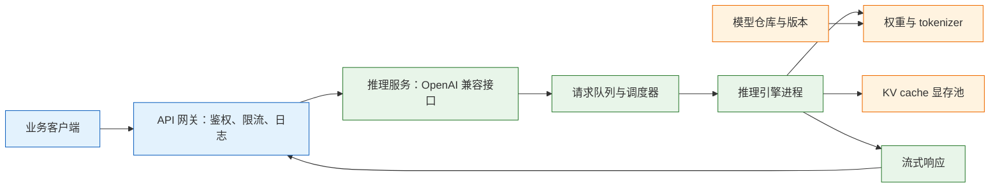
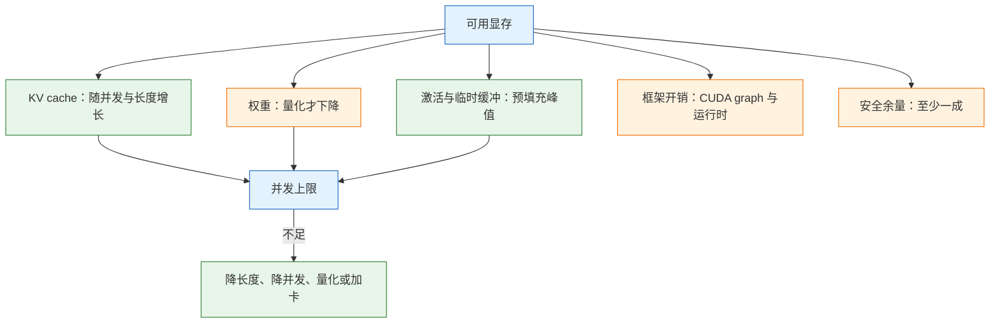
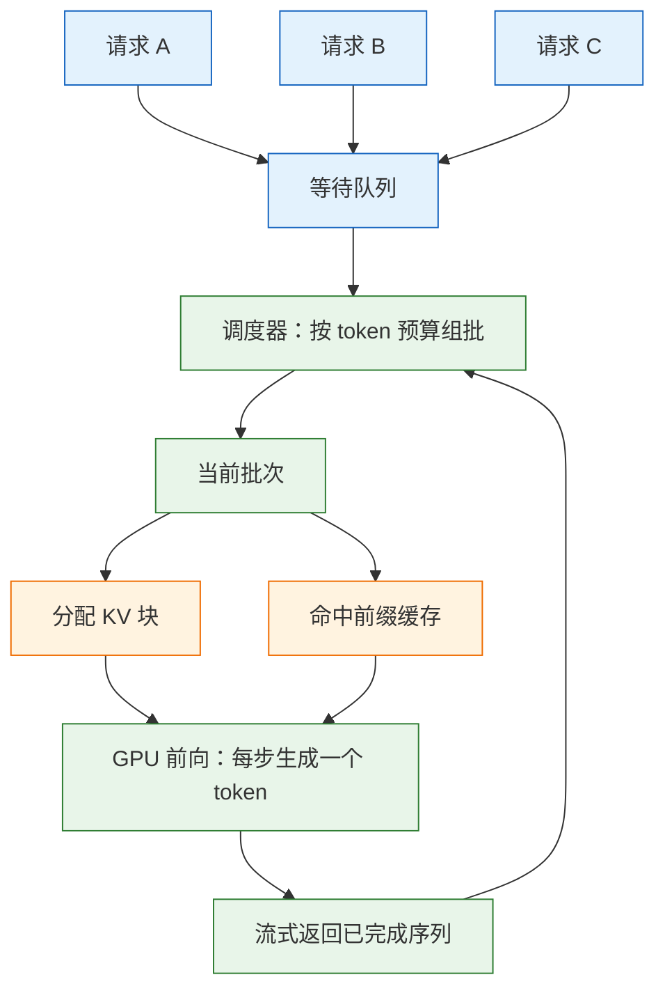

# 模型部署与推理

> 部署先做一道算术：权重、KV cache、临时缓冲与框架开销相加，必须小于可用显存。算不清这笔账，调任何参数都是碰运气；算清了，才知道该量化、该降并发还是该加卡。

---

## 一、模型部署与推理是什么

### 1.1 核心概念

模型部署是把训练好的权重变成一个稳定、可计量、可运维的在线服务；推理是服务对每次请求执行前向计算并返回结果的过程。两者常被混为一谈，实际关注点不同：部署关心进程、端口、显存、并发与发布，推理关心延迟、吞吐与输出质量。

一次生成请求分成两个阶段：

- **预填充（Prefill）**：把整段输入一次性送进模型，计算所有 token 的 Key 和 Value，写入 KV cache。这个阶段矩阵乘密集，通常受算力限制。
- **解码（Decode）**：每次只生成一个 token，读取历史 KV cache 并追加新的 Key/Value。这个阶段访存密集，GPU 算力往往用不满。

| 指标 | 含义 | 优化方向 |
|---|---|---|
| TTFT | 从发出请求到收到第一个 token | 减少排队、缩短输入、命中前缀缓存 |
| TPOT / ITL | 相邻 token 的时间间隔 | 提高 batch、减少 KV 读取 |
| 吞吐 | 单位时间产出的总 token 数 | 增大并发、提高 GPU 利用率 |
| 有效吞吐 | 满足延迟门槛的吞吐 | 限流、调度、副本数 |
| 并发 | 同时在处理的序列数 | 由 KV cache 容量决定 |

延迟与吞吐是一对矛盾。单请求独占 GPU 时延迟最低，但吞吐极差；把几十条请求拼成一批，吞吐上去了，单条请求的排队时间也变长。生产部署的目标不是某一个指标最优，而是在业务可接受的 P95 延迟下，把有效吞吐做到最高。

### 1.2 与相邻技术的关系

推理服务处在模型与应用之间。上游是训练与微调产出的权重，下游是网关、业务后端和监控系统。

| 技术 | 关系 | 边界 |
|---|---|---|
| 训练与微调 | 产出权重与 tokenizer | 不负责在线并发 |
| 模型仓库 | 存放权重与版本 | 不执行推理 |
| 推理引擎 | 加载权重、调度请求 | 不做业务鉴权 |
| API 网关 | 鉴权、限流、日志 | 不做 token 级调度 |
| Kubernetes | 副本、探针、滚动发布 | 不感知 KV cache |
| 监控系统 | 采集指标与告警 | 不替代压测 |

推理引擎只解决“如何高效地跑模型”。它默认提供一个 HTTP 接口，但不提供租户隔离、计费、内容审核和业务级限流。把这些能力直接塞进引擎进程，会让升级变得困难；正确做法是让引擎保持单一职责，外围由网关和服务网格承担。

Kubernetes 负责副本与故障转移，但它不知道一个副本的 KV cache 已经满了。副本数够、Pod 也 Ready，请求仍可能排队，因为就绪探针只检查进程能否响应，不检查显存余量。容量判断必须回到推理引擎自己的指标。

### 1.3 推理服务架构组成



| 组件 | 职责 | 常见实现 |
|---|---|---|
| 网关 | 鉴权、限流、审计、TLS 终止 | Nginx、Kong、APISIX |
| 服务层 | 暴露聊天与补全接口 | vLLM、SGLang、TGI |
| 调度器 | 组批、分配 KV、抢占 | 引擎内置 |
| 权重存储 | 提供模型文件 | 本地盘、对象存储、PVC |
| 显存池 | 缓存 KV 与临时激活 | 引擎管理 |
| 监控 | 采集延迟、队列、显存 | Prometheus |

模型文件通常通过只读卷挂载进容器，而不是打进镜像。一个 7B 的 fp16 权重约 14GB，打进镜像会让推送、拉取和回滚都变得笨重；挂载卷还能让多个副本共享同一份文件，升级时只替换卷内容或切换路径。

---

## 二、环境与依赖

> **版本现状（2026）**：vLLM、SGLang、TensorRT-LLM 都处于快速迭代期，参数名会随版本变化。容器镜像 tag 必须与引擎版本对应，不要用 `latest`；升级前先在灰度副本上验证启动参数与输出。

### 2.1 硬件与驱动检查

推理的第一道门槛是显存，第二道是 GPU 与容器的连接。驱动、CUDA 运行时、容器工具链三者版本不匹配时，最常见的表现是容器里看不到卡，或者一加载权重就报内核错误。

```bash
# ========== 显卡与驱动 ==========
# 查看型号、显存与驱动版本
nvidia-smi

# 只取关键字段，记录到部署清单
nvidia-smi --query-gpu=index,name,memory.total,driver_version \
  --format=csv

# 查看拓扑，判断多卡是否在同一个 NVLink 域
nvidia-smi topo -m

# ========== 系统限制 ==========
# 查看共享内存大小，容器内多进程加载依赖它
df -h /dev/shm

# 查看锁定内存上限，部分引擎需要较大的 memlock
ulimit -l

# 查看模型目录所在磁盘余量
df -h /data/models
```

| 检查项 | 合格标准 | 不合格的表现 |
|---|---|---|
| 驱动 | 能识别全部 GPU | `nvidia-smi` 报错或缺少卡 |
| 显存 | 空闲显存大于预算 | 启动即 OOM |
| 共享内存 | 不小于单卡显存的一半 | 加载中断、bus error |
| 磁盘 | 大于权重体积的两倍 | 下载或转换失败 |
| 互联 | 多卡在同一 NVLink 域 | 张量并行吞吐骤降 |

> **注意**：`nvidia-smi` 显示的显存是总量，不是可用量。桌面环境、监控代理、其他推理进程都会占一部分；按总量做预算，往往在并发上来后才暴露不足。

### 2.2 容器与 GPU 运行时

生产部署优先用容器，原因是依赖隔离和回滚简单。让容器看到 GPU 需要一个中间层：NVIDIA Container Toolkit 把宿主驱动和 GPU 设备暴露给容器运行时。

```bash
# ========== 安装容器工具链（Ubuntu/Debian 示例） ==========
# 添加 NVIDIA 容器仓库
curl -fsSL https://nvidia.github.io/libnvidia-container/gpgkey \
  | sudo gpg --dearmor -o /usr/share/keyrings/nvidia-container-toolkit-keyring.gpg

curl -s -L https://nvidia.github.io/libnvidia-container/stable/deb/nvidia-container-toolkit.list \
  | sed 's#deb https://#deb [signed-by=/usr/share/keyrings/nvidia-container-toolkit-keyring.gpg] https://#g' \
  | sudo tee /etc/apt/sources.list.d/nvidia-container-toolkit.list

sudo apt update
sudo apt install -y nvidia-container-toolkit

# ========== 配置 Docker 运行时 ==========
# 让 Docker 通过 nvidia 运行时访问 GPU
sudo nvidia-ctk runtime configure --runtime=docker
sudo systemctl restart docker

# ========== 验证 ==========
# 容器内应输出与宿主机一致的显卡信息
docker run --rm --gpus all nvidia/cuda:12.4.1-base-ubuntu22.04 nvidia-smi
```

| 组件 | 作用 | 验证命令 |
|---|---|---|
| NVIDIA 驱动 | 内核态 GPU 支持 | `nvidia-smi` |
| Container Toolkit | 把设备挂进容器 | `nvidia-ctk --version` |
| Docker | 容器运行时 | `docker info` |
| 引擎镜像 | 自带 CUDA 与依赖 | `docker run ... --help` |

> **注意**：镜像里自带的 CUDA 运行时版本可以低于驱动支持的上限，但不能高于它。宿主机驱动太旧时，容器启动会报 `CUDA driver version is insufficient`，升级驱动而不是在镜像里反复换 CUDA。

### 2.3 模型格式与获取

同一份权重可以有多种格式，格式决定哪些引擎能加载、需要多少显存、是否需要现场量化。

| 格式 | 特点 | 适用引擎 |
|---|---|---|
| HF safetensors | 原始精度，通用 | vLLM、SGLang、TGI |
| GPTQ | 训练后量化，4bit 为主 | vLLM、AutoGPTQ |
| AWQ | 激活感知量化，精度较稳 | vLLM、AutoAWQ |
| FP8 | 新卡原生支持，损失小 | vLLM、TensorRT-LLM |
| GGUF | 为 CPU 与 Metal 优化 | llama.cpp、Ollama |

```bash
# ========== 下载权重 ==========
# 指定仓库与本地目录，避免每次启动重复下载
hf download Qwen/Qwen2.5-7B-Instruct \
  --local-dir /data/models/Qwen2.5-7B-Instruct

# ========== 校验 ==========
# 查看文件与体积
ls -lh /data/models/Qwen2.5-7B-Instruct

# 与发布页的校验值比对
sha256sum /data/models/Qwen2.5-7B-Instruct/*.safetensors

# ========== 检查配置 ==========
# 确认层数、KV 头数、最大位置编码
python -c "import json;c=json.load(open('/data/models/Qwen2.5-7B-Instruct/config.json'));print(c['num_hidden_layers'],c.get('num_key_value_heads'),c['hidden_size'],c.get('max_position_embeddings'))"
```

| 配置字段 | 用途 | 影响 |
|---|---|---|
| `num_hidden_layers` | 层数 | 决定 KV cache 大小 |
| `num_key_value_heads` | KV 头数 | GQA 越小越省显存 |
| `hidden_size` | 隐藏维度 | 与头维度共同决定单 token KV |
| `max_position_embeddings` | 最大位置 | 限制上下文上限 |
| `torch_dtype` | 权重精度 | 决定加载后的显存 |

> **安全警告**：推理服务加载的权重就是可执行资产。只从官方仓库或内部制品库获取，校验哈希，优先使用 safetensors；不要加载来源不明的 `.bin` 或“量化优化版”。权重被替换后，服务仍能正常启动，输出却可能被植入特定触发词，这类问题靠接口测试发现不了。

模型许可也要确认：能否商用、是否要求署名、能否二次分发。法务问题不会在启动日志里报错，但会在上线后变成阻断。

---

## 三、显存估算与量化选型

### 3.1 显存构成

推理显存由四部分组成，任何一项漏算都会让“看起来能跑”的配置在并发上来后崩溃。

```text
总显存 = 权重 + KV cache + 激活/临时缓冲 + 框架开销
权重   = 参数量 × 每参数字节（fp16=2，int8=1，int4≈0.5）
KV     = 2 × 层数 × KV头数 × 头维度 × 序列长度 × 并发 × 字节
```



权重先看量级（不含 KV 与开销）：

| 模型 | FP16/BF16 | INT8 | INT4 |
|---|---|---|---|
| 7B | 14GB | 7GB | 3.5~4GB |
| 14B | 28GB | 14GB | 7~8GB |
| 32B | 64GB | 32GB | 16~18GB |
| 70B | 140GB | 70GB | 35~40GB |

> **注意**：INT4 的实际占用略高于理论值，因为量化 scales、zero points 和部分未量化的层仍以较高精度保存。按理论值卡着显存买卡，通常会在启动阶段失败。

### 3.2 KV cache 计算

KV cache 是最容易被低估的部分。它不在权重里，随并发和上下文长度线性增长，而且引擎为了吞吐会尽量把它填满。

以 7B 级模型为例：28 层、4 个 KV 头、头维度 128、fp16：

```text
每 token = 2 × 28 × 4 × 128 × 2B = 57,344B ≈ 56KiB
8k 上下文、1 条序列 ≈ 56KiB × 8192 = 458,752KiB ≈ 448MiB
16 条并发 ≈ 7.0GiB
```

24GB 卡上跑 7B fp16：权重 14GB 加 KV 7.0GiB 加开销 2GB，约 23GB，几乎没有余量；换 4bit 权重 3.5GB，同样并发只用约 13GB。**并发能力由 KV 决定，不由权重单独决定。**

GQA（分组查询注意力）能显著压 KV：KV 头从 32 降到 8，KV 直接降到四分之一。选模型时看 `num_key_value_heads`，不要只看参数量。

再看一个 32B 的例子：64 层、8 个 KV 头、头维度 128，fp16 下每 token 约 256KB，8k 上下文一条序列就是 2GB；权重 64GB 加 8 条并发 16GB，已经超过 80GB 卡的实际可用量。**长上下文加高并发是最吃显存的组合**，不是“模型能装下”就行。

| 变量 | 增大后的影响 | 控制手段 |
|---|---|---|
| 上下文长度 | KV 线性增长 | 设 `max-model-len`、截断输入 |
| 并发序列数 | KV 线性增长 | 设 `max-num-seqs`、限流 |
| KV 头数 | 每 token KV 线性增长 | 选 GQA/MQA 模型 |
| KV 精度 | fp16 减半为 fp8 | 开启 KV 量化 |
| 权重精度 | 权重占用减半或更多 | GPTQ、AWQ、FP8 |

### 3.3 量化精度权衡

量化是用数值精度换显存与带宽。它通常不会让模型“变笨”，但会让本来就接近边界的任务更容易出错，尤其是分类、抽取和数学计算。

| 精度 | 显存 | 质量 | 适用 |
|---|---|---|---|
| BF16/FP16 | 基准 | 基准 | 显存够、要最高质量 |
| FP8 | 约一半 | 损失很小，需较新 NVIDIA 卡 | H100/L40S 类，吞吐优先 |
| INT8 | 约一半 | 小幅下降 | 通用降本 |
| INT4（GPTQ/AWQ） | 约四分之一 | 通常掉 1~3 个点 | 单卡跑大模型 |
| GGUF Q4_K_M | 约四分之一 | 与 INT4 接近 | CPU / Apple / llama.cpp |

三条工程结论：

- **量化后必须跑同一套评测集**。困惑度降一点不代表分类准确率不掉；小模型对量化更敏感。
- **KV cache 可以单独量化**（如 FP8 KV），它和权重量化是两件事；长上下文场景收益最大，但要确认引擎支持。
- **不要量化完再微调**，除非用 QLoRA 这类适配方案；直接在 4bit 权重上做全量训练，梯度精度不够。

量化还分“训练后量化”和“量化感知训练”。前者直接用校准数据统计激活范围，成本低、兼容性好；后者在训练时模拟量化误差，质量更稳，但需要训练资源。线上大多数场景用前者足够，前提是评测集覆盖了真实难点。

### 3.4 按卡选型

按卡选型是量级判断，不是保证值。同样的模型，换引擎、换量化格式、换上下文长度，结果都会变。

| 模型 | 24GB | 48GB | 80GB |
|---|---|---|---|
| 7B | fp16 很紧，4bit 舒适 | fp16 舒适 | 充裕 |
| 14B | 4bit 可用 | 4bit 舒适 | 充裕 |
| 32B | 4bit 仅短上下文 | 4bit 有实用并发 | 4bit 较舒适 |
| 70B | 不可行 | 4bit 勉强 | 4bit 低并发 |

24GB 卡跑 7B fp16 很紧，14B 用 4bit 比较舒服，32B 用 4bit 只剩很短的上下文和低并发；48GB 卡跑 32B 4bit 才有实用并发；70B 基本要 2×48GB 或 4×24GB 起步。真实上限以压测为准，不要用表格直接做采购决策。

---

## 四、推理引擎与调度

### 4.1 引擎对比

推理引擎的差异不在“能不能跑”，而在调度、显存管理、量化支持和生态。

| 引擎 | 优势 | 代价 | 适合 |
|---|---|---|---|
| vLLM | 连续批处理、PagedAttention、OpenAI 兼容、生态全 | 显存吃得多，参数要调 | 通用生产默认 |
| SGLang | 前缀缓存强、结构化输出 | 生态相对小 | 多轮、RAG 共享前缀 |
| TensorRT-LLM | NVIDIA 上性能上限高 | 编译复杂、模型适配慢 | 固定模型、追求极限 |
| llama.cpp | CPU/Metal 可跑、GGUF 生态 | 高并发弱 | 本地、边缘、离线 |
| Ollama | 安装简单、开发体验好 | 不适合多并发生产 | 开发机验证 |

同一份权重在不同引擎、不同量化下，输出可能不同：KV 量化、批处理顺序、采样实现都会影响结果。换引擎后要拿 50 条同一批题对比，不能只看“能启动、能返回”。

### 4.2 连续批处理与分页注意力

静态批处理把一组请求凑齐后一起跑，必须等最长的序列结束才能释放整批。一条长回答会拖住整批，GPU 在短请求完成后空转。

连续批处理（Continuous Batching）以 token 为粒度调度：某条序列生成结束就立刻退出，队列里的新请求马上补位。GPU 始终有活干，吞吐显著提高，代价是调度器更复杂，单条请求的延迟会随 batch 变化。



PagedAttention 解决 KV 的碎片问题。传统实现为每条序列预留一段连续显存，按最大长度分配，实际用不满就浪费；PagedAttention 把 KV 切成固定大小的块，逻辑块通过页表映射到物理块，按需分配。序列增长时才申请新块，结束后立即归还。

| 机制 | 解决的问题 | 代价 |
|---|---|---|
| 连续批处理 | 短请求等长请求 | 调度复杂、延迟波动 |
| PagedAttention | KV 显存碎片 | 页表查找开销 |
| 前缀缓存 | 重复前缀重复计算 | 需要哈希与淘汰策略 |
| 分块预填充 | 长输入阻塞解码 | 实现复杂、参数增多 |
| 抢占 | KV 池耗尽 | 重算或换出，延迟抖动 |

KV 池耗尽时，引擎会抢占部分序列：把它们的 KV 换到内存，或者直接丢弃、等轮到时重算。日志里的 preemption 次数上升，通常意味着并发上限设得高于显存能力，表现为延迟抖动而不是直接报错。

### 4.3 前缀缓存与分块预填充

前缀缓存把相同前缀的 KV 复用起来。system 提示、few-shot 示例、RAG 的公共文档片段，只要前缀逐 token 相同，就能跳过预填充。多轮对话中，历史消息也是天然的前缀。

前缀匹配是严格的前缀匹配，不是语义相似。前缀里插入时间戳、随机 request id、变化的用户昵称，缓存就会全部失效。想让缓存生效，要把稳定内容放前面，把变化内容放后面。

分块预填充（Chunked Prefill）把长输入的预填充拆成多块，与解码请求交替执行。它避免一条超长输入独占 GPU 几百毫秒，让其他请求的 TPOT 更平稳；代价是长输入自身的 TTFT 略微增加。

| 优化 | 生效条件 | 观察指标 |
|---|---|---|
| 前缀缓存 | 前缀完全一致 | 缓存命中率、TTFT |
| 分块预填充 | 输入长、并发混合 | TPOT 抖动、队列长度 |
| KV 量化 | 引擎支持、显存紧张 | KV 使用率、质量回归 |
| 请求排队 | 到达率高于服务能力 | 等待请求数、P95 |

### 4.4 并行策略

单卡放不下时，才考虑多卡。多卡不是把模型切开就自动变快，通信开销往往吃掉收益。

| 策略 | 切分对象 | 通信特点 | 适用 |
|---|---|---|---|
| 张量并行 TP | 每层的矩阵 | 每层都要 all-reduce | 单机 2~4 卡、NVLink |
| 流水并行 PP | 按层分段 | 只在段间传激活 | 跨机、层数多 |
| 数据并行 DP | 复制完整模型 | 只同步请求 | 多副本扩容 |
| 专家并行 EP | MoE 专家 | 路由通信 | 大 MoE 模型 |

张量并行把每层的权重矩阵按列或按行切开，每张卡算一部分，再把结果合并。它每层都要通信，对带宽和延迟极敏感；单机内通过 NVLink 互联时收益明显，跨机走普通网络时通常不如单卡小模型。

流水并行按层切分，前一段算完把激活传给后一段。它有流水气泡：前几步只有部分卡在工作，需要足够多的微批才能填满。跨机部署时，流水并行比张量并行更容易接受。

`--tensor-parallel-size` 不是越大越好。超过单机 NVLink 域后，通信开销会明显吞掉收益；超过 8 卡时，优先考虑多副本加负载均衡，而不是继续扩大单个实例。

---

## 五、部署流程与完整示例

这一节从拉起容器开始，完成接口验证、参数配置、压测和容量估算。命令中的镜像 tag、模型路径和模型名都要替换成实际值。

### 5.1 服务启动

前提是驱动正常、`nvidia-smi` 有输出、Docker 能用 `--gpus all`。启动命令要显式固定镜像版本，并把模型目录以只读方式挂载。

```bash
# ========== 版本与路径 ==========
# 从官方 releases 选一个具体版本，不要用 latest
export VLLM_TAG="v0.x.y"
export MODEL_DIR="/data/models/Qwen2.5-7B-Instruct"

# ========== 启动服务 ==========
# --ipc=host 让容器共享宿主共享内存，多进程加载依赖它
# --gpus all 暴露全部显卡；只给部分卡时用 device=0,1
docker run -d --name vllm --gpus all --ipc=host \
  -p 8000:8000 \
  -v "${MODEL_DIR}:/models/Qwen2.5-7B-Instruct:ro" \
  "vllm/vllm-openai:${VLLM_TAG}" \
  --model /models/Qwen2.5-7B-Instruct \
  --served-model-name qwen \
  --max-model-len 8192 \
  --gpu-memory-utilization 0.90 \
  --max-num-seqs 32

# ========== 观察启动 ==========
# 看到 Application startup complete 再发请求
docker logs -f vllm

# ========== 资源检查 ==========
# 确认显存占用与进程
nvidia-smi
```

启动日志要看到三个阶段：加载权重、捕获 CUDA graph、`Application startup complete`。卡在加载权重多半是磁盘、格式或许可问题；启动完成后第一次请求会明显慢，属于预热，不要拿它当压测数据。

### 5.2 接口验证

```bash
# ========== 健康检查 ==========
# 进程存活即返回 200，不代表模型已就绪
curl -s http://127.0.0.1:8000/health

# ========== 模型列表 ==========
# 确认 served-model-name 与请求里的 model 一致
curl -s http://127.0.0.1:8000/v1/models | head

# ========== 非流式请求 ==========
curl -s http://127.0.0.1:8000/v1/chat/completions \
  -H 'content-type: application/json' \
  -d '{"model":"qwen","messages":[{"role":"user","content":"用一个词回答：水的化学式"}],"max_tokens":16}'

# ========== 流式请求 ==========
# 观察首 token 时间与分块返回
curl -N http://127.0.0.1:8000/v1/chat/completions \
  -H 'content-type: application/json' \
  -d '{"model":"qwen","messages":[{"role":"user","content":"数到五"}],"stream":true}'
```

预期返回（id、时间戳会不同）：

```json
{"id":"chatcmpl-...","object":"chat.completion","model":"qwen",
 "choices":[{"index":0,"message":{"role":"assistant","content":"H2O"},"finish_reason":"stop"}],
 "usage":{"prompt_tokens":14,"completion_tokens":2,"total_tokens":16}}
```

| 接口 | 用途 | 注意 |
|---|---|---|
| `/health` | 进程存活 | 不检查模型是否加载完 |
| `/v1/models` | 列出模型名 | 请求名必须匹配 |
| `/v1/chat/completions` | 对话 | 模板由引擎配置 |
| `/v1/completions` | 文本补全 | 不套对话模板 |
| `/metrics` | Prometheus 指标 | 需确认引擎版本支持 |

### 5.3 参数配置

| 参数 | 作用 | 调法 |
|---|---|---|
| `--max-model-len` | 单请求最大上下文 | 按业务最长输入设，不要直接拉满模型上限 |
| `--gpu-memory-utilization` | 引擎可用显存比例，含权重与 KV | 0.85~0.92；和别的进程共卡时调低 |
| `--max-num-seqs` | 同时在跑的序列数 | 先按 KV 算上限，再看压测 |
| `--tensor-parallel-size` | 多卡切分 | 单卡放不下时才用；卡间要 NVLink 或高速网 |
| `--quantization` | 量化方式 | 与权重格式匹配，不匹配会直接报错 |
| `--dtype` | 计算精度 | 新卡用 bfloat16，老卡用 float16 |
| `--enable-prefix-caching` | 开启前缀复用 | 多轮与 RAG 场景收益明显 |
| `--max-num-batched-tokens` | 单批 token 预算 | 控制预填充与解码的平衡 |

`--ipc=host` 是最省事的做法：容器内共享内存不够时，多进程加载会直接崩，报错通常和 `bus error` 或共享内存有关。用 Kubernetes 部署时，对应的是 `hostIPC: true` 或足够的 `emptyDir` 共享内存挂载。

`--gpu-memory-utilization` 是引擎可用的显存比例，不是“留多少给系统”。设成 0.95 意味着引擎几乎占满显存，留给 CUDA 上下文和监控的空间很小；和别的进程共卡时，应从 0.7 左右开始试。

### 5.4 压测方法

压测的目标是找到有效并发的拐点，而不是刷一个好看的吞吐数字。先预热，再按梯度加压，每轮记录 TTFT、TPOT 与错误率。

```python
# bench.py —— 并发压测，统计 TTFT/总时长/P95
import asyncio, statistics, time
import httpx

URL = "http://127.0.0.1:8000/v1/chat/completions"
BODY = {"model": "qwen", "max_tokens": 128,
        "messages": [{"role": "user", "content": "用三句话解释什么是 KV cache"}]}

async def one(client, sem):
    async with sem:
        t0 = time.perf_counter(); ttft = None; tokens = 0
        async with client.stream("POST", URL, json={**BODY, "stream": True}) as r:
            r.raise_for_status()
            async for line in r.aiter_lines():
                if not line.startswith("data: "):
                    continue
                if line[6:] == "[DONE]":
                    break
                if ttft is None:
                    ttft = time.perf_counter() - t0
                tokens += 1
        total = time.perf_counter() - t0
        return ttft, total, tokens

async def main(n=50):
    sem = asyncio.Semaphore(n)
    async with httpx.AsyncClient(timeout=120) as c:
        rows = await asyncio.gather(*(one(c, sem) for _ in range(n)))
    ttfts = sorted(r[0] for r in rows)
    totals = sorted(r[1] for r in rows)
    tok = sum(r[2] for r in rows)
    p95 = max(0, int(n * 0.95) - 1)
    print(f"n={n} TTFT p50={statistics.median(ttfts):.2f}s "
          f"p95={ttfts[p95]:.2f}s total p95={totals[p95]:.2f}s "
          f"throughput={tok/max(totals):.1f} tok/s")

asyncio.run(main())
```

| 指标 | 含义 | 异常时先看 |
|---|---|---|
| TTFT | 排队加首 token 计算 | 队列长度、输入长度、前缀缓存 |
| TPOT / ITL | 每 token 间隔 | batch 大小、GPU 利用率 |
| 吞吐 | 总 token 除以总时长 | 是否被单条长请求拖住 |
| 错误率 | 429、5xx、超时 | 并发上限、显存、引擎日志 |

并发从 1 加到 50，TTFT 通常先平后陡。拐点就是这台机器的有效并发；超过拐点继续加，吞吐不涨、延迟翻倍，最后 OOM。

压测方法比工具重要：先跑 10 次预热，再按 1/5/10/20/50 的梯度各跑 3 轮；每轮用同一批输入长度，短、中、长各占三分之一，报 P50/P95，不报平均值。混合长度才能暴露“一条长请求拖住整批”的问题。

压测客户端本身也会成为瓶颈：单进程 Python 开 50 个流式连接，可能先卡在客户端。用多进程或另一台机器发压，同时看客户端 CPU；客户端打满时，测到的是自己，不是服务端。

### 5.5 容量与成本

容量从并发开始算，不从 GPU 数量开始算。

```text
所需并发 ≈ QPS × 平均端到端时长
单副本有效并发 ≈ 压测拐点
副本数 ≈ 峰值并发 / 单副本有效并发 × 1.5（余量）
每百万 token 成本 = 单卡小时单价 × 占用小时 / 产出百万 token
```

把实测吞吐记为 T、月租记为 C、利用率记为 U，则月产出约为 `T × U × 720 × 3600` token，每百万 token 成本为 `C / (T × U × 720 × 3600 / 1,000,000)`。不要套用别人的吞吐数字，同一张卡在不同模型、不同上下文、不同引擎下差异很大。

还有一层反直觉的账：自建的成本不止 GPU 租金，还包括机房、电费、运维人力、闲置和故障冗余。API 单价低时，日请求几千、GPU 大半时间空转，自建一定更贵；只有长期跑满、数据不能出内网、或者需要深度定制时，自建才划算。

多副本不是线性翻倍：网关、存储、网络、上游限流都可能先满。按“单副本拐点 × 副本数 × 0.8”估容量，留出调度与故障切换的余量。

自建与 API 的边界可以归纳为四类场景：

| 场景 | 建议 | 原因 |
|---|---|---|
| 日请求少、流量波动大 | 用 API | 自建闲置成本高 |
| 长期跑满、数据敏感 | 自建 | 单位成本与合规可控 |
| 需要固定权重、可离线 | 自建 | 不依赖外部服务 |
| 极低延迟、同城接入 | 自建或边缘部署 | 网络往返占主导 |

容量规划留 1.5 倍余量，但不要靠加卡解决所有问题：先看是不是输入太长、`max-num-seqs` 太小、前缀缓存没命中。参数问题不解决，加卡只是把瓶颈推后。

---

## 六、安全与发布

### 6.1 暴露面与鉴权

推理引擎默认只提供 API，不提供业务鉴权。把 8000 端口直接映射到公网，等于把模型和账单一起交出去。

| 暴露面 | 风险 | 控制措施 |
|---|---|---|
| 引擎 HTTP 端口 | 无鉴权调用、模型窃取 | 只监听内网，网关前置 |
| 管理端口 | 配置泄露、重启 | 不对外映射 |
| 模型目录 | 权重被下载 | 只读挂载、权限收敛 |
| 日志 | prompt 含隐私 | 脱敏、缩短保留期 |
| 指标端口 | 内部信息泄露 | 内网采集、加认证 |

> **安全警告**：推理服务不要直接暴露到公网。必须在前面放网关，完成 TLS、API Key 或 OAuth、按租户限流、请求体大小限制和内容审核；引擎端口只绑定内网地址或集群内 Service。即使只是临时测试，也不要用 `0.0.0.0:8000` 加无鉴权启动后忘记关闭。

请求日志要记录模型版本、token 用量、延迟和状态码，但不要落完整 prompt 与回答。需要排障时，采样记录并做脱敏，保留期按合规要求设置。多租户场景下，配额按 token 而不是按请求数计，否则长上下文用户会占满显存。

### 6.2 滚动发布与回滚

模型发布比普通服务发布多一个维度：代码版本和权重版本。两者任一变化，输出都可能变化。

| 阶段 | 动作 | 通过标准 |
|---|---|---|
| 影子 | 新副本只记录不返回 | 与线上对比无明显退化 |
| 灰度 | 导入 5%~10% 流量 | TTFT、错误率、质量达标 |
| 扩量 | 逐步提高到全量 | 连续观察稳定 |
| 回滚 | 切回旧权重与旧镜像 | 分钟级恢复 |

滚动发布用两副本起步：先把新副本拉起来，健康检查通过后摘掉旧副本，观察 TTFT 与错误率十分钟再全量。模型版本要能从响应或日志里查到；只写“v2”而不写具体权重，回滚时找不到对应文件。

就绪探针要区分“进程起来了”和“模型能服务了”。加载 14GB 权重需要时间，探针过早通过会把流量打进还在初始化的副本。用启动探针覆盖加载阶段，就绪探针检查 `/v1/models` 或一条最小生成请求。

```yaml
apiVersion: apps/v1
kind: Deployment
metadata:
  name: qwen
spec:
  replicas: 2
  selector:
    matchLabels: {app: qwen}
  template:
    metadata:
      labels: {app: qwen}
    spec:
      containers:
        - name: vllm
          image: vllm/vllm-openai:<tag>
          args:
            - --model=/models/Qwen2.5-7B-Instruct
            - --served-model-name=qwen
            - --max-model-len=8192
            - --gpu-memory-utilization=0.90
            - --max-num-seqs=32
          ports:
            - containerPort: 8000
          resources:
            limits:
              nvidia.com/gpu: "1"
          startupProbe:
            httpGet: {path: /v1/models, port: 8000}
            failureThreshold: 60
            periodSeconds: 10
          readinessProbe:
            httpGet: {path: /v1/models, port: 8000}
            periodSeconds: 10
          volumeMounts:
            - {name: models, mountPath: /models, readOnly: true}
            - {name: shm, mountPath: /dev/shm}
      volumes:
        - name: models
          persistentVolumeClaim: {claimName: model-pvc}
        - name: shm
          emptyDir:
            medium: Memory
            sizeLimit: 16Gi
```

`nvidia.com/gpu` 由 GPU 设备插件注册，副本数不能超过节点可用卡数。共享内存用 `emptyDir` 挂到 `/dev/shm`，比 `hostIPC: true` 更安全；后者会让 Pod 与宿主共享 IPC 命名空间，破坏隔离。

| 配置 | 作用 | 错误后果 |
|---|---|---|
| `nvidia.com/gpu` | 申请整卡 | 配额不足时 Pod Pending |
| `startupProbe` | 覆盖权重加载 | 未配时流量打到未就绪副本 |
| `readinessProbe` | 判断能否接流量 | 只查端口会误判 |
| `emptyDir` | 提供共享内存 | 太小导致加载崩溃 |
| `replicas` | 副本数 | 超过卡数导致 Pending |

### 6.3 监控指标

线上至少盯五个指标：GPU 利用率、KV cache 使用率、运行中与排队请求数、TTFT P95、被抢占次数。

| 指标 | 健康状态 | 异常含义 |
|---|---|---|
| GPU 利用率 | 稳定偏高 | 长期偏低说明请求不足或瓶颈在别处 |
| KV 使用率 | 有波动、不贴顶 | 长期贴顶说明并发超过显存能力 |
| 排队请求数 | 接近 0 | 持续大于 0 说明副本不够或单条太慢 |
| TTFT P95 | 在门槛内 | 突增通常是长输入或缓存失效 |
| 抢占次数 | 接近 0 | 上升说明 KV 池频繁耗尽 |
| 错误率 | 低于门槛 | 429 看限流，5xx 看引擎 |

引擎一般自带 Prometheus 指标，接到现有监控即可。告警要绑定业务门槛，而不是只看 GPU 温度；GPU 利用率 100% 不代表服务健康，可能只是队列堆满。

---

## 七、常见故障与排查

### 7.1 故障表

| 现象 | 最可能原因 | 处理 |
|---|---|---|
| 启动 `CUDA out of memory` | 权重加 KV 超预算、并发上限太高 | 降 `max-model-len`/`max-num-seqs`，量化或换更大卡 |
| 容器里看不到 GPU | 没装 Container Toolkit、没加 `--gpus` | `docker run --rm --gpus all ... nvidia-smi` 先验证 |
| 进程莫名崩溃、bus error | 共享内存不足 | 加 `--ipc=host` 或扩大 `/dev/shm` |
| 404 `model does not exist` | 请求名与 `--served-model-name` 不一致 | 查 `/v1/models`，统一别名 |
| 401/403 | 网关或引擎开了鉴权，Key 不对 | 查启动参数与请求头 |
| 流式一次性返回 | 中间有代理缓冲 | 关 `proxy_buffering`，回 `X-Accel-Buffering: no` |
| 并发一高延迟暴涨 | 超过有效并发、KV 不够 | 压测找拐点，限流或加副本 |
| 长上下文直接失败 | 超过 `max-model-len` | 调大或截断输入，二者都要算显存 |
| 量化模型加载报错 | 量化格式与引擎不匹配 | 换对应格式或引擎支持的量化方式 |
| 输出乱码或重复 | 聊天模板错、特殊 token 处理错 | 对齐模型 template，检查 stop 词 |
| 下载模型很慢 | 网络与存储 | 预下载到本地卷，不要每次启动拉 |

### 7.2 排查顺序

1. `nvidia-smi` 看显存与进程，确认卡没被别的任务占。
2. `docker logs` 看启动到哪一步失败，OOM 会明确写出来。
3. `curl /v1/models` 确认服务真的起来了、模型名对。
4. 单请求跑通，再上并发；并发问题看队列与 KV 使用率。
5. 对比同一批题在旧版本上的输出，确认是权重、模板还是引擎参数变化。
6. 最后才调引擎参数或换量化。参数是在正确容量模型下调优，不是用来掩盖容量不足。

> **运维提示**：上线前做一次三十分钟满载：并发固定，观察显存是否缓慢上涨、TTFT 是否持续变差。缓慢泄漏通常来自请求缓存或未释放的 KV，短跑压测看不出来。
