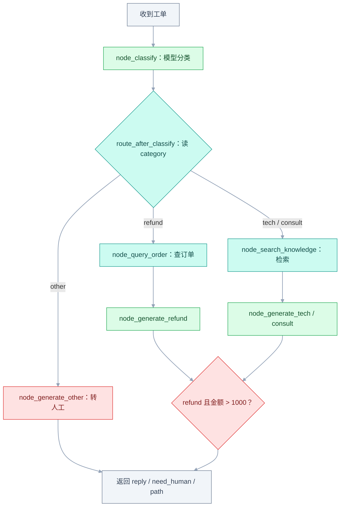
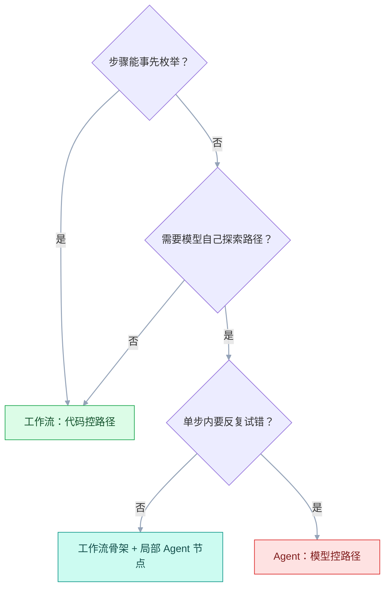
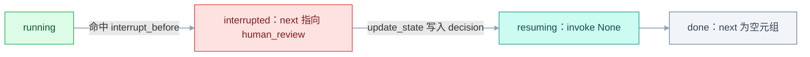

# Agent 工作流

## 一、工程案例：把客服工单处理做成确定性工作流

**场景**：电商客服收到工单（退款 / 技术 / 咨询 / 其它）需要自动分类、路由到不同处理链、生成回复，退款金额超过 1000 元需要人工确认。目标是把「收到工单 → 分类 → 查资料 → 起草回复 → 人工确认」做成**确定性工作流**，而不是自由 Agent 自主决定顺序。

**为什么必须做**：纯 Agent 容易「先查订单再分类」（多一次调用）、「分类完忘了回复」、「把技术问题当退款处理」。确定性流程用确定性的代码写，只在需要判断的地方调模型——更便宜、更稳定、更好调试。

**动手前确认**：已有订单查询接口和知识库检索接口可用；模型 API Key 已配置。

**流程图**（方框是代码节点，菱形是代码判断，没有任何「模型决定下一步」）：



### 1.1 主线（按顺序执行）

```python
"""ticket_workflow.py — 客服工单确定性工作流"""
import json, os, time
from enum import Enum
from openai import OpenAI

client = OpenAI(api_key=os.environ["OPENAI_API_KEY"],
                base_url=os.environ.get("OPENAI_BASE_URL"))
MODEL = os.environ.get("CHAT_MODEL", "gpt-4o-mini")

# === 状态定义 ===
class Category(str, Enum):
    REFUND = "refund"
    TECH = "tech"
    CONSULT = "consult"
    OTHER = "other"

class TicketState:
    """工作流的共享状态 —— 所有节点读写同一个对象。"""
    def __init__(self, content: str, user_id: str = ""):
        self.content = content
        self.user_id = user_id
        self.category: Category | None = None
        self.classify_reason: str = ""
        self.order_info: dict = {}
        self.knowledge: str = ""
        self.reply: str = ""
        self.need_human: bool = False
        self.human_decision: str = ""
        self.path: str = ""
        self.error: str = ""

# === 节点 1：分类（模型判断） ===
CLASSIFY_PROMPT = """把工单分到下面四类之一：
- refund：退款、退货、退费、退款进度
- tech：功能异常、报错、无法登录、性能问题
- consult：业务咨询、政策询问、使用方法
- other：以上都不属于
只输出 JSON：{"category": "类别", "reason": "一句话理由"}
工单内容：{content}"""

def node_classify(state: TicketState) -> TicketState:
    # 提示词里有 JSON 花括号，用 replace 拼，别用 str.format
    raw = client.chat.completions.create(
        model=MODEL, temperature=0,
        messages=[{"role": "user", "content": CLASSIFY_PROMPT.replace("{content}", state.content)}]
    ).choices[0].message.content
    try:
        data = json.loads(raw.strip().strip("`").removeprefix("json").strip())
        state.category = Category(data.get("category", "other"))
        state.classify_reason = data.get("reason", "")
    except (json.JSONDecodeError, ValueError):
        state.category = Category.OTHER
        state.classify_reason = f"解析失败：{raw[:80]}"
    return state

# === 节点 2：查订单（代码调用） ===
def query_order_status(content: str) -> dict:
    """模拟订单查询接口 —— 真实环境替换为 HTTP 调用。"""
    return {"order_id": "ORD-12345", "amount": 1500.0, "status": "已发货", "pay_time": "2025-10-01"}

def node_query_order(state: TicketState) -> TicketState:
    state.order_info = query_order_status(state.content)
    return state

# === 节点 3：检索知识库（代码调用） ===
def search_knowledge_base(content: str) -> str:
    """模拟知识库检索 —— 真实环境替换为向量检索。"""
    return "重启路由器后仍无法上网：检查 PPPoE 密码是否正确，确认线路未断开。"

def node_search_knowledge(state: TicketState) -> TicketState:
    state.knowledge = search_knowledge_base(state.content)
    return state

# === 节点 4：生成回复（模型生成） ===
def node_generate_refund(state: TicketState) -> TicketState:
    prompt = f"""你是退款专员。基于订单信息回复客户，说明退款进度和预计到账时间。
订单信息：{json.dumps(state.order_info, ensure_ascii=False)}
工单：{state.content}"""
    state.reply = client.chat.completions.create(
        model=MODEL, temperature=0.3,
        messages=[{"role": "user", "content": prompt}]
    ).choices[0].message.content
    state.path = "refund"
    return state

def node_generate_tech(state: TicketState) -> TicketState:
    prompt = f"""你是技术支持。基于知识库内容给客户排查步骤。
知识库：{state.knowledge}
工单：{state.content}"""
    state.reply = client.chat.completions.create(
        model=MODEL, temperature=0.3,
        messages=[{"role": "user", "content": prompt}]
    ).choices[0].message.content
    state.path = "tech"
    return state

def node_generate_consult(state: TicketState) -> TicketState:
    prompt = f"""你是业务顾问。基于资料回答问题，不要编造。
资料：{state.knowledge}
问题：{state.content}"""
    state.reply = client.chat.completions.create(
        model=MODEL, temperature=0.3,
        messages=[{"role": "user", "content": prompt}]
    ).choices[0].message.content
    state.path = "consult"
    return state

def node_generate_other(state: TicketState) -> TicketState:
    state.reply = "已转人工处理，我们会尽快回复您。"
    state.need_human = True
    state.path = "other"
    return state

# === 节点 5：人工确认标记（条件判断） ===
def node_check_human_review(state: TicketState) -> TicketState:
    """退款超过 1000 元标记待人工确认；金额缺失时保守转人工。

    这里只打标记，真正的暂停/恢复要接 checkpointer（见 3.7）。
    """
    if state.category != Category.REFUND:
        return state
    amount = state.order_info.get("amount")
    if amount is None or amount > 1000:
        state.need_human = True
        state.human_decision = "pending"
    return state

# === 路由函数（代码决定路径） ===
def route_after_classify(state: TicketState) -> str:
    """分类后，代码决定下一个节点 —— 不是模型决定。"""
    if state.category == Category.REFUND:
        return "query_order"
    elif state.category == Category.TECH:
        return "search_knowledge"
    elif state.category == Category.CONSULT:
        return "search_knowledge"
    else:
        return "generate_other"

def route_after_query(state: TicketState) -> str:
    return "generate_refund"

def route_after_search(state: TicketState) -> str:
    if state.category == Category.TECH:
        return "generate_tech"
    else:
        return "generate_consult"

# === 主流程（确定性执行） ===
def process_ticket(content: str, user_id: str = "") -> dict:
    state = TicketState(content=content, user_id=user_id)
    state = node_classify(state)
    next_node = route_after_classify(state)
    if next_node == "query_order":
        state = node_query_order(state)
        state = node_generate_refund(state)
    elif next_node == "search_knowledge":
        state = node_search_knowledge(state)
        next_node = route_after_search(state)  # 只取节点名，别覆盖 state
        if next_node == "generate_tech":
            state = node_generate_tech(state)
        else:
            state = node_generate_consult(state)
    else:
        state = node_generate_other(state)
    state = node_check_human_review(state)
    return {
        "category": state.category.value,
        "classify_reason": state.classify_reason,
        "reply": state.reply,
        "need_human": state.need_human,
        "human_decision": state.human_decision,
        "path": state.path,
        "order_info": state.order_info,
        "knowledge": state.knowledge,
    }

# === 运行日志 ===
if __name__ == "__main__":
    result = process_ticket("我上个月买的会员申请退款，怎么还没到账？", user_id="U001")
    print(json.dumps(result, ensure_ascii=False, indent=2))
```

```text
=== 运行日志（示例输出，reply 随模型与版本变化） ===
$ python ticket_workflow.py
{
  "category": "refund",
  "classify_reason": "涉及退款到账进度",
  "reply": "您好，订单 ORD-12345（1500 元）的退款申请已收到，审核通过后 3~5 个工作日原路退回。",
  "need_human": true,
  "human_decision": "pending",
  "path": "refund",
  "order_info": {"order_id": "ORD-12345", "amount": 1500.0, "status": "已发货", "pay_time": "2025-10-01"},
  "knowledge": ""
}
```

`need_human=true` 表示「草稿已生成、等人工点头」，不是已通过；`human_decision` 由人写入。

### 1.2 验收（8 项全过才算交付）

把断言写成脚本，跑一条命令看结果，别靠肉眼：

```python
"""verify.py — 三张样例工单跑完逐项断言"""
import ticket_workflow as w

REFUND = "我上个月买的会员申请退款，怎么还没到账？"
TECH = "路由器重启后还是上不了网，PPPoE 报错 691"
OTHER = "我要投诉快递员态度恶劣"

refund, tech, other = (w.process_ticket(t) for t in (REFUND, TECH, OTHER))

assert refund["category"] == "refund" and refund["path"] == "refund"      # 1 分类正确
assert refund["order_info"].get("order_id"), "退款分支没查到订单"          # 2
assert tech["category"] == "tech" and tech["knowledge"], "技术分支没检索"  # 3
assert refund["need_human"] is True, "1500 元退款必须转人工"               # 4
assert all(len(r["reply"]) >= 10 for r in (refund, tech, other))          # 5 回复非空
assert refund["classify_reason"] and tech["classify_reason"]              # 6
assert {r["path"] for r in (refund, tech, other)} <= {"refund", "tech", "consult", "other"}  # 7
assert other["need_human"] is True, "other 必须转人工"                    # 8
print("8/8 通过")
```

```text
$ python verify.py
8/8 通过
```

| # | 检查 | 判定字段 | 通过标准 |
|---|---|---|---|
| 1 | 分类正确 | `category` | 退款工单 → `refund`，技术工单 → `tech` |
| 2 | 退款查到订单 | `order_info` | `refund` 分支的 `order_info.order_id` 非空 |
| 3 | 技术查到知识 | `knowledge` | `tech` 分支的 `knowledge` 非空 |
| 4 | 人工确认触发 | `need_human` | 退款 1500 元 → `True` |
| 5 | 回复非空 | `reply` | 三个分支的回复都 ≥ 10 字 |
| 6 | 分类理由记录 | `classify_reason` | 非空字符串 |
| 7 | 路径可追踪 | `path` | 属于 `refund` / `tech` / `consult` / `other` |
| 8 | 其他类转人工 | `need_human` | `other` 类别 → `True` |

> **验收 4 的边界**：金额恰好 1000 元**不**触发（判断是 `> 1000`）；`amount` 字段缺失（`None`）时保守转人工，避免该拦的没拦。`other` 分支的话术只有 16 字左右，所以验收 5 的门槛设 10 字而不是 20 字。

### 1.3 复制到 100 个业务线

不同业务线的工单分类维度不同，但**主流程骨架不变**：分类 → 路由 → 处理 → 生成 → 确认。只需要替换 `Category` 枚举、`CLASSIFY_PROMPT` 和各处理链的节点函数。

| 约束 | 处理 |
|---|---|
| 分类维度不同 | 写死在 `CLASSIFY_PROMPT` 里，枚举值由业务定义 |
| 订单接口不同 | `query_order_status` 替换为对应业务的 HTTP 调用 |
| 知识库不同 | `search_knowledge_base` 替换为对应业务的检索 |
| 人工确认阈值不同 | `node_check_human_review` 里的 `1000` 改为业务参数 |

---

## 二、高频问答：会卡住你的地方，也是面试最常问的

### 2.1 Agent 明明有工具却不用，或者明明不用工具还一直调

**现场**

检查请求体里 `tools` 和 `tool_choice` 是否都存在。

```python
# ✔ 明确要求调用工具
client.chat.completions.create(
    model=MODEL, tools=TOOLS, tool_choice="required", messages=[...])
# ✔ 允许自由选择
client.chat.completions.create(
    model=MODEL, tools=TOOLS, tool_choice="auto", messages=[...])
```

> ⚠️ `tool_choice="none"` 会完全禁用工具调用；`tool_choice="required"` 会强制至少一次调用。

**要点**

- 不是模型智障，多半是 `tools` 没传上，或 `tool_choice` 根本没设。
- `tool_choice="auto"` 时模型自行判断是否调用，不给理由它就可能不调。
- 反过来「不用工具还一直调」，通常是描述写成了「总是调用」，或缺停止条件。

**追问**

- `none` / `auto` / `required` 分别什么语义？→ 完全禁用、自行判断、至少调用一次。
- 强制 `required` 后选错工具怎么办？→ 那是描述问题，不是开关问题。
- 确定性工作流里为什么可以不用工具？→ 路径由代码决定，模型只在节点内做事。

### 2.2 循环永远不结束

**现场**

看执行轨迹，同一个工具被调用多次且参数几乎相同；在轨迹里搜重复的 `tool_call_id`。

```python
# LangGraph：设置递归上限（默认 25，以官方当前稳定版为准）
app.invoke(inputs, config={"recursion_limit": 15})
# 手写循环：加计数器
for step in range(max_steps):  # max_steps = 10
    ...
```

**要点**

- 不是模型发疯，是缺少循环终止条件。
- 图执行要有 `recursion_limit`，手写循环要有 `max_steps`。
- 同一函数连续调用 3 次以上，基本可以判定是循环。

**追问**

- `recursion_limit` 默认多少？→ 25，设太小会误杀正常流程。
- 调大上限能解决吗？→ 不能，只会让死循环烧得更久。
- 除了步数还该限什么？→ token 预算和墙钟超时。

### 2.3 JSON 解析失败

**现场**

打印原始输出，看看有没有 markdown 标记或额外文字；`print(repr(raw))` 看控制字符和不可见字符。

```python
def safe_parse_json(raw: str) -> dict | None:
    cleaned = raw.strip().strip("`").removeprefix("json").strip()
    try:
        return json.loads(cleaned)
    except json.JSONDecodeError:
        return None  # 兜底为 None，走降级路径
```

> **更省事的做法**：模型支持 JSON 模式时直接开 `response_format={"type": "json_object"}`，提示词里仍然要出现 `json` 字样并给出字段示例。JSON 模式只保证语法合法，不保证字段齐全，字段校验还得自己写。

> **怎么核实**：`print(repr(raw))` 看看控制字符、不可见字符。

**要点**

- 让模型「只输出 JSON」不等于它会只输出 JSON。
- 常见三种：`json` 代码块包裹、前后解释性文字、尾随逗号，`json.loads` 对这些都不宽容。
- 解析失败要能降级，别让整个流程崩在一行 `loads` 上。

**追问**

- 开了 JSON 模式还要清洗吗？→ 语法有保证，字段齐全仍要自己校验。
- JSON 模式有什么前提？→ 提示词里要出现 `json` 字样并给字段示例。
- 解析失败该重试吗？→ 重试一次可以，连续失败就要走降级路径。

### 2.4 分类准确率低

**现场**

抽样 100 个工单，看误判的都落在哪两个类别之间，用混淆矩阵找假阳性、假阴性最多的类别对。

```python
# 反例放进提示词，让模型学会「什么不是」
CLASSIFY_PROMPT = """...
- refund：退款、退货、退费
- tech：功能异常、报错
- consult：业务咨询、政策询问
- other：以上都不属于
反例：
- 「怎么查订单」 → consult（不是 refund）
- 「退款进度怎么查」 → refund（不是 consult）
"""
```

> **怎么核实**：用混淆矩阵，找出「假阳性 / 假阴性」最多的类别对。

**要点**

- 不是模型不够大，是分类提示词没有边界定义。
- 「退款」和「咨询退款进度」这类重叠类别，只给类名模型只能猜。
- 反例比正例更能教会「什么不是」，边界是写出来的。

**追问**

- 加反例会有什么副作用？→ 提示变长，可能把别的类挤掉，要控制条数。
- 类别不平衡怎么办？→ 看宏 F1 和单类召回，别只看准确率。
- 什么时候才该换模型？→ 边界写清、样本足够仍差，再谈档位。

### 2.5 工具调用结果没传回去

**现场**

检查 messages 列表里 `tool` 消息的 `tool_call_id` 是否和 `assistant` 的 `tool_calls` 里的 `id` 匹配。

```python
# ✔ 正确的格式
messages.append({"role": "tool", "tool_call_id": call.id, "content": result})
```

> **怎么核实**：`for msg in messages: print(msg.get("tool_call_id"))` —— 必须一一对应。

**要点**

- 不是工具没生效，是结果没按协议回传。
- 必须是 `role="tool"` 且带 `tool_call_id`，写成普通 user 消息模型不认。
- 一个调用一条结果，`id` 一一对应。

**追问**

- 结果能用自然语言描述吗？→ 能，但 `content` 仍要挂在 `tool` 消息上。
- 并行调用怎么回？→ 每个 call 一条，按顺序写最稳。
- 不回传会怎样？→ 下一轮模型看不到结果，要么重调要么编。

### 2.6 上下文窗口爆了

**现场**

打印 `len(messages)` 看增长趋势，再用 `sum(len(m.get("content", "")) for m in messages)` 估算 token。

```python
# 保留最近 N 轮 + 重要信息
MAX_MESSAGES = 20
if len(messages) > MAX_MESSAGES:
    messages = messages[-MAX_MESSAGES:]
# 或用摘要替换早期对话
```

> **怎么核实**：`sum(len(m.get("content", "")) for m in messages)` 看 token 数。

**要点**

- 不是窗口不够大，是历史无限累积、检索结果全量塞。
- 每轮重发全部历史，成本随轮次叠加，不是线性。
- 保留最近 N 轮只是止血，重要信息要靠摘要或结构化状态。

**追问**

- 滑窗会丢什么？→ 早期的约束和结论，长任务会因此跑偏。
- 摘要和结构化状态怎么选？→ 流程明确用状态，资料型用检索。
- 压缩本身有成本吗？→ 有，多一次调用，还可能把失败原因压掉。

### 2.7 Checkpointer 状态丢失

**现场**

打印当前 `config` 和 `app.get_state(config).values`，线程对不上时 values 是空的。

```python
# ✔ 固定 thread_id
config = {"configurable": {"thread_id": "ticket-1001"}}
app.invoke(inputs, config=config)
# 之后用同一个 config 继续
state = app.get_state(config)
```

> **怎么核实**：`app.get_state_history(config)` 看是否有历史快照。

**要点**

- 不是 LangGraph 存档有 bug，是 `thread_id` 换了。
- 另外两个坑：`checkpointer` 没传到 `compile()`、每次都用 `MemorySaver` 新建实例。
- `thread_id` 标识一条独立执行流，不负责跨线程共享状态。

**追问**

- 重启后状态为什么没了？→ `MemorySaver` 只在内存，生产要用 Sqlite/Postgres。
- 同一个 `thread_id` 能并发跑吗？→ 不能，同一执行流要串行。
- 怎么查历史？→ `app.get_state_history(config)`，可带 `checkpoint_id` 回放。

### 2.8 人工确认节点没暂停

**现场**

`app.get_state(config).next` 里是不是 `('human_review',)`，即卡在该节点之前。

```python
# ✔ 节点名称必须和 add_node 里的名称一致
app = graph.compile(checkpointer=checkpointer, interrupt_before=["human_review"])
```

> **怎么核实**：暂停后 `app.get_state(config).next` 应该是 `('human_review',)` 而**不是** `()`；空元组说明流程已经跑完，压根没停住。没挂 checkpointer 时无法暂停——中断依赖检查点。静态 `interrupt_before` / `interrupt_after` 与动态 `interrupt()` 是两套写法，版本间有差异，以官方当前稳定版为准。

**要点**

- 不是 `interrupt_before` 不生效，是节点名拼错，或写成了节点输出而不是 `add_node` 的名字。
- 没挂 checkpointer 就无法暂停——中断依赖检查点。
- 空元组 `()` 说明流程已经跑完，压根没停住。

**追问**

- 暂停后怎么继续？→ 先 `update_state` 写决定，再 `invoke(None, config)`。
- 只 `invoke(None)` 行不行？→ 那是原样继续，人没做决定也会往下走。
- 静态和动态中断能混用吗？→ 不能，两套写法版本间还有差异。

### 2.9 多 Agent 成本爆表

**现场**

统计每个 Agent 的 token 消耗，`tracer.log` 记录每个节点的 `tokens` 字段，找出成本大头。

```python
# 限制工作者数量 + 共享摘要而非完整历史
MAX_WORKERS = 3
# 传递摘要而非完整消息
worker_input = {"summary": state.summary, "task": task}
```

> **怎么核实**：`tracer.log` 记录每个节点的 `tokens` 字段，找出成本大头。

**要点**

- 不是提示词不够短，是每个 Agent 都要重复读完整上下文。
- 成本还有两块：Supervisor 调度开销、工作者之间信息传递冗余。
- 手段是限工作者数量 + 传摘要而非完整历史。

**追问**

- 为什么多 Agent 比单 Agent 贵这么多？→ 同一份上下文被复制了 N 份。
- 什么时候值得多 Agent？→ 角色分工明确、规则写得清。
- 怎么判断该合并？→ 看单节点 token 占比，调度开销超过执行就该收。

### 2.10 并行没加快速度

**现场**

检查子任务是否真的独立；看 API 返回的速率限制头；用 `time.time()` 记录每个子任务的开始、结束时间，看是否有重叠。

```python
# ✔ 真正独立的任务才能并行
with ThreadPoolExecutor(max_workers=4) as pool:
    results = list(pool.map(independent_task, items))
```

> **怎么核实**：`time.time()` 记录每个子任务的开始/结束时间，看是否有重叠。

**要点**

- 不是线程池没生效，是子任务之间有依赖，或 API 速率限制把请求串起来了。
- 并行的收益上限由最慢的那个子任务决定。
- 只有真正独立的只读任务适合并行，写操作要串行。

**追问**

- 依赖关系怎么发现？→ 画出输入输出，B 用到 A 的结果就是有依赖。
- 被限流怎么办？→ 降并发、加退避，或按配额分桶。
- 并行一定更快吗？→ 不一定，请求变多后排队和限流会吃掉收益。

### 2.11 路由分支跑偏

**现场**

打印 `state.category` 和路由函数的返回值。

```python
# ✔ 显式处理所有分支，兜底到 OTHER
def route_after_classify(state):
    if state.category == Category.REFUND:
        return "query_order"
    elif state.category == Category.TECH:
        return "search_knowledge"
    elif state.category == Category.CONSULT:
        return "search_knowledge"
    else:
        return "generate_other"  # 必须有兜底
```

> **怎么核实**：`assert state.category in Category.__members__.values()`。

**要点**

- 不是分类模型错了，先看路由函数里的条件判断。
- 枚举值大小写不一致、分支漏写，都会静默走错。
- 路由必须有兜底分支，落到 `other` 而不是抛异常。

**追问**

- 怎么区分是分类错还是路由错？→ 打印 category，再看路由返回值。
- 兜底为什么不能省？→ 新枚举值上线时，没兜底就是 500。
- 路由能交给模型做吗？→ 能，但确定性流程里交给代码更稳。

### 2.12 重试导致重复执行

**现场**

检查重试前后状态是否一致，`request_id` 在重试间保持一致，后端返回缓存结果。

```python
# ✔ 幂等：查订单带上 request_id 去重
def query_order_status(content: str, request_id: str = "") -> dict:
    # 后端通过 request_id 去重
    return http_post("/order/query", {"content": content, "request_id": request_id})
```

> **怎么核实**：`request_id` 在重试间保持一致，后端返回缓存结果。

**要点**

- 不是重试逻辑有 bug，是重试时状态没清理、幂等性没保证。
- 查订单带 `request_id` 由后端去重，是这类问题最省事的解法。
- 写操作重试前要先确认上次到底成没成。

**追问**

- `request_id` 该在哪生成？→ 第一次请求时生成，重试沿用同一个。
- 后端不支持去重怎么办？→ 先查后写，或落一张幂等表。
- 重试几次合适？→ 有限次加退避，别把失败放大成雪崩。

### 2.13 并行分支的结果被覆盖，只剩最后一个

**现场**

给每个分支的返回值打日志，再打印合并后的 state，对比「分支数」和「最终条数」。

```python
from typing import Annotated, TypedDict
import operator

class State(TypedDict):
    # ✔ 声明合并方式，否则 A、B 并行写 items 只剩一个
    items: Annotated[list[str], operator.add]
    summary: str  # 多个分支都写这个键 → 冲突或覆盖
```

> **怎么核实**：给每个分支的返回值打日志，再打印合并后的 state，对比「分支数」和「最终条数」。并行分支要写同一个键时，要么加 reducer，要么各写各的键、留一个聚合节点收口。

**要点**

- 不是并行节点没执行，是多个分支写同一个 state 字段，默认后写覆盖。
- 没声明 reducer（如 `operator.add`），框架只能取最后一个。
- 并行写同一个键要么加 reducer，要么各写各的键、留一个聚合节点收口。

**追问**

- 哪些类型适合 reducer？→ 列表、字典这类可累加的，标量覆盖语义本来就模糊。
- `summary` 这种字符串能并行写吗？→ 不能，会冲突或覆盖。
- 怎么验证 reducer 生效？→ 对比分支数和最终条数。

---

## 三、核心知识：从零开始要建立的东西

### 3.1 工作流与 Agent 的本质区别

| 维度 | 工作流 | Agent |
|---|---|---|
| 路径决定者 | 代码 | 模型 |
| 步数 | 固定 | 1 到 N |
| 可预测性 | 高 | 低 |
| 成本 | 低（2~4 次调用） | 高（3~20 次） |
| 调试难度 | 低 | 高 |
| 适用任务 | 流程明确 | 探索性 |



> **一句话**：工作流是「流程 + 局部智能」，Agent 是「全局自主决策」。**先问步骤能不能枚举**，能枚举就别交给模型决定顺序——这是省钱和稳的第一原则。

> **面试**：常问「什么时候用工作流，什么时候用 Agent？」答：先问步骤能不能枚举，能枚举就代码控路径，需要模型自己探索才用 Agent。

### 3.2 六种常见工作流模式

| 模式 | 思路 | 适用 |
|---|---|---|
| 链式 | 前步输出 → 后步输入 | 任务可拆 2~5 阶段 |
| 路由 | 先分类，再分发到不同链 | 类别处理差异大 |
| 并行 | 独立子任务同时跑 | 子任务无依赖 |
| 编排者-工作者 | 模型拆分任务 → 工作者执行 | 子任务不可预知 |
| 评估-优化 | 生成 → 评估 → 打回重做 | 质量要求高 |
| 多 Agent 协作 | 主管调度多个专业 Agent | 角色分工明确、能写清规则 |

### 3.3 状态管理

**State 是工作流的共享内存**：所有节点读写同一个对象，节点返回「要更新的字段」，框架自动合并。

| 设计原则 | 说明 |
|---|---|
| 扁平结构 | 用 `TypedDict` / 简单类，不嵌套太深 |
| 不可变更新 | 节点返回新字段而非修改原对象 |
| 序列化友好 | 所有字段都能 `json.dumps` |

```python
from typing import TypedDict
class TicketState(TypedDict):
    content: str
    category: str
    reply: str
    need_human: bool
```

> 两种写法都行：`TypedDict` 由框架负责字段合并、缺键检查和 reducer；普通类靠节点返回整个对象（1.1 的 `TicketState` 就是后者）。**要并行写同一个键，就得用 `TypedDict` + `Annotated`**，否则后写覆盖。

### 3.4 节点设计

**节点 = 一个函数**：`state -> dict`，返回要更新的字段。

| 原则 | 说明 |
|---|---|
| 单一职责 | 一个节点只做一件事 |
| 可测试 | 单独调用，输入输出都在案 |
| 无副作用 | 不直接写数据库/文件，靠返回值传递 |

```python
def node_classify(state: TicketState) -> dict:
    category = classify(state["content"])
    return {"category": category}  # 只返回更新的字段
```

> 返回「更新片段」而不是整个 state，框架才知道哪些字段变了、该触发哪个 reducer；返回整个对象也能跑，但并行时会互相覆盖。

### 3.5 边的设计

**Edge 决定节点间的流向**：固定边（`add_edge`）或条件边（`add_conditional_edges`）。

| 类型 | 用法 |
|---|---|
| 固定边 | `graph.add_edge("A", "B")` |
| 条件边 | `graph.add_conditional_edges("A", route_fn, {"B": "B", "C": "C"})` |

```python
def route(state) -> str:
    if state["category"] == "refund":
        return "query_order"
    return "search_knowledge"
```

### 3.6 Checkpointer

**Checkpointer 把每一步的 State 存到数据库**：流程中断后，从断点继续。

| 存储后端 | 特点 |
|---|---|
| SqliteSaver | 本地 SQLite，开发/测试 |
| PostgresSaver | 生产环境 |
| MemorySaver | 仅内存，测试用 |

```python
from langgraph.checkpoint.sqlite import SqliteSaver
import sqlite3
conn = sqlite3.connect("checkpoints.db", check_same_thread=False)
app = graph.compile(checkpointer=SqliteSaver(conn))
config = {"configurable": {"thread_id": "ticket-1001"}}
```

> **thread_id 语义**：标识「一条独立执行流」。同一个 `thread_id` 接着跑，不同 `thread_id` 互不干扰——它不负责「跨线程共享状态」，共享要靠外部存储。
>
> **版本提示**：`SqliteSaver` / `PostgresSaver` 的包路径与类名、以及是否需要用上下文管理器创建连接，版本之间改过，以官方当前稳定版为准。

> **面试**：常问「Checkpointer 是干什么的，thread_id 是什么？」答：每步状态落库，中断后从断点续跑；thread_id 标识一条独立执行流，不负责跨线程共享。

### 3.7 人工介入

**Human-in-the-Loop**：流程跑到关键节点暂停，等人确认后继续。**没有 checkpointer 就没有暂停**——暂停本质是「把状态存下来然后停下」。

| 动作 | 做什么 | 关键 API |
|---|---|---|
| 暂停 | 在指定节点前/后停下 | `interrupt_before` / `interrupt_after`（编译时） |
| 恢复 | 用 `None` 作输入接着跑 | `invoke(None, config)` |
| 修改 | 人工改状态再继续 | `update_state(config, {...})` |

状态流转如下，「已暂停」时 `next` 指向待执行节点：



```python
app = graph.compile(
    checkpointer=SqliteSaver(conn),
    interrupt_before=["human_review"])
# 人工确认后：
app.update_state(config, {"decision": "approve"})
app.invoke(None, config=config)
```

> **顺序别搞反**：先 `update_state` 再 `invoke(None)`。只 `invoke(None)` 是「原样继续」，人没做决定也会往下走。动态 `interrupt()` 写法在节点内部抛中断、靠 `Command(resume=...)` 恢复，与静态写法不能混用，以官方当前稳定版为准。

> **面试**：常问「人工确认节点怎么实现暂停和恢复？」答：靠 checkpointer 存状态，静态 interrupt 在节点前停，先 update_state 再 invoke(None) 恢复。

### 3.8 递归上限

**recursion_limit 防止无限循环**：默认 25（以官方当前稳定版为准），设置过小会提前终止。

| 参数 | 默认 | 说明 |
|---|---|---|
| `recursion_limit` | 25 | 最大执行步数 |

```python
app.invoke(inputs, config={"recursion_limit": 15})
```

> **边界**：设置太大（如 1000）会让真正的死循环耗尽资源；太小（如 5）会误杀正常流程。

### 3.9 工具调用

**Tool Call = 模型输出 + 宿主执行**：模型输出 `tool_calls`，代码执行工具，结果作为 `tool` 角色消息回传。

| 字段 | 作用 |
|---|---|
| `tool_call_id` | 匹配模型调用和工具结果 |
| `role="tool"` | 标记这是工具结果 |
| `content` | 工具的返回值 |

```python
# 模型输出
msg = response.choices[0].message
# 执行工具
for call in msg.tool_calls:
    result = TOOLS[call.function.name](**json.loads(call.arguments))
    messages.append({"role": "tool", "tool_call_id": call.id, "content": str(result)})
```

### 3.10 链式工作流

**把大任务拆成固定步骤**：提取要点 → 写初稿 → 润色。

| 优点 | 缺点 |
|---|---|
| 每步可单独调试 | 链太长会累积误差 |
| 输入输出都在案 | 中间加校验变复杂 |

```python
points = call_llm("提取关键信息", doc)
draft = call_llm("写公告", points)
final = call_llm("润色", draft)
```

### 3.11 路由工作流

**先分类，再分发到不同处理链**：分类是「便宜的小任务」，一次调用就能省下后续无效处理。

| 步骤 | 职责 |
|---|---|
| 分类节点 | 输出固定枚举 + 理由 |
| 路由函数 | 代码决定下一个节点 |
| 处理链 | 各自独立优化提示词 |

```python
category = classify(content)  # 模型
next_node = route(category)   # 代码
```

> **关键**：分类准确率决定一切——路由错了，后面再好也答非所问。

### 3.12 并行工作流

**互相独立的子任务同时执行**：最后聚合。

| 用途 | 收益 |
|---|---|
| 降低延迟 | 5 个独立子任务：串行 10s → 并行约 2s（最慢那个决定） |
| 提高可靠性 | 同一问题多次采样投票，能压低偶发错误；提升幅度取决于任务难度 |

```python
with ThreadPoolExecutor(max_workers=4) as pool:
    results = list(pool.map(summarize, sections))
```

> **代价**：同时打多个请求，注意 API 速率限制。

### 3.13 编排者-工作者

**主模型拆分任务 → 工作者执行 → 汇总**：子任务由模型决定，不是你预先写死。

| 角色 | 职责 |
|---|---|
| Orchestrator | 理解任务 → 决定子任务 → 写指令 |
| Worker | 执行指令 → 输出结果 |
| 汇总 | 把结果整合 |

```python
tasks = plan_tasks(request)  # 模型拆分
results = parallel_execute(tasks)  # 工作者并行
summary = synthesize(results)  # 汇总
```

> **约束**：必须限制子任务数量（`[:4]`），否则模型可能拆出 10 个任务。

### 3.14 评估-优化循环

**先生成，再评估，不合格打回**：适合质量要求高的任务。

| 环节 | 职责 |
|---|---|
| 生成 | 基于输入生成初稿 |
| 评估 | 打分 + 指出问题 |
| 优化 | 带反馈重新生成 |

```python
for round in range(max_rounds):
    reply = generate(ticket, feedback)
    review = evaluate(ticket, reply)
    if review["pass"]:
        return reply
    feedback = review["problems"]
```

> **必须有最大轮数**：评估本身可能不稳定，没有上限会无限循环。

### 3.15 多 Agent 协作

**Supervisor 模式**：一个主 Agent 调度多个专业 Agent。

| 角色 | 职责 |
|---|---|
| Supervisor | 决定下一步派给谁 |
| Writer | 写作 |
| Reviewer | 审核 |
| Fact-checker | 核查事实 |

```python
# 调度提示词必须写清楚规则
SUPERVISOR_PROMPT = """你是主管。规则：
① 没有草稿 → writer
② 有草稿无待改意见 → reviewer
③ 审核发现问题 → writer
④ 审核通过 → FINISH
"""
```

> **核心**：规则写清楚，模型才能稳定调度。

### 3.16 可观测性

**记录什么**：每次模型调用的完整输入输出、每个节点的耗时与 token、路由分支走向、工具调用与异常。

| 指标 | 用途 |
|---|---|
| 输入输出 | 复现问题 |
| 耗时 | 找瓶颈 |
| token | 找成本大头 |
| 分支走向 | 统计占比 |

```python
import json, time

class Tracer:
    def __init__(self, path: str = "trace.jsonl"):
        self.path = path

    def log(self, node, inputs, outputs, elapsed, tokens, cost):
        record = {"node": node, "elapsed_ms": round(elapsed * 1000, 1),
                  "tokens": tokens, "cost": cost,
                  "inputs": str(inputs)[:500],   # 截断，别把全量上下文写进去
                  "outputs": str(outputs)[:500]}
        with open(self.path, "a", encoding="utf-8") as f:
            f.write(json.dumps(record, ensure_ascii=False) + "\n")

# 包一层，节点只管业务
def traced(state, node, tracer: Tracer):
    t0 = time.time()
    out = node(state)
    tracer.log(node.__name__, state, out, time.time() - t0, 0, 0.0)
    return out
```

> **LangSmith**：装包 + 配好 tracing 开关和 API Key（变量名随版本变过，以官方当前稳定版为准），LangGraph 的每次 `invoke` 会自动上报节点级轨迹——比自己写 JSONL 省事，但注意它会拿到完整输入输出，先确认没有敏感数据。

---

## 四、冷门知识汇总

| 知识点 | 为什么冷门 | 用到时的关键词 |
|---|---|---|
| 时间旅行调试 | 平时不用，调试时才用 | `get_state_history` / `get_state(config, checkpoint_id=...)` / `update_state` |
| 子图组合 | 复杂工作流才用；父子图状态默认不互通 | `add_node("sub", 子图)` / 共享键名 / 子图单独 `compile` |
| 状态快照导出 | 调试、审计、离线复盘时用 | `get_state` / `state.values` / `state.next` |
| 自定义 Checkpointer | 自建存储（Redis、对象存储）时用 | `BaseCheckpointSaver` 子类 / `put` / `put_writes` / `get_tuple` |
| 检查点清理 | 数据量涨起来才想删 | `delete_thread` / 建表时加 TTL 或定期归档 |
| 流式事件 | 只想要中间进度而非最终结果 | `stream_mode="updates"` / `"values"` / `"messages"` |
| 模型输出流式解析 | 实时展示才用 | `stream=True` / `delta.content` / 拼接分片 |
