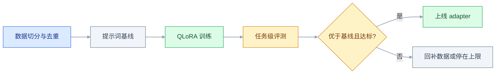
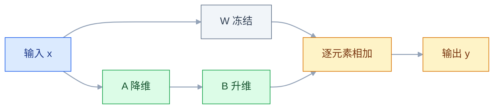
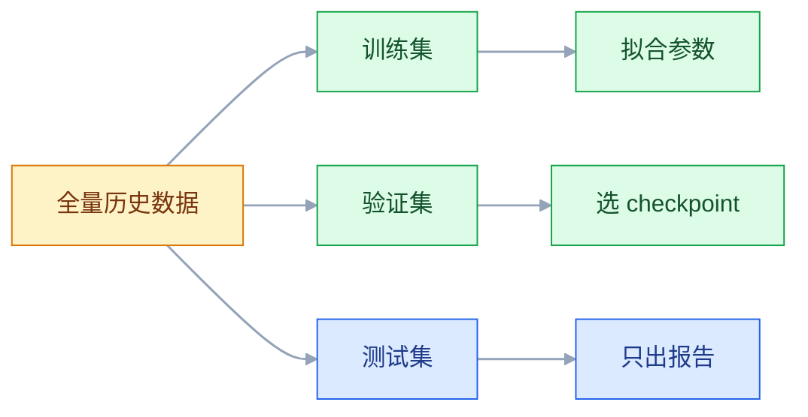

# 模型微调

## 一、工程案例：判断一个分类任务该用提示词还是微调，并跑一次 LoRA 训练与评测

**场景**：客服工单要自动打 12 个意图标签（退款、物流、发票、改地址、商品质量、优惠券、催发货、取消订单、售后维修、投诉、账户问题、其他）。手里有 800 条人工标注的历史工单，线上要求输出严格 JSON、准确率 ≥ 90%、单条 P95 延迟 < 1.5 秒。团队的第一反应是「直接微调一版」。

**为什么先别训**：微调真正的成本在数据和评测，不在 GPU。没有提示词基线，就没有「提升了多少」的参照；没有独立测试集，训出来的分数也不可信。这一节先用半天做基线，再用 QLoRA 训一版，用同一套测试集对比，最后给出「该不该微调」的结论和可复现的产物。

**产出**：一个几十 MB 的 adapter、一份 `reports/eval_report.json`、一张三版对比表、一条能重跑的训练命令。



### 1.1 先固定验收口径

指标必须在训练前写死，否则训练完会不自觉地挑一个好看的指标。

| 指标 | 定义 | 基线（示例） | 目标 |
|---|---|---|---|
| 准确率 | 12 类中预测正确的比例 | 71.5% | ≥ 90% |
| 宏平均 F1 | 每类 F1 取平均，防止长尾类被平均掉 | 0.63 | ≥ 0.88 |
| JSON 合法率 | 能被 `json.loads` 解析且 `label` 在枚举内 | 96.0% | 100% |
| P95 延迟 | 单条端到端，含网络与排队 | 0.9 s | < 1.5 s |
| 单条成本 | 输入 + 输出 token 折算 | 见 1.11 | 不高于基线 |

> 表里的数字是示例，用来演示口径，真实值以自己跑出来的为准。

**为什么单列 JSON 合法率**：格式错和分类错是两类问题。格式可以靠约束解码解决，分类只能靠模型能力。混在一个指标里，会误判成「模型不行」。

### 1.2 数据切分：按时间切，不按随机切

```python
# split.py —— 按时间切 + 归一化去重 + 同一订单/用户不跨集
import json, hashlib, re
from collections import Counter

raw = sorted(json.load(open("data/raw.json", encoding="utf-8")),
             key=lambda x: x["created_at"])
seen, dedup = set(), []
for r in raw:
    h = hashlib.md5(re.sub(r"\s+", "", r["text"].lower()).encode()).hexdigest()
    if h not in seen:
        seen.add(h); dedup.append(r)
n = len(dedup)
train, val, test = dedup[:int(n*.8)], dedup[int(n*.8):int(n*.9)], dedup[int(n*.9):]

def group(r):                                  # 同订单优先，没有就按用户
    return r.get("order_id") or r["user_id"]

def drop_overlap(part, base):
    ids = {group(r) for r in base}
    return [r for r in part if group(r) not in ids]

val = drop_overlap(val, train)
test = drop_overlap(test, train + val)
for name, part in [("train", train), ("val", val), ("test", test)]:
    json.dump(part, open(f"data/{name}.json", "w", encoding="utf-8"),
              ensure_ascii=False)
print(n, len(train), len(val), len(test), Counter(r["label"] for r in test))
```

三个动作都不能省：

| 动作 | 不做会怎样 |
|---|---|
| 按时间切 | 同一周的近似工单同时进训练和测试，分数虚高（示例：5~15 个点） |
| 文本归一化去重 | 只差一个空格的重复样本会同时出现在两边 |
| 同一订单/同一用户只落一边 | 模型记住订单号就能「猜对」，学到的是泄漏不是能力 |

切完检查一遍测试集的类别分布。12 类里如果有 2 类在测试集只有 2 条，准确率的置信区间会大到没有意义，需要补样本或改成按类别分层抽样。同组剔除会让 val/test 比 8:1:1 少一截，把实际条数记进实验记录。

### 1.3 提示词基线：zero-shot、few-shot、约束解码

```python
# baseline.py —— 三档提示词，跑同一批测试集
import json
from openai import OpenAI

client = OpenAI(base_url="http://localhost:8000/v1", api_key="x")
LABELS = ["退款", "物流", "发票", "改地址", "商品质量", "优惠券",
          "催发货", "取消订单", "售后维修", "投诉", "账户问题", "其他"]
SYS = "你是工单分类器。只输出 JSON：{\"label\": \"<枚举值>\"}，不要解释。"
# 每类 1 条示例，共 12 条，只能从训练集抽，测试集一条都不能进
FEW_SHOT = [("我上周申请退款了，还没到账", "退款"),
            ("快递一直不动，到哪了", "物流"),
            ("发票什么时候能开", "发票"),
            ("地址填错了，帮我改一下", "改地址"),
            ("收到的东西有裂痕", "商品质量"),
            ("优惠券下单时用不了", "优惠券"),
            ("下单三天了还没发货", "催发货"),
            ("订单不想要了，取消掉", "取消订单"),
            ("这个能保修吗", "售后维修"),
            ("客服态度太差了，我要投诉", "投诉"),
            ("手机号换了，登录不上", "账户问题"),
            ("你们几点下班", "其他")]

def ask(text, use_few_shot=False):
    msgs = [{"role": "system", "content": SYS}]
    for q, a in (FEW_SHOT if use_few_shot else []):
        msgs += [{"role": "user", "content": q},
                 {"role": "assistant", "content": json.dumps({"label": a}, ensure_ascii=False)}]
    msgs.append({"role": "user", "content": text})
    r = client.chat.completions.create(
        model="qwen", messages=msgs, temperature=0,
        response_format={"type": "json_object"})   # 只保证是合法 JSON，不保证标签在枚举内
    return json.loads(r.choices[0].message.content)["label"]
```

> `json_object` 管的是语法，枚举要另外约束：vLLM 一类服务提供 `guided_choice` / `structured_outputs` 之类的开关，把候选限定成这 12 个字符串，具体参数名以服务当前稳定版文档为准。

| 档位 | 做法 | 准确率（示例） | JSON 合法率（示例） |
|---|---|---|---|
| zero-shot | 只给 12 个标签名 | 71.5% | 96.0% |
| few-shot | 每类 1 条示例，共 12 条，约 600 token | 80.4% | 99.5% |
| few-shot + 枚举约束 | 解码时限制在 12 个标签内 | 80.4% | 100% |

**这一步的结论比数字重要**：few-shot 把准确率从 71.5 拉到 80.4，离 90 还差 10 个点；约束解码只修格式，不修分类。差距落在「模型对业务话术的边界不敏感」上，这才是微调该解决的问题。

### 1.4 环境与显存确认

```bash
nvidia-smi                    # 看显存总量与驱动支持的最高 CUDA 版本
python -c "import torch; print(torch.__version__, torch.version.cuda, torch.cuda.is_bf16_supported())"

python -m venv .venv && source .venv/bin/activate
pip install -U pip
git clone --depth 1 https://github.com/hiyouga/LLaMA-Factory.git
cd LLaMA-Factory && pip install -e ".[torch,metrics]"
llamafactory-cli env          # 打印框架版本、显卡与依赖信息
```

> 训练框架的参数名、导出命令随版本变化，以官方当前稳定版文档为准；基座模型名同样以官方当前稳定版为准。

训练显存按四块估，不要只算权重：

| 组成 | 估算方式 | 7B 量级、QLoRA 示例 |
|---|---|---|
| 基座权重 | 参数量 × 每参数字节 | 4bit ≈ 3.5 GB |
| LoRA 参数、梯度、优化器状态 | 可训练参数 × 约 12 字节 | 0.2~0.5 GB |
| 激活值 | 与 batch × 序列长度 × 层数成正比 | 1~2 GB（开梯度检查点后） |
| CUDA 上下文与碎片 | 固定开销 | 1~2 GB |
| 合计 | | 约 6~10 GB（示例，以 `nvidia-smi` 实测为准） |

12GB 卡能跑，24GB 卡更宽裕。真正决定 OOM 的不是模型大小，是 `cutoff_len` 和 batch。

### 1.5 数据格式与注册

Alpaca 格式最省事，`output` 直接放 JSON 字符串：

```json
[
  {
    "instruction": "把工单分到以下类别之一：退款、物流、发票、改地址、商品质量、优惠券、催发货、取消订单、售后维修、投诉、账户问题、其他。只输出 JSON。",
    "input": "我上周申请退款了，到现在还没到账，麻烦查一下",
    "output": "{\"label\": \"退款\"}"
  },
  {
    "instruction": "把工单分到以下类别之一：退款、物流、发票、改地址、商品质量、优惠券、催发货、取消订单、售后维修、投诉、账户问题、其他。只输出 JSON。",
    "input": "快递显示签收了但我根本没收到",
    "output": "{\"label\": \"物流\"}"
  }
]
```

在 `data/dataset_info.json` 注册训练集与验证集两个名字（验证集用 1.2 切出来的 `val.json`，不用框架再随机切一次）：

```json
{
  "ticket_cls_train": {
    "file_name": "train.json",
    "columns": { "prompt": "instruction", "query": "input", "response": "output" }
  },
  "ticket_cls_val": {
    "file_name": "val.json",
    "columns": { "prompt": "instruction", "query": "input", "response": "output" }
  }
}
```

数据侧的四个硬要求：

| 要求 | 原因 |
|---|---|
| 每类 ≥ 40 条 | 少于这个数，模型学不到边界，只会背样本 |
| `output` 只能是 12 个枚举之一 | 出现第 13 种写法，模型就会在推理时发明标签 |
| 标签定义写进 `instruction` 且全量一致 | 定义不一致等于给模型两套标准 |
| 长尾类做欠采样或补数据 | 800 条里「投诉」只有 30 条时，该类召回会明显偏低 |

### 1.6 训练配置

`train_ticket_lora.yaml`：

```yaml
model_name_or_path: Qwen/Qwen3-8B
trust_remote_code: true

stage: sft
do_train: true
finetuning_type: lora
quantization_bit: 4
quantization_method: bnb
lora_rank: 16
lora_alpha: 32
lora_dropout: 0.05
lora_target: all

dataset: ticket_cls_train
eval_dataset: ticket_cls_val
template: qwen          # 与基座匹配；Qwen3 的思考段开关见 3.7
cutoff_len: 512
overwrite_cache: true
preprocessing_num_workers: 8

output_dir: saves/ticket-lora-v1
logging_steps: 5
save_steps: 50
plot_loss: true
seed: 42

per_device_train_batch_size: 1
gradient_accumulation_steps: 16
learning_rate: 1.0e-4
num_train_epochs: 3.0
lr_scheduler_type: cosine
warmup_ratio: 0.1
max_grad_norm: 1.0
bf16: true
gradient_checkpointing: true
```

三个参数的理由：

| 参数 | 取值 | 理由 |
|---|---|---|
| `lora_rank` | 16 | 分类要分辨 12 个类的边界，比纯风格任务需要多一点容量；8 也常够，32 容易过拟合 |
| `learning_rate` | 1e-4 | LoRA 的常用起点；数据不到千条时不宜再大 |
| `cutoff_len` | 512 | 工单文本普遍在 200 token 内，截太长只浪费显存 |

> 若换 24GB 卡跑 bf16 LoRA（不量化），删掉 `quantization_bit` 与 `quantization_method` 两行；显存会明显上升，速度也会快一些。

### 1.7 启动训练与读日志

```bash
llamafactory-cli train train_ticket_lora.yaml
```

```text
Num examples = 616, Num Epochs = 3, Total optimization steps = 116
{'loss': 2.1043, 'grad_norm': 0.9120, 'learning_rate': 9.9e-05, 'epoch': 0.09}
{'loss': 0.8734, 'grad_norm': 0.4410, 'learning_rate': 9.2e-05, 'epoch': 0.56}
{'eval_loss': 0.4120, 'eval_accuracy': 0.8875, 'epoch': 1.0}
{'loss': 0.2810, 'grad_norm': 0.1830, 'learning_rate': 2.1e-06, 'epoch': 2.94}
{'train_runtime': 612.4, 'train_loss': 0.5312, 'epoch': 3.0}
```

> 日志是示例，数值以实际训练为准。

| 现象 | 含义 | 动作 |
|---|---|---|
| loss 从 2.1 平滑降到 0.28 | 正常收敛 | 看 `eval_loss` 是否同步降 |
| loss 一直在 2.3 附近不动 | 模板错、数据列错、学习率过小 | 先打印一条模板化后的文本核对 |
| loss 到 0.05 以下，eval 开始升 | 过拟合 | 减 epoch、加 dropout、补数据 |
| loss 变 NaN 或剧烈震荡 | 学习率过大、有空样本或超长样本 | 学习率 ÷10，过滤异常长度 |

`eval_accuracy` 是训练框架在验证集上按 token 算的，只能当参考，最终以 1.8 的任务级评测为准。

### 1.8 任务级评测

训练框架的 eval loss 不等于业务准确率。要按「生成 → 解析 → 比对标签」重新评一遍，基座版和 LoRA 版共用同一套代码（基座版把 `load("saves/ticket-lora-v1")` 换成 `load()`）。

```python
# eval.py —— 基座 / LoRA 共用；few-shot 版沿用同一套 parse 与指标
import json, os, re, torch
from collections import Counter
from transformers import AutoModelForCausalLM, AutoTokenizer
from peft import PeftModel

BASE = "Qwen/Qwen3-8B"
SYS = "你是工单分类器。只输出 JSON：{\"label\": \"<枚举值>\"}，不要解释。"
LABELS = {"退款", "物流", "发票", "改地址", "商品质量", "优惠券",
          "催发货", "取消订单", "售后维修", "投诉", "账户问题", "其他"}

def load(adapter=None):
    tok = AutoTokenizer.from_pretrained(BASE, trust_remote_code=True)
    model = AutoModelForCausalLM.from_pretrained(
        BASE, torch_dtype=torch.bfloat16, device_map="auto", trust_remote_code=True)
    if adapter:
        model = PeftModel.from_pretrained(model, adapter)
    return tok, model.eval()

def predict(tok, model, text):
    msgs = [{"role": "system", "content": SYS}, {"role": "user", "content": text}]
    prompt = tok.apply_chat_template(msgs, tokenize=False, add_generation_prompt=True,
                                     enable_thinking=False)   # 必须与训练模板一致
    ids = tok(prompt, return_tensors="pt").to(model.device)
    with torch.no_grad():
        out = model.generate(**ids, max_new_tokens=24, do_sample=False,
                             pad_token_id=tok.eos_token_id)
    return tok.decode(out[0][ids["input_ids"].shape[1]:], skip_special_tokens=True)

def parse(raw):
    m = re.search(r"\{.*?\}", raw, re.S)
    if not m:
        return None
    try:
        label = json.loads(m.group())["label"]
        return label if label in LABELS else None
    except Exception:
        return None

tok, model = load("saves/ticket-lora-v1")
rows = []
for r in json.load(open("data/test.json", encoding="utf-8")):
    rows.append({"text": r["text"], "gold": r["label"],
                 "pred": parse(predict(tok, model, r["text"]))})

gold = Counter(r["gold"] for r in rows)
hit = Counter(r["gold"] for r in rows if r["pred"] == r["gold"])
pred = Counter(r["pred"] for r in rows if r["pred"])
recall = {k: hit[k] / gold[k] for k in gold}              # 1.10 第 7 项看这个
prec = {k: hit[k] / pred[k] for k in pred}
f1 = {k: 2 * prec[k] * recall[k] / (prec[k] + recall[k])
      for k in recall if k in prec and prec[k] + recall[k]}
acc = sum(hit.values()) / len(rows)
valid = sum(r["pred"] is not None for r in rows) / len(rows)
print(f"acc={acc:.3f} macro_f1={sum(f1.values()) / len(f1):.3f} json_valid={valid:.3f}")
print("最差三类:", sorted(recall.items(), key=lambda kv: kv[1])[:3])
os.makedirs("reports", exist_ok=True)
json.dump(rows, open("reports/eval_report.json", "w", encoding="utf-8"),
          ensure_ascii=False, indent=2)
```

评测时固定 `do_sample=False`。采样会让同一道题两次结果不同，指标无法比较。线上要多样性再单独调温度，别混进评测。

adapter 是在 4bit 基座上训的，这里用 bf16 基座加载来评，数值上足够接近；如果线上是量化部署，上线前用线上同款配置再抽一批复测一次。

### 1.9 结果与结论

| 版本 | 准确率（示例） | 宏 F1（示例） | JSON 合法率（示例） |
|---|---|---|---|
| zero-shot | 71.5% | 0.63 | 96.0% |
| few-shot + 约束解码 | 80.4% | 0.74 | 100% |
| LoRA + 约束解码 | 91.2% | 0.89 | 100% |

混淆矩阵里最该看的是「互相吞」的类别对（示例：77 条测试错 7 条，全落在下面三对上）：

```text
退款 ←→ 售后维修   3 条（模型分不清「要退钱」和「要修」）
物流 ←→ 催发货     2 条（「怎么还不发」既是催也是物流）
优惠券 ←→ 其他     2 条
```

**决策结论**：这个任务值得微调。理由是 few-shot 加了 12 条示例仍差 10 个点，说明瓶颈不是提示词表达，而是模型对业务边界的判别；同时任务窄、高频、标签体系稳定，正好落在微调的甜区。

反过来说，如果 few-shot 已经到 88%，或者需求只是「输出格式统一」，就该停在提示词，把训练的时间拿去做数据和监控。

### 1.10 验收表

| # | 检查项 | 命令或检查 | 通过标准 |
|---|---|---|---|
| 1 | 测试集独立 | 比对训练/测试文本哈希 | 交集为 0 |
| 2 | 类别覆盖 | 统计测试集每类条数 | 每类 ≥ 5 条 |
| 3 | 训练收敛 | 看 `trainer_state.json` 的 loss 曲线 | 平滑下降，无 NaN |
| 4 | 验证 loss 不回升 | `eval_loss` 曲线 | 最后一轮未连续上升 |
| 5 | 任务准确率 | `python eval.py` | ≥ 90% |
| 6 | 格式合法 | `eval_report.json` 中 `pred` 非空比例 | 100% |
| 7 | 长尾类召回 | 按类别统计召回 | 最低类 ≥ 75% |
| 8 | 通用能力 | 抽 20 条非工单问题人工看 | 不明显退化 |
| 9 | adapter 可加载 | `adapter_config.json` 的基座名一致 | 加载无 shape 报错 |
| 10 | 可复现 | 固定 seed 重跑一次 | 指标差异 < 1 个点 |

第 8 项容易被跳过，但它是上线后最常被投诉的点：工单模型把「今天天气」也答成 `{"label":"其他"}`，用户会觉得系统坏了。

### 1.11 复现与成本

目录按「数据、配置、脚本、产物」四块分开，全部进 Git（大文件用 LFS 或对象存储）：

```text
ticket-cls/
├── data/raw.json               # 原始导出，只读
├── data/train.json  val.json  test.json   # 切分产物，由 split.py 生成
├── configs/train_ticket_lora.yaml
├── scripts/split.py  eval.py
├── saves/ticket-lora-v1/       # adapter + trainer_state.json
└── reports/eval_report.json
```

```bash
sha256sum data/train.json > data/train.sha256   # 数据版本写进实验记录；macOS 用 shasum -a 256
```

| 成本项 | 说明 | 量级（示例） |
|---|---|---|
| GPU 机时 | 3 次实验 × 约 10 分钟 + 调试 | 2~4 机时，按云厂商单价计 |
| 数据标注 | 800 条已有；补长尾类约 100 条 | 内部人力 0.5~1 人天 |
| 评测与对比 | 写脚本 + 人工看 40 条 | 0.5 人天 |
| 推理成本 | adapter 可挂在同一基座上，不额外占一份权重 | 与基线基本相同 |

真正的开销是标注和评测人力，不是 GPU。这也解释了为什么「先做基线」划算：基线半天，能省掉一次没必要的训练和一轮数据返工。

---

## 二、高频问答：会卡住你的地方，也是面试最常问的

### 2.1 loss 几乎不动，一直在初始值附近

**现场**

打印一条 `apply_chat_template` 后的完整文本，看是否含模型该有的角色标记与结束符；再拿基座直接对同一条数据做一次前向、打印 loss，与手动按官方模板拼一遍的结果对比。

```python
print(tok.apply_chat_template(
    [{"role": "user", "content": "测试"}], tokenize=False, add_generation_prompt=True))
```

**要点**

- loss 不降先别怀疑容量，模板与模型不匹配才是第一嫌疑。
- 模板决定角色标记和特殊 token 怎么拼，拼错等于给模型看乱码，学不到「哪里是问题、哪里是答案」。
- 两者差很多就是模板问题，差得不多再去看数据和学习率。

**追问**

- 模板错配的典型数值特征？→ loss 卡在 2.0 以上几乎不动。
- 训练和推理模板要一致吗？→ 必须一致，角色标记、结束符、有没有思考段都要对齐。
- 换基座要注意什么？→ 模板名跟着换，别沿用上一族的。

### 2.2 一启动就 OOM

**现场**

先看显存是不是被别的进程占着：`nvidia-smi` 看 `Processes` 里有没有残留 python。

```bash
nvidia-smi
fuser -v /dev/nvidia* 2>/dev/null
```

**要点**

- OOM 的报错只说了「分配失败」，没说「谁占的」。
- 排查顺序：先确认没有残留进程，再按 `cutoff_len → batch → 梯度检查点 → 4bit → rank` 逐项降。
- 降序列长度最有效，因为激活值随长度线性甚至超线性增长。

**追问**

- 为什么先降 `cutoff_len` 而不是 rank？→ 激活值是大头，rank 省下的量和它不在一个量级。
- 梯度检查点的代价？→ 重算换显存，慢约 20%~30%。
- 12GB 卡跑 7B 要哪些开关？→ 4bit 量化、短序列、batch 1 加梯度累积。

### 2.3 训练完，输出风格一点没变

**现场**

看训练日志里 `trainable params` 的占比；确认评测脚本里 `PeftModel.from_pretrained` 真的执行了，adapter 目录里有 `adapter_model.safetensors`。

```text
trainable params: 20,185,088 || all params: 8,190,000,000 || trainable%: 0.25
```

**要点**

- 不是数据不够，是评测时加载的是基座而不是 adapter。
- 也可能训练根本没挂上 LoRA，`finetuning_type` 不是 `lora`。
- 占比 100% 是全量微调，0% 是没挂上，0.2% 左右才正常。

**追问**

- `target_modules` 写了不存在的名字会怎样？→ PEFT 一般直接报错，别把这条报错当成模型问题。
- adapter 和基座怎么对？→ `adapter_config.json` 里的 `base_model_name_or_path` 必须一致。
- 为什么加到几千条还是没变？→ 加载路径没生效，训多少条都一样。

### 2.4 训练 loss 很低，测试集一塌糊涂

**现场**

对比 `train_loss` 与 `eval_loss` 的最后一个值，差距大就是过拟合；再把训练集原文喂进去，换一种说法问同一个意思，前者完美、后者崩就是记忆而非泛化。

**要点**

- loss 低只证明训练集拟合得好，不证明泛化。
- 几百条数据跑 5~10 轮，模型就把样本背下来了。
- 处理顺序是减 epoch → 加 dropout → 补数据多样性，不要先调学习率。

**追问**

- 过拟合的拐点怎么找？→ `eval_loss` 先降后升，取拐点前的 checkpoint。
- 数据少时验证集怎么留？→ 少于 500 条留 10%~15% 做验证比强行切三份更实际。
- 加了 dropout 还过拟合？→ 说明数据多样性不够，改写样本比调参有效。

### 2.5 测试分数高得不像话

**现场**

训练集与测试集做一次相似度比对；检查切分脚本的随机种子与范围；随机抽 10 条测试样本，看训练集里有没有几乎一样的。

```python
# 粗查：字符 3-gram Jaccard > 0.8 视为近似重复；几千条以内这样两两比够用
def grams(s): return {s[i:i+3] for i in range(len(s) - 2)}

def jac(a, b):
    ga = grams(a)
    return len(ga & grams(b)) / max(1, len(ga | grams(b)))

leak = [t for t in test if max((jac(t, x) for x in train), default=0) > 0.8]
print(len(leak), "/", len(test))
```

**要点**

- 指标异常好时，先怀疑「哪里漏了」，而不是「成了」。
- 泄漏有三种：近似重复样本跨集、按随机切而不是按时间切、同一订单或用户落两边。
- 抽 10 条样本做人工比对，比看总分有用。

**追问**

- 3-gram Jaccard 阈值怎么定？→ 0.8 只是粗筛，最终要人工看一批。
- 为什么必须按时间切？→ 同一周的近似工单会同时进训练和测试，分数虚高 5~15 个点。
- 泄漏修完指标掉很多正常吗？→ 正常，掉下去的才是真实水平。

### 2.6 微调后通用能力明显下降

**现场**

抽 20 条与业务无关的问题，对比微调前后的回答；固定一组「百科、代码、闲聊」问题做回归集，每次训练后都跑。

**要点**

- 不是模型被训坏了，是灾难性遗忘。
- 训练数据 100% 单一任务，模型会推断「所有输入都该这么答」。
- 缓解手段是掺 10%~30% 通用数据、降学习率、减 epoch，不是把业务数据删掉。

**追问**

- 通用数据怎么选？→ 输入形态要和业务接近，否则学不到「这类输入该换种答法」。
- 掺多少合适？→ 20%~30% 是推荐区间，超过 40% 业务风格学不牢。
- 只测业务问题能发现吗？→ 发现不了，这是最容易跳过的一项验收。

### 2.7 adapter 加载报 shape 不匹配

**现场**

看 `adapter_config.json` 里的 `base_model_name_or_path`，基座名、参数量、词表大小三项对齐。

```bash
cat saves/ticket-lora-v1/adapter_config.json
```

**要点**

- 报错里的 `size mismatch` 指向权重形状，不是文件损坏。
- 根因是加载的基座和训练时的基座不是同一个：尺寸、词表或版本不同。
- 换了基座版本就必须重训，adapter 不能跨基座复用。

**追问**

- 同尺寸不同版本能复用吗？→ 不能，稳妥做法就是重训。
- 词表变了为什么必错？→ embedding 形状变了，adapter 对不上。
- 怎么预防？→ adapter 目录里记基座名和 hash，加载前校验。

### 2.8 输出重复、截断，或带着奇怪的特殊 token

**现场**

打印原始输出（故意不 skip 特殊 token），看结尾到底是什么。

```python
raw = tok.decode(out[0][ids["input_ids"].shape[1]:])   # 故意不 skip 特殊 token
print(repr(raw[-200:]))                                 # 看 <|im_end|> 是否反复出现
```

**要点**

- 不是模型质量差，是解码配置问题。
- 三个常见原因：没设 `pad_token`（或设成了非 eos）、`max_new_tokens` 太小、解码时没跳过特殊 token。
- 结尾反复出现 `<|im_end|>` 就是 eos 没生效。

**追问**

- `pad_token` 为什么常设成 eos？→ 生成时不会被当成有效内容。
- `max_new_tokens` 留多少？→ 至少答案长度的 1.5 倍。
- 批量推理时 pad 有影响吗？→ 有，pad 位置要 mask 掉，否则结果会漂。

### 2.9 启动报 `Dataset ticket_cls_train not found`

**现场**

在 `data/` 目录下用注册名反查，再确认文件真的存在。

```bash
python -c "import json; d=json.load(open('data/dataset_info.json')); print(d.get('ticket_cls_train'))"
ls -l data/train.json data/val.json
```

**要点**

- 不是框架有 bug，是 `dataset_info.json` 没注册或路径不对。
- 三处逐字比对：注册名、`file_name`、`columns` 映射的字段名。
- `file_name` 是相对 `data/` 的路径，写绝对路径也会找不到。

**追问**

- 为什么验证集不要让框架再切一次？→ 会打乱自己按时间切好的边界。
- 注册了还报错？→ 确认 `data/` 是不是框架认的目录。
- 字段映射写错什么表现？→ 能加载但训练报缺列，或 loss 不降。

### 2.10 训练慢得离谱，GPU 利用率却很低

**现场**

`nvidia-smi dmon` 看 SM 利用率，再看日志里预处理耗时是否占了大头。

```yaml
overwrite_cache: false
preprocessing_num_workers: 8
bf16: true
dataloader_num_workers: 4
```

**要点**

- 不是卡太差，是 GPU 在等数据。
- 四个原因：预处理每次重跑、没开 bf16、DataLoader 的 worker 太少、缓存没开。
- 第一步是几分钟 tokenize 而训练只要几十秒，瓶颈就在预处理。

**追问**

- GPU 利用率多少算正常？→ 长期低于 50% 就先查喂数据，而不是换卡。
- worker 越多越好吗？→ 受 CPU 核数限制，开过头会抢主进程。
- 换 A100 有用吗？→ 喂不饱的流水线换卡也白搭。

### 2.11 多卡训练报错，或显存没按预期分摊

**现场**

看启动命令与环境变量 `LOCAL_RANK`、`WORLD_SIZE`。

```bash
FORCE_TORCHRUN=1 llamafactory-cli train train_ticket_lora.yaml   # 框架内置的 torchrun 入口
```

**要点**

- `device_map="auto"` 与 `Trainer` 的分布式启动冲突。
- 分布式要用 `torchrun`/`accelerate` 启动，不是手写 `device_map`。
- 手工 `device_map` 做的是模型并行，不是数据并行，训练会极慢甚至报错。

**追问**

- 分布式训练该传 `device_map` 吗？→ 不要，单卡调试时才用 `auto`。
- 数据并行和模型并行的区别？→ 一个切数据，一个切模型。
- 显存没分摊说明什么？→ 多半还是单进程在跑，先看 `WORLD_SIZE`。

### 2.12 中文或 JSON 字段被截断、转义出错

**现场**

统计训练样本的 token 长度分布，看 P99 是否接近 `cutoff_len`；量的是整条样本，不是只量答案。

```python
import numpy as np
from transformers import AutoTokenizer

tok = AutoTokenizer.from_pretrained("Qwen/Qwen3-8B")   # 与训练同一个 tokenizer

def full_len(x):                                      # 量整条样本，不是只量答案
    msgs = [{"role": "user", "content": x["instruction"] + "\n" + x["input"]},
            {"role": "assistant", "content": x["output"]}]
    return len(tok.apply_chat_template(msgs, tokenize=True, enable_thinking=False))

lens = [full_len(x) for x in data]
print(np.percentile(lens, [50, 90, 99]), max(lens))
```

**要点**

- 不是模型不会写 JSON，是截断发生在 tokenize 阶段，模型根本没看到完整答案。
- `\\"` 这种二次转义是手工拼字符串拼出来的。
- 把 `cutoff_len` 调到 P99 以上，或在预处理时丢掉超长样本并记数。

**追问**

- 长度该量整条还是只量答案？→ 整条，模板和指令都占 token。
- 丢掉超长样本有风险吗？→ 有，可能丢的正是长尾类，要记录丢了多少。
- JSON 怎么生成才不出转义问题？→ 用 `json.dumps(..., ensure_ascii=False)`。

### 2.13 推理结果为空，或先吐一大段「思考」再没下文

**现场**

把推理时 `apply_chat_template` 的结果打印出来，和训练数据模板化后的文本逐字对比。

```python
prompt = tok.apply_chat_template(
    msgs, tokenize=False, add_generation_prompt=True,
    enable_thinking=False)      # 与训练模板对齐；其他模型族没有这个开关，靠模板名对齐
print(prompt)
```

**要点**

- 不是模型没学会，是训练模板和推理模板不一致。
- Qwen3 这类带思考段的模型，tokenizer 默认会加思考开头，而训练用的框架模板没有这一段。
- `max_new_tokens` 小的时候，预算全被思考内容吃掉。

**追问**

- 对齐之后还是空怎么办？→ 再查 `max_new_tokens` 和 eos 配置。
- 其他模型族有 `enable_thinking` 吗？→ 没有，靠模板名对齐。
- 训练时要不要带思考段？→ 任务简单就别带，答案短、成本低。

### 2.14 不管输入什么，都输出同一个标签

**现场**

统计测试集上的预测分布，和真实分布、混淆矩阵对比。

```python
from collections import Counter
print(Counter(r["pred"] for r in rows).most_common())   # 复用 1.8 的 rows
```

**要点**

- 不是模型太笨，是类别严重不均衡，模型只学「一律猜多数类」就能把 loss 压低。
- 另一种是同一条 `instruction` 里标签定义前后不一致，模型无从分辨。
- 准确率被多数类撑起来，看着还行，宏 F1 却很低。

**追问**

- 怎么发现预测塌成一列？→ 看预测分布，再看 1.10 第 7 项的单类召回。
- 处理顺序是什么？→ 补长尾样本、按类重采样、对 loss 加权，不要先加 epoch。
- 为什么不能只看准确率？→ 多数类占一半以上时，全猜它也有 50% 以上。

---

## 三、核心知识：从零开始要建立的东西

### 3.1 全量微调与参数高效微调的成本结构

微调不是「再训一遍」，而是「在已有权重上做一次有约束的更新」。约束放在哪，决定了成本。

| 项目 | 全量微调 | LoRA | QLoRA |
|---|---|---|---|
| 参与更新的参数 | 100% | 0.1%~1% | 0.1%~1% |
| 基座权重的精度 | bf16 | bf16 | 4bit |
| 梯度 | 全参数，bf16 约 2 字节/参数 | 仅 adapter | 仅 adapter |
| 优化器状态 | 全参数，m、v 各 4 字节 + fp32 主权重 4 字节 | 仅 adapter | 仅 adapter |
| 7B 单卡可行性 | 基本不可行 | 24GB 可行 | 12GB 可行 |
| 产物 | 完整模型 | 几十 MB | 几十 MB |
| 灾难性遗忘 | 重 | 轻 | 轻 |

全量微调贵在优化器：Adam 为每个参数存一阶、二阶矩，混合精度还要一份 fp32 主权重和一份梯度。按权重 2 + 梯度 2 + 主权重 4 + m 4 + v 4 估算，约 16 字节/参数，7B 就是 110GB 量级，还没算激活值。所以它需要 ZeRO/FSDP 把状态切到多卡，属于「有集群才考虑」的选项。

LoRA 把「需要梯度的参数」缩到百分之一以下，优化器状态随之缩到可以忽略。代价是表达能力受限，收益是单卡可跑、产物可切换、原模型不被破坏。

> **面试**：常问「LoRA 为什么比全量微调省显存？」答：只更新 adapter，优化器状态跟着缩到可忽略，基座冻结不存梯度和主权重。

### 3.2 LoRA 的低秩分解

一个线性层的原始计算是 `y = Wx`。LoRA 冻结 `W`，在旁边并联一条窄路：



```text
y = Wx + (alpha / r) · B(Ax)
A: r × d_in，随机初始化
B: d_out × r，零初始化   ← 训练开始时旁路贡献为 0
```

`B` 初始为零，保证训练第一步的输出和原模型完全一致，不会一上来就把模型打乱。训练只更新 `A`、`B`，参数量从 `d_out × d_in` 降到 `r × (d_in + d_out)`：

| 维度 | 原权重 | r=8 | r=16 |
|---|---|---|---|
| 4096 × 4096 | 16,777,216 | 65,536（0.39%） | 131,072（0.78%） |

边界：低秩假设的是「任务需要的改变是低维的」。风格、格式、窄分类符合这个假设；注入大量新事实不符合，硬训只会得到自信的胡编。

> **面试**：常问「LoRA 的 B 为什么零初始化？」答：保证训练第一步输出和原模型完全一致，旁路贡献从 0 开始。

### 3.3 秩、缩放系数与有效强度

真正进入计算的是 `alpha / r`，不是 `alpha` 本身。

| r | alpha | 有效缩放 | 容量 | 典型场景 |
|---|---|---|---|---|
| 8 | 16 | 2 | 小 | 风格、格式、简单分类 |
| 16 | 32 | 2 | 中 | 多类分类、结构化抽取 |
| 32 | 64 | 2 | 大 | 复杂任务、数据上千条 |
| 64 | 16 | 0.25 | 大但弱 | 少见，需重新调学习率 |

两条经验：

- 固定 `alpha = 2r` 时，改 `r` 只改容量，不改强度，比较实验更干净。
- 只改 `alpha` 不改 `r`，等于改学习率的有效倍率；调不动时先怀疑这一点。

`lora_dropout` 是正则，数据少（几百条）用 0.05~0.1，数据多可以设 0。它和 `r` 不是替代关系：`r` 管容量，dropout 管泛化。

### 3.4 目标模块的覆盖范围

`target_modules` 决定 LoRA 挂在哪几类线性层上。

| 配置 | 覆盖 | 相对参数量 | 效果 | 显存 |
|---|---|---|---|---|
| 仅 `q_proj,v_proj` | 注意力的查询与值 | 最少 | 老做法，够用但上限低 | 最低 |
| `q,k,v,o` | 全部注意力投影 | 中 | 大多数任务够 | 中 |
| 全部线性层（含 MLP） | 注意力 + 前馈 | 较多 | 通常最好，默认选择 | 较高 |
| 再加 `lm_head` | 输出层 | 最多 | 换词表/强改输出分布时才需要 | 高 |

大多数框架里写 `lora_target: all` 就是「全部线性层」。MoE 模型要注意专家层是否被包含，配置里通常有单独的开关。

取舍：覆盖越广，越容易学到任务，也越容易过拟合和变慢。数据少于 200 条时，从注意力四投影起步更稳。

### 3.5 量化基座与计算精度

QLoRA 把冻结的基座压到 4bit，但**计算仍在 16bit 上做**：前向时把 4bit 权重反量化成 bf16，再和激活值相乘。所以它省的是存储和带宽，不是算力。

| 技术 | 解决的问题 | 代价 |
|---|---|---|
| NF4 | 正态分布的权重用 4bit 表示，误差更小 | 反量化有额外计算 |
| 双重量化 | 量化缩放系数本身也占空间 | 省约 0.4 bit/参数，实现略复杂 |
| 分页优化器 | 显存峰值时把优化器状态换到内存 | 触发换页会明显变慢 |

精度与显存的对应关系（按参数量估算）：

| 基座精度 | 每参数字节 | 7B 权重 | 备注 |
|---|---|---|---|
| bf16 | 2 | 约 14 GB | LoRA 的默认 |
| 8bit | 1 | 约 7 GB | 质量接近 bf16 |
| 4bit | 0.5 | 约 3.5 GB | QLoRA 的默认 |

边界：QLoRA 训练通常比同配置的 bf16 LoRA 慢，因为每层都要反量化；序列很长、batch 很大时，激活值才是大头，4bit 带来的收益会被稀释。

### 3.6 监督微调的数据契约

SFT 的本质是「给模型看大量输入到输出的配对，让它模仿」。数据格式不是审美问题，是契约：字段名、角色名、结束符任何一处不一致，训练就会静默地学错。

| 格式 | 结构 | 适用 | 注意 |
|---|---|---|---|
| Alpaca | `instruction` / `input` / `output` | 单轮任务、分类、抽取 | `input` 可为空字符串，不能缺字段 |
| ShareGPT | `conversations` 数组，`from` 为 `human`/`gpt` | 多轮对话 | 角色必须交替，首条通常是 `human` |
| 自定义 JSONL | 每行一个对象 | 大数据量流式读取 | 需要自己写预处理 |

最小可用样本：

```json
{"instruction": "把工单分类，只输出 JSON", "input": "退款还没到账", "output": "{\"label\": \"退款\"}"}
```

三条边界：

- `output` 必须是**模型该生成的完整内容**，不要把解释、标点、前后缀留给推理时补。
- 多轮数据里，每一轮 `gpt` 的内容都会参与 loss；如果只想学最后一轮，需要在预处理时做掩码。
- 推理时遇到训练里没有的标签，模型会自己发明一个，且往往很自信。

### 3.7 对话模板与特殊 token

基座模型不认识「角色」，它只认识 token。模板负责把 `system/user/assistant` 拼成模型训练时见过的格式，包括角色标记和结束符。

```text
# Qwen 风格（示意，实际以 tokenizer 内置模板为准）
<|im_start|>system
你是工单分类器<|im_end|>
<|im_start|>user
退款还没到账<|im_end|>
<|im_start|>assistant
```

| 模型族 | 框架里的模板名（示例） | 常见错误 |
|---|---|---|
| Qwen | `qwen` | 用了 llama 模板，角色标记全错 |
| Llama 3 | `llama3` | 漏掉 `<\|eot_id\|>` |
| Mistral | `mistral` | 把 `[INST]` 拼错位置 |

模板错配的典型症状是 loss 卡在 2.0 以上不动，因为模型在预测它没见过的分隔符。核实方法只有一个：把模板化后的字符串打印出来，和模型卡上的示例逐字对比。

手工拼数据时，训练样本用 `add_generation_prompt=False`（答案紧接在 assistant 头之后，模型学着续写答案），推理时用 `True`（让模型从 assistant 头开始生成）。搞反了会把 assistant 头写进要学的答案里，或者推理时少一个开头，loss 和输出都会漂。

同一个基座还可能有两套模板：Qwen3 系列默认带思考段，框架里通常另有对应写法或 `enable_thinking` 开关。训练用的是不带思考段的模板，推理就必须显式关掉，否则预算会先被思考内容吃掉（见 2.13）。

> **面试**：常问「对话模板为什么必须对齐？」答：基座只认 token，模板决定角色标记和结束符，错配就是给模型看乱码。

### 3.8 损失掩码与训练目标

因果语言模型的训练目标是「给定前文，预测下一个 token」。一条样本里，问题部分和答案部分都会产生预测，但只有答案部分该被学习。

| 掩码策略 | 学什么 | 适用 |
|---|---|---|
| 全序列参与 | 问题 + 答案 | 数据量大、想让模型也学会提问风格 |
| 只算答案（prompt 置 -100） | 只学回答 | **SFT 的常规做法** |
| 只算最后一轮 | 只学目标轮次 | 多轮数据、只想优化最终回答 |

```python
labels = input_ids.copy()
labels[: prompt_len] = [-100] * prompt_len   # -100 在交叉熵里被忽略
```

框架里对应的开关是 `train_on_prompt`（默认关，即只算答案）；多轮数据只想学最后一轮时用 `mask_history`。自己写训练循环才需要手写上面两行。

不掩码的后果不是报错，而是 loss 里混进了「预测用户提问」的部分：训练集的数字会更好看，模型却可能养成复述问题的习惯。数据里问答长度比差异越大，这个副作用越明显。

### 3.9 有效批大小与学习率

显存不够时，用小 batch 加梯度累积凑出等效批大小：

```text
有效批大小 = per_device_batch × 梯度累积步数 × 卡数
```

| 显存 | batch | 累积 | 卡数 | 有效批大小 |
|---|---|---|---|---|
| 12GB | 1 | 16 | 1 | 16 |
| 24GB | 2 | 8 | 1 | 16 |
| 4 × 24GB | 2 | 2 | 4 | 16 |

有效批大小影响的是「一步看多少数据」，进而影响学习率的合适区间。批大小翻倍时，学习率可以适度上调，但 LoRA 场景下不建议机械地线性放大，先保持 1e-4 试一版更稳。

另一个隐性约束是步数：200 条数据、有效批 16、跑 3 轮，只有 38 步。步数太少时，cosine 调度还没降下来就结束了，模型处于「学了一半」的状态。数据少的时候，宁可把 epoch 加到 3~5，也不要让总步数低于 50。

### 3.10 显存构成与压缩顺序

训练显存不是一块，是四块相加：

| 块 | 与什么成正比 | 压缩手段 |
|---|---|---|
| 基座权重 | 参数量 × 精度字节 | 4bit 量化 |
| adapter 与优化器状态 | 可训练参数量 | 降 rank、只挂注意力层 |
| 激活值 | batch × 序列长度 × 层数 | 降序列、降 batch、梯度检查点 |
| 上下文与碎片 | 固定 + 分配策略 | 换更大卡、减少反复分配 |

OOM 时按这个顺序动，性价比从高到低：

```text
1. cutoff_len 减半（激活值近似减半）
2. per_device_batch_size 降到 1
3. 开 gradient_checkpointing（省激活，慢约 20%~30%）
4. 开 4bit 量化（权重降到 1/4）
5. lora_rank 减半
6. 只挂注意力层
```

先降序列长度，是因为它同时影响激活值和注意力计算，收益最大；先降 rank 往往省不了多少，还伤效果。

### 3.11 过拟合的判据

过拟合不是「loss 低」，而是「训练集和真实分布的差距在变大」。

| 信号 | 读法 | 处理 |
|---|---|---|
| `eval_loss` 先降后升 | 典型过拟合拐点 | 取拐点前的 checkpoint |
| `train_loss` 远低于 `eval_loss` | 记忆训练集 | 减 epoch、加 dropout、补数据 |
| 换个说法就答错 | 学的是表面模式 | 增加同义改写样本 |
| 所有回答长度、句式雷同 | 分布塌缩 | 提高数据多样性，推理时适当升温 |
| 训练集问题回答完美 | 可能只是背下来了 | 用未见过的改写做测试 |

小验证集（几十条）的 `eval_loss` 噪声很大，单点上升不代表过拟合。至少看连续两个评估点，或者用交叉验证。数据量少于 500 条时，留 10%~15% 做验证，其余全训，比强行切三份更实际。

### 3.12 灾难性遗忘与回放配比

模型只有一个参数空间，新任务学得越猛，旧行为被覆盖得越多。

| 通用数据占比 | 业务指标 | 通用能力 | 评价 |
|---|---|---|---|
| 0% | 最高 | 明显退化 | 只适合完全专用、无兜底需求的场景 |
| 10% | 略降 | 基本恢复 | 常用起点 |
| 20%~30% | 降 1~3 个点 | 恢复良好 | 推荐区间 |
| > 40% | 明显被稀释 | 好 | 风格学不牢 |

四种手段可以叠加：掺通用数据、降学习率（1e-4 → 2e-5~5e-5）、减 epoch、优先 LoRA 而非全量。通用数据不是随便找，要和业务数据的「输入形态」接近，否则模型学不到「这类输入该用另一种答法」。

### 3.13 偏好优化（DPO）的数据形态

SFT 教「会不会」，DPO 教「更偏好哪个」。DPO 不需要奖励模型，直接用成对比较数据。

```json
{
  "instruction": "快递太慢了",
  "chosen": "亲，非常抱歉让您久等，我马上帮您催一下物流。",
  "rejected": "物流时效以实际为准，请您耐心等待。"
}
```

| 方法 | 数据 | 工程复杂度 | 适用 |
|---|---|---|---|
| SFT | 输入 → 标准答案 | 低 | 先做，几乎所有场景都需要 |
| DPO | 同一输入 + chosen/rejected | 中 | SFT 后仍不够稳，或要压某种倾向 |
| RLHF/PPO | 偏好数据 + 奖励模型 + 强化学习 | 高 | 有专门团队、追求极限对齐 |

边界：DPO 依赖参考模型算 KL 约束，显存要多留一份（或用 adapter 做参考）；偏好数据噪声大时，DPO 会把噪声放大成稳定偏好。顺序永远是先 SFT 到可用，再 DPO 调倾向。

### 3.14 评测集的设计

评测集是微调项目里最该先做、最容易被敷衍的部分。



| 原则 | 做法 | 违反的后果 |
|---|---|---|
| 独立性 | 测试集不参与训练、不参与选模 | 指标虚高，上线掉点 |
| 时间性 | 按时间切，测试集取最近的 | 学到过时模式，线上分布已变 |
| 分层 | 每个类别都有足够样本 | 长尾类指标不可信 |
| 去重 | 近似重复样本只留一份 | 泄漏，分数虚高 |
| 盲评 | 人工评测时不告诉评测者版本 | 先入为主，偏好微调版 |

如果用人或强模型当裁判，要注意位置偏置（更偏好第一个答案）和长度偏置（更偏好长答案）。固定顺序、交换 A/B 各评一次，能消掉一部分。

> **面试**：常问「测试集该怎么切、怎么用？」答：按时间切、去重、同订单不跨集，测试集只出报告，不参与训练也不参与选模。

### 3.15 产物形态与权重合并

训练产出的是 adapter，不是完整模型。

| 形态 | 内容 | 优点 | 缺点 |
|---|---|---|---|
| adapter | 几十 MB 的 `A`、`B` 与配置 | 小、可多版本共存、可热切换 | 推理时要加载基座 + adapter |
| 合并模型 | `W' = W + (alpha/r)·BA` | 任何框架直接加载，无额外开销 | 每个版本一份完整权重 |

```bash
llamafactory-cli export \
  --model_name_or_path Qwen/Qwen3-8B \
  --adapter_name_or_path saves/ticket-lora-v1 \
  --template qwen --finetuning_type lora \
  --export_dir models/ticket-merged
```

合并要在高精度下做（fp32 或 bf16），不要先量化再合并：4bit 基座加上 adapter 再存回 4bit，会引入两次量化误差。合并后的模型是标准权重，量化、部署、再微调都可以照常进行。

### 3.16 实验的可复现性

微调是实验科学，不能复现就等于没做。

| 要素 | 记录方式 | 为什么 |
|---|---|---|
| 数据版本 | 文件哈希 + 切分脚本 | 数据一变，指标不可比 |
| 配置 | yaml 进 Git，不写在命令行里 | 命令行参数会被遗忘 |
| 随机性 | 固定 `seed`，记录框架版本 | 数据顺序影响结果 |
| 环境 | 锁 `pip freeze` 或镜像 tag | CUDA、依赖版本会改变行为 |
| 产物 | adapter + `trainer_state.json` + 评测报告 | 事后能解释「为什么这版更好」 |

最低标准：换一台机器，用仓库里的数据和配置，能跑出指标差异在 1 个点以内的结果。

---

## 四、冷门知识汇总

| 知识点 | 为什么冷门 | 用到时的关键词 |
|---|---|---|
| LoRA 的 B 零初始化 | 框架默认做了，没人注意；自己实现时才踩 | `init_lora_weights`、旁路初始输出为 0 |
| rsLoRA 的缩放改法 | 大 rank 才需要，小 rank 下和原版几乎一样 | `use_rslora`、`alpha / sqrt(r)` |
| DoRA 的幅度与方向分解 | 新方法，收益依任务而定 | `use_dora`、weight-decomposed |
| PiSSA 初始化 | 用 SVD 主成分初始化，收敛更快 | `init_lora_weights="pissa"` |
| LoRA 加在 embedding / lm_head | 常规配置不包含，换词表或强改输出分布时才用 | `modules_to_save`、`embed_tokens` |
| sequence packing | 短样本多时能显著提速，但会引入跨样本注意力 | `packing`、`neat_pack`、attention mask |
| NEFTune 噪声嵌入 | 一行开关，能缓解过拟合，但会改变输出风格 | `neftune_noise_alpha` |
| 梯度检查点的真实代价 | 只说「省显存」，不说「慢多少」 | `gradient_checkpointing`、重算换显存 |
| bf16 与 fp16 的取舍 | 新卡默认 bf16，老卡只能 fp16 + loss scale | `bf16`、`fp16`、`loss_scale` |
| 多轮数据的 loss 掩码 | 默认每一轮 gpt 都算 loss，想只学最后一轮要自己改 | `mask_history`、逐轮 labels |
| 词表扩展后的 embedding 对齐 | 加中文/领域 token 时，新向量是随机的 | `resize_token_embeddings`、`mean_resizing` |
| 中文的 token 效率 | 同一句中文在不同 tokenizer 下长度能差一倍以上 | `tokenizer` 对比、`tokens/字` |
| adapter 热切换 | 一个基座挂多个 adapter，省显存 | vLLM `--enable-lora`、`--lora-modules` |
| 训练集近重复检测 | 精确去重不够，近似重复才是泄漏主因 | MinHash、SimHash、3-gram Jaccard |
| 评测的位置偏置 | LLM 当裁判时偏爱第一个答案 | A/B 交换、位置随机化 |
| DPO 的长度偏置 | 偏好数据里长答案常被选中，模型会越答越长 | 长度归一化、按长度分层 |
| 数据配比的课程学习 | 先通用后专用、或反之，结果不同 | curriculum、two-stage SFT |
| 断点续训依赖优化器状态 | 只存权重就接不上，`.pt` 一删等于重跑 | `resume_from_checkpoint`、`save_only_model`、optimizer 状态 |
| 全量微调的 ZeRO 分片 | 单卡跑不动时才接触 | ZeRO-2/3、FSDP、offload |
