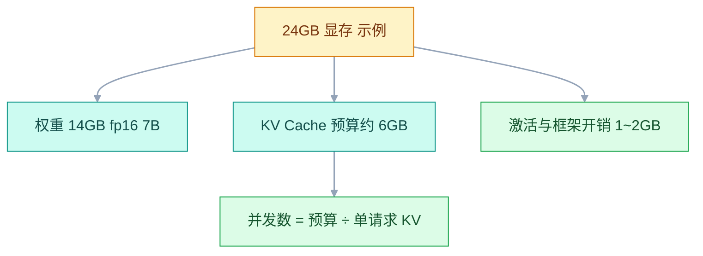
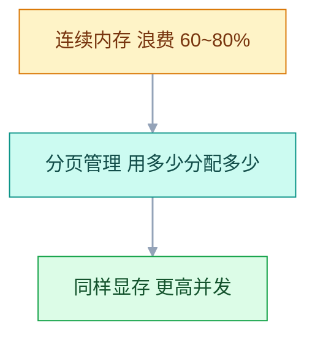

# 模型部署与推理

## 一、工程案例：把一个 7B 级模型部署到单卡 GPU，暴露 OpenAI 兼容 API 并压测

**场景**：手里有一台 24GB 显存的 GPU 服务器（RTX 3090 / 4090 / A10），系统是 Ubuntu 22.04，Docker + NVIDIA Container Toolkit 已就绪。目标是把一个 7B 级指令模型（示例参数：28 层、4 个 KV 头、128 维，与 Qwen2.5-7B 同量级）部署成一个**能被业务调用、能扛并发、延迟可控**的私有化推理服务：

- 单卡跑 7B 模型，显存不 OOM
- 暴露 `/v1/chat/completions` OpenAI 兼容接口
- 压测 50 并发：低负载首 token < 500ms，P95 首 token < 2s，吞吐 > 1000 tok/s
- 健康检查 + 故障自动摘除

**为什么必须做**：调 API 简单，但内网/离线/定制模型场景必须自建；自建不是「装软件」，而是**显存规划 + 并发控制 + 监控告警**的工程。本案例把 7B 模型从零跑起来、压测、验收，所有命令可直接复用。

**动手前确认**：`nvidia-smi` 能看到 GPU；Docker 能 `docker run --gpus all`；本机 8000 端口空闲。

### 1.1 主线（按顺序执行）

```bash
# ① 确认 GPU 与驱动
nvidia-smi                           # 显存 ≥ 24GB，驱动正常
docker run --rm --gpus all nvidia/cuda:12.1.0-base-ubuntu22.04 nvidia-smi

# ② 准备模型目录（示例：7B 级指令模型，约 14GB fp16）
mkdir -p /data/models/7b-instruct
# 下载权重到 /data/models/7b-instruct
# 国内可从 ModelScope 镜像，速度更快

# ③ 用 vLLM 启动服务（以官方当前稳定版为准）
docker run -d --name vllm-qwen \
  --gpus '"device=0"' --ipc=host --restart unless-stopped \
  -p 8000:8000 \
  -v /data/models:/models \
  vllm/vllm-openai:latest \
  --model /models/7b-instruct \
  --served-model-name qwen \
  --host 0.0.0.0 --port 8000 \
  --gpu-memory-utilization 0.9 \
  --max-model-len 8192 \
  --enable-prefix-caching \
  --api-key sk-internal-2026

# ④ 等待启动，查看日志（首次要加载权重 + 做显存 profiling，约 1~3 分钟）
docker logs -f vllm-qwen
# 看到 "Starting vLLM API server" 且 /health 返回 200 即就绪

# ⑤ 验证 API
curl http://localhost:8000/v1/chat/completions \
  -H "Authorization: Bearer sk-internal-2026" \
  -H "Content-Type: application/json" \
  -d '{"model":"qwen","messages":[{"role":"user","content":"你好"}]}'

# ⑥ 压测：把下面脚本存为 benchmark.py，装依赖后运行
pip install -U openai
python benchmark.py
```

```python
# benchmark.py —— 50 并发，统计 QPS / 首 token 延迟(TTFT) / 输出吞吐
import asyncio, time, statistics
from openai import AsyncOpenAI

PROMPT = "请用 100 字左右介绍一下人工智能的发展历史"

async def one_request(client):
    t0 = time.time()
    ttft = None
    out_tokens = 0
    stream = await client.chat.completions.create(
        model="qwen",
        messages=[{"role": "user", "content": PROMPT}],
        max_tokens=200, temperature=0, stream=True,
        stream_options={"include_usage": True},
    )
    async for chunk in stream:
        if chunk.choices and chunk.choices[0].delta.content and ttft is None:
            ttft = time.time() - t0          # 第一个正文 chunk 到达时刻
        if chunk.usage:                       # 末尾 chunk 带 usage
            out_tokens = chunk.usage.completion_tokens
    return ttft, time.time() - t0, out_tokens

async def run(concurrency):
    client = AsyncOpenAI(base_url="http://localhost:8000/v1",
                         api_key="sk-internal-2026", timeout=600)
    t_start = time.time()
    results = await asyncio.gather(
        *[one_request(client) for _ in range(concurrency)],
        return_exceptions=True)
    wall = time.time() - t_start
    ok = [r for r in results if not isinstance(r, Exception) and r[0] is not None]
    if not ok:
        print(f"  并发 {concurrency:3d} | 全部失败")
        return
    ttfts = [r[0] for r in ok]
    p95 = statistics.quantiles(ttfts, n=20)[18] if len(ttfts) > 1 else ttfts[0]
    print(f"  并发 {concurrency:3d} | QPS {len(ok) / wall:6.2f} | "
          f"平均延迟 {statistics.mean(r[1] for r in ok):5.2f}s | "
          f"P95 首token {p95:5.2f}s | "
          f"吞吐 {sum(r[2] for r in ok) / wall:7.1f} tok/s")

async def main():
    for c in [1, 10, 30, 50]:
        await run(c)

asyncio.run(main())
```

**压测结果（示例，以实测为准）**：

| 并发 | QPS | 平均延迟 | P95 首 token | 输出吞吐 tok/s |
|---|---|---|---|---|
| 1 | 0.8 | 1.28 s | 0.09 s | 145 |
| 10 | 4.6 | 2.15 s | 0.35 s | 820 |
| 30 | 7.9 | 3.80 s | 0.90 s | 1400 |
| 50 | 9.3 | 5.35 s | 1.60 s | 1670 |

> 单并发延迟最低但吞吐上不去；并发 50 时吞吐接近饱和，延迟因排队而上升。**QPS ≈ 并发数 ÷ 平均延迟**，所以这张表必须自洽，对不上的数字说明测量口径错了。单卡 7B 的吞吐上限由显存带宽决定（每一步都要把 14GB 权重读一遍），到 50 并发基本到顶，再加并发只会拉长排队。

### 1.2 验收（8 项全过才算交付）

| # | 检查 | 命令 | 通过标准 |
|---|---|---|---|
| 1 | GPU 就绪 | `nvidia-smi` | 显存 ≥ 24GB，驱动正常 |
| 2 | 容器启动 | `docker ps` | vllm-qwen 状态 Up |
| 3 | API 响应 | `curl .../v1/chat/completions` | 返回 JSON，含 `choices[0].message.content` |
| 4 | 健康检查 | `curl -i http://localhost:8000/health` | 返回 HTTP 200（body 为空即正常） |
| 5 | 首 token 延迟 | benchmark.py 并发 1 | P95 首 token < 500ms |
| 6 | 并发承载 | benchmark.py 并发 50 | 全部成功，吞吐 > 1000 tok/s，P95 首 token < 2s |
| 7 | 流式输出 | `curl -N ... -d '{"stream":true,...}'` | 逐块返回 `data: ...` |
| 8 | 显存安全 | 宿主机 `nvidia-smi` | 显存占用 < 92%，无 `preempted` 日志 |

### 1.3 复制到多台

单机部署好了，多机就复制容器。关键是**显存与并发的换算**（怎么算见 3.3）：24GB 卡上 `(可用显存 - 权重 - 开销) / 单请求 KV Cache` ≈ 2048 上下文能同时跑约 50 个请求，8192 上下文只剩约 13 个。多卡装不下时用 `--tensor-parallel-size` 走张量并行（约束见 3.9）。

```bash
# 双卡机器上，把 7B 拆到两张卡（张量并行）
docker run -d --name vllm-qwen \
  --gpus '"device=0,1"' --ipc=host --restart unless-stopped \
  -p 8000:8000 \
  -v /data/models:/models \
  vllm/vllm-openai:latest \
  --model /models/7b-instruct \
  --served-model-name qwen \
  --tensor-parallel-size 2 \
  --max-model-len 8192 --gpu-memory-utilization 0.9 \
  --api-key sk-internal-2026
```

> 单卡 7B 已足够；多卡张量并行主要用于 30B+ 模型。

---

## 二、高频问答：会卡住你的地方，也是面试最常问的

### 2.1 `CUDA out of memory`

**现场**

`docker logs` 看是启动 profiling 阶段挂的（预留不足）还是跑起来后挂的（KV 打满）；`nvidia-smi` 看剩余显存。

```bash
# 收敛上下文长度（最直接）：单请求 KV 上限减半或更多，同显存能容纳的并发变多
--max-model-len 8192
# 降低显存预留比例
--gpu-memory-utilization 0.85
# 用 CUDA Graph 换显存（牺牲一点吞吐）
--enforce-eager
# 换量化模型（权重直接减到 1/4～1/2）
--model /models/7b-instruct-AWQ
```

**要点**

- 先分清是启动就 OOM 还是运行中 OOM，两者解法不同。
- 启动挂多半是 `max-model-len × 并发上限` 的预留超过余量；运行中挂是 KV 真打满了。
- `nvidia-smi` 显示剩余显存不代表能全部分给模型，vLLM 还要留给 CUDA 上下文和 CUDA Graph。

**追问**

- 调低 `gpu-memory-utilization` 有什么用？→ 少预留、给别的进程留余量，但能跑的并发也少了。
- 量化模型为什么更省？→ 权重直接降到 1/4~1/2。
- `--enforce-eager` 的代价？→ 关掉 CUDA Graph，省显存换吞吐。

### 2.2 `--ipc=host` 忘加，容器直接崩

**现场**

`docker logs` 出现 `Bus error`、`No space left on device` 或共享内存报错；`docker exec <容器> df -h /dev/shm` 明显偏小。

```bash
# 必须加 --ipc=host，容器直接用宿主机的 /dev/shm
docker run --gpus all --ipc=host ...
```

**要点**

- 不是 vLLM 有 bug，是容器 `/dev/shm` 默认只有 64MB。
- API 进程与引擎进程靠共享内存传张量，写满就崩。
- 共享内存是硬性要求，不是性能优化。

**追问**

- 怎么确认？→ `docker inspect <container> | grep IpcMode` 应显示 `host`。
- 不用 host 能调大吗？→ 可以调 `--shm-size`，但要估准。
- 为什么表现是 Bus error？→ 映射的共享内存段写不进去。

### 2.3 GPU 在容器里看不见

**现场**

`docker run --rm --gpus all nvidia/cuda:12.1.0-base-ubuntu22.04 nvidia-smi` 报错。

```bash
# 安装 NVIDIA Container Toolkit（nvidia-docker2 已废弃，用官方新源）
distribution=$(. /etc/os-release; echo $ID$VERSION_ID)
curl -fsSL https://nvidia.github.io/libnvidia-container/gpgkey | \
  sudo gpg --dearmor -o /usr/share/keyrings/nvidia-container-toolkit-keyring.gpg
curl -s -L https://nvidia.github.io/libnvidia-container/$distribution/libnvidia-container.list | \
  sed 's#deb https://#deb [signed-by=/usr/share/keyrings/nvidia-container-toolkit-keyring.gpg] https://#g' | \
  sudo tee /etc/apt/sources.list.d/nvidia-container-toolkit.list
sudo apt-get update && sudo apt-get install -y nvidia-container-toolkit
sudo nvidia-ctk runtime configure --runtime=docker   # 写入 /etc/docker/daemon.json
sudo systemctl restart docker
```

**要点**

- 不是 Docker 不支持 GPU，是 NVIDIA Container Toolkit 没装，或 `--gpus` 写法错。
- GPU 可见性是驱动 + Container Toolkit + `--gpus` 三者共同作用的结果。
- `nvidia-docker2` 已废弃，要用官方新源。

**追问**

- 怎么确认 runtime 注册了？→ `docker info | grep -i runtime` 应列出 `nvidia`。
- 驱动和 toolkit 谁先装？→ 先驱动，toolkit 只负责把设备暴露给容器。
- 容器里 `nvidia-smi` 版本和宿主机不同正常吗？→ 正常，容器自带用户态库。

### 2.4 压测并发上去，延迟线性暴涨

**现场**

`curl localhost:8000/metrics | grep cache_usage` 接近 100%；`docker logs` 里出现 `preempted`。

```bash
# 1) 压住单请求 KV 上限（对长上下文请求最有效）
--max-model-len 4096
# 2) 限制同时在跑的序列数：让请求排队，而不是互相抢占重算
--max-num-seqs 32
# 3) 共享系统提示，省掉重复 prefill
--enable-prefix-caching
# 4) 长 prompt 堵住短请求时开启分块 prefill
--enable-chunked-prefill
```

**要点**

- 多半是 KV Cache 打满后的排队与抢占，不是算力不够。
- 先看 `num_requests_waiting` 是否 > 0、`cache_usage` 是否贴 100%。
- 参数调到硬件上限还压不住，才是加卡或加实例。

**追问**

- 抢占为什么更慢？→ 被抢占的请求要重算 prefill。
- 调小 `max-num-seqs` 是变快还是变慢？→ 单请求更稳，总吞吐可能降。
- 什么时候该加机器？→ 参数调完仍排队，且成本可接受。

### 2.5 API 返回 401 / 403

**现场**

`curl` 里 `Authorization: Bearer <key>` 是否匹配。

```bash
# 启动时设置
--api-key sk-internal-2026
# 请求时带上
curl -H "Authorization: Bearer sk-internal-2026" ...
```

**要点**

- 不是 API 崩了，是 `--api-key` 设了但请求没带或带错。
- vLLM 默认不开启鉴权，一旦开启就必须带 key。
- 验证方法是去掉 `--api-key` 重启，看是否恢复。

**追问**

- 401 和 403 有什么区别？→ 一个没认证，一个认证了没权限。
- key 该怎么管？→ 别写进镜像和仓库，走环境变量或密钥管理。
- 多实例 key 要一致吗？→ 网关后面必须一致，否则随机 401。

### 2.6 流式输出一次性返回所有内容

**现场**

浏览器 Network 面板看 `data: ...` 是一条一条来的还是一起到的；`curl -N` 看是否逐块返回。

```nginx
location /v1/ {
    proxy_buffering off;          # 必须加
    proxy_read_timeout 300s;      # 生成可能很久
    proxy_pass http://llm_backend;
}
```

**要点**

- 不是引擎不支持流式，是 Nginx `proxy_buffering on`（默认）把流式缓冲了。
- Nginx 默认缓冲所有代理响应，SSE 必须显式关掉。
- `proxy_read_timeout` 也要放大，默认 60s 长回答会 504。

**追问**

- 不想改 Nginx 配置怎么办？→ 后端加 `X-Accel-Buffering: no` 响应头。
- 还有哪些中间层会缓冲？→ CDN、API 网关、负载均衡都要查。
- 为什么 `curl` 正常、浏览器不正常？→ 浏览器前面还有一层代理或压缩。

### 2.7 端口放行了，外面还是连不上

**现场**

`ss -tunlp | grep 8000` 看监听地址；云控制台看安全组；再从外部 `telnet <IP> 8000`。

```bash
# vLLM 必须监听 0.0.0.0
--host 0.0.0.0
# 云安全组放行 8000
# 主机防火墙放行 8000
sudo ufw allow 8000/tcp
```

**要点**

- 云安全组在网络层，ufw 在主机层，两层都要放行。
- 服务只监听 `127.0.0.1` 时，防火墙开满也进不来。
- vLLM 必须 `--host 0.0.0.0`。

**追问**

- 怎么快速区分是哪一层？→ 本机 `curl` 通、外部不通，就是网络层或监听地址。
- 容器里监听 `0.0.0.0` 就够了吗？→ 还要端口映射和宿主机防火墙。
- `telnet` 不通但 `curl` 通？→ 可能只开了 HTTP，或中间有代理。

### 2.8 模型下载失败或速度极慢

**现场**

`hf download`（旧版 `huggingface-cli`）长时间卡在 0%，或 `docker logs` 里加载权重超时；`curl -o /dev/null -w '%{speed_download}' <URL>` 看实际速率。

```bash
# HF 走国内镜像（默认的 huggingface.co 在境外）
export HF_ENDPOINT=https://hf-mirror.com
export HF_HOME=/data/models
# 新版下载 CLI 是 hf（旧版 huggingface-cli），支持续传
pip install -U "huggingface_hub[hf_transfer]"
hf download Qwen/Qwen2.5-7B-Instruct --local-dir /data/models/7b-instruct
# 或直接用 ModelScope
pip install modelscope
python -c "from modelscope import snapshot_download; \
  snapshot_download('Qwen/Qwen2.5-7B-Instruct', cache_dir='/data/models')"
```

**要点**

- 不是网不好只能等，国内直连 huggingface.co 经常只有几十 KB/s。
- 换 `hf-mirror.com` 或 ModelScope 通常有数量级提升。
- 大文件要支持续传，别每次从头下。

**追问**

- 镜像站的权重和官方一致吗？→ 要校验 hash，别用来源不明的。
- 下到容器里会怎样？→ 容器销毁就丢，必须挂卷。
- 怎么避免重复下载？→ 把 `HF_HOME` 固定到宿主机目录。

### 2.9 量化模型加载报错 `Unknown quantization method`

**现场**

`docker logs` 里出现 `ValueError: Unknown quantization method: xxx`；`docker exec vllm-qwen ls /models/7b-instruct-AWQ` 看文件是否齐全。

```bash
# AWQ / GPTQ：config.json 带 quantization_config 时自动识别，一般不用手写
--model /models/7b-instruct-AWQ
--quantization awq        # 仅在自动识别失败时显式指定
# GGUF：vLLM 只有实验性支持，生产建议交给 llama.cpp / Ollama
```

**要点**

- 不是量化模型坏了，多半是权重目录缺 `quantization_config`。
- vLLM 默认读 `config.json` 里的字段自动识别，报这个错说明字段没了或格式不支持。
- 先 `cat` 一下 config 确认字段，再决定显式传参还是换镜像。

**追问**

- 自己转的模型最容易漏什么？→ 量化配置文件和 tokenizer 文件。
- GGUF 能直接跑吗？→ 只有实验性支持，生产交给 llama.cpp / Ollama。
- 什么时候用 `--quantization`？→ 自动识别失败时，且格式确实受支持。

### 2.10 容器重启后模型丢失

**现场**

`docker exec` 进容器 `ls /root/.cache/huggingface` 是空的；`docker inspect <container> | grep -A5 Mounts` 确认卷挂载。

```bash
# 模型必须挂卷到宿主机
docker run -v /data/models:/models ...
# 或设置 HF 缓存目录
docker run -v ~/.cache/huggingface:/root/.cache/huggingface ...
```

**要点**

- 不是 Docker 有 bug，是模型下载到容器内，容器销毁后就丢了。
- 容器是短暂的，模型文件必须挂卷。
- 缓存目录也要挂，否则每次重启都重新下载。

**追问**

- 挂载会覆盖镜像里的文件吗？→ 会，空目录挂上去原内容就没了。
- 生产怎么放？→ 宿主机固定目录，或对象存储加启动时拉取。
- 多实例共享一份权重行吗？→ 行，只读挂载最省空间。

### 2.11 请求报 404 `The model ... does not exist`

**现场**

`curl -s localhost:8000/v1/models | jq '.data[].id'` 看服务端认哪些名字。

```bash
# 启动时把对外模型名固定下来
--served-model-name qwen
# 请求里必须用同名
curl ... -d '{"model":"qwen","messages":[...]}'
```

**要点**

- 这是 404 不是 500，服务其实好好的。
- 请求里的 `model` 必须等于 `--served-model-name`，没设时是权重目录名。
- 多实例负载均衡时更常见：各实例名字不一致，请求随机落到某个实例才 404。

**追问**

- 单机能通、走网关就 404？→ 后端实例的 `served-model-name` 不统一。
- 改名要重启吗？→ 要，名字是启动参数。
- 客户端写死名字好不好？→ 用统一别名，别写权重目录名。

---

## 三、核心知识：从零开始要建立的东西

### 3.1 推理与部署

**推理（Inference）**：把训练好的模型跑起来，输入文字产出回答，是模型「干活」的阶段。

**部署（Deployment）**：把推理能力变成稳定、可调用、能扛并发的服务——选引擎、配显存、包 API、加监控。


> 部署 ≠ 安装软件。部署 = **显存规划 + 并发控制 + 监控告警** 的工程。

### 3.2 量化

模型权重是一堆小数（`0.0234`、`-1.5678`），fp16 每个占 2 字节。量化就是**把这些数字映射到更小的整数集合里**。

| 精度 | 每参数 | 7B 权重 | 质量 | 适用 |
|---|---|---|---|---|
| FP16 | 2 字节 | 14 GB | 基准 | 显存充足 |
| FP8 | 1 字节 | 7 GB | 接近基准 | H100 / Ada（算力 8.9+） |
| INT8 | 1 字节 | 7 GB | ≈基准 | 显存紧张 |
| INT4 | 0.5 字节 | 3.5 GB | 有小幅损失 | 消费级显卡 |
| INT3 | 0.375 字节 | 2.6 GB | 明显变笨 | 不推荐 |

**GGUF 格式**（llama.cpp / Ollama）：单文件包含权重 + 词表 + 配置，档位命名 `Q<比特数>_<变体>`：

| 档位 | 7B 大小（约） | 质量 | 推荐 |
|---|---|---|---|
| `Q4_K_M` | ~4.1 GB | 好 | 默认 |
| `Q5_K_M` | ~4.8 GB | 很好 | 质量优先 |
| `Q8_0` | ~7.2 GB | 几乎无损 | 显存宽裕 |

**AWQ / GPTQ**（GPU 推理）：

| 格式 | 特点 | 什么时候用 |
|---|---|---|
| AWQ | 质量略好、速度快 | vLLM 首选 |
| GPTQ | 兼容性好 | 兼容性优先 |

> 从 FP16 到 INT4，显存降到约 1/4，多数任务上的质量损失难以察觉——但**数学、代码、长链条推理最容易先崩**，上线前必须用自己的评测集跑一遍。看清名字里的 `W`/`A`：`W4A16` 是权重 4bit、激活 16bit，只省权重显存；**能多装的 KV Cache 才是并发提升的来源**。

### 3.3 显存需求

显存不够是部署时最常见的报错，必须学会自己算。

```text
总显存 ≈ 权重显存 + KV Cache 显存 + 激活/框架开销（约 1~2GB）
```

**权重显存**：`参数量 × 每参数字节数`。7B fp16 = 14GB，INT4 = 3.5GB。

**KV Cache**：每个并发请求、每个 token 都要占显存。

```text
单 token KV Cache = 2 × 层数 × KV头数 × 头维度 × 精度字节数
以示例模型：28 层，4 个 KV 头，128 维，2 字节
= 2 × 28 × 4 × 128 × 2 = 57344 字节 ≈ 56 KB
```

| 序列长度 | 单请求 | 10 并发 | 50 并发 |
|---|---|---|---|
| 2048 | 112 MB | 1.12 GB | 5.6 GB |
| 4096 | 224 MB | 2.24 GB | 11.2 GB |
| 8192 | 448 MB | 4.48 GB | 22.4 GB |

**把表反过来用，就是并发上限**（示例，以实测为准）：

```text
KV 预算 = 24GB × 0.9 - 14GB 权重 - 1.5GB 开销 ≈ 6GB
2048 上下文：6GB ÷ 112MB ≈ 54 并发
8192 上下文：6GB ÷ 448MB ≈ 13 并发   ← 表里 50 并发 × 8192 = 22.4GB，装不下
```



> **24GB 卡跑 7B 到底能撑多少并发，取决于上下文长度**：2048 上下文约 50 并发，8192 上下文只剩约 13 并发，这也正是 2.1 里先改 `max-model-len` 的原因。算完再压测，两边对得上才算规划正确。

> **面试**：常问「24GB 卡跑 7B 能撑多少并发？」答：看上下文长度，2048 约 50 并发，8192 只剩约 13，先算 KV 预算再压测。

### 3.4 KV Cache

模型生成每个 token 时，缓存之前所有 token 的 Key 和 Value 向量。**每个并发请求、每个 token 都要占显存**。

| 影响因素 | 关系 |
|---|---|
| 序列长度 | 线性正比 |
| 并发数 | 线性正比 |
| 模型层数 | 线性正比 |
| KV 头数 | 线性正比 |

**KV Cache 与序列长度的关系**：

```text
max_model_len 从 8192 → 4096：单请求 KV 峰值减半
→ 同样显存能同时容纳的请求数约翻倍（短请求按需分块，实际占用不变）
```

> **降 `max_model_len` 是压 KV 成本最快的一刀**，但它只削「单请求上限」，不改变已经生成的 token 的占用。KV Cache 按 `block_size`（默认 16 token）分块分配，占用一定向上取整到整块。KV Cache 自身也能单独量化：`--kv-cache-dtype fp8` 让 KV 显存直接减半，代价是需要 Hopper/Ada（算力 8.9+）且长上下文下精度略降。

### 3.5 推理引擎

| 框架 | 定位 | 什么时候选 |
|---|---|---|
| llama.cpp | CPU/边缘 | 没有 GPU，或要在笔记本上跑 |
| Ollama | 易用 | 个人开发、本地验证 |
| vLLM | 高并发 | 生产 API 服务 |
| TGI | HF 生态 | 重度 HF 用户（已进入维护模式） |
| SGLang | 极致性能 | 前沿项目、愿意跟版本 |
| TensorRT-LLM | NVIDIA 官方 | 有专职性能工程师 |

> **生产 API 服务默认选 vLLM**：PagedAttention + 连续批处理。官方论文里对比 HF Transformers 朴素实现，吞吐可达 10~24 倍——**这个倍数是跟「没用批处理」比的，不是相对其他推理引擎**。版本与参数以官方当前稳定版为准。

### 3.6 PagedAttention

传统推理里 KV Cache 必须是**连续内存**，而每个请求实际生成长度差异极大，按最大长度连续预留会浪费 60%~80% 显存。

vLLM 把 KV Cache **分块管理**，块之间可以不连续，**用多少分配多少**，浪费 < 4%。



> PagedAttention 优化的是**显存利用率 → 吞吐**，不是降低模型本身的显存需求。7B fp16 权重还是要 14GB。

> **面试**：常问「PagedAttention 解决什么问题？」答：KV Cache 分块、块间可不连续，用多少分配多少，浪费从 60%~80% 降到 4% 以下。

### 3.7 连续批处理

静态批处理必须整批结束才能接下一批，GPU 大量空转；连续批处理下某个请求一完成，新请求立刻插进来无缝执行。

| 批处理方式 | 特点 | 吞吐 |
|---|---|---|
| 静态 | 整批结束才接下一批 | 低，GPU 空转多 |
| 连续 | 请求完成立即插队 | 高（数倍，随负载而定） |

> 连续批处理是 vLLM 高并发的另一个核心机制，**请求完成立即插队**。它提升的是 GPU 时间利用率，代价是显存要同时扛更多在跑序列——所以批处理越激进，KV Cache 越紧张。

> **面试**：常问「连续批处理为什么能提高吞吐？」答：某个请求一完成新请求立刻插进来，GPU 不用等整批结束，时间利用率上去了。

### 3.8 前缀缓存

相同前缀不重复计算：命中缓存的部分直接跳过 prefill。所有请求共享一大段系统提示时，省掉的是**首 token 的等待时间**，生成阶段不受影响。

```bash
# vLLM 开启前缀缓存
--enable-prefix-caching
```

> **长系统提示 / RAG 场景必开**：所有请求共享同一段系统提示，命中率高。代价是缓存块常驻 KV Cache，**命中率低（前缀各不相同）时反而白占显存**。

### 3.9 张量并行

单卡装不下大模型时，用多张卡。vLLM 通过 `--tensor-parallel-size` 控制。

| 场景 | 选择 |
|---|---|
| 7B 单卡 | 1 |
| 30B+ | 2 或更多 |
| 70B（fp16 约 140GB） | 4（A100 80G） |

> 张量并行会降低单卡效率，**7B 不需要**，只有 30B+ 才考虑。硬约束：**`--tensor-parallel-size` 必须能整除注意力头数与 KV 头数**（如 8 头配 3 卡直接启动失败）；卡数取 2 的幂次通常更省心，因为跨卡通信拓扑更规整。

> **面试**：常问「张量并行有什么硬约束？」答：卡数必须整除注意力头数和 KV 头数，7B 单卡够用，30B+ 才考虑。

### 3.10 GPU 环境

CUDA 有三层：应用层（PyTorch/vLLM）→ CUDA Toolkit（随 PyTorch 安装）→ NVIDIA 驱动（宿主机）。

```text
关键规则：
· 驱动版本决定「最高能支持哪个 CUDA 版本」
· CUDA Toolkit 不能超过驱动支持上限
· nvidia-smi 右上角显示的是驱动支持的最高 CUDA 版本，不是已装版本
```

```bash
nvidia-smi                           # 驱动版本 + 支持最高 CUDA
python -c "import torch; print(torch.version.cuda)"  # 实际用 CUDA
```

> **右上角的 CUDA Version 是「驱动能支持的上限」，不是「已经装了什么」**：容器里实际用的 CUDA 运行时由镜像和 wheel 决定（`torch.version.cuda`）。两者对不上时先查驱动下限，而不是重装 CUDA。

### 3.11 Docker GPU

Docker 默认看不到 GPU，必须装 NVIDIA Container Toolkit（安装命令见 2.3）。

```bash
# 验证：容器里能看到卡就算通
docker run --rm --gpus all nvidia/cuda:12.1.0-base-ubuntu22.04 nvidia-smi
docker info | grep -i runtime          # 应出现 nvidia
```

> `--gpus all` 和 `--ipc=host` 都是**必选**参数。忘加 `--ipc=host` 会直接崩溃（见 2.2）。

### 3.12 OpenAI 兼容接口

vLLM、Ollama、TGI 都提供 OpenAI 兼容接口，业务代码只改 `base_url` 和 `model` 即可；FastAPI 写的是服务框架，要自己封这套接口。

```python
from openai import OpenAI
client = OpenAI(base_url="http://localhost:8000/v1", api_key="sk-xxx")
resp = client.chat.completions.create(
    model="qwen",
    messages=[{"role": "user", "content": "你好"}],
)
```

> **OpenAI 兼容的价值**：业务代码不被推理引擎绑架。换 vLLM → Ollama，通常只改 `base_url`、`api_key` 和 `model` 三处（Ollama 的模型名带 tag，如 `qwen2.5:7b`）。

### 3.13 负载均衡

Nginx 负载均衡多个 vLLM 实例：

```nginx
upstream llm_backend {
    least_conn;                       # 别用默认轮询：长请求堆在一台上会雪崩
    server 127.0.0.1:8001 max_fails=3 fail_timeout=30s;
    server 127.0.0.1:8002 max_fails=3 fail_timeout=30s;
    keepalive 64;
}
server {
    listen 80;
    location /v1/ {
        proxy_http_version 1.1;       # keepalive 只在 1.1 生效
        proxy_set_header Connection "";
        proxy_buffering off;          # 流式必加
        proxy_read_timeout 300s;      # 长回答必加
        proxy_pass http://llm_backend;
    }
}
```

| 配置 | 为什么必须 |
|---|---|
| `proxy_buffering off` | 不关 SSE 流式会被缓冲 |
| `proxy_read_timeout 300s` | 默认 60s，长回答会被 504 |
| `proxy_http_version 1.1` | 不加则 keepalive 失效，每个请求重连上游 |
| `least_conn` | 推理请求耗时差 10 倍，轮询会把长请求叠到同一台 |
| `max_fails=3` | 实例连续失败 3 次后摘除，`fail_timeout` 后重新试探 |

> **故障切换验证**：`docker stop vllm-1`，连续 curl 5 次，预期前几次 502/503 后转为 200。注意 `max_fails` 是**被动检查**，故障发现需要几个请求的延迟，要求秒级切流得加主动健康检查（如 `nginx_upstream_check_module` 或外层 LB）。

### 3.14 监控指标

vLLM 原生暴露 Prometheus 指标（`http://localhost:8000/metrics`）。

| 指标 | 含义 | 告警阈值 |
|---|---|---|
| `vllm:num_requests_running` | 正在处理的请求数 | 长期贴着 `max-num-seqs` |
| `vllm:num_requests_waiting` | 排队等待的请求数 | > 10 持续 5 分钟 |
| `vllm:kv_cache_usage_perc` | KV Cache 使用率（旧版叫 `gpu_cache_usage_perc`） | > 92% 告警 |
| `vllm:time_to_first_token_seconds` | 首 token 延迟（直方图） | P95 > 2s 告警 |
| `vllm:request_success_total` | 成功请求计数（带 `finished_reason`） | 结合网关 5xx 算错误率 > 1% |

> **TTFT（首 token 延迟）是用户体感的核心指标**：P95 > 2s 就该扩容。指标名随版本变，**以官方当前稳定版的 `/metrics` 输出为准**——先 `curl` 一遍再写看板，别照抄旧文章。

### 3.15 模型路由

不是所有请求都值得用最贵的模型。假设 70% 请求是简单问题，小模型成本是大模型的 1/10：

```text
路由前：100 次 × 大模型 = 100 单位
路由后：70 × 0.1 + 30 × 1 = 37 单位 → 降 63%
```

```python
import re
GREETING = re.compile(r"^(你好|hi|hello|在吗|谢谢|再见)[\s!。？?]*$", re.I)
SIMPLE_KW = ["几点", "怎么联系", "地址", "营业时间", "退款流程"]

def route(prompt: str) -> str:
    p = prompt.strip()
    if len(p) <= 8 or GREETING.match(p):
        return "small"
    if any(k in p for k in SIMPLE_KW):
        return "small"
    if len(p) > 200 or any(k in p for k in ["分析", "推理", "为什么"]):
        return "large"
    return "small"
```

> **路由的边界**：简单问候/短问题走小模型；需要推理/创作的走大模型。这套规则是关键词 + 长度的启发式，**不是分类器**，必须配兜底：小模型出现拒答、空输出、明显答非所问时自动升级到大模型，并把每次判定打点，用真实流量校准阈值。

### 3.16 成本模型

**同一用量口径（每月 4.2 亿输出 token）下的粗算，示例，单价以厂商当期报价为准**：

| 方案 | 月成本 | 数据出内网 | 运维 |
|---|---|---|---|
| 云 API（7B 级，0.006 元/千 token） | 2520 元 | 是（合规风险） | 无 |
| 云 API（旗舰，0.024 元/千 token） | 10080 元 | 是（合规风险） | 无 |
| 自建 ×2（24GB） | 1890 元 | 否 | 中 |
| 云 GPU 包月（单卡 24GB） | 900 元 | 否 | 中 |

```text
盈亏平衡点（按 0.006 元/千输出 token 的示例单价）：
  云 GPU 900 元/月 ÷ 0.006 元/千输出 token ≈ 1.5 亿输出 token/月
  即每月输出 token 超过约 1.5 亿，自建才开始划算
```

> **量小没必要自建**：每月 100 万输出 token，按示例单价仅 6 元，自建完全不划算。**量大 + 合规 → 自建**。真实成本还要算人力和闲置：卡闲置时钱照付，API 不用不花钱。

---

## 四、冷门知识汇总

| 知识点 | 为什么冷门 | 用到时的关键词 |
|---|---|---|
| FP8 | 需要 Hopper/Ada（算力 8.9+），老卡根本不支持 | `--dtype fp8` |
| GQA KV 头数 | 公式里用 KV 头数，不是注意力头数 | 4（示例模型） |
| Chunked Prefill | 只有长 prompt 堵住短请求时才需要 | `--enable-chunked-prefill` |
| `vllm bench serve` | 官方压测工具，指标比手写脚本全 | `vllm bench serve --num-prompts 200` |
| `--enforce-eager` | 关掉 CUDA Graph 省显存，换吞吐下降 | `--enforce-eager` |
| 云 GPU 关机计费 | 关机后系统盘/数据盘仍在计费 | 释放实例 |
| `host.docker.internal` | Linux 上不存在，容器连宿主机要走网关 IP | `--network=host` |
| `X-Accel-Buffering: no` | 响应头就能让 Nginx 不缓冲，不必改配置 | 后端加响应头 |
| `OLLAMA_KEEP_ALIVE` | 模型常驻显存，避免反复加载 | `24h` |
| `OLLAMA_NUM_PARALLEL` | 同时处理请求数，受显存限制 | `4` |
| `OLLAMA_MAX_LOADED_MODELS` | 同时加载模型数，加载多了必然换入换出 | `2` |
