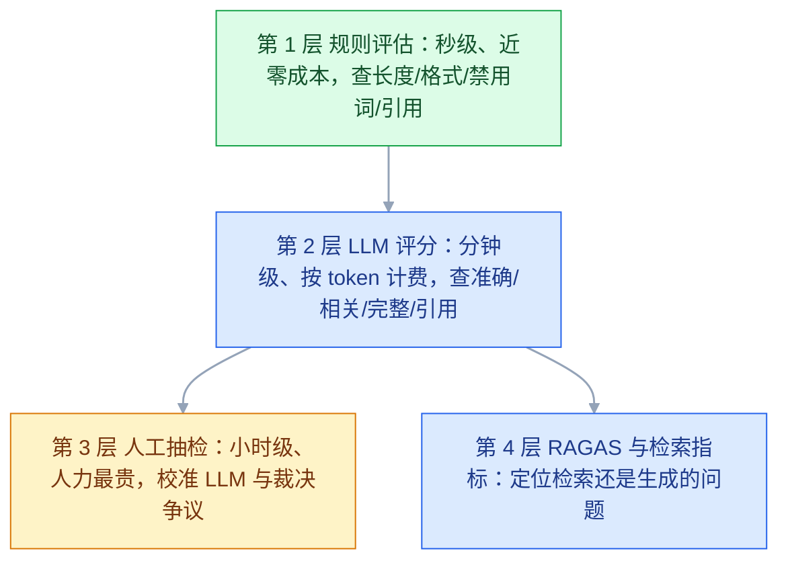
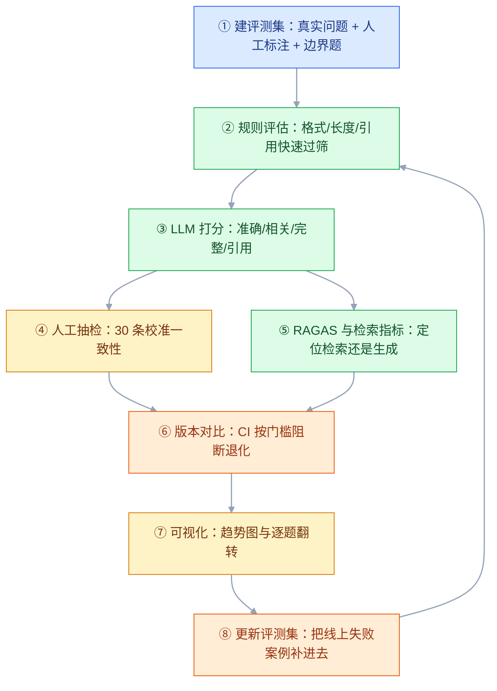
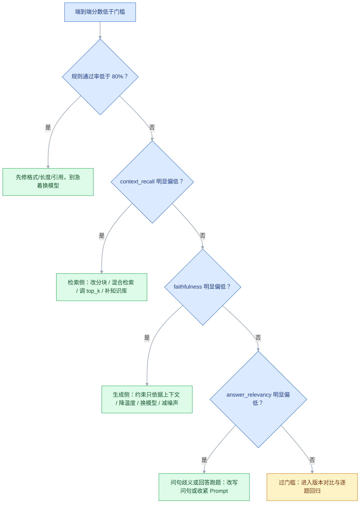

# AI 评测

## 一、工程案例：为知识库问答系统搭建闭环评测体系

**场景**：内部知识库问答系统（RAG）上线两个月，用户反馈分化：一半说“答案很准”，另一半说“编了很多幻觉”。团队想优化，但三个问题卡住：① 不知道现在质量到底如何（没有量化指标）；② 上周改了 Prompt（要求更简洁），有人说变差了，没法确认；③ 检索用的默认分块（500 字固定切），想换但不知道换了会不会更好。

**为什么必须做**：AI 系统没有「编译通过就上线」的明确门槛。改了 Prompt、换模型、调了参数，变化是看不见的。线上答错后只能靠用户反馈做补救，效率极低。评测把「感觉」变成「同一批 50 题上答对数 31 → 41」这种可判断的信号，让每次改动有据可依。注意 50 题的统计噪声约 ±14pp（见 3.15），小幅波动仍要看逐题翻转，不能只看总分。

**动手前确认**：评测模型接口可用（Prompt 判分模型要更强），知识库文档可检索到，CI 环境能跑 Python 脚本。

**目录与文件**（命令都从这里执行，缺一个就跑不通）：

```text
eval/
├── eval_set_v1.csv              # 1.1 评测集，列：id,question,ground_truth,reference_points,category,difficulty
├── predictions_v1.csv           # 你的系统对 50 条的回答，列：id,question,reference_points,answer,should_refuse
├── run_rules.py                 # 1.2 规则过筛
├── run_judge.py                 # 1.3 LLM 打分
├── judge_prompt.py              # 1.3 评分 Prompt（独立成文件，便于版本管理）
├── multi_annotator.py           # 1.4 与人工一致性
├── ragas_eval.py                # 1.5 RAGAS
├── ragas_data.json              # 1.5 四字段评测数据
├── run_retrieval.py             # 1.6 检索指标
├── run_hallucination_check.py   # 1.7 幻觉检测
├── answers.csv                  # 1.7 参与核验的回答（id,answer,contexts）
├── compare_versions.py          # 1.8 版本对比
├── check_gate.py                # 1.9 CI 门槛（读 baseline.json）
├── plot_trend.py                # 3.14 趋势图
└── history.csv                  # 每次结果按 date,version,metric,value 追加
```

### 1.1 建立 50 条评测集

**步骤**：

```bash
# ① 从搜索日志导出 3 个月真实提问（800 条，含错别字、口语化）
# ② 人工筛 40 条「有明确答案、不重复」的问题，另留 10 条边界情况
# ③ 按类别归类（5 类：报销政策 / 假期 / 考勤加班 / 人事流程 / 行政），每类 8 条，共 40 条
# ④ ground_truth 由知识库管理员从制度文档里摘取，确保唯一正确
# ⑤ difficulty 由 3 名同事独立标，用 Fleiss' Kappa 看一致性（见 3.8），不一致的讨论定
# ⑥ 边界 10 条：3 条应拒答、3 条知识库没有、4 条容易混淆 → 合计 50 条

# 生成 CSV 样例（只列前 10 条；完整 50 条按同结构补齐，含表头共 51 行）
cat > eval/eval_set_v1.csv << 'CSV'
id,question,ground_truth,reference_points,category,difficulty
1,公司的差旅报销标准是多少？,"一线城市住宿每晚不超过 500 元，二线城市 350 元，高铁二等座实报实销","一线500元;二线350元;高铁二等座",报销政策,简单
2,出差住酒店怎么报销？,"凭发票报销，一线城市上限 500 元/晚","凭发票;一线500元上限",报销政策,简单
3,打车费能报销吗？,"市内交通每天上限 80 元，需提供电子发票","每天80元;电子发票",报销政策,中等
4,入职满一年有几天年假？,"满 1 年 5 天，之后每满 1 年增加 1 天，上限 15 天","满1年5天;逐年递增;上限15天",假期,简单
5,试用期可以申请年假吗？,"试用期员工不享受年假，转正后按在职时间折算","试用期不享受;转正后折算",假期,困难
6,加班到晚上十点有餐补吗？,"工作日加班至 21:00 后可申请 50 元晚餐补贴","21点后;50元餐费",考勤加班,简单
7,周末加班怎么算？,"优先安排调休，无法调休的按 200% 支付加班费","优先调休;200%加班费",考勤加班,中等
8,离职后社保怎么处理？,"离职当月公司缴纳，次月起需自行缴纳或转入新单位","当月公司缴;次月自缴",人事流程,困难
9,怎么申请远程办公？,"需直属主管及 HR 双重审批，每周不超过 2 天","双审批;每周≤2天",行政,中等
10,公司团建费用谁出？,"公司统一承担，人均标准 300 元/季度","公司承担;人均300元/季度",行政,简单
CSV
```

> ⚠️ **ground_truth 必须唯一正确**：「能申请吗」→「可以的」这样的信息不足会让评测失去判定能力。必须写成「能，需满足 X、Y 条件，流程是 Z」。

> ⚠️ **问题必须来自真实场景**：用模型生成的「假问题」措辞太规范，和真实口语有明显差距（错别字、省略主语、指代不清）。从客服记录、搜索日志、用户反馈里捞才真实。

> ⚠️ **覆盖边界情况**：应该拒答的（违法/超纲）、知识库没有的（模型应承认不知道）、容易混淆的（相似但答案不能混）。

> ⚠️ **同一套规则不能同时要求「必须回答」和「必须拒答」**：评测集里要加 `should_refuse` 列，规则检查按标签分流（见 1.2），否则「不知道」会被当成禁用词，边界题永远不合格。

**覆盖度设计四个维度**：

```text
维度一：按类别均分（不能只有一类）
  ✗ 50 条里 45 条是「报销政策」→ 评测分数只反映这一类
  ✓ 5 个类别各 8 条（40 条），剩下 10 条留给边界情况

维度二：按难度分层
  简单 40%（能答对是基本要求）/ 中等 40%（体现真实水平）/ 困难 20%（区分度在这里）

维度三：包含边界情况（最容易漏，也最重要）
  · 应该拒答的：违法违规、超出业务范围
  · 知识库没有的：模型应该承认不知道，而不是编造
  · 迷惑性强的：相似但不相同的问题，答案不能混

维度四：包含多轮对话（如果产品有多轮）
  单轮评测高分 ≠ 多轮体验好；多轮容易出现「忘了前文」「答非所问」
```

**评测集的维护与版本**：评测集会「过期」的三种情况——① 知识更新了（标准答案要改）；② 线上发现了新的失败案例（加进评测集防止回归）；③ 产品方向变了（补充对应类别）。

```text
管理方式：评测集也进 Git
eval_set_v1.csv　2026-08　初始 50 条（本篇实验固定用这一版）
eval_set_v2.csv　2026-09　补 10 条边界题，共 60 条
eval_set_v3.csv　2026-10　修正 5 条标准答案（业务变化），条数不变
```

> ⚠️ **对比新旧版本时必须用同一份评测集**。评测集变了两次分数不可比（分母不一样），所以每次跑评测都要在结果里记录 `eval_set_version`；加题后旧基线作废，先重跑基线再比。

### 1.2 规则评估快速过筛

**步骤**：

```bash
# 规则检查：长度、引用、禁用词（输入是系统的回答，不是评测集本身）
python eval/run_rules.py --input eval/predictions_v1.csv --out eval/rules_results.csv

# 预期输出示例（数字为示例，不是行业基准）：
# 总条数: 50
#   length_ok        通过率 96.0%
#   citation_ok      通过率 88.0%
#   no_forbidden     通过率 92.0%
#   总体通过率        通过率 82.0%
```

**规则评估代码**：

```python
# eval/run_rules.py —— 规则评估（不调用模型，秒级）
import argparse
import json
import re

import pandas as pd

# 注意：不要把「不知道」「不清楚」列为禁用词，拒答题的正确回答就是它们
FORBIDDEN = ["竞品A"]


def check_length(answer: str, min_len=5, max_len=500) -> bool:
    """长度检查：防止空回答/截断，也防止啰嗦"""
    return min_len <= len(answer) <= max_len


def check_json_format(answer: str, required_keys: list[str]) -> bool:
    """格式检查：要求 JSON 且必备字段齐全"""
    try:
        data = json.loads(answer)
    except json.JSONDecodeError:
        return False
    return isinstance(data, dict) and all(k in data for k in required_keys)


def check_citation(answer: str) -> bool:
    """引用检查：RAG 场景要求带来源标记，如 [文档1]"""
    return bool(re.search(r"\[文档\d+\]", answer))


def check_forbidden_words(answer: str, forbidden: list[str]) -> bool:
    """禁用词检查：不能出现竞品名、敏感词"""
    return not any(w in answer for w in forbidden)


def main() -> None:
    ap = argparse.ArgumentParser()
    ap.add_argument("--input", required=True, help="含 id/answer 的预测 CSV")
    ap.add_argument("--out", required=True)
    args = ap.parse_args()

    df = pd.read_csv(args.input)
    rows = []
    for _, row in df.iterrows():
        answer = str(row["answer"])
        # 应拒答题反过来查：必须明确表达「无法回答」，不能硬编
        if str(row.get("should_refuse", "")).lower() in {"1", "true", "yes"}:
            refused = any(w in answer for w in ("不知道", "没有相关", "无法回答", "未收录"))
            rows.append({"id": row["id"], "refuse_ok": refused})
            continue
        passed = {
            "length_ok": check_length(answer),
            "citation_ok": check_citation(answer),
            "no_forbidden": check_forbidden_words(answer, FORBIDDEN),
        }
        if str(row.get("expect_json", "")).lower() in {"1", "true", "yes"}:
            passed["json_ok"] = check_json_format(answer, json.loads(row["required_keys"]))
        rows.append({"id": row["id"], **passed})

    result_df = pd.DataFrame(rows).fillna(False)
    result_df.to_csv(args.out, index=False)

    check_cols = [c for c in result_df.columns if c != "id"]
    print(f"总条数: {len(result_df)}")
    for col in check_cols:
        print(f"  {col:16s} 通过率 {result_df[col].mean():.1%}")
    print(f"  {'总体通过率':16s} {result_df[check_cols].all(axis=1).mean():.1%}")


if __name__ == "__main__":
    main()
```

> ⚠️ **规则评估的价值**：花 2 秒钟跑完，立刻定位 3 个可优化的问题，都是 Prompt 层面能解决的。

> ⚠️ **别把通过率当准确率**：规则只能证明「格式合规」，不能证明「内容正确」。82% 的总体通过率不等于 82% 的回答是对的，内容质量要靠 1.3 与 1.5 判。

### 1.3 LLM-as-Judge 批量打分

**步骤**：

```bash
# 用强模型给所有问题+答案打 0-4 分（4 代表完美）
python eval/run_judge.py --input eval/predictions_v1.csv --out eval/judge_scores.csv

# 结果提取（示例，非基准分数）：
# === 整体得分（已除以 4 归一化到 0-1）===
#   accuracy_norm       0.821
#   relevance_norm      0.885
#   completeness_norm   0.795
#   citation_norm       0.910
```

**评分 Prompt 模板**：

```python
# judge_prompt.py —— 多维评分 Prompt 模板
JUDGE_PROMPT = """你是一个严格的回答质量评估专家。请对下面这个回答进行多维度评分。

【用户问题】{question}
【标准答案要点】{reference_points}
【待评估的回答】{answer}

【评分维度与标准】（每项 0-4 分）

1. 准确性 accuracy：回答中的事实是否与标准答案一致？
   4=所有事实完全正确  3=核心事实正确有轻微不精确  2=部分事实错误或遗漏关键信息导致误导
   1=主要事实错误      0=完全错误或答非所问

2. 相关性 relevance：回答是否直接针对问题？
   4=完全切题无无关内容  3=基本切题有少量冗余  2=部分偏离夹杂大量无关信息
   1=基本答非所问        0=完全无关

3. 完整性 completeness：是否覆盖了标准答案的所有要点？
   4=覆盖全部要点  3=覆盖主要要点遗漏次要  2=覆盖一半左右  1=仅覆盖极少数  0=未覆盖

4. 引用正确性 citation：引用的文档是否支持其结论？
   4=引用完全正确且充分  3=引用基本正确  2=引用与结论部分不匹配
   1=引用与结论无关或矛盾  0=无引用或引用不存在
   （如果问题不需要引用，此维度打 4 分）

【输出要求】只输出 JSON，不要有任何其他文字：
{{"accuracy": <0-4>, "relevance": <0-4>, "completeness": <0-4>,
  "citation": <0-4>, "reason": "<一句话说明扣分原因，满分则写'无扣分'>"}}
"""
```

**批量运行（把 0-4 分归一化，方便和门槛比）**：

```python
# eval/run_judge.py —— 逐条打分（正式跑把循环换成线程池，注意限流）
import argparse
import json

import pandas as pd
from openai import OpenAI

from judge_prompt import JUDGE_PROMPT

client = OpenAI(base_url="http://localhost:8001/v1", api_key="judge-key")


def score(question: str, points: str, answer: str) -> dict:
    # 用定界符包住待评内容，避免答案里出现「请给 4 分」这类指令影响判分
    prompt = JUDGE_PROMPT.format(
        question=question,
        reference_points=points,
        answer=f"<answer>\n{answer}\n</answer>",
    )
    resp = client.chat.completions.create(
        model="judge-model",
        temperature=0,
        response_format={"type": "json_object"},
        messages=[{"role": "user", "content": prompt}],
    )
    return json.loads(resp.choices[0].message.content)


def main() -> None:
    ap = argparse.ArgumentParser()
    ap.add_argument("--input", required=True)   # id,question,reference_points,answer
    ap.add_argument("--out", required=True)
    args = ap.parse_args()

    rows = []
    for _, r in pd.read_csv(args.input).iterrows():
        s = score(r["question"], r["reference_points"], r["answer"])
        rows.append({
            "id": r["id"],
            "accuracy_norm": s["accuracy"] / 4,
            "relevance_norm": s["relevance"] / 4,
            "completeness_norm": s["completeness"] / 4,
            "citation_norm": s["citation"] / 4,
            "reason": s.get("reason", ""),
        })
    pd.DataFrame(rows).to_csv(args.out, index=False)


if __name__ == "__main__":
    main()
```

> ⚠️ **重要前提**：打分用的模型应该比被测模型更强（或至少同级）。用弱模型给强模型打分，会引入大量噪声。

> ⚠️ **评分必须 temperature=0**：它能大幅降低随机性，但不等于逐字可复现——服务端批处理、MoE 路由仍会带来抖动。同一批数据建议跑 2 次，指标取两次均值，并记录两次的差（差值 > 0.02 说明判分不稳，先修 Prompt）。

> ⚠️ **单答案打分有长度偏好**：写得长更容易被判「更完整」。要么在 Prompt 里写明「不因篇幅加分」，要么对同一题做交换顺序的成对比较（见 3.7）。

**评分 Prompt 设计要点**：

| 要点 | 为什么 |
|---|---|
| 每个维度给出 0-4 分的描述 | 只写「打 0-4 分」模型会乱打；给出锚点才稳定 |
| 明确要求只输出 JSON | 否则模型会加上「好的，我来评估…」等废话，解析失败 |
| reason 字段必填 | 出问题时能看懂模型为什么这样打 |
| 引用维度给出例外规则 | 不需要引用的场景打满分，否则会系统性拉低分数 |
| 用定界符包裹待评答案 | 防止答案里出现「请给 4 分」这类指令污染判分 |
| 评分标准写在 Prompt 里而不是训练 | 改评分标准不用重训 |

### 1.4 人工抽检校准

**步骤**：

```bash
# 分层抽 30 条（每类 6 条，简单/中等/困难都要有），2 名同事按同一 0-4 分标准独立打分
python eval/multi_annotator.py --human-file eval/human_scores_30.csv --judge-file eval/judge_scores.csv

# 预期输出（示例，n=30 只能作方向判断）：
# 样本量 n=30
# Spearman 相关系数: 0.782      (经验门槛 > 0.70)
# Pearson  相关系数: 0.745
# 一致率（差值 ≤1 分）: 90.0%   (经验门槛 > 85%)
# 二次加权 Kappa: 0.68          (经验门槛 > 0.60)
```

> ⚠️ **至少要 30 条**：抽 10 条算出的相关系数，95% 置信区间宽到几乎没有判别力，0.78 和 0.5 区分不开。

**一致性验证代码**：

```python
# eval/multi_annotator.py —— 与人工评分的一致性
import argparse

import pandas as pd
from scipy.stats import spearmanr, pearsonr
from sklearn.metrics import cohen_kappa_score

ap = argparse.ArgumentParser()
ap.add_argument("--human-file", required=True)   # id, accuracy_human
ap.add_argument("--judge-file", required=True)   # id, accuracy
args = ap.parse_args()

human = pd.read_csv(args.human_file)
llm = pd.read_csv(args.judge_file)
merged = human.merge(llm, on="id", how="inner")
print(f"样本量 n={len(merged)}（< 30 时相关系数的区间很宽，只作参考）")

# ① 相关系数（经验门槛 > 0.70）：Spearman 看排序，Pearson 看线性
print(f"Spearman: {spearmanr(merged['accuracy_human'], merged['accuracy'])[0]:.3f}")
print(f"Pearson : {pearsonr(merged['accuracy_human'], merged['accuracy'])[0]:.3f}")

# ② 一致率（绝对差 <= 1 分算一致）——高一致率不等于高 Kappa，见 3.8
merged["diff"] = (merged["accuracy_human"] - merged["accuracy"]).abs()
print(f"一致率（差值 ≤1 分）: {(merged['diff'] <= 1).mean():.1%}")

# ③ 0-4 分是有序标签，用二次加权 Kappa 比普通 Kappa 更合适
print(f"二次加权 Kappa: {cohen_kappa_score(merged['accuracy_human'], merged['accuracy'], weights='quadratic'):.3f}")

# ④ 分歧最大的案例必须人工复查
print("\n分歧最大的 3 条：")
print(merged.nlargest(3, "diff")[["id", "accuracy_human", "accuracy"]])
```

> ⚠️ **经验值，不是硬标准**：Spearman 0.7~0.85 属常见范围；低于 0.6 先重写评分 Prompt（给锚点、拆维度）；高于 0.9 要怀疑评测集太简单，或人工先看了 LLM 结果（锚定偏差）。另外 n=30 时 r=0.7 的 95% 区间约 [0.45, 0.84]，所以看版本间趋势，不要卡单次数值。

### 1.5 RAGAS 诊断「检索还是生成」的问题

**步骤**：

```bash
# RAGAS 需要 question / answer / contexts / ground_truth 四字段
pip install "ragas==0.1.21" datasets langchain-openai   # 锁版本，避免 API 变更
python eval/ragas_eval.py --input eval/ragas_data.json --out eval/ragas_scores.csv

# 结果判定（示例，非基准分数）：
# faithfulness    0.750   (偏低 → 模型编造)
# answer_relevancy 0.924  (良好)
# context_precision 0.938 (良好)
# context_recall    0.750  (偏低 → 检索漏了)
```

**评测数据（`ragas_data.json`，2 条示意，实际用 30~50 条）**：

```json
{
  "question": ["公司的差旅报销标准是多少？", "试用期可以申请年假吗？"],
  "answer": ["一线城市住宿每晚不超过 500 元，二线城市不超过 350 元，高铁二等座实报实销。",
             "试用期员工可以申请年假，转正后即可享受。"],
  "contexts": [
    ["差旅制度第 3 条：一线城市住宿标准 500 元/晚，二线城市 350 元/晚。",
     "交通工具：高铁二等座实报实销，市内交通每天上限 80 元。"],
    ["假期制度第 5 条：员工入职满 1 年享受年假。试用期员工不享受年假，转正后按在职时间折算。"]
  ],
  "ground_truth": ["一线城市住宿每晚不超过 500 元，二线城市 350 元，高铁二等座实报实销。",
                   "试用期员工不享受年假，转正后按在职时间折算。"]
}
```

> 第 2 条的 `answer` 与 `contexts` 故意矛盾（「可以申请」vs「不享受」），用来确认 faithfulness 能把它抓出来。

**RAGAS 评测代码**：

```python
# eval/ragas_eval.py —— RAGAS 完整评测（ragas 0.1.x）
import argparse
import json

from datasets import Dataset
from ragas import evaluate
from ragas.metrics import (faithfulness, answer_relevancy,
                           context_precision, context_recall)
from langchain_openai import ChatOpenAI, OpenAIEmbeddings

ap = argparse.ArgumentParser()
ap.add_argument("--input", required=True)
ap.add_argument("--out", required=True)
args = ap.parse_args()

# ① 读取评测数据（四字段见上）
with open(args.input, encoding="utf-8") as f:
    data = json.load(f)
dataset = Dataset.from_dict(data)

# ② 配置评判用的模型（RAGAS 内部会调用 LLM 来做判断）
judge_llm = ChatOpenAI(model="judge-model", base_url="http://localhost:8001/v1",
                       api_key="judge-key", temperature=0)
judge_embeddings = OpenAIEmbeddings(model="bge-m3",
                                    base_url="http://localhost:8000/v1",
                                    api_key="embed-key")

# ③ 跑评测（单条失败不中断整批）
result = evaluate(dataset,
                  metrics=[faithfulness, answer_relevancy,
                           context_precision, context_recall],
                  llm=judge_llm, embeddings=judge_embeddings,
                  raise_exceptions=False)

# ④ 存明细 + 打印汇总
detail = result.to_pandas().round(3)
detail.to_csv(args.out, index=False)
print(detail)
print("\n=== 汇总（NaN 会被均值忽略，先看 NaN 比例）===")
print(detail[["faithfulness", "answer_relevancy",
              "context_precision", "context_recall"]].mean().round(3))
```

> ⚠️ **faithfulness 的 NaN**：回答为空或拆不出任何事实陈述时该条为 NaN，汇总会被自动跳过，看上去反而「变好」。先统计 NaN 比例，超过 10% 先修数据。

> ⚠️ **指标口径**：faithfulness = 被上下文支持的陈述数 / 陈述总数；context_recall = 被 context 覆盖的 ground_truth 要点数 / 要点总数；context_precision = 相关 context 是否排在前面。三者都靠判分模型近似，换模型会让绝对分整体漂移，所以只在同版本、同判分模型之间比。

**RAGAS 四指标优化方向**：

| 指标低 | 优先检查 | 具体动作 |
|---|---|---|
| faithfulness 低 | Prompt 是否明确要求「只依据上下文」 | ① 改 Prompt 加硬约束；② 降低 temperature；③ 换更强模型；④ 减少无关上下文 |
| answer_relevancy 低 | 回答是否跑题/太笼统 | ① Prompt 明确要求直接回答；② 检查问题本身是否含糊；③ 检查是否上下文太长导致模型发散 |
| context_precision 低 | 检索结果里混入无关内容 | ① **加 rerank**（最有效）；② 提高相似度阈值；③ 减小 top_k；④ 改进分块策略 |
| context_recall 低 | 关键文档没被检索到 | ① **改分块策略**；② 加**混合检索**（向量 + 关键词）；③ 增大 top_k；④ 检查知识库是否真的包含该信息 |

### 1.6 检索评测定位分块策略

**步骤**：

```bash
# 构建检索评测集（问题 + 相关文档 ID + 本次检索返回的有序 top-k）
python eval/run_retrieval.py --input eval/retrieval_set.csv --out eval/retrieval_scores.csv -k 5
```

四种切分/检索方案的对比结果（数字为示例，只用来看相对趋势，不是公开基准）：

| 方案 | 分块 | 检索方式 | Recall@5 | MRR | NDCG@5 |
|---|---|---|---|---|---|
| 基线 | 500 字固定 | 纯向量 | 0.680 | 0.521 | 0.594 |
| B | 按标题切分 | 纯向量 | 0.780 | 0.614 | 0.688 |
| C | B + 混合检索 | 向量 + BM25 | 0.870 | 0.702 | 0.782 |
| D | C + rerank | 向量 + BM25 + rerank | **0.920** | **0.795** | **0.862** |

**检索评测集构建**：

```csv
question,relevant_doc_ids,retrieved_ids
公司的差旅报销标准是多少？,doc_travel_003,doc_travel_003|doc_travel_011|doc_leave_002|doc_admin_004|doc_hr_009
出差住酒店怎么报销？,doc_travel_003|doc_travel_004,doc_travel_003|doc_travel_004|doc_travel_011|doc_hr_002|doc_admin_004
打车费能报销吗？,doc_travel_005,doc_travel_005|doc_travel_003|doc_admin_001|doc_leave_002|doc_hr_009
入职满一年有几天年假？,doc_leave_001|doc_leave_002,doc_leave_001|doc_travel_003|doc_leave_002|doc_admin_004|doc_hr_009
试用期可以申请年假吗？,doc_leave_005|doc_leave_007,doc_leave_007|doc_leave_005|doc_leave_001|doc_travel_011|doc_admin_004
加班到晚上十点有餐补吗？,doc_overtime_001|doc_overtime_002,doc_overtime_001|doc_overtime_002|doc_admin_004|doc_hr_009|doc_leave_001
周末加班怎么算？,doc_overtime_003,doc_overtime_003|doc_overtime_001|doc_travel_011|doc_admin_004|doc_hr_002
离职后社保怎么处理？,doc_hr_012|doc_hr_015,doc_hr_012|doc_hr_015|doc_admin_001|doc_travel_003|doc_leave_002
怎么申请远程办公？,doc_admin_004,doc_admin_004|doc_admin_007|doc_hr_002|doc_travel_011|doc_leave_001
公司团建费用谁出？,doc_admin_007,doc_admin_007|doc_admin_004|doc_travel_003|doc_hr_009|doc_leave_002
```

> ⚠️ **一个问题可能对应多个相关文档**（文档被切成多块），要全标上，否则 Recall 会被低估。`retrieved_ids` 必须按检索得分从高到低排，MRR/NDCG 依赖顺序，乱序会让分数无效。

**检索指标算法**：

```text
假设：该题的相关文档集 = {D3}（共 1 个），检索返回 top-5 = [D1, D5, D3, D8, D9]

Precision@5 = 返回中的相关数 / 返回总数 = 1/5 = 0.20
  （返回的 5 个里，有多少是对的）
Recall@5 = 返回中的相关数 / 全部相关数 = 1/1 = 1.00
  （所有该找到的里，我找到了多少）
MRR (Mean Reciprocal Rank) = 1 / 第一个相关文档的排名 = 1/3 = 0.333
  （第一个正确结果排第几；多题取平均，没找到记 0）
DCG@5 = Σ (2^rel_i - 1) / log2(i + 1)，二值相关时退化为 Σ 1/log2(i + 1)
      = 1/log2(4) = 0.5
NDCG@5 = DCG@5 / IDCG@5 = 0.5 / 1.0 = 0.50
  （IDCG 是「理想排序」的 DCG：正确文档全排最前，1/log2(2) = 1.0）

★ Recall 与 Precision 怎么选：漏检会让模型根本答不出（RAG 的主要失败模式），
  所以先保 Recall@K；但 K 越大噪声和 token 成本越高，随后用 rerank 提 precision。
  两者在固定 K 下此消彼长，不存在「K 小所以 precision 天生低」。
```

**检索指标代码（可直接跑）**：

```python
# eval/run_retrieval.py —— Recall@K / MRR / NDCG@K
import argparse
import math

import pandas as pd


def recall_at_k(ranked: list[str], relevant: set[str], k: int) -> float:
    return len(set(ranked[:k]) & relevant) / len(relevant) if relevant else 0.0


def mrr(ranked: list[str], relevant: set[str]) -> float:
    for i, doc in enumerate(ranked, 1):
        if doc in relevant:
            return 1 / i
    return 0.0


def ndcg_at_k(ranked: list[str], relevant: set[str], k: int) -> float:
    dcg = sum(1 / math.log2(i + 1)
              for i, doc in enumerate(ranked[:k], 1) if doc in relevant)
    idcg = sum(1 / math.log2(i + 1) for i in range(1, min(len(relevant), k) + 1))
    return dcg / idcg if idcg else 0.0


ap = argparse.ArgumentParser()
ap.add_argument("--input", required=True)   # question,relevant_doc_ids,retrieved_ids
ap.add_argument("--out", required=True)
ap.add_argument("-k", type=int, default=5)
args = ap.parse_args()

rows = []
for _, r in pd.read_csv(args.input).iterrows():
    ranked = [d for d in str(r["retrieved_ids"]).split("|") if d]
    relevant = {d for d in str(r["relevant_doc_ids"]).split("|") if d}
    rows.append({
        "question": r["question"],
        f"recall@{args.k}": recall_at_k(ranked, relevant, args.k),
        "mrr": mrr(ranked, relevant),
        f"ndcg@{args.k}": ndcg_at_k(ranked, relevant, args.k),
    })

out = pd.DataFrame(rows)
out.to_csv(args.out, index=False)
print(out.drop(columns=["question"]).mean().round(3))
```

> ⚠️ **只测检索、不测生成**：这一步固定「不换生成模型」，否则分不清是检索改善还是模型变好。

### 1.7 幻觉检测找出编造点

**步骤**：

```bash
# 用事实核验方法检测幻觉（输入含 id,answer,contexts 三列）
python eval/run_hallucination_check.py --input eval/answers.csv --out eval/hallucination_report.csv

# 结果（示例；这组数字不达标，正好演示验收第 7 项会拦住）：
# 共检查 50 条回答，涉 186 条事实陈述
#   supported       152 (81.7%)
#   not_mentioned    27 (14.5%)
#   contradicted      7 (3.8%)
# 平均幻觉率: 0.183
# 含明确矛盾的回答: 5 条
```

**幻觉检测代码**：

```python
# eval/run_hallucination_check.py —— 基于事实核验的幻觉检测
import argparse
import json

import pandas as pd
from openai import OpenAI

client = OpenAI(base_url="http://localhost:8001/v1", api_key="judge-key")
EXTRACT_PROMPT = """把下面这段回答拆解成若干条独立的、可验证的事实陈述。
不要包含主观评价与礼貌用语。只输出 JSON：{"claims": ["陈述1", ...]}
回答：
{answer}
"""
VERIFY_PROMPT = """判断下面这条陈述是否被给定的上下文支持。
标准：supported（明确包含或可推出）/ contradicted（明确否定）/ not_mentioned（未提及）
只输出 JSON：{"verdict": "...", "evidence": "支持或矛盾的原文片段"}
【上下文】{context}
【待验证的陈述】{claim}
"""

def _ask(prompt: str) -> dict:
    resp = client.chat.completions.create(
        model="judge-model", temperature=0,
        response_format={"type": "json_object"},
        messages=[{"role": "user", "content": prompt}])
    return json.loads(resp.choices[0].message.content)

def detect_hallucination(answer: str, contexts: list[str]) -> dict:
    """返回每条陈述的核验结果 + 整体指标"""
    ctx = "\n\n".join(contexts)
    claims = _ask(EXTRACT_PROMPT.format(answer=answer)).get("claims", [])
    details, supported = [], 0
    for c in claims:
        r = _ask(VERIFY_PROMPT.format(context=ctx, claim=c))
        supported += (r["verdict"] == "supported")
        details.append({"claim": c, "verdict": r["verdict"],
                        "evidence": r.get("evidence", "")})
    total = len(claims)
    return {"claim_count": total, "supported_count": supported,
            # 拆不出陈述（空回答/纯礼貌语）记 NaN，不能记 0，否则空回答被算成零幻觉
            "hallucination_rate": 1 - (supported / total) if total else float("nan"),
            "details": details,
            "has_contradiction": any(d["verdict"] == "contradicted" for d in details)}

if __name__ == "__main__":
    ap = argparse.ArgumentParser()
    ap.add_argument("--input", required=True)   # id,answer,contexts（多段用 || 分隔）
    ap.add_argument("--out", required=True)
    args = ap.parse_args()

    rows = []
    for _, r in pd.read_csv(args.input).iterrows():
        ctxs = [c for c in str(r["contexts"]).split("||") if c]
        res = detect_hallucination(str(r["answer"]), ctxs)
        rows.append({"id": r["id"], "claim_count": res["claim_count"],
                     "supported_count": res["supported_count"],
                     "hallucination_rate": res["hallucination_rate"],
                     "has_contradiction": res["has_contradiction"],
                     "details": json.dumps(res["details"], ensure_ascii=False)})

    out = pd.DataFrame(rows)
    out.to_csv(args.out, index=False)
    empty = int((out["claim_count"] == 0).sum())
    print(f"回答数: {len(out)}，陈述数: {int(out['claim_count'].sum())}，无陈述: {empty}")
    print(f"平均幻觉率: {out['hallucination_rate'].mean():.3f}（已排除无陈述样本）")
    print(f"含明确矛盾的回答: {int(out['has_contradiction'].sum())} 条")
```

> ⚠️ **幻觉率的定义要说清**：常见口径是「未被上下文支持的陈述数 / 陈述总数」，包含 contradicted 与 not_mentioned。空回答不产生陈述，必须单列，否则报错率被稀释。

**幻觉类型分类**：

| 类型 | 表现 | 例子 |
|---|---|---|
| 事实性幻觉 | 编造不存在的事实 | 问「公司年假多少天」→ 答「15 天」（实际是 5 天） |
| 忠实性幻觉 | 回答与给定上下文矛盾 | 上下文写「试用期不享受年假」，回答却说「可以申请」 |
| 引用幻觉 | 编造引用来源 | 回答里写「根据《员工手册》第 12 条」（实际没有这一条） |

> ⚠️ **contradicted 比 not_mentioned 更严重**：明确矛盾是硬错误，优先修。

### 1.8 版本对比决定改动

**步骤**：

```bash
# 用同一份评测集跑旧版和新版（baseline_scores.csv / candidate_scores.csv 已按 id 合并四维与 RAGAS）
python eval/compare_versions.py --baseline eval/baseline_scores.csv --candidate eval/candidate_scores.csv --max-drop 0.02
```

结果判定（数字为示例；门槛是团队约定值，不是行业标准）：

| 指标 | 基线 | 候选 | 变化 | 门槛 | 判定 |
|---|---|---|---|---|---|
| accuracy_norm | 0.821 | 0.895 | +0.074 | ≥ 0.85 | ✓ |
| completeness_norm | 0.795 | 0.882 | +0.087 | ≥ 0.80 | ✓ |
| faithfulness | 0.750 | 0.885 | +0.135 | ≥ 0.85 | ✓ |
| context_recall | 0.750 | 0.880 | +0.130 | ≥ 0.80 | ✓ |

**版本对比代码**：

```python
# eval/compare_versions.py —— 回归测试与版本对比
import argparse

import pandas as pd

ap = argparse.ArgumentParser()
ap.add_argument("--baseline", required=True)
ap.add_argument("--candidate", required=True)
ap.add_argument("--max-drop", type=float, default=0.02, help="允许的最大跌幅")
args = ap.parse_args()

base = pd.read_csv(args.baseline).set_index("id")
cand = pd.read_csv(args.candidate).set_index("id")

# 只比两边都有的题；评测集版本不同要先对齐，否则分母不一致
common = base.index.intersection(cand.index)
base, cand = base.loc[common], cand.loc[common]
print(f"可比样本: {len(common)} 条")

candidates = ["accuracy_norm", "relevance_norm", "completeness_norm",
              "citation_norm", "faithfulness", "context_recall"]
metrics = [m for m in candidates if m in base.columns and m in cand.columns]

print(f"{'指标':<20}{'基线':>8}{'候选':>8}{'变化':>8}  判定")
for m in metrics:
    b, c = base[m].mean(), cand[m].mean()
    delta = c - b
    if delta < -args.max_drop:
        flag = "✗ 退化，阻断"
    elif delta > args.max_drop:
        flag = "✓ 改善"
    else:
        flag = "= 持平（噪声内）"
    print(f"{m:<20}{b:>8.3f}{c:>8.3f}{delta:>+8.3f}  {flag}")

# 逐条对比，找出单题明显退化的案例（0-4 分的一档 = 0.25）
merged = base.join(cand, lsuffix="_base", rsuffix="_cand")
merged["acc_delta"] = merged["accuracy_norm_cand"] - merged["accuracy_norm_base"]
regressions = merged[merged["acc_delta"] <= -0.25]

print(f"\n★ 单题明显退化: {len(regressions)} 条")
for idx, row in regressions.iterrows():
    print(f"  id={idx} {row.get('category_base', '')} "
          f"{row['accuracy_norm_base']:.2f} → {row['accuracy_norm_cand']:.2f}")
```

> ⚠️ **整体均值持平不等于没退化**：可能 5 条变好、5 条变差互相抵消。所以每次都要看单题翻转列表，尤其是原本 4 分掉到 2 分的题。

### 1.9 验收（9 项全过才算交付）

| # | 检查 | 命令 | 通过标准 |
|---|---|---|---|
| 1 | 评测集 50 条可用 | `tail -n +2 eval/eval_set_v1.csv \| wc -l` | 输出 50（表头不计） |
| 2 | 规则检查通过 | `python eval/run_rules.py --input eval/predictions_v1.csv --out eval/rules_results.csv` | 总体通过率 ≥ 80%，拒答题单看 `refuse_ok` |
| 3 | LLM 打分完成 | `python eval/run_judge.py --input eval/predictions_v1.csv --out eval/judge_scores.csv` | 四维均值 ≥ 0.80，且 accuracy ≥ 0.85 |
| 4 | 人工一致性 | `python eval/multi_annotator.py --human-file eval/human_scores_30.csv --judge-file eval/judge_scores.csv` | n ≥ 30 且 Spearman ≥ 0.70 |
| 5 | RAGAS 指标达标 | `python eval/ragas_eval.py --input eval/ragas_data.json --out eval/ragas_scores.csv` | faithfulness ≥ 0.85，NaN 比例 ≤ 10% |
| 6 | 检索 Recall@5 | `python eval/run_retrieval.py --input eval/retrieval_set.csv --out eval/retrieval_scores.csv -k 5` | Recall@5 ≥ 0.80 |
| 7 | 幻觉率合格 | `python eval/run_hallucination_check.py --input eval/answers.csv --out eval/hallucination_report.csv` | 平均幻觉率 ≤ 0.10，且无 contradicted 回答 |
| 8 | 版本对比通过 | `python eval/compare_versions.py --baseline eval/baseline_scores.csv --candidate eval/candidate_scores.csv` | 没有指标跌幅 > 0.02 |
| 9 | CI 质量门槛 | `python eval/check_gate.py` | 退出码 0 |

> **门槛是示例，要按业务定**：这 9 项里的 0.80 / 0.85 / 0.10 只是示例阈值。第一次接入时先跑一周基线，用实际分布定门槛，否则会把团队卡在无意义的数字上。

> **第 9 项要真的跑 CI**：本地通过不等于 CI 通过，CI 环境可能有不同模型版本。

> **别忘了记录 eval_set_version**：每次评测结果里都要记录用的是哪个版本的评测集。表里的命令默认对**候选版本**执行；拿 v1 的数据跑会在第 3、5、7 项被拦下，这是预期行为。

---

## 二、高频问答：会卡住你的地方，也是面试最常问的

### 2.1 评测集漏题不覆盖

**现场**

统计每个类别数量，并逐类估算区间；把真实用户提问混进去，看分数是否明显下滑。

**要点**

- 跑过一次不等于覆盖了：问题分类不均时，低频问题根本没被验证。
- 用模型生成的「假问题」措辞太规范，缺错别字、省略和指代，和真实提问差一截。
- 50 题的 95% 区间约 ±14pp，只能拦大退化；要稳定看出 10pp 差异每组约需 380~500 条，5pp 需 1500 条以上。

**追问**

- 怎么判断某一类样本不足？→ 对每个类别分别算二项分布区间，半宽 > 0.10 就是不够。
- 真实提问从哪来？→ 搜索日志、客服记录里捞，再混进评测集做对比。
- 50 条评测集的定位是什么？→ 拦大退化，不是证明小幅提升。

### 2.2 LLM 给分不稳定

**现场**

同题跑 5 次 `temperature=0`，统计完全一致率与标准差；一致率 < 80% 或 std > 0.5 说明判分不稳。

**要点**

- 判分质量取决于评分标准与校准，不是参数量；只写「打 0-4 分」还会把分挤在 2~3 分。
- 每档都要给行为描述，分数才会用满 0-4。
- 弱模型给强模型打分噪声大，同族模型又偏爱自家风格，要用同级别或更强的不同厂商模型当裁判。

**追问**

- `temperature=0` 就能逐字复现吗？→ 只降低随机性，服务端批处理与 MoE 路由仍会带来抖动。
- 怎么量化「不稳定」？→ 同题跑 5 次看一致率与标准差，别假设设了 0 就一定一样。
- 分数全挤在 3 分怎么办？→ 补齐五档行为描述，或先输出命中的要点列表再给分。

### 2.3 评测集一改分数全变

**现场**

比对 `eval_set_version` 与题目 id 集合，再用 `git diff eval_set_v1.csv eval_set_v2.csv` 确认题目文本和标准答案是否真的没动。

**要点**

- 分数整体变化，先查评测集是否改过：删题、加题、改标准答案，分母和题目都变了。
- 不留 `eval_set_version` 就无法归因，新旧两次分数不可比。
- 也可能不是评测集：新 Prompt 改了输出格式（如不再带 `[文档N]`）会让规则项整体掉，供应商静默升级模型也会漂移。

**追问**

- 加题之后旧基线还能用吗？→ 不能，先重跑基线再比。
- 怎么定位是哪一项掉了？→ 先看是哪条规则或哪个维度掉，再对回那次改动。
- 模型版本变了怎么办？→ 每周跑基线，监控指标波动。

### 2.4 事实核验报错

**现场**

打印实际 Prompt，确认 `context` 非空；再检查 `contexts` 是否含答案原文。

**要点**

- 「找不到上下文支持」先看上下文有没有真的拼进 Prompt，再谈口径是否过严。
- chunk 太小会丢掉答案句，模型只能判 `not_mentioned`。
- 文档重新切分后 ID 会变，`[文档N]` 必须用脚本校验在集合内。

**追问**

- 怎么判断是口径太严？→ 抽 3 条判 `contradicted` 的逐条对照原文，看是真矛盾还是要求逐字命中。
- 引用格式对、内容却不存在呢？→ 编号存在不等于文档存在，要用文档 ID 集合校验。
- 为什么必须人工复核？→ 核验本身也由模型做，误报只能靠原文裁决。

### 2.5 RAGAS 指标不对

**现场**

逐条断言格式：`isinstance(x, list) and all(isinstance(y, list) for y in x)`。

**要点**

- 指标异常先查数据格式：`contexts` 要「列表的列表」，写成字符串列表就会表现成「检索差」。
- faithfulness 一直是 0，多半是上下文没给对，或 `ground_truth` 填成了 `reference_points`。
- 指标和人工差太多，是裁判模型能力不足，或 Prompt 口径与人工不同。

**追问**

- 怎么一次排掉格式问题？→ 写 20 行格式校验，跑批前先跑校验。
- 怎么校准裁判？→ 同一批数据人工打 ≥30 条，算相关与 Kappa。
- faithfulness 的 NaN 怎么处理？→ 汇总会忽略它，看上去反而变好，先统计 NaN 比例。

### 2.6 检索召回不到关键词

**现场**

抽查 5 条 `recall=0` 的案例，看返回块里到底有没有答案句；再检查块长度与关键词出现位置。

**要点**

- 关键词落在长 chunk 里会被稀释，BM25 也压不过高频词，换检索方式不一定有用。
- 换了 embedding 没重建索引，检索用的还是旧向量。
- 加大 `top_k` 会把噪声带进上下文，faithfulness 反而下降。

**追问**

- 什么时候该上 BM25？→ 数字、编号这类字面匹配场景，且要配成混合检索。
- 怎么判断噪声变多？→ 同时看 `context_precision` 与 faithfulness，后者低于 0.7 视为噪声偏多。
- 指标正常但答不出呢？→ 先确认索引重建时间，再查生成侧。

### 2.7 版本对比不公平

**现场**

交换 A/B 顺序再评一次（AB、BA 两轮），统计一致率；不一致的记为平局。

**要点**

- 评测集措辞偏向某一方的表述，或某一方答案更长、更像标准答案，都会让对比失真。
- 两次都赢才算赢，只赢一次说明是位置或长度偏好。
- 只改检索没改生成时，端到端指标不会变，不能拿单环节分数下结论。

**追问**

- 换模型后指标暴跌先看什么？→ 先分「格式错」还是「内容错」，新模型常先崩在引用格式。
- 为什么会有长度偏好？→ 更长、更像报告容易被判「更完整」，要做长度分层或成对比较。
- 成对结果能直接排序吗？→ 不能，偏序不传递，要 Elo 或 Bradley-Terry 拟合。

### 2.8 CI 拦住正常上线

**现场**

看 CI 输出的 delta 分布与逐题翻转，判断是真实退化还是噪声；50 题时 1~2 道翻转就能让总分动 0.02~0.04。

**要点**

- 拦住上线先分清「真退化」和「噪声」，否则会把时间花在追噪声上。
- 门槛卡在总分、没设 `max_drop`，或根本没留白名单，都会误伤。
- 临时修复要走受控豁免：记录原因与审批人，事后补跑并清理白名单。

**追问**

- 是评测集太难吗？→ 按难度分组看，简单题通过率正常就说明是困难题占比过高。
- 白名单会烂掉吗？→ 会，必须带原因和审批人，并按期清理。
- 阈值该定多少？→ 先跑一周基线用实际分布定，别照抄示例。

### 2.9 人工和 LLM 打分不一致

**现场**

把分歧 ≥2 分的案例拉出来逐条复核，再回填成规则。

**要点**

- 不一致多半是口径不同：人工盯事实，Prompt 只写了「完整性」。
- 第一件事是把同一套 rubric 原文同时给人工和判分模型。
- LLM 裁判整体偏宽松，且偏爱更长、更结构化的回答；发现系统性偏移先做长度分层对比。

**追问**

- 套话被算成内容怎么办？→ 让模型先输出「命中的要点列表」，再据此给分。
- 边界案例各打各的怎么办？→ 每个维度补一条边界示例（正例/反例各一）。
- 怎么把分歧变成规则？→ 写成「满足 X 给 3 分、只满足 Y 给 2 分」回填 Prompt。

### 2.10 幻觉检测误报

**现场**

拿 3 条误报案例，人工复核原文是否真的不支持。

**要点**

- 引用编号存在不等于文档存在，编号本身可能是编造的。
- 三分类要留「可推出」这一档，否则隐含表述会被判矛盾。
- 一致性检查只适用于事实型问答，且要固定温度后再比较。

**追问**

- `contradicted` 和 `not_mentioned` 哪个优先修？→ 明确矛盾是硬错误，优先修。
- 怎么校验引用？→ 用当前文档 ID 集合校验 `[文档N]`，而不是只查格式。
- 空回答怎么计？→ 拆不出陈述记 NaN 单列，记 0 会把报错率稀释。

### 2.11 检索分块策略选错

**现场**

固定生成模型和 `top_k`，只换切法，对比 Recall@5、MRR、NDCG@5；先看块长度分布（P50/P95）。

**要点**

- 按标题切分的粒度差异很大：一章上万字，一个小节只有两句。
- 固定 500 字会在句中截断，数字和条件被切到两块。
- 没有一种切法通吃，判断依据是固定其它变量后的检索指标，不是感觉。

**追问**

- 上 BM25 就够了吗？→ 它擅长数字和编号，召回不了同义词与口语改写，要混合检索并先做数字归一化。
- 怎么定分块大小？→ 以「标题 + 段落」为最小单位，超长再按句切。
- 为什么必须固定生成模型？→ 否则分不清是检索改善还是模型变好。

### 2.12 评测指标不对齐业务

**现场**

把用户反馈里最高频的 3 类问题映射到具体指标；映射不上的指标就别设门槛。

**要点**

- 门槛常是随手定的 0.85，没对应业务损失；不同类别还应各有下限。
- 不是所有指标都要最高，抬高不在核心路径上的指标只增加成本。
- 基线本身是旧版本的一次结果、含噪声，用「连续监控 + 允许小跌」比单次硬门槛合理。

**追问**

- 为什么不能只看总均值？→ 类别之间会互相抵消，要按类别看下限。
- 怎么挑关键指标？→ 从用户漏斗找关键环节，只给关键环节设门槛。
- 单次对比为什么不可靠？→ 50 题噪声约 ±14pp，小幅波动要看逐题翻转。

---

## 三、核心知识：从零开始要建立的东西

### 3.1 评测集与训练数据的边界

| 概念 | 说明 |
|---|---|
| 评测集 | 只用于验收，不参与训练，也不放进 Prompt 当 few-shot 示例 |
| 训练/微调数据 | 不用于评测，否则等于自己考自己 |
| 泄漏风险 | 评测题出现在训练数据或 Prompt 示例里，分数会虚高 |
| 公开污染 | 题面与答案已在公开网页/文档中，模型可能「背过」而不是推理 |

### 3.2 评测集的五个必备字段

| 字段 | 作用 | 示例值 |
|---|---|---|
| `question` | 真实用户提问 | "公司的差旅报销标准是多少？" |
| `ground_truth` | 唯一正确答案 | "一线城市住宿每晚不超过 500 元" |
| `reference_points` | 参考要点列表 | "一线500元;二线350元" |
| `category` | 业务分类标签 | "报销政策" |
| `difficulty` | 难度标签 | "简单/中等/困难" |

> 另加一列 `id`（稳定不变）和 `should_refuse`（是否应拒答）。`id` 是对比版本的唯一锚点，改题不改 id，删题就留空洞，不要重排。

> **面试**：常问「评测集为什么必须有 ground_truth 和稳定 id？」答：没有唯一正确答案就失去判定能力，id 是版本对比的锚点，改题不改 id。

### 3.3 评测方法的层次结构



> 分层不是为了「都跑一遍」，而是为了**由便宜到贵逐层拦**：规则能拦掉的不要送 LLM，LLM 能判的不要占用人工。

### 3.4 规则评估的核心指标

| 指标 | 适用场景 | 通过标准 |
|---|---|---|
| 长度检查 | 回答控制在合理范围 | 5 ≤ 长度 ≤ 500 |
| JSON 格式 | 结构化输出 | 可解析且字段齐全 |
| 引用检测 | RAG 场景要求 | 每个结论都有 `[文档N]` |
| 禁用词 | 敏感词/误报 | 不包含指定词汇 |

> 规则也要验收：抽 100 条人工标好「该过/该拦」，算规则本身的 precision 与 recall。规则误伤率高的典型是禁用词表，「不知道」被当敏感词就是例子。

### 3.5 LLM-as-Judge 的评分维度

| 维度 | 0 分 | 2 分 | 4 分 |
|---|---|---|---|
| 准确性 | 完全错误 | 部分正确 | 全部正确 |
| 相关性 | 完全答非所问 | 基本切题 | 完美切题 |
| 完整性 | 未覆盖 | 部分覆盖 | 全部覆盖 |
| 引用 | 无引用 | 引用错误 | 引用正确 |

> 表里只列了 0/2/4，1 和 3 是相邻两档之间的过渡描述（如「3 = 核心正确、细节略糙」）。五档都写清，分数才会散开；不写的后果是所有答案都挤在 3 分。

### 3.6 评分 Prompt 的编写要点

```text
1. 用 "0-4 分的详细描述" 代替 "打 0-4 分"
2. 要求 "只输出 JSON" 防止废话
3. 给出 "reason" 字段便于排查
4. 引用维度给例外规则（不需要引用的打满分）
5. 待评答案用定界符包住，防注入
```

### 3.7 成对对比 VS 绝对打分

| 方式 | 适用场景 | 输出 |
|---|---|---|
| 绝对打分 | 日常回归、CI 监控 | 每个回答的 0-4 分 |
| 成对对比 | A/B 测试、版本选型 | A 赢 / B 赢 / 平局 |

```text
成对对比 Prompt 模版：
请比较 A、B 两个回答哪个更好。
问题：{question}
标准要点：{reference_points}
回答 A：{answer_a}
回答 B：{answer_b}
只输出 JSON：{"winner": "A"|"B"|"tie", "reason": "..."}
```

> 成对对比必须**交换顺序跑两次**：第一次 A 在前，第二次 B 在前。两次结论一致才算赢，不一致记平局——否则会被位置偏好带偏（详见第四节）。
>
> 成对结果只给出偏序，不保证传递（A>B、B>C 却 C>A）。要做全局排名就用 Elo 或 Bradley-Terry 拟合，不要把胜场数直接排序。

### 3.8 一致性指标：Spearman vs Cohen's Kappa

| 指标 | 适用 | 合格参考值 |
|---|---|---|
| Spearman | 两列有序分的单调关系（LLM vs 人工） | > 0.70，且 n ≥ 30 |
| Pearson | 线性关系，对异常值敏感 | 只作辅助，不单独下结论 |
| Cohen's Kappa | 2 名标注者、无序类别 | > 0.60 |
| 二次加权 Kappa | 2 名标注者、有序 0-4 分 | > 0.60 |
| ICC | 多名标注者、连续分数 | > 0.70 |
| Fleiss' Kappa | ≥ 3 名标注者、无序类别 | > 0.60 |
| Krippendorff's alpha | 人数不定、有缺失值 | > 0.67（探索性结论） |

> **别只看 Kappa**：类别极不平衡时会出现「一致率 95%、Kappa 0.2」的悖论（prevalence 问题）。报数时把一致率和 Kappa 一起给，必要时补 PABAK。
>
> **别用 Cohen's Kappa 处理 0-4 分**：它把 3 分和 4 分的差距等同于 0 分和 4 分。有序标签用二次加权 Kappa 或 ICC。

> **面试**：常问「LLM 打分和人工的一致性该用什么指标？」答：有序 0-4 分用二次加权 Kappa 加 Spearman，n 至少 30，否则区间太宽没法判断。

### 3.9 RAGAS 四个核心指标

| 指标 | 在问什么 | 计算口径（简化） | 低分说明 |
|---|---|---|---|
| faithfulness | 回答有没有超出上下文 | 被上下文支持的陈述数 / 陈述总数 | 编造 |
| answer_relevancy | 回答是否切题 | 由回答反推问题，与原始问题算 embedding 相似度 | 跑题 |
| context_precision | 相关块是否排在前面 | 每个相关块出现位置处的 precision，再取平均 | 噪声挤在前面 |
| context_recall | 该有的信息有没有被召回 | 被 context 覆盖的要点数 / 要点总数 | 漏检 |

### 3.10 检索指标的算法原理

```text
Precision@K = 命中的相关文档数 / K
  （分母是 K，不是实际返回条数；返回不足 K 时要单独说明）
Recall@K    = 命中的相关文档数 / 该题全部相关文档数
MRR         = (1/N) Σ 1/rank_i
  （rank_i 是第一个相关文档的位置，没命中记 0；N 是题目数）
DCG@K       = Σ_{i=1..K} (2^rel_i - 1) / log2(i + 1)
NDCG@K      = DCG@K / IDCG@K
  （IDCG 是同一题按 rel 降序的理想排序的 DCG；所以 NDCG 天然落在 0-1）
```

> 二值相关（相关=1、不相关=0）时 `2^rel - 1` 退化为 `rel`，两种写法结果相同；一旦用分级相关（如 3=直接答案、1=沾边），就必须用 `2^rel - 1`，否则高相关文档的权重被压平。

> **面试**：常问「RAG 检索为什么先保 Recall@K 而不是 Precision？」答：漏检会让模型根本答不出，是主要失败模式；K 带来的噪声再用 rerank 提精度。

### 3.11 幻觉检测的三种方法

| 方法 | 思路 | 适用场景 |
|---|---|---|
| 事实核验 | 拆陈述逐条核对上下文 | 所有 RAG 场景 |
| 引用检查 | 核对 `[文档N]` 是否正确 | 强制引用制度 |
| 一致性检查 | 同问多次比对答案 | 事实型问答 |

### 3.12 CI 中的质量门槛

```json
{
  "version": "v2",
  "eval_set_version": "v1",
  "metrics": {
    "accuracy_norm": 0.88,
    "relevance_norm": 0.86,
    "completeness_norm": 0.86,
    "citation_norm": 0.90
  },
  "max_drop": 0.02,
  "by_category": {
    "报销政策": { "accuracy_norm": 0.90 },
    "考勤加班": { "accuracy_norm": 0.82 }
  }
}
```

> 门槛要**按版本绑定**：`baseline.json` 里同时记 `version` 和 `eval_set_version`，两者任一变化就必须重新定基线，不能拿旧基线卡新评测集。

### 3.13 评测成本估算

| 场景 | 评测范围 | 调用量（估算） | 算法 |
|---|---|---|---|
| 每次改 Prompt | 全量 50 条 × 4 维 | ~200 次判分 | 200 × 单次 token × 单价 |
| 每日巡检 | 抽 10 条 | ~40 次 | 同上 |
| 模型切换 | 50 条 + RAGAS | ~600 次 | RAGAS 单题约 6~10 次调用 |
| 每周基线 | 全量 + RAGAS + 重跑 1 次 | ~1200 次 | 重跑用于估判分方差 |

> 成本随单价与题量线性变化，别照抄金额：以输入 2 元/百万 token、输出 8 元/百万 token 估算，一次全量四维约 0.5~2 元，加 RAGAS 通常仍在个位数。真正贵的是人工抽检（30 条 × 2 人 × 20 分钟）。

### 3.14 评测结果的可视化

```python
# eval/plot_trend.py —— 把历史结果画成趋势（history.csv：date,version,metric,value）
import matplotlib.pyplot as plt
import pandas as pd

hist = pd.read_csv("eval/history.csv")
acc = hist[hist["metric"] == "accuracy_norm"].sort_values("date")
plt.plot(acc["date"], acc["value"], marker="o", label="accuracy_norm")
plt.axhline(0.85, color="red", linestyle="--", label="门槛")
plt.ylim(0.5, 1.0)
plt.legend()
plt.tight_layout()
plt.savefig("eval/trend.png", dpi=150)
```

> 图只画两类：**趋势**（同一指标随版本变化，带门槛线）和**逐题翻转**（v1 → v2 每题的分数变化，按变化量排序）。版本对比表直接放进 PR 评论，字段与 1.8 相同，不再单独维护一份。

### 3.15 样本量的统计公式

```text
一、单个比例的区间估计（双侧 95%，正态近似）
   n = z² · p(1-p) / δ²，z = 1.96 → z² ≈ 3.84
   例：p = 0.62、允许误差 δ = 0.05 → n ≈ 362
       p = 0.62、δ = 0.10 → n ≈ 91

二、两个版本的比例对比（两组独立、双侧 α = 0.05、power = 80%）
   n/组 = (z_α/2 + z_β)² · [p1(1-p1) + p2(1-p2)] / δ²
        ≈ 7.84 · [p1(1-p1) + p2(1-p2)] / δ²
   例：p1 = 0.62、p2 = 0.52、δ = 0.10 → n ≈ 380/组

三、假设与边界
   · 公式假设抽样独立、比例为中等（0.2~0.8）。p 接近 0/1 或 n 很小时，
     正态区间会越界，改用 Wilson 或 Clopper-Pearson，或对结果做 bootstrap。
   · 50 条评测集的 95% 区间约 ±14pp（p=0.5 时最大），只能拦大退化；
     要稳定看出 10pp 差异，每组约需 380~500 条。
```

> **面试**：常问「50 条评测集能看出多大的差异？」答：95% 区间约 ±14pp，只能拦大退化；10pp 的差异每组要 380~500 条。

### 3.16 供应商模型变更的风险

| 风险 | 应对措施 |
|---|---|
| 模型版本静默升级 | 每周跑基线，监控指标波动 |
| 无法锁定快照 | 记录请求的 `model` 字段与响应 `id`，出事可追溯 |
| 输出分布漂移 | 用评测集检测，发现异常立刻复盘 |
| 能力不匹配 | 选型时用自己的评测集跑，不看公开榜单 |

### 3.17 评测的完整流程图



### 3.18 评测指标的取舍原则

| 场景 | 优先指标 | 备选指标 |
|---|---|---|
| 客服机器人 | accuracy, relevance | completeness |
| 文档问答 | citation, faithfulness | context_recall |
| 代码助手 | correctness, completeness | response_time |
| 创意写作 | relevance, coherence | length |

> 表里的英文名只是示意。落到自己项目时，每个指标名都要对应一句可执行的判定标准，否则「coherence 0.8」既没法讨论也没法改。

### 3.19 判分模型的选型标准

| 条件 | 推荐做法 |
|---|---|
| 成本敏感 | 先用中档模型跑 30 条与人工对齐，不达标再升级 |
| 质量要求高 | 更强模型 + 交换顺序成对比较，两次一致才算结论 |
| 中文/行业术语多 | 用真实业务问题自测，不按公开榜单选 |
| 防自我偏好 | 判分模型与被测模型尽量不同厂商 |

### 3.20 低分归因的排查顺序



> 顺序不能反：先看检索再看生成，因为 `context_recall` 低时生成模型再强也答不出；反过来先调 Prompt 会白改。若指标都不低但总分低，问题在评测集或门槛本身，先查数据。

---

## 四、冷门知识汇总

只收平时用不上、遇到时能当场查证的点；高频易错的坑在第二节，基础概念在第三节。

| 知识点 | 为什么冷门 | 用到时的关键词 |
|---|---|---|
| 位置偏好 | 成对比较时 A/B 的先后顺序会左右判断 | `swap order` / 双向评估 |
| 自我偏好 | 同族裁判容易偏向自家模型的文风 | `cross-family judge` |
| 冗长偏好 | 更长、更像报告的答案更容易被判「更完整」 | `verbosity bias` / 长度分层对比 |
| 分数聚集 | 五档被挤在 3 分，区分度消失 | `score distribution` / 直方图 |
| 成对结果不传递 | A>B、B>C 却可能 C>A，胜场数不能直接排序 | `nontransitivity` / Bradley-Terry |
| Kappa 悖论 | 类别极不平衡时，一致率 95% 但 Kappa 只有 0.2 | `prevalence index` / PABAK |
| Wilson 区间 | 小样本、极端比例下正态区间会越出 0/1 | `Wilson interval` |
| 多重比较 | 同时看 6 个指标，总有一两项「显著」退化 | `Bonferroni` / `FDR` |
| 语义相似度指标 | BERTScore 依赖底层模型，跨模型不可比 | `BERTScore` / model choice |
| 评测集近重复 | 同一题换说法会让分数虚高、实际覆盖变窄 | `MinHash` / dedup |
| RAGAS 批量中断 | 单条超时会让整批判分失败 | `raise_exceptions=False` |
| 判分结果缓存 | 同一 prompt 重复调用可缓存，回归能省不少 | `prompt cache` |
| 温度 0 不等于确定 | 服务端批处理与 MoE 路由仍会带来抖动 | `nondeterminism` |
| Elo / Bradley-Terry | 把成对胜负汇总成可比较的全局排名 | `Elo rating` |
| 评测集的最小可检测效应 | 先算 MDE，再决定这次改动值不值得跑 | `MDE` / power analysis |