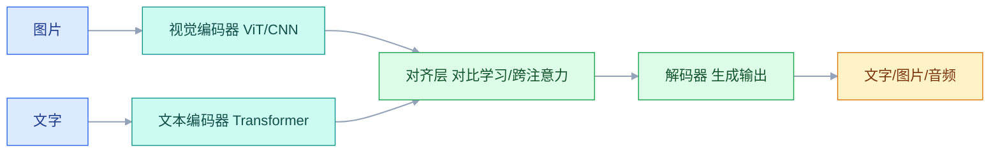
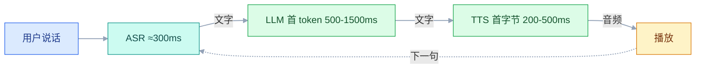
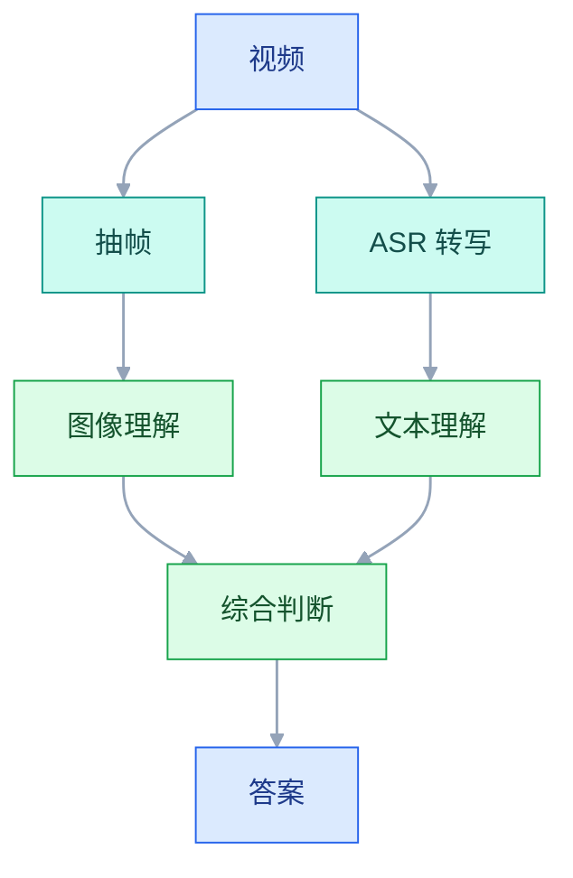

# 多模态

## 一、工程案例：做一个「发票智能录入系统」

**场景**：公司财务每月收到约 3000 张发票（纸质拍照 + 电子 PDF + 手机截图），需要录入 ERP。目前 4 个人手工录入，每人每天 150 张、每张 1 分钟，金额和税号经常出错。

**为什么必须做**：手工录入成本高、错误率高、可追溯性差。下面按「环境 → 链路 → 验收 → 铺开」的顺序，搭完「上传图片 → OCR → LLM 结构化 → 校验分流 → 入库」的完整链路。

**动手前确认**：已有能运行 PaddleOCR 的机器（CPU 即可），已有 OpenAI 兼容 API 密钥。

### 1.1 主线（按顺序执行）

```bash
# ① 建 Python 环境
python -m venv .venv && source .venv/bin/activate
pip install "openai==1.*" "pillow==10.*" "opencv-python==4.*" "numpy==1.*"
pip install "paddlepaddle==2.6.*" -i https://mirror.baidu.com/pypi/simple
pip install "paddleocr==2.8.*"
brew install poppler           # 电子 PDF 转图用（Ubuntu: sudo apt install poppler-utils）

# ② 验证环境
python -c "import cv2, PIL, paddleocr; print('依赖就绪')"
pdftoppm -v 2>&1 | head -1
```

```text
依赖就绪
pdftoppm version 24.02.0
```

**③ 图片预处理 + OCR + LLM 结构化 + 校验分流**（完整代码）：

```python
# multimodal/pipeline.py —— 图片预处理 + OCR + LLM + 校验
import base64, json, re, time
from pathlib import Path
from datetime import datetime
from PIL import Image, ImageEnhance, ImageFilter, ImageOps
from paddleocr import PaddleOCR
from openai import OpenAI, RateLimitError, APITimeoutError, APIError

client = OpenAI(base_url="https://api.openai.com/v1", api_key="sk-xxx")
MAX_BASE64_MB = 5
REQUIRED = ["invoice_no", "invoice_date", "total_amount"]
TAX_NO_RE = re.compile(r"^[0-9A-Z]{15}$|^[0-9A-Z]{17,20}$")
INVOICE_NO_RE = re.compile(r"^\d{8}$|^\d{20}$")
CN_DIGITS = {"零": 0, "壹": 1, "贰": 2, "叁": 3, "肆": 4, "伍": 5,
             "陆": 6, "柒": 7, "捌": 8, "玖": 9}
CN_UNITS = {"拾": 10, "佰": 100, "仟": 1000, "万": 10000, "亿": 100000000}
_ocr = None


def get_ocr():
    global _ocr
    if _ocr is None:
        _ocr = PaddleOCR(use_angle_cls=True, lang="ch", show_log=False)
    return _ocr


def compress_for_api(src, max_side=1600, quality=90, sharpen=False):
    """发票要读小字，max_side 设到 1600。"""
    img = ImageOps.exif_transpose(Image.open(src)).convert("RGB")
    w, h = img.size
    if max(w, h) > max_side:
        ratio = max_side / max(w, h)
        img = img.resize((int(w * ratio), int(h * ratio)), Image.LANCZOS)
    elif max(w, h) < 800:
        ratio = 800 / max(w, h)
        img = img.resize((int(w * ratio), int(h * ratio)), Image.LANCZOS)
    if sharpen:
        img = img.filter(ImageFilter.UnsharpMask(radius=2, percent=150, threshold=3))
        img = ImageEnhance.Contrast(img).enhance(1.15)
    dst = str(Path(src).with_suffix(".compressed.jpg"))
    img.save(dst, "JPEG", quality=quality, optimize=True)
    return dst


def to_data_url(image_path, max_side=1600):
    """压缩后转 base64，避免内存暴涨。"""
    path = Path(image_path)
    if path.stat().st_size > 1_000_000:
        path = Path(compress_for_api(str(path), max_side=max_side))
    encoded = base64.b64encode(path.read_bytes()).decode()
    if len(encoded) / 1024 / 1024 > MAX_BASE64_MB:
        raise ValueError("编码后超出限制，请进一步压缩")
    suffix = path.suffix.lstrip(".").lower()
    mime = {"jpg": "jpeg", "jpeg": "jpeg", "png": "png", "webp": "webp"}.get(suffix, "jpeg")
    return f"data:image/{mime};base64,{encoded}"


def ocr_text_with_layout(image_path):
    """OCR 并按阅读顺序排序。"""
    result = get_ocr().ocr(image_path, cls=True)
    if not result or not result[0]:
        return "", 0.0
    lines = [(min(p[1] for p in box), min(p[0] for p in box), text)
             for box, (text, conf) in result[0]]
    lines.sort(key=lambda t: (round(t[0] / 15), t[1]))
    confs = [c for _, (_, c) in result[0]]
    return "\n".join(t[2] for t in lines), (sum(confs) / len(confs) if confs else 0.0)


def chat_with_retry(messages, model="gpt-4o-mini", max_retries=3, **kwargs):
    """指数退避重试。"""
    for attempt in range(max_retries):
        try:
            resp = client.chat.completions.create(model=model, messages=messages, **kwargs)
            return resp.choices[0].message.content
        except (RateLimitError, APITimeoutError):
            time.sleep(2 ** attempt)
        except APIError as e:
            if getattr(e, "status_code", 500) < 500:
                raise
            time.sleep(2 ** attempt)
    raise RuntimeError(f"重试 {max_retries} 次后仍失败")


STRUCTURE_PROMPT = """下面是一张发票经过 OCR 得到的文本。
请提取信息，输出 JSON：
{"invoice_no": "发票号码", "invoice_date": "YYYY-MM-DD",
 "total_amount": "数字，单位元", "buyer_name": "购买方",
 "buyer_tax_no": "纳税人识别号", "seller_name": "销售方",
 "seller_tax_no": "纳税人识别号", "invoice_type": "类型"}
要求：金额去掉 ¥ 和逗号；日期 YYYY-MM-DD；价税合计才是 total_amount；
找不到填 null；只输出 JSON。

OCR 文本：
---
{ocr_text}
---
"""


def extract_invoice(image_path, ocr_text=None):
    start = time.time()
    text = ocr_text if ocr_text is not None else ocr_text_with_layout(image_path)[0]
    if not text.strip():
        return {"_valid": False, "_errors": ["OCR 未识别到任何文字"],
                "_latency": round(time.time() - start, 2)}
    raw = chat_with_retry(
        messages=[{"role": "user", "content": STRUCTURE_PROMPT.format(ocr_text=text)}],
        model="gpt-4o-mini", temperature=0,
        response_format={"type": "json_object"},
    )
    data = json.loads(raw)
    data["_latency"] = round(time.time() - start, 2)
    return data


def chinese_to_number(text):
    """把中文大写金额转数字，支持「元/圆 + 角/分」。"""
    text = text.strip().replace("整", "").replace("正", "").replace("圆", "元")
    jiao = fen = 0
    m = re.search(r"元(?:零?([零壹贰叁肆伍陆柒捌玖])角)?(?:零?([零壹贰叁肆伍陆柒捌玖])分)?", text)
    if m:
        jiao = CN_DIGITS.get(m.group(1), 0)
        fen = CN_DIGITS.get(m.group(2), 0)
        text = text[:m.start()]
    total, section, number = 0.0, 0.0, 0
    for ch in text:
        if ch in CN_DIGITS:
            number = CN_DIGITS[ch]
        elif ch in CN_UNITS:
            unit = CN_UNITS[ch]
            if unit >= 10000:
                section = (section + number) * unit
                total, section = total + section, 0
            else:
                section += (number or 1) * unit
            number = 0
    return round(total + section + number + jiao / 10 + fen / 100, 2)


def normalize(data):
    """规范化：金额转 float、日期转 ISO、税号大写去空格。"""
    amount = data.get("total_amount")
    if amount is not None:
        s = str(amount).strip().replace("¥", "").replace("￥", "")
        s = s.replace(",", "").replace("，", "").replace(" ", "")
        s = s.translate(str.maketrans("０１２３４５６７８９", "0123456789"))
        try:
            data["total_amount"] = round(float(s), 2)
        except ValueError:
            data["total_amount"] = None
    date = data.get("invoice_date")
    if date:
        s = re.sub(r"[年月]", "-", str(date).strip())
        s = s.replace("日", "").replace("/", "-").replace(".", "-")
        s = re.sub(r"-+", "-", s).strip("-")
        m = re.match(r"^(\d{4})-(\d{1,2})-(\d{1,2})$", s)
        data["invoice_date"] = (f"{m.group(1)}-{int(m.group(2)):02d}-{int(m.group(3)):02d}"
                                if m else s)
    for f in ["invoice_no", "buyer_tax_no", "seller_tax_no"]:
        if data.get(f):
            data[f] = str(data[f]).strip().upper().replace(" ", "")
    return data


def cross_validate_amount(data, ocr_text):
    """用大写金额校验小写金额。"""
    amount = data.get("total_amount")
    if not amount:
        return data
    m = re.search(r"[（(]大写[）)]([零壹贰叁肆伍陆柒捌玖拾佰仟万亿元圆角分整正]+)", ocr_text)
    if m:
        expected = chinese_to_number(m.group(1))
        if expected and abs(expected - float(amount)) > 0.01:
            data.setdefault("_warnings", []).append(
                f"金额与大写不一致：识别 {amount}，大写为 {expected}")
            data["total_amount"] = expected
    return data


def validate(data):
    """校验。返回 (是否通过, 错误列表)。"""
    errors = [f"必填字段缺失：{f}" for f in REQUIRED if not data.get(f)]
    amount = data.get("total_amount")
    if amount is not None:
        if not isinstance(amount, (int, float)):
            errors.append(f"金额不是数字：{amount}")
        elif amount <= 0:
            errors.append(f"金额必须大于 0：{amount}")
        elif amount > 100_000_000:
            errors.append(f"金额异常大（>1亿），请核对：{amount}")
    date = data.get("invoice_date")
    if date:
        try:
            d = datetime.strptime(str(date), "%Y-%m-%d")
            if d.year < 2010 or d > datetime.now():
                errors.append(f"日期超出合理范围：{date}")
        except ValueError:
            errors.append(f"日期格式不正确：{date}")
    for f in ["buyer_tax_no", "seller_tax_no"]:
        v = data.get(f)
        if v and not TAX_NO_RE.match(str(v)):
            errors.append(f"{f} 格式不正确：{v}")
    v = data.get("invoice_no")
    if v and not INVOICE_NO_RE.match(str(v)):
        data.setdefault("_warnings", []).append(f"发票号位数异常：{v}")
    return (not errors), errors


def compute_confidence(data, ocr_avg_conf=1.0):
    """综合置信度：校验 + OCR 置信度 + warnings。"""
    score = 1.0
    score -= len(data.get("_errors", [])) * 0.25
    if ocr_avg_conf < 0.85:
        score -= (0.85 - ocr_avg_conf) * 2
    score -= len(data.get("_warnings", [])) * 0.1
    return max(0.0, min(1.0, score))


def process_invoice(image_path):
    """完整处理流程：OCR → LLM → 校验 → 分流。"""
    ocr_text, ocr_avg_conf = ocr_text_with_layout(image_path)
    if not ocr_text.strip():
        return {"image_path": image_path, "status": "need_review",
                "reason": "OCR 无输出", "created_at": datetime.now().isoformat()}
    data = normalize(extract_invoice(image_path, ocr_text=ocr_text))
    data = cross_validate_amount(data, ocr_text)
    data["_valid"], data["_errors"] = validate(data)
    conf = compute_confidence(data, ocr_avg_conf)
    status = "need_review" if (not data.get("_valid") or conf < 0.75) else "auto_approved"
    return {"image_path": image_path,
            "fields": {k: v for k, v in data.items() if not k.startswith("_")},
            "confidence": round(conf, 3), "status": status,
            "reasons": data.get("_errors", []) + data.get("_warnings", []),
            "created_at": datetime.now().isoformat()}
```

### 1.2 验收（8 项全过才算交付）

| # | 检查 | 命令 | 通过标准 |
|---|---|---|---|
| 1 | 环境就绪 | `python -c "import cv2, PIL, paddleocr"` | 无报错 |
| 2 | PDF 转图可用 | `pdftoppm -v 2>&1 \| head -1` | 输出版本号 |
| 3 | OCR 能读文字 | `python -c "from multimodal.pipeline import ocr_text_with_layout; print(ocr_text_with_layout('./samples/invoice_01.jpg')[0][:50])"` | 输出 50+ 字符 |
| 4 | LLM 能结构化 | `python -c "from multimodal.pipeline import extract_invoice; print(extract_invoice('./samples/invoice_01.jpg'))"` | 输出 JSON 含 invoice_no 等字段 |
| 5 | 校验通过 | `python -c "from multimodal.pipeline import validate, normalize, extract_invoice; d=normalize(extract_invoice('./samples/invoice_01.jpg')); print(validate(d))"` | 返回 (True, []) |
| 6 | 金额交叉校验 | `python -c "from multimodal.pipeline import cross_validate_amount; print(cross_validate_amount({'total_amount': 100.0}, '（大写）壹佰贰拾叁元整')['total_amount'])"` | 输出 123.0 |
| 7 | 分流正确 | `python -c "from multimodal.pipeline import process_invoice; print(process_invoice('./samples/invoice_01.jpg')['status'])"` | 输出 auto_approved 或 need_review |
| 8 | 批量处理 | `python -c "from multimodal.pipeline import process_invoice; import glob; print([process_invoice(f)['status'] for f in sorted(glob.glob('./samples/*.jpg'))])"` | 2 张以上连续处理不报错 |

> **第 3 项**：PaddleOCR 第一次运行会下载模型（约 10MB），耐心等待。
> **第 5 项**：`normalize` 必须在 `validate` 之前调用，否则格式不一致导致校验失败。

### 1.3 复制到 20 台

```bash
# 批量处理脚本
for f in ./invoices/*.jpg; do
    python -c "
from multimodal.pipeline import process_invoice
import json
r = process_invoice('$f')
print(json.dumps(r, ensure_ascii=False))
" >> results.jsonl
done
```

| 约束 | 处理 |
|---|---|
| 每台机器 PaddleOCR 模型缓存不同 | `get_ocr()` 复用全局实例，避免重复初始化 |
| API 密钥不同 | 用环境变量 `OPENAI_API_KEY`，不要写死 |
| 发票图片格式多样 | `file` 判断类型；PDF 先 `pdftoppm -r 200 -png in.pdf page` 转图，再进 `process_invoice` |
| 并发太高触发限流 | 用 `process_batch`（见 3.13）控速，默认 5 QPS |

---

## 二、高频问答：会卡住你的地方，也是面试最常问的

### 2.1 图片上传后模型什么都没看见

**现场**

`ls -lh image.jpg` 看原图大小；再打印编码后的 MB 数：

```bash
python -c "from multimodal.pipeline import to_data_url; print(len(to_data_url('image.jpg')) / 1024 / 1024)"
python -c "from multimodal.pipeline import compress_for_api; compress_for_api('big.jpg')"
```

**要点**

- 「传了图片就一定看得见」是错的，先看传输层的大小限制。
- 文件太大或 base64 后请求体超限，API 返回 413，个别网关会静默丢弃。
- 核实要把原图大小和编码后长度两个数一起看，超限就压缩。

**追问**

- 为什么有的网关是静默的？→ 它在转发层就丢了超限请求体，应用只看到空图片。
- 压到多大合适？→ 发票要读小字，最长边 1600，别一刀切压到 1024。
- 压了还是识别不准？→ 那是清晰度问题不是超限问题，先判断属于哪一种。

### 2.2 base64 编码内存暴涨

**现场**

```python
# 大图一定要压缩后再编码
path = compress_for_api(src, max_side=1024)
encoded = base64.b64encode(Path(path).read_bytes()).decode()
```

**要点**

- base64 只把 3 字节编成 4 字节（×1.33），真正放大的是同时驻留的副本。
- 原图 bytes、`b64encode` 的 bytes、`decode` 出的 str、再 `json.dumps` 的请求体一起算，峰值约原图 4 倍。
- 这与「Python 字符串是 Unicode」无关：base64 结果是纯 ASCII，1 字节 1 字符。

**追问**

- 5MB 的图怎么会 OOM？→ 5MB 乘上 4 倍峰值，再乘并发数。
- 怎么核实？→ 比较原始字节数和编码后长度，估算内存。
- 怎么避免？→ 编码前先压缩，别把整个请求体拼在内存里。

### 2.3 多模态返回格式不一致

**现场**

```python
resp = client.chat.completions.create(
    model="gpt-4o-mini",
    response_format={"type": "json_object"},   # 必须加这个
    messages=[{"role": "user", "content": [
        {"type": "text", "text": prompt},
        {"type": "image_url", "image_url": {"url": url, "detail": "high"}},
    ]}],
)
```

**要点**

- 格式乱不是模型不听话，是缺 `response_format={"type": "json_object"}`。
- 没有它，JSON 结构、字段名、数字格式都会自由发挥。
- 加了也只保证「是合法 JSON」，字段是否存在、类型是否正确仍要校验。

**追问**

- 加了 `response_format` 还缺字段？→ 它不保证字段齐全，必须做后处理校验。
- 解析失败要不要重试？→ 要，但要带上错误提示，否则同样的输出会再错一次。
- 图片怎么传？→ `image_url` 里放 data URL，`detail` 按需选 high 或 low。

### 2.4 OCR 识别方向错误

**现场**

```python
ocr = PaddleOCR(use_angle_cls=True, lang="ch", show_log=False)
result = ocr.ocr("invoice.jpg", cls=True)
```

**要点**

- 倒置发票被当正着识别，是方向分类器没开：PaddleOCR 2.x 的 `use_angle_cls` 默认关闭。
- 构造参数 `use_angle_cls=True` 和调用参数 `cls=True` 都要给。
- 任意角度歪斜它也不管，要先做倾斜校正再 OCR。

**追问**

- 为什么两个参数都要给？→ 构造决定是否加载方向模型，调用决定这一批是否启用。
- 校正和 OCR 的先后？→ 先摆正再识别，识别完再转顺序已经晚了。
- 90° 旋转也能救吗？→ 方向分类主要处理 0/180，90° 要靠预处理旋转。

### 2.5 音频格式不兼容

**现场**

```bash
ffprobe -v error -show_entries stream=codec_name,sample_rate,channels -of json audio.mp3
ffmpeg -i input.mp3 -ar 16000 -ac 1 output.wav
```

**要点**

- 并不是只认 WAV：ffmpeg 会解码并内部重采样到 16kHz 单声道。
- 但格式不在支持列表、采样率异常、双声道混音都会报错或明显掉字。
- 统一先转 16kHz 单声道最省事，长音频转码还会额外耗时。

**追问**

- 双声道为什么要处理？→ 两路混在一起会糊，识别质量下降。
- 怎么核实参数？→ `ffprobe` 看 codec、sample_rate、channels。
- 长音频还有什么坑？→ 30 秒窗口拼接会漏句，要分片加重叠。

### 2.6 视频抽帧 token 爆表

**现场**

```python
import cv2

def extract_frames(video_path, interval_sec=5, max_frames=20, max_width=1024):
    """按固定间隔抽帧，顺带降分辨率。"""
    cap = cv2.VideoCapture(video_path)
    fps = cap.get(cv2.CAP_PROP_FPS) or 25
    step, idx, kept, paths = max(1, int(fps * interval_sec)), 0, 0, []
    while kept < max_frames and cap.grab():
        if idx % step == 0:
            ok, frame = cap.retrieve()
            if ok:
                h, w = frame.shape[:2]
                if w > max_width:
                    frame = cv2.resize(frame, (max_width, int(h * max_width / w)))
                path = f"{video_path}.{kept:03d}.jpg"
                cv2.imwrite(path, frame)
                paths.append(path)
                kept += 1
        idx += 1
    cap.release()
    return paths
```

**要点**

- 每帧 `detail=high` 按 512² 分块，1024² 一帧约 765 token，30 帧就是 23000 token。
- 这不是理解力问题，是上下文上限与预算问题，帧给多了反而调不通。
- 手段是 `max_frames` 压到 20 以内、统一缩到 640-1024 宽、按场景选间隔。

**追问**

- 帧越多越好吗？→ 不是，超上限直接报错，多出来的帧也多是冗余信息。
- 监控视频怎么抽？→ 间隔 1-2 秒，或用场景变化检测跳静止画面。
- 长视频有更好的做法吗？→ 先 ASR 转写，以文本为主、抽帧为辅。

### 2.7 多模态并发被限流

**现场**

```python
# process_batch 实现见 3.13；worker 内部用 chat_with_retry（见 1.1）兜 429
process_batch(items, worker, max_workers=8, rate_limit_per_sec=5.0)
```

**要点**

- 提升并发不会更快：RPM/RPD 限制下过高并发触发 429，反而更慢。
- 要同时控两件事：worker 数（并发）和全局 QPS（匀速放行）。
- 429 要在调用内部用指数退避兜住，只在外层重试挡不住。

**追问**

- 并发和 QPS 有什么区别？→ 并发是在途请求数，QPS 是每秒放行数，后者才对应供应商配额。
- 免费额度和付费额度一样吗？→ 不一样，低配额 1-2 个并发就够。
- 本地模型呢？→ 看显存，单卡 1-4 个。

### 2.8 图像生成违规或不符合预期

**现场**

检查返回的 error 消息；去掉敏感内容后重试。

```python
# 生成无文字底图 + 代码叠字
prompt = "一张白色背景的产品展示图，简约现代风格"
```

**要点**

- 被拒多半不是 Prompt 不好，是内容安全过滤：真人肖像、品牌 LOGO、暴力内容会直接拒绝。
- 先读错误信息，再决定是改描述还是换方案。
- 商用还要确认授权与版权，这是条款问题，不是技术问题。

**追问**

- 图里的文字总是乱怎么办？→ 生成无文字底图，文字用代码叠上去。
- 过滤误伤怎么办？→ 换成更中性的描述，别硬碰类别词。
- 能绕过过滤吗？→ 不该绕，绕过等于把合规风险留给业务。

### 2.9 TTS 语速过快不自然

**现场**

逐个音色试听，记录各自的自然上限。

```python
tts(text, voice="nova", speed=1.2)   # 不要超过 1.3
```

**要点**

- `speed` 拉到 1.3 以上会明显失真，噪音和机械感先出现。
- 不同音色的自然上限不一样，没有统一阈值。
- 逐个音色实测并记录，比记一个全局数字可靠。

**追问**

- 为什么 1.0 也有人说不自然？→ 音色本身风格不同，文本缺少标点停顿也会显得生硬。
- 长文本怎么办？→ 单次有字符上限，超长按句切再拼。
- 流式合成怎么切？→ 按句末标点切，按时长切会把句子切碎。

### 2.10 语音对话打断失效

**现场**

检查 `audio_player.stop()` 是否被调用；确认 `spoken_text` 进入上下文。

```python
def interrupt(self):
    self.playback_queue.clear()
    self.audio_player.stop()           # 必须调用
    self.spoken_text += "（被打断）"    # 进入上下文
    self.state = State.LISTENING
```

**要点**

- 打断失效常不是 VAD 不灵敏，是 TTS 播放缓冲区没清空。
- `interrupt()` 只清了队列、没停播放器，声音还在继续。
- 已播内容要进上下文并标记「被打断」，否则模型会从头再说一遍。

**追问**

- VAD 要不要一起调？→ 先修播放器再谈灵敏度，否则调了也白调。
- 为什么要记已播内容？→ 模型不知道被打断过，上下文里缺一段就会重复。
- 状态机怎么设计？→ 打断后回到 LISTENING，不要停在 SPEAKING。

### 2.11 多模态 RAG 图表检索不到

**现场**

```python
# 用视觉模型生成描述，再向量化描述文本（describe_chart 见 3.10）
desc = describe_chart(image_path)
searchable_text = " ".join([
    desc.get("title", ""), desc.get("description", ""),
    " ".join(desc.get("keywords", [])),
])
```

**要点**

- 直接向量化图片只能粗粒度匹配，问「Q3 云服务营收多少」命中不了。
- 正确链路是「图片 → 描述 → 向量化描述」，把描述当文本块索引。
- 描述里要带标题、数值、结论、关键词，否则照样检索不到。

**追问**

- CLIP 能精确查数吗？→ 不能，它适合粗粒度找图。
- 描述生成很贵怎么办？→ 用便宜模型、按图片哈希缓存，并先过滤装饰图。
- 图和正文怎么关联？→ 用版面坐标判断「离谁最近」。

### 2.12 长音频转写漏句

**现场**

```bash
# 5 分钟一片 + 3 秒重叠（片长 303s、步长 297s），统一转 16kHz 单声道
for i in 0 1 2 3; do
    ffmpeg -y -ss $((i * 297)) -i input.mp3 -t 303 -ar 16000 -ac 1 "chunk_$(printf '%03d' "$i").wav"
done
```

**要点**

- 不是模型不行，是 Whisper 按 30 秒窗口训练和推理，长音频靠切窗拼接。
- 十几分钟以上就会出现漏句、重复、时间戳漂移。
- 手段是分片加重叠（示例 5 分钟一片、3 秒重叠），并统一转 16kHz 单声道。

**追问**

- 重叠为什么有用？→ 边界上的词至少有一片是完整的。
- 怎么发现漏句？→ 检查首尾和段落衔接，看时间戳是否连续。
- 能直接上流式吗？→ 它按整段 30 秒设计，做流式要自己切窗。

---

## 三、核心知识：从零开始要建立的东西

### 3.1 多模态模型架构

多模态模型 = **视觉编码器 + 文本编码器 + 对齐层 + 解码器**。



| 组件 | 作用 | 常见实现 |
|---|---|---|
| 视觉编码器 | 把像素 → 向量 | ViT、CNN、Patch Embedding |
| 文本编码器 | 把词 → 向量 | Transformer、Embedding |
| 对齐层 | 让图文向量在同一空间 | CLIP 对比学习、跨注意力 |
| 解码器 | 生成目标模态 | Transformer Decoder |

### 3.2 图像 token 计算

图像输入会被折算成 token，规则以厂商当前文档为准。

| detail | 规则 | 适用 |
|---|---|---|
| low | 固定约 85 token，图片压到 512×512 | 分类、判断有无 |
| high | 先缩放到 ≤2048×2048，再按 512×512 分块，每块 170 token + 85 基础 | 读小字、看细节 |

```text
1024×1024 → 4 块 → 85 + 4×170 = 765 token
2048×2048 → 16 块 → 85 + 16×170 = 2805 token
```

**边界**：`detail=low` 成本反而低于 500 字文本，是最有效的优化手段。`detail=high` 适合需要精读的场景，日常判断用 `low` 即可。

> **面试**：常问「一张图到底算多少 token？」答：按 `detail` 折算，low 约 85；high 先缩到 2048² 再按 512² 分块，每块 170 加 85 基础。

### 3.3 图像预处理

预处理不是越多越好，必须根据图片质量动态调整。

| 步骤 | 作用 | 什么时候用 |
|---|---|---|
| 灰度化 | 降维，OCR 只需亮度 | OCR 链路；颜色本身是判据时不要 |
| 去噪 | 去掉照片噪点 | 手机拍摄、高 ISO |
| 二值化 | 增强文字与背景对比 | 光照不均、有底纹（用自适应阈值） |
| 倾斜校正 | 把歪的文档摆正 | 拍照件 |
| 锐化 | 让模糊字边缘清晰 | 失焦、运动模糊 |

```python
import cv2

def assess_quality(image_path):
    img = cv2.imread(image_path, cv2.IMREAD_GRAYSCALE)
    blur = cv2.Laplacian(img, cv2.CV_64F).var()
    brightness, contrast = float(img.mean()), float(img.std())
    return {"blur_score": round(blur, 1), "is_blurry": blur < 100,
            "is_dark": brightness < 80, "low_contrast": contrast < 40}
```

### 3.4 OCR 版面还原

OCR 输出是一堆乱序的文本框，必须按阅读顺序排序，否则拼出来的文字是乱的。

```python
def sort_lines(raw):
    """raw 为 PaddleOCR 的 result[0]：按 y 分行（每 15px 一行），行内按 x 排序。"""
    lines = [(min(p[1] for p in box), min(p[0] for p in box), text)
             for box, (text, conf) in raw]
    lines.sort(key=lambda t: (round(t[0] / 15), t[1]))
    return "\n".join(t[2] for t in lines)
```

**取舍**：坐标排序适合规则版式；复杂排版（如竖排、绕图）需要版面分析模型（如 MinerU）。

### 3.5 专业 OCR vs 多模态

| 维度 | 专业 OCR | 多模态大模型 |
|---|---|---|
| 速度 | 快（几十毫秒/图） | 慢（秒级） |
| 成本 | 极低（可离线） | 高（按 token） |
| 输出 | 文字 + 坐标 + 置信度 | 文字 + 理解 + 结构化 |
| 确定性 | 高 | 中 |
| 版式理解 | 弱 | 强 |
| 语义理解 | 无 | 强 |

| 需求 | 选择 |
|---|---|
| 只要「把文字抠出来」 | 专业 OCR |
| 要「看懂内容做判断」 | 多模态模型 |
| 要「先抠字再理解」 | OCR + LLM 两段式 |
| 量大且版式固定 | 专业 OCR + 模板匹配 |

> **面试**：常问「什么时候用专业 OCR，什么时候用多模态模型？」答：只要抠字用 OCR，要理解做判断用多模态，固定版式大批量走 OCR 加模板。

### 3.6 语音识别原理

ASR = **音频编码器 + 解码器**。模型内部按 16kHz 处理，实践中统一先转 16kHz 单声道 WAV；编码器提取声学特征，解码器贪心或束搜索生成文字。

本地首选 `faster-whisper`（CTranslate2 后端，CPU 可跑 int8，比 `openai-whisper` 快数倍）：

```python
from faster_whisper import WhisperModel   # pip install faster-whisper
model = WhisperModel("small", device="cpu", compute_type="int8")
segments, info = model.transcribe(
    audio_path, language="zh",
    beam_size=5, vad_filter=True,
    initial_prompt="以下是普通话会议录音。",
)
```

| 参数 | 作用 | 建议 |
|---|---|---|
| vad_filter | 跳过静音 | 必开 |
| initial_prompt | 领域提示词 | 有明显改善 |
| beam_size | 搜索宽度 | 5 默认，实时可降到 1 |
| compute_type | 计算精度 | CPU 用 int8，GPU 用 float16 |

### 3.7 语音合成原理

TTS = **文本前端 + 声学模型 + 声码器**。文本前端处理语言（分词、拼音、韵律），声学模型生成 Mel 频谱，声码器把频谱转成波形。

```python
resp = client.audio.speech.create(
    model="tts-1", voice="nova",
    input=text[:4096],              # 单次上限 4096 字符，超长先按句切
    speed=1.0,
    response_format="mp3",
)
```

| 参数 | 说明 | 注意 |
|---|---|---|
| voice | 音色 | 不同厂商命名不同 |
| speed | 语速 | 常见自然上限 1.2-1.3，逐音色实测 |
| model | 质量档 | 草稿用低档，成品用高档（型号与价格以厂商当前文档为准） |
| 格式 | mp3/wav/opus | 网页播放用 mp3 |

### 3.8 语音对话架构

ASR + LLM + TTS 串联，端到端延迟 = ASR + LLM 首 token + TTS 首字节 ≈ 1-2.3 秒。



| 优化 | 做法 | 收益 |
|---|---|---|
| 流式串联 | ASR 边识别边送 LLM；LLM 边生成边切句送 TTS | 最大 |
| VAD 提前触发 | 检测短暂停顿就开跑 | 省 200-500ms |
| LLM 用小模型 | 对话场景不需要大模型 | 省 300-800ms |
| TTS 预建连接 | 提前建立连接 | 省 100-300ms |

### 3.9 视频抽帧策略

视频理解 = **抽帧 + 图像理解**，直接喂视频的方案成本高、受限多。

| 视频类型 | 抽帧间隔 | 帧数上限 | 说明 |
|---|---|---|---|
| 监控（找异常） | 1-2 秒 | 50 | 间隔要小 |
| 会议录屏 | 30 秒或切页时 | 20 | 变化少 |
| 短视频审核 | 1 秒 | 30 | 覆盖全过程 |
| 教学视频 | 5-10 秒 | 40 | 变化慢 |

```bash
# 场景变化检测抽帧：自动跳过静止画面（ffmpeg 6+ 用 -fps_mode，旧版为 -vsync vfr）
ffmpeg -i video.mp4 -vf "select='gt(scene,0.3)'" -fps_mode vfr out_%03d.jpg
# 降分辨率：视频理解通常不需要高清
ffmpeg -i video.mp4 -vf scale=640:-1 -r 1 out_%03d.jpg
```

### 3.10 多模态 RAG

PDF 里的图表怎么检索：用视觉模型生成描述，把描述当作文本块一起索引。

```python
import base64, json
from pathlib import Path

CHART_DESC_PROMPT = """请详细描述这张图表，包含所有可用于检索的信息：
{"chart_type": "类型", "title": "标题", "description": "描述",
 "data_points": [{"label": "X轴", "value": "数值", "unit": "单位"}],
 "conclusion": "结论", "keywords": ["关键词"]}
要求：data_points 尽量完整；数值精确；只输出 JSON。
"""

def describe_chart(image_path):
    # 先按 2.1 压缩，避免 base64 编码后超限
    b64 = base64.b64encode(Path(image_path).read_bytes()).decode()
    resp = client.chat.completions.create(
        model="gpt-4o", temperature=0,
        response_format={"type": "json_object"},
        messages=[{"role": "user", "content": [
            {"type": "text", "text": CHART_DESC_PROMPT},
            {"type": "image_url", "image_url": {"url": f"data:image/png;base64,{b64}", "detail": "high"}},
        ]}],
    )
    return json.loads(resp.choices[0].message.content)
```

| 难点 | 说明 | 应对 |
|---|---|---|
| 图片和正文关联 | 图可能离说明文字很远 | 用版面坐标判断「离谁最近」 |
| 图片数量大 | 100 页 PPT 可能有 80 张图 | 先过滤：尺寸够大且非装饰才处理 |
| 描述生成成本 | 每张图一次视觉调用 | 用便宜模型；缓存相同图片哈希 |
| 表格跨页 | 表格被分成两页 | 按表头特征拼接，标记「续表」 |

### 3.11 CLIP 向量检索

用海量「图片 + 配文」训练两个编码器，输出到同一向量空间。

```text
图片: [猫的照片] ──▶ [0.21, -0.35, 0.77, ...]
文本: "一只猫"    ──▶ [0.19, -0.33, 0.79, ...]   ← 相似度高
文本: "一辆汽车"  ──▶ [-0.62, 0.11, -0.20, ...]  ← 相似度低
```

| 能力 | 说明 |
|---|---|
| 以文搜图 | 粗粒度匹配，不能精确 |
| 以图搜图 | 相似图片检索 |
| 零样本分类 | 给定类别判断归属 |
| 精确 OCR | 不能 |
| 数字匹配 | 不能 |

**结论**：CLIP 适合「粗粒度找图」，不适合「精确查数据」。

> **面试**：常问「CLIP 能做精确的图表检索吗？」答：不能，它只做粗粒度语义匹配；精确查数要把图转成描述文本再检索。

### 3.12 成本优化

图片会被折算成 token，优化手段按收益排序。

| 输入类型 | 折算 token | 相对纯文本 |
|---|---|---|
| 500 字纯文本 | ~700 | 1x |
| 小图（detail=low） | ~85 | 0.1x |
| 中等图（1024²，high） | ~765 | 1x |
| 大图（2048²，high） | ~2805 | 4x |
| 1 分钟音频（Whisper） | 单独计费 | 远高于文本 |

```text
三个关键结论：
① 同样模型下，中等清晰图片 ≈ 500 字文本。
② detail=low 成本低于普通文本 —— 最有效优化。
③ 真正贵的是 ASR（按时长）和图像生成（按张），不是视觉理解。
```

| 优化 | 做法 | 收益 |
|---|---|---|
| 压缩降采样 | 统一缩到最长边 1024px | token 约降 70% |
| 按需选择 detail | 分类用 low，读字用 high | 成本降一个量级 |
| 缓存 | 文件哈希判断重复 | 零重复调用 |
| OCR 优先 | 批量固定版式用 OCR | 比多模态便宜 5-20 倍 |
| 本地 ASR | Whisper small 本地跑 | 成本仅剩电费 |

### 3.13 并发控制

限流保护比并发数本身更重要。重试与退避不再重复实现，直接用 1.1 的 `chat_with_retry`；这里只做全局匀速放行。

```python
import threading, time
from concurrent.futures import ThreadPoolExecutor

_lock, _last = threading.Lock(), 0.0

def _throttle(interval):
    """全局匀速放行：max_workers 再大，实际 QPS 也不会超过 rate_limit_per_sec。"""
    global _last
    with _lock:
        wait = _last + interval - time.monotonic()
        if wait > 0:
            time.sleep(wait)
        _last = time.monotonic()

def process_batch(items, fn, max_workers=8, rate_limit_per_sec=5.0):
    interval = 1.0 / rate_limit_per_sec
    def run(item):
        _throttle(interval)
        return fn(item)          # fn 内部用 chat_with_retry（见 1.1）兜 429
    with ThreadPoolExecutor(max_workers=max_workers) as pool:
        return list(pool.map(run, items))
```

| 场景 | 建议并发 | 原因 |
|---|---|---|
| 免费/低配额 | 1-2 | 容易触发 429 |
| 标准付费 | 4-8 | 平衡吞吐与风险 |
| 企业配额 | 16-32 | 吞吐更高，监控 429 |
| 本地模型（单卡） | 1-4 | 显存有限 |

### 3.14 结构化输出

`response_format={"type": "json_object"}` 能保证输出是合法 JSON，但**不能保证字段存在或类型正确**。

```python
REQUIRED = ["invoice_no", "invoice_date", "total_amount"]   # 与 1.1 保持一致

def validate_invoice(data):
    errors = [f"缺少必填字段：{f}" for f in REQUIRED if not data.get(f)]
    amount = data.get("total_amount")
    if amount is not None:
        try:
            data["total_amount"] = float(str(amount).replace(",", "").replace("¥", ""))
        except (ValueError, TypeError):
            errors.append(f"金额格式异常：{amount}")
    return data, errors
```

**边界**：JSON 格式保证 ≠ 内容正确。模型可能返回 `null`、字符串数字、错误格式日期，都需要后处理。

### 3.15 置信度分流

准确率会很快到平台期——固定版式的抽取做到九成上下，再往上每一点都要靠标注、规则和复核堆出来，技术侧不再是瓶颈。

```python
def compute_confidence(data, ocr_avg_conf=1.0):
    score = 1.0
    score -= len(data.get("_errors", [])) * 0.25
    if ocr_avg_conf < 0.85:
        score -= (0.85 - ocr_avg_conf) * 2
    score -= len(data.get("_warnings", [])) * 0.1
    return max(0.0, min(1.0, score))
```

| 信号 | 权重 | 说明 |
|---|---|---|
| 校验通过 | 高 | 格式错误直接打回 |
| OCR 平均置信度 | 中 | <0.85 拉分 |
| warnings | 低 | 大写金额不一致等 |

**取舍**：把准确率从九成推到九九，标注、长尾处理和复核的成本是线性增长的几十倍；不如把剩下的一小部分交给人工 + 好用的复核界面。

### 3.16 图像生成参数

托管 API 与本地模型是两套参数，不能混传：前三个属于托管服务，后三个属于本地 SD/FLUX。取值与价格以厂商当前文档为准。

| 参数 | 属于 | 说明与注意 |
|---|---|---|
| size | 托管 API | 如 1024×1024 / 1792×1024 / 1024×1792，方图/横图/竖图 |
| quality | 托管 API | standard / hd 之类，单价不同，具体倍数看厂商文档 |
| style | 托管 API | vivid / natural，对比度 vs 写实 |
| seed | 本地 SD/FLUX | 固定后复现同一张图 |
| steps | 本地 SD/FLUX | 20-30 步通常够，越多越慢 |
| guidance_scale | 本地 SD/FLUX | 7-8，太高过饱和、太低不听话 |

**Prompt 结构**：`[主体] + [动作/姿态] + [环境] + [风格] + [光线] + [镜头] + [画质]`

```text
❌ "一张桌子"（太宽泛）
✅ "胡桃木餐桌，北欧极简风格，白墙背景，柔和顶光，产品摄影"
```

### 3.17 视频理解

视频理解现在最好的姿势是「把视频降维成文本和图片，然后用成熟的文本/图像能力处理」。



| 什么时候不成熟 | 原因 | 方案 |
|---|---|---|
| 长视频（>30 分钟） | 抽帧会漏信息 | 先 ASR 转写，文本为主 |
| 细粒度动作识别 | 需要时序模型 | 用专门的动作识别模型 |
| 精确计数 | 需要目标检测 | 用 YOLO |
| 跨帧一致性 | 需要 ReID | 用人脸识别/ReID |

---

## 四、冷门知识汇总

| 知识点 | 为什么冷门 | 用到时的关键词 |
|---|---|---|
| EXIF Orientation | 手机照片看着是正的，像素其实是躺着的，PIL 不会自动转 | `ImageOps.exif_transpose` |
| HEIC/HEIF | iPhone 默认格式，PIL 直接打不开 | `pillow-heif` |
| RGBA 存 JPEG | 截图带透明通道，`save(..., "JPEG")` 直接报错 | `convert("RGB")` |
| `Image.MAX_IMAGE_PIXELS` | 600dpi 扫描件超默认像素上限，抛 DecompressionBomb | 大图、扫描件 |
| 电子发票 OFD/XML | 数电票的票面数据在 OFD/XML 里，解析比 OCR 准且不花钱 | 免 OCR |
| PDF 文字层 | 电子发票 PDF 自带文字层，`pdftotext -layout` 直接抽 | 电子文档 |
| `pdftoppm -r` | 低于 150 小字就糊，200 是常用起点 | PDF 转图 |
| 自适应阈值 | 光照不均时比全局阈值稳得多 | `cv2.adaptiveThreshold` |
| 全角数字 | OCR 常输出「１２３」，`float()` 直接失败 | NFKC 归一化 |
| PaddleOCR 3.x API | 构造参数与推理接口都变了（改叫 `predict()`） | 版本兼容 |
| `row_count` 自校验 | 表格抽取让模型输出行数，自己数一遍比对 | 表格抽取 |
| `strength` 图生图 | 0.3 微调 / 0.6 中等 / 0.9 重画 | 图生图 |
| Whisper 不适合流式 | 编码器-解码器按整段 30 秒设计，做流式要自己切窗 | 实时语音 |
| 流式 TTS 按标点切 | 按时长切会把句子切碎，按句末标点切才自然 | 流式合成 |
| MinerU / RAGFlow | PDF 版面分析与复杂文档解析 | 文档解析 |
| 图像生成商用条款 | 需确认是否允许商用、是否撞版权 | 图像生成 |
