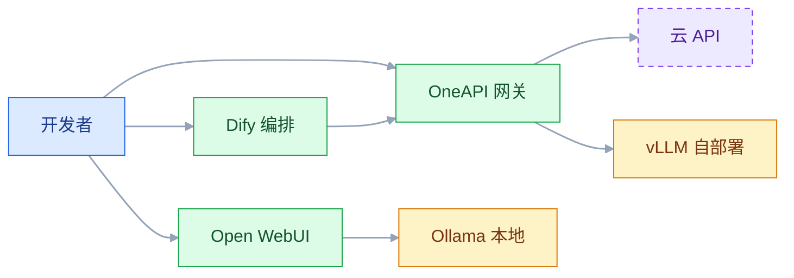
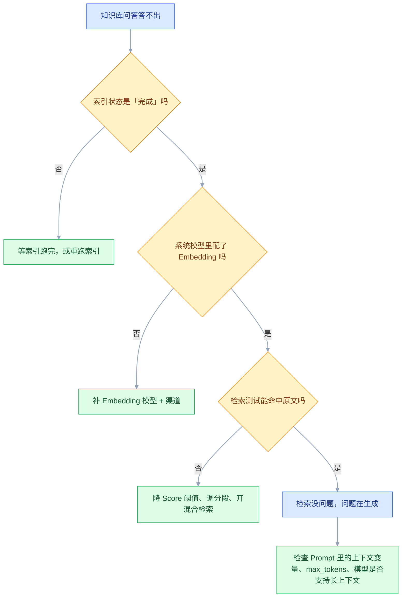
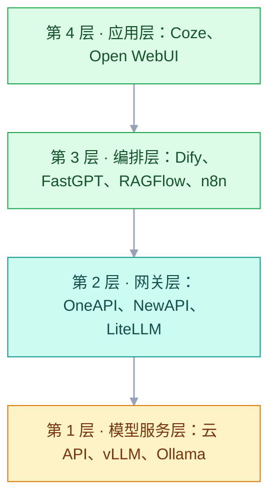

# 常用 AI 技术（平台与生态）

## 一、工程案例：给一个团队做一次 AI 工具盘点

**场景**：一个 10 人开发团队，想在 2 周内上手 AI 工具。现状是：部分人在用 ChatGPT 网页版、部分人在用公司采购的某个云 API、还有人在试本地的 Ollama。目标是：盘清现有工具、判断哪些能直接用、哪些需要自建、哪些先别碰，搭建一个「30 天内能上手的 starter stack」。

**为什么必须做**：AI 工具铺满整个开发流程，但乱用会带来三种成本——**数据泄露**（把代码贴到 SaaS）、**重复采购**（每个人掏自己的钱买会员）、**技术债**（接了 5 个平台的 API，后续接不住）。下面 8 步完成一次完整的盘点 + 部署。

**动手前确认**：团队负责人已列出「哪些场景要用 AI」（写代码、查文档、处理内部文档、自动化办公）；以及「哪些数据不能出内网」。

### 1.1 主线（按顺序执行，不要跳步）

**① 列出团队已在用的 AI 工具**（调研而不是猜）：发一份 5 分钟问卷，只问 3 题，收集后去重成清单。

| # | 问题 | 要拿到的东西 |
|---|---|---|
| 1 | 你在用哪些 AI 工具？（名称 + 用途） | 工具名、使用的账号类型（个人/公司） |
| 2 | 你的数据有没有出过内网？ | 每个工具的「数据边界」标注 |
| 3 | 你最希望解决的痛点是？ | 优先级排序，决定先接哪个场景 |

**② 分类四类**：

| 类别 | 判断标准 | 例子 |
|---|---|---|
| **直接可用** | SaaS，数据不敏感，团队已有账号 | ChatGPT 网页版、Coze SaaS |
| **自建替代** | 数据敏感，或需要内网集成 | Dify 自部署、OneAPI 网关 |
| **先别碰** | 成本高、团队无维护能力、替代方案更简单 | 自建 vLLM 集群、自建向量数据库集群 |
| **观望** | 刚上线、稳定性未知 | 某个刚发布的新平台 |

**③ 选定主力组合**（按场景）：

| 场景 | 主力工具 | 理由 | 备选 |
|---|---|---|---|
| 写代码 | Cursor / 通义灵码 | IDE 集成最成熟 | GitHub Copilot |
| 查内部文档 | Dify 自部署 | 数据可控、知识库成熟 | FastGPT |
| 处理敏感文档 | Ollama + Open WebUI | 数据不出内网 | — |
| 自动化办公 | Coze SaaS | 飞书/微信一键发布 | n8n |
| API 聚合 | OneAPI | 统一 Key、故障切换 | NewAPI |

**④ 部署 OneAPI 网关**（统一所有模型入口）：

```bash
# 在内网服务器上，一条命令起一个网关
docker run -d --name one-api --restart=always \
  -p 3000:3000 -e TZ=Asia/Shanghai \
  -e SESSION_SECRET="换成随机字符串" \
  -v /opt/ai/one-api:/data \
  justsong/one-api:latest
# 首次登录 root / 123456 → 立刻改密码
# 渠道 → 添加渠道（每家一个）→ 渠道 → 测试（绿色才行）
#   openai      https://api.openai.com                      gpt-4o, gpt-4o-mini
#   qwen        https://dashscope.aliyuncs.com/compatible-mode/v1   qwen-plus, qwen-max
#   deepseek    https://api.deepseek.com                    deepseek-chat
# 模型名会变，填之前以厂商当前文档的模型列表为准
```

> **为什么一定要网关**：没有网关时，应用 A 用 OpenAI、应用 B 用通义、应用 C 用 DeepSeek，结果是 3 套 Key 要管理、3 套 API 格式要适配、3 个账单要核对，想换供应商每个应用都要改代码。有网关后，所有应用只连 OneAPI（统一 OpenAI 格式），背后随意切换供应商——一套 Key、一套格式、一个账单、换供应商只改网关。

**⑤ 部署 Dify**（应用编排 + 知识库）：

```bash
git clone https://github.com/langgenius/dify.git
cd dify/docker && cp .env.example .env
# 改 .env：SECRET_KEY、INIT_PASSWORD、POSTGRES_PASSWORD、EXPOSE_NGINX_PORT
docker compose up -d && docker compose ps     # 确认所有服务 Up
```

> **千万不要用 `docker compose down -v`**。`-v` 会连数据库卷一起删，所有知识库、应用配置全没。升级时用 `docker compose down`（保留卷）→ `git pull` → `docker compose pull` → `docker compose up -d`。

**⑥ 部署 Open WebUI + Ollama**（本地对话 + 知识库）：

```bash
# 安装 Ollama + 监听所有网卡
curl -fsSL https://ollama.com/install.sh | sh
sudo systemctl edit ollama    # 加入 [Service] Environment="OLLAMA_HOST=0.0.0.0:11434"
sudo systemctl restart ollama
ollama pull qwen3:8b          # 主力对话模型
ollama pull nomic-embed-text  # Embedding 模型（做知识库要用）

# 部署 Open WebUI
# 第一次启动先保留 ENABLE_SIGNUP=true，注册出管理员账号后
# 再改成 false 重建容器（docker rm -f 后重新 run），否则一个账号都建不出来
docker run -d --name open-webui --restart=always \
  -p 8080:8080 \
  -e OLLAMA_BASE_URL=http://host.docker.internal:11434 \
  -e WEBUI_SECRET_KEY="换成随机字符串" \
  -e ENABLE_SIGNUP=true \
  -v /opt/ai/open-webui:/app/backend/data \
  --add-host=host.docker.internal:host-gateway \
  ghcr.io/open-webui/open-webui:main
```

> Linux 下 `host.docker.internal` 可能不可用。改成 `--network=host` 并去掉 `-p`，或者把 `OLLAMA_BASE_URL` 直接指向宿主机 IP（如 `http://192.168.1.10:11434`），并确保 Ollama 监听 `0.0.0.0`（设置环境变量 `OLLAMA_HOST=0.0.0.0`）。

**⑦ 配置 Dify 连接 OneAPI**：

```text
右上角头像 → 设置 → 模型供应商 → 添加 OpenAI-API-compatible
  API Base：http://192.168.1.10:3000/v1   （填宿主机内网 IP，端口是 ④ 里映射的 3000）
  API Key：sk-你的OneAPI令牌
  模型名称：手动填上 OneAPI 渠道里已有的模型名

然后「系统模型设置」里指定：
  对话模型：渠道里已启用的那个
  Embedding 模型：bge-m3（需要先在 OneAPI/供应商侧有对应的 embedding 渠道）
```

> **这里不能写 `http://one-api:3000`**。Dify 和 ④ 里用 `docker run` 起的 OneAPI 不在同一个 Docker 网络，容器名解析不到；要么填宿主机 IP，要么把 OneAPI 加入 Dify 的 compose 网络（`docker network connect <dify 网络名> one-api`，网络名用 `docker network ls` 查）。

> **Embedding 模型必须配。** 没配的话知识库里「高质量索引」选项是灰的，上传文档后问不到答案就是它。Embedding 也要走一个「渠道」，只配对话模型不够。

**⑧ 验证**：浏览器打开 `http://<IP>`（Dify）和 `http://<IP>:8080`（Open WebUI），分别创建一个知识库问答和一次本地对话，确认都能返回结果。

### 1.2 工具地图（哪些能组合在一起）



**理解这个图**：它们不是竞品，是可以组合的。注意 Open WebUI 直连 Ollama（`M3`），不经过网关——本地模型只有在 OneAPI 里登记成 OpenAI 兼容渠道后，才会走 `GW`。典型的企业私有化组合是「vLLM（模型）+ OneAPI（网关）+ Dify（编排）+ Milvus（向量库）」，此时 Open WebUI 可以不部署。

### 1.3 结论

| 结论 | 什么时候用 |
|---|---|
| **SaaS 优先** | 数据不敏感、快速验证、不需要内网集成 |
| **自部署当基础** | 涉及企业内部数据，基本只有自部署这一条路 |
| **网关不可少** | 用 ≥ 2 个供应商的模型，或者将来可能换供应商 |
| **本地模型是保底** | 用于不联网场景、敏感文档处理、个人学习 |
| **vLLM 而不是 Ollama** | 生产环境需要 PagedAttention、连续批处理，同卡同模型下吞吐常见高数倍（具体看并发和上下文长度，以实测为准） |

> **平台用来「验证和标准化」，代码用来「定制和优化」**。先用 Dify 搭原型验证效果（半天），确认方向对了之后，再用代码重写核心逻辑。

### 1.4 验收（8 项全过才算交付）

| # | 检查 | 命令或检查 | 通过标准 |
|---|---|---|---|
| 1 | 工具清单完整 | 问卷回收后去重 | 回复率 ≥ 80%，问卷里出现的工具全部进清单 |
| 2 | 数据边界明确 | 每个工具标注「数据是否出内网」 | 敏感数据的工具都标「❌ 出内网」 |
| 3 | OneAPI 部署 | `curl -s http://localhost:3000/api/status` | 返回 `"success":true`（`/` 只是控制台前端页面，状态码不能说明后端可用） |
| 4 | Dify 部署 | `docker compose ps` | 所有容器 Up |
| 5 | 模型渠道测试 | OneAPI 界面「渠道测试」 | 至少 2 个渠道显示绿色 |
| 6 | Embedding 模型配置 | Dify 设置 → 系统模型 → Embedding | 能选到模型，非灰色 |
| 7 | 知识库问答 | Dify 知识库上传文档后提问 | 能返回带引用的答案 |
| 8 | 本地对话 | `curl -s -o /dev/null -w "%{http_code}" http://localhost:8080`，再在浏览器里发一句话 | 返回 200 且能收到 Ollama 模型的回复 |

> **第 3 项和第 4 项要真的部署一次**。盘点报告只是纸上谈兵，部署起来才知道哪些工具真的合用。

---

## 二、高频问答：会卡住你的地方，也是面试最常问的

### 2.1 Dify 部署了但模型就是调不通

**现场**

```bash
# OneAPI 渠道测试：点击每个渠道的「测试」按钮
# 如果某个渠道红的，说明上游 Key 或 Base URL 错了
# Dify 侧：设置 → 模型供应商 → 点「测试」，看返回 401/404/500
```

**要点**

- 调不通多半不是 Key 写错，是没走网关，或网关的渠道没测试通过。
- Dify 的「模型供应商」里 Base URL 必须是网关地址，不是供应商直连。
- 排查顺序固定：先在 OneAPI 里点渠道测试，只有绿色的渠道才勾给 Dify。

**追问**

- Dify 报 401 说明什么？→ 网关令牌或渠道 Key 错了，先分清是网关侧还是上游侧。
- 渠道测试绿了还不通？→ 看 Dify 填的模型名是否在渠道的模型列表里。
- 为什么不直连供应商？→ Key 散落在各应用，换供应商要逐个改代码。

### 2.2 知识库上传了文档，但问不到答案

**现场**

```bash
# 检查 Embedding 模型
# 设置 → 系统模型设置 → Embedding 模型：必须选一个
# 知识库详情 → 索引状态：显示「完成」才行
# 检索设置：Top K 太小（<3）或 Score 阈值太高（>0.7）都会漏掉答案
```



从上往下走一遍，每一步都有可执行的检查动作。多数人卡在 `B`（Embedding 没配）和 `C`（阈值太高），而不是 `D`。

**要点**

- 先别怪模型：多数卡在 Embedding 没配（选项是灰的）或检索阈值太高。
- 索引状态不是「完成」，检索就还没有可用的数据。
- 顺序固定：索引 → Embedding → 检索测试能否命中 → 最后才轮到生成。

**追问**

- Top K 和 Score 阈值怎么设？→ Top K 3-5，阈值 0.5 起步，太高会漏。
- 检索命中了却答不出？→ 查 Prompt 的上下文变量、`max_tokens`、模型窗口。
- 换 Embedding 模型要注意什么？→ 维度变了，必须重建集合与索引。

### 2.3 docker compose down -v 之后所有数据没了

**现场**

```bash
# 错误示范：
docker compose down -v    # ❌ 会删掉数据库卷

# 正确做法：
docker compose down        # ✅ 保留卷
git pull
docker compose pull
docker compose up -d
```

**要点**

- `-v` 删的是命名卷，PostgreSQL 的数据全在里面。
- 没加 `-v` 的 `down` 只删容器、保留卷，这是设计行为。
- 升级流程固定成 `down` → `pull` → `up -d`，永远不要带 `-v`。

**追问**

- 还能恢复吗？→ 卷没有回收站，只能靠备份。
- Redis 数据丢了要紧吗？→ 只是缓存，丢了不致命；数据库丢了才是事故。
- 怎么确认卷还在？→ `docker volume ls` 看命名卷是否仍存在。

### 2.4 本地 Ollama 拉不下来模型

**现场**

```bash
# 方案 1：走代理拉取（Ollama 没有"换镜像源"的开关）
export HTTPS_PROXY=http://127.0.0.1:7890
export HTTP_PROXY=http://127.0.0.1:7890
ollama pull qwen3:8b

# 方案 2：离线导入（在 ModelScope 下 GGUF，再建本地模型）
# ollama create qwen3-8b -f Modelfile   # Modelfile 里写 FROM ./xxx.gguf

# 方案 3：检查磁盘空间
df -h /                     # 模型动辄 5GB+，确保剩 10GB 以上
```

**要点**

- 报 `dial tcp` 是下载地址在海外，Ollama 没有「换镜像源」的开关，只能走代理。
- 也可能是磁盘空间不足，模型动辄 5GB+。
- `OLLAMA_MODELS` 是模型存放目录，不是下载地址，写成 URL 会直接失败。

**追问**

- 离线环境怎么装？→ 在 ModelScope 下 GGUF，用 Modelfile 建本地模型。
- 怎么区分 DNS 和空间问题？→ 看完整报错，再用 `df -h` 确认。
- 要改存储位置怎么写？→ 绝对路径，如 `/data/ollama/models`。

### 2.5 Open WebUI 连不上 Ollama

**现场**

```bash
# 方案 1：用 --add-host（推荐）
docker run -d --name open-webui \
  --add-host=host.docker.internal:host-gateway \
  -e OLLAMA_BASE_URL=http://host.docker.internal:11434 \
  ...

# 方案 2：直接用宿主机 IP
-e OLLAMA_BASE_URL=http://192.168.1.10:11434
```

**要点**

- 容器里的 `localhost` 是容器自己，Linux 下 `host.docker.internal` 也常不可用。
- 用 `--add-host=host.docker.internal:host-gateway`，或直接写宿主机内网 IP。
- 前提是 Ollama 监听 `0.0.0.0`，只监听 127.0.0.1 时怎么配都连不上。

**追问**

- 怎么区分是 Ollama 挂了还是网络问题？→ 宿主机 `curl localhost:11434/api/tags` 能返回 JSON，就是容器网络问题。
- 还有别的办法吗？→ `--network=host` 并去掉端口映射。
- 改了还不通？→ 检查防火墙和 `OLLAMA_HOST`。

### 2.6 OneAPI 切换模型就报错

**现场**

```bash
# OneAPI 渠道配置里的「模型」字段：
#   openai      → gpt-4o, gpt-4o-mini
#   qwen        → qwen-plus, qwen-max
#   deepseek    → deepseek-chat, deepseek-reasoner
# 应用里调用时 model 参数必须用上面列表里的名称
```

**要点**

- 报错不是网关坏，是模型名称不匹配：传给供应商的 `model` 必须是它认识的名称。
- 应用里的 `model` 要在渠道配置的模型列表里。
- 用「渠道测试」看返回的具体错误，比猜快。

**追问**

- 为什么不统一模型名？→ 各家命名不同，网关只做透传，不做名字翻译。
- Key 过期长什么样？→ 401，和模型名错误的 400/404 不是一回事。
- 换模型还要改什么？→ 单价配置、上下文长度、是否支持 `stream_options`。

### 2.7 Prompt 改了但没生效

**现场**

```bash
# Dify 应用编辑完成后，必须点击右上角「发布」按钮
# 否则改动只在草稿里，API 还是用旧版本
```

**要点**

- 改动只存在草稿里，没点「发布」，API 还是旧版本。
- 也可能改的是 A 应用，线上调用的却是 B 应用的 Key。
- 核实看应用详情页的发布状态，再调一次 API 对比返回值。

**追问**

- 为什么先排除缓存？→ 没发布时缓存只是掩盖现象，发布状态才是根因。
- 发布后还不生效？→ 看调用方是否缓存了旧的 `conversation_id` 或配置。
- 怎么避免？→ Prompt 纳入版本管理，发布与调用都带版本号。

### 2.8 把内部代码贴到 ChatGPT 泄露了

**现场**

```bash
# 硬性规则：
# 1. 代码片段 ≤ 5 行，去掉所有变量名和路径 → 可以贴
# 2. 完整函数、配置文件、SQL → 绝对不能贴
# 3. 密钥、密码、token → 绝对不能贴
# 4. 内部文档、政策、流程 → 绝对不能贴
```

**要点**

- 这不是「个人不小心」，是没有数据边界意识，属于公司风险。
- 判据是这份数据能不能出内网，不是这段代码重不重要。
- 落地方式是在工具盘点表里给每个工具标「数据是否出内网」，敏感数据只能用自部署。

**追问**

- 用企业版就安全吗？→ 看条款与部署形态，数据不出内网才算。
- 已经贴了怎么办？→ 按泄露事件处理：通知、轮换密钥、评估影响面。
- 代码片段为什么可以放宽？→ 去掉变量名和路径后失去业务上下文，风险量级不同。

### 2.9 企业微信/飞书机器人收不到消息

**现场**

```bash
# 飞书自建应用：
# 1. 企业管理员在飞书开放平台创建自建应用
# 2. 配置「消息接收」URL（必须是公网可访问的 HTTPS）
# 3. 配置「机器人」能力，勾选「接收消息」权限
# 4. 在 Coze 发布时选择对应应用（可发布的渠道以厂商当前文档为准）
```

**要点**

- 不是 Coze 挂了，是企业微信/飞书侧要「自建应用」并配正确回调 URL。
- 回调必须是公网可访问的 HTTPS，权限不完整同样收不到。
- 排查顺序：消息接收是否开启 → 回调 URL 是否可达 → 机器人权限是否勾选。

**追问**

- 为什么本地测试收不到？→ 回调地址要公网可达，本地服务没有公网入口。
- 权限勾了还不通？→ 看开放平台的回调验签与事件订阅是否成功。
- 发布时选什么？→ 选对应的自建应用，可发布渠道以厂商文档为准。

### 2.10 Dify 工作流代码节点报错

**现场**

```python
# 代码节点限制：
# 1. 执行超时（默认十几秒，可用 CODE_EXECUTION_TIMEOUT 调大）→ 长任务放到外部服务
# 2. 只预装少量常用库，不能 pip install → 特殊库的逻辑外置成 API
# 3. 默认不能访问内网 → 用「HTTP 请求」节点调内部接口
# 4. 无状态，每次执行都是新环境 → 状态放 Redis/数据库
```

**要点**

- 代码节点跑在独立 sandbox：有执行超时、只预装少量库、默认没有外网/内网访问。
- 所以 `TimeoutError`、`ModuleNotFoundError`、`ConnectionError` 都是环境限制，不一定是代码 bug。
- 长任务、特殊库、内网访问都要外置成服务，用「HTTP 请求」节点调。

**追问**

- 为什么不能 `pip install`？→ 沙箱镜像固定，装不了，只能提前声明或外置。
- 状态放哪？→ 节点无状态，每次执行都是新环境，放 Redis 或数据库。
- 超时能调吗？→ 可以调大，但长任务仍应外置。

### 2.11 向量数据库检索很慢

**现场**

```python
# Milvus 没有 SHOW INDEX 这类 SQL，用 SDK 或 Attu 看：
from pymilvus import Collection
collection = Collection("docs")
collection.has_index()        # False 就是没建索引
collection.indexes            # 索引类型、字段、参数
# 顺序：create_index → load → search，少一步就报 not loaded
# 维度不匹配：Embedding 输出 1024 维，集合定义 768 维 → 插入/检索直接报错
```

**要点**

- 慢通常不是选型问题，是集合没建索引、没 `load` 到内存。
- 顺序是 `create_index` → `load` → `search`，少一步就报 `not loaded`。
- 还有一类是维度不一致：Embedding 输出 1024 维、集合定义 768 维，直接报错。

**追问**

- 建了索引还慢怎么办？→ 先确认已 `load`，再看 `top_k` 与过滤条件是否合理。
- 换 Embedding 模型要做什么？→ 重建集合，维度变了旧向量不可比。
- 怎么快速判断？→ 先 `has_index()`，再 `load()`，最后才怀疑性能。

### 2.12 开源模型被下游改动了

**现场**

```bash
# ollama list 的 ID 是模型 digest 的前缀，拉取时也会打印完整 digest
ollama list
# 固定的版本最好写死 tag（qwen3:8b 而不是 latest），
# 并把 digest 记进部署文档，升级时对比一次
```

**要点**

- 权重可能被发布者更新，或被镜像站替换，这属于低频但影响大的供应链风险。
- 判断依据是 digest 与官方发布的 sha256 是否一致，不是文件能不能跑。
- 生产固定 tag（不用 `latest`），把 digest 记进部署文档，升级时对比一次。

**追问**

- `ollama list` 的 ID 是什么？→ 模型 digest 的前缀。
- 怎么防镜像站替换？→ 私有镜像加哈希校验。
- 为什么行为会突然变？→ 同名 tag 被重新发布，权重换了一版。

---

## 三、核心知识：从零开始要建立的东西

### 3.1 AI 应用平台的四层结构

AI 应用平台不是一个黑盒，它由四层独立的组件组成，**它们不是竞品，是可以组合的**：



| 层 | 职责 | 常见工具 |
|---|---|---|
| 模型服务层 | 提供 LLM 推理能力 | 云 API、vLLM、Ollama |
| 模型网关层 | 统一 API 格式、管理 Key、负载均衡 | OneAPI、NewAPI、LiteLLM |
| 编排层 | 把 LLM + 知识库 + 工具组装成应用 | Dify、FastGPT、RAGFlow、Flowise、n8n |
| 应用层 | 面向用户的界面或渠道 | Coze、Open WebUI |

**典型组合**：个人学习 → Ollama + Open WebUI；企业内部 → vLLM + OneAPI + Dify + Milvus；C 端发布 → Coze SaaS。

> **面试**：常问「Dify、OneAPI、Ollama 是竞品吗？」答：不是，它们分属编排层、网关层和模型服务层，可以组合成一套栈。

### 3.2 自部署与 SaaS 的取舍

| | SaaS（Coze、Dify Cloud） | 自部署（Docker 部署 Dify） |
|---|---|---|
| 数据位置 | 在厂商的服务器上 | **在自己内网** |
| 初次成本 | 低（注册就能用） | 中（要配服务器、数据库、向量库） |
| 长期成本 | 按量计费，量大了很贵 | 服务器成本固定 |
| 可否改源码 | 不能 | **可以** |
| 内网系统集成 | 要暴露公网接口 | **直接访问内网** |
| 合规 | 看厂商资质 | 自己负责 |

**选型口诀**：涉及企业内部数据 → 自部署；快速验证、数据不敏感 → SaaS。**先用 SaaS 做原型，但数据一旦进去，迁出成本很高，生产环境基本只有自部署这一条路。**

### 3.3 显存估算与硬件选型

| 模型规模 | 内存（无独显） | 显存（有独显） | 生成速度（参考） |
|---|---|---|---|
| 3B | 8GB | 4GB | 快（20+ token/s） |
| 7B/8B | 16GB | 8GB | 中（10-15 token/s） |
| 14B | 32GB | 16GB | 慢（5-8 token/s） |
| 32B | 64GB | 24GB | 很慢（2-4 token/s） |
| 70B | 128GB | 48GB（或双卡） | 很慢 |

> 表中是 4bit 量化 + 单请求的粗略量级，实际值跟量化方式、上下文长度、并发数都相关；显存要额外留 1-2GB 给 KV Cache 和框架。

**选型判断**：

| 场景 | 推荐 | 说明 |
|---|---|---|
| 个人学习 | Ollama + 7B 模型 | 16GB 内存就能跑 |
| 团队内部 | vLLM + 7B-14B | 需要 GPU，8 核 32GB 起步 |
| 生产服务 | vLLM + 70B | 多卡部署，监控 GPU 利用率 |
| 高并发 | 云 API | 不用管硬件，按需付费 |

> Mac 的 M 系列芯片因为统一内存架构，跑本地模型比同价位的 x86 机器体验好不少。M2/M3 的 16GB 版本跑 7B 模型很流畅。

### 3.4 Docker Compose 编排

**为什么用 Compose**：OneAPI、Open WebUI 这类服务手动 `docker run` 容易漏掉网络和卷配置；Dify 这种 10 来个容器的应用更必须用官方 compose。Compose 用一个 YAML 声明所有依赖。

> 下面这份是「网关 + 前端」的自写 compose，和 Dify 的官方仓库不是一套。两者要互访时，把服务接进同一个 network，或让 Dify 填宿主机 IP（见 1.1 ⑦）。

```yaml
# /opt/ai/compose.yaml
services:
  one-api:
    image: justsong/one-api:latest
    restart: always
    ports: ["3000:3000"]
    environment:
      TZ: Asia/Shanghai
      SESSION_SECRET: "换成随机字符串"
    volumes: ["./one-api:/data"]
    networks: [ai-net]

  open-webui:
    image: ghcr.io/open-webui/open-webui:main
    restart: always
    ports: ["8080:8080"]
    environment:
      OPENAI_API_BASE_URL: "http://one-api:3000/v1"
      OPENAI_API_KEY: "sk-你的OneAPI令牌"
      WEBUI_SECRET_KEY: "换成随机字符串"
    volumes: ["./open-webui:/app/backend/data"]
    depends_on: [one-api]
    networks: [ai-net]

networks:
  ai-net:
    name: ai-net
```

**三个关键点**：

| 陷阱 | 正确做法 |
|---|---|
| 容器内互访写 `localhost` | 用容器名（`http://one-api:3000`） |
| 数据卷用匿名卷 | 用绑定挂载（`./one-api:/data`），方便备份 |
| `depends_on` 保证服务就绪 | 它只管启动顺序；要等可用得配 `healthcheck` + `condition: service_healthy` |

```bash
# 启动
mkdir -p /opt/ai && cd /opt/ai
docker compose up -d && docker compose ps      # 两个服务都要 Up

# 升级（千万不要加 -v）
docker compose down        # ✅ 保留卷
docker compose pull        # 拉新镜像
docker compose up -d
# 只有把 compose.yaml 放在 git 仓库里时才需要 git pull 这一步
```

### 3.5 模型网关的作用

**没有网关时**：应用 A 用 OpenAI、应用 B 用通义、应用 C 用 DeepSeek，结果是 3 套 Key 要管理、3 套 API 格式要适配、3 个账单要核对，想换供应商每个应用都要改代码。

**有网关后**：所有应用只连 OneAPI（统一 OpenAI 格式），背后随意切换供应商——一套 Key、一套格式、一个账单、换供应商只改网关。

| 能力 | OneAPI | NewAPI | LiteLLM |
|---|---|---|---|
| 语言 | Go | Go（OneAPI 分支） | Python |
| 界面 | 有 Web 管理 | **界面更完善** | 有简单 UI |
| 功能 | 多渠道负载均衡、Key 管理 | OneAPI + 更多统计 | **SDK 能力更强**，100+ 供应商 |
| 部署 | Docker 一条命令 | Docker 一条命令 | pip 或 Docker |

**OneAPI 部署 + 配置**：

```bash
docker run -d --name one-api --restart=always \
  -p 3000:3000 -e TZ=Asia/Shanghai \
  -e SESSION_SECRET="换成随机字符串" \
  -v /opt/ai/one-api:/data \
  justsong/one-api:latest
```

```text
① 渠道 → 添加渠道（每家一个，填上游 Base URL + Key）
② 渠道 → 测试（绿色才行）
③ 令牌 → 添加令牌（生成 sk-xxx，给应用用）
④ 设置 → 日志/额度（看每个令牌的消耗）
```

> **第一件事改密码**：默认 `root / 123456`，暴露到公网就是砸钱。

> **面试**：常问「既然各厂商都有 SDK，为什么还要一层模型网关？」答：统一格式与 Key、集中限流计费和故障切换，换供应商只改网关。

### 3.6 Embedding 模型与向量检索

**为什么需要 Embedding**：LLM 看不懂「向量」，但向量数据库能。Embedding 模型把文本变成高维数值向量，向量数据库用「距离」（cosine / L2）找最相似的。

| 步骤 | 说明 |
|---|---|
| 1. 文档切块 | 把长文档切成 500-1000 token 的段落 |
| 2. Embedding | 每块变成一个向量（如 1024 维） |
| 3. 存入向量库 | Milvus / pgvector / Weaviate |
| 4. 检索 | 用户问句也 Embedding，找最近邻 |

**常见 Embedding 模型**：

| 模型 | 维度 | 特点 |
|---|---|---|
| bge-m3 | 1024 | 中文好，可本地部署 |
| text-embedding-ada-002 | 1536 | OpenAI 早期型号，新项目选更新的型号 |
| nomic-embed-text | 768 | Ollama 本地可用 |
| m3e-base | 768 | 国产，中文优化（m3e-large 为 1024） |

**最小示例**（Python + Milvus）：

```python
from pymilvus import Collection, connections

connections.connect(host="localhost", port="19530")
collection = Collection("docs")
print(collection.has_index())     # 没索引就先建，不然 search 报错
collection.load()                 # 检索前必须 load 到内存

res = collection.search(data=[query_vector], anns_field="embedding", limit=4)
```

> **维度必须匹配**：Embedding 模型输出 1024 维，但集合定义 768 维 → 插入/检索直接报错。换 Embedding 模型等于换维度，必须重建集合。

> **面试**：常问「为什么换了 Embedding 模型就必须重建集合？」答：输出维度变了，旧向量和新向量不在同一空间，无法比较，只能重嵌入。

### 3.7 文档分段策略

**为什么分段重要**：LLM 上下文有限，一次只能看几千 token。把整份文档塞进去，检索到的片段可能只有 10% 相关，剩 90% 是噪音。

| 文档类型 | 分段长度 | 重叠 | 理由 |
|---|---|---|---|
| 政策制度、FAQ | 500 | 50 | 每条独立，按条切最好 |
| 产品手册、技术文档 | 800 | 100 | 一段一个知识点 |
| 长篇报告、论文 | 1200 | 200 | 上下文依赖强，切大一点 |
| 对话记录、会议纪要 | 600 | 100 | 按说话人或话题切 |

**分段参数**：

| 参数 | 说明 | 推荐值 |
|---|---|---|
| 分段标识符 | 按什么符号切 | `\n\n`（段落）或 `##`（标题） |
| 分段最大长度 | 每块多长 | 500-1000 token |
| 分段重叠长度 | 相邻块重复多少 | 最大长度的 10-20% |

> **重叠的作用**：防止答案正好被切在边界上，前后文都丢失。

### 3.8 混合检索与重排序

**纯向量检索的盲点**：专有名词、型号、订单号这类「字面精确匹配」场景，向量检索容易失手。

| 检索方式 | 原理 | 适合 |
|---|---|---|
| 向量检索 | Embedding 距离 | 语义相近的查询 |
| 关键词检索（BM25） | 倒排索引 | 专有名词、型号 |
| 混合检索 | 向量 + 关键词融合（RRF） | 两者都要 |
| Rerank | 重新排序前 N 结果 | 进一步提升准确率 |

**实务建议**：大多数场景用「混合检索 + Rerank」。Rerank 的收益取决于语料和 rerank 模型，别照搬参数，用自己的问题集测一遍（见 1.4 第 7 项）。

```python
# 混合检索示例（伪代码）
vector_results = vector_search(query, top_k=10)
keyword_results = bm25_search(query, top_k=10)
# RRF 融合
merged = rrf_fusion(vector_results, keyword_results)
# Rerank
reranked = rerank(query, merged, top_k=4)
```

### 3.9 Prompt 工程基础

**Prompt 的三段结构**（任何 RAG 应用都一样，Dify 只是把它拆成节点）：

| 部分 | 写什么 | 从哪来 |
|---|---|---|
| 指令（system） | 角色、任务、边界、输出格式 | 你在应用配置里手写 |
| 上下文（context） | 检索命中的文档片段 | 知识检索节点 / 知识库自动注入 |
| 问题（query） | 用户这一轮的输入 | 开始节点或对话输入 |

> 在 Dify 里引用上游变量要写成 `{{#节点ID.变量名#}}`，变量名以节点声明的为准，不要自己编一个 `{{context}}` 之类的占位符——填错了不会报错，只会把字面量发给模型。

**温度（Temperature）的作用**：

| 值 | 行为 | 适合 |
|---|---|---|
| 0-0.3 | 确定、重复 | 问答、摘要、分类 |
| 0.5-0.7 | 平衡 | 一般对话 |
| 0.8-1.0 | 随机、创意 | 文案、创作 |

**Top K / Score 阈值**：

| 参数 | 说明 | 推荐值 |
|---|---|---|
| Top K | 召回几条最相似的块 | 3-5 |
| Score 阈值 | 相似度低于此值的不采用 | 0.5 |

> **温度太高 → 答案飘；温度太低 → 答案死板。** 问答场景建议 0.2，创意写作 0.7。

### 3.10 工作流节点类型

**工作流 ≠ 聊天**：工作流是「流程」，聊天是「对话」。工作流用节点图精确控制每一步。

| 节点 | 用途 | 典型配置 |
|---|---|---|
| 开始（Start） | 定义输入变量 | 字段名、类型、是否必填 |
| LLM | 调用大模型 | 选模型、写 Prompt、设温度 |
| 知识检索 | 从知识库检索 | 选知识库、Top K、阈值 |
| 代码执行 | 跑 Python | 输入变量 → 代码 → 输出变量 |
| 条件分支 | 按条件走不同路径 | 定义条件表达式 |
| 问题分类器 | LLM 给输入分类 | 定义类别 |
| HTTP 请求 | 调外部 API | URL、方法、headers、body |
| 变量聚合 | 合并多分支输出 | 定义输出变量名 |
| 结束（End） | 定义最终输出 | 返回字段 |

**执行模型**：每个节点的输入 = 上游节点的输出变量（用 `{{#节点ID.变量名#}}` 引用），输出 = 该节点产生的变量，供下游使用。

### 3.11 代码节点的输入输出契约

Dify 的「代码执行」节点本质是一个函数：面板上声明的输入变量 = 函数参数，返回值 = 输出变量。三条约定记牢：

| 约定 | 含义 | 常见错法 |
|---|---|---|
| 入口函数名 | Python 节点必须是 `main` | 写成 `run` / `handler`，节点直接失败 |
| 参数 | 按声明的输入变量名传参，顺序不用管 | 代码里加了参数但面板没声明 → 调用时缺参数 |
| 返回值 | 必须是 `dict`，key 与面板声明的输出变量一一对应 | 返回字符串、或 key 拼错 → 下游节点取到空值 |

```python
# Dify 代码节点示例：解析工单内容
import re

def main(raw_text: str) -> dict:
    rules = {
        "物流": ["发货", "物流", "快递", "配送"],
        "退款": ["退款", "退货", "退单"],
        "技术": ["报错", "打不开", "登录不了"],
    }
    category = "其他"
    for cat, keywords in rules.items():
        if any(kw in raw_text for kw in keywords):
            category = cat
            break
    m = re.search(r"\b\d{6,}\b", raw_text)
    return {"category": category, "order_no": m.group() if m else ""}
```

> 面板上要把 `category`、`order_no` 两个输出变量都声明成 `string`，否则运行时报「输出变量未定义」。沙箱超时、依赖库这些限制见 2.10。

### 3.12 API 重试与降级

**为什么要做降级**：平台是外部依赖。它挂了、超时了、限流了——这些都会发生。前端的表现应该是「回答问题暂时不可用」，而不是「500 错误」或一直转圈。

```python
import time, logging, requests

log = logging.getLogger("dify")
DIFY_BASE = "http://localhost/v1"
API_KEY = "app-xxxxxxxxxxxxxxxxxxxx"
TIMEOUT = 60
FALLBACK = "系统繁忙，请稍后重试或联系人工客服。"

def chat(query, user, conversation_id="", max_retries=2):
    headers = {"Authorization": f"Bearer {API_KEY}", "Content-Type": "application/json"}
    body = {"inputs": {}, "query": query, "response_mode": "blocking",
            "user": user, "conversation_id": conversation_id}
    for attempt in range(max_retries + 1):
        try:
            resp = requests.post(f"{DIFY_BASE}/chat-messages",
                                 headers=headers, json=body, timeout=TIMEOUT)
            # 4xx（429 除外）：Key 错、参数错、会话失效，重试没有意义
            if 400 <= resp.status_code < 500 and resp.status_code != 429:
                log.warning("Dify 返回 %s：%s", resp.status_code, resp.text[:200])
                return {"answer": FALLBACK, "_degraded": True}
            if resp.status_code < 500 and resp.status_code != 429:
                return resp.json()
            log.warning("Dify 第 %s 次返回 %s", attempt + 1, resp.status_code)
        except (requests.Timeout, requests.ConnectionError) as e:
            log.warning("Dify 调用失败（第 %s 次）：%s", attempt + 1, e)
        if attempt < max_retries:
            time.sleep(2 ** attempt)          # 1s、2s
    log.error("Dify 降级：重试后仍失败")
    return {"answer": FALLBACK, "_degraded": True}
```

**重试策略**：4xx 不重试（429 例外，它属于限流，要退避，能读到 `Retry-After` 就按它等）；5xx、超时、连接错误重试，指数退避（1s、2s、4s）。

### 3.13 权限与认证

**Dify 的 user 参数**：Dify 用它区分不同终端用户，同一个 `user` 的会话会被关联起来，也用于统计。生产环境要传真实的用户 ID，不要都传 `"abc-123"`，否则统计数据会混在一起。

```python
# 错误：所有请求都用同一个 user
resp = requests.post(url, json={"user": "abc-123", ...})
# 正确：每个终端用户一个 user
resp = requests.post(url, json={"user": f"user_{user_id}", ...})
```

**OneAPI 令牌**：

| 概念 | 说明 |
|---|---|
| 渠道 Key | 上游供应商的 Key（OpenAI、通义等） |
| 令牌 | OneAPI 生成的 `sk-xxx`，给应用用 |
| 令牌可以设 | 额度上限、过期时间、可用模型范围 |

> **为什么不直接用上游 Key**：Key 泄露了就要去每个供应商平台手动删，令牌泄露了只在 OneAPI 里删一行。

### 3.14 监控与可观测性

**生产环境要监控的指标**：

| 层 | 指标 | 怎么看 |
|---|---|---|
| 模型层 | GPU 利用率、显存、推理延迟（P50/P95/P99） | vLLM 自带 / Prometheus |
| 网关层 | 各渠道成功率、平均延迟、配额消耗 | OneAPI 后台 |
| 应用层 | 问答量、检索命中率、用户反馈（点赞/点踩） | Dify 后台 / 日志 |
| 成本 | 每日 token 消耗、折算成金额 | 各供应商账单 + OneAPI 统计 |

> **没有监控 = 盲操作**。线上出问题时，第一反应是「模型慢」，但没有指标，你永远不知道是模型慢还是检索慢还是网关超时。

### 3.15 成本控制

**token 消耗的三个杀手**：

| 来源 | 说明 | 优化 |
|---|---|---|
| 检索召回太多 | Top K 太大，把无关内容都塞进 Prompt | 降低 Top K，加 Score 阈值 |
| Embedding 重复 | 相同文档反复 Embedding | 缓存 Embedding 结果 |
| 抽象层额外调用 | 平台做意图识别、重排序等额外 LLM 调用 | 直接调用 LLM，跳过平台抽象 |

**成本优化口诀**：检索 Top K 别太大（3-5 就够）；Score 阈值设在 0.5；Embedding 结果缓存（Redis）；长对话及时清理历史；便宜模型优先（本地小模型 > 轻量云端模型 > 旗舰模型）。

> **平台的抽象层会带来额外 token 消耗**，比如内部可能有额外的 LLM 调用做意图识别。追求极致性价比时，考虑绕过平台直接调用。

### 3.16 数据安全边界

**数据泄露的常见路径**：

| 路径 | 示例 | 防范 |
|---|---|---|
| 把代码贴到 SaaS | ChatGPT、Copilot 在线版 | 用本地模型（Ollama）或企业版 |
| API 直连供应商 | 应用里直连 OpenAI Key | 用网关（OneAPI），Key 不暴露 |
| 文档上传到云 | Dify Cloud、Coze SaaS | 自部署 Dify，数据在内网 |
| 日志里泄露 | 把用户问题写到日志文件 | 日志脱敏、定期清理 |

**安全分级**：

| 等级 | 数据类型 | 工具选择 |
|---|---|---|
| 公开 | 文档、FAQ、帮助 | SaaS（Coze、Dify Cloud） |
| 内部 | 流程、政策、培训材料 | 自部署 Dify |
| 敏感 | 客户信息、订单、财务 | 自部署 + 本地模型 |
| 机密 | 密钥、源码、专利 | 本地模型（Ollama），不联网 |

> **硬性规则**：把公司代码、密钥、内部文档贴到 SaaS 平台 = 数据泄露。代码片段 ≤ 5 行，去掉所有变量名和路径才可以贴。

---

## 四、冷门知识汇总

| 知识点 | 为什么冷门 | 用到时的关键词 |
|---|---|---|
| 自部署 vs SaaS | 团队懒选 SaaS，直到数据出去才后悔 | 数据边界、合规、内网集成 |
| `docker compose down -v` | 升级时顺手写，结果库全没 | 保留卷、不要加 -v |
| Dify Embedding 模型 | 不配就灰，问不到答案 | 系统模型设置 |
| 混合检索 + Rerank | 专有名词查询靠 BM25 补 | RRF、Rerank |
| OneAPI 默认密码 | `root / 123456`，第一件事改 | 改密码 |
| 代码节点限制 | 超时、沙箱、依赖有限 | 外部服务、HTTP 请求 |
| `host.docker.internal` | Linux 下可能不可用 | `--add-host` 或宿主 IP |
| 容器内互访 | 用容器名，不写 localhost | `http://one-api:3000` |
| vLLM 而不是 Ollama | 生产吞吐差一截 | PagedAttention、连续批处理 |
| Embedding 维度不匹配 | 换模型就报错 | 检查模型输出维度、重建集合 |
| 反代后流式输出变成一次性 | 本地正常、上线才出现 | `proxy_buffering off`、SSE、`X-Accel-Buffering` |
| 云盘在线扩容 | 云上一定会遇到一次 | `growpart` + `resize2fs` |
| 开源模型被下游改动 | 行为突然变了 | 固定 tag、`ollama list` 比对 digest |
| Coze 卡片消息 | 比纯文本好，但配置复杂 | 飞书消息卡片 |
| Prompt 唯一索引 | `(name, env) WHERE is_active` | 版本管理 |
| `OLLAMA_HOST=0.0.0.0` | 让 Docker 容器连上 | 监听所有网卡 |
| OneAPI `SQL_DSN` | 量大时从 SQLite 换 MySQL | 生产环境 |
| AI 编程工具幻觉包名 | 会推荐不存在的 PyPI 包 | 验证包名 |