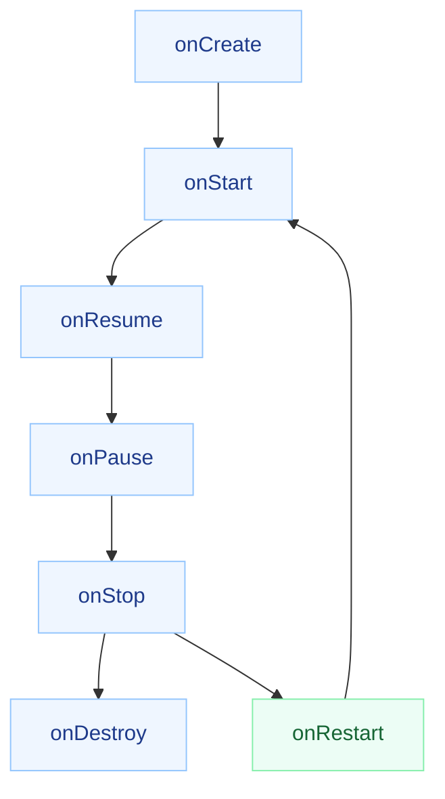
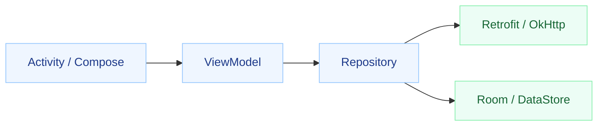
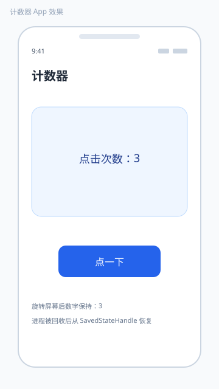

# Android与Kotlin基础

> 这篇从 Android 的组件和运行模型讲起，经过环境、Kotlin 基础、协程、生命周期、网络与存储，最后落到一个最小 App 和调试。
>
> 学完能跑起一个最小 App，并解释旋转屏幕、后台回收时的行为。

## 一、Android 的定位

Android 应用运行在 Android Runtime（ART）上，使用 Kotlin/Java 编写，通过 Gradle 构建成 APK/AAB。一个应用由 Activity、Service、BroadcastReceiver、ContentProvider 四类组件组成，生命周期由系统调度。

Android 的核心判断：Activity 是一个屏幕，不是整个应用，系统可以在任何时候回收它；主线程只做轻量工作，网络、数据库、大计算必须切到后台；Kotlin 的空安全是编译期的，运行时仍可能遇到平台类型和 Java 互操作的空值。

> 边界：原生 Android 适合需要系统能力、性能、长期维护的应用；以内容展示为主、团队偏 Web 的项目，跨平台方案可能更划算。

## 二、环境与最小工程

### 2.1 环境基线

| 工具 | 版本基线 | 作用 |
|---|---|---|
| Android Studio | 当前稳定版（2026-11） | IDE、模拟器、布局检查 |
| JDK | 17/21 | Gradle 与 Kotlin 编译 |
| Android SDK | API 36（按项目调整） | 编译和目标版本 |
| Gradle | 8.9+（以模板为准） | 构建 |
| Kotlin | 2.x | 语言 |

| 环境 | 安装方式（2026-11） |
|---|---|
| Windows 10/11 | `winget install Google.AndroidStudio`，或从官网下载安装包 |
| macOS | `brew install --cask android-studio`，或从官网下载 |
| Ubuntu 24.04/26.04 | `sudo snap install android-studio --classic`，或下载 tar.gz |
| Rocky/CentOS 9/10 | 官方 tar.gz 解压到 `/opt`，手动创建桌面入口 |

> 边界：Android Studio 自带 JDK，但 Gradle 仍可能读取 `JAVA_HOME`；团队项目要统一 JDK 和 Gradle 版本，避免“本机能跑、CI 报错”。

创建 Empty Views Activity 工程，包名 `com.example.counter`，语言选 Kotlin。

### 2.2 最小页面

`activity_main.xml`：

```xml
<?xml version="1.0" encoding="utf-8"?>
<LinearLayout xmlns:android="http://schemas.android.com/apk/res/android"
    android:layout_width="match_parent"
    android:layout_height="match_parent"
    android:gravity="center"
    android:orientation="vertical"
    android:padding="24dp">

    <!-- 显示当前计数 -->
    <TextView
        android:id="@+id/countText"
        android:layout_width="wrap_content"
        android:layout_height="wrap_content"
        android:text="点击次数：0"
        android:textSize="24sp" />

    <!-- 主操作：点击后计数 +1 -->
    <Button
        android:id="@+id/addButton"
        android:layout_width="wrap_content"
        android:layout_height="wrap_content"
        android:layout_marginTop="16dp"
        android:text="点一下" />
</LinearLayout>
```

`MainActivity.kt`：

```kotlin
package com.example.counter

import android.os.Bundle
import android.util.Log
import android.widget.Button
import android.widget.TextView
import androidx.appcompat.app.AppCompatActivity

class MainActivity : AppCompatActivity() {
    // 状态放在 Activity 里，旋转屏幕会重建 Activity，count 会丢
    private var count = 0

    override fun onCreate(savedInstanceState: Bundle?) {
        super.onCreate(savedInstanceState)
        setContentView(R.layout.activity_main)

        // findViewById 通过布局里的 id 找视图
        val countText = findViewById<TextView>(R.id.countText)
        val addButton = findViewById<Button>(R.id.addButton)

        addButton.setOnClickListener {
            count++
            countText.text = "点击次数：$count"
            Log.d("MainActivity", "count=$count") // Logcat 过滤 MainActivity
        }
    }
}
```

运行后点击按钮，文本递增；Logcat 过滤 `MainActivity` 能看到日志。

> 边界：旋转屏幕会重建 Activity，`count` 会回到 0。需要保留状态时用 `ViewModel` 或 `onSaveInstanceState`。

## 三、Kotlin 基础

### 3.1 变量与空安全

```kotlin
val name: String = "Kotlin"   // 只读
var count = 0                 // 可读写，类型推断为 Int

val nullable: String? = null
val length = nullable?.length ?: 0   // 安全调用 + Elvis
val forced = nullable!!.length       // 明确风险：为 null 时抛 NPE
```

| 写法 | 含义 | 建议 |
|---|---|---|
| `val` | 引用不可变 | 默认用 `val` |
| `var` | 引用可变 | 只在需要时用 |
| `String?` | 可空类型 | 优先用安全调用 |
| `!!` | 断言非空 | 能不用就不用 |
| `?.` / `?:` | 安全调用 / 默认值 | 处理可空的常规方式 |

### 3.2 数据类、when、集合

```kotlin
data class User(val id: Long, val name: String)

fun label(score: Int): String = when {
    score >= 90 -> "优秀"
    score >= 60 -> "及格"
    else -> "不及格"
}

val users = listOf(User(1, "张三"), User(2, "李四"))
val names = users.map { it.name }
val firstLongName = users.firstOrNull { it.name.length > 2 }?.name
```

`data class` 自动生成 `equals`、`hashCode`、`toString`、`copy`，适合 DTO 和状态对象。

> 边界：`data class` 只根据主构造器参数生成方法；可变属性放在主构造器里会破坏 `hashCode` 的稳定性。

## 四、协程与异步

协程把异步代码写成顺序代码。`suspend` 函数只能在协程或其他 `suspend` 函数中调用。

```kotlin
import android.widget.TextView
import androidx.appcompat.app.AppCompatActivity
import androidx.lifecycle.lifecycleScope
import kotlinx.coroutines.Dispatchers
import kotlinx.coroutines.launch
import kotlinx.coroutines.withContext

class MainActivity : AppCompatActivity() {
    override fun onCreate(savedInstanceState: Bundle?) {
        super.onCreate(savedInstanceState)
        setContentView(R.layout.activity_main)
        val countText = findViewById<TextView>(R.id.countText)

        lifecycleScope.launch {
            val result = withContext(Dispatchers.IO) {
                // 模拟网络/数据库
                Thread.sleep(500)
                "加载完成"
            }
            countText.text = result
        }
    }
}
```

> 依赖：`androidx.lifecycle:lifecycle-runtime-ktx` 提供 `lifecycleScope`。

| 概念 | 作用 |
|---|---|
| `CoroutineScope` | 管理协程生命周期 |
| `launch` | 启动不返回结果的协程 |
| `async/await` | 并发执行并取回结果 |
| `Dispatchers.Main` | 主线程，更新 UI |
| `Dispatchers.IO` | 网络、磁盘 |
| `Dispatchers.Default` | CPU 密集计算 |
| `lifecycleScope` | Activity/Fragment 销毁时自动取消 |

> 边界：协程不是线程。`Dispatchers.IO` 的线程池也会被耗尽；不要在主线程 `runBlocking`，也不要在协程里忽略异常。

## 五、Android 生命周期



| 回调 | 常见工作 | 不该做什么 |
|---|---|---|
| `onCreate` | 初始化视图、绑定数据 | 耗时操作、网络请求 |
| `onStart` | 注册监听、刷新可见数据 | 阻塞主线程 |
| `onResume` | 恢复动画、相机、传感器 | 重复初始化 |
| `onPause` | 暂停动画、保存轻量状态 | 耗时写数据库 |
| `onStop` | 释放资源、取消订阅 | 假设进程还活着 |
| `onDestroy` | 最终清理 | 依赖一定被调用 |

> 边界：系统可能在 `onStop` 后直接杀进程，不能把关键数据只放在内存里；配置变更会重建 Activity，用 `ViewModel` 保存跨重建状态。



## 六、网络与存储

### 6.1 网络

`AndroidManifest.xml` 加权限：

```xml
<!-- 没有这条权限，所有网络请求都会失败 -->
<uses-permission android:name="android.permission.INTERNET" />
```

Retrofit + Kotlin 协程：

```kotlin
data class Order(val id: Long, val status: String)

interface ApiService {
    @GET("orders")
    suspend fun orders(): List<Order> // suspend：必须在协程里调用
}

val retrofit = Retrofit.Builder()
    .baseUrl("https://api.example.com/") // baseUrl 必须以 / 结尾
    .addConverterFactory(MoshiConverterFactory.create())
    .build()

val api = retrofit.create(ApiService::class.java)
```

> 边界：Android 9+ 默认禁止明文 HTTP；生产必须 HTTPS。网络请求不要在主线程，超时、重试和错误提示要显式处理。

### 6.2 存储

| 方式 | 适合 | 注意 |
|---|---|---|
| `SharedPreferences` / `DataStore` | 少量键值、设置 | DataStore 是异步的，推荐新项目 |
| `Room` | 结构化本地数据 | 需要实体、DAO、数据库类 |
| 应用专属目录 | 文件、缓存 | 卸载即删除 |
| `MediaStore` | 图片、视频等共享媒体 | 需要权限和 scoped storage |
| 数据库/服务端 | 多端共享、权威数据 | 本地只做缓存 |

Room 片段：

```kotlin
@Entity // Room 实体：对应一张表
data class OrderEntity(@PrimaryKey val id: Long, val status: String)

@Dao
interface OrderDao {
    @Query("SELECT * FROM orders")
    suspend fun all(): List<OrderEntity>

    @Insert(onConflict = OnConflictStrategy.REPLACE)
    suspend fun upsert(order: OrderEntity)
}
```

> 边界：本地数据库不是服务端权威源的替代。离线写入要考虑冲突、幂等和同步顺序。

## 七、最小 App 与调试

```bash
adb devices
adb logcat -s MainActivity
adb shell dumpsys activity activities | grep mResumedActivity
```

| 现象 | 最可能原因 | 第一条检查 |
|---|---|---|
| 启动即崩溃 | 空指针、布局 ID 错、主题不匹配 | Logcat 第一行 `Caused by` |
| 点击无反应 | 监听未绑定、按钮被遮挡 | 断点/日志确认回调 |
| 网络请求失败 | 权限、HTTPS、超时 | Logcat 的异常和响应码 |
| 旋转后数据丢失 | Activity 重建 | 用 ViewModel 保存状态 |
| Gradle 同步失败 | JDK/SDK/依赖版本不匹配 | Build 窗口的完整错误 |

> 边界：`adb logcat` 输出很多，先按包名或 TAG 过滤；不要用 `System.out.println` 代替日志。

## 八、最佳实践案例

### 8.1 案例背景

计数器 App 从演示版做到可维护版本：旋转屏幕不丢数据，进程被回收后能恢复，Activity 不在后台更新 UI。

### 8.2 案例实操

```kotlin
import androidx.lifecycle.SavedStateHandle
import androidx.lifecycle.ViewModel
import kotlinx.coroutines.flow.MutableStateFlow
import kotlinx.coroutines.flow.StateFlow
import kotlinx.coroutines.flow.asStateFlow

class CounterViewModel(private val savedState: SavedStateHandle) : ViewModel() {
    // 进程死亡后，从 SavedStateHandle 恢复计数
    private val _count = MutableStateFlow(savedState.get<Int>("count") ?: 0)
    val count: StateFlow<Int> = _count.asStateFlow()

    fun increment() {
        val next = _count.value + 1
        _count.value = next
        // 同步写回，保证进程被回收后还能恢复
        savedState["count"] = next
    }
}
```

```kotlin
import android.os.Bundle
import android.widget.Button
import android.widget.TextView
import androidx.activity.viewModels
import androidx.appcompat.app.AppCompatActivity
import androidx.lifecycle.Lifecycle
import androidx.lifecycle.lifecycleScope
import androidx.lifecycle.repeatOnLifecycle
import kotlinx.coroutines.launch

class MainActivity : AppCompatActivity() {
    private val vm: CounterViewModel by viewModels()

    override fun onCreate(savedInstanceState: Bundle?) {
        super.onCreate(savedInstanceState)
        setContentView(R.layout.activity_main)

        val countText = findViewById<TextView>(R.id.countText)
        val addButton = findViewById<Button>(R.id.addButton)

        // UI 只发事件，不直接持有计数状态
        addButton.setOnClickListener { vm.increment() }

        lifecycleScope.launch {
            // 只在界面可见时收集，避免后台更新 UI
            repeatOnLifecycle(Lifecycle.State.STARTED) {
                vm.count.collect { countText.text = "点击次数：$it" }
            }
        }
    }
}
```

依赖（版本以 Android Studio 模板/版本目录为准）：

```kotlin
implementation("androidx.activity:activity-ktx:1.10.1")
implementation("androidx.lifecycle:lifecycle-runtime-ktx:2.9.0")
implementation("androidx.lifecycle:lifecycle-viewmodel-ktx:2.9.0")
implementation("androidx.lifecycle:lifecycle-viewmodel-savedstate:2.9.0")
```



验证：

1. 点击按钮，数字递增；
2. 旋转屏幕，数字不归零；
3. 开发者选项开启“不保留活动”，切后台再回来，数字仍能恢复；
4. `adb logcat -s MainActivity` 能看到生命周期日志，后台没有 UI 更新异常。

### 8.3 案例结果

旋转屏幕和进程回收后计数都能恢复，后台不再更新 UI。复盘：`ViewModel` 解决配置变更，`SavedStateHandle` 解决进程回收，`repeatOnLifecycle` 解决后台收集；三者职责不同，不能用一个 `static` 变量代替。
