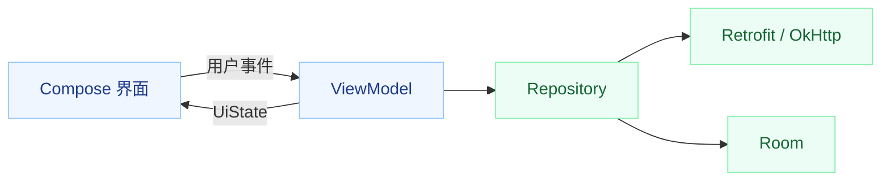
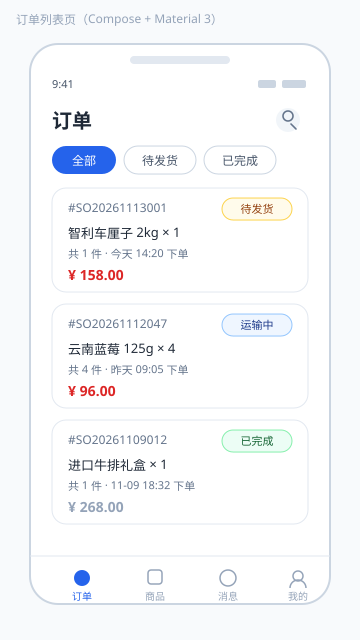
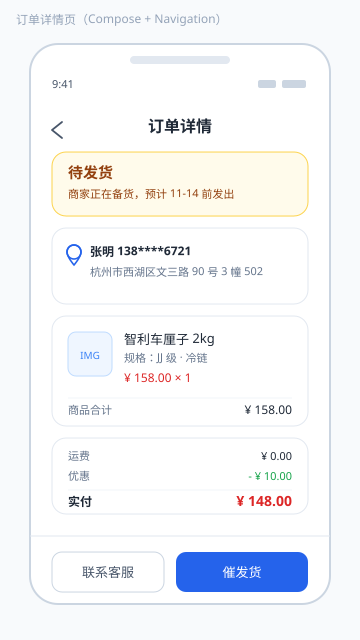

# Android Jetpack Compose与工程化

> 这篇从 Compose 的声明式界面模型讲起，经过最小工程、布局与 Modifier、状态与重组、ViewModel、导航，最后落到 Gradle 工程化、签名上架和线上排障。
>
> 学完能用 Compose 独立完成一个多页面 App，配好版本目录与签名，打出可上架的 AAB，并在卡顿、崩溃、构建失败时找到第一条命令。

## 一、Compose 的界面模型与边界

Jetpack Compose（下称 Compose）把界面描述成状态的函数：给定状态，界面长什么样由代码决定，状态变化时框架重新执行受影响的函数。这条规则决定了后面所有写法：先想状态放在哪，再想界面怎么画。

Compose 适合新页面、设计系统统一、状态驱动的交互；不适合一次性替换依赖大量自定义 View、成熟第三方 SDK 的老模块。迁移按页面做，不按项目做。

| 维度 | View 体系 | Compose |
|---|---|---|
| 界面定义 | XML 布局 + 命令式修改 | Kotlin 函数 + 声明式描述 |
| 状态同步 | 手动 `findViewById` 后改属性 | 读状态，框架负责刷新 |
| 列表 | `RecyclerView` + Adapter | `LazyColumn` + item 函数 |
| 动画 | `ObjectAnimator`、`AnimatorSet` | `animate*AsState`、`Transition` |
| 互操作 | 宿主 | `ComposeView` / `AndroidView` |

### 1.1 组合、重组与三个阶段

一次界面刷新分三个阶段：组合（composition）决定有哪些节点，布局（layout）决定每个节点多大、在哪，绘制（draw）把像素画到屏幕上。重组只重新执行读取了变化状态的 composable，参数稳定且未变化的函数会被跳过。

状态读取发生在哪个阶段，决定了重组的范围。动画值在布局阶段读取，就不会触发组合阶段的重组：

```kotlin
// 片段：offset 的 lambda 在布局阶段读取动画值，跳过组合阶段
val offsetX by animateFloatAsState(targetValue = if (expanded) 0f else -40f)

Box(
    Modifier.offset {
        // 在 layout 阶段读取，值变化只重跑布局，不重跑组合
        IntOffset(offsetX.roundToInt(), 0)
    }
) {
    Text("滑入内容")
}
```

> 边界：不是所有读取都能延后。`Modifier.background(color)` 的颜色在绘制阶段读取，而 `if (expanded) A else B` 这类分支在组合阶段读取。判断标准是这行代码属于哪个阶段，不是“尽量少读状态”。

### 1.2 与 View 体系的双向互操作

Compose 可以嵌 View，View 也可以嵌 Compose，两条路都有正式 API。已有页面不必重写，先把新页面写成 Compose，再逐步替换。

```kotlin
// 片段：把地图 SDK 的 View 包进 Compose，地图仍由 SDK 自己管理生命周期
AndroidView(
    factory = { context ->
        MapView(context).apply {
            // 只在创建时初始化一次，重组不会重复创建
            onCreate(null)
        }
    },
    modifier = Modifier.fillMaxWidth().height(240.dp)
)
```

```xml
<!-- 片段：在 XML 页面里嵌入 Compose，必须用 ViewCompositionStrategy 释放组合 -->
<androidx.compose.ui.platform.ComposeView
    android:id="@+id/composeHeader"
    android:layout_width="match_parent"
    android:layout_height="wrap_content" />
```

```kotlin
// 片段：Fragment 销毁视图时释放组合，否则监听器会泄漏
composeHeader.setViewCompositionStrategy(
    ViewCompositionStrategy.DisposeOnViewTreeLifecycleDestroyed
)
composeHeader.setContent { AppTheme { OrderSummaryHeader(order) } }
```

> 边界：地图、相机、富文本编辑器、部分推送 SDK 仍以 View 为主，用 `AndroidView` 包装即可。不要在 `LazyColumn` 的每个 item 里放一个重量级 View，滚动会明显掉帧。

### 1.3 单向数据流是默认架构

Compose 官方推荐的架构是单向数据流（Unidirectional Data Flow，UDF）：事件向上传，状态向下流。界面只负责渲染状态和上报事件，业务状态集中在 ViewModel。



> 边界：UDF 不等于必须用 Hilt 和 Room。单页小工具的临时状态用 `remember` 就够；一旦出现跨页面共享、需要缓存或重试，才引入 ViewModel 和数据层，否则只是把简单问题做复杂。

## 二、环境基线与最小 Compose 工程

这一章把环境固定到可复现的版本，并跑通一个能点击、能旋转的最小界面。装好不等于配好：Gradle、JDK、SDK 三者版本必须一起对齐，否则 CI 与本机会出现两套结果。

### 2.1 版本基线

| 组件 | 2026-11 基线 | 说明 |
|---|---|---|
| Kotlin | 2.x（2.2+） | Compose 编译器随 Kotlin 发布 |
| Android Gradle Plugin | 8.13+ | 与 Gradle 版本强绑定 |
| Gradle | 8.14+，9.x 可用 | 以 AGP 兼容表为准 |
| compileSdk / targetSdk | 36 | 新应用按商店要求跟进 |
| minSdk | 26 | 覆盖绝大多数在用设备 |
| JDK | 21 | AGP 8.x 要求 17 以上 |
| Compose BOM | 当前稳定版 | 统一 Compose 各库版本 |

Compose 从 Kotlin 2.0 起由 `org.jetbrains.kotlin.plugin.compose` 提供编译器插件，不再手写 `composeOptions.kotlinCompilerExtensionVersion`。这一条决定了 `build.gradle.kts` 的写法，旧教程里的那行配置已经失效。

### 2.2 三端安装与 SDK 配置

| 系统 | 安装方式 |
|---|---|
| Windows 10/11 | `winget install Google.AndroidStudio`，或官网安装包 |
| macOS | `brew install --cask android-studio`，或官网 dmg |
| Ubuntu 24.04+ | `sudo snap install android-studio --classic`，或 tar.gz |
| Rocky / CentOS 9+ | 解压官方 tar.gz 到 `/opt`，手写 desktop 入口 |

命令行装 SDK，适合 CI 和无界面服务器：

```bash
# 只装编译需要的平台和构建工具，避免下载整套 IDE 组件
sdkmanager "platforms;android-36" "build-tools;36.0.0" "platform-tools"

# 接受许可，CI 首次运行必须执行，否则构建在许可证检查处失败
yes | sdkmanager --licenses
```

```bash
# 验证：三行都应输出具体版本，空行说明没装到当前用户
adb version
java -version
./gradlew --version
```

预期输出（版本号随基线变化）：

```text
Android Debug Bridge version 1.0.41
openjdk version "21.0.8" 2026-07-15 LTS
Gradle 8.14.3
```

> 边界：Android Studio 自带 JBR，但命令行 Gradle 读 `JAVA_HOME`。两者不一致时，IDE 能同步、终端构建报 `Unsupported class file major version`，先查 `./gradlew --version` 里的 JVM。

### 2.3 最小工程结构

用 Android Studio 的 Empty Activity 模板创建工程，包名 `com.example.orders`，语言 Kotlin，构建脚本 Kotlin DSL。模板已经包含版本目录，后续所有依赖都加在 `gradle/libs.versions.toml`。

```text
app/
├── build.gradle.kts
└── src/main/
    ├── AndroidManifest.xml
    └── java/com/example/orders/
        ├── MainActivity.kt
        └── ui/theme/Theme.kt
gradle/
├── libs.versions.toml
└── wrapper/gradle-wrapper.properties
settings.gradle.kts
build.gradle.kts
```

`gradle/libs.versions.toml`（节选，版本按 2026-11 稳定通道填写）：

```toml
[versions]
kotlin = "2.2.20"
agp = "8.13.0"
composeBom = "2026.10.00"      # 只改这一处，Compose 各库版本由 BOM 统一
activityCompose = "1.11.0"
lifecycle = "2.9.4"
navigation = "2.9.5"
hilt = "2.57"
ksp = "2.2.20-2.0.2"
room = "2.8.3"
serialization = "1.9.0"
immutable = "0.4.0"

[libraries]
compose-bom = { group = "androidx.compose", name = "compose-bom", version.ref = "composeBom" }
compose-ui = { group = "androidx.compose.ui", name = "ui" }
compose-material3 = { group = "androidx.compose.material3", name = "material3" }
compose-ui-tooling = { group = "androidx.compose.ui", name = "ui-tooling" }
compose-ui-tooling-preview = { group = "androidx.compose.ui", name = "ui-tooling-preview" }
androidx-activity-compose = { group = "androidx.activity", name = "activity-compose", version.ref = "activityCompose" }
androidx-lifecycle-runtime-compose = { group = "androidx.lifecycle", name = "lifecycle-runtime-compose", version.ref = "lifecycle" }
androidx-navigation-compose = { group = "androidx.navigation", name = "navigation-compose", version.ref = "navigation" }
room-runtime = { group = "androidx.room", name = "room-runtime", version.ref = "room" }
room-ktx = { group = "androidx.room", name = "room-ktx", version.ref = "room" }
room-compiler = { group = "androidx.room", name = "room-compiler", version.ref = "room" }
hilt-android = { group = "com.google.dagger", name = "hilt-android", version.ref = "hilt" }
hilt-compiler = { group = "com.google.dagger", name = "hilt-compiler", version.ref = "hilt" }
kotlinx-serialization-json = { group = "org.jetbrains.kotlinx", name = "kotlinx-serialization-json", version.ref = "serialization" }
kotlinx-collections-immutable = { group = "org.jetbrains.kotlinx", name = "kotlinx-collections-immutable", version.ref = "immutable" }

[plugins]
android-application = { id = "com.android.application", version.ref = "agp" }
kotlin-android = { id = "org.jetbrains.kotlin.android", version.ref = "kotlin" }
kotlin-compose = { id = "org.jetbrains.kotlin.plugin.compose", version.ref = "kotlin" }
kotlin-serialization = { id = "org.jetbrains.kotlin.plugin.serialization", version.ref = "kotlin" }
ksp = { id = "com.google.devtools.ksp", version.ref = "ksp" }
hilt = { id = "com.google.dagger.hilt.android", version.ref = "hilt" }
```

`app/build.gradle.kts`：

```kotlin
plugins {
    alias(libs.plugins.android.application)
    alias(libs.plugins.kotlin.android)
    // Kotlin 2.x 必须显式启用，Compose 编译器不再随 AGP 配置
    alias(libs.plugins.kotlin.compose)
}

android {
    namespace = "com.example.orders"
    compileSdk = 36

    defaultConfig {
        applicationId = "com.example.orders"
        minSdk = 26
        targetSdk = 36
        versionCode = 1
        versionName = "1.0.0"
    }

    buildFeatures {
        compose = true   // 没有它，@Composable 注解不会生成界面代码
    }

    compileOptions {
        // 用 JDK 21 的字节码目标，与 CI 保持一致
        sourceCompatibility = JavaVersion.VERSION_21
        targetCompatibility = JavaVersion.VERSION_21
    }
}

// Kotlin 2.x 用 compilerOptions DSL；kotlinOptions 已废弃，AGP 9 会移除
kotlin {
    compilerOptions {
        jvmTarget.set(org.jetbrains.kotlin.gradle.dsl.JvmTarget.JVM_21)
    }
}

dependencies {
    val composeBom = platform(libs.compose.bom)
    implementation(composeBom)
    androidTestImplementation(composeBom)   // 测试也走同一套 BOM，避免版本漂移

    implementation(libs.compose.ui)
    implementation(libs.compose.material3)
    implementation(libs.compose.ui.tooling.preview)
    debugImplementation(libs.compose.ui.tooling)
    implementation(libs.androidx.activity.compose)
}
```

### 2.4 第一个界面

```kotlin
package com.example.orders

import android.os.Bundle
import androidx.activity.ComponentActivity
import androidx.activity.compose.setContent
import androidx.activity.enableEdgeToEdge
import androidx.compose.foundation.layout.*
import androidx.compose.material3.*
import androidx.compose.runtime.*
import androidx.compose.runtime.saveable.rememberSaveable
import androidx.compose.ui.Alignment
import androidx.compose.ui.Modifier
import androidx.compose.ui.unit.dp

class MainActivity : ComponentActivity() {
    override fun onCreate(savedInstanceState: Bundle?) {
        super.onCreate(savedInstanceState)
        // 边到边后，内容要自己处理系统栏 inset，否则标题会被状态栏挡住
        enableEdgeToEdge()
        setContent {
            MaterialTheme {
                Surface(Modifier.fillMaxSize()) { CounterScreen() }
            }
        }
    }
}

@Composable
fun CounterScreen() {
    // rememberSaveable：配置变更和进程回收后都恢复；remember 只能扛住重组
    var count by rememberSaveable { mutableIntStateOf(0) }

    Column(
        modifier = Modifier.fillMaxSize().safeDrawingPadding(),
        horizontalAlignment = Alignment.CenterHorizontally,
        verticalArrangement = Arrangement.Center
    ) {
        Text("点击次数：$count", style = MaterialTheme.typography.headlineSmall)
        Spacer(Modifier.height(16.dp))
        Button(onClick = { count++ }) { Text("点一下") }
    }
}
```

构建并安装：

```bash
./gradlew :app:assembleDebug
adb install -r app/build/outputs/apk/debug/app-debug.apk
adb shell am start -n com.example.orders/.MainActivity
```

预期结果：界面居中显示“点击次数：0”，每点一次加一；旋转屏幕后数字不变；`adb logcat -s AndroidRuntime` 无输出。第一条命令失败时先看 `./gradlew :app:assembleDebug --stacktrace` 的最后一个 `Caused by`，不要从第一行读起。

> 边界：模板生成后不要同时升级 Kotlin、AGP、Gradle 三个版本。先升 Gradle wrapper，再升 AGP，最后升 Kotlin，每步跑一次 `assembleDebug`，否则报错时无法定位是哪一层不兼容。

## 三、布局、约束与 Modifier

这一章解决“界面为什么和设计稿不一样”。Compose 的布局是单向约束：父组件给子组件一组尺寸约束，子组件在约束内决定自己的大小，父组件再决定位置。理解这一点，`weight`、`fillMaxWidth`、`wrapContent` 的行为都能推出来。

### 3.1 约束与测量

子组件不能凭空超出父组件给的约束，除非显式要求忽略约束。`fillMaxWidth()` 是把自身宽度设为父约束的上限，`wrapContentWidth()` 是按内容取最小可用宽度。

```kotlin
// 片段：三个盒子在同一行，权重按剩余空间分配
Row(Modifier.fillMaxWidth().padding(16.dp)) {
    Box(Modifier.weight(1f).height(56.dp).background(MaterialTheme.colorScheme.primary))
    Spacer(Modifier.width(8.dp))
    // weight(2f) 占剩余空间的三分之二，不是父宽度的三分之二
    Box(Modifier.weight(2f).height(56.dp).background(MaterialTheme.colorScheme.secondary))
}
```

| 写法 | 结果 | 使用场景 |
|---|---|---|
| `fillMaxWidth()` | 占满父约束上限 | 通栏卡片、分隔线 |
| `wrapContentWidth()` | 按内容 | 标签、徽章 |
| `weight(1f)` | 分剩余空间 | 列表与侧栏 |
| `sizeIn(max = 240.dp)` | 限制上限 | 图片、长文本 |
| `requiredSize(320.dp)` | 忽略父约束 | 少用，易溢出 |

> 边界：`weight` 只在 `Row` / `Column` 的直接子项上有效，包一层 `Box` 后权重失效。需要“内容自适应 + 剩余给另一个子项”时，给自适应项不设 weight，给伸展项设 weight。

### 3.2 Modifier 的顺序就是执行的顺序

Modifier 链从上到下依次包裹，顺序不同，结果不同。背景在 padding 之前，背景覆盖整块区域；背景在 padding 之后，背景只覆盖内容区。

```kotlin
// 背景铺满整行，文字有内边距——列表分组标题的常见写法
Text(
    text = "今日订单",
    modifier = Modifier
        .fillMaxWidth()
        .background(MaterialTheme.colorScheme.surfaceVariant)
        .padding(horizontal = 16.dp, vertical = 12.dp)
)
```

```kotlin
// 反过来：背景只包住文字本身，外围是透明留白
Text(
    text = "今日订单",
    modifier = Modifier
        .fillMaxWidth()
        .padding(horizontal = 16.dp, vertical = 12.dp)
        .background(MaterialTheme.colorScheme.surfaceVariant)
)
```

点击区域同理：`clickable` 写在 `padding` 之前，内边距也算可点击区；写在之后，只有内容可点，按钮会变得难点。

> 边界：`Modifier.size(48.dp)` 之后再 `padding(8.dp)`，最终外框仍是 48dp，内容区变小；如果先 `padding` 再 `size`，总尺寸会变成 64dp。调间距时先确认改的是外框还是内容区。

### 3.3 列表：LazyColumn 的四个关键参数

长列表必须用 `LazyColumn`，它只组合可见项。决定滚动是否流畅的不是 `LazyColumn` 本身，而是 key 是否稳定、item 是否轻、状态读取是否在 item 内部。

```kotlin
@Composable
fun OrderList(
    orders: List<Order>,
    onOrderClick: (String) -> Unit,
    modifier: Modifier = Modifier
) {
    LazyColumn(
        modifier = modifier.fillMaxSize(),
        // contentPadding 是列表内部留白，滚动时内容从留白区内滑出，比外层 padding 少一层布局
        contentPadding = PaddingValues(horizontal = 16.dp, vertical = 12.dp),
        verticalArrangement = Arrangement.spacedBy(12.dp)
    ) {
        items(
            items = orders,
            // 稳定 key：数据刷新时复用已有节点，避免整列表重建和滚动位置跳动
            key = { it.id },
            // contentType 让不同类型的 item 共用同一个复用池，减少组合次数
            contentType = { "order" }
        ) { order ->
            OrderCard(order = order, onClick = { onOrderClick(order.id) })
        }
    }
}
```

> 边界：`key` 用 `index` 等于没有 key，删除中间项会导致状态错位。列表里放 `TextField` 时，key 必须是业务 id，否则输入内容会串行。反过来，key 全局唯一即可，不必拼前缀。

### 3.4 边到边与窗口 inset

targetSdk 35 起，应用默认边到边绘制，系统栏是透明的。内容必须自己避让，否则顶部标题被状态栏压住、底部按钮被手势条挡住。

```kotlin
// 片段：Scaffold 自动把 inset 传给 innerPadding，内容按它留白
Scaffold(
    topBar = { TopAppBar(title = { Text("订单") }) },
    bottomBar = { NavigationBar { /* ... */ } }
) { innerPadding ->
    OrderList(
        orders = orders,
        onOrderClick = onOrderClick,
        // 不要再用 statusBarsPadding，Scaffold 已经把 inset 算进 innerPadding
        modifier = Modifier.padding(innerPadding)
    )
}
```

> 边界：`imePadding()` 处理键盘，`navigationBarsPadding()` 处理手势条，`safeDrawingPadding()` 一次处理两者加状态栏。用了 `Scaffold` 就不要再叠加一层，双重留白会让底部空出一大块。

## 四、状态、重组与副作用

这一章解决“数据变了界面不刷新”和“界面刷新太频繁”。Compose 的刷新由状态读取驱动，写法对了不需要手动通知；写法错了会出现无限重组或状态丢失。

### 4.1 状态容器与 remember

`mutableStateOf` 返回可观察的状态，读取它的 composable 会被登记，写入时触发重组。`remember` 把对象存进当前组合，重组时不重建；`rememberSaveable` 额外把值写进 `Bundle`，配置变更和进程回收后恢复。

| API | 生命周期 | 适用 |
|---|---|---|
| `remember` | 当前组合 | 临时对象、滚动状态 |
| `rememberSaveable` | 组合 + 进程恢复 | 输入框、页码、开关 |
| `mutableStateOf` | 随宿主 | 对象状态 |
| `mutableIntStateOf` | 随宿主 | 计数，避免装箱 |
| `derivedStateOf` | 随宿主 | 由其他状态计算 |

```kotlin
// 片段：derivedStateOf 只在筛选结果变化时通知，输入框每敲一个字不会重算整个列表
var keyword by rememberSaveable { mutableStateOf("") }
val visibleOrders by remember(orders) {
    derivedStateOf {
        if (keyword.isBlank()) orders
        else orders.filter { it.title.contains(keyword, ignoreCase = true) }
    }
}
```

> 边界：`derivedStateOf` 包住的表达式必须是纯计算、无副作用。在里面对外发请求、写数据库，会在每次读取时重复执行。数据量小于几百条时，直接 `filter` 也不会卡，不必为了性能提前上 `derivedStateOf`。

### 4.2 状态提升

状态提升（State Hoisting）是把状态从子组件移到调用方，子组件变成无状态函数，只接收值和回调。这样组件可预览、可测试、可在多处复用。

```kotlin
// 无状态：输入什么显示什么，事件往外抛
@Composable
fun SearchBar(
    keyword: String,
    onKeywordChange: (String) -> Unit,
    modifier: Modifier = Modifier
) {
    OutlinedTextField(
        value = keyword,
        onValueChange = onKeywordChange,
        modifier = modifier.fillMaxWidth(),
        placeholder = { Text("搜索订单号或商品") },
        singleLine = true
    )
}

// 有状态：只负责持有状态，业务判断仍交给上层
@Composable
fun SearchBarHost(onSearch: (String) -> Unit) {
    var keyword by rememberSaveable { mutableStateOf("") }
    SearchBar(
        keyword = keyword,
        onKeywordChange = {
            keyword = it
            // 输入即搜索只适合本地过滤；服务端搜索应 debounce 后再发
            onSearch(it)
        }
    )
}
```

> 边界：状态提升不是把所有状态都提到最顶层。状态的“所有权”跟随最后一个需要读写它的组件；只有跨页面共享的业务状态才进 ViewModel，滚动位置、展开状态留在页面内。

### 4.3 副作用 API 的选择

副作用是组合之外的动作：请求、订阅、写日志、启动协程。选错 API 会导致重复执行或泄漏。

| API | 触发时机 | 典型用途 |
|---|---|---|
| `LaunchedEffect(key)` | 进入组合、key 变化 | 首屏加载、按 key 重启任务 |
| `rememberCoroutineScope` | 手动调用时 | 点击事件里启动协程 |
| `DisposableEffect(key)` | 进入时注册，离开时清理 | 监听器、广播、回调 |
| `SideEffect` | 每次成功重组后 | 把状态同步给非 Compose 代码 |
| `produceState` | 进入组合 | 把回调式 API 转成 State |

```kotlin
// 片段：输入停顿 300ms 再搜索，避免每敲一个字发一次请求
@Composable
fun SearchEffect(keyword: State<String>, onSearch: suspend (String) -> Unit) {
    // 用 rememberUpdatedState 包住回调，协程里始终调用最新的 onSearch
    val currentOnSearch by rememberUpdatedState(onSearch)

    LaunchedEffect(Unit) {
        // snapshotFlow 跟踪 State 的读取，keyword.value 变化才会重新发射
        snapshotFlow { keyword.value }
            .debounce(300)
            .distinctUntilChanged()
            // collectLatest：新关键词到来时取消上一次未完成的请求
            .collectLatest { currentOnSearch(it) }
    }
}
```

> 边界：`snapshotFlow` 只能跟踪 Compose 状态。参数是普通 `String` 时它只在首次发射，不会随参数变化，必须传 `State<String>` 或在调用方把值放进 `mutableStateOf`。把普通参数写进 `snapshotFlow` 是这类代码最常见的错误。

```kotlin
// 片段：DisposableEffect 必须成对，onDispose 里做反注册
DisposableEffect(lifecycleOwner) {
    val observer = LifecycleEventObserver { _, event ->
        if (event == Lifecycle.Event.ON_STOP) player.pause()
    }
    lifecycleOwner.lifecycle.addObserver(observer)
    onDispose { lifecycleOwner.lifecycle.removeObserver(observer) }
}
```

> 边界：`LaunchedEffect` 的 key 用 `Unit` 表示只执行一次；如果它读取了会变化的外部变量，要用 `rememberUpdatedState` 拿最新值，否则协程里看到的是启动时的旧值。

### 4.4 稳定性与过度重组

重组本身很便宜，贵在重组链上的大对象分配和重复计算。参数类型不稳定时，Compose 无法跳过该函数，只能每次重跑。

```kotlin
// 片段：用不可变集合告诉编译器“这个列表不会被原地修改”，可以跳过重组
@Immutable
data class OrderRow(
    val id: String,
    val title: String,
    val amountCents: Long,
    val status: OrderStatus
)

// List 接口不保证不可变，编译器按不稳定处理；持久化集合有稳定性注解
val orders: ImmutableList<OrderRow> = persistentListOf()
```

> 边界：`List` 接口不保证不可变，编译器按不稳定处理；`ImmutableList` 需要 `kotlinx-collections-immutable` 依赖（版本见版本目录）。给类加 `@Immutable` 是承诺，不是优化开关。承诺后仍原地修改字段，界面不会刷新且很难排查。确实需要可变集合时，用 `SnapshotStateList` 并在 item 内读取，而不是加注解。

## 五、ViewModel 与 UI 状态建模

这一章解决“状态放在哪、怎么活过配置变更”。界面状态用密封接口表达，ViewModel 暴露 `StateFlow`，界面只收集和渲染。三条职责分开后，旋转屏幕、进程回收、后台恢复都不需要额外代码。

### 5.1 UiState 用密封接口

一个页面同一时刻只可能处于一种状态：加载、成功、空、失败。用 `sealed interface` 表达，`when` 分支必须穷尽，漏掉分支编译不过。

```kotlin
// 片段：领域模型，金额用“分”存储避免浮点误差；status 用枚举限制取值
enum class OrderStatus(val label: String) {
    PENDING("待发货"), SHIPPING("运输中"), DONE("已完成")
}

data class Order(
    val id: String,
    val title: String,
    val amountCents: Long,
    val status: OrderStatus
) {
    // 金额在构造时格式化一次，item 重组时不再重复 String.format；固定区域避免小数点随系统语言变化
    val amountYuan: String = String.format(java.util.Locale.CHINA, "%.2f", amountCents / 100.0)
}
```

```kotlin
sealed interface OrdersUiState {
    data object Loading : OrdersUiState
    data object Empty : OrdersUiState
    data class Success(val orders: List<Order>) : OrdersUiState
    // message 只放可展示文案，异常对象留在日志里，避免把堆栈带进 UI
    data class Error(val message: String) : OrdersUiState
}
```

```kotlin
@HiltViewModel
class OrdersViewModel @Inject constructor(
    private val repository: OrderRepository,
    private val savedState: SavedStateHandle
) : ViewModel() {

    // 筛选条件写进 SavedStateHandle：进程被回收后，用户回来仍看到原来的筛选
    private val statusFilter = savedState.getStateFlow("filter", "ALL")

    // stateIn 把冷流转成热流，界面旋转重建时不会重新发请求
    val uiState: StateFlow<OrdersUiState> = repository.observeOrders(statusFilter)
        .map { orders ->
            if (orders.isEmpty()) OrdersUiState.Empty
            else OrdersUiState.Success(orders)
        }
        .catch { emit(OrdersUiState.Error("订单加载失败，请下拉重试")) }
        .stateIn(
            scope = viewModelScope,
            started = SharingStarted.WhileSubscribed(5_000),
            initialValue = OrdersUiState.Loading
        )

    fun setFilter(value: String) {
        savedState["filter"] = value
    }

    fun refresh() {
        // 重设同一个筛选项不会触发上游，重试必须显式调用数据层刷新
        viewModelScope.launch { repository.refresh() }
    }
}
```

> 边界：`SharingStarted.WhileSubscribed(5_000)` 的 5 秒是为了旋转屏幕时不中断上游；设成 `0` 会在每次重建时重新订阅，请求翻倍。`Eagerly` 只在数据必须常驻时用，否则页面退到后台仍在耗电。

### 5.2 收集状态要跟随生命周期

`collectAsState()` 在组合存在时就收集，页面退到后台仍会更新状态。`collectAsStateWithLifecycle()` 只在 `STARTED` 以上收集，是界面层的默认选择。

```kotlin
@Composable
fun OrdersRoute(
    onOrderClick: (String) -> Unit,
    viewModel: OrdersViewModel = hiltViewModel()
) {
    // 只在界面可见时收集，后台不刷新，省电也避免无意义重组
    val state by viewModel.uiState.collectAsStateWithLifecycle()

    OrdersScreen(
        state = state,
        onOrderClick = onOrderClick,
        onRetry = { viewModel.refresh() }
    )
}
```

```kotlin
@Composable
fun OrdersScreen(
    state: OrdersUiState,
    onOrderClick: (String) -> Unit,
    onRetry: () -> Unit
) {
    when (state) {
        OrdersUiState.Loading -> CircularProgressIndicator(Modifier.fillMaxSize())
        OrdersUiState.Empty -> Text("暂无订单")
        is OrdersUiState.Error -> Column {
            Text(state.message)
            Button(onClick = onRetry) { Text("重试") }
        }
        is OrdersUiState.Success -> OrderList(state.orders, onOrderClick)
    }
}
```

> 边界：`collectAsStateWithLifecycle` 需要 `lifecycle-runtime-compose` 依赖。只在 Compose 预览里用的组件不要直接调 ViewModel，预览环境没有 Hilt 容器，会直接崩。

### 5.3 一次性事件不要塞进 StateFlow

Toast、导航、弹窗属于一次性事件，用 `StateFlow` 会在旋转屏幕后重放。正确做法是 `Channel` 配 `receiveAsFlow`，或者 `SharedFlow` 配 `replay = 0`。

```kotlin
@HiltViewModel
class CheckoutViewModel @Inject constructor(
    private val repository: OrderRepository
) : ViewModel() {

    // Channel 的每个元素只被一个收集者消费，天然适合“只发生一次”的事件
    private val _events = Channel<CheckoutEvent>(Channel.BUFFERED)
    val events = _events.receiveAsFlow()

    fun pay(orderId: String) {
        viewModelScope.launch {
            runCatching { repository.pay(orderId) }
                .onSuccess { _events.send(CheckoutEvent.Paid) }
                .onFailure { _events.send(CheckoutEvent.Failed(it.message ?: "支付失败")) }
        }
    }
}
```

```kotlin
// 片段：事件在界面层收集，导航动作留在界面层，ViewModel 不持有 NavController
LaunchedEffect(Unit) {
    viewModel.events.collect { event ->
        when (event) {
            CheckoutEvent.Paid -> onPaid()
            is CheckoutEvent.Failed -> snackbarHost.showSnackbar(event.message)
        }
    }
}
```

> 边界：`SharedFlow` 默认 `replay = 0` 且没有缓冲，事件在收集者未就绪时会丢。需要“后台也收到”的事件用 `Channel`；需要“多个界面同时收到”的状态用 `StateFlow`，两者不要混用。

### 5.4 Hilt 注入与作用域

Hilt 把依赖注入从手写工厂里拿出来，`@HiltViewModel` 让 ViewModel 支持构造器注入，`hiltViewModel()` 在 Compose 里取实例。作用域决定对象活多久：`@Singleton` 跟进程，`@ViewModelScoped` 跟 ViewModel。

```kotlin
@Module
@InstallIn(SingletonComponent::class)
object DataModule {
    @Provides
    @Singleton
    fun provideDatabase(@ApplicationContext context: Context): AppDatabase =
        Room.databaseBuilder(context, AppDatabase::class.java, "orders.db")
            // 迁移脚本缺失时直接崩，比静默丢表安全
            .build()

    @Provides
    fun provideOrderDao(db: AppDatabase): OrderDao = db.orderDao()
}
```

> 边界：不要在 ViewModel 里持有 `Activity` 或 `Context`，配置变更后旧 Activity 泄漏。需要 Context 时注入 `@ApplicationContext`，或把操作下移到 Repository。

## 六、导航与页面组织

这一章解决多页面之间的跳转、传参和返回。Compose 的导航由 `navigation-compose` 提供，单 Activity 承载多个页面，返回栈由 `NavController` 管理。路由从字符串升级为类型安全对象后，参数错误在编译期暴露。

### 6.1 类型安全路由

路由用 `@Serializable` 数据类或对象声明，`composable<T>` 注册，`toRoute<T>()` 取参数。需要 Kotlin 序列化插件，参数类型支持基本类型、字符串和可序列化对象。

```kotlin
// 对象表示无参页面，数据类表示带参页面，参数名就是字段名
@Serializable data object OrderListRoute
@Serializable data class OrderDetailRoute(val orderId: String)
```

```kotlin
@Composable
fun OrdersNavHost(navController: NavHostController = rememberNavController()) {
    NavHost(navController = navController, startDestination = OrderListRoute) {
        composable<OrderListRoute> {
            OrdersRoute(
                onOrderClick = { id ->
                    // launchSingleTop 防止连点打开两个相同详情页
                    navController.navigate(OrderDetailRoute(id)) { launchSingleTop = true }
                }
            )
        }
        composable<OrderDetailRoute> { entry ->
            // toRoute 按类型解析，参数缺失会在运行时抛明确异常，不是空字符串
            val route: OrderDetailRoute = entry.toRoute()
            OrderDetailRouteScreen(
                orderId = route.orderId,
                onBack = { navController.popBackStack() }
            )
        }
    }
}
```

详情页的 ViewModel 从 `SavedStateHandle` 取路由参数，页面自己不拼字符串；数据直接观察数据库，列表刷新后详情同步更新。

```kotlin
@HiltViewModel
class OrderDetailViewModel @Inject constructor(
    repository: OrderRepository,
    savedState: SavedStateHandle
) : ViewModel() {
    // 类型安全路由的参数会写进 SavedStateHandle，进程回收后重建仍能取到
    private val orderId: String = checkNotNull(savedState["orderId"])
    val order: StateFlow<Order?> = repository.observeOrder(orderId)
        .stateIn(viewModelScope, SharingStarted.WhileSubscribed(5_000), null)
}

@Composable
fun OrderDetailRouteScreen(
    orderId: String,
    onBack: () -> Unit,
    viewModel: OrderDetailViewModel = hiltViewModel()
) {
    // 路由参数与 ViewModel 从 SavedStateHandle 取到的是同一个值；这里只用于日志，不参与取数
    Log.d("OrderDetail", "open order $orderId")
    val order by viewModel.order.collectAsStateWithLifecycle()
    val current = order
    if (current == null) {
        LoadingState()
        return
    }
    OrderDetailContent(current, onBack)
}

@Composable
fun OrderDetailContent(order: Order, onBack: () -> Unit) {
    Scaffold(
        topBar = {
            TopAppBar(
                title = { Text("订单详情") },
                navigationIcon = {
                    IconButton(onClick = onBack) {
                        Icon(Icons.AutoMirrored.Filled.ArrowBack, contentDescription = "返回")
                    }
                }
            )
        },
        bottomBar = {
            Row(
                Modifier.fillMaxWidth().navigationBarsPadding().padding(16.dp),
                horizontalArrangement = Arrangement.spacedBy(12.dp)
            ) {
                OutlinedButton(onClick = {}, modifier = Modifier.weight(1f)) { Text("联系客服") }
                Button(onClick = {}, modifier = Modifier.weight(1f)) { Text("催发货") }
            }
        }
    ) { padding ->
        Column(
            Modifier.padding(padding).verticalScroll(rememberScrollState()).padding(16.dp),
            verticalArrangement = Arrangement.spacedBy(12.dp)
        ) {
            // 状态、收货信息、商品三段都用卡片承载，和列表页共用同一套圆角与间距
            Card { Column(Modifier.padding(16.dp)) {
                Text(order.status.label, style = MaterialTheme.typography.titleMedium)
                Text("商家正在备货，预计 24 小时内发出", style = MaterialTheme.typography.bodySmall)
            } }
            Card { Column(Modifier.padding(16.dp)) {
                Text("收货信息", style = MaterialTheme.typography.labelLarge)
                Text("张明 138****6721")
                Text("杭州市西湖区文三路 90 号 3 幢 502")
            } }
            Card { Row(Modifier.padding(16.dp)) {
                Text(order.title, modifier = Modifier.weight(1f))
                Text("¥ ${order.amountYuan}")
            } }
        }
    }
}
```

> 边界：类型安全路由需要 `kotlin-serialization` 插件和 `kotlinx-serialization-json` 依赖，缺一个都会在编译期报找不到序列化器。路由参数只放 id 和少量筛选条件，不要把整个订单对象序列化进路由。返回栈会保存参数，大对象会导致 `TransactionTooLargeException`。

### 6.2 底部导航与返回栈

底部导航切换页面时，要保存各 tab 的滚动位置和状态，否则每次切换都回到顶部。三个参数配合使用：`popUpTo(graph.startDestinationId)`、`saveState = true`、`restoreState = true`。

```kotlin
// 片段：底部 tab 切换，避免返回栈无限增长
NavigationBar {
    tabs.forEach { tab ->
        NavigationBarItem(
            selected = currentDestination?.hierarchy?.any { it.hasRoute(tab.route::class) } == true,
            onClick = {
                navController.navigate(tab.route) {
                    // 弹到起始页，防止点十次产生十层返回栈
                    popUpTo(navController.graph.findStartDestination().id) { saveState = true }
                    launchSingleTop = true
                    restoreState = true   // 恢复上次离开时的滚动位置
                }
            },
            icon = { Icon(tab.icon, contentDescription = null) },
            label = { Text(tab.label) }
        )
    }
}
```

> 边界：`restoreState` 只恢复被 `saveState` 保存过的页面。首次进入的 tab 没有保存状态，恢复为空是正常的。登录页、支付页不要放进底部导航的返回栈，用独立导航图。

### 6.3 返回结果与深链

子页面回传结果用 `previousBackStackEntry.savedStateHandle`，不要用全局单例或广播。深链用 `deepLinks` 声明，外部链接和推送都能落到指定页面。

```kotlin
// 片段：详情页把“是否已取消”写回上一页
navController.previousBackStackEntry
    ?.savedStateHandle
    ?.set("order_canceled", true)
navController.popBackStack()

// 片段：列表页在恢复时读取一次，读完即删，避免重复处理
val canceled = navController.currentBackStackEntry
    ?.savedStateHandle
    ?.remove<Boolean>("order_canceled") == true
```

```kotlin
// 片段：深链声明，orderId 从 URI 自动解析到路由字段
composable<OrderDetailRoute>(
    deepLinks = listOf(navDeepLink<OrderDetailRoute>(basePath = "https://example.com/order"))
) { entry ->
    OrderDetailRouteScreen(entry.toRoute<OrderDetailRoute>().orderId, onBack = {})
}
```

> 边界：深链进入的页面可能没有上一页，`popBackStack()` 会直接退出应用。返回逻辑要判断 `previousBackStackEntry` 是否为空，空时导航到首页。

### 6.4 导航与状态的作用域

每个返回栈条目有自己的 `ViewModelStore`。用 `hiltViewModel()` 取到的实例跟随该条目，页面出栈后清除；用 `navController.getBackStackEntry(route)` 可以取出共享作用域的 ViewModel。

```kotlin
// 片段：列表与筛选面板共享同一个 ViewModel，避免两个页面各存一份筛选条件
val parentEntry = remember(navController.currentBackStackEntry) {
    navController.getBackStackEntry(OrderListRoute)
}
val sharedVm: OrdersViewModel = hiltViewModel(parentEntry)
```

> 边界：共享作用域只用于真正需要共享的状态。共享过多会让页面之间产生隐式依赖，删掉一个页面时另一个页面跟着崩。

## 七、Gradle 工程化

这一章解决“本机能跑、CI 报错”和“改一个版本要改十个文件”。工程化的目标是版本只有一处来源、模块边界清晰、构建可缓存。做完之后，升级依赖和新增模块都是单点改动。

### 7.1 版本目录是唯一版本来源

`gradle/libs.versions.toml` 由 Gradle 原生支持，IDE 能补全和检查。所有模块通过 `libs.xxx` 引用，不在 `build.gradle.kts` 里写死版本号。

```toml
# 版本目录里只放“版本”，模块里只放“用哪个库”
[versions]
retrofit = "3.0.0"
okhttp = "5.1.0"
moshi = "1.15.2"
coroutines = "1.10.2"

[libraries]
retrofit = { group = "com.squareup.retrofit2", name = "retrofit", version.ref = "retrofit" }
retrofit-moshi = { group = "com.squareup.retrofit2", name = "converter-moshi", version.ref = "retrofit" }
okhttp = { group = "com.squareup.okhttp3", name = "okhttp", version.ref = "okhttp" }
moshi-kotlin = { group = "com.squareup.moshi", name = "moshi-kotlin", version.ref = "moshi" }
coroutines-android = { group = "org.jetbrains.kotlinx", name = "kotlinx-coroutines-android", version.ref = "coroutines" }
```

> 边界：BOM 管理的库不要再写版本号，写了会覆盖 BOM 的对齐结果。版本目录里也不要放 `-SNAPSHOT`，CI 缓存会让不同机器拿到不同快照。

### 7.2 模块拆分与依赖方向

按“谁依赖谁”拆，不按“文件多少”拆。依赖方向单向：`app` → `feature` → `core`，`feature` 之间不互相依赖，共享能力下沉到 `core`。

```text
app/                      组装、导航、DI 入口
core/designsystem/        主题、颜色、通用组件
core/model/               纯 Kotlin 数据模型，无 Android 依赖
core/data/                Room、Retrofit、Repository 实现
feature/orders/           订单列表与详情
feature/profile/          个人中心
build-logic/convention/   约定插件，统一编译配置
```

```kotlin
// feature/orders/build.gradle.kts：只依赖需要的东西
plugins {
    alias(libs.plugins.android.library)
    alias(libs.plugins.kotlin.android)
    alias(libs.plugins.kotlin.compose)
    alias(libs.plugins.ksp)
    alias(libs.plugins.hilt)
}

android {
    namespace = "com.example.orders.feature.orders"
    compileSdk = 36
    defaultConfig { minSdk = 26 }
    buildFeatures { compose = true }
}

dependencies {
    implementation(project(":core:designsystem"))
    implementation(project(":core:model"))
    implementation(project(":core:data"))
    implementation(libs.androidx.navigation.compose)
    implementation(libs.hilt.android)
    ksp(libs.hilt.compiler)
}
```

> 边界：`core:model` 不要依赖 Android 框架，否则单元测试要跑 Robolectric。`feature` 之间共享代码时，先判断是不是领域模型，是就下沉 `core:model`，不是就复制少量 UI，不要制造横向依赖。

### 7.3 约定插件统一编译配置

每个模块重复写 `compileSdk`、`jvmTarget`、`compose = true`，升级时要改十几处。用 `build-logic` 里的约定插件，一次配置，所有模块生效。

```kotlin
// build-logic/convention/src/main/kotlin/AndroidLibraryComposeConventionPlugin.kt
class AndroidLibraryComposeConventionPlugin : Plugin<Project> {
    override fun apply(target: Project) = with(target) {
        pluginManager.apply("com.android.library")
        pluginManager.apply("org.jetbrains.kotlin.android")
        // Compose 编译器插件随 Kotlin 版本走，统一在约定插件里启用
        pluginManager.apply("org.jetbrains.kotlin.plugin.compose")

        extensions.configure<LibraryExtension> {
            compileSdk = 36
            defaultConfig.minSdk = 26
            buildFeatures.compose = true
            compileOptions {
                sourceCompatibility = JavaVersion.VERSION_21
                targetCompatibility = JavaVersion.VERSION_21
            }
        }
    }
}
```

```kotlin
// build-logic/convention/build.gradle.kts（节选）
gradlePlugin {
    plugins {
        register("androidLibraryCompose") {
            id = "example.android.library.compose"
            implementationClass = "AndroidLibraryComposeConventionPlugin"
        }
    }
}
```

```kotlin
// 模块里只剩一行，升级 compileSdk 只改约定插件
plugins {
    id("example.android.library.compose")
}
```

> 边界：约定插件适合“全项目一致”的配置，不适合个别模块的特殊需求。例外配置写在模块自己的 `android {}` 里，不要为每个模块加一个开关参数。

### 7.4 构建类型、R8 与资源压缩

release 构建必须开启代码压缩和资源压缩，否则包体积和启动时间都会被拖累。R8 需要保留反射用到的类，规则写在 `proguard-rules.pro`。

```kotlin
android {
    buildTypes {
        release {
            // 代码压缩 + 混淆 + 优化，三者由 R8 一起完成
            isMinifyEnabled = true
            // 删除未引用资源，和代码压缩配合才能拿到完整体积收益
            isShrinkResources = true
            proguardFiles(
                getDefaultProguardFile("proguard-android-optimize.txt"),
                "proguard-rules.pro"
            )
            // 用 debug 签名只用于本地验证 release 包，正式上架必须换成上传密钥
            signingConfig = signingConfigs.getByName("release")
        }
    }
}
```

```proguard
# Moshi 用反射读注解，泛型信息被裁掉后会在运行时崩，必须保留
-keep class com.example.core.data.api.** { *; }
-keepclassmembers class ** {
    @com.squareup.moshi.JsonQualifier <fields>;
}
# Retrofit 接口方法签名由注解生成，保留接口和泛型
-keepattributes Signature, InnerClasses, EnclosingMethod
```

> 边界：`isShrinkResources = true` 必须和 `isMinifyEnabled = true` 同时开，单独开无效。第一次开 R8 后要在真机跑完整回归，尤其是反射、序列化、WebView 桥接。

### 7.5 CI 与构建缓存

CI 的目标是“同一次提交产出同一个包”。固定 JDK、固定 Gradle wrapper、开启构建缓存，三步做到可复现。

```yaml
# .github/workflows/android.yml（节选）
- uses: actions/setup-java@v4
  with:
    distribution: temurin
    java-version: '21'
- uses: gradle/actions/setup-gradle@v4
  with:
    # 只读缓存来自主分支，PR 不能写缓存，避免污染
    cache-read-only: ${{ github.ref != 'refs/heads/main' }}
- run: ./gradlew :app:bundleRelease --build-cache --stacktrace
```

```bash
# 本地验证配置缓存和构建缓存都能命中
./gradlew :app:assembleDebug --configuration-cache --build-cache
./gradlew :app:assembleDebug --configuration-cache --build-cache   # 第二次应显示 Reusing configuration cache
```

预期输出（关键行）：

```text
Configuration cache entry stored.
BUILD SUCCESSFUL in 1m 12s
...
Reusing configuration cache.
BUILD SUCCESSFUL in 8s
```

> 边界：配置缓存对读取 `System.getenv`、动态改任务图的旧插件不友好。遇到 `problems were found storing the configuration cache`，先按报告修插件，不要全局关掉缓存。

## 八、签名、打包与上架

这一章解决“包能不能装、能不能上架、能不能回滚”。签名密钥是应用的身份证，丢了就无法覆盖更新；AAB 是商店分发格式，不能直接 `adb install`。两者都要在 CI 里做成可重复流程。

### 8.1 生成上传密钥

上传密钥（upload key）只用于给 AAB 签名，真正的分发密钥由商店托管。密钥库文件不进仓库，密码进 CI secret。

```bash
# -validity 10000 天：Google Play 要求密钥有效期至少到 2033 年
keytool -genkeypair \
  -v \
  -keystore upload-keystore.jks \
  -alias upload \
  -keyalg RSA \
  -keysize 4096 \
  -validity 10000 \
  -storetype JKS
```

预期输出：

```text
Generating 4,096 bit RSA key pair and self-signed certificate (SHA384withRSA) ...
[Storing upload-keystore.jks]
```

```properties
# keystore.properties，加入 .gitignore，CI 用 secret 注入
storeFile=../upload-keystore.jks
storePassword=******
keyAlias=upload
keyPassword=******
```

### 8.2 签名配置不要写死密码

```kotlin
// app/build.gradle.kts
import java.util.Properties

val keystorePropsFile = rootProject.file("keystore.properties")
// 文件不存在时返回空属性，保证没有密钥的机器也能跑 debug 构建
val keystoreProps = Properties().apply {
    if (keystorePropsFile.exists()) keystorePropsFile.inputStream().use { load(it) }
}

android {
    signingConfigs {
        create("release") {
            // 用 rootProject.file 解析相对路径，避免不同工作目录下找不到密钥
            storeFile = keystoreProps.getProperty("storeFile")?.let { rootProject.file(it) }
            storePassword = keystoreProps.getProperty("storePassword")
            keyAlias = keystoreProps.getProperty("keyAlias")
            keyPassword = keystoreProps.getProperty("keyPassword")
        }
    }
    buildTypes {
        release {
            signingConfig = signingConfigs.getByName("release")
        }
    }
}
```

> 边界：不要把 `keystore.properties`、`.jks` 提交到仓库，即使后来删掉，历史记录里仍能取到。密钥泄露只能重置上传密钥，分发密钥由商店托管，重置流程更长。

### 8.3 打出 AAB 并用 bundletool 验证

AAB 是分发格式，本地验证要用 `bundletool` 生成按设备拆分的 APK，再装到真机。

```bash
# 1. 打 release 包
./gradlew :app:bundleRelease

# 2. 校验包结构和签名
bundletool validate --bundle=app/build/outputs/bundle/release/app-release.aab

# 3. 生成只针对当前连接设备的 APK 集
bundletool build-apks \
  --bundle=app/build/outputs/bundle/release/app-release.aab \
  --output=app-release.apks \
  --ks=upload-keystore.jks \
  --ks-key-alias=upload \
  --connected-device

# 4. 安装到设备
bundletool install-apks --apks=app-release.apks
```

预期输出（关键行）：

```text
The APKs have been extracted in the directory: ...
BUILD SUCCESSFUL
```

```bash
# 查看各 ABI 和密度的下载体积，用于评估商店页面数据
bundletool get-size total --apks=app-release.apks --dimensions=ABI
```

> 边界：`bundletool` 版本要与 AGP 的 bundle 格式匹配，过旧会报 `Unsupported bundle format`。`app-release.aab` 不能 `adb install`，报 `Failure [INSTALL_FAILED_INVALID_APK]` 是正常的。

### 8.4 版本号、targetSdk 与上架材料

`versionCode` 每次上架必须递增，`versionName` 是展示给用户的版本。targetSdk 跟随商店的年度要求，新包低于要求会被拒。

| 项目 | 规则 | 常见错误 |
|---|---|---|
| `versionCode` | 单调递增整数 | 复用旧值，商店拒收 |
| `versionName` | 语义化版本 | 与灰度包混用 |
| `targetSdk` | 按商店当年要求 | 沿用旧值被拒 |
| 签名 | 上传密钥 + 商店托管 | 用 debug 签名 |
| 隐私 | 隐私政策 + 数据安全表 | 权限与声明不一致 |

上架流程按商店分两条线：Google Play 要 AAB、数据安全表、内容分级；国内商店要 APK、软件著作权、ICP 备案、隐私政策，且各家的加固和渠道包要求不同。渠道包用 product flavors 或构建后重签名，不要手工改包。

> 边界：灰度发布先给 5%–10% 用户，观察崩溃率和核心转化再放量。回滚用“停发 + 发旧版本”而不是下架，下架会丢失已安装用户的更新路径。

## 九、现场排障

这一章给现象、原因和第一条命令。线上的问题先缩小范围（是否只在某机型、某版本、某页面），再看日志和指标，不要一上来改代码。

| 现象 | 最可能原因 | 第一条命令 |
|---|---|---|
| 列表滑动掉帧 | item 过重、key 不稳 | Layout Inspector 看重组计数 |
| 点击后界面不刷新 | 状态未用 State 包装 | 检查是否 `var` 普通字段 |
| 旋转后数据丢失 | 状态在 Activity 里 | 换 `rememberSaveable` / ViewModel |
| release 崩溃 debug 正常 | R8 裁掉反射类 | `retrace` 还原堆栈 |
| 启动白屏时间长 | Application 初始化过重 | `am start -W` 看 TotalTime |
| 构建报 JDK 不匹配 | `JAVA_HOME` 与 AGP 不符 | `./gradlew --version` |

### 9.1 卡顿与过度重组

先确认是重组多、布局多还是绘制多，再决定改哪一层。`gfxinfo` 给出帧时间分布，Layout Inspector 给出重组次数。

```bash
# 清空统计，滑动列表 10 秒后导出帧数据
adb shell dumpsys gfxinfo com.example.orders reset
adb shell dumpsys gfxinfo com.example.orders framestats

# 直接看掉帧比例，Janky frames 超过 5% 需要处理
adb shell dumpsys gfxinfo com.example.orders | grep -A 3 "Janky frames"
```

```text
Janky frames: 42 (8.40%)
50th percentile: 7ms
90th percentile: 19ms
95th percentile: 24ms
99th percentile: 61ms
```

处理顺序：先删 item 里的重复计算，再给列表加稳定 key，最后才考虑 `derivedStateOf` 和 `remember`。在 `LazyColumn` 的 item 里直接 `SimpleDateFormat` 格式化时间，是常见的隐形开销。

> 边界：debug 包的重组计数和耗时都高于 release，性能结论必须用 release 包测。Baseline Profile 能改善首次启动和首屏滑动，但它不修复写法问题。

### 9.2 release 崩溃与 R8 堆栈还原

release 包崩溃日志里的类名是 `a.a.a`，必须用构建时生成的 `mapping.txt` 还原。每个版本都要归档 mapping，否则线上崩溃无法定位。

```bash
# mapping 文件随包归档，路径按 AGP 版本可能不同
ls app/build/outputs/mapping/release/mapping.txt

# 还原堆栈，-verbose 会输出行号和内联信息
retrace -verbose app/build/outputs/mapping/release/mapping.txt crash.txt
```

```text
# 还原前
Caused by: java.lang.NullPointerException: Attempt to invoke virtual method ...
    at com.example.orders.a.b(SourceFile:2)

# 还原后
Caused by: java.lang.NullPointerException
    at com.example.orders.data.OrderRepository.pay(OrderRepository.kt:88)
```

> 边界：`mapping.txt` 每次 release 构建都会变，必须按 `versionCode` 归档。用 Play Console 的“反混淆”功能也要上传同一份文件，不能拿旧版本的 mapping 还原新包。

### 9.3 启动慢与包体积

启动时间用 `am start -W` 测，包体积用 `bundletool get-size` 或 Android Studio 的 APK Analyzer。先看 Application 初始化，再看首屏数据请求，最后看资源。

```bash
adb shell am force-stop com.example.orders
adb shell am start -W -n com.example.orders/.MainActivity
```

```text
Status: ok
LaunchState: COLD
TotalTime: 1284
WaitTime: 1301
```

冷启动 `TotalTime` 超过 2 秒要拆解：`Application.onCreate` 里同步初始化的 SDK 移到 App Startup 或懒加载；首屏请求并行发出；大图换成 WebP 并按密度下发。

> 边界：`TotalTime` 包含进程创建和首帧绘制，模拟器数据不能作为验收依据。低端机（4GB 内存以下）要单独测，旗舰机数据会掩盖问题。

### 9.4 构建失败的第一条命令

```bash
# 完整堆栈，从最后一个 Caused by 往上读
./gradlew :app:assembleDebug --stacktrace

# 看依赖冲突和最终解析版本
./gradlew :app:dependencies --configuration debugRuntimeClasspath

# 看某个依赖被谁引入
./gradlew :app:dependencyInsight --dependency okhttp --configuration debugRuntimeClasspath
```

| 报错关键字 | 原因 | 处理 |
|---|---|---|
| `Unsupported class file major version` | JDK 版本高于 AGP 支持 | 统一 JDK 与 `jvmTarget` |
| `Duplicate class` | 两个依赖带同一份类 | `exclude` 或统一版本 |
| `Cannot access 'kotlinx.serialization'` | 忘了序列化插件 | 加 `kotlin-serialization` |
| `Hilt requires @HiltAndroidApp` | Application 未注解 | 补注解并注册到 Manifest |
| `KSP failed` | KSP 版本与 Kotlin 不匹配 | 用同前缀版本 |

> 边界：`./gradlew clean` 不是万能解。配置缓存、KSP 缓存和增量编译的问题，先 `--rerun-tasks` 或删 `build/` 目录再试，不要养成每次构建都 clean 的习惯。

## 十、最佳实践案例

### 10.1 案例背景

一家区域生鲜连锁的 App 团队有 3 名 Android 开发，旧工程是 12 万行 XML + `RecyclerView` 架构，订单模块的列表和详情是用户投诉最多的页面：筛选后滚动位置丢失、详情返回列表整页刷新、大促期间列表明显掉帧。团队要在 6 周内把订单模块迁到 Compose，并交付一个可灰度上架的 2.0 版本，期间不能停止两周一次的小版本迭代。

约束有四个：只改订单模块，其他页面继续用 XML；包体不能比旧版增加超过 2MB；必须能按渠道出包；崩溃率不能高于旧版。目标是把订单列表首屏耗时压到 1.5 秒内，滑动掉帧率低于 5%，并让这次迁移成为后续页面复用的模板。

### 10.2 案例实操

第一步，拆模块并固定版本。旧工程只有一个 `app` 模块，先抽出 `core:designsystem`、`core:model`、`core:data`，订单功能放 `feature:orders`。这样 XML 页面继续留在 `app`，Compose 页面独立编译，互不影响发布节奏。

```text
app/                    XML 旧页面 + 导航宿主
core/designsystem/      主题、按钮、空状态、加载态
core/model/             Order、OrderStatus（纯 Kotlin）
core/data/              Room、Retrofit、Repository
feature/orders/         订单列表、详情（Compose）
```

第二步，落数据层。Room 缓存订单，网络数据到达后写库，界面只观察数据库，离线也能看历史订单。

```kotlin
// core/data/src/main/kotlin/.../OrderEntity.kt
@Entity(tableName = "orders")
data class OrderEntity(
    @PrimaryKey val id: String,
    val title: String,
    val amountCents: Long,
    val status: String,
    // 服务端更新时间，用于增量同步时判断新旧
    val updatedAt: Long
)

@Dao
interface OrderDao {
    // Flow 让界面观察数据库，写入后列表自动刷新，不需要手动通知
    @Query("SELECT * FROM orders ORDER BY updatedAt DESC")
    fun observeAll(): Flow<List<OrderEntity>>

    @Query("SELECT * FROM orders WHERE status = :status ORDER BY updatedAt DESC")
    fun observeByStatus(status: String): Flow<List<OrderEntity>>

    // 详情页按 id 观察单条订单，实体为空表示本地还没有这条数据
    @Query("SELECT * FROM orders WHERE id = :id")
    fun observeById(id: String): Flow<OrderEntity?>

    // 订单号是业务主键，冲突时整行替换，避免同一条订单出现两行
    @Upsert
    suspend fun upsertAll(orders: List<OrderEntity>)
}
```

```kotlin
// core/data/src/main/kotlin/.../OrderRepository.kt
class OrderRepository @Inject constructor(
    private val api: OrderApi,
    private val dao: OrderDao
) {
    // 先返回本地缓存，再触发刷新；界面不会因为网络慢而白屏
    fun observeOrders(filter: Flow<String>): Flow<List<Order>> =
        filter.flatMapLatest { status ->
            if (status == "ALL") dao.observeAll() else dao.observeByStatus(status)
        }.map { list -> list.map { it.toDomain() } }

    // 详情页不单独发请求，直接观察数据库；列表刷新写入后详情自动更新
    fun observeOrder(id: String): Flow<Order?> =
        dao.observeById(id).map { it?.toDomain() }

    suspend fun refresh() {
        // 网络失败不抛出到界面，保留缓存；错误由同步状态单独暴露
        runCatching { api.orders() }
            .onSuccess { dao.upsertAll(it.map(OrderDto::toEntity)) }
    }
}
```

第三步，写 ViewModel。筛选条件放 `SavedStateHandle`，`stateIn` 让旋转屏幕不重复订阅，错误转成可展示文案。

```kotlin
@HiltViewModel
class OrdersViewModel @Inject constructor(
    private val repository: OrderRepository,
    savedState: SavedStateHandle
) : ViewModel() {

    private val filter = savedState.getStateFlow("filter", "ALL")

    val uiState: StateFlow<OrdersUiState> = repository.observeOrders(filter)
        .map { orders ->
            if (orders.isEmpty()) OrdersUiState.Empty else OrdersUiState.Success(orders)
        }
        .catch { emit(OrdersUiState.Error("订单加载失败，下拉重试")) }
        .stateIn(viewModelScope, SharingStarted.WhileSubscribed(5_000), OrdersUiState.Loading)

    init {
        // 进页面就刷新，失败不阻塞缓存展示
        viewModelScope.launch { repository.refresh() }
    }

    fun refresh() {
        // 重试与首次加载走同一条路径，避免两套逻辑出现行为差异
        viewModelScope.launch { repository.refresh() }
    }

    fun selectFilter(value: String) {
        savedState["filter"] = value
    }
}
```

第四步，写列表页。筛选条固定在顶部，列表用稳定 key，卡片只读自己的数据，空态和错误态分别处理。

```kotlin
@Composable
fun OrdersRoute(
    onOrderClick: (String) -> Unit,
    viewModel: OrdersViewModel = hiltViewModel()
) {
    val state by viewModel.uiState.collectAsStateWithLifecycle()
    var selected by rememberSaveable { mutableStateOf("ALL") }

    Column(Modifier.fillMaxSize()) {
        FilterRow(
            selected = selected,
            onSelect = {
                selected = it
                viewModel.selectFilter(it)
            }
        )
        when (val current = state) {
            OrdersUiState.Loading -> LoadingState()
            OrdersUiState.Empty -> EmptyState("暂无订单")
            is OrdersUiState.Error -> ErrorState(current.message) { viewModel.refresh() }
            is OrdersUiState.Success -> OrderList(
                orders = current.orders,
                onOrderClick = onOrderClick
            )
        }
    }
}
```

```kotlin
@Composable
fun OrderCard(order: Order, onClick: () -> Unit, modifier: Modifier = Modifier) {
    Card(
        onClick = onClick,
        modifier = modifier
            .fillMaxWidth()
            // 整卡可点：clickable 放在 padding 之前，边距也算点击区
            .semantics { contentDescription = "订单 ${order.id}，${order.status.label}" },
        colors = CardDefaults.cardColors(containerColor = MaterialTheme.colorScheme.surface)
    ) {
        Column(Modifier.padding(16.dp)) {
            Row(verticalAlignment = Alignment.CenterVertically) {
                Text(order.id, style = MaterialTheme.typography.labelMedium)
                Spacer(Modifier.weight(1f))
                StatusBadge(order.status)
            }
            Spacer(Modifier.height(8.dp))
            Text(order.title, style = MaterialTheme.typography.bodyLarge)
            Spacer(Modifier.height(4.dp))
            Text("¥ ${order.amountYuan}", color = MaterialTheme.colorScheme.error)
        }
    }
}
```



列表页依赖的展示组件放在共享模块，保证其他页面能复用同一套筛选条、空态和错误态。模型已在第五章定义，这里只补组件：

```kotlin
// core/designsystem/src/main/kotlin/.../StateViews.kt（节选）
@Composable
fun LoadingState() {
    Box(Modifier.fillMaxSize(), contentAlignment = Alignment.Center) {
        CircularProgressIndicator()
    }
}

@Composable
fun EmptyState(text: String) {
    Box(Modifier.fillMaxSize(), contentAlignment = Alignment.Center) {
        Text(text, color = MaterialTheme.colorScheme.onSurfaceVariant)
    }
}

@Composable
fun ErrorState(message: String, onRetry: () -> Unit) {
    Column(
        Modifier.fillMaxSize(),
        horizontalAlignment = Alignment.CenterHorizontally,
        verticalArrangement = Arrangement.Center
    ) {
        Text(message)
        Spacer(Modifier.height(12.dp))
        Button(onClick = onRetry) { Text("重试") }
    }
}

@Composable
fun FilterRow(selected: String, onSelect: (String) -> Unit) {
    val filters = listOf("ALL" to "全部", "PENDING" to "待发货", "DONE" to "已完成")
    Row(
        Modifier.fillMaxWidth().padding(horizontal = 16.dp, vertical = 8.dp),
        horizontalArrangement = Arrangement.spacedBy(8.dp)
    ) {
        filters.forEach { (value, label) ->
            // 选中态由外部传入，FilterRow 自身不存状态，才能被多个页面复用
            FilterChip(
                selected = selected == value,
                onClick = { onSelect(value) },
                label = { Text(label) }
            )
        }
    }
}

@Composable
fun StatusBadge(status: OrderStatus) {
    // 颜色随状态变化，但只依赖 status 一个参数，重组范围可控
    val (bg, fg) = when (status) {
        OrderStatus.PENDING -> Color(0xFFFFFBEB) to Color(0xFF92400E)
        OrderStatus.SHIPPING -> Color(0xFFEFF6FF) to Color(0xFF1E3A8A)
        OrderStatus.DONE -> Color(0xFFECFDF5) to Color(0xFF166534)
    }
    Text(
        text = status.label,
        color = fg,
        modifier = Modifier
            .background(bg, RoundedCornerShape(50))
            .padding(horizontal = 10.dp, vertical = 4.dp),
        style = MaterialTheme.typography.labelSmall
    )
}
```

第五步，写详情页与导航。路由只传 `orderId`，详情页自己观察数据；返回时把“是否取消”写回上一页。图标用 `androidx.compose.material:material-icons-core` 的 `Icons.AutoMirrored`，Material 3 不再默认带入图标库。

```kotlin
@Serializable data object OrderListRoute
@Serializable data class OrderDetailRoute(val orderId: String)

@Composable
fun OrdersNavHost(navController: NavHostController = rememberNavController()) {
    NavHost(navController, startDestination = OrderListRoute) {
        composable<OrderListRoute> {
            OrdersRoute(onOrderClick = { id ->
                // 连点只保留一个详情页，避免返回栈堆叠
                navController.navigate(OrderDetailRoute(id)) { launchSingleTop = true }
            })
        }
        composable<OrderDetailRoute> { entry ->
            val route: OrderDetailRoute = entry.toRoute()
            OrderDetailRouteScreen(
                orderId = route.orderId,
                onBack = { navController.popBackStack() }
            )
        }
    }
}
```



第六步，配置签名与构建。上传密钥放 CI secret，本地用 `keystore.properties`；release 开 R8 和资源压缩，用 bundletool 验证后再提交商店。

```kotlin
// feature/orders/build.gradle.kts（节选）
android {
    buildTypes {
        release {
            isMinifyEnabled = true
            isShrinkResources = true
            proguardFiles(
                getDefaultProguardFile("proguard-android-optimize.txt"),
                "proguard-rules.pro"
            )
        }
    }
}
```

```bash
# 完整构建与验证链
./gradlew :app:bundleRelease
bundletool validate --bundle=app/build/outputs/bundle/release/app-release.aab
bundletool build-apks --bundle=app/build/outputs/bundle/release/app-release.aab \
  --output=orders-2.0.apks --ks="$KS_PATH" --ks-key-alias=upload --connected-device
bundletool install-apks --apks=orders-2.0.apks
```

预期输出：

```text
> Task :app:bundleRelease
BUILD SUCCESSFUL in 2m 41s
The APKs have been extracted in the directory: /tmp/...
```

第七步，验证四项指标：冷启动、滑动掉帧、包体积、崩溃率。每项都在 release 包上测，用同一台中端机（8GB 内存）对比新旧版本。

```bash
# 冷启动 5 次取中位数
for i in 1 2 3 4 5; do
  adb shell am force-stop com.example.orders
  adb shell am start -W -n com.example.orders/.MainActivity | grep TotalTime
done
```

### 10.3 案例结果

6 周后订单模块完成迁移，灰度 10% 用户两周，指标如下（示例数据，按团队真实埋点口径统计）：

| 指标 | 旧版 | 新版 | 变化 |
|---|---|---|---|
| 冷启动 TotalTime | 1.9s | 1.3s | -32% |
| 滑动掉帧率 | 11.2% | 3.8% | -7.4pp |
| 订单页崩溃率 | 0.21% | 0.09% | -57% |
| 包体积增量 | — | +1.4MB | 低于 2MB 约束 |

失败模式有三条，都在灰度第一周出现。第一，R8 裁掉了 Moshi 的泛型签名，release 包在解析订单列表时崩，补 `-keepattributes Signature` 后恢复；这也是为什么第一次开 R8 必须真机回归。第二，详情页返回列表时整页刷新，原因是列表的 `uiState` 用了 `SharingStarted.Eagerly` 且在返回时重建了 ViewModel，改成 `WhileSubscribed(5_000)` 并让导航复用返回栈条目后消失。第三，筛选 chips 的点击区域只有文字大小，测试反馈“点不中”，把 `clickable` 移到 `padding` 之前解决。

复盘：迁移的收益主要来自“状态收敛到一个 `StateFlow`”和“列表 key 稳定”，而不是 Compose 本身。工程化部分的价值在上线阶段才体现：签名、AAB、mapping 归档、灰度回滚四件事提前做好，出问题时才有一分钟内的处置手段。后续页面复用这套模块结构和约定插件，单个列表页的迁移成本从 5 天降到 2 天。
