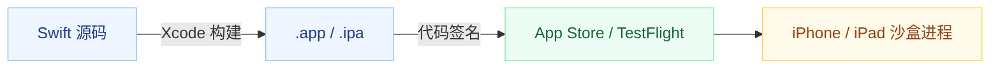
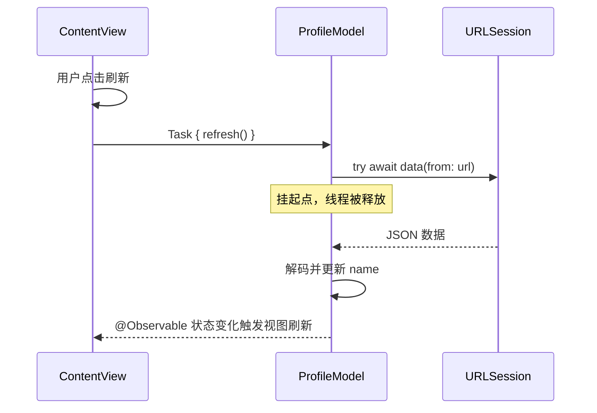
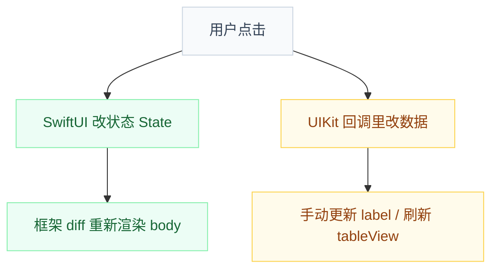
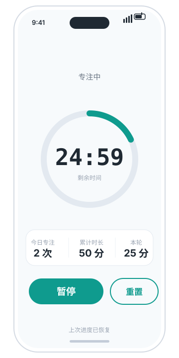

# iOS与Swift基础

> 这篇从 iOS 的运行模型和原生路线的边界讲起，经过 Xcode 环境与第一个程序、Swift 类型系统、Optional 空安全、集合函数与闭包、结构体类与协议、错误处理，再到 Swift Concurrency 和 UIKit/SwiftUI 入门，最后落到一个完整的专注计时 App。
>
> 学完能用 Swift 6 写出类型安全的业务模型，用 async/await 组织异步代码，并在 Xcode 里独立交付一个可运行、状态可恢复的 SwiftUI 应用。

## 一、iOS 的定位与边界

iOS 应用是编译为原生机器码的二进制，加上动态链接的系统框架（Framework），运行在各自的沙盒（Sandbox）进程里：一个应用一个进程，所有界面更新都发生在主线程，所有文件访问都被限制在沙盒目录内。

原生路线的三个核心判断：

1. **主线程只做界面**：长时间任务必须切走，Swift 6 的严格并发（Strict Concurrency）把"跨线程共享可变状态"变成编译错误；
2. **Optional 是类型系统的一部分**：空指针风险在编译期暴露，而不是运行时崩溃；
3. **系统框架是唯一后端**：网络、存储、动画都来自系统 SDK，不引入界面层的第三方运行时。



技术栈从下到上分四层：

| 层 | 内容 | 说明 |
|---|---|---|
| 语言 | Swift 6.x | `swiftc` 编译，值类型优先 |
| 界面 | SwiftUI / UIKit | 新项目默认 SwiftUI，存量代码大量 UIKit |
| 基础库 | Foundation、Observation | 字符串、日期、网络、状态观察 |
| 系统 | Darwin、各系统服务 | 文件、推送、权限、蓝牙 |

版本基线（2026-11）：

| 项 | 基线 | 备注 |
|---|---|---|
| Xcode | 当前稳定版（26.x） | iOS 开发唯一的官方 IDE |
| Swift | 6.x，启用 Swift 6 语言模式 | 严格并发默认开启 |
| 部署目标 | iOS 18+ | 用到的 API 均覆盖 iOS 18 |
| 模拟器 | iPhone 16 或更新机型 | 真机调试需 Apple ID 签名 |

> 边界：原生 iOS 适合需要系统能力（推送、小组件、传感器）、高性能动效和长期维护的应用；以内容展示为主、团队全是 Web 技术栈的项目，跨平台方案通常更划算。开发 iOS 原生应用**只能在 macOS 上进行**，Windows/Linux 只能练习 Swift 语言本身，无法构建 iOS App，这是与 Android 最大的环境差异。

## 二、环境与第一个程序

### 2.1 安装 Xcode 与验证

Xcode 只能装在 macOS 上，从 App Store 或 developer.apple.com/download 下载；写命令行工具和 CI 脚本时还需要 Command Line Tools。

| 环境 | 安装方式 | 验证 |
|---|---|---|
| macOS（必需） | App Store 装 Xcode，或官网下载 `.xip` 解压到 `/Applications` | `xcodebuild -version` |
| Windows | 仅语言练习：swift.org 下载 Swift 工具链 exe | `swift --version`，不能构建 iOS App |
| Ubuntu 24.04 | 仅语言练习：swift.org 下载 tar.xz 解压，或用 swiftly 安装 | `swift --version` |
| Rocky/CentOS 9 | 仅语言练习：swift.org tar.xz 解压后加 PATH | `swift --version` |

安装后的验证命令（macOS）：

```bash
xcodebuild -version        # 确认 Xcode 可用
swift --version            # 确认 Swift 工具链版本
xcrun simctl list devices available | head -5   # 列出可用模拟器
```

预期输出（版本号以本机为准，示例）：

```text
Xcode 26.2
Build version 17C5033z
swift-driver version: 1.133.0 Apple Swift version 6.2 (swiftlang-6.2.0.19.9 clang-1700.6.3.2)
Target: arm64-apple-macosx26.0
-- iOS 26.0 --
    iPhone 16 Pro (4A1B2C3D-5E6F-7A8B-9C0D-1E2F3A4B5C6D) (Shutdown)
```

> 边界：如果 `xcodebuild` 报 "command line tools are already installed, use ..."，先执行 `sudo xcode-select -s /Applications/Xcode.app/Contents/Developer` 把开发目录切到完整版 Xcode；Command Line Tools 不含模拟器和 iOS SDK，编译不了 App。

### 2.2 第一个 Swift 程序（命令行）

不打开 Xcode 也能验证 Swift 环境：Swift 与 Java 一样是先编译后执行，只是 `swiftc` 通常被 Xcode 包在幕后。

`hello.swift`：

```swift
let app = "FocusTimer"          // 只读：名字确定后不会被改
var launchCount = 0             // 可变：随运行变化
launchCount += 1
print("Hello, Swift! app=\(app), count=\(launchCount)")  // \(...) 是字符串插值
```

编译运行：

```bash
swiftc hello.swift -o hello   # swiftc 编译为可执行文件
./hello
```

预期输出：

```text
Hello, Swift! app=FocusTimer, count=1
```

快速试验单个表达式用 REPL：

```bash
swift
```

预期输出（示例）：

```text
Welcome to Swift version 6.2.
Type :help for assistance.
  1> 1 + 2
$R0: Int = 3
```

### 2.3 第一个 iOS App（Xcode 模板）

Xcode 里 `File → New → Project → iOS → App`，Interface 选 SwiftUI，Language 选 Swift，创建后直接 `Cmd+R` 在模拟器运行，看到 "Hello, world!" 即环境闭环。模板会生成三个角色明确的文件：

| 文件 | 角色 |
|---|---|
| `App` 入口 | `@main` 标注的 `App` 结构体，应用生命周期 |
| `ContentView` | 第一个界面 |
| `Assets` / `Info.plist` | 资源与权限声明 |

> 边界：部署目标（Deployment Target）在 Target → General 里设为 iOS 18.0；Swift 6 语言模式在 Build Settings → Swift Language Version 里选 Swift 6。模板默认可能是最低版本，先改再写代码，避免用到高版本 API 后回退目标时集体报错。

## 三、Swift 类型系统基础

Swift 是静态强类型语言：每个变量类型在编译期确定，且**不存在隐式数值转换**，`Int` 与 `Double` 直接相加是编译错误。

```swift
let version = "6"          // 只读，类型推断为 String
var count = 0              // 可变，类型推断为 Int
let price = 25.0           // 推断为 Double（带小数点即是 Double）
let ok = true              // Bool 只有 true / false

let total = price + 5.0    // Double + Double 才合法
// let bad = price + 5      // 编译错误：Binary operator '+' cannot be applied to Double and Int

let minutes = 25
let seconds = Double(minutes) * 60   // 必须显式转换，Int → Double
let label = "本次专注 \(minutes) 分钟" // 字符串插值，比拼接更常用
```

| 写法 | 含义 | 建议 |
|---|---|---|
| `let` | 只读引用 | 默认写 `let`，需要改再换 `var` |
| `var` | 可变引用 | 越少越好，可变状态是 bug 源头 |
| `Double(x)` | 显式类型转换 | 数值混算的标准写法 |
| `"\(x)"` | 字符串插值 | 代替 `+` 拼接 |

整数与小数的选型规则：

```swift
let userId: Int = 10086         // 计数、ID 用 Int
let score: Double = 98.5        // 一切带小数的数据用 Double
let precise: Double = 0.1 + 0.2 // 0.30000000000000004，金额不能用 Double
```

> 边界：金额不要用 `Double` 浮点运算，用整数"分"存储（`let cents = 1999`）再换算展示，或用 `Decimal`。这是所有语言的通病，不是 Swift 特有。

字符串常用操作：

```swift
let tag = "  swift-basic "
let trimmed = tag.trimmingCharacters(in: .whitespaces)  // "swift-basic"，用户输入先去首尾空白
let upper = tag.uppercased()
let has = tag.contains("swift")        // true
let words = "a,b,c".split(separator: ",")   // ["a","b","c"]，结果是 Substring 数组
```

> 边界：`String` 是值类型，赋值和传参都是拷贝（编译器有写时优化，不必担心性能）；`split` 返回 `[Substring]` 避免重复分配，需要长期持有时 `String(word)` 转回字符串。

## 四、Optional 与空安全

Optional（可选类型）是Swift 空安全的核心：`String?` 是一个装着 `String` 或 `nil` 的枚举，编译器强制在解包之后才能使用值，`nil` 崩溃从运行时问题变成编译错误。

```swift
var nickname: String? = nil     // 声明可空：显式写 ?
nickname = "swiftdev"

// 1. 安全调用：为 nil 时整个表达式是 nil，不崩溃
let length = nickname?.count            // Int?，可能是 nil

// 2. 空合并：为 nil 时给默认值，界面兜底最常用
let shown = nickname ?? "未设置"        // String，一定有值

// 3. if let 解包：作用域内拿到非空值
if let name = nickname {
    print("昵称长度 \(name.count)")     // name 在这里是 String，非 String?
}

// 4. guard let 早退：避免金字塔嵌套，函数式代码首选
func greet(name: String?) {
    guard let name else { return }     // Swift 5.7+ 可以省略 = name
    print("hi, \(name)")
}

// 5. 强制解包：为 nil 直接崩溃，生产代码禁用
let forced = nickname!.count           // 此时非 nil，但写法本身就是风险
```

| 写法 | 为 nil 时行为 | 使用建议 |
|---|---|---|
| `x?.y` | 返回 nil | 可选链，取值首选 |
| `x ?? d` | 返回默认值 | 兜底展示 |
| `if let x` | 跳过分支 | 有值才处理 |
| `guard let x else` | 提前返回 | 函数内首选 |
| `x!` | 运行时崩溃 | 禁用 |

强制解包唯一可接受的场景是"程序员已经用断言证明了非空"，例如单元测试里：

```swift
let parsed = try? JSONDecoder().decode([String].self, from: data)
XCTAssertEqual(parsed!.count, 3)   // 测试断言先行，崩溃即测试失败，可接受
```

隐式解包可选 `String!` 是历史包袱，主要出现在旧式 `@IBOutlet` 连线上；新项目用 SwiftUI 后基本不会遇到，遇到时按 `?` 的规则改写。

> 边界：不要为了绕过编译器把变量都声明成 `?` 再到处 `!`，那等于放弃空安全。规则是：**能非空就非空，只有真正的"可能没有"才标 `?`**，例如网络返回字段、查找结果、用户未填项。

## 五、集合、函数与闭包

Swift 的三大集合都是泛型且强类型：`Array`（有序可重复）、`Dictionary`（键值对）、`Set`（去重无序），集合本身也是值类型，赋值即拷贝。

```swift
var scores = [82, 95, 77, 90]      // Array<Int>
scores.append(88)
scores.sort()                     // 原地排序（var 才能 sort，let 只能 sorted）

let top = scores.filter { $0 >= 90 }        // [90, 95]，$0 是闭包参数缩写
let total = scores.reduce(0, +)              // 432
let names = ["focus", "rest"].map { $0.capitalized }  // ["Focus", "Rest"]

var dict: [String: Int] = ["ok": 200, "fail": 3]
dict["skip"] = 5                  // 增改都用下标
let okCount = dict["ok"] ?? 0     // 下标访问返回 Int?，必须处理 nil

let tags: Set<String> = ["work", "work", "life"]  // {"work", "life"}
for (key, value) in dict {        // 遍历字典拿到元组
    print("\(key): \(value)")
}
```

函数的参数标签是 Swift 的显著特征：调用处读起来像自然语言，标签用 `_` 才能省略。

```swift
// 外部标签 userId / amount，内部参数名同名；coupon 有默认值
func charge(userId: Int, amount: Double, coupon: Double = 0) -> Double {
    return amount - coupon
}
charge(userId: 10086, amount: 25.0)          // 25.0，默认参数可省
charge(userId: 10086, amount: 25.0, coupon: 5)  // 20.0

// 返回多个值用元组，比定义小类更轻
func minMax(_ nums: [Int]) -> (min: Int, max: Int) {
    (nums.min() ?? 0, nums.max() ?? 0)
}
let r = minMax(scores)
print(r.max)    // 95
```

闭包是能捕获上下文的匿名函数，按使用距离分三种写法，从啰嗦到简洁：

```swift
let plans = [25, 15, 50]

// 完整写法
let sorted1 = plans.sorted(by: { (a: Int, b: Int) in return a < b })
// 类型推断 + 隐式返回
let sorted2 = plans.sorted(by: { a, b in a < b })
// 尾随闭包 + 参数缩写：日常写法
let sorted3 = plans.sorted { $0 < $1 }        // [15, 25, 50]
```

> 边界：闭包会强引用捕获的对象，在类的方法里写异步闭包要加 `[weak self]`，否则对象释放不掉；这是 iOS 内存泄漏的头号来源，第八章的 `Task` 同样适用。

## 六、结构体、类、枚举与协议

Swift 默认用结构体（struct，值类型）：赋值即拷贝、天然线程安全；类（class，引用类型）只在需要共享可变状态、继承或生命周期管理（`deinit`）时使用。

```swift
struct FocusSession: Codable, Identifiable {   // Codable 提供编解码；Identifiable 供列表定位
    let id: UUID
    var minutes: Int
    var tag: String
    private(set) var isDone = false            // 外部只读，内部可改

    // 值类型方法要修改自身，必须标 mutating
    mutating func finish() { isDone = true }
}

final class SessionStore {                     // final：禁止继承，编译器可优化
    private(set) var sessions: [FocusSession] = []
    func add(_ s: FocusSession) { sessions.append(s) }
    func remove(id: UUID) {
        sessions.removeAll { $0.id == id }     // 闭包过滤删除
    }
}
```

值类型与引用类型的核心差异：

```swift
var a = FocusSession(id: UUID(), minutes: 25, tag: "work")
var b = a
b.minutes = 50
print(a.minutes)   // 25 —— b 是拷贝，改 b 不影响 a

let storeA = SessionStore()
let storeB = storeA
storeB.add(FocusSession(id: UUID(), minutes: 15, tag: "rest"))
print(storeA.sessions.count)   // 1 —— 引用类型，a、b 指向同一个对象
```

| 维度 | struct | class |
|---|---|---|
| 语义 | 值，赋值拷贝 | 引用，赋值共享 |
| 继承 | 无（用协议） | 有 |
| 释放 | 无 deinit | 有 deinit |
| 默认选择 | 是 | 需要时才用 |

枚举（enum）是 Swift 表达"有限状态"的利器，关联值让它能携带数据，比常量字典安全得多：

```swift
enum LoadState {
    case idle
    case loading
    case loaded([FocusSession])   // 关联值：状态携带数据
    case failed(String)
}

let state: LoadState = .loaded([a])
switch state {
case .idle:
    print("未开始")
case .loading:
    print("加载中")
case .loaded(let list):            // 模式匹配解出关联值
    print("共 \(list.count) 条")
case .failed(let msg):
    print("失败：\(msg)")
}
```

协议（protocol）定义能力，扩展（extension）给协议提供默认实现，"面向协议"取代了继承体系：

```swift
protocol Clocked {                 // 能力：有分钟数
    var minutes: Int { get }
}

extension Clocked {               // 所有遵循者白拿 seconds，不必重复实现
    var seconds: Int { minutes * 60 }
}

struct RestSession: Clocked {
    var minutes: Int
}
print(RestSession(minutes: 5).seconds)   // 300
```

> 边界：模型层（数据结构）一律 struct + Codable；界面层的状态对象需要被多个视图共享观察时用 class（如第九章、第十章的 `@Observable` 模型）。判断标准就一条：谁需要"改一处、处处见"的共享可变性，谁用 class。

## 七、错误处理与泛型

Swift 用类型化的错误处理：`throws` 函数要么返回值要么抛出错误，调用方必须 `try` 显式标记，漏处理是编译错误，而不是异常随时飞出。

```swift
enum FocusError: Error {          // 错误用枚举建模，可穷举、可精确捕获
    case badInput
    case storageFailed(String)
}

// throws 声明"我可能失败"
func normalize(minutes: Int) throws -> Int {
    guard minutes > 0, minutes <= 180 else {
        throw FocusError.badInput   // 业务规则：0 到 180 分钟才合法
    }
    return minutes
}

// do-catch 按错误类型分别处理
do {
    let m = try normalize(minutes: 25)
    print("本次专注 \(m) 分钟")
} catch FocusError.badInput {
    print("时长必须在 1-180 分钟之间")
} catch {
    print("其他错误：\(error)")    // 兜底分支必须有，编译器强制穷尽
}

// try? 把失败折叠成 Optional，适合"失败了就空着"的场景
let maybe = try? normalize(minutes: 0)   // nil
```

真实业务里错误处理的标准形态是 `Codable` + 网络/文件解析：

```swift
import Foundation

struct SessionList: Codable {
    let items: [FocusSession]
}

let json = """
{"items": [{"id": "AAA-111", "minutes": 25, "tag": "work", "isDone": false}]}
""".data(using: .utf8)!

do {
    // decode 是 throws，因为字段缺失、类型不匹配都会抛 DecodingError
    let list = try JSONDecoder().decode(SessionList.self, from: json)
    print("解析 \(list.items.count) 条")   // 解析 1 条
} catch let DecodingError.keyNotFound(key, _) {
    print("缺字段：\(key.stringValue)")   // 精确定位是哪个字段错了
} catch {
    print("解析失败：\(error)")
}
```

泛型让"对任意类型的操作"只写一遍，标准库里 `Array`、`Optional` 全是泛型：

```swift
// 约束 T 遵循 Comparable，函数体内才能用 <
func topOne<T: Comparable>(_ items: [T]) -> T? {
    guard let first = items.first else { return nil }  // 空数组返回 nil 而不是崩溃
    return items.reduce(first) { $0 > $1 ? $0 : $1 }
}
topOne([3, 9, 2])        // 9
topOne(plans)            // 50
topOne(["b", "a"])       // "b"
```

> 边界：不要用 `try?` 吞掉一切再 `?? 默认值`，那会把"字段改名了""服务端返回 500"静默成空页面；用户可见的失败要走到 `catch` 并给出提示，`try?` 只用于日志、埋点这类"失败无所谓"的路径。

## 八、Swift Concurrency

Swift Concurrency（async/await）把异步代码写成顺序代码：`await` 标记挂起点，编译器在等待期间释放线程；配合 Swift 6 语言模式，跨并发域共享可变状态直接编译报错。

先看最常用的三件事：异步函数、任务（Task）、并发取值。

```swift
import Foundation

// 1. async 函数：模拟网络请求，2 秒后返回
func fetchSessions() async throws -> [FocusSession] {
    try await Task.sleep(for: .seconds(2))   // 挂起而非阻塞线程
    return [FocusSession(id: UUID(), minutes: 25, tag: "work")]
}

// 2. async let 并发发起多个请求，await 时收结果
func loadAll() async throws -> ([FocusSession], Int) {
    async let sessions = fetchSessions()     // 两个请求同时发出
    async let quota = fetchSessions()
    let (a, b) = try await (sessions, quota) // 在这里等待
    return (a, b.count)
}

// 3. Task：从同步上下文（如按钮回调）启动异步工作
Task {
    do {
        let (list, _) = try await loadAll()
        print("拿到 \(list.count) 条")
    } catch {
        print("请求失败：\(error)")
    }
}
```

| 工具 | 解决什么 | 典型场景 |
|---|---|---|
| `async/await` | 顺序化异步逻辑 | 网络、磁盘 |
| `Task { }` | 从同步代码启动异步 | 按钮点击后发请求 |
| `async let` | 固定数量并发 | 同时拉多个接口 |
| `TaskGroup` | 动态数量并发 | 列表逐项并发拉详情 |
| `actor` | 保护可变状态 | 计数器、缓存 |
| `@MainActor` | 隔离到主线程 | 所有 UI 更新 |

`actor` 是引用类型，但它的可变状态只能通过 `await` 串行访问，数据竞争（Data Race）在语言层面被消除：

```swift
actor TickCounter {
    private(set) var count = 0
    func tick() { count += 1 }         // actor 内部方法直接改，外部看不到中间状态
}

let counter = TickCounter()
Task {
    await counter.tick()               // 跨 actor 访问必须 await，排队串行执行
    print(await counter.count)         // 1
}
```

`@MainActor` 把类型隔离到主线程，是界面代码的默认选择：

```swift
@MainActor
final class ProfileModel {
    var name = ""

    func refresh() async throws {
        // await 返回后自动回到主线程，这里改 name 更新 UI 是安全的
        let sessions = try await fetchSessions()
        name = "共 \(sessions.count) 次专注"
    }
}
```

请求到渲染的完整时序：



> 边界：三条红线。第一，不要写"发射后不管"的裸 `Task` 又不持有句柄，界面销毁后它还在跑、还在更新已废弃的模型；可取消的工作放在 `Task` 里并保存引用（第十章案例就是这么做的）。第二，不要在异步代码里直接 `try!`。第三，Swift 6 模式下编译器报 "main actor-isolated" 相关错误时，正确动作是把类型或方法标上 `@MainActor`/`@Sendable`，而不是关掉严格检查。

## 九、UIKit 与 SwiftUI 入门

iOS 有两代界面框架：UIKit（命令式，1998 年传承的命令式风格，系统全部存量）与 SwiftUI（声明式，2019 年起，新项目默认）。区别的本质是**状态与界面的关系**：UIKit 手动更新界面，SwiftUI 声明"界面是状态的函数"，状态变则界面自动变。

SwiftUI 最小页面，一个可运行的计数器：

```swift
import SwiftUI

struct CounterView: View {
    @State private var count = 0   // @State：视图私有的可变状态，变化自动触发重绘

    var body: some View {          // body 是"状态的函数"，只描述不命令
        VStack(spacing: 16) {
            Text("次数：\(count)")
                .font(.title)
            Button("点一下") {
                count += 1         // 改状态，而不是改 Text
            }
            .buttonStyle(.borderedProminent)
        }
    }
}
```

`Cmd+R` 运行，点击按钮数字递增。同样的页面用 UIKit 程序化写法（片段，需嵌入 App 壳运行）：

```swift
import UIKit

final class CounterViewController: UIViewController {
    private let countLabel = UILabel()
    private var count = 0

    override func viewDidLoad() {      // 生命周期回调：视图加载完成，做一次性初始化
        super.viewDidLoad()
        view.backgroundColor = .systemBackground

        countLabel.text = "次数：0"
        countLabel.font = .preferredFont(forTextStyle: .title1)
        countLabel.translatesAutoresizingMaskIntoConstraints = false
        view.addSubview(countLabel)

        let button = UIButton(type: .system)
        button.setTitle("点一下", for: .normal)
        // [weak self]：按钮强持有闭包，闭包再强持有 self 就是引用循环
        button.addAction(UIAction { [weak self] _ in
            self?.count += 1
            self?.countLabel.text = "次数：\(self?.count ?? 0)"   // 手动刷新界面
        }, for: .touchUpInside)
        button.translatesAutoresizingMaskIntoConstraints = false
        view.addSubview(button)

        NSLayoutConstraint.activate([
            countLabel.centerXAnchor.constraint(equalTo: view.centerXAnchor),
            countLabel.centerYAnchor.constraint(equalTo: view.centerYAnchor),
            button.centerXAnchor.constraint(equalTo: view.centerXAnchor),
            button.topAnchor.constraint(equalTo: countLabel.bottomAnchor, constant: 24)
        ])
    }
}
```

两代框架的状态流向对比：



SwiftUI 状态属性选型（都在视图或模型上，职责不同）：

| 属性包装器 | 用在 | 场景 |
|---|---|---|
| `@State` | 视图 | 视图私有简单状态 |
| `@Binding` | 子视图 | 父传子的双向绑定 |
| `@Observable` + `@State` | 模型类 | 共享业务状态（iOS 17+） |
| `@Environment` | 视图 | 主题、场景、依赖注入 |

| 维度 | SwiftUI | UIKit |
|---|---|---|
| 心智 | 声明状态 | 命令式更新 |
| 新项目 | 默认选择 | 维护存量时用 |
| 学习曲线 | 门槛在状态模型 | 门槛在生命周期与代理 |
| 混用 | `UIViewRepresentable` 嵌 UIKit | UIHostingController 嵌 SwiftUI |

> 边界：新项目一律 SwiftUI 起步；接手 UIKit 存量代码时按原框架改，SwiftUI 视图可以用 `UIHostingController` 嵌进 UIKit 页面，反向也能用 `UIViewRepresentable` 包旧控件，混合过渡是常态，不要为"统一"重写稳定页面。

## 十、最佳实践案例

### 10.1 案例背景

小团队要做一个内部工具 App「专注计时」：25 分钟番茄钟，支持开始、暂停、重置，切到后台再回来时间不"冻结"，杀掉 App 重启能恢复上次剩余时间。约束：SwiftUI + Swift 6 语言模式，纯本地功能，不引入任何第三方依赖，部署目标 iOS 18。现状是初版直接把剩余秒数写在 View 的 `@State` 里，切换页面状态就丢，也没有任何持久化。

### 10.2 案例实操

第 1 步：创建工程。Xcode `File → New → Project → iOS → App`，Product Name 填 `FocusTimer`，Interface 选 SwiftUI；Target → General 把 Deployment Target 设为 iOS 18.0；Build Settings 里 Swift Language Version 选 Swift 6。`Cmd+R` 空模板先跑通。

第 2 步：写模型 `FocusModel.swift`。计时用异步循环而不是 `Timer`，状态集中在一个 `@MainActor @Observable` 类里：

```swift
import Foundation
import Observation

@MainActor
@Observable
final class FocusModel {
    private(set) var remainingSeconds: Int     // 私有可写：外部只能通过方法改变状态
    private(set) var isRunning = false

    private let totalSeconds: Int
    private var timerTask: Task<Void, Never>?  // 持有任务句柄，才能 cancel
    private var leftAtBackground: Date?

    init(totalMinutes: Int = 25) {
        let total = totalMinutes * 60
        totalSeconds = total
        // 重启恢复：上次退出时持久化的剩余秒数有效则用它，否则从满额开始
        let saved = UserDefaults.standard.integer(forKey: "focus.remaining")
        remainingSeconds = (1...total).contains(saved) ? saved : total
    }

    var minutesText: String {
        String(format: "%02d:%02d", remainingSeconds / 60, remainingSeconds % 60)
    }

    var progress: Double {   // 已完成比例，驱动进度环
        1 - Double(remainingSeconds) / Double(totalSeconds)
    }

    func start() {
        guard !isRunning, remainingSeconds > 0 else { return }
        isRunning = true
        // Task 继承当前 @MainActor 上下文，循环里的状态更新天然在主线程
        timerTask = Task { [weak self] in
            guard let self else { return }
            while self.remainingSeconds > 0 && !Task.isCancelled {
                try? await Task.sleep(for: .seconds(1))   // 挂起 1 秒，不占线程
                guard !Task.isCancelled else { break }    // cancel 后不再走剩余逻辑
                self.remainingSeconds -= 1
                self.persist()
            }
            self.isRunning = false
            if self.remainingSeconds == 0 {
                // 一轮结束回到满额，方便直接开始下一轮
                self.remainingSeconds = self.totalSeconds
                self.persist()
            }
        }
    }

    func pause() {
        timerTask?.cancel()   // 取消任务即停止循环，sleep 中的等待会立即被打断
        isRunning = false
    }

    func reset() {
        timerTask?.cancel()
        isRunning = false
        remainingSeconds = totalSeconds
        persist()
    }

    func handleScenePhase(_ phase: ScenePhase) {
        if phase != .active {
            leftAtBackground = Date()   // 记录离开前台的绝对时刻
        } else if let left = leftAtBackground {
            // 系统挂起期间 Task 循环不推进，回前台用绝对时间差校准
            let elapsed = Int(Date().timeIntervalSince(left))
            if isRunning {
                remainingSeconds = max(0, remainingSeconds - elapsed)
            }
            leftAtBackground = nil
            persist()
        }
    }

    private func persist() {
        UserDefaults.standard.set(remainingSeconds, forKey: "focus.remaining")
    }
}
```

第 3 步：写界面 `ContentView.swift`，进度环 + 两个按钮，并接上前后台切换：

```swift
import SwiftUI

struct ContentView: View {
    @State private var model = FocusModel(totalMinutes: 25)  // @State 持有可观察模型
    @Environment(\.scenePhase) private var scenePhase

    var body: some View {
        VStack(spacing: 32) {
            Text(model.isRunning ? "专注中" : "准备专注")
                .font(.headline)
                .foregroundStyle(.secondary)

            ZStack {
                Circle()
                    .stroke(.gray.opacity(0.15), lineWidth: 12)   // 背景轨道
                Circle()
                    .trim(from: 0, to: model.progress)   // 按进度画弧
                    .stroke(.teal, style: StrokeStyle(lineWidth: 12, lineCap: .round))
                    .rotationEffect(.degrees(-90))       // 从 12 点方向起画
                Text(model.minutesText)
                    .font(.system(size: 44, weight: .bold, design: .monospaced))  // 等宽防跳动
                    .contentTransition(.numericText())  // 数字变化有滚动动画
            }
            .frame(width: 220, height: 220)
            .animation(.default, value: model.progress)

            HStack(spacing: 16) {
                Button(model.isRunning ? "暂停" : "开始") {
                    model.isRunning ? model.pause() : model.start()
                }
                .buttonStyle(.borderedProminent)
                Button("重置") { model.reset() }
                    .buttonStyle(.bordered)
            }
        }
        .padding()
        // 前后台切换交给模型校准，视图不参与计时逻辑
        .onChange(of: scenePhase) { _, phase in
            model.handleScenePhase(phase)
        }
    }
}
```

第 4 步：确认 `FocusTimerApp.swift` 入口（模板已生成，无需改动）：

```swift
import SwiftUI

@main
struct FocusTimerApp: App {
    var body: some Scene {
        WindowGroup { ContentView() }
    }
}
```

`Cmd+R` 运行在 iPhone 模拟器上，界面效果：



### 10.3 案例结果

按四步验证（模拟器实测路径）：

1. 点「开始」，时间从 25:00 每秒递减，进度环随时间增长；
2. 点「暂停」，数字停住；再点「开始」继续；
3. 「开始」后按 Home 键切后台，等 30 秒再回来，剩余时间减少约 30 秒——说明绝对时间校准生效；
4. 杀掉 App 重新打开，剩余时间与退出时一致——说明 UserDefaults 持久化生效。

失败模式与处理：

| 现象 | 原因 | 处理 |
|---|---|---|
| 切后台回来时间没走 | 未做绝对时间校准 | `handleScenePhase` 记录 `Date` 差值 |
| 暂停无效，继续倒计时 | 只改了 `isRunning` 没 cancel | 必须持有 `timerTask` 并 `cancel()` |
| 数字每一秒轻微跳动 | 非等宽字体的字宽变化 | `design: .monospaced` |
| 重启后计数异常 | 恢复值未做范围校验 | `(1...total).contains(saved)` |

复盘：初版把秒数放 `@State`，等于把业务状态放进视图，切页面就丢；终版把状态收敛到 `@MainActor @Observable` 模型，视图只负责展示和转发动作，计时、校准、持久化全部内聚在模型里。`Task.sleep` 循环 + 句柄取消，比 `Timer` 更贴合并发模型：挂起不占线程，取消即停。绝对时间校准补上了"系统挂起不发秒"的盲区——任何依赖循环回调的计时器都有这个坑，一律用 `Date` 差值兜底（示例指标：模拟器 iOS 18 SDK，Xcode 26.x，Swift 6 语言模式编译零警告通过）。
