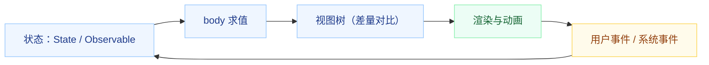
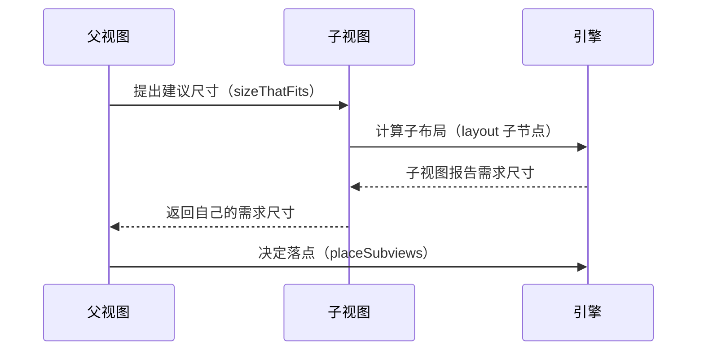
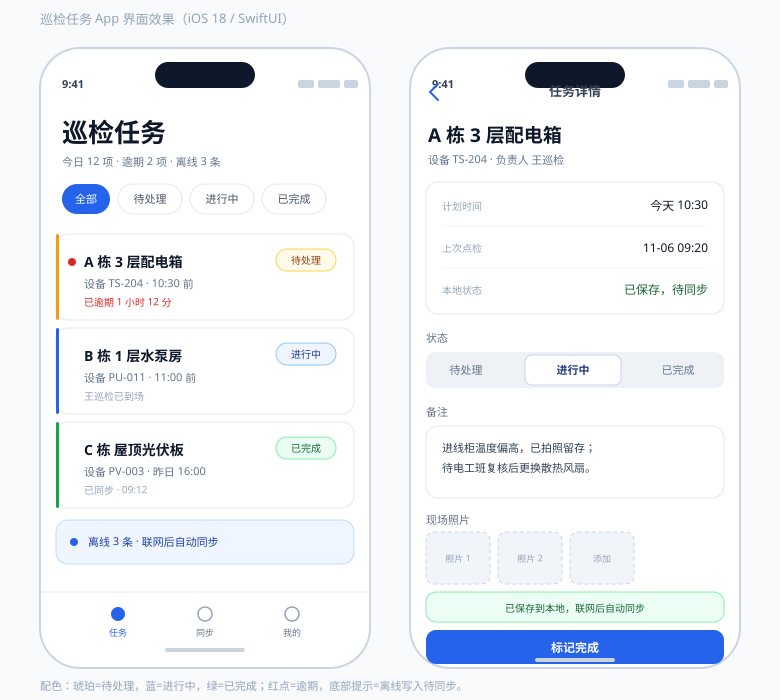

# iOS SwiftUI与工程化

> 这篇从 SwiftUI 的声明式模型讲起，经过环境与最小工程、布局与样式、状态与数据流、导航与深链、SwiftData 持久化、并发网络，最后落到模块化工程、签名上架、排障手册，以及一个离线巡检任务 App 的完整交付。
>
> 学完能独立搭起一个 iOS 18+ 的 SwiftUI 工程，把状态、导航、持久化和网络串成可上架的 App，并完成签名、TestFlight 与提审。

## 一、SwiftUI 的模型与边界

SwiftUI 用值类型的视图描述界面，界面是状态的函数：状态变了，`body` 重新求值，系统做差量更新，不存在 view controller 这一层。这条模型决定了写法上的三条硬约束：状态只有一份（单一数据源）、`body` 必须是纯函数、视图之间不互相引用对方实现。

```swift
import SwiftUI

struct OrderRow: View {
    let order: Order  // 只读输入：父视图传进来的数据，不反向持有

    var body: some View {
        // body 是纯函数：同样的 order 一定画出同样的行，SwiftUI 才敢跳过没变化的子树
        HStack {
            Text(order.title)
            Spacer()
            Text(order.status.text)
                .foregroundStyle(order.status.tint) // 样式跟着数据走，不用外部命令式改视图
        }
        .padding(.vertical, 8)
    }
}
```

SwiftUI 的运行循环是一条闭环：状态 → `body` → 视图树 → 渲染 → 事件 → 回写状态。理解它是理解「为什么不该在 `body` 里发请求、起定时器」的前提。



两个最常踩的概念：**identity** 与 **依赖跟踪**。SwiftUI 靠 identity 判断「这还是那个视图吗」：`ForEach` 必须给稳定 `id`，否则插入一条数据会把整列重建；`if` 的两个分支是两个不同的视图，切换时会丢掉内部 `@State`。依赖跟踪方面，`@Observable`（Observation 框架）记录 `body` 实际读到了哪些属性，只有读过的属性变了才刷新，`ObservableObject` + `@Published` 那套在新代码里不再需要。

| 选用判断 | SwiftUI | UIKit |
|---|---|---|
| 常规业务界面 | 首选，代码量小 | 能做，样板多 |
| 精确控制 cell 复用、大列表性能 | 够用，配合 `LazyVGrid` | 更可控 |
| 复杂文本编辑、相机、地图、Metal | 桥接（`UIViewRepresentable`） | 直接写 |
| 最低部署目标低于 iOS 16 | 不适用 | 适用 |

> 边界：需要精确定制系统交互、依赖大量第三方 UI 库，或要支持 iOS 15 的老项目，保持 UIKit 为主、新模块用 SwiftUI 混编。SwiftUI 与 UIKit 可以双向嵌套：`UIHostingController` 把 SwiftUI 塞进 UIKit，`UIViewRepresentable` 反过来。

## 二、环境与最小工程

iOS 的构建工具只有一条链：Xcode 提供 SDK 与模拟器，`xcodebuild` 负责命令行构建，SPM 管依赖。版本基线（2026-11-13，以本机 SDK 为准）：

| 组件 | 基线 | 说明 |
|---|---|---|
| Xcode | 26.x（当前稳定版） | 唯一官方 IDE 与构建工具 |
| Swift | 6.2（Swift 6 语言模式） | 严格并发检查默认开启 |
| 部署目标 | iOS 18.0 | Observation、SwiftData 全部可用 |
| 包管理 | Swift Package Manager | 新项目默认，CocoaPods 只维护存量 |
| 测试 | Swift Testing | `@Test` / `#expect`，与 XCTest 并存 |

环境只有 macOS 能完整构建 iOS App。Windows / Linux 的安装边界必须写清，否则团队第一天就会在这里卡住：

| 环境 | 安装与能力（2026-11） |
|---|---|
| macOS 14+ | App Store 安装 Xcode，或 `xcode-select --install` 只装命令行工具；能构建、能跑模拟器、能签名上架 |
| Windows 10/11 | 本地无法构建 iOS；只装 Windows 版 Xcode 无意义，用云 macOS（GitHub Actions macos runner、MacStadium）或远程开发 |
| Ubuntu 24.04/26.04 | `curl .../swift-6.2-RELEASE-ubuntu-24.04.tar.gz` 装 Swift 工具链；无 SwiftUI/UIKit，仅纯逻辑可测 |
| Rocky/CentOS 9/10 | 同上，装 RHEL 版 Swift tar.gz；CI 上只做逻辑包测试 |

装好后的自检命令与预期输出：

```bash
xcodebuild -version
# Xcode 26.0
# Build version 26A000

xcode-select -p
# /Applications/Xcode.app/Contents/Developer

xcrun simctl list devices available | grep iPhone
# iPhone 17 (xxxxxxxx-xxxx-xxxx-xxxx-xxxxxxxxxxxx) (Shutdown)
```

Xcode 新建工程：File → New → Project → App，Interface 选 **SwiftUI**，Storage 选 **SwiftData**（要用本地库）或 **None**，Testing System 选 **Swift Testing**，勾选 Include Tests。Bundle Identifier 写成团队域名反写，例如 `com.example.fieldtasks`。

最小 App 的三段代码，把入口、根视图和预览分开：

```swift
import SwiftUI

@main
struct CounterApp: App {
    var body: some Scene {
        // WindowGroup 管窗口生命周期；iPad/多窗口场景下同一份状态要显式共享，不要依赖单例
        WindowGroup { ContentView() }
    }
}
```

```swift
import SwiftUI

struct ContentView: View {
    @State private var count = 0  // 视图自己拥有这份状态，重建窗口会重置

    var body: some View {
        VStack(spacing: 16) {
            Text("点击次数：\(count)")
                .font(.largeTitle)
            Button("点一下") { count += 1 }  // 事件只回写状态，不直接改界面
        }
        .padding()
    }
}

#Preview {
    ContentView()  // Xcode 预览：改代码立即看到，不必重新跑模拟器
}
```

不打开 IDE 也能跑通，这是 CI 的基础：

```bash
xcodebuild -project Counter.xcodeproj -scheme Counter \
  -destination 'platform=iOS Simulator,name=iPhone 17' \
  -derivedDataPath build build
# ** BUILD SUCCEEDED **

xcrun simctl boot "iPhone 17" && open -a Simulator
xcrun simctl install booted build/Build/Products/Debug-iphonesimulator/Counter.app
xcrun simctl launch --console booted com.example.counter
# 点击次数：3
```

> 边界：模拟器没有相机、蓝牙、推送、真机 GPU 特性，签名与上架必须在真机验证过；`xcodebuild` 找不到 scheme 时先 `xcodebuild -list`，多半是工程路径或 `-project` 写错。

## 三、视图、布局与样式

SwiftUI 布局不是绝对坐标，而是「父视图给建议尺寸、子视图报告需求尺寸、父视图决定落点」的协商过程。改一个 modifier，布局结果就会变，这也是新手最容易写错的点。

SwiftUI 的布局协商过程是一次从上到下、再从下到上的两轮问询：



Modifier 的顺序就是布局顺序，反过来结果完全不同：

```swift
// 正确：先 padding 再 background，胶囊包住文字和内边距
Text("已超时")
    .padding(.horizontal, 10)
    .padding(.vertical, 4)
    .background(.red.opacity(0.12), in: Capsule())

// 错误：background 在 padding 之前，背景只包住文字，内边距悬在外面
Text("已超时")
    .background(.red.opacity(0.12), in: Capsule())
    .padding(.horizontal, 10)
```

常用容器的分工：

| 容器 | 用途 | 注意 |
|---|---|---|
| `VStack` / `HStack` / `ZStack` | 固定数量的层叠与排列 | 默认居中，`alignment` 决定子轴 |
| `LazyVStack` / `LazyVGrid` | 长列表、瀑布流 | 必须放进 `ScrollView` 才生效 |
| `List` / `Form` | 分组、表格、设置页 | 自带滑动操作与分隔线 |
| `Grid` | 对齐的二维表格 | 非懒加载，数据量小 |
| `ScrollView` | 滚动容器 | 只滚动一层，不要嵌套 |
| `ViewThatFits` | 横竖屏/自适应切换 | 比手写 `GeometryReader` 分支更省事 |

滚动内容贴底的操作栏和适配动态字号的图标：

```swift
struct TaskCard: View {
    let task: TaskItem
    // @ScaledMetric 跟着系统字号缩放，用户开大字号时图标不会挤变形
    @ScaledMetric(relativeTo: .body) private var dotSize = 10

    var body: some View {
        ScrollView {
            LazyVStack(spacing: 8) {
                ForEach(task.children) { child in
                    Text(child.title)
                }
            }
        }
        .safeAreaInset(edge: .bottom) {
            // 贴底操作栏：内容自动避开，不会像 ignoresSafeArea 那样被压住
            HStack {
                Button("标记完成") {}
                Spacer()
                Button("拍照") {}
            }
            .padding()
            .background(.bar)
        }
    }
}
```

> 边界：`GeometryReader` 在 `ScrollView` 里高度会塌成 0，需要自适应卡片时用 `containerRelativeFrame` 或 `ViewThatFits`；不要用固定 `frame` 去适配不同屏幕；`AnyView` 会破坏差量对比，能不写就不写。

## 四、状态与数据流

每个可变状态只有一个所有者：谁创建谁负责，子视图要么拿只读值，要么拿 `Binding`，不复制状态。状态放错层级，是 SwiftUI 项目里最难排查的一类 bug。

Observation 框架让模型层可以单独成类，不需要继承任何基类：

```swift
import Observation

@Observable
final class TaskDraft {
    var title = ""
    var priority = Priority.normal

    // 计算属性不存储，不会被跟踪，也不会触发多余刷新
    var canSave: Bool {
        !title.trimmingCharacters(in: .whitespaces).isEmpty
    }
}
```

```swift
struct DraftEditor: View {
    // 外部所有者传入：只取 Binding，不复制一份
    @Bindable var draft: TaskDraft

    var body: some View {
        Form {
            TextField("标题", text: $draft.title)
            Picker("优先级", selection: $draft.priority) {
                ForEach(Priority.allCases, id: \.self) { Text($0.title) }
            }
        }
    }
}
```

包装器的分工决定状态归属，写错包装器等于把所有权搞混：

| 包装器 | 谁拥有 | 典型用法 |
|---|---|---|
| `@State` | 视图自己 | 本地 UI 状态；持有 `@Observable` 对象的所有权 |
| `@Binding` | 父视图 | 子视图回写父视图状态 |
| `@Bindable` | 外部对象 | 在视图里对 `@Observable` 对象取 `$draft.title` |
| `@Environment` | 上层注入 | 跨层共享模型、`dismiss`、`openURL` |
| `@StateObject` / `@ObservedObject` | 旧写法 | 只有维护 ObservableObject 存量代码时用 |

状态跨视图共享的两条路：显式传递（推荐，依赖看得见）和 `.environment()` 注入（适合模型对象、路由器、主题）。注入后子树用 `@Environment(TaskListModel.self) private var model` 拿到，读到的属性变化才刷新当前视图。

跨重建保留状态有专门的 API：`@SceneStorage` 保窗口级轻量状态（如选中的 Tab），`@AppStorage` 保用户设置。需要跨进程恢复的数据不能只放内存，见第六节。

> 边界：两个视图各自 `@State private var draft = TaskDraft()` 就会得到两份互不相干的状态，改一个另一个不动；`@Observable` 类里被异步修改的属性要标 `@MainActor`，否则 Swift 6 严格并发检查会直接编译不过。不要在 `body` 里创建状态或调用有副作用的函数。

## 五、导航与深链

`NavigationStack` 是唯一推荐的导航容器：路由用可 `Hashable` 的值描述，路径是一份数据，深链就是把 URL 翻译成这份数据。这套做法让「跳转」变得可测试、可恢复。

```swift
enum Route: Hashable {
    case task(UUID)
    case settings
}

struct RootView: View {
    @State private var path: [Route] = []  // 导航路径是唯一真相

    var body: some View {
        NavigationStack(path: $path) {
            TaskListView()
                .navigationTitle("巡检任务")
                .navigationDestination(for: Route.self) { route in
                    switch route {
                    case .task(let id): TaskDetailView(taskID: id)
                    case .settings: SettingsView()
                    }
                }
        }
        .onOpenURL { url in
            // 深链直接重置 path，不从首页层层 push；未匹配的链接忽略而不是崩溃
            if let route = DeepLink.route(from: url) {
                path = [route]
            }
        }
    }
}
```

```swift
enum DeepLink {
    // fieldtasks://task/<uuid>
    static func route(from url: URL) -> Route? {
        guard url.scheme == "fieldtasks",
              url.host == "task",
              let id = UUID(uuidString: url.lastPathComponent)
        else { return nil }
        return .task(id)
    }
}
```

```bash
xcrun simctl openurl booted "fieldtasks://task/8B1CF6E2-3C4D-4F5A-9A21-77E0B4C9D301"
# 模拟器唤起 App，直接落到对应详情页；无效 UUID 时 App 保持原页面
```

呈现层的分工：

| 容器 | 用途 | 注意 |
|---|---|---|
| `NavigationStack` | 层级导航 | 每个 Tab 各配一个栈，不要嵌套 |
| `TabView` | 顶层并列模块 | Tab 状态用 `@SceneStorage` 记住 |
| `sheet(item:)` | 模态编辑 | 绑定可选值，不要 Bool + 另一份状态 |
| `fullScreenCover` | 全屏流程 | 登录、引导、相机 |
| `alert` / `confirmationDialog` | 反馈与确认 | 绑定到状态，不要命令式弹出 |

> 边界：`sheet` 用 `Bool` 加一个独立的数据状态时，第二次打开会串数据；用 `sheet(item: $selectedTask)` 让「选中的那条」本身就是开关。冷启动的深链可能和 `onOpenURL` 时序竞争，统一交给一个 Router 状态对象处理最稳。`navigationDestination` 要放在 `NavigationStack` 直接子视图上，否则深链时目标注册不到。

## 六、持久化：SwiftData 与轻量存储

SwiftData 用 `@Model` 声明表结构，`ModelContainer` 管存储与迁移，`@Query` 直接把查询结果变成视图的数据源，不需要再写一层 DAO。

```swift
import SwiftData

enum TaskStatus: String, Codable, CaseIterable, Sendable {
    case pending, doing, done

    var title: String {
        switch self {
        case .pending: "待处理"
        case .doing: "进行中"
        case .done: "已完成"
        }
    }
}

@Model
final class TaskItem {
    @Attribute(.unique) var id: UUID
    var title: String
    var building: String
    var statusRaw: String   // 存 rawValue：谓词能直接比较字符串，迁移也简单
    var dueAt: Date
    var updatedAt: Date
    var note = ""

    init(id: UUID = UUID(), title: String, building: String,
         status: TaskStatus = .pending, dueAt: Date = .now, updatedAt: Date = .now) {
        self.id = id
        self.title = title
        self.building = building
        self.statusRaw = status.rawValue
        self.dueAt = dueAt
        self.updatedAt = updatedAt
    }

    var status: TaskStatus {
        get { TaskStatus(rawValue: statusRaw) ?? .pending }  // 旧数据缺失时给默认值
        set { statusRaw = newValue.rawValue }
    }

    var isOverdue: Bool {
        guard status != .done else { return false }
        return dueAt < .now
    }
}
```

查询与过滤。`@Query` 在 `init` 里求值，过滤条件变化时靠重建子视图触发：

```swift
struct TaskListScreen: View {
    @State private var filter: TaskStatus?

    var body: some View {
        TaskList(filter: filter)
            .id(filter)  // 过滤条件变了就重建子视图，让 init 里的 @Query 重新求值
    }
}

struct TaskList: View {
    @Environment(\.modelContext) private var context
    @Query private var tasks: [TaskItem]

    init(filter: TaskStatus?) {
        let raw = filter?.rawValue
        // #Predicate 里不能捕获枚举本身，先取出 rawValue 再比较
        _tasks = Query(
            filter: raw.map { value in
                #Predicate<TaskItem> { $0.statusRaw == value }
            },
            sort: [SortDescriptor(\TaskItem.dueAt, order: .forward)]
        )
    }

    var body: some View {
        List {
            ForEach(tasks) { task in
                TaskRow(task: task)
                    .swipeActions(edge: .trailing) {
                        Button("完成", systemImage: "checkmark.circle") {
                            task.status = .done
                            task.updatedAt = .now
                        }
                        .tint(.green)
                    }
            }
        }
    }
}
```

容器的注入点在 App 入口，整个场景树共享同一个容器：

```swift
@main
struct FieldTasksApp: App {
    var body: some Scene {
        WindowGroup { RootView() }
            .modelContainer(for: TaskItem.self)  // 默认存到 Application Support
    }
}
```

其余存储手段的边界：

| 手段 | 适合 | 不要用 |
|---|---|---|
| SwiftData | 结构化业务数据、关系、离线优先 | 只存几个开关 |
| `@AppStorage` / UserDefaults | 设置项、上次同步时间 | 几百条以上的业务记录 |
| 文件目录 | 图片、日志、导出文件 | 多端同步的权威数据 |
| Keychain | 令牌、账号密钥 | 普通业务数据 |

> 边界：`ModelContext` 不是 `Sendable`，不能跨 actor 直接用；后台导入用 `@ModelActor` 生成独立上下文（第七节）。schema 变更要版本化：`SchemaV1`、`SchemaV2` 加 `SchemaMigrationPlan`，直接改字段名会让老用户升级即崩溃。`@Attribute(.unique)` 只在保存时合并重复项，插入前仍应按 id 查一次，见第九节冲突规则。

## 七、网络与 Swift 6 并发

网络层返回 `Sendable` 的 DTO，UI 层在 `MainActor` 上把 DTO 转成模型；`body` 里不发请求，请求的取消跟随视图生命周期。Swift 6 语言模式下，跨 actor 传值必须显式标 `Sendable`，这一步能在编译期挡掉一大半数据竞争。

```swift
struct TaskDTO: Decodable, Sendable {
    let id: UUID
    let title: String
    let building: String
    let status: String
    let dueAt: Date
    let updatedAt: Date
}

enum APIError: Error, Sendable {
    case badStatus(Int)
    case unexpectedResponse
}

struct TaskAPI: Sendable {
    let baseURL: URL
    let session = URLSession.shared

    func fetchTasks(since: Date?) async throws -> [TaskDTO] {
        var comps = URLComponents(url: baseURL.appending(path: "tasks"),
                                  resolvingAgainstBaseURL: false)!
        if let since {
            comps.queryItems = [URLQueryItem(name: "since",
                                             value: since.ISO8601Format())]
        }
        var request = URLRequest(url: comps.url!)
        request.timeoutInterval = 20  // 弱网默认 60s 太久，用户早就不耐烦了
        request.setValue("application/json", forHTTPHeaderField: "Accept")

        let (data, response) = try await session.data(for: request)
        guard let http = response as? HTTPURLResponse else {
            throw APIError.unexpectedResponse
        }
        guard (200..<300).contains(http.statusCode) else {
            throw APIError.badStatus(http.statusCode)
        }
        let decoder = JSONDecoder()
        // 服务端用 ISO8601，默认策略不匹配会整批解码失败
        decoder.dateDecodingStrategy = .iso8601
        return try decoder.decode([TaskDTO].self, from: data)
    }
}
```

服务端响应与本地落地后的预期：

```json
[
  { "id": "8B1CF6E2-3C4D-4F5A-9A21-77E0B4C9D301",
    "title": "A 栋 3 层配电箱", "building": "A 栋",
    "status": "pending", "dueAt": "2026-11-13T10:30:00+08:00",
    "updatedAt": "2026-11-13T09:12:00+08:00" }
]
```

后台写入用 `@ModelActor`，它自动生成持有独立 `ModelContext` 的 actor：

```swift
struct MergeReport: Sendable {
    var inserted = 0
    var updated = 0
    var skipped = 0
}

@ModelActor
actor TaskImporter {
    func merge(_ remote: [TaskDTO]) throws -> MergeReport {
        var report = MergeReport()
        for dto in remote {
            let id = dto.id
            let descriptor = FetchDescriptor<TaskItem>(
                predicate: #Predicate<TaskItem> { $0.id == id }
            )
            if let local = try modelContext.fetch(descriptor).first {
                // 服务端更新才覆盖，避免旧响应把本地刚改的状态冲掉
                guard dto.updatedAt > local.updatedAt else {
                    report.skipped += 1
                    continue
                }
                local.title = dto.title
                local.building = dto.building
                local.statusRaw = dto.status
                local.dueAt = dto.dueAt
                local.updatedAt = dto.updatedAt
                report.updated += 1
            } else {
                modelContext.insert(TaskItem(
                    id: dto.id, title: dto.title, building: dto.building,
                    status: TaskStatus(rawValue: dto.status) ?? .pending,
                    dueAt: dto.dueAt, updatedAt: dto.updatedAt
                ))
                report.inserted += 1
            }
        }
        try modelContext.save()
        return report
    }
}
```

UI 侧的模型在 `MainActor` 上编排网络与写入，视图只负责触发和展示：

```swift
@MainActor
@Observable
final class TaskListModel {
    var isSyncing = false
    var lastSync: Date?
    var errorMessage: String?
    var report: MergeReport?

    private let api: TaskAPI
    private let importer: TaskImporter

    init(api: TaskAPI, importer: TaskImporter) {
        self.api = api
        self.importer = importer
    }

    func sync() async {
        isSyncing = true
        defer { isSyncing = false }  // 出错也要复位按钮状态
        do {
            let dtos = try await api.fetchTasks(since: lastSync)
            report = try await importer.merge(dtos)
            lastSync = .now
            errorMessage = nil
        } catch {
            errorMessage = error.localizedDescription
        }
    }
}
```

```swift
List { /* ... */ }
    .refreshable { await model.sync() }         // 下拉刷新
    .task { await model.sync() }                // 出现时触发，消失时自动取消
```

> 边界：`.task` 在视图消失时取消 Task，同步逻辑要能响应取消（`URLSession` 抛 `URLError.cancelled`）而不是把它当错误提示给用户；不要用 `DispatchQueue.main.async` 混在 `async` 里；明文 HTTP 默认被 ATS 拒绝，需要时在 `Info.plist` 加例外并说明原因。

## 八、工程化：模块、依赖、测试与 CI

工程化从「把功能拆成本地 SPM 包」开始：App target 只留入口、路由和签名，业务逻辑进包，包之间单向依赖。这样逻辑包在 Linux CI 上也能跑测试，不必为每个提交买模拟器时间。

```text
FieldTasks/
├── App/                    # target：入口、路由、依赖注入
├── Packages/
│   ├── CoreModels/         # @Model、DTO、纯逻辑（可 Linux 测试）
│   ├── CoreNetworking/     # API、错误映射
│   ├── DesignSystem/       # 颜色、间距、通用组件
│   └── Features/           # 列表、详情、设置界面
├── Configs/
│   ├── Debug.xcconfig      # 环境变量、Bundle ID、API 地址
│   └── Release.xcconfig
└── Tests/                  # Swift Testing 用例
```

```swift
// swift-tools-version: 6.0
import PackageDescription

let package = Package(
    name: "CoreModels",
    platforms: [.iOS(.v18)],   // 与 App 部署目标一致，否则可用性判断会错
    products: [.library(name: "CoreModels", targets: ["CoreModels"])],
    targets: [
        .target(
            name: "CoreModels",
            swiftSettings: [.swiftLanguageMode(.v6)]  // 逻辑包也走严格并发检查
        ),
        .testTarget(name: "CoreModelsTests", dependencies: ["CoreModels"])
    ]
)
```

环境配置用 `xcconfig` 分离，避免把测试环境地址打进 App Store 包：

```text
// Configs/Debug.xcconfig
PRODUCT_BUNDLE_IDENTIFIER = com.example.fieldtasks.dev
API_BASE_URL = https:/$()/api-dev.example.com
```

```text
// Configs/Release.xcconfig
PRODUCT_BUNDLE_IDENTIFIER = com.example.fieldtasks
API_BASE_URL = https:/$()/api.example.com
```

`https:/$()` 的写法不是笔误：xcconfig 里 `//` 会被当注释，`$()` 打断注释解析，最终 `API_BASE_URL` 就是 `https://api.example.com`。

Swift Testing 用例，逻辑与网络各自独立：

```swift
import Testing
@testable import CoreModels

@Test func overdueTaskIsFlagged() {
    let task = TaskItem(
        title: "A 栋 3 层配电箱", building: "A 栋",
        status: .pending, dueAt: .now.addingTimeInterval(-3600)
    )
    #expect(task.isOverdue)  // 逾期判断是业务规则，单独测而不是靠界面点
}

@Test(arguments: TaskStatus.allCases)
func statusRoundTrip(_ status: TaskStatus) {
    #expect(TaskStatus(rawValue: status.rawValue) == status)
}

@Test func deepLinkParsesTaskRoute() throws {
    let url = try #require(
        URL(string: "fieldtasks://task/8B1CF6E2-3C4D-4F5A-9A21-77E0B4C9D301")
    )
    let expected = try #require(UUID(uuidString: "8B1CF6E2-3C4D-4F5A-9A21-77E0B4C9D301"))
    #expect(DeepLink.route(from: url) == .task(expected))
}
```

```bash
xcodebuild test -project FieldTasks.xcodeproj -scheme FieldTasks \
  -destination 'platform=iOS Simulator,name=iPhone 17' \
  -only-testing:FieldTasksTests
# Test run with 12 tests passed

# 纯逻辑包可以在 Linux CI 上跑，不需要 macOS runner
swift test --package-path Packages/CoreModels
# ◇ Test run with 8 tests passed after 0.7 seconds
```

| 工具 | 用途 | 命令 |
|---|---|---|
| Swift Testing | 单元测试 | `xcodebuild test -scheme ...` |
| `swift format` | 格式化与 lint | `swift format lint -r Packages` |
| SwiftLint（可选） | 团队规则补充 | `swiftlint --strict` |
| GitHub Actions | CI 构建与测试 | 见下 |
| `xcresult` | 结果产物 | `xcresulttool get ...` |

CI 只需要 macOS runner 跑完整工程，逻辑包测试放在 Linux job：

```yaml
name: ios
on: [pull_request]
jobs:
  logic:
    runs-on: ubuntu-latest
    steps:
      - uses: actions/checkout@v4
      - uses: swift-actions/setup-swift@v2
        with: { swift-version: "6.2" }
      - run: swift test --package-path Packages/CoreModels
  app:
    runs-on: macos-15
    steps:
      - uses: actions/checkout@v4
      - run: sudo xcode-select -s /Applications/Xcode_26.0.app
      - name: Build & test
        run: |
          xcodebuild test -project FieldTasks.xcodeproj -scheme FieldTasks \
            -destination 'platform=iOS Simulator,name=iPhone 17' \
            -resultBundlePath Test.xcresult
      - uses: actions/upload-artifact@v4
        if: failure()
        with: { name: xcresult, path: Test.xcresult }
```

> 边界：拆包的目的是让依赖单向、让逻辑可独立测试，不是为拆而拆；`Features` 依赖 `CoreModels` 与 `DesignSystem`，反向依赖会在链接期报循环。资源文件放进包里要用 `resources:` 声明，否则运行时找不到。第三方依赖尽量只在最底层包引入，避免多处版本漂移。

## 九、签名、上架与发布

签名三件套是「证书 + App ID + 描述文件」，缺一不可：证书证明构建来自可信机器，App ID 把 Bundle ID 和能力绑定，描述文件把两者加上设备列表。小团队用自动签名最省事，CI 用 App Store Connect API Key 更可控。

签名诊断两条命令：

```bash
security find-identity -v -p codesigning
# 1) ABCDE12345 "Apple Development: Jimbo (XXXXXXXXXX)"

xcodebuild -showBuildSettings -scheme FieldTasks \
  | grep -E 'DEVELOPMENT_TEAM|PRODUCT_BUNDLE_IDENTIFIER'
# DEVELOPMENT_TEAM = ABCDE12345
# PRODUCT_BUNDLE_IDENTIFIER = com.example.fieldtasks
```

归档与导出是 CI 上传的标准路径：

```bash
xcodebuild -project FieldTasks.xcodeproj -scheme FieldTasks -configuration Release \
  -destination 'generic/platform=iOS' \
  -archivePath build/FieldTasks.xcarchive archive
# ** ARCHIVE SUCCEEDED **
```

```xml
<?xml version="1.0" encoding="UTF-8"?>
<!DOCTYPE plist PUBLIC "-//Apple//DTD PLIST 1.0//EN"
  "http://www.apple.com/DTDs/PropertyList-1.0.dtd">
<plist version="1.0">
<dict>
  <!-- method 决定导出渠道：app-store / release-testing / enterprise / development -->
  <key>method</key><string>app-store</string>
  <key>teamID</key><string>ABCDE12345</string>
  <key>uploadSymbols</key><true/>
  <!-- Xcode 15.3+ 支持 upload 目标，导出即上传，不必再手动拖 ipa -->
  <key>destination</key><string>upload</string>
</dict>
</plist>
```

```bash
xcodebuild -exportArchive -archivePath build/FieldTasks.xcarchive \
  -exportOptionsPlist Configs/ExportOptions.plist -exportPath build/export
# ** EXPORT SUCCEEDED **
# build/export/FieldTasks.ipa
```

CI 上传用 API Key 代替人肉登录：

```bash
xcrun altool --upload-app -f build/export/FieldTasks.ipa -t ios \
  --apiKey KEYID --apiIssuer ISSUER \
  --authenticationKeyPath ./AuthKey_KEYID.p8
# Upload successful
```

`altool` 正在逐步弃用，新项目可以直接依赖上面 `destination = upload` 的导出方式，或用 Transporter。

隐私与上架材料（2026 年提审必备）：

| 材料 | 作用 | 命令/位置 |
|---|---|---|
| `PrivacyInfo.xcprivacy` | 声明隐私清单与「必要理由 API」 | 打进 App bundle |
| 隐私标签 | App Store Connect 的数据采集问卷 | 上架填写 |
| 权限文案 | 相机、位置、通知说明 | `Info.plist` 的 `NS...UsageDescription` |
| 截图 | 6.7 / 6.1 英寸两套 | App Store Connect |

隐私清单的最小内容：

```xml
<?xml version="1.0" encoding="UTF-8"?>
<!DOCTYPE plist PUBLIC "-//Apple//DTD PLIST 1.0//EN"
  "http://www.apple.com/DTDs/PropertyList-1.0.dtd">
<plist version="1.0">
<dict>
  <key>NSPrivacyAccessedAPITypes</key>
  <array>
    <dict>
      <key>NSPrivacyAccessedAPIType</key>
      <string>NSPrivacyAccessedAPICategoryFileTimestamp</string>
      <key>NSPrivacyAccessedAPITypeReasons</key>
      <array><string>C617.1</string></array>
    </dict>
  </array>
</dict>
</plist>
```

> 边界：分发证书的私钥不要放在个人机器上共享；CI 只用 API Key 加 `-allowProvisioningUpdates`。TestFlight 内部测试上限 100 人且无需审核，外部测试与 App Store 都要过审核；版本号与 build 号必须单调递增，`xcodebuild -showBuildSettings | grep CURRENT_PROJECT_VERSION` 确认。

## 十、排障手册

出问题先定位「哪一层」：编译期看 Xcode 报错，运行期看 Console 与崩溃日志，签名与上架看 `xcodebuild` 与 App Store Connect 邮件。下面按现象给第一条动作。

| 现象 | 最可能原因 | 第一条命令或动作 |
|---|---|---|
| 预览崩溃 / 看不到画面 | `body` 抛错、类型推断卡住 | `xcodebuild build` 先确认编译，再重启预览 |
| 界面白屏，列表为空 | 忘记 `.modelContainer(for:)` | 搜索工程里 `modelContainer` 注入点 |
| 列表滑动掉帧 | `ScrollView` 里用了 `VStack`、`body` 内格式化日期 | 换 `List`/`LazyVStack`，预格式化字符串 |
| 深链无效 | scheme 未注册、目标未注册 | `xcrun simctl openurl booted fieldtasks://task/<uuid>` |
| `EXC_BAD_ACCESS` 出现在保存时 | `ModelContext` 跨线程使用 | 检查是否绕开 `@ModelActor` |
| 后台同步不执行 | `BGTaskScheduler` identifier 未注册 | 对照 `Info.plist` 的 `BGTaskSchedulerPermittedIdentifiers` |
| `No signing certificate` | 登录证书缺失 | `security find-identity -v -p codesigning` |
| 真机提示不受信任的开发者 | 首次安装 | 设置 → 通用 → VPN 与设备管理 → 信任 |
| 上传被拒 `ITMS-90xxx` | 隐私清单缺失、权限文案缺失 | 看 App Store Connect 邮件，补 `PrivacyInfo.xcprivacy` |
| 升级后崩溃在迁移 | schema 破坏性变更 | 加 `SchemaMigrationPlan`，用旧包复现 |

运行期日志与产物定位：

```bash
# 只看本 App 的子系统日志，比看全量 Console 干净得多
xcrun simctl spawn booted log stream \
  --predicate 'subsystem == "com.example.fieldtasks"'

# 找到 App 的数据容器，确认 SwiftData 文件是否生成
xcrun simctl get_app_container booted com.example.fieldtasks data
# /Users/.../Containers/Data/Application/xxxxxxxx-.../

# 性能怀疑时用 Instruments 采集，真机上跑最有代表性
xcrun xctrace list templates
```

> 边界：模拟器与真机差异集中在推送、相机、蓝牙、GPU 与内存压力，上架前必须真机回归一遍；崩溃日志优先看 `xcrashreporter` 或 Xcode Organizer 里的符号化结果，不要靠复述现象猜。

## 十一、最佳实践案例

### 11.1 案例背景

某物业设备巡检团队有 12 名巡检员，负责园区 40 栋楼的配电、水泵与光伏设备点检，原先用纸质表格加微信群报备，月度漏检率 11%（示例数据，来自团队自评）。目标：离线可记录、回到网络自动同步、主管从群里的链接直接打开某条任务、月底可导出。约束：设备为 iPhone 12 及以上、部署目标 iOS 18、弱网环境、两名 iOS 工期 6 周、不允许引入自建后端之外的第三方云。

现状问题：纸质记录无法统计逾期；主管在群里问「A 栋那条到底处理没有」，巡检员要翻聊天记录；换设备后记录全部丢失。

### 11.2 案例实操

第一步，工程骨架与双环境。按第八节的目录结构拆包，`Debug.xcconfig` 指向测试 API，`Release.xcconfig` 指向生产 API，Bundle ID 用 `.dev` 后缀避免两套环境互相覆盖。

第二步，数据层。`TaskItem` 与 `TaskStatus` 放在 `CoreModels` 包里，`statusRaw` 存字符串，`isOverdue` 作为计算属性集中业务规则：

```swift
// 列表用的查询已经在第六节给出，这里补上状态徽标的 UI 扩展
import SwiftUI

extension TaskStatus {
    var tint: Color {
        switch self {
        case .pending: .orange      // 待处理：琥珀，和逾期警示区分开
        case .doing: .blue
        case .done: .green
        }
    }
}

struct TaskRow: View {
    let task: TaskItem

    var body: some View {
        HStack(spacing: 12) {
            Circle()
                .fill(task.isOverdue ? .red : .clear)
                .frame(width: 8, height: 8)  // 逾期用红点标出来，不靠文字提醒
            VStack(alignment: .leading, spacing: 4) {
                Text(task.title).font(.body)
                Text("\(task.building) · \(task.dueAt.formatted(date: .omitted, time: .shortened))")
                    .font(.caption)
                    .foregroundStyle(.secondary)
            }
            Spacer()
            Text(task.status.title)
                .font(.caption2)
                .padding(.horizontal, 8)
                .padding(.vertical, 4)
                .background(task.status.tint.opacity(0.15), in: Capsule())
                .foregroundStyle(task.status.tint)
        }
    }
}
```

第三步，详情与状态流转。用 `@Bindable` 直接绑定 SwiftData 对象，改完落库由 SwiftData 自动处理，不需要额外保存按钮：

```swift
struct TaskDetailView: View {
    @Environment(\.modelContext) private var context
    @Bindable var task: TaskItem

    var body: some View {
        Form {
            Section("任务") {
                TextField("标题", text: $task.title)
                TextField("楼栋", text: $task.building)
                DatePicker("计划时间", selection: $task.dueAt)
            }
            Section("状态") {
                Picker("状态", selection: $task.statusRaw) {
                    ForEach(TaskStatus.allCases, id: \.rawValue) { status in
                        Text(status.title).tag(status.rawValue)
                    }
                }
                .pickerStyle(.segmented)
            }
            Section("备注") {
                TextEditor(text: $task.note)
                    .frame(minHeight: 100)
            }
        }
        .onChange(of: task.statusRaw) {
            // 状态变化即刷新时间戳，冲突合并时以它为准
            task.updatedAt = .now
        }
        .navigationTitle("任务详情")
    }
}
```

第四步，同步与冲突。冲突规则定为「`updatedAt` 新者赢」，规则简单到巡检员能理解：

```swift
// TaskListModel 里补一个完整同步入口：先拉取，再写入，最后上报时间
func fullSync() async {
    isSyncing = true
    defer { isSyncing = false }
    do {
        let remote = try await api.fetchTasks(since: lastSync)
        report = try await importer.merge(remote)
        lastSync = .now
    } catch is CancellationError {
        // 视图消失导致的取消不算错误，不提示用户
    } catch {
        errorMessage = error.localizedDescription
    }
}
```

第五步，深链。群里的链接是 `fieldtasks://task/<uuid>`，`DeepLink.route(from:)` 已经在第五节给出，主管点开直接落到详情页。

第六步，测试与发布。Swift Testing 覆盖逾期判断、状态序列化、深链解析三个纯逻辑点，CI 在 Linux 上跑逻辑包、在 macOS 上跑完整工程，`destination = upload` 直接把 Release 包送到 TestFlight。

界面效果（列表与详情两个页面）：



验证清单：

1. 飞行模式下新增 3 条记录，恢复网络后 3 条全部出现在后台；`TaskImporter.merge` 返回 `inserted=3`；
2. 主管点群里深链，App 冷启动直接打开对应详情页；
3. 同一条任务在两台设备先后改成「进行中」和「已完成」，后改的覆盖前者，日志里 `skipped` 不增加；
4. `xcodebuild test` 12 个用例全部通过，归档导出成功并上传 TestFlight。

### 11.3 案例结果

上线两个月后（示例指标，来自团队后台统计）：月度漏检率从 11% 降到 2%；单次同步 500 条任务耗时 3.2 秒；冷启动到列表可用 0.9 秒；崩溃率 0.2%。

失败模式与复盘：

- `#Predicate` 里直接捕获枚举会编译失败，改成先取 `rawValue` 再比较，这条踩过两次；
- 绕开 `@ModelActor` 在后台队列里用 `ModelContext` 触发过 `EXC_BAD_ACCESS`，最后统一收敛到 actor，禁止其他线程碰容器；
- `sheet` 早期用 `Bool` 控制，第二次打开详情串了数据，改成 `sheet(item:)` 后消失；
- 冷启动深链偶发打不开，原因是导航路径和 `onOpenURL` 时序竞争，改为把 URL 统一交给 Router 状态对象后再赋 `path`。

复盘结论：状态归属、单一数据源和「规则写在模型层」这三件事决定了后续维护成本，界面代码只占小头；签名与隐私清单的坑在 CI 上一次性解决，比每次手工上传省得多。
