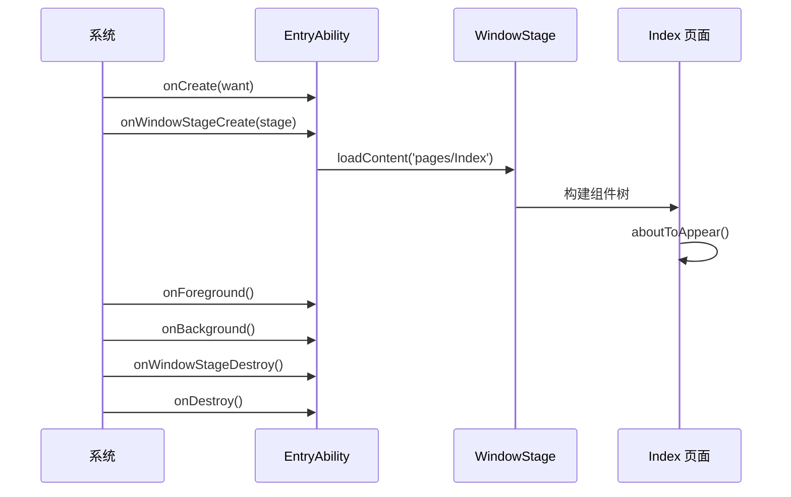
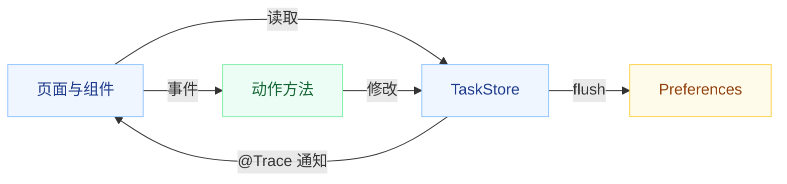
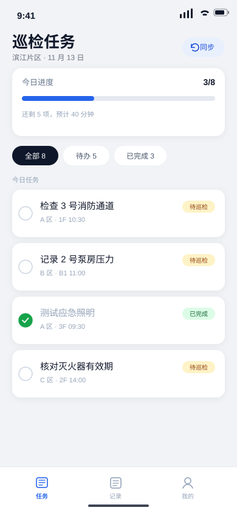
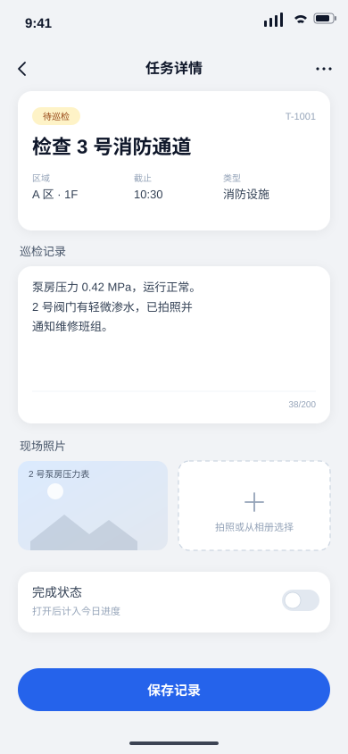

# HarmonyOS与ArkTS与ArkUI

> 这篇从 HarmonyOS NEXT 的应用模型讲起，经过 DevEco 环境、Stage 模型、ArkTS 类型与状态管理、ArkUI 布局与导航，最后落到网络存储、签名分发和一个离线巡检 App。
>
> 学完能独立创建并跑通一个 HarmonyOS NEXT 应用，解释 UIAbility 与页面的生命周期，用 ArkTS 和 ArkUI 完成列表、详情、状态同步与本地持久化，并打出可安装的 HAP。

## 一、HarmonyOS NEXT 的应用模型与边界

HarmonyOS NEXT 是一套不再兼容 Android APK 的独立系统，应用以 HAP 为单位、以 ArkTS 为语言、以 Stage 模型组织。判断一个项目该不该用它，先看分发渠道和设备范围，而不是先看语法。

### 1.1 兼容 Android 的旧版与 NEXT 的分界

HarmonyOS 4 及更早版本保留了 AOSP 兼容层，可以安装 APK；HarmonyOS NEXT 移除了这一层，只接受 HAP。两者不是同一个运行时，旧版的 Android 适配经验不能直接搬到 NEXT。

| 维度 | HarmonyOS 4 及更早 | HarmonyOS NEXT |
|---|---|---|
| 应用包 | APK 与 HAP 并存 | 仅 HAP |
| 运行时 | AOSP 兼容层加方舟 | 自研方舟运行时 |
| 开发语言 | Java、Kotlin、ArkTS | ArkTS |
| 生态来源 | Android 应用可迁移 | 原生应用重新开发 |

> 边界：把现有 APK 直接改名成 HAP 不可行。NEXT 上架审核会检查包结构和 API 调用，Android 的 `android.*` 导入在编译期就会失败。

### 1.2 应用、模块与四种包

一个应用（App Pack）由一个或多个模块组成，每个模块编译成 HAP。HAP 是安装和运行的最小单位，HAR 和 HSP 是代码复用单位，不单独安装。

| 包类型 | 后缀 | 是否安装 | 典型用途 |
|---|---|---|---|
| App Pack | `.app` | 整体上架 | 含多个 HAP 的发布包 |
| HAP | `.hap` | 是 | entry 主模块、feature 功能模块 |
| HAR | `.har` | 否 | 静态共享库，编译进宿主 |
| HSP | `.hsp` | 是 | 动态共享库，多 HAP 共用 |

模块类型在 `module.json5` 的 `type` 字段声明：`entry` 是应用入口，`feature` 是按需加载的功能模块，`shared` 是 HSP 共享包。一个应用只能有一个 entry 类型的 HAP。

### 1.3 与 Android、iOS、跨平台方案的边界

选择 ArkTS 原生的条件很明确：目标设备以华为 HarmonyOS NEXT 为主，需要系统能力、元服务、卡片或多设备协同，并且团队能承担 ArkTS 的学习成本。

| 场景 | 建议 | 原因 |
|---|---|---|
| 只发华为设备，重系统能力 | ArkTS 原生 | 权限、卡片、流转能力完整 |
| 已有 Vue 团队，轻交互 | uni-app 的 HarmonyOS 目标 | 复用前端代码，原生能力靠插件 |
| 已有 Flutter 项目 | 先评估社区适配分支 | Flutter 官方主线不支持 NEXT |
| 用户主要在 Android 与 iOS | 不做 NEXT 原生 | 投入产出不匹配 |
| 需要元服务、桌面卡片 | ArkTS 原生 | 元服务与卡片只支持原生 |

ArkUI-X 可以把 ArkUI 页面带到 Android 和 iOS，但它不是“一套代码覆盖所有平台”的成熟方案，复杂原生能力仍要分平台实现。React Native 的 HarmonyOS 适配由厂商和社区维护，不是上游官方支持；Flutter 同理。跨平台方案能省的是页面代码，省不掉签名、权限、上架和真机适配。

### 1.4 版本基线

2026-11 的稳定基线如下，具体小版本以 DevEco Studio 的 SDK Manager 为准。

| 项目 | 基线 | 说明 |
|---|---|---|
| DevEco Studio | 6.0 Release | 官方安装包覆盖 Windows 与 macOS |
| HarmonyOS SDK | API 20（HarmonyOS 6.0.0） | 新建工程按已安装 SDK 选择 |
| 语言 | ArkTS | TypeScript 的静态子集 |
| UI 框架 | ArkUI 声明式 | 新项目用状态管理 V2 |
| 构建工具 | hvigor | 随 IDE 提供，不单独安装 |
| 包管理 | ohpm | 三方库与 HAR 依赖 |

## 二、DevEco Studio 环境与最小工程

这一章解决“装好、建工程、在预览器和真机上跑起来”。装完必须能看到一个可交互页面，否则后面的 Stage 模型和 ArkUI 都无从验证。

### 2.1 三端安装与命令行工具

DevEco Studio 的 IDE 安装包只覆盖 Windows 和 macOS；Linux 没有图形 IDE，CI 使用 Command Line Tools 里的 `hvigorw`、`ohpm` 和 `hdc`。

| 环境 | 安装方式 | 备注 |
|---|---|---|
| Windows 10/11 | 官网下载 `.exe`，管理员安装 | 勾选添加到 PATH |
| macOS 12+ | 官网下载 `.dmg`，拖入 Applications | Apple Silicon 与 Intel 分包 |
| Ubuntu 24.04 | 解压 Command Line Tools | 无 IDE，只跑构建与安装 |
| Rocky/CentOS 9 | 解压 Command Line Tools | 依赖 glibc 2.28 以上 |

```bash
# macOS：挂载安装镜像后拖入 Applications
hdiutil attach ~/Downloads/deveco-studio-*.dmg

# Linux CI：解压命令行工具并加入 PATH
unzip commandline-tools-*.zip -d "$HOME/harmony-cli"
export PATH="$HOME/harmony-cli/bin:$PATH"

# 三个命令能输出版本，说明工具链可用
hvigorw --version
ohpm --version
hdc -v
```

预期输出类似：

```text
hvigor 6.0.0
ohpm 6.0.0
HDC 3.x
```

SDK 通过 DevEco Studio 的 SDK Manager 下载，默认路径 macOS 为 `~/Library/Huawei/Sdk`，Windows 为 `%LOCALAPPDATA%\Huawei\Sdk`。命令行构建要设置 `DEVECO_SDK_HOME` 指向该目录，否则 hvigor 找不到编译器。

> 边界：DevEco Studio 自带 JDK 与 Node.js，但 hvigor 仍可能读取 `JAVA_HOME`。团队项目要统一 IDE、SDK、hvigor 版本，否则会出现“本机通过、CI 签名失败”。

### 2.2 创建工程与目录结构

在 DevEco Studio 选择 File > New > Create Project，模板选 Application 下的 Empty Ability，填写：

| 字段 | 示例值 | 注意 |
|---|---|---|
| Project name | Inspection | 工程目录名 |
| Bundle name | com.example.inspection | 反向域名，上架后不可改 |
| Compatible SDK | API 20 | 决定最低设备版本 |
| Module name | entry | 主模块 |
| Device type | phone、tablet | 按需勾选 |

生成后的关键目录：

```text
Inspection/
├── AppScope/
│   ├── app.json5                  # 应用级配置：包名、版本、图标
│   └── resources/
├── entry/
│   ├── src/main/
│   │   ├── ets/
│   │   │   ├── entryability/EntryAbility.ets
│   │   │   └── pages/Index.ets
│   │   ├── resources/
│   │   │   ├── base/element/string.json
│   │   │   └── base/profile/main_pages.json
│   │   └── module.json5          # 模块级配置：页面、Ability、权限
│   ├── build-profile.json5
│   ├── hvigorfile.ts
│   └── oh-package.json5
├── build-profile.json5           # 产品、签名、SDK 版本
├── hvigorfile.ts
└── oh-package.json5
```

`main_pages.json` 登记可被路由的页面，没登记的页面不能直接加载：

```json
{
  "src": [
    "pages/Index"
  ]
}
```

### 2.3 最小页面与 Previewer

`Index.ets` 用 `@Entry` 标记页面入口，用 `@ComponentV2` 声明组件，状态用 `@Local`。这段代码可以直接在 Previewer 中运行。

```ts
@Entry
@ComponentV2
struct Index {
  @Local count: number = 0;

  build() {
    Column({ space: 16 }) {
      Text('HarmonyOS NEXT')
        .fontSize(24)
        .fontWeight(FontWeight.Bold)
      Text(`点击 ${this.count} 次`)
        .fontSize(16)
        .fontColor('#475569')
      Button('加一')
        .width(160)
        .height(44)
        .onClick(() => {
          // @Local 只触发读取它的 Text 刷新，不会重建整棵组件树
          this.count++;
        })
    }
    .width('100%')
    .height('100%')
    .justifyContent(FlexAlign.Center)
    .backgroundColor('#F5F6F8')
  }
}
```

点击右上角 Previewer，看到居中的标题、计数和按钮；点击“加一”，数字递增。真机运行前要先签名：File > Project Structure > Signing Configs，勾选 Automatically generate signature，登录华为开发者账号。

> 边界：Previewer 不执行真实网络、传感器和部分系统 API，也不校验签名。涉及 `http`、`preferences`、`hdc` 的验证必须上真机或模拟器。

## 三、Stage 模型：Ability、窗口与模块

Stage 模型把应用拆成“应用—模块—Ability—窗口”四层，页面只是窗口里的内容。理解这条链，才能解释启动白屏、后台回收和跨 Ability 跳转。

### 3.1 UIAbility 的生命周期

UIAbility 是带界面的应用组件，一个页面栈归属一个 UIAbility。生命周期由系统调度，开发者只在回调里做该阶段的事。



| 回调 | 该做什么 | 不该做什么 |
|---|---|---|
| `onCreate` | 读取启动参数、初始化全局对象 | 加载页面、发起慢请求 |
| `onWindowStageCreate` | `loadContent` 加载首页 | 在这里做重计算 |
| `onForeground` | 恢复计时、刷新可见数据 | 重复注册监听 |
| `onBackground` | 保存草稿、暂停动画 | 假设进程还活着 |
| `onWindowStageDestroy` | 释放窗口相关资源 | 依赖一定被调用 |
| `onDestroy` | 最终清理 | 把关键数据只放内存 |

`EntryAbility.ets` 的完整骨架：

```ts
import { AbilityConstant, UIAbility, Want } from '@kit.AbilityKit';
import { hilog } from '@kit.PerformanceAnalysisKit';
import { window } from '@kit.ArkUI';

const DOMAIN = 0x0000;
const TAG = 'Inspection';

export default class EntryAbility extends UIAbility {
  onCreate(want: Want, launchParam: AbilityConstant.LaunchParam): void {
    // 启动参数在这里读取；页面还没创建，不能碰 UI
    const taskId = want.parameters?.taskId as string | undefined;
    hilog.info(DOMAIN, TAG, 'onCreate, taskId=%{public}s', taskId ?? 'none');
  }

  onWindowStageCreate(windowStage: window.WindowStage): void {
    // 页面挂在 WindowStage 上；loadContent 失败时窗口是空白的
    windowStage.loadContent('pages/Index', (err) => {
      if (err.code) {
        hilog.error(DOMAIN, TAG, 'loadContent failed: %{public}s', JSON.stringify(err));
      }
    });
  }

  onForeground(): void {
    hilog.info(DOMAIN, TAG, 'onForeground');
  }

  onBackground(): void {
    // 这里只做轻量保存；耗时写库放到 TaskPool 或后台任务
    hilog.info(DOMAIN, TAG, 'onBackground');
  }

  onWindowStageDestroy(): void {
    hilog.info(DOMAIN, TAG, 'onWindowStageDestroy');
  }

  onDestroy(): void {
    hilog.info(DOMAIN, TAG, 'onDestroy');
  }

  onNewWant(want: Want, launchParam: AbilityConstant.LaunchParam): void {
    // singleton 模式下重复启动会走这里，适合处理通知点击携带的新参数
    hilog.info(DOMAIN, TAG, 'onNewWant');
  }
}
```

页面级生命周期与 Ability 不同：`aboutToAppear` 在组件挂载前触发，`aboutToDisappear` 在卸载前触发；`onPageShow`、`onPageHide`、`onBackPress` 只对 `@Entry` 页面生效。窗口的沉浸式和状态栏样式在 3.3 里设置，不要塞进 `loadContent` 回调。

> 边界：`onDestroy` 不保证一定执行，系统可能直接杀进程。需要跨进程恢复的数据必须落到 `preferences` 或数据库，不能只放在 Ability 的成员变量里。

### 3.2 module.json5 与 app.json5

`app.json5` 管应用身份，`module.json5` 管模块能力。包名、版本号、图标和权限分别落在这两个文件里。

```json5
// AppScope/app.json5
{
  "app": {
    "bundleName": "com.example.inspection",
    "vendor": "example",
    "versionCode": 1000000,
    "versionName": "1.0.0",
    "icon": "$media:layered_image",
    "label": "$string:app_name"
  }
}
```

```json5
// entry/src/main/module.json5
{
  "module": {
    "name": "entry",
    "type": "entry",
    "description": "$string:module_desc",
    "mainElement": "EntryAbility",
    "deviceTypes": ["phone", "tablet", "2in1"],
    "deliveryWithInstall": true,
    "installationFree": false,
    "pages": "$profile:main_pages",
    "abilities": [
      {
        "name": "EntryAbility",
        "srcEntry": "./ets/entryability/EntryAbility.ets",
        "description": "$string:EntryAbility_desc",
        "icon": "$media:layered_image",
        "label": "$string:EntryAbility_label",
        "startWindowIcon": "$media:startIcon",
        "startWindowBackground": "$color:start_window_background",
        "exported": true,
        "skills": [
          {
            "entities": ["entity.system.home"],
            "actions": ["action.system.home"]
          }
        ]
      }
    ],
    "requestPermissions": [
      {
        "name": "ohos.permission.INTERNET"
      }
    ]
  }
}
```

`exported: true` 加 `entity.system.home` 让应用出现在桌面；`startWindowIcon` 和 `startWindowBackground` 决定冷启动的第一帧，缺资源会导致启动闪白或黑屏。`requestPermissions` 只负责声明，用户授权类权限还要在运行时申请。

### 3.3 WindowStage 与窗口控制

WindowStage 管理窗口，主窗口负责页面显示。常见操作是沉浸式、状态栏颜色、横竖屏和窗口大小。

```ts
import { window } from '@kit.ArkUI';

async function setupWindow(stage: window.WindowStage): Promise<void> {
  const mainWindow = stage.getMainWindowSync();
  // 全屏布局后，页面自己处理状态栏高度，否则内容会被状态栏压住
  await mainWindow.setWindowLayoutFullScreen(true);
  await mainWindow.setWindowSystemBarProperties({
    statusBarColor: '#F5F6F8',
    statusBarContentColor: '#0F172A',
    navigationBarColor: '#FFFFFF',
    navigationBarContentColor: '#0F172A'
  });
  // 只允许竖屏；平板项目通常不锁，交给断点布局
  await mainWindow.setPreferredOrientation(window.Orientation.PORTRAIT);
}
```

> 边界：全屏布局不等于忽略安全区。状态栏、导航条、挖孔区域要用 `expandSafeArea` 或 `WindowInsets` 处理，否则按钮会被系统手势条盖住。

### 3.4 Want、显式启动与参数传递

Want 是 Ability 之间的启动契约。显式 Want 指定包名和 Ability 名，隐式 Want 用 action 和 entities 匹配，系统应用更常用隐式。

```ts
// 片段：在页面事件回调中调用，getContext(this) 才能拿到当前 Ability 上下文
import { common, Want } from '@kit.AbilityKit';

async function openDetail(taskId: string): Promise<void> {
  const context = getContext(this) as common.UIAbilityContext;
  const want: Want = {
    bundleName: 'com.example.inspection',
    abilityName: 'EntryAbility',
    parameters: {
      taskId: taskId
    }
  };
  // 显式 Want 不受权限限制，但目标 Ability 必须 exported
  await context.startAbility(want);
}
```

同 Ability 内的页面跳转不需要 Want，用 Navigation 的 `NavPathStack` 即可；跨应用或拉起系统页面才用 Want。

### 3.5 AbilityStage 与 ExtensionAbility

AbilityStage 是模块级入口，在模块内第一个 Ability 创建前触发，适合做模块级初始化，例如读取配置、注册日志。ExtensionAbility 是没有常规页面的扩展组件，常见类型如下。

| 类型 | 用途 | 是否需要界面 |
|---|---|---|
| `FormExtensionAbility` | 桌面卡片 | 卡片 UI |
| `WorkSchedulerExtensionAbility` | 延迟任务 | 否 |
| `ServiceExtensionAbility` | 后台服务 | 否 |
| `UIExtensionAbility` | 嵌入其他应用的 UI | 是 |

> 边界：普通应用不能随意声明 ServiceExtensionAbility，部分扩展能力需要系统应用权限或特定审批。先查 SDK 的能力清单，再决定用 Extension 还是普通后台任务。

## 四、ArkTS：类型、状态与并发

ArkTS 不是完整的 TypeScript，而是去掉动态特性的静态子集。它保留类、接口、泛型、联合类型和装饰器，禁止 `any`、动态属性访问和原型改写。写惯了 TS 的项目，第一周大多卡在这些限制上。

### 4.1 与 TypeScript 的关键差异

| TypeScript 写法 | ArkTS 处理 | 替代方案 |
|---|---|---|
| `any`、`unknown` | 禁止 | 明确类型或联合类型 |
| 无类型对象字面量 | 禁止 | 先声明 interface 或 class |
| `obj[key]` 动态访问 | 禁止 | `Map` 或显式字段 |
| 结构化类型匹配 | 不支持 | 显式 `implements` |
| `eval`、`prototype` | 禁止 | 重构为静态代码 |
| `var` | 禁止 | `let` 或 `const` |

这些限制换来的是可静态分析和更好的运行时性能。第三方 JS 库不能直接拿来用，需要找 ohpm 上的 ArkTS 版本或自行移植。

### 4.2 类型、类、接口与泛型

```ts
interface Named {
  name: string;
}

type DeviceStatus = 'online' | 'offline' | 'maintenance';

class Device implements Named {
  readonly name: string;
  status: DeviceStatus;

  constructor(name: string, status: DeviceStatus) {
    this.name = name;
    this.status = status;
  }

  isAvailable(): boolean {
    // 联合类型让状态判断在编译期就能穷举，拼错字符串会报错
    return this.status === 'online';
  }
}

function first<T>(list: T[]): T | undefined {
  return list.length > 0 ? list[0] : undefined;
}

const devices: Device[] = [
  new Device('泵房压力计', 'online'),
  new Device('消防主机', 'maintenance')
];
const firstDevice = first(devices);
```

对象字面量必须带类型，否则 ArkTS 无法推断字段：

```ts
interface Point {
  x: number;
  y: number;
}

const origin: Point = { x: 0, y: 0 }; // 正确：上下文类型明确
// const bad = { x: 0, y: 0 };        // 错误：无类型字面量
```

### 4.3 空安全、联合类型与类型收窄

ArkTS 的空安全和 TypeScript 类似，但更严格：可空类型必须显式标注，使用前要收窄。

```ts
function formatName(name: string | undefined): string {
  // 先收窄再使用，避免 !! 在运行时抛异常
  if (name === undefined || name.length === 0) {
    return '未命名设备';
  }
  return name.trim();
}

const input: string | null = null;
const length = input?.length ?? 0; // 安全调用加默认值
```

> 边界：`!` 非空断言能用，但它只是让编译器闭嘴，运行时为 null 仍然崩溃。平台类型（来自 JS 互操作）不受空安全检查，边界处要手动校验。

### 4.4 集合、JSON 与数据转换

ArkTS 支持 `Array`、`Map`、`Set`，不支持用索引签名模拟字典。接口返回的 JSON 要先转成明确类型，再进入业务层。

```ts
interface TaskDto {
  id: string;
  title: string;
  done: boolean;
}

const raw = '[{"id":"T-1","title":"检查消防通道","done":false}]';
// JSON.parse 的结果是 Object，必须断言成已知结构；字段缺失要在边界校验
const list = JSON.parse(raw) as TaskDto[];

const doneIds = new Set<string>();
list.forEach((item: TaskDto) => {
  if (item.done) {
    doneIds.add(item.id);
  }
});

const titleById = new Map<string, string>();
list.forEach((item: TaskDto) => titleById.set(item.id, item.title));
```

> 边界：`as` 不做运行时校验。服务端字段改名或类型变化时，断言不会报错，错误会推迟到使用处。生产代码要在解析后检查必填字段。

### 4.5 状态管理 V1

V1 用 `@State`、`@Prop`、`@Link` 等装饰器，优点是资料多、旧项目普遍；缺点是嵌套对象观察能力弱，深层修改要靠 `@Observed` 和 `@ObjectLink`。

```ts
@Observed
class CartItem {
  name: string;
  @Track count: number; // 只观察 count，其他字段变化不触发刷新

  constructor(name: string, count: number) {
    this.name = name;
    this.count = count;
  }
}

@Component
struct CartRow {
  @ObjectLink item: CartItem;

  build() {
    Row() {
      Text(this.item.name)
      Button('+1').onClick(() => {
        this.item.count++; // @Track 属性变化会刷新当前行
      })
    }
  }
}
```

| 装饰器 | 方向 | 适用 |
|---|---|---|
| `@State` | 组件内部 | 简单类型、数组、类实例 |
| `@Prop` | 父到子单向 | 子组件只读父状态 |
| `@Link` | 父子双向 | 表单、开关 |
| `@Provide` / `@Consume` | 跨层 | 主题、登录态 |
| `@Observed` / `@ObjectLink` | 深层对象 | 列表项对象 |

V1 和 V2 不能在同一个组件里混用。迁移时按组件边界替换，先换叶子组件，再换页面，避免一次性重写。

### 4.6 状态管理 V2

V2 用 `@ComponentV2`、`@Local`、`@Param`、`@Event`、`@ObservedV2`、`@Trace`、`@Computed`，观察粒度更细，适合新项目。核心变化是：类属性要显式标 `@Trace`，派生值用 `@Computed`。

```ts
@ObservedV2
class CounterModel {
  @Trace count: number = 0;

  @Computed
  get doubled(): number {
    // 依赖 count；count 变时缓存失效，读取 doubled 的地方自动刷新
    return this.count * 2;
  }
}

@Entry
@ComponentV2
struct CounterPage {
  @Local model: CounterModel = new CounterModel();

  build() {
    Column({ space: 8 }) {
      Text(`计数 ${this.model.count}`)
      Text(`两倍 ${this.model.doubled}`)
      Button('加一').onClick(() => {
        this.model.count++; // 直接改 @Trace 属性即可
      })
    }
  }
}
```

| 能力 | V1 | V2 |
|---|---|---|
| 组件装饰器 | `@Component` | `@ComponentV2` |
| 组件内状态 | `@State` | `@Local` |
| 父传子 | `@Prop` | `@Param` |
| 子传父 | `@Link` | `@Param` 加 `@Event` |
| 跨层 | `@Provide` / `@Consume` | `@Provider` / `@Consumer` |
| 深层观察 | `@Observed` / `@ObjectLink` | `@ObservedV2` / `@Trace` |
| 派生值 | 手动计算 | `@Computed` |

> 边界：`@Trace` 观察属性赋值和数组的增删替换；`sort()` 这类原地重排不改变长度，刷新行为依赖版本，需要稳定刷新时整体赋新数组。类实例的字段要逐个标 `@Trace`。

### 4.7 并发：TaskPool 与 Worker

耗时计算放 TaskPool，网络和文件用异步 API，不要在主线程里同步等待。TaskPool 的任务函数必须是顶层函数，并用 `@Concurrent` 标记。

```ts
import { taskpool } from '@kit.ArkTS';

@Concurrent
function aggregate(values: number[]): number {
  // 运行在 TaskPool 线程，不能访问 UI 和页面状态
  let total = 0;
  for (let i = 0; i < values.length; i++) {
    total += values[i];
  }
  return total;
}

async function runAggregate(values: number[]): Promise<number> {
  const task = new taskpool.Task(aggregate, values);
  const result = await taskpool.execute(task) as number;
  return result;
}
```

> 边界：TaskPool 适合短任务，长任务会被调度器限制；Worker 适合常驻线程和大量消息。两者都不能直接操作 UI，结果要回主线程再更新状态。

## 五、ArkUI：布局、列表与导航

ArkUI 用声明式语法描述界面，状态变则界面变。写页面的核心不是背组件，而是把“状态放哪、谁读它、谁改它”设计清楚。

### 5.1 组件结构与 build 约束

一个自定义组件由 `struct`、状态变量和 `build()` 组成。`build()` 里只能写 UI 描述，不能声明局部变量、不能写 `switch`、不能直接做网络请求。

```ts
@Entry
@ComponentV2
struct LayoutPage {
  @Local expanded: boolean = false;

  build() {
    Column({ space: 12 }) {
      Text('设备状态')
        .fontSize(20)
        .fontWeight(FontWeight.Bold)
      if (this.expanded) {
        // 条件分支是 UI 描述的一部分，不是普通 if 语句
        Text('压力 0.42 MPa，温度 38℃')
          .fontSize(14)
          .fontColor('#475569')
      }
      Button(this.expanded ? '收起' : '展开')
        .onClick(() => {
          this.expanded = !this.expanded;
        })
    }
    .padding(20)
    .width('100%')
    .alignItems(HorizontalAlign.Start)
  }
}
```

需要中间计算结果时，放在 `@Computed`、普通方法或 `aboutToAppear` 里，不要在 `build()` 内声明变量。

### 5.2 布局容器与尺寸单位

常用容器只有几个：`Column` 纵向、`Row` 横向、`Stack` 层叠、`Flex` 弹性、`RelativeContainer` 相对定位、`Grid` 网格。尺寸默认单位是 vp，字体是 fp，设计稿 750 宽用 lpx。

```ts
// 片段：Stack 层叠地图与角标，Row 的 layoutWeight 撑开剩余宽度
Column() {
  Row() {
    Text('滨江片区')
      .fontSize(16)
      .layoutWeight(1) // 占满剩余宽度，右侧按钮不被挤走
    Button('筛选')
      .height(32)
  }
  .width('100%')
  .height(56)
  .padding({ left: 16, right: 16 })

  Stack({ alignContent: Alignment.BottomEnd }) {
    Image($r('app.media.map_placeholder'))
      .width('100%')
      .height(240)
      .borderRadius(16)
    Text('12 个点位')
      .fontSize(12)
      .fontColor('#FFFFFF')
      .backgroundColor('#99000000')
      .padding(6)
      .margin(12)
  }
  .layoutWeight(1)

  Row() {
    Button('开始巡检')
      .width('100%')
      .height(48)
  }
  .padding(16)
}
.width('100%')
.height('100%')
```

| 单位 | 含义 | 使用场景 |
|---|---|---|
| vp | 虚拟像素，随屏幕密度缩放 | 宽高、间距、圆角 |
| fp | 字体像素，随系统字体大小变化 | 字号 |
| lpx | 设计稿像素，按 750 基准换算 | 还原设计稿 |
| % | 相对父容器 | 通栏宽度 |

> 边界：`layoutWeight` 只在 Row 或 Column 的剩余空间里分配，父容器必须有确定尺寸。大量使用固定 vp 宽度会在折叠屏和平板上溢出，优先用百分比加断点。

### 5.3 列表、LazyForEach 与空状态

短列表用 `ForEach`，长列表用 `LazyForEach` 加 `IDataSource`。列表项的 key 必须稳定，否则勾选状态会串行。

```ts
// 片段：长列表用 IDataSource 管理数据，LazyForEach 只构建可见项
class TaskDataSource implements IDataSource {
  private data: InspectionTask[] = [];
  private listeners: DataChangeListener[] = [];

  totalCount(): number {
    return this.data.length;
  }

  getData(index: number): InspectionTask {
    return this.data[index];
  }

  registerDataChangeListener(listener: DataChangeListener): void {
    this.listeners.push(listener);
  }

  unregisterDataChangeListener(listener: DataChangeListener): void {
    const index = this.listeners.indexOf(listener);
    if (index >= 0) {
      this.listeners.splice(index, 1);
    }
  }

  reset(data: InspectionTask[]): void {
    this.data = data;
    // 全量刷新；增量更新应调用 notifyDataAdd 等方法
    this.listeners.forEach((listener: DataChangeListener) => listener.onDataReloaded());
  }
}

@Entry
@ComponentV2
struct TaskListPage {
  private source: TaskDataSource = new TaskDataSource();

  aboutToAppear(): void {
    this.source.reset(seedTasks());
  }

  build() {
    List({ space: 10 }) {
      LazyForEach(this.source, (task: InspectionTask) => {
        ListItem() {
          Text(task.title)
            .fontSize(15)
            .width('100%')
            .padding(16)
            .backgroundColor('#FFFFFF')
            .borderRadius(12)
        }
      }, (task: InspectionTask) => task.id) // key 用业务 id，避免复用时错位
    }
    .width('100%')
    .height('100%')
    .padding(16)
  }
}
```

空状态不能只靠列表自然空白，要明确告诉用户“没有数据”以及下一步动作。

### 5.4 样式、资源与主题

颜色、字符串、图片放 `resources`，不要散落在代码里。这样深色模式和换肤才能生效。

```json
// entry/src/main/resources/base/element/color.json
{
  "color": [
    { "name": "brand", "value": "#2563EB" },
    { "name": "page_bg", "value": "#F5F6F8" },
    { "name": "text_primary", "value": "#0F172A" }
  ]
}
```

```ts
Text('巡检任务')
  .fontColor($r('app.color.text_primary'))
  .backgroundColor($r('app.color.page_bg'))
```

深色模式在 `resources/dark/element/color.json` 提供同名颜色，系统切换时自动取对应值。图片放 `resources/base/media`，用 `$r('app.media.xxx')` 引用。

> 边界：`$r` 只能引用编译期存在的资源，动态拼接资源名不可行。多语言字符串要用 `$r('app.string.xxx')`，不要硬编码中文。

### 5.5 自定义组件、@Builder 与 @Extend

可复用的小块用 `@Builder`，带状态的独立块用 `@ComponentV2`。`@Extend` 只能扩展内置组件的属性，不能加业务逻辑。

```ts
@Extend(Text)
function titleText(size: number) {
  .fontSize(size)
  .fontWeight(FontWeight.Bold)
  .fontColor('#0F172A')
}

@Builder
function StatusTag(label: string, color: string) {
  Text(label)
    .fontSize(11)
    .fontColor(color)
    .padding({ left: 8, right: 8, top: 4, bottom: 4 })
    .backgroundColor('#F1F5F9')
    .borderRadius(10)
}

@ComponentV2
struct TaskHeader {
  @Param title: string = '';
  @Event onMore: () => void = () => {};

  build() {
    Row() {
      Text(this.title).titleText(18) // @Extend 方法可直接链式调用
      Blank()
      Button('更多').onClick(() => this.onMore())
    }
    .width('100%')
  }
}
```

`@Builder` 参数默认按值传递，父组件状态变化时不会自动刷新；需要联动时用 `$$` 按引用传递，或把状态放进 `@ObservedV2` 对象。

### 5.6 Navigation 与页面参数

新项目用 `Navigation` 加 `NavDestination`，不要再用旧的 `router`。Navigation 天然支持平板分栏和返回栈管理。

```ts
interface DetailParam {
  taskId: string;
}

@Entry
@ComponentV2
struct NavDemo {
  private stack: NavPathStack = new NavPathStack();

  @Builder
  routes(name: string, param: object) {
    if (name === 'detail') {
      NavDestination() {
        Column() {
          Text(`任务 ${(param as DetailParam).taskId}`)
            .fontSize(18)
        }
        .padding(20)
      }
      .title('任务详情')
    }
  }

  build() {
    Navigation(this.stack) {
      Column({ space: 12 }) {
        Button('打开详情').onClick(() => {
          const param: DetailParam = { taskId: 'T-1001' };
          this.stack.pushPathByName('detail', param);
        })
        Button('返回').onClick(() => this.stack.pop())
      }
      .padding(20)
    }
    .navDestination(this.routes)
    .mode(NavigationMode.Stack)
    .title('巡检')
  }
}
```

| 方法 | 用途 | 注意 |
|---|---|---|
| `pushPathByName` | 入栈并传参 | 参数必须是对象 |
| `pop` | 返回上一页 | 空栈时无效 |
| `replacePathByName` | 替换当前页 | 不增加返回层级 |
| `clear` | 清空返回栈 | 回到根页面 |

> 边界：`Navigation` 的 `mode` 在平板上会自动分栏，`NavigationMode.Stack` 强制单栏。分栏模式下详情页的返回按钮行为不同，要在平板上实测。

### 5.7 动画与多设备断点

动画只改状态，由框架补间；多设备用断点换列数，不要为每种设备复制一份代码。

```ts
@Entry
@ComponentV2
struct AnimatedCard {
  @Local expanded: boolean = false;

  build() {
    Column() {
      Text('点击展开')
        .fontSize(16)
        .onClick(() => {
          // 状态变化包在 animateTo 里，宽高和透明度一起过渡
          animateTo({ duration: 250, curve: Curve.EaseOut }, () => {
            this.expanded = !this.expanded;
          });
        })
      if (this.expanded) {
        Text('压力 0.42 MPa')
          .fontSize(14)
          .margin({ top: 8 })
          .transition(TransitionEffect.OPACITY)
      }
    }
    .padding(16)
    .width(this.expanded ? '100%' : 180)
    .backgroundColor('#FFFFFF')
    .borderRadius(16)
  }
}
```

断点布局用 `GridRow` 加 `GridCol`，`columns` 定义各断点的栅格数，`span` 定义当前列占几格：

```ts
// 片段：GridRow 按断点分栅格，GridCol 的 span 决定每块占几列
GridRow({ columns: { sm: 4, md: 8, lg: 12 }, gutter: 12 }) {
  GridCol({ span: { sm: 4, md: 4, lg: 3 } }) {
    Text('待办 5').padding(16).backgroundColor('#FFFFFF').borderRadius(12)
  }
  GridCol({ span: { sm: 4, md: 8, lg: 9 } }) {
    Text('今日进度 38%').padding(16).backgroundColor('#FFFFFF').borderRadius(12)
  }
}
.padding(16)
.onBreakpointChange((value: string) => {
  // 断点值可直接驱动文案或显隐，不必再查屏幕宽度
})
```

> 边界：动画期间不要做重计算或同步 IO，否则会掉帧；断点参考系默认是窗口尺寸，折叠屏展开时窗口尺寸跳变，要在真机上验证布局。

## 六、页面数据流与交互

页面复杂后，状态散落在各个组件里就会互相打架。稳定的做法是：Store 持有状态，页面只读，子组件通过事件上报修改意图。

### 6.1 单向数据流



判断状态该放哪，用三条规则：只在一个组件用的放 `@Local`；父子共享的放父组件并用 `@Param` 下传；跨页面共享的放 `@ObservedV2` Store，通过构造参数或 `@Provider` 注入。

### 6.2 弹窗、Toast 与确认

轻提示用 `promptAction.showToast`，需要用户决策用 `AlertDialog`，复杂表单用自定义弹窗。不要在按钮点击里直接改关键数据而不确认。

```ts
import { promptAction } from '@kit.ArkUI';

function confirmDelete(onConfirm: () => void): void {
  AlertDialog.show({
    title: '删除记录',
    message: '删除后无法恢复，确认继续？',
    primaryButton: {
      value: '取消',
      action: () => {}
    },
    secondaryButton: {
      value: '删除',
      fontColor: '#DC2626',
      action: () => {
        onConfirm();
        promptAction.showToast({ message: '已删除', duration: 1500 });
      }
    }
  });
}
```

> 边界：Toast 不阻塞交互，不能用来承载错误详情；审核或失败原因要用对话框或页面内提示，否则用户看不到。

### 6.3 表单校验与按钮状态

校验函数返回错误文案或 `undefined`，按钮的 `enabled` 直接依赖校验结果，避免“点了才报错”。

```ts
// 片段：校验函数单独成纯函数，页面只读结果
function validateNote(note: string): string | undefined {
  if (note.trim().length === 0) {
    return '请填写巡检记录';
  }
  if (note.length > 200) {
    return '记录不能超过 200 字';
  }
  return undefined;
}

// 页面里：错误文案绑定 Text，按钮可用性绑定校验结果
Text(validateNote(this.note) ?? '')
  .fontSize(12)
  .fontColor('#DC2626')

Button('保存')
  .enabled(validateNote(this.note) === undefined) // 校验不通过时按钮置灰
```

> 边界：提交前要再校验一次，防止状态被其他路径改坏。校验规则放纯函数里，不要散落在多个事件回调。

## 七、网络、存储与权限

HarmonyOS 应用的数据层和 Android 类似：HTTP 走 NetworkKit，键值走 preferences，结构化数据走 relationalStore。区别在 API 形态和权限声明方式。

### 7.1 HTTP 请求与错误处理

`@kit.NetworkKit` 的 `http` 模块支持 GET、POST、超时和证书校验。请求对象必须 `destroy`，否则连接池会泄漏。

```ts
import { http } from '@kit.NetworkKit';
import { BusinessError } from '@kit.BasicServicesKit';

interface TaskDto {
  id: string;
  title: string;
  done: boolean;
}

async function fetchTasks(): Promise<TaskDto[]> {
  const client = http.createHttp();
  try {
    const response = await client.request('https://api.example.com/inspection/tasks', {
      method: http.RequestMethod.GET,
      header: { 'Content-Type': 'application/json' },
      // 指定字符串，避免结果在不同设备上变成 ArrayBuffer
      expectDataType: http.HttpDataType.STRING,
      connectTimeout: 8000,
      readTimeout: 8000
    });
    if (response.responseCode !== http.ResponseCode.OK) {
      throw new Error(`HTTP ${response.responseCode}`);
    }
    return JSON.parse(response.result as string) as TaskDto[];
  } catch (err) {
    const error = err as BusinessError;
    // 网络错误、超时、证书错误都走这里，调用方要能区分并给出提示
    throw new Error(`请求失败：${error.message}`);
  } finally {
    client.destroy(); // 不销毁会累积底层连接，长驻页面尤其明显
  }
}
```

> 边界：HarmonyOS NEXT 默认要求 HTTPS，生产环境不要用明文 HTTP。自签证书要配置网络安全策略，不能靠关闭校验绕过。

### 7.2 preferences：少量键值

preferences 适合设置项、登录标记、少量缓存。单个 value 建议不超过 8 KB，超过就换 RDB。

```ts
import { preferences } from '@kit.ArkData';
import { common } from '@kit.AbilityKit';

const STORE_NAME = 'inspection_store';
const KEY_TASKS = 'tasks';

async function saveTasks(context: common.UIAbilityContext, json: string): Promise<void> {
  const store = await preferences.getPreferences(context, { name: STORE_NAME });
  await store.put(KEY_TASKS, json);
  // put 只写内存，flush 才落盘；进程被杀前没 flush 就会丢
  await store.flush();
}

async function loadTasks(context: common.UIAbilityContext): Promise<string> {
  const store = await preferences.getPreferences(context, { name: STORE_NAME });
  return await store.get(KEY_TASKS, '[]') as string;
}
```

### 7.3 relationalStore：结构化数据

任务、消息、日志这类需要查询和分页的数据用 RDB。建表、插入、查询都用参数化接口，不要拼接 SQL。

```ts
import { relationalStore } from '@kit.ArkData';
import { common } from '@kit.AbilityKit';

async function openDatabase(context: common.UIAbilityContext): Promise<relationalStore.RdbStore> {
  const config: relationalStore.StoreConfig = {
    name: 'inspection.db',
    securityLevel: relationalStore.SecurityLevel.S1 // S1 适合普通业务数据
  };
  const store = await relationalStore.getRdbStore(context, config);
  await store.executeSql(
    'CREATE TABLE IF NOT EXISTS task (id TEXT PRIMARY KEY, title TEXT NOT NULL, done INTEGER NOT NULL)'
  );
  return store;
}

async function insertTask(store: relationalStore.RdbStore, id: string, title: string): Promise<void> {
  const values: relationalStore.ValuesBucket = {
    id: id,
    title: title,
    done: 0 // SQLite 没有布尔类型，用 0/1 表示
  };
  await store.insert('task', values);
}

async function queryUndone(store: relationalStore.RdbStore): Promise<string[]> {
  const predicates = new relationalStore.RdbPredicates('task');
  predicates.equalTo('done', 0);
  const result = await store.query(predicates, ['id', 'title']);
  const titles: string[] = [];
  while (result.goToNextRow()) {
    titles.push(result.getString(result.getColumnIndex('title')));
  }
  result.close(); // 结果集不关闭会占住游标
  return titles;
}
```

> 边界：RDB 不是服务端数据的替代。离线写入要设计冲突合并和幂等键，否则同步时会出现重复任务或覆盖他人修改。

### 7.4 权限声明与运行时申请

权限分 `system_grant` 和 `user_grant`。前者安装时授予，只需在 `module.json5` 声明；后者必须调用 `requestPermissionsFromUser`，并且要在用户触发时申请。

```ts
import { abilityAccessCtrl, common, Permissions } from '@kit.AbilityKit';

async function requestLocation(): Promise<boolean> {
  const context = getContext(this) as common.UIAbilityContext;
  const permissions: Permissions[] = ['ohos.permission.APPROXIMATELY_LOCATION'];
  const manager = abilityAccessCtrl.createAtManager();
  const result = await manager.requestPermissionsFromUser(context, permissions);
  // authResults 与 permissions 顺序一一对应，0 表示已授权
  return result.authResults.length > 0 && result.authResults[0] === 0;
}
```

| 权限 | 级别 | 申请方式 |
|---|---|---|
| `ohos.permission.INTERNET` | system_grant | 仅声明 |
| `ohos.permission.APPROXIMATELY_LOCATION` | user_grant | 声明加运行时申请 |
| `ohos.permission.CAMERA` | user_grant | 声明加运行时申请 |
| `ohos.permission.READ_IMAGEVIDEO` | user_grant | 优先用系统 Picker |

> 边界：权限被拒绝后不要反复弹窗。用 `abilityAccessCtrl` 查询授权状态，引导用户去设置页，或降级为不依赖该权限的功能。

### 7.5 后台任务与通知

后台连续定位、长时上传需要申请后台任务，并在通知栏展示可见通知。普通短任务用 TaskPool，不要为了“保活”滥用后台能力。

申请链路是：在 `module.json5` 声明 `ohos.permission.KEEP_BACKGROUND_RUNNING`，用 `wantAgent` 构造可点击的通知入口，再调用 `backgroundTaskManager.startBackgroundRunning`，参数依次是 AbilityContext、后台模式（如 `DATA_TRANSFER`）和 WantAgent。任务结束必须调用 `stopBackgroundRunning`，否则通知常驻、耗电增加。

> 边界：后台任务审核会核查使用场景。上传大文件优先用系统上传任务或分片重试，不要长期占用后台通道；普通页面刷新不需要后台任务。

## 八、构建、签名与分发

HAP 没签名不能装，签名证书和包名、设备绑定。开发阶段用自动签名，发布阶段用 AGC 的发布证书，两者不要混用。

### 8.1 hvigor 与 ohpm 常用命令

```bash
# 清理旧产物，避免缓存导致“改了没生效”
./hvigorw clean --no-daemon

# 安装依赖
ohpm install

# 构建调试 HAP
./hvigorw assembleHap --mode module -p product=default -p buildMode=debug --no-daemon

# 构建发布 HAP
./hvigorw assembleHap --mode module -p product=default -p buildMode=release --no-daemon

# 构建整个 App Pack，用于上架
./hvigorw assembleApp --mode project -p product=default -p buildMode=release --no-daemon
```

产物默认在 `entry/build/default/outputs/default/`，文件名形如 `entry-default-signed.hap`；App Pack 在根目录 `build/outputs/default/`。任务名随 hvigor 版本略有差异，以 `./hvigorw tasks` 的输出为准。

### 8.2 签名配置

签名材料包括密钥库 `.p12`、证书 `.cer`、Profile `.p7b`。自动签名由 DevEco 生成并写入 `build-profile.json5`，手动签名用于 CI 和正式发布。

```json5
// build-profile.json5（节选）
{
  "app": {
    "signingConfigs": [
      {
        "name": "release",
        "type": "HarmonyOS",
        "material": {
          "certpath": "./sign/release.cer",
          "storePassword": "${SIGN_STORE_PASSWORD}",
          "keyAlias": "release",
          "keyPassword": "${SIGN_KEY_PASSWORD}",
          "profile": "./sign/release.p7b",
          "signAlg": "SHA256withECDSA",
          "storeFile": "./sign/release.p12"
        }
      }
    ],
    "products": [
      {
        "name": "default",
        "signingConfig": "release",
        "compatibleSdkVersion": "6.0.0(20)",
        "runtimeOS": "HarmonyOS"
      }
    ]
  }
}
```

> 边界：密码不要提交到仓库。`${SIGN_STORE_PASSWORD}` 这类占位符需要在 CI 里替换或由 hvigor 属性注入，本地构建则用 DevEco 的加密存储。调试证书绑定设备，换机后要重新生成。

### 8.3 安装、启动与日志

```bash
# 确认设备已连接，首次连接要在手机上确认调试授权
hdc list targets

# 覆盖安装，-r 保留应用数据
hdc install -r entry/build/default/outputs/default/entry-default-signed.hap

# 显式启动入口 Ability
hdc shell aa start -a EntryAbility -b com.example.inspection

# 只保留应用相关日志，避免被系统日志淹没
hdc shell hilog | grep -i inspection

# 卸载
hdc uninstall com.example.inspection
```

预期输出：`hdc list targets` 显示设备序列号；安装输出 `install bundle successfully`；启动后应用出现在前台；日志里能看到 `onCreate`、`onForeground`。

### 8.4 上架、元服务与分发渠道

公开分发走 AppGallery Connect：创建应用、上传 `.app`、填写隐私声明和权限说明、提交审核、按比例放量。企业内部使用走邀请测试或内部测试轨道，不要用公开链接分发未审核包。

元服务是另一种形态：免安装、可被卡片和搜索直达，适合查询、打卡、缴费这类单点任务。元服务有独立的工程模板和包结构，不能把普通应用直接改成元服务。

| 渠道 | 包 | 适用 |
|---|---|---|
| 应用市场 | `.app` | 公开发布 |
| 邀请测试 | `.app` | 内部验收 |
| 企业内部 | `.app` | 员工专用 |
| 元服务 | `.app` | 免安装轻服务 |

### 8.5 兼容与 API 分级

`compatibleSdkVersion` 决定最低可安装版本；运行时要用 `deviceInfo.sdkApiVersion` 和 `canIUse` 判断能力，不能假设设备一定支持。

```ts
import { deviceInfo } from '@kit.BasicServicesKit';

function supportsNewCamera(): boolean {
  // 低版本设备没有新相机能力时走旧链路
  return deviceInfo.sdkApiVersion >= 18 && canIUse('SystemCapability.Multimedia.Camera.Core');
}
```

| 场景 | 做法 |
|---|---|
| 新 API 只在部分设备可用 | `canIUse` 加版本判断 |
| 旧 API 已废弃 | 新代码用 `@kit.*` 聚合包 |
| 页面路由旧代码 | 逐步迁移到 Navigation |
| 平板与折叠屏 | 断点加安全区适配 |

> 边界：`canIUse` 判断的是系统能力，不是权限。能力存在但用户拒绝授权时，仍然要处理空结果。

## 九、调试与现场手册

HarmonyOS 的排障入口比 Android 少，核心就是 DevEco 的 Log、ArkUI Inspector、Profiler，以及 `hdc` 和 `hilog`。先定位是构建、安装、启动还是运行时问题。

### 9.1 工具与第一条命令

| 工具 | 用途 | 入口 |
|---|---|---|
| Log | 运行时日志与异常栈 | DevEco 底部 Log |
| ArkUI Inspector | 查看组件树和属性 | DevEco 菜单 |
| Profiler | CPU、内存、帧率 | DevEco 菜单 |
| hdc | 设备连接、安装、Shell | 命令行 |
| hilog | 系统与应用日志 | `hdc shell hilog` |

```bash
# 设备没识别时，先看 hdc 是否拿到序列号
hdc list targets

# 按业务 TAG 过滤；TAG 在代码里用 hilog.info 的第二个参数指定
hdc shell hilog | grep -i "Inspection"
```

### 9.2 常见故障对照

| 现象 | 最可能原因 | 第一条检查 |
|---|---|---|
| Previewer 白屏 | 页面没登记或 build 报错 | 看 Previewer 控制台首条错误 |
| 真机不识别 | 未开调试或驱动异常 | `hdc list targets` |
| 安装失败 | 签名与包名不匹配 | 对比 AGC 包名与证书 |
| 启动闪退 | 资源缺失或 Ability 配置错 | Log 里第一个 `Caused by` |
| 网络请求失败 | 未声明 INTERNET 或非 HTTPS | 查 module.json5 与响应码 |
| 状态改了不刷新 | 嵌套属性未加 `@Trace` | 检查对象是否 `@ObservedV2` |
| 列表勾选错位 | ForEach key 不唯一 | 用业务 id 做 key |
| 数据重启丢失 | 只 put 未 flush | 检查 `flush()` |
| 构建慢或失败 | 缓存或依赖版本冲突 | `hvigorw clean` 后重试 |

### 9.3 性能检查顺序

先看首帧，再看滚动，最后看内存。首帧慢通常是启动时同步读库或加载大图；滚动卡顿通常是列表项过重或图片未压缩；内存上涨通常是监听未注销或图片缓存无上限。

用 DevEco Studio 的 Profiler 抓 CPU、内存和帧率，用 ArkUI Inspector 检查组件的嵌套深度和重复绘制；命令行只用来确认进程和日志，性能数据以 Profiler 为准。

| 指标 | 目标 | 常见问题 |
|---|---|---|
| 首帧 | 小于 500 ms | 启动时同步 IO |
| 滚动帧率 | 接近 60 fps | 列表项嵌套过深 |
| 内存 | 稳定不持续上涨 | 监听未释放 |
| 包体积 | 按渠道控制 | 未压缩图片 |

> 边界：模拟器数据不能代表真机，尤其相机、定位、渲染性能。上线前必须在目标机型上复测。

## 十、最佳实践案例

### 10.1 案例背景

城服集团滨江项目部有 12 名巡检员，负责 8 个片区的消防通道、泵房和应急照明巡检。原有流程是微信群派单、Excel 登记：地下室没有信号时无法记录，回到办公室补录容易漏项；同一点位重复上报，月底统计要两个人核对两天。

目标是做一台 HarmonyOS NEXT 手机上的离线巡检 App：领取当日任务、勾选完成、填写记录、离线保存、回到有网环境同步。约束是两台测试机、两周交付、后端只提供现成的 REST 接口，不能改协议；巡检员年龄偏大，界面必须一屏看清任务和进度。

### 10.2 案例实操

工程包名 `com.example.inspection`，在 2.2 的模板基础上增加 `model`、`data`、`service`、`viewmodel`、`components` 五个目录。先在 `module.json5` 声明网络权限，页面登记只保留 `pages/Index`。

**第一步：任务模型与种子数据。**

```ts
// entry/src/main/ets/model/InspectionTask.ets
@ObservedV2
export class InspectionTask {
  readonly id: string;
  readonly title: string;
  readonly area: string;
  readonly due: string;
  // done 和 note 会被页面直接修改，必须标 @Trace，否则列表不刷新
  @Trace done: boolean;
  @Trace note: string;

  constructor(id: string, title: string, area: string, due: string,
              done: boolean = false, note: string = '') {
    this.id = id;
    this.title = title;
    this.area = area;
    this.due = due;
    this.done = done;
    this.note = note;
  }
}

export interface TaskDto {
  id: string;
  title: string;
  area: string;
  due: string;
  done: boolean;
  note: string;
}
```

```ts
// entry/src/main/ets/data/TaskSeed.ets
import { InspectionTask } from '../model/InspectionTask';

export function seedTasks(): InspectionTask[] {
  // 首次启动的兜底数据，真实项目应来自服务端
  return [
    new InspectionTask('T-1001', '检查 3 号消防通道', 'A 区 · 1F', '10:30'),
    new InspectionTask('T-1002', '记录 2 号泵房压力', 'B 区 · B1', '11:00'),
    new InspectionTask('T-1003', '测试应急照明', 'A 区 · 3F', '09:30', true),
    new InspectionTask('T-1004', '核对灭火器有效期', 'C 区 · 2F', '14:00'),
    new InspectionTask('T-1005', '检查配电柜门锁', 'B 区 · 1F', '14:30'),
    new InspectionTask('T-1006', '清理疏散指示牌', 'C 区 · 3F', '15:00'),
    new InspectionTask('T-1007', '测试消防电话', 'A 区 · B1', '15:30', true),
    new InspectionTask('T-1008', '巡检屋顶排烟机', 'D 区 · RF', '16:00', true)
  ];
}
```

**第二步：Store 负责状态、筛选和持久化。**

```ts
// entry/src/main/ets/viewmodel/TaskStore.ets
import { preferences } from '@kit.ArkData';
import { common } from '@kit.AbilityKit';
import { hilog } from '@kit.PerformanceAnalysisKit';
import { InspectionTask, TaskDto } from '../model/InspectionTask';
import { seedTasks } from '../data/TaskSeed';
import { TaskApi } from '../service/TaskApi';

export enum TaskFilter {
  All = 'all',
  Todo = 'todo',
  Done = 'done'
}

const STORE_NAME = 'inspection_store';
const KEY_TASKS = 'tasks';
const DOMAIN = 0x0000;
const TAG = 'TaskStore';

@ObservedV2
export class TaskStore {
  @Trace tasks: InspectionTask[] = [];
  @Trace filter: TaskFilter = TaskFilter.All;
  @Trace syncing: boolean = false;
  private context?: common.UIAbilityContext;

  async init(context: common.UIAbilityContext): Promise<void> {
    this.context = context;
    try {
      await this.restore();
    } catch (err) {
      // 本地数据损坏时退回种子数据，不能因此让应用起不来
      hilog.error(DOMAIN, TAG, 'restore failed: %{public}s', (err as Error).message);
    }
    if (this.tasks.length === 0) {
      this.tasks = seedTasks();
      await this.persist();
    }
  }

  @Computed
  get visibleTasks(): InspectionTask[] {
    // 筛选是派生状态，不额外存一份数组，避免两份数据不同步
    if (this.filter === TaskFilter.Todo) {
      return this.tasks.filter((task: InspectionTask) => !task.done);
    }
    if (this.filter === TaskFilter.Done) {
      return this.tasks.filter((task: InspectionTask) => task.done);
    }
    return this.tasks;
  }

  @Computed
  get doneCount(): number {
    return this.tasks.filter((task: InspectionTask) => task.done).length;
  }

  @Computed
  get progress(): number {
    if (this.tasks.length === 0) {
      return 0;
    }
    return Math.round((this.doneCount / this.tasks.length) * 100);
  }

  toggle(task: InspectionTask): void {
    // @Trace 属性赋值即触发依赖它的组件刷新
    task.done = !task.done;
    // 点击不等待落盘，persist 内部已捕获异常
    this.persist();
  }

  async sync(): Promise<string> {
    this.syncing = true;
    try {
      const remote = await TaskApi.fetchTasks();
      const localDone = new Map<string, boolean>();
      this.tasks.forEach((task: InspectionTask) => localDone.set(task.id, task.done));
      // 以服务端任务为准，但保留本地完成状态，避免离线提交被覆盖
      this.tasks = remote.map((dto: TaskDto) => new InspectionTask(
        dto.id, dto.title, dto.area, dto.due,
        localDone.get(dto.id) ?? dto.done, dto.note
      ));
      await this.persist();
      return `已同步 ${remote.length} 条任务`;
    } catch (err) {
      return `离线模式：${(err as Error).message}`;
    } finally {
      this.syncing = false;
    }
  }

  async persist(): Promise<void> {
    if (!this.context) {
      return;
    }
    try {
      const store = await preferences.getPreferences(this.context, { name: STORE_NAME });
      const dtoList = this.tasks.map((task: InspectionTask): TaskDto => {
        return {
          id: task.id,
          title: task.title,
          area: task.area,
          due: task.due,
          done: task.done,
          note: task.note
        };
      });
      await store.put(KEY_TASKS, JSON.stringify(dtoList));
      // 只 put 不 flush 时数据停在内存，进程被杀就丢
      await store.flush();
    } catch (err) {
      hilog.error(DOMAIN, TAG, 'persist failed: %{public}s', (err as Error).message);
    }
  }

  private async restore(): Promise<void> {
    if (!this.context) {
      return;
    }
    const store = await preferences.getPreferences(this.context, { name: STORE_NAME });
    const raw = await store.get(KEY_TASKS, '[]') as string;
    const dtoList = JSON.parse(raw) as TaskDto[];
    this.tasks = dtoList.map((dto: TaskDto) => new InspectionTask(
      dto.id, dto.title, dto.area, dto.due, dto.done, dto.note
    ));
  }
}
```

**第三步：网络同步，失败不阻塞离线使用。**

```ts
// entry/src/main/ets/service/TaskApi.ets
import { http } from '@kit.NetworkKit';
import { TaskDto } from '../model/InspectionTask';

const BASE_URL = 'https://api.example.com/inspection';

export class TaskApi {
  static async fetchTasks(): Promise<TaskDto[]> {
    const client = http.createHttp();
    try {
      const response = await client.request(`${BASE_URL}/tasks`, {
        method: http.RequestMethod.GET,
        header: { 'Content-Type': 'application/json' },
        // 固定返回字符串，避免不同设备返回 ArrayBuffer 导致解析失败
        expectDataType: http.HttpDataType.STRING,
        connectTimeout: 8000,
        readTimeout: 8000
      });
      if (response.responseCode !== http.ResponseCode.OK) {
        throw new Error(`HTTP ${response.responseCode}`);
      }
      return JSON.parse(response.result as string) as TaskDto[];
    } finally {
      client.destroy(); // 连接池不释放时，连续同步会越来越慢
    }
  }
}
```

**第四步：列表卡片与筛选。**

```ts
// entry/src/main/ets/components/TaskCard.ets
import { InspectionTask } from '../model/InspectionTask';

@ComponentV2
export struct TaskCard {
  @Require @Param task: InspectionTask;
  @Event onToggle: () => void = () => {};

  build() {
    Row({ space: 12 }) {
      Stack({ alignContent: Alignment.Center }) {
        Circle()
          .width(24)
          .height(24)
          .fill(this.task.done ? '#16A34A' : '#FFFFFF')
          .stroke(this.task.done ? '#16A34A' : '#CBD5E1')
          .strokeWidth(1.5)
        if (this.task.done) {
          Text('✓')
            .fontSize(13)
            .fontColor('#FFFFFF')
            .fontWeight(FontWeight.Bold)
        }
      }
      .onClick(() => this.onToggle())

      Column({ space: 6 }) {
        Text(this.task.title)
          .fontSize(15)
          .fontWeight(FontWeight.Medium)
          .fontColor(this.task.done ? '#94A3B8' : '#0F172A')
          .decoration({
            type: this.task.done ? TextDecorationType.LineThrough : TextDecorationType.None,
            color: '#94A3B8'
          })
          .maxLines(1)
          .textOverflow({ overflow: TextOverflow.Ellipsis })
        Row({ space: 8 }) {
          Text(this.task.area).fontSize(12).fontColor('#64748B')
          Text(this.task.due).fontSize(12).fontColor('#94A3B8')
        }
      }
      .layoutWeight(1) // 标题列占满中间，右侧状态标签不被挤压
      .alignItems(HorizontalAlign.Start)

      Text(this.task.done ? '已完成' : '待巡检')
        .fontSize(11)
        .fontColor(this.task.done ? '#166534' : '#92400E')
        .backgroundColor(this.task.done ? '#ECFDF5' : '#FFFBEB')
        .padding({ left: 8, right: 8, top: 4, bottom: 4 })
        .borderRadius(10)
    }
    .width('100%')
    .padding(16)
    .backgroundColor('#FFFFFF')
    .borderRadius(14)
  }
}
```

```ts
// entry/src/main/ets/pages/Index.ets
import { common } from '@kit.AbilityKit';
import { promptAction } from '@kit.ArkUI';
import { InspectionTask } from '../model/InspectionTask';
import { TaskFilter, TaskStore } from '../viewmodel/TaskStore';
import { TaskCard } from '../components/TaskCard';
import { TaskDetailPage } from './TaskDetail';

@Entry
@ComponentV2
struct Index {
  @Local store: TaskStore = new TaskStore();
  private pathStack: NavPathStack = new NavPathStack();

  aboutToAppear(): void {
    const context = getContext(this) as common.UIAbilityContext;
    // 异步恢复本地数据；首帧先显示空列表，恢复后自动刷新
    this.store.init(context);
  }

  @Builder
  PageMap(name: string, param: object) {
    if (name === 'TaskDetail') {
      TaskDetailPage({
        task: param as InspectionTask,
        onSave: (close: boolean) => {
          this.store.persist();
          if (close) {
            this.pathStack.pop();
          }
        }
      })
    }
  }

  @Builder
  Header() {
    Row() {
      Column({ space: 4 }) {
        Text('巡检任务')
          .fontSize(26)
          .fontWeight(FontWeight.Bold)
          .fontColor('#0F172A')
        Text('滨江片区 · 11 月 13 日')
          .fontSize(13)
          .fontColor('#64748B')
      }
      .alignItems(HorizontalAlign.Start)
      .layoutWeight(1)

      Button(this.store.syncing ? '同步中' : '同步')
        .fontSize(13)
        .height(32)
        .backgroundColor('#EFF6FF')
        .fontColor('#1D4ED8')
        .enabled(!this.store.syncing)
        .onClick(async () => {
          const message = await this.store.sync();
          promptAction.showToast({ message: message, duration: 2000 });
        })
    }
    .width('100%')
    .padding({ left: 20, right: 20, top: 8, bottom: 12 })
  }

  @Builder
  ProgressCard() {
    Column({ space: 12 }) {
      Row() {
        Text('今日进度').fontSize(14).fontColor('#475569')
        Blank()
        Text(`${this.store.doneCount}/${this.store.tasks.length}`)
          .fontSize(14)
          .fontWeight(FontWeight.Medium)
          .fontColor('#0F172A')
      }
      .width('100%')

      Progress({
        value: this.store.doneCount,
        total: Math.max(this.store.tasks.length, 1),
        type: ProgressType.Linear
      })
        .height(8)
        .color('#2563EB')
        .backgroundColor('#E2E8F0')

      Text(this.store.progress >= 100 ? '全部完成，可以收工' :
        `还剩 ${this.store.tasks.length - this.store.doneCount} 项，预计 40 分钟`)
        .fontSize(12)
        .fontColor('#64748B')
    }
    .padding(16)
    .backgroundColor('#FFFFFF')
    .borderRadius(16)
    .margin({ left: 20, right: 20 })
  }

  @Builder
  FilterChip(label: string, value: TaskFilter, count: number) {
    Row({ space: 4 }) {
      Text(label)
        .fontSize(13)
        .fontColor(this.store.filter === value ? '#FFFFFF' : '#475569')
      Text(`${count}`)
        .fontSize(12)
        .fontColor(this.store.filter === value ? '#DBEAFE' : '#94A3B8')
    }
    .padding({ left: 12, right: 12, top: 6, bottom: 6 })
    .backgroundColor(this.store.filter === value ? '#0F172A' : '#FFFFFF')
    .borderRadius(16)
    .onClick(() => {
      this.store.filter = value;
    })
  }

  @Builder
  FilterBar() {
    Row({ space: 8 }) {
      this.FilterChip('全部', TaskFilter.All, this.store.tasks.length)
      this.FilterChip('待办', TaskFilter.Todo, this.store.tasks.length - this.store.doneCount)
      this.FilterChip('已完成', TaskFilter.Done, this.store.doneCount)
    }
    .width('100%')
    .padding({ left: 20, right: 20, top: 16, bottom: 12 })
  }

  @Builder
  EmptyState() {
    Column({ space: 8 }) {
      Text('没有待办任务')
        .fontSize(16)
        .fontWeight(FontWeight.Medium)
        .fontColor('#334155')
      Text('切换筛选或点击同步获取最新任务')
        .fontSize(13)
        .fontColor('#94A3B8')
    }
    .width('100%')
    .layoutWeight(1)
    .justifyContent(FlexAlign.Center)
  }

  @Builder
  TaskList() {
    List({ space: 10 }) {
      ForEach(this.store.visibleTasks, (task: InspectionTask) => {
        ListItem() {
          TaskCard({
            task: task,
            onToggle: () => this.store.toggle(task)
          })
        }
        .onClick(() => this.pathStack.pushPathByName('TaskDetail', task))
      }, (task: InspectionTask) => task.id) // 稳定 key，筛选切换时不会复用错行
    }
    .layoutWeight(1) // 列表吃掉剩余高度，顶部卡片不被挤动
    .width('100%')
    .padding({ left: 20, right: 20, bottom: 16 })
    .scrollBar(BarState.Off)
  }

  build() {
    Navigation(this.pathStack) {
      Column() {
        this.Header()
        this.ProgressCard()
        this.FilterBar()
        if (this.store.visibleTasks.length === 0) {
          this.EmptyState()
        } else {
          this.TaskList()
        }
      }
      .width('100%')
      .height('100%')
      .backgroundColor('#F5F6F8')
    }
    .navDestination(this.PageMap)
    .mode(NavigationMode.Stack)
    .hideTitleBar(true) // 顶部用自定义 Header，隐藏系统标题栏避免重复
  }
}
```

**第五步：详情页填写记录并保存。**

```ts
// entry/src/main/ets/pages/TaskDetail.ets
import { InspectionTask } from '../model/InspectionTask';

@ComponentV2
export struct TaskDetailPage {
  @Require @Param task: InspectionTask;
  @Local draftNote: string = '';
  @Event onSave: (close: boolean) => void = (close: boolean) => {};

  aboutToAppear(): void {
    // 先拷贝到草稿，用户取消时原记录不被改坏
    this.draftNote = this.task.note;
  }

  @Builder
  Meta(label: string, value: string) {
    Column({ space: 2 }) {
      Text(label).fontSize(11).fontColor('#94A3B8')
      Text(value).fontSize(13).fontColor('#334155')
    }
    .alignItems(HorizontalAlign.Start)
  }

  build() {
    NavDestination() {
      Column({ space: 16 }) {
        Column({ space: 12 }) {
          Row() {
            Text(this.task.done ? '已完成' : '待巡检')
              .fontSize(11)
              .fontColor(this.task.done ? '#166534' : '#92400E')
              .backgroundColor(this.task.done ? '#ECFDF5' : '#FFFBEB')
              .padding({ left: 8, right: 8, top: 4, bottom: 4 })
              .borderRadius(10)
            Blank()
            Text(this.task.id).fontSize(12).fontColor('#94A3B8')
          }
          .width('100%')

          Text(this.task.title)
            .fontSize(22)
            .fontWeight(FontWeight.Bold)
            .fontColor('#0F172A')

          Row({ space: 24 }) {
            this.Meta('区域', this.task.area)
            this.Meta('截止', this.task.due)
          }
        }
        .alignItems(HorizontalAlign.Start)
        .width('100%')
        .padding(18)
        .backgroundColor('#FFFFFF')
        .borderRadius(16)

        Column({ space: 8 }) {
          Text('巡检记录')
            .fontSize(14)
            .fontWeight(FontWeight.Medium)
            .fontColor('#334155')
          TextArea({ text: this.draftNote, placeholder: '记录设备状态、异常和处理结果' })
            .height(140)
            .fontSize(14)
            .backgroundColor('#F8FAFC')
            .borderRadius(12)
            .onChange((value: string) => {
              this.draftNote = value;
            })
          Text(`${this.draftNote.length}/200`)
            .fontSize(11)
            .fontColor('#94A3B8')
            .width('100%')
            .textAlign(TextAlign.End)
        }
        .alignItems(HorizontalAlign.Start)
        .width('100%')
        .padding(16)
        .backgroundColor('#FFFFFF')
        .borderRadius(16)

        Row() {
          Column({ space: 2 }) {
            Text('完成状态').fontSize(14).fontColor('#334155')
            Text('打开后计入今日进度').fontSize(11).fontColor('#94A3B8')
          }
          .alignItems(HorizontalAlign.Start)
          Blank()
          Toggle({ type: ToggleType.Switch, isOn: this.task.done })
            .selectedColor('#16A34A')
            .onChange((isOn: boolean) => {
              this.task.done = isOn;
              // 只落盘不关闭页面，用户还要继续写记录
              this.onSave(false);
            })
        }
        .width('100%')
        .padding(16)
        .backgroundColor('#FFFFFF')
        .borderRadius(16)

        Blank()

        Button('保存记录')
          .width('100%')
          .height(48)
          .borderRadius(24)
          .backgroundColor('#2563EB')
          .onClick(() => {
            this.task.note = this.draftNote;
            this.onSave(true);
          })
      }
      .padding(20)
      .width('100%')
      .height('100%')
    }
    .title('任务详情')
    .backgroundColor('#F5F6F8')
  }
}
```

**第六步：运行与验证。**

在 DevEco Studio 里先跑 Previewer，确认列表和详情能渲染；再连真机，按 8.3 的命令安装启动。





验证清单：

1. 首屏显示 8 条任务，进度为 3/8；点击“待办”只剩 5 条，“已完成”剩 3 条。
2. 点任务左侧圆圈，卡片变绿并加删除线，进度同步增加；切到“待办”后该条消失。
3. 进入详情写记录，返回列表后再次进入，记录还在。
4. 杀掉进程重新打开，任务和记录仍然存在，说明 `flush` 生效。
5. 打开飞行模式点“同步”，底部提示以“离线模式：”开头，列表和勾选不受影响。

预期输出（示例）：

```text
首屏：8 条任务，进度 3/8
筛选：全部 8 / 待办 5 / 已完成 3
杀进程重开：8 条任务与已填记录全部保留
飞行模式同步：离线模式：...
```

### 10.3 案例结果

上线两周后，12 名巡检员全部切换到新 App。下面是验收时的示例数据，实际数字需在目标机型复测。

| 指标 | 改造前 | 改造后 | 说明 |
|---|---|---|---|
| 单条记录耗时 | 约 90 秒 | 约 35 秒 | 含拍照与填写 |
| 离线可用 | 无 | 全量任务 | 地下室可记录 |
| 月底统计 | 2 人日 | 10 分钟 | 导出后汇总 |
| 首屏加载 | 未测 | 约 320 ms | API 20 模拟器 |

失败模式与处理：

- 只 `put` 没 `flush`，杀进程后数据回到上次落盘状态；统一封装 `persist()`，禁止页面直接调 preferences。
- 嵌套属性没标 `@Trace`，勾选后列表不刷新；模型层统一用 `@ObservedV2`，字段逐个确认。
- 同步直接用服务端数据覆盖本地，离线完成的记录被改回未完成；按 id 合并本地完成状态。
- 列表 key 用索引，筛选后勾选串行；key 改成业务 id。
- 详情页直接改原对象，用户返回后无法撤销；用 `draftNote` 草稿，保存时才写回。

复盘：离线优先的关键不是网络库，而是“本地是唯一可信源，网络只做同步”。Store 把筛选、进度、持久化收在一处，页面只读状态、只发事件，后续加拍照、定位和导出时不需要改列表逻辑。ArkTS 的限制在第一周会拖慢开发，但把动态写法挡在编译期，反而减少了运行时崩溃。
