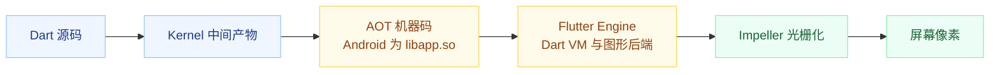
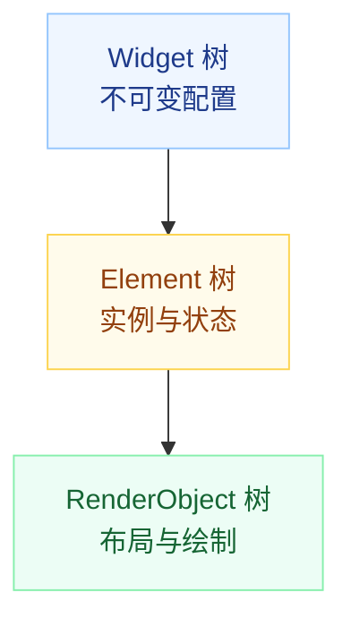
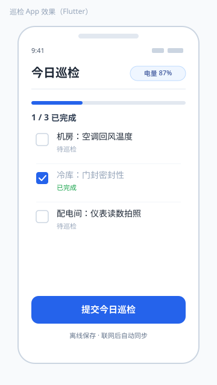

# Flutter与Dart

> 这篇从 Flutter 的编译与渲染模型讲起，经过环境搭建、Dart 语言要点、Widget 与布局、状态管理、平台通道，最后落到构建签名发布、性能排障，并以一个双端巡检 App 的完整交付收尾。
>
> 学完能独立搭起一个双端 Flutter 工程，把原生能力接进来，打出可上架的签名包，并在卡顿、白屏或构建失败时定位到具体哪一层出了问题。

## 一、Flutter 的定位与边界

Flutter 是 Google 的跨平台 UI 工具包，用 Dart 语言编写，一套代码编译到 Android、iOS、Web 和桌面端。核心判断：Flutter 自己绘制每一个像素，不把界面翻译成原生控件；因此双端一致性和迭代速度是它的强项，包体体积、原生能力桥接和无障碍细节是它的固有成本。

### 1.1 从 Dart 到像素

一个 release 包里的界面不是"翻译"出来的，是 Dart 代码被 AOT（Ahead-of-Time，提前）编译成机器码，由 Flutter 引擎驱动 GPU 直接画出来的。理解这条链，后面所有"为什么慢""为什么白屏"都顺着这条链查。



| 阶段 | 产物 | 排查入口 |
|---|---|---|
| 编译 | Kernel → AOT 机器码 | `flutter build` 的报错 |
| 运行 | Dart VM 执行机器码 | DevTools Console、`logcat` |
| 布局/绘制 | 帧数据 | DevTools Performance |
| 光栅化 | GPU 指令 | DevTools Raster 线程 |

两条关键结论：

1. **debug 和 release 不是同一个程序**。debug 用 JIT（Just-in-Time，即时编译）支持热重载，release 用 AOT，性能特征完全不同；debug 卡不代表 release 卡，性能问题必须在 profile/release 模式下复现。
2. **渲染后端是 Impeller**。2026 年的稳定版在 iOS 与 Android 上默认使用 Impeller（Impeller 渲染器，预编译着色器，消除着色器编译卡顿），老资料里"用 `--trace-skia` 排查着色器卡顿"的做法已经过时。

> 边界：Flutter 引擎自带 Dart 运行时与渲染管线，这是空工程 arm64 release APK 约 7–10 MB（示例，随引擎版本浮动）的原因；体积预算在 5 MB 以下的项目不适合 Flutter。

### 1.2 与原生、React Native、uni-app 的边界

选型只看三件事：界面一致性要求、原生能力深度、团队人力结构。

| 方案 | 渲染方式 | 语言 | 适合的场景 | 主要成本 |
|---|---|---|---|---|
| 原生 Android/iOS | 平台控件 | Kotlin / Swift | 深度系统能力、极致性能 | 双端两套代码两套人力 |
| Flutter | 自绘 | Dart | 强交互、双端一致 | 包体增大、原生能力要桥接 |
| React Native / Expo | 原生控件 + JS 线程 | TypeScript | Web 团队、需要 OTA 热更 | JS 与原生层调试割裂 |
| uni-app | WebView / 小程序 | Vue | 小程序 + 轻量 App 双投放 | 复杂交互性能受限 |

具体到成本：

- **Flutter 的"一套代码"覆盖 UI 层**。超过八成的业务界面可以完全共享；但蓝牙后台、桌面小组件、推送、支付、安全键盘这类东西，每端仍要写平台通道和原生代码，双端人力省不掉那两成。
- **Flutter 不擅长跟随平台新特性首发**。iOS 新发布的系统控件，原生当天可用，Flutter 要等社区插件或自绘实现。
- **Flutter 不能做 OTA（Over-the-Air，空中下载）热更新**（官方立场，商店条款也禁止替换可执行代码）。需要"不发版修线上文案/逻辑"的团队，React Native 的 EAS Update 或 uni-app 的热更更合适。

> 边界：这些方案不是互斥的。存量原生 App 里嵌一个 Flutter 模块（Add-to-App 模式）做活动页，是大型 App 常见的混合形态；反过来把原生 SDK 封装成 Flutter 插件再分发，也是常态。

### 1.3 什么时候不该用 Flutter

- 产品以系统能力为主（VoIP、后台导航、通话录音），UI 只占一小部分——桥接成本超过 UI 层收益；
- 团队全是 Web 技术栈、且强依赖 OTA 动态更新——React Native / Expo 更合适；
- 目标端包含大量小程序场景——uni-app 一次投放多端更划算；
- 包体硬预算在 5 MB 以下，或设备是低内存老旧机型；
- 需要重度使用平台专属控件语义（iOS 原生日期滚轮、无障碍服务的深度定制），自绘控件需要额外补齐。

## 二、环境与第一个工程

这一章解决"从零到在真机上看到界面"。

### 2.1 版本基线与安装

版本基线 2026-11-13：Flutter 3.3x stable、Dart 3.x、Android Gradle Plugin 8.x、JDK 17 或 21、Xcode 16+。具体小版本以 `flutter --version` 输出为准，团队内用 `fvm` 或 CI 钉住同一版本。

| 系统 | 安装方式 |
|---|---|
| Windows 10/11 | 官网 zip 解压到无空格中文路径，把 `flutter\bin` 加入 PATH；或 `choco install flutter` |
| macOS | `brew install --cask flutter`；iOS 开发另需 Xcode 并 `xcode-select` 指到 Xcode.app |
| Ubuntu 24.04+ | `sudo snap install flutter --classic`，或 git clone stable 分支后加 PATH |
| Rocky / CentOS 9+ | git clone stable；桌面构建另装 `dnf install clang cmake ninja-build gtk3-devel` |

装完第一件事永远是跑体检，缺什么补什么：

```bash
flutter doctor -v
```

预期输出（片段，只看四类问题）：

```text
[✓] Flutter (Channel stable, 3.3x, on macOS, locale zh-Hans-CN)
[✓] Android toolchain - develop for Android devices
[✓] Xcode - develop for iOS and macOS
[!] Android Studio
    ! Some Android licenses not accepted. To resolve this, run: flutter doctor --android-licenses
```

> 边界：Android 许可证未接受是最常见的一格红叉，`flutter doctor --android-licenses` 全部选 `y` 即可；Android 模拟器需要硬件加速（macOS 的 Hypervisor、Windows 的 WHPX、Linux 的 KVM），没加速的虚拟机里跑不了模拟器，用真机代替。

### 2.2 创建并跑通最小工程

```bash
flutter create --org com.example --project-name inspect_app inspect_app
cd inspect_app
flutter devices        # 列出可用目标：真机、模拟器、Chrome
flutter run -d <设备ID> # 例如 flutter run -d 84B7N16BQxxxx
```

`flutter run` 预期输出：

```text
Launching lib/main.dart on Pixel 8 in debug mode...
Running Gradle task 'assembleDebug'...
✓ Built build/app/outputs/flutter-apk/app-debug.apk
Flutter run key commands.
r Hot reload. 🔥🔥🔥  R Hot restart. h List all commands. d Detach. q Quit.
A Dart VM Service on Pixel 8 is available at: http://127.0.0.1:xxxx
```

工程骨架：

| 路径 | 内容 | 改动频率 |
|---|---|---|
| `lib/` | Dart 代码，入口 `lib/main.dart` | 高 |
| `pubspec.yaml` | 依赖、资源、SDK 约束 | 中 |
| `android/` `ios/` | 原生壳工程，通道与签名在这改 | 低 |
| `test/` | 单元测试与 Widget 测试 | 随代码 |

### 2.3 热重载的边界

热重载（Hot Reload）只重跑 `build` 方法，保留 State——这是它快的原因，也是它不可靠的原因。改了 `main()`、`initState()`、全局变量、依赖注入的构造参数，热重载不会生效，必须按 `R` 热重启（Hot Restart，整个 Dart isolate 重来）。

典型坑：给 `State` 类加了一个新字段并赋初值，热重载不初始化它，运行时读到 `null`，误以为"代码有 bug"，实际按一次 `R` 就好。判断口诀：**改的是"build 里怎么画"用 r，改的是"启动时怎么装配"用 R**。

## 三、Dart 语言要点

这一章把写 Flutter 必需的 Dart 子集一次讲清：空安全、集合与模式、异步、类组织与并发。

### 3.1 空安全

Dart 的空安全是健全的（sound null safety）：类型系统在编译期保证非空类型不为 `null`，混用旧代码的空值风险集中在平台通道和 JSON 上。

```dart
String city = '杭州';        // 非空：编译器保证永不为 null
String? nickname;             // 可空：默认值就是 null

// 安全调用链 + 空值合并：处理可空的常规写法
final len = nickname?.length ?? 0;

// 平台通道返回值一定可空：原生侧可能返回 null 或抛异常
final level = await channel.invokeMethod<int>('getBatteryLevel');
final shown = level ?? -1;    // 不判空直接用会编译报错，这里必须给降级值

// late：字段类型非空、但初始化时机在构造之后
late final Box box;           // 第一次访问前必须赋值，否则运行时抛 LateInitializationError

// ! 断言：只在"逻辑上必然非空"时用；用错就是运行时 NPE
final forced = nickname!;
```

| 写法 | 含义 | 使用建议 |
|---|---|---|
| `String?` | 可空类型 | 边界数据（网络、通道、JSON）默认可空 |
| `?.` | 安全调用 | 首选 |
| `??` | 空值合并 | 给降级值 |
| `late` | 延迟非空初始化 | 只用于确定会初始化的字段 |
| `!` | 非空断言 | 能不用就不用 |

> 边界：`dynamic` 关掉了静态检查，等于回到 JS 时代；JSON 解析宁可写 `json['id'] as String? ?? ''`，也不要一路 `dynamic` 传下去。

### 3.2 集合、记录与模式匹配

Dart 3 的记录（Record）和模式匹配让"状态分支"不再靠字符串比较。

```dart
final tasks = <String>['机房', '冷库', '配电间'];
final done = tasks.where((t) => t.length > 1).toSet();

// 记录：轻量多返回值，不用再定义小类
(int ok, int pending) summarize(List<bool> flags) {
  final ok = flags.where((f) => f).length;
  return (ok, flags.length - ok);
}
final (:ok, :pending) = summarize([true, false, true]);

// sealed + switch 表达式：编译器强制穷举，漏分支直接编译失败
sealed class SyncState {}
class Idle extends SyncState {}
class Syncing extends SyncState {}
class Failed extends SyncState {
  Failed(this.message);
  final String message;
}

String label(SyncState s) => switch (s) {
      Idle() => '待同步',
      Syncing() => '同步中',
      Failed(:final message) => '失败：$message',  // 解构模式，直接取出字段
    };
```

> 边界：`sealed` 的价值是编译期穷举检查；如果状态类不 `sealed`，switch 必须写 `default`，而 `default` 会吞掉新分支的拼写错误。枚举能表达的不要用类层次。

### 3.3 Future 与 Stream

Dart 是单线程事件循环模型：一个 isolate 内没有抢占，`await` 只是让出执行权，不存在"锁"的概念；并发隔离靠 isolate（见 3.4）。

```dart
Future<List<String>> loadTasks() async {
  final prefs = await SharedPreferences.getInstance();
  return prefs.getStringList('tasks') ?? const [];
}

// 并发多个独立请求：Future.wait 等价于 Promise.all
final results = await Future.wait([
  fetchUser(1),
  fetchOrders(1),
]);

// Stream：电量、传感器、WebSocket 这类持续事件
final levels = const EventChannel('com.example.inspect/battery_events');
Stream<int> batteryLevel() =>
    levels.receiveBroadcastStream().map((e) => e as int);

// await for 在一个函数体内消费流，离开作用域自动取消订阅
Future<void> watch() async {
  await for (final level in batteryLevel()) {
    debugPrint('电量 $level');
  }
}
```

| 关键字 | 语义 | 最容易错在哪 |
|---|---|---|
| `async` / `await` | 返回 Future，异步顺序化 | 忘记 await，拿到的是 Future 不是值 |
| `Future.wait` | 并发汇聚 | 一个失败整体失败，需要 `eagerError: false` 时看文档 |
| `Stream` | 事件序列 | broadcast 流没监听者时事件被丢弃 |
| `await for` | 循环消费流 | 在 build 方法里用会每帧重订阅 |

> 边界：异常必须捕获。`Future` 的错误如果没有任何 `await` 或 `catchError` 接住，会成为未处理异常直接打到 Zone；`runZonedGuarded` 只用于兜日志，不能当正常处理。

### 3.4 类组织与 isolate

```dart
// mixin：把"能力"横向组合进类，避免多继承的菱形问题
mixin Retry {
  Future<T> retry<T>(Future<T> Function() task, {int times = 3}) async {
    Object? lastError;
    for (var i = 0; i < times; i++) {
      try {
        return await task();
      } catch (e) {
        lastError = e;
        // 退避重试：200/400/600ms，避免把已经过载的服务端打得更死
        await Future<void>.delayed(Duration(milliseconds: 200 * (i + 1)));
      }
    }
    throw lastError!; // 重试耗尽必须抛出，吞掉会让上层误判成功
  }
}

// 扩展：不改原类加方法，只对当前库生效，不会污染全局
extension YinYang on DateTime {
  String get ymd => '$year-$month-$day';
}

class TaskRepo with Retry {}

// isolate：CPU 密集任务丢到另一个 isolate，UI isolate 才不卡
final parsed = await Isolate.run(() => parseTenMbJson(raw));
```

| 机制 | 用途 | 禁忌 |
|---|---|---|
| `Isolate.run` | 一次性重计算（解析大 JSON、压缩图片） | 闭包不能捕获不可发送对象 |
| `compute` | 同上的历史函数 | 新代码用 `Isolate.run` |
| 多 isolate | 长驻 worker（音视频处理） | isolate 间只能传消息，不共享内存 |

> 边界：网络请求不需要 isolate——`http`/`dio` 的 IO 在引擎层完成，await 期间 UI 照常响应；只有纯 CPU 计算（解析、加密、图像处理）才需要 isolate。

## 四、Widget 与布局

这一章解决"把界面画出来并知道为什么画错了"。

### 4.1 三棵树与重建



| 树 | 职责 | 特征 |
|---|---|---|
| Widget | 描述"应该长什么样" | 不可变、每次 build 全量新建、便宜 |
| Element | 持有 State、diff 前后两帧 Widget | 帧间复用，setState 标脏它 |
| RenderObject | 真正算布局、画像素 | 数量远少于 Widget |

由此得出三条日常结论：

1. **setState 的代价是"以该 Element 为根整棵子树重建"**，所以把大页面拆小、把不变的子树标 `const`，是第一优化手段；
2. **Widget 每帧新建是设计使然**，不要为"减少对象创建"把 Widget 存成成员变量——存了反而破坏 diff；
3. **Key 的作用对象是 Element**：同类型 Widget 列表里增删元素必须给 Key，否则 State 会跟着位置而不是跟着数据走。

```dart
class StatusTag extends StatelessWidget {
  // 不用 Badge 命名：Flutter 自带 Material 组件 Badge，重名会编译报错
  const StatusTag({super.key, required this.text});

  // const 构造器让框架直接复用同一实例，跳过整棵子树重建
  final String text;

  @override
  Widget build(BuildContext context) {
    return Container(
      padding: const EdgeInsets.symmetric(horizontal: 8, vertical: 2),
      decoration: BoxDecoration(color: Colors.blue.shade50, borderRadius: BorderRadius.circular(6)),
      child: Text(text, style: const TextStyle(fontSize: 12, color: Color(0xFF1E3A8A))),
    );
  }
}
```

### 4.2 约束模型：约束向下、尺寸向上、父级定位

Flutter 布局的唯一核心规则：**约束（Constraints）从父传子，尺寸（Size）从子传父，位置由父决定**。子组件不能想画多大就多大，只能问"我在多小的框里"。

```dart
// 反例：Column 的主轴高度无界，ListView 要求有界高度 → 报
// "Vertical viewport was given unbounded height"
Column(
  children: [
    const Text('今日任务'),
    ListView(children: [/* ... */]),
  ],
)

// 正解：Expanded 给 ListView 一份"剩余高度"的约束
Column(
  children: [
    const Text('今日任务'),
    Expanded(child: ListView(children: [/* ... */])),
  ],
)
```

| 报错 | 原因 | 修法 |
|---|---|---|
| `unbounded height/width` | 可滚动组件放进无界空间 | 外面包 `Expanded` / 指定尺寸 |
| `RenderFlex overflowed by N pixels` | 内容超过 Row/Column 可用空间 | `Expanded`、`Flexible` 或 `SingleChildScrollView` |
| `Incorrect use of ParentDataWidget` | `Expanded` 不在 Flex 直接子级 | 调整层级，`Expanded` 必须是 Row/Column 的直接子项 |
| 文本不换行溢出 | Text 没拿到宽度约束 | 包一层 `Expanded` 或设 `maxLines` + `overflow` |

排查布局问题时用 `LayoutBuilder` 打印父给的约束，比猜快得多：

```dart
LayoutBuilder(
  builder: (context, constraints) {
    debugPrint('maxW=${constraints.maxWidth} maxH=${constraints.maxHeight}');
    return const SizedBox.shrink();
  },
)
```

### 4.3 常用布局与滚动

高频组件只记一份心智表：

| 组件 | 语义 | 高频陷阱 |
|---|---|---|
| `Row` / `Column` | 线性布局 | 内容溢出，见 4.2 |
| `Stack` / `Positioned` | 层叠 | 需要外层有界尺寸 |
| `Expanded` / `Flexible` | 弹性占位 | `Expanded` 强制填满，`Flexible` 可收缩 |
| `ListView.builder` | 长列表按需构建 | 忘 `itemCount` 或在 item 里发请求 |
| `GridView.builder` | 网格 | `SliverGridDelegate` 尺寸算错会溢出 |
| `CustomScrollView` + Slivers | 复杂滚动联动 | Sliver 与普通组件不能混挂 |

典型"卡片列表"组合：

```dart
ListView.separated(
  padding: const EdgeInsets.all(12),
  itemCount: tasks.length,
  separatorBuilder: (_, __) => const SizedBox(height: 8),
  itemBuilder: (context, i) {
    final t = tasks[i];
    return Row(
      children: [
        Checkbox(value: t.done, onChanged: (_) => onToggle(t.id)),
        const SizedBox(width: 8),
        // Expanded 让标题拿到剩余宽度，长文本 ellipsis 而不是撑爆 Row
        Expanded(
          child: Text(t.title,
              maxLines: 1,
              overflow: TextOverflow.ellipsis,
              style: const TextStyle(fontSize: 15)),
        ),
        StatusTag(text: t.done ? '完成' : '待巡检'),
      ],
    );
  },
)
```

> 边界：`ListView` 默认懒构建，但 `ListView(children: [...])` 是一次性全建的，只适合几行内容；上百行必须 `ListView.builder`。

### 4.4 主题、适配与资源

- 主题统一从 `MaterialApp.theme` 下发，组件里不写死颜色；换品牌色只改种子色：

```dart
MaterialApp(
  theme: ThemeData(
    colorScheme: ColorScheme.fromSeed(seedColor: const Color(0xFF2563EB)),
    useMaterial3: true,
  ),
)
```

- 字号跟随系统缩放：文本用 `TextStyle(fontSize: ...)` 会被系统 `TextScaler` 自动缩放；要自己算尺寸时用 `MediaQuery.textScalerOf(context).scale(16)`，不要用已废弃的 `textScaleFactor`。
- 资源在 `pubspec.yaml` 声明目录，访问相对路径：

```yaml
flutter:
  assets:
    - assets/images/
    - assets/config/app.json
```

- 平板/横屏适配用 `LayoutBuilder` 断点，而不是抄第三库；600 dp 起双栏是 Material 官方惯例。
- 安全区：`SafeArea` 包住内容，避免刘海与手势条遮挡。

> 边界：Flutter 的逻辑像素（logical pixel）与 Web 的 CSS px 不是一个概念，跨端共享设计稿时按设备像素比（DPR）换算，不要直接搬 px 数值。

## 五、状态管理与数据流

这一章解决"状态放在哪、谁能改它、界面怎么订阅它"。

### 5.1 setState 的边界

`setState` 只适合**单页面、短生命周期、无共享**的临时状态（输入框内容、展开折叠）。判断标准：这个状态被第二个页面用到时，要不要通过构造函数一层层传？要传就该上提。

```dart
Future<void> _load() async {
  final data = await repo.load();
  if (!mounted) return; // 异步回来时页面可能已销毁，不判 mounted 会抛 setState after dispose
  setState(() => _data = data);
}
```

### 5.2 ChangeNotifier + ListenableBuilder：零依赖的正式方案

Flutter 自带 `ChangeNotifier`（可监听对象）和 `ListenableBuilder`（订阅并重建），不引入任何第三方就能把"数据层"从 UI 里剥出来；Provider 只是它的依赖注入壳。

```dart
class TaskController extends ChangeNotifier {
  TaskController(this._repo);
  final TaskRepository _repo;

  List<InspectionTask> _tasks = const [];
  bool _loading = true;
  String? _error;

  List<InspectionTask> get tasks => List.unmodifiable(_tasks); // 对外只读视图，防止 UI 绕过控制器改数据

  Future<void> load() async {
    _loading = true;
    _error = null;
    notifyListeners(); // 先发加载态，界面立即出转圈，而不是等数据回来一起变
    try {
      _tasks = await _repo.load();
    } catch (e) {
      _error = '读取失败：$e';
    } finally {
      _loading = false;
      notifyListeners();
    }
  }

  Future<void> toggle(String id) async {
    final index = _tasks.indexWhere((t) => t.id == id);
    if (index < 0) return;
    final snapshot = _tasks;
    final next = [..._tasks];
    next[index] = next[index].copyWith(done: !next[index].done);
    _tasks = next;
    notifyListeners(); // 先改内存：点击立即有反馈，不等落盘
    try {
      await _repo.save(next);
    } catch (e) {
      _tasks = snapshot; // 落盘失败回滚，避免"界面说完成、重启后没完成"
      _error = '保存失败：$e';
      notifyListeners();
    }
  }
}
```

```dart
ListenableBuilder(
  listenable: _controller,
  builder: (context, _) {
    if (_controller.loading) {
      return const Center(child: CircularProgressIndicator());
    }
    return TaskListView(tasks: _controller.tasks, onToggle: _controller.toggle);
  },
)
```

### 5.3 Provider / Riverpod / Bloc 怎么选

| 方案 | 心智模型 | 适合 | 风险 |
|---|---|---|---|
| `ChangeNotifier` + `ListenableBuilder` | 面向对象，自带 Flutter | 小型应用、零依赖需求 | 手动管理生命周期 |
| Provider | ChangeNotifier + `context` 注入 | 中型应用、团队入门 | `context` 层级放错会找不到 |
| Riverpod | Provider 容器，编译期安全 | 中大型应用、可测试优先 | 学习曲线，API 3.x 有迁移成本 |
| Bloc / Cubit | 事件驱动的状态机 | 大团队、强流程规范 | 样板代码多，小项目过重 |

Provider 的最小用法（依赖 `provider: ^6.1.5`）：

```dart
void main() => runApp(
      // Provider 必须在 MaterialApp 之上，路由里的 context 才能向上找到它
      ChangeNotifierProvider(
        create: (_) => TaskController(TaskRepository()),
        child: const InspectApp(),
      ),
    );

// 读取并订阅：Widget 级订阅用 context.watch，回调里只取值用 context.read
final controller = context.watch<TaskController>();
onPressed: () => context.read<TaskController>().toggle(task.id),
```

> 边界：`watch` 写在回调里是常见错误——回调不属于 build，用 `read`；混用会让页面无谓重建。

### 5.4 生命周期与异步安全

| 回调 | 时机 | 该做什么 |
|---|---|---|
| `initState` | 插入树，一次 | 初始化 controller、发首屏请求 |
| `didChangeDependencies` | 依赖的 InheritedWidget 变化 | 读 `MediaQuery`、`Theme` 并缓存 |
| `didUpdateWidget` | 父重建给了新配置 | 对比新旧参数做增量更新 |
| `dispose` | 永久移除 | 取消订阅、释放 controller |

三条铁律：订阅必须在 `dispose` 取消；异步回来必须判 `mounted`；`initState` 里不能 `dependOnInheritedWidgetOfExactType`（拿不到，放 `didChangeDependencies`）。

## 六、平台通道与原生能力

这一章解决"Dart 画不了的系统能力怎么拿"。

### 6.1 MethodChannel：一次性调用

通道是 Dart 与原生之间按名字寻址的双向消息队列；一条通道一个名字，方法用字符串分发。以读取电量为例。

Dart 侧：

```dart
import 'package:flutter/services.dart';

class BatteryService {
  // 通道名按"域名反写/模块"命名，避免与插件冲突
  static const _channel = MethodChannel('com.example.inspect/battery');

  Future<int> level() async {
    // invokeMethod 泛型是期望类型，原生返回 null 或类型不符会抛异常，必须接住
    final value = await _channel.invokeMethod<int>('getBatteryLevel');
    return value ?? -1;
  }
}
```

Android 侧（`android/app/src/main/kotlin/.../MainActivity.kt`）：

```kotlin
import android.content.Context
import android.os.BatteryManager
import io.flutter.embedding.android.FlutterActivity
import io.flutter.embedding.engine.FlutterEngine
import io.flutter.plugin.common.MethodChannel

class MainActivity : FlutterActivity() {
    override fun configureFlutterEngine(flutterEngine: FlutterEngine) {
        super.configureFlutterEngine(flutterEngine)
        MethodChannel(flutterEngine.dartExecutor.binaryMessenger, "com.example.inspect/battery")
            .setMethodCallHandler { call, result ->
                when (call.method) {
                    "getBatteryLevel" -> {
                        val bm = getSystemService(Context.BATTERY_SERVICE) as BatteryManager
                        // BATTERY_PROPERTY_CAPACITY 返回百分比整数，无需自己算
                        result.success(bm.getIntProperty(BatteryManager.BATTERY_PROPERTY_CAPACITY))
                    }
                    else -> result.notImplemented()
                    // 不写这行，Dart 侧 Future 会永久挂起而不是抛错
                }
            }
    }
}
```

iOS 侧（`ios/Runner/AppDelegate.swift`）：

```swift
import Flutter
import UIKit

@main
@objc class AppDelegate: FlutterAppDelegate {
  override func application(
    _ application: UIApplication,
    didFinishLaunchingWithOptions launchOptions: [UIApplication.LaunchOptionsKey: Any]?
  ) -> Bool {
    let controller = window?.rootViewController as! FlutterViewController
    let channel = FlutterMethodChannel(
      name: "com.example.inspect/battery",
      binaryMessenger: controller.binaryMessenger)
    channel.setMethodCallHandler { call, result in
      guard call.method == "getBatteryLevel" else {
        result(FlutterMethodNotImplemented)
        return
      }
      // 不打开监控开关，batteryLevel 恒为 -1，这是 iOS 上最经典的"通道正常但拿到 -1"
      UIDevice.current.isBatteryMonitoringEnabled = true
      let level = UIDevice.current.batteryLevel
      // 三元里混 nil 和 Int 容易让 Swift 推断失败，拆成 if 更稳
      if level < 0 {
        result(nil)
      } else {
        result(Int(level * 100))
      }
    }
    GeneratedPluginRegistrant.register(with: self)
    return super.application(application, didFinishLaunchingWithOptions: launchOptions)
  }
}
```

预期输出：Dart 侧 `await BatteryService().level()` 得到 `87` 这类整数；模拟器上 iOS 恒为 `-1`，属正常现象。

> 边界：通道参数只支持标准编解码类型（null、bool、num、String、Uint8List、List、Map）；传自定义对象要手工转 Map，字段多了就用 6.3 的 Pigeon。

### 6.2 EventChannel：持续事件流

一次性调用用 MethodChannel，持续推送（传感器、电量变化、扫描枪广播）用 EventChannel。Dart 侧一行拿到 Stream，原生侧要自己管广播接收器的注册与注销：

```kotlin
class BatteryStreamHandler(private val context: Context) : EventChannel.StreamHandler {
  private var receiver: BroadcastReceiver? = null

  override fun onListen(arguments: Any?, events: EventChannel.EventSink) {
    receiver = object : BroadcastReceiver() {
      override fun onReceive(ctx: Context?, intent: Intent?) {
        val level = intent?.getIntExtra(BatteryManager.EXTRA_LEVEL, -1) ?: -1
        events.success(level)
      }
    }
    context.registerReceiver(receiver, IntentFilter(Intent.ACTION_BATTERY_CHANGED))
  }

  override fun onCancel(arguments: Any?) {
    // 不注销会泄漏：页面退出后原生还在收广播、还在往一个没人听的 sink 推数据
    receiver?.let { context.unregisterReceiver(it) }
    receiver = null
  }
}
// 注册：
// EventChannel(flutterEngine.dartExecutor.binaryMessenger, "com.example.inspect/battery_events")
//     .setStreamHandler(BatteryStreamHandler(context))
```

### 6.3 Pigeon：类型安全的通道生成器

手写通道靠字符串匹配，方法签名对不上要到运行时才炸。Pigeon 用一个 Dart 描述文件生成双端代码，签名错误在编译期暴露：

```dart
// pigeons/battery.dart
import 'package:pigeon/pigeon.dart';

@HostApi()  // HostApi：Dart 调原生；要反向就写 FlutterApi
abstract class BatteryApi {
  int getBatteryLevel();
}
```

```bash
dart run pigeon --input pigeons/battery.dart
```

生成物：`BatteryApi` 的 Dart 接口、Kotlin 实现、Swift 实现，原生侧只需补方法体。团队里通道超过三四个、或参数结构开始嵌套时，直接上 Pigeon。

### 6.4 插件与权限

优先找成熟插件而不是自己写通道：`shared_preferences`（键值存储）、`path_provider`（目录）、`permission_handler`（运行时权限）、`url_launcher`（外链）、`camera`。装法：`flutter pub add shared_preferences`。

权限配置落在原生壳工程，不在 Dart：

| 能力 | Android | iOS |
|---|---|---|
| 网络 | `INTERNET`（release 主清单） | 默认允许 HTTPS |
| 相机 | `CAMERA` | `NSCameraUsageDescription` |
| 定位 | `ACCESS_FINE_LOCATION` | `NSLocationWhenInUseUsageDescription` |
| 相册读取 | API 33+ 走照片选择器可免权限 | `NSPhotoLibraryUsageDescription` |

> 边界：iOS 的 `UsageDescription` 缺失时 App 直接崩溃而不是失败提示；Android 6.0+ 危险权限要运行时申请，清单里写了不等于有了。

## 七、构建、签名与发布

这一章解决"从 `flutter run` 到可上架的包"。

### 7.1 Android：签名与多环境

生成上传密钥（一次性的长期资产，丢了等于失去该应用身份，必须进密码管理器并异地备份）：

```bash
mkdir -p ~/keys
keytool -genkey -v -keystore ~/keys/inspect-upload.jks \
  -keyalg RSA -keysize 2048 -validity 10000 -alias upload
```

密钥参数写 `android/key.properties`（加入 `.gitignore`）：

```properties
storePassword=***
keyPassword=***
keyAlias=upload
storeFile=/Users/me/keys/inspect-upload.jks
```

`android/app/build.gradle.kts`：

```kotlin
import java.io.FileInputStream
import java.util.Properties

val keystoreProps = Properties().apply {
    val f = rootProject.file("key.properties")
    // CI 上可能没有该文件：缺失时跳过而不是构建失败，release 签名交给 CI 注入
    if (f.exists()) FileInputStream(f).use { load(it) }
}

android {
    flavorDimensions += "env"
    productFlavors {
        create("dev") {
            dimension = "env"
            applicationIdSuffix = ".dev"   // 独立包名让测试包与正式包共存一部手机
        }
        create("prod") { dimension = "env" }
    }
    signingConfigs {
        create("release") {
            keyAlias = keystoreProps["keyAlias"] as String?
            keyPassword = keystoreProps["keyPassword"] as String?
            storeFile = (keystoreProps["storeFile"] as String?)?.let { file(it) }
            storePassword = keystoreProps["storePassword"] as String?
        }
    }
    buildTypes {
        release {
            signingConfig = signingConfigs.getByName("release")
            isMinifyEnabled = true        // R8 代码压缩，必须同时配 keep 规则
            isShrinkResources = true
            proguardFiles(getDefaultProguardFile("proguard-android-optimize.txt"), "proguard-rules.pro")
        }
    }
}
```

同一份代码区分环境用 `--dart-define`，不需要为环境变量再造 flavor：

```dart
// 只能是 const：AOT 编译期常量，别想着运行时读环境变量
const apiBaseUrl = String.fromEnvironment('API_BASE_URL', defaultValue: 'https://dev.example.com');
```

构建命令与产物：

有多入口时加 `-t lib/main_prod.dart`（内容是 `import 'package:flutter/material.dart'; import 'main.dart'; void main() => runApp(const InspectApp());`）；单入口项目省略 `-t`，全靠 `--dart-define` 区分环境：

```bash
flutter build appbundle --release --flavor prod \
  --dart-define=API_BASE_URL=https://api.example.com \
  --obfuscate --split-debug-info=build/symbols
```

```text
√ Built build/app/outputs/bundle/prodRelease/app-prod-release.aab (21.3 MB)
```

| 命令 | 产物 | 用途 |
|---|---|---|
| `flutter build apk --release --split-per-abi` | 三个按 ABI 拆分的 APK | 直发渠道，体积更小 |
| `flutter build appbundle` | `.aab` | Google Play 上架唯一格式 |
| `flutter build apk --release --flavor dev` | dev 包 | 内测分发 |

> 边界：`--obfuscate` 混淆 Dart 代码后，崩溃堆栈是乱码，还原时必须留好 `build/symbols` 目录：`flutter symbolize -d build/symbols -i crash.txt`。

### 7.2 iOS：签名与 IPA

```bash
cd ios && pod install && cd ..     # 首次或改插件后
flutter build ipa --release --flavor prod --export-method app-store
```

预期输出：

```text
√ Built build/ios/archive/Runner.xcarchive
√ Uploaded IPA build/ios/ipa/inspect_app.ipa
```

要点：

- 签名在 Xcode 的 Signing & Capabilities 里选 Team，`Automatically manage signing` 勾上，本地构建交给 Xcode，云端交给 EAS/Fastlane；
- `--export-method` 四个值：`app-store`（上架）、`ad-hoc`（指定设备内测）、`development`、`enterprise`（企业证书）；
- iOS 无需 flavor 也能用 `--dart-define`，多 scheme 时在 Xcode 里配 `dev.xcconfig`/`prod.xcconfig`；
- App Store 要求 HTTPS，`NSAppTransportSecurity` 例外仅限开发期。

### 7.3 体积与 CI

体积三板斧：

```bash
# 1. 按 ABI 拆包（arm64 单包可减少约 30% 体积，示例值）
flutter build apk --release --split-per-abi
# 2. 体积归因：哪个库占多少，直接列出来
flutter build appbundle --release --analyze-size --target-platform android-arm64
# 3. 图片资源压缩后再进 assets（pngquant / tinypng），大图用 WebP
```

GitHub Actions 最小流水线（缓存 + 测试 + 出包）：

```yaml
name: android-release
on:
  push:
    tags: ['v*']
jobs:
  build:
    runs-on: ubuntu-latest
    steps:
      - uses: actions/checkout@v4
      - uses: actions/setup-java@v4
        with: { distribution: temurin, java-version: '21' }
      - uses: subosito/flutter-action@v2
        with: { channel: stable, cache: true }
      - run: flutter pub get
      - run: flutter analyze
      - run: flutter test
      # key.properties 不进仓库，CI 用 secrets 现场生成
      - run: |
          printf '%s\n' "${{ secrets.KEYSTORE_PROPERTIES }}" > android/key.properties
          echo "${{ secrets.KEYSTORE_BASE64 }}" | base64 -d > android/app/upload-keystore.jks
      - run: flutter build appbundle --release --flavor prod --dart-define=API_BASE_URL=${{ secrets.API_BASE_URL }}
      - uses: actions/upload-artifact@v4
        with: { name: aab, path: build/app/outputs/bundle/prodRelease/*.aab }
```

### 7.4 发布渠道与灰度

| 渠道 | 灰度方式 | 生效速度 |
|---|---|---|
| Google Play | 内部测试 → 封闭测试 → 分阶段放量（10% 起） | 审核后数小时 |
| App Store | TestFlight → 分阶段放量（7 天自动递增） | 审核后 24h 内 |
| 国内安卓市场 | 各厂商渠道包 + 各自审核 | 1–3 天 |

> 边界：Flutter 没有官方 OTA。要"线上文案/轻逻辑即时修复"，只能靠包内配置下发（远程开关、文案接口），不能动代码；这个约束要在技术选型时就说清。

## 八、性能与排障

这一章是现场手册：现象 → 原因 → 第一条命令。

### 8.1 卡顿定位

定位卡顿只认 profile 模式（`flutter run --profile`），debug 的帧率没有参考价值。打开 run 输出里的 DevTools 链接，进 Performance 视图看帧图：**UI 线程高**是 Dart 代码慢（build 太重、JSON 太大），**Raster 线程高**是绘制太重（大图、复杂阴影、整屏重画）。

| 现象 | 原因 | 手段 |
|---|---|---|
| 列表滚动掉帧 | item 全量重建 | `const`、拆小组件、`itemExtent` |
| 大图页面卡 | 原图直接解码 | `Image.asset(..., cacheWidth: 300)` |
| 整页闪烁重画 | 无重绘边界 | 局部包 `RepaintBoundary` |
| 长列表内存涨 | 图片缓存无上限 | `Image.cacheWidth` + 列表回收 |
| 启动白屏久 | 首帧做了 IO | 首屏只画骨架，数据异步进 |

```dart
// cacheWidth 按显示尺寸的 3 倍解码，避免 4000px 原图撑爆内存与光栅
Image.asset('assets/images/plan.png', cacheWidth: 300);
```

内存与泄漏：DevTools Memory 视图抓两份堆快照做 diff；泄漏追踪用 `leak_tracker`（在 `flutter_test_test` 配置里显式开启 `LeakTracking`），专抓"忘记 dispose 的 controller"。

### 8.2 现象 → 原因 → 第一条命令

| 现象 | 最可能原因 | 第一条检查 |
|---|---|---|
| release 白屏、debug 正常 | `--dart-define` 缺失、混淆吞类 | `adb logcat -s flutter` |
| `unbounded height` 崩 | 滚动组件无界，见 4.2 | 报错里 "relevant error-causing widget" |
| `setState called after dispose` | 异步未判 `mounted` | 定位该 async 函数加 `if (!mounted) return` |
| `MissingPluginException` | 插件未注册或只热重载了 | 按 `R` 重启；不行 `flutter clean && flutter pub get` |
| iOS `pod install` 失败 | 本地 pod 仓库过期 | `pod repo update && pod install` |
| Gradle 构建失败 | JDK 版本不符 | `flutter doctor -v` 看 Java 行 |
| 通道返回 null | 原生未实现该方法 | 看 `else -> result.notImplemented()` 分支 |

### 8.3 上线检查清单

- [ ] release 包真机过一遍主流程（debug 会掩盖混淆与资源问题）；
- [ ] `--dart-define` 的值与后端环境一致；
- [ ] 崩溃符号目录 `build/symbols` 已归档，能 `flutter symbolize`；
- [ ] 图标、启动图、版本号、`versionCode` 已更新；
- [ ] 权限清单与实际功能一一对应，iOS `UsageDescription` 文案可读；
- [ ] 弱网与离线路径试过：首屏骨架、错误提示、重试入口；
- [ ] 深链/推送冷启动路径回归；
- [ ] 包体与启动耗时记录进发布单（对比上一版）。

## 九、最佳实践案例

### 9.1 案例背景

一家连锁物业的运维团队要给巡检员换掉纸质工单：巡检员每天按路线巡检机房、冷库、配电间，勾完成况，结果当天要能汇总。约束是：Android 手持机为主、少量 iPhone；两周上线；巡检点常在地下室，必须离线可用；管理层要求包里能看到设备电量（排班时避开低电机）；只有一个会点 Java 的兼职安卓同事，没有 iOS 人力。现状是 Excel + 微信群，出错率高、汇总靠人肉。选型结论：双端一致、强表单交互、原生能力只有一个"读电量"，适合 Flutter；`shared_preferences` 满足离线，不需要上数据库。

### 9.2 案例实操

工程与依赖：

```bash
flutter create --org com.example --project-name inspect_app inspect_app
cd inspect_app
flutter pub add shared_preferences
```

`lib/models/inspection_task.dart`：

```dart
class InspectionTask {
  const InspectionTask({
    required this.id,
    required this.title,
    required this.done,
  });

  final String id;
  final String title;
  final bool done;

  InspectionTask copyWith({bool? done}) => InspectionTask(
        id: id,
        title: title,
        done: done ?? this.done,  // copyWith 只覆盖显式传入的字段，其余沿用旧值
      );

  Map<String, dynamic> toJson() => {'id': id, 'title': title, 'done': done};

  factory InspectionTask.fromJson(Map<String, dynamic> json) =>
      InspectionTask(
        id: json['id'] as String,
        title: json['title'] as String,
        // 兼容老版本缓存：done 字段后加，旧数据没有它时视为未完成
        done: json['done'] as bool? ?? false,
      );
}
```

`lib/data/task_repository.dart`：

```dart
import 'dart:convert';
import 'package:shared_preferences/shared_preferences.dart';
import '../models/inspection_task.dart';

class TaskRepository {
  static const _key = 'inspection_tasks_v1';

  Future<List<InspectionTask>> load() async {
    final prefs = await SharedPreferences.getInstance();
    final raw = prefs.getString(_key);
    if (raw == null) return _seed();  // 首启给一份可演示数据，当天就能试
    final list = jsonDecode(raw) as List<dynamic>;
    return list
        .map((e) => InspectionTask.fromJson(e as Map<String, dynamic>))
        .toList();
  }

  Future<void> save(List<InspectionTask> tasks) async {
    final prefs = await SharedPreferences.getInstance();
    await prefs.setString(
        _key, jsonEncode(tasks.map((t) => t.toJson()).toList()));
  }

  List<InspectionTask> _seed() => const [
        InspectionTask(id: 't1', title: '机房：空调回风温度', done: false),
        InspectionTask(id: 't2', title: '冷库：门封密封性', done: false),
        InspectionTask(id: 't3', title: '配电间：仪表读数拍照', done: false),
      ];
}
```

把 5.2 的 `TaskController` 原样落到 `lib/state/task_controller.dart`，它只依赖 `TaskRepository` 的两个方法，案例里不重复贴。界面与入口：

`lib/main.dart`：

```dart
import 'package:flutter/material.dart';
import 'package:flutter/services.dart';
import 'data/task_repository.dart';
import 'state/task_controller.dart';

void main() {
  // runApp 之前如果要用插件（如提前拉配置），必须先绑定引擎
  WidgetsFlutterBinding.ensureInitialized();
  runApp(const InspectApp());
}

class InspectApp extends StatelessWidget {
  const InspectApp({super.key});

  // const 编译期常量：AOT 里不存在"运行时读环境变量"，必须用 fromEnvironment
  static const apiBaseUrl =
      String.fromEnvironment('API_BASE_URL', defaultValue: 'https://dev.example.com');

  @override
  Widget build(BuildContext context) {
    return MaterialApp(
      title: '巡检',
      theme: ThemeData(
        colorScheme: ColorScheme.fromSeed(seedColor: const Color(0xFF2563EB)),
        useMaterial3: true,
      ),
      home: const InspectionPage(),
    );
  }
}

class InspectionPage extends StatefulWidget {
  const InspectionPage({super.key});

  @override
  State<InspectionPage> createState() => _InspectionPageState();
}

class _InspectionPageState extends State<InspectionPage> {
  late final TaskController _controller;

  @override
  void initState() {
    super.initState();
    // 级联语法：创建后立刻拉数据，不用等第一帧
    _controller = TaskController(TaskRepository())..load();
  }

  @override
  void dispose() {
    _controller.dispose();  // ChangeNotifier 不释放，监听者会泄漏到下一页
    super.dispose();
  }

  @override
  Widget build(BuildContext context) {
    return Scaffold(
      appBar: AppBar(
        title: const Text('今日巡检'),
        actions: const [BatteryBadge()],  // 排班前看电量，见第六章通道
      ),
      body: ListenableBuilder(
        listenable: _controller,
        builder: (context, _) {
          if (_controller.loading) {
            return const Center(child: CircularProgressIndicator());
          }
          if (_controller.error != null) {
            return Column(
              mainAxisAlignment: MainAxisAlignment.center,
              children: [
                Text(_controller.error!),
                FilledButton(onPressed: _controller.load, child: const Text('重试')),
              ],
            );
          }
          final tasks = _controller.tasks;
          final done = tasks.where((t) => t.done).length;
          return Column(
            children: [
              const SizedBox(height: 8),
              Padding(
                padding: const EdgeInsets.symmetric(horizontal: 16),
                child: LinearProgressIndicator(
                  value: tasks.isEmpty ? 0 : done / tasks.length,
                  minHeight: 6,
                ),
              ),
              Padding(
                padding: const EdgeInsets.all(16),
                child: Text('$done / ${tasks.length} 已完成',
                    style: Theme.of(context).textTheme.titleMedium),
              ),
              Expanded(
                // Expanded 给列表有界高度，否则直接抛 unbounded height
                child: ListView.separated(
                  itemCount: tasks.length,
                  separatorBuilder: (_, __) => const Divider(height: 1),
                  itemBuilder: (context, i) {
                    final t = tasks[i];
                    return CheckboxListTile(
                      value: t.done,
                      onChanged: (_) => _controller.toggle(t.id),
                      title: Text(t.title),
                      subtitle: Text(t.done ? '已完成' : '待巡检'),
                    );
                  },
                ),
              ),
            ],
          );
        },
      ),
    );
  }
}

/// 顶栏电量徽标：MethodChannel 一次性调用，见 6.1 的原生实现
class BatteryBadge extends StatefulWidget {
  const BatteryBadge({super.key});

  @override
  State<BatteryBadge> createState() => _BatteryBadgeState();
}

class _BatteryBadgeState extends State<BatteryBadge> {
  static const _channel = MethodChannel('com.example.inspect/battery');
  int? _level;

  @override
  void initState() {
    super.initState();
    _channel.invokeMethod<int>('getBatteryLevel').then((v) {
      if (mounted) setState(() => _level = v ?? -1);  // Future 回来先判 mounted
    });
  }

  @override
  Widget build(BuildContext context) {
    final level = _level;
    return Padding(
      padding: const EdgeInsets.only(right: 16),
      child: Chip(
        label: Text(level == null ? '…' : '电量 $level%'),
        visualDensity: VisualDensity.compact,
      ),
    );
  }
}
```

界面效果（勾选一项后）：



加一条 Widget 测试，锁住"勾选 → 进度推进 → 重启恢复"三条主路径：

```dart
// test/inspection_test.dart
import 'package:flutter/material.dart';  // Checkbox 类型来自 material，Dart 的 import 不传递
import 'package:flutter/services.dart';
import 'package:flutter_test/flutter_test.dart';
import 'package:shared_preferences/shared_preferences.dart';
import 'package:inspect_app/main.dart';

void main() {
  testWidgets('勾选后进度从 0/3 到 1/3，电量徽标显示', (tester) async {
    // 1. 通道打桩：测试环境没有原生引擎，不打桩直接 MissingPluginException
    tester.binding.defaultBinaryMessenger.setMockMethodCallHandler(
      const MethodChannel('com.example.inspect/battery'),
      (call) async => 87,
    );
    // 2. 插件打桩：SharedPreferences 落到内存假实现
    SharedPreferences.setMockInitialValues({});

    await tester.pumpWidget(const InspectApp());
    await tester.pumpAndSettle();

    expect(find.text('0 / 3 已完成'), findsOneWidget);
    expect(find.text('电量 87%'), findsOneWidget);

    await tester.tap(find.byType(Checkbox).first);
    await tester.pumpAndSettle();
    expect(find.text('1 / 3 已完成'), findsOneWidget);

    // 3. 模拟重启：先卸载再挂载，状态应从 mock 存储恢复而不是回到 0
    await tester.pumpWidget(const SizedBox.shrink());
    await tester.pumpWidget(const InspectApp());
    await tester.pumpAndSettle();
    expect(find.text('1 / 3 已完成'), findsOneWidget);
  });
}
```

```bash
flutter test
```

```text
00:03 +1: All tests passed!
```

出包与验证：

```bash
# Android 正式包（先按 7.1 配好 key.properties 与 flavor）
flutter build appbundle --release --flavor prod \
  --dart-define=API_BASE_URL=https://ops.example.com \
  --obfuscate --split-debug-info=build/symbols

# iOS 上传包
flutter build ipa --release --flavor prod --export-method app-store
```

预期输出（Android）：

```text
√ Built build/app/outputs/bundle/prodRelease/app-prod-release.aab (18.7 MB)
```

真机验收按 8.3 清单走，重点三条：飞行模式下勾选、重启 App 数据仍在（`shared_preferences` 持久化生效）；dev 包与 prod 包在同一台手机并存（包名后缀生效）；电量徽标与系统状态栏数字一致（两端通道各自验证，iOS 模拟器除外）。

### 9.3 案例结果

上线后两周的数据（示例值，按 40 人巡检队试点估算）：单店日均巡检录入时长从约 25 分钟降到 9 分钟（纸质誊录环节消失）；漏检率从每周 3–5 项降到 0–1 项（进度条直接暴露未完成项）；双端各出一次包共耗时半天，兼职安卓同事维护平台通道绰绰有余。包体 18.7 MB、冷启动约 1.4 s（Pixel 8，示例值），满足管理层的"低电量可见"排班需求。

失败模式复盘：第一版把 `toggle` 写成"先落盘再改界面"，地下室信号弱时点击半秒无反馈，巡检员会连点两下造成重复勾选——改成 5.2 的"先改内存、失败回滚"后连点不再产生脏数据；iOS 电量首次读到 `-1`，原因是没开 `isBatteryMonitoringEnabled`（见 6.1），这类"通道正常但值不对"的问题靠真机而非模拟器解决。结构复盘：模型层（`fromJson` 兼容旧缓存）让后续加字段零迁移成本；`TaskController` 与 UI 解耦让加"拍照"功能时没有动过列表代码。
