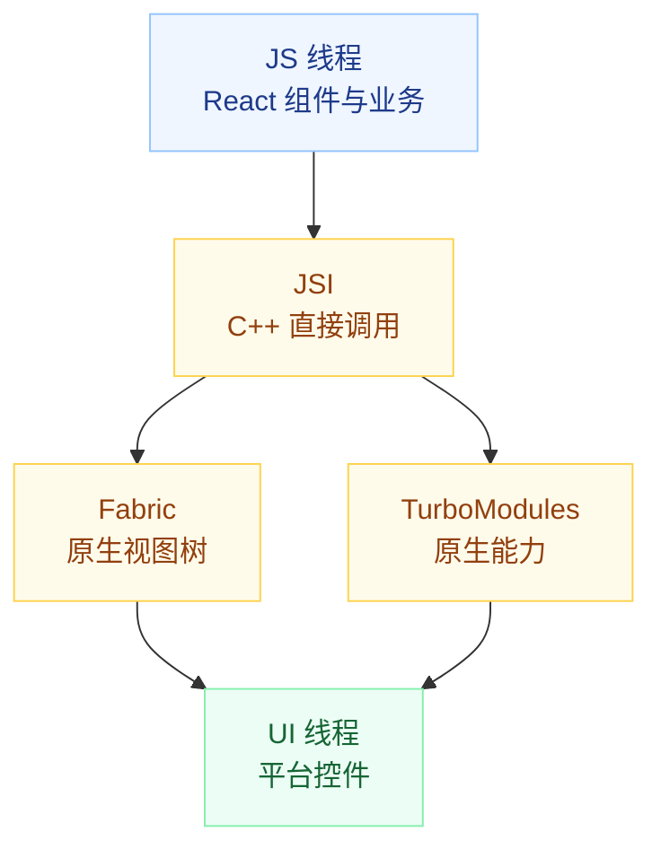
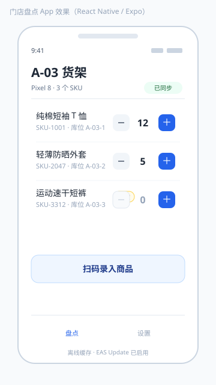

# ReactNative与Expo

> 这篇从 React Native 的线程模型与新架构（New Architecture）讲起，经过 Expo 工程搭建、组件与样式、路由、状态与存储、原生模块，最后落到 EAS 构建发布、OTA 更新、性能排障，并以一个门店盘点 App 的完整交付收尾。
>
> 学完能独立搭起一个 TypeScript 的 Expo 工程，接好原生能力，用 EAS 打出双端安装包并安全地推热更新，在列表卡顿、白屏或构建失败时定位到具体环节。

## 一、React Native 的定位与边界

React Native（RN）用 TypeScript/JavaScript 写业务，界面最终渲染成平台原生控件，不是 WebView。核心判断：RN 的强项是"Web 团队 + 原生体验 + 动态更新"，代价是 JS 线程与原生线程之间的调度、原生依赖的版本匹配，以及调试时要在两套运行时之间来回看。

### 1.1 线程模型与 New Architecture

RN 应用至少有三个执行上下文：JS 线程跑 React 与业务逻辑，UI 线程（主线程）跑原生控件与手势，渲染线程做布局与绘制。老架构靠 Bridge 传 JSON 消息，异步、批量、序列化；新架构把这条桥换成了 JSI（JavaScript Interface）之上的直接调用。



| 组成 | 职责 | 对开发的影响 |
|---|---|---|
| JSI | JS 引擎与 C++ 的同步接口 | 原生方法可同步调用，不再全异步 |
| Fabric | 新的渲染器，C++ 维护影子树 | 列表与动画更顺，布局可并发 |
| TurboModules | 按需加载的原生模块 | 启动更快，模块要声明式注册 |
| Codegen | 从 TS 类型生成 C++/原生胶水 | 原生模块签名编译期校验 |
| Hermes | 默认 JS 引擎，预编译字节码 | 启动快，但 `eval` 等动态能力受限 |

版本事实（2026-11）：RN 0.8x 稳定线，新项目默认开启 New Architecture；0.76 起新架构成为默认，旧架构进入冻结并逐步移除。把 `newArchEnabled` 关掉只应作为旧库迁移的临时手段，不是长期方案。

> 边界：新架构不等于"没有原生线程"。JS 里的长任务照样卡 JS 线程，进而卡住手势与渲染；性能问题仍然要分清是 JS 计算、原生视图数量，还是图片解码。

### 1.2 Expo 与 bare 工程的选择

Expo 是一层围绕 RN 的工程体系：托管构建（EAS Build）、OTA（Over-the-Air，空中下载）更新（EAS Update）、一整套原生模块（相机、定位、安全存储）和 `expo-router` 文件路由。bare 工程是纯 RN CLI 工程，原生目录自己管。

| 形态 | 原生目录 | 适合 | 代价 |
|---|---|---|---|
| Expo 托管（managed） | 不提交，按需生成 | 绝大多数业务 App | 依赖 Expo 模块覆盖度 |
| Expo prebuild | `android/` `ios/` 可生成可提交 | 需要改原生工程 | 生成物与配置要同步 |
| bare RN CLI | 自己维护 | 深度定制、存量原生集成 | 升级与配置全手工 |

判断规则：需要写自定义原生代码时，不必逃离 Expo——用 **development build + 本地 Expo Module + config plugin**，仍然保留 EAS 构建和 OTA；只有当原生工程被大量手工改动、或公司强制要求自建流水线时，才考虑纯 bare。

> 边界：Expo Go 是沙盒，只包含内置模块；一旦引入本地模块或第三方原生 SDK，就必须用 development build（`npx expo run:android` 或 EAS `development` profile），Expo Go 里会报 "native module not found"。

### 1.3 与原生、Flutter、uni-app 的边界

| 方案 | 渲染 | 语言 | 适合 | 主要成本 |
|---|---|---|---|---|
| 原生 | 平台控件 | Kotlin / Swift | 系统能力、极致性能 | 双端人力 |
| RN / Expo | 原生控件 + JS | TypeScript | Web 团队、OTA 热更 | 原生依赖与调试割裂 |
| Flutter | 自绘 | Dart | 双端像素一致、强交互 | 包体、能力桥接 |
| uni-app | WebView / 小程序 | Vue | 小程序 + 轻量 App | 复杂交互性能 |

RN 与 Flutter 的实质差别不在语言，而在"谁画控件"：RN 用原生控件，天然继承平台手感与无障碍，但控件样式受平台限制、跨端像素一致性弱；Flutter 自绘，像素一致、动画可控，但包体大、原生控件语义要自己补。需要"发版后还能改文案和轻逻辑"的场景，RN 的 EAS Update 是目前跨平台方案里最成熟的一条路。

## 二、环境与第一个 Expo 工程

这一章解决"从零到真机看到界面"。

### 2.1 版本基线与安装

版本基线 2026-11-13：React Native 0.8x、React 19.x、TypeScript 5.9+、Node 22 LTS、Expo SDK 当前稳定版（以 `npx create-expo-app@latest` 实际拉到的版本为准，并写进 `package.json` 锁定）、Hermes 默认、New Architecture 默认开启。

| 系统 | 安装方式 |
|---|---|
| Windows 10/11 | `winget install OpenJS.NodeJS.LTS`；Android 调试装 Android Studio 与平台工具 |
| macOS | `brew install node@22`；iOS 真机/模拟器装 Xcode 16+ |
| Ubuntu 24.04+ | NodeSource 源安装 Node 22，或 `nvm install 22` |
| Rocky / CentOS 9+ | `dnf module install nodejs:22`，或 NodeSource 源 |

```bash
node -v          # v22.x
npm -v
npx expo --version
npx expo-doctor  # 体检：依赖版本、配置、原生目录一致性
```

预期输出（片段）：

```text
✔ Check Expo config for common issues
✔ Check package.json for common issues
✔ Check native toolchains using Android SDK
✔ Check dependencies for packages that should not be installed directly
```

### 2.2 创建工程与目录

```bash
npx create-expo-app@latest stock-check
cd stock-check
npx expo start
```

`npx expo start` 输出：

```text
Starting Metro Bundler
› Metro waiting on exp://192.168.1.20:8081
› Scan the QR code above with Expo Go (Android) or the Camera app (iOS)
› Press a │ open Android
› Press i │ open iOS simulator
› Press w │ open web
```

默认模板带 `expo-router` 与 TypeScript，目录职责：

| 路径 | 内容 | 说明 |
|---|---|---|
| `app/` | 路由页面，文件即路由 | `_layout.tsx` 是布局，`[id].tsx` 是动态段 |
| `components/` | 可复用组件 | 只放展示与交互，不放请求 |
| `hooks/` | 数据与副作用封装 | TanStack Query 的封装放这里 |
| `lib/` | 请求、存储、工具 | 与 React 无关的纯逻辑 |
| `modules/` | 本地原生模块 | `npx create-expo-module --local` 生成 |
| `app.json` | 应用配置、插件、权限 | 原生能力的声明入口 |

### 2.3 真机调试与 development build

- 最快路径：手机装 Expo Go，扫二维码，改代码即热更新；
- 需要自定义原生模块：`npx expo run:android`（首次会 `prebuild` 生成 `android/` 并编译），之后 `npx expo start --dev-client`；
- 无线调试不稳时，Android 用 USB 反向代理：

```bash
adb reverse tcp:8081 tcp:8081
```

> 边界：`expo run:android` 首次编译要 5–15 分钟并下载 Gradle 依赖；CI 或换机后 Gradle 缓存失效会重来一遍。日常改 JS 不需要重新编译原生，只有新增原生模块、改权限、改 `app.json` 的 native 配置才需要。

## 三、组件、样式与列表

这一章解决"界面怎么写、为什么和 Web 的直觉不一样"。

### 3.1 核心组件与宿主视图

RN 没有 `div`/`span`，只有平台映射好的宿主组件（Host Component）。

| RN 组件 | 映射 | 用途 |
|---|---|---|
| `View` | `UIView` / `android.view.ViewGroup` | 布局容器，默认 flex 纵向 |
| `Text` | `UILabel` / `TextView` | 所有文字必须包在 `Text` 里 |
| `Pressable` | 触摸手势 | 替代已不推荐的 `TouchableOpacity` |
| `ScrollView` | 滚动容器 | 内容少、需整体滚动 |
| `FlatList` | 虚拟列表 | 长列表，按需渲染 |
| `Image` | 图片视图 | 优先用 `expo-image` 拿缓存 |

```tsx
import { Pressable, Text, View } from 'react-native';

export function PrimaryButton({ label, onPress }: { label: string; onPress: () => void }) {
  return (
    <Pressable
      onPress={onPress}
      // android_ripple 是 Android 的水波纹；iOS 用 style 回调做透明度反馈
      android_ripple={{ color: '#1d4ed8' }}
      style={({ pressed }) => [
        { backgroundColor: '#2563eb', paddingVertical: 12, borderRadius: 10, opacity: pressed ? 0.85 : 1 },
      ]}
    >
      <Text style={{ color: '#fff', textAlign: 'center', fontWeight: '600' }}>{label}</Text>
    </Pressable>
  );
}
```

> 边界：原始文本必须包在 `Text` 里，不能直接放在 `View` 中；`Text` 也不能设 `flexDirection`，嵌套文字只能 `Text` 套 `Text`。

### 3.2 Flexbox 与平台差异

RN 的 Flexbox 与 Web 有三处实质差异：默认 `flexDirection: 'column'`、没有 `gap` 的历史包袱（0.71 起支持 `gap`）、单位是无量纲的 dp/pt（不是 px）。样式用 `StyleSheet.create` 集中，避免每次渲染新建对象导致子组件重渲染。

```tsx
import { StyleSheet } from 'react-native';

const styles = StyleSheet.create({
  row: {
    flexDirection: 'row',
    alignItems: 'center',
    gap: 12,                    // 0.71+ 原生支持，比手写 margin 更少布局抖动
    paddingHorizontal: 16,
    height: 64,                 // 固定行高，配合 getItemLayout 让列表跳过测量
    backgroundColor: '#fff',
  },
  info: { flex: 1 },            // flex:1 才让长文本拿到剩余宽度并 ellipsis
  name: { fontSize: 15, color: '#1f2937' },
  sku: { fontSize: 12, color: '#94a3b8', marginTop: 2 },
});
```

平台差异只包在必须的地方：

```tsx
import { Platform } from 'react-native';

const shadow = Platform.select({
  ios: { shadowColor: '#000', shadowOpacity: 0.08, shadowRadius: 8, shadowOffset: { width: 0, height: 2 } },
  android: { elevation: 2 },   // Android 用 elevation，iOS 的 shadow* 在 Android 无效
  default: {},
});
```

> 边界：`StyleSheet.create` 不是"编译期样式"，它只做注册与复用；动态样式仍然每次渲染创建新对象，颜色/尺寸写在 `style` 数组里要接受这点开销。

### 3.3 FlatList 与长列表

长列表是 RN 性能的分水岭。`FlatList` 只渲染窗口内的项，前提是 key 稳定、行高可预测、renderItem 不每次新建。

```tsx
<FlatList
  data={items}
  keyExtractor={(it) => it.id}                 // 用业务 ID，不要用 index：增删会错位复用
  renderItem={renderItem}                       // renderItem 必须是稳定引用，见 8.1
  getItemLayout={(_, i) => ({ length: 64, offset: 64 * i, index: i })}
  initialNumToRender={12}
  maxToRenderPerBatch={12}
  windowSize={7}                                // 值越小内存越省、快速滑动越容易露白
  removeClippedSubviews={Platform.OS === 'android'}
  contentContainerStyle={{ paddingBottom: 24 }}
/>
```

> 边界：`getItemLayout` 只在行高固定时用；行高随内容变化时硬给会让滚动条与点击位置错位。列表里嵌套纵向 `ScrollView` 等于放弃虚拟化。

### 3.4 图片、字体与安全区

- 图片用 `expo-image`：内置磁盘缓存、`recyclingKey` 防列表复用时闪图；
- 字体用 `expo-font` 在根布局 `useFonts` 加载，未加载完先返回 splash，避免文字闪烁；
- 安全区用 `react-native-safe-area-context` 的 `useSafeAreaInsets`，不要用已废弃的 `SafeAreaView`（它只处理 iOS 刘海，不处理 Android 手势条）。

```tsx
import { Image } from 'expo-image';

<Image
  source={{ uri: item.photo }}
  style={{ width: 56, height: 56, borderRadius: 8 }}
  contentFit="cover"
  cachePolicy="memory-disk"      // 盘点照片重复打开时不再走网络
  recyclingKey={item.id}          // 列表回收复用时按 key 重置，避免显示上一行图片
  transition={120}
/>
```

## 四、导航与路由

这一章解决"页面怎么组织、参数怎么传、深链怎么进"。

### 4.1 expo-router 文件路由

`app/` 目录即路由表：文件名是路径，`(group)` 分组不贡献路径，`[param]` 是动态段，`_layout.tsx` 包住同级页面。

| 文件 | 路由 | 说明 |
|---|---|---|
| `app/_layout.tsx` | 根布局 | Provider、字体、启动屏 |
| `app/(tabs)/_layout.tsx` | Tab 容器 | 底部导航 |
| `app/(tabs)/index.tsx` | `/` | 首页 |
| `app/(tabs)/settings.tsx` | `/settings` | 设置 |
| `app/stock/[id].tsx` | `/stock/:id` | 动态详情 |

根布局：

```tsx
import { Stack } from 'expo-router';
import { StatusBar } from 'expo-status-bar';
import { SafeAreaProvider } from 'react-native-safe-area-context';
import { QueryClient, QueryClientProvider } from '@tanstack/react-query';

// 模块级单例：每次渲染新建 QueryClient 会丢缓存、重复请求
const queryClient = new QueryClient({
  defaultOptions: { queries: { retry: 1, staleTime: 30_000 } },
});

export default function RootLayout() {
  return (
    <QueryClientProvider client={queryClient}>
      <SafeAreaProvider>
        <StatusBar style="dark" />
        <Stack screenOptions={{ headerShown: false }} />
      </SafeAreaProvider>
    </QueryClientProvider>
  );
}
```

Tab 布局：

```tsx
import { Tabs } from 'expo-router';
import { Ionicons } from '@expo/vector-icons';

export default function TabsLayout() {
  return (
    <Tabs screenOptions={{ tabBarActiveTintColor: '#2563eb', headerShown: false }}>
      <Tabs.Screen
        name="index"
        options={{
          title: '盘点',
          tabBarIcon: ({ color, size }) => <Ionicons name="list-outline" color={color} size={size} />,
        }}
      />
      <Tabs.Screen
        name="settings"
        options={{
          title: '设置',
          tabBarIcon: ({ color, size }) => <Ionicons name="settings-outline" color={color} size={size} />,
        }}
      />
    </Tabs>
  );
}
```

### 4.2 参数、跳转与返回

```tsx
import { router, useLocalSearchParams } from 'expo-router';

// 跳转：对象形式便于类型检查与深链复用
router.push({ pathname: '/stock/[id]', params: { id: item.id } });

// 详情页取值：动态段参数都是 string 或 string[]
const { id } = useLocalSearchParams<{ id: string }>();

// 返回上一页；没有上一页（深链冷启动）时兜底到首页
if (router.canGoBack()) router.back();
else router.replace('/');
```

> 边界：`router.push` 同名页面会叠加栈，连续点击"详情"可能开出多层；列表项点击要加防抖，或改用 `router.replace` 保持栈深度。

### 4.3 深链与冷启动

在 `app.json` 配 `scheme`，`expo-router` 自动把 URL 映射到路由：

```json
{
  "expo": {
    "scheme": "stockcheck"
  }
}
```

```bash
# Android 验证深链：冷启动直接进详情页
adb shell am start -a android.intent.action.VIEW -d "stockcheck://stock/SKU-1001"
# iOS 模拟器
xcrun simctl openurl booted "stockcheck://stock/SKU-1001"
```

深链进来时没有登录态，要在根布局做"鉴权 → 重定向"，不要在详情页里各自判断，否则每个页面都要复制一份。

## 五、状态、存储与网络

这一章解决"数据从哪来、放哪、断网怎么办"。

### 5.1 本地状态与 Context

组件内状态用 `useState`/`useReducer`；跨页面但低频变化的（主题、登录用户、当前门店）用 Context；高频变化且范围大的（列表、表单草稿）不要塞 Context，一次更新会让所有消费者重渲染。

```tsx
type Session = { storeId: string; userName: string } | null;

const SessionContext = createContext<{
  session: Session;
  signIn: (storeId: string) => void;
}>({ session: null, signIn: () => {} });

export function useSession() {
  return useContext(SessionContext);
}
```

> 边界：Context 的 `value` 每次渲染新建对象，等于所有消费者都更新；用 `useMemo` 包住 value，或拆成多个 Context。

### 5.2 服务端状态与缓存

服务端数据不要手写 `loading/error/data` 三件套，用 TanStack Query 管理缓存、重试、失效与乐观更新。

```ts
// lib/api.ts
import * as SecureStore from 'expo-secure-store';

const BASE_URL = process.env.EXPO_PUBLIC_API_BASE ?? 'https://api.example.com';

export async function request<T>(path: string, init: RequestInit = {}): Promise<T> {
  const token = await SecureStore.getItemAsync('token');
  const controller = new AbortController();
  // fetch 没有默认超时，弱网下请求会一直挂着，必须自己掐
  const timer = setTimeout(() => controller.abort(), 8000);
  try {
    const res = await fetch(`${BASE_URL}${path}`, {
      ...init,
      signal: controller.signal,
      headers: {
        'Content-Type': 'application/json',
        ...(token ? { Authorization: `Bearer ${token}` } : {}),
        ...init.headers,
      },
    });
    if (!res.ok) throw new Error(`HTTP ${res.status}`);
    return (await res.json()) as T;
  } finally {
    clearTimeout(timer);
  }
}
```

```ts
// hooks/useStock.ts
import { useMutation, useQuery, useQueryClient } from '@tanstack/react-query';
import { fetchStock, patchStock, type StockItem } from '@/lib/stock';

export const STOCK_KEY = ['stock'] as const;

export function useStock() {
  return useQuery({
    queryKey: STOCK_KEY,
    queryFn: fetchStock,
    staleTime: 30_000,       // 30 秒内重进页面不重复请求，店员来回切 Tab 很常见
    gcTime: 5 * 60_000,
  });
}

export function useUpdateStock() {
  const queryClient = useQueryClient();
  return useMutation({
    mutationFn: ({ id, delta }: { id: string; delta: number }) => patchStock(id, delta),
    // 乐观更新：点 + 立即变数字，网络回来再校正，弱网下手感差别最大
    onMutate: async ({ id, delta }) => {
      await queryClient.cancelQueries({ queryKey: STOCK_KEY });
      const previous = queryClient.getQueryData<StockItem[]>(STOCK_KEY);
      queryClient.setQueryData<StockItem[]>(STOCK_KEY, (old) =>
        (old ?? []).map((it) => (it.id === id ? { ...it, qty: Math.max(0, it.qty + delta) } : it)),
      );
      return { previous };
    },
    onError: (_err, _vars, ctx) => {
      // 失败回滚，避免界面数字与服务端长期不一致
      if (ctx?.previous) queryClient.setQueryData(STOCK_KEY, ctx.previous);
    },
    onSettled: () => queryClient.invalidateQueries({ queryKey: STOCK_KEY }),
  });
}
```

### 5.3 本地存储与安全存储

| 存储 | 内容 | 安全级别 |
|---|---|---|
| `AsyncStorage` | 列表缓存、草稿、偏好 | 明文，可被 root/越狱设备读取 |
| `expo-secure-store` | token、刷新凭证 | Keychain / Keystore 加密 |
| `expo-file-system` | 照片、导出文件 | 沙盒目录，卸载即删 |
| SQLite（`expo-sqlite`） | 大量结构化离线数据 | 明文，需自行加密敏感字段 |

```ts
// lib/stock.ts
import AsyncStorage from '@react-native-async-storage/async-storage';
import { request } from './api';

const CACHE_KEY = 'stock:cache:v1';

export type StockItem = { id: string; name: string; sku: string; bin: string; qty: number };

export async function fetchStock(): Promise<StockItem[]> {
  try {
    const fresh = await request<StockItem[]>('/stock');
    await AsyncStorage.setItem(CACHE_KEY, JSON.stringify({ at: Date.now(), items: fresh }));
    return fresh;
  } catch (err) {
    // 离线优先：读不到网络就读上次缓存，门店地下室常态
    const raw = await AsyncStorage.getItem(CACHE_KEY);
    if (raw) return (JSON.parse(raw) as { items: StockItem[] }).items;
    throw err; // 连缓存都没有才把错误抛给界面
  }
}

export async function patchStock(id: string, delta: number): Promise<void> {
  await request(`/stock/${id}`, {
    method: 'PATCH',
    body: JSON.stringify({ delta }),
  });
}
```

> 边界：`AsyncStorage` 单条上限与总容量随平台不同，超过几 MB 的离线数据应换 `expo-sqlite`；token 绝不能放 `AsyncStorage`，这是移动端最常见的泄密点。

### 5.4 网络状态与错误处理

断网检测用 `@react-native-community/netinfo`；但**不要用"有没有网"决定是否发请求**，地铁里显示有网却打不通是常态。正确做法是请求本身带超时，失败后读缓存，并在界面上明确标注"离线数据 + 时间"。

```tsx
const { data, isError, refetch, isRefetching } = useStock();

if (isError) {
  return (
    <Pressable onPress={() => refetch()}>
      <Text>加载失败，点击重试</Text>
    </Pressable>
  );
}
```

## 六、原生模块与 New Architecture

这一章解决"RN 没有的能力怎么自己补"。

### 6.1 先用现成模块，再考虑自己写

Expo 生态覆盖了大多数需求：`expo-camera`（扫码/拍照）、`expo-location`（定位）、`expo-notifications`（推送）、`expo-secure-store`、`expo-battery`、`expo-haptics`。装法：

```bash
npx expo install expo-camera expo-battery
```

用 `npx expo install` 而不是 `npm install`，它会按当前 SDK 选兼容版本，避免"装最新版把原生编译搞崩"。

写本地模块的触发条件只有三个：现成模块不覆盖；需要调用公司自有 SDK；需要同步返回一个原生常量（如设备型号）以避免异步开销。

### 6.2 用 Expo Modules 写一个本地模块

```bash
npx create-expo-module@latest --local device-info
```

生成 `modules/device-info/`，包含 `expo-module.config.json`、`android/`、`ios/`、`index.ts`。模块声明：

```json
{
  "platforms": ["android", "ios"],
  "android": { "modules": ["expo.modules.deviceinfo.DeviceInfoModule"] },
  "ios": { "modules": ["DeviceInfoModule"] }
}
```

Kotlin 实现：

```kotlin
package expo.modules.deviceinfo

import android.os.Build
import android.os.SystemClock
import expo.modules.kotlin.modules.Module
import expo.modules.kotlin.modules.ModuleDefinition

class DeviceInfoModule : Module() {
  override fun definition() = ModuleDefinition {
    Name("DeviceInfo")

    // 同步函数：走 JSI 直接返回，适合读取内存里的常量，不要在这里做 IO
    Function("getModel") { "${Build.MANUFACTURER} ${Build.MODEL}" }

    // 异步函数：返回 Promise，耗时操作放这里
    AsyncFunction("getUptimeSeconds") {
      SystemClock.elapsedRealtime() / 1000
    }
  }
}
```

Swift 实现：

```swift
import ExpoModulesCore
import UIKit

public class DeviceInfoModule: Module {
  public func definition() -> ModuleDefinition {
    Name("DeviceInfo")

    Function("getModel") { UIDevice.current.model }

    AsyncFunction("getUptimeSeconds") { () -> Int in
      Int(ProcessInfo.processInfo.systemUptime)
    }
  }
}
```

TypeScript 门面：

```ts
// modules/device-info/index.ts
import { requireNativeModule } from 'expo-modules-core';

type DeviceInfoNative = {
  getModel(): string;
  getUptimeSeconds(): Promise<number>;
};

// 名字必须与原生 Name("DeviceInfo") 一致，否则运行时抛 "Cannot find native module"
export default requireNativeModule<DeviceInfoNative>('DeviceInfo');
```

使用：

```tsx
import DeviceInfo from '@/modules/device-info';

// 同步调用，不经过异步桥；在渲染函数里直接取也不会造成额外一帧
const model = DeviceInfo.getModel();
```

> 边界：本地模块改完必须重新编译原生（`npx expo run:android` / `run:ios`），只重启 Metro 不会生效；`expo-module.config.json` 写错类名时，报错发生在启动阶段而不是导入阶段，先看 `adb logcat` 里的 "Cannot find native module"。

### 6.3 config plugin 与 prebuild

有些原生改动没有 JS API：改 `Info.plist`、加 Android 权限、往 `AndroidManifest` 注 `meta-data`。这些用 config plugin 声明，`prebuild` 时自动写进原生工程，避免"手改 `android/` 后被下一次 prebuild 覆盖"。

```js
// plugins/with-camera-message.js
const { withInfoPlist } = require('expo/config-plugins');

module.exports = function withCameraMessage(config) {
  return withInfoPlist(config, (cfg) => {
    // iOS 缺这条文案，调用相机时直接崩溃，不是弹权限框
    cfg.modResults.NSCameraUsageDescription = '扫描商品条码需要相机权限';
    return cfg;
  });
};
```

```json
{
  "expo": {
    "plugins": ["expo-router", "expo-secure-store", "./plugins/with-camera-message"]
  }
}
```

```bash
npx expo prebuild --clean   # 重新生成 android/ ios/，插件在这里生效
npx expo run:android
```

> 边界：`prebuild --clean` 会丢弃对 `android/`、`ios/` 的手工修改；确实需要手改时，把改动固化成 config plugin 或 patch-package，否则下次生成就丢。

## 七、EAS 构建与发布

这一章解决"怎么出安装包、怎么发商店、怎么安全热更"。

### 7.1 eas.json 与构建 profile

```bash
npm install -g eas-cli
eas login
eas build:configure
```

```json
{
  "cli": { "version": ">= 16.0.0", "appVersionSource": "remote" },
  "build": {
    "development": {
      "developmentClient": true,
      "distribution": "internal"
    },
    "preview": {
      "distribution": "internal",
      "channel": "preview",
      "android": { "buildType": "apk" }
    },
    "production": {
      "autoIncrement": true,
      "channel": "production"
    }
  },
  "submit": { "production": {} }
}
```

| profile | 用途 | 产物 |
|---|---|---|
| development | 带 dev client 的调试包 | 双端安装包 |
| preview | 内部试用、QA 回归 | Android APK、iOS ad-hoc |
| production | 商店上架 | AAB、IPA |

`channel` 是 EAS Update 的分支映射，只有配了 `expo-updates` 才生效。

```bash
eas build --platform android --profile preview
eas build --platform ios --profile production
```

预期输出（片段）：

```text
✔ Build finished
https://expo.dev/accounts/example/projects/stock-check/builds/8f3c2a1e
```

### 7.2 签名与凭证

- Android：EAS 可代管 keystore（`eas credentials` 查看/下载）；自管时把 keystore 与密码放 CI secrets，**不要提交到仓库**；
- iOS：需要 Apple Developer 账号，EAS 可代管证书与 provisioning profile；
- 首次 `eas build` 会交互式创建凭证，CI 里用 `EXPO_TOKEN` 非交互登录：

```bash
EXPO_TOKEN=*** eas build --platform android --profile production --non-interactive
```

> 边界：keystore 丢失无法更新已上架应用，只能换包名重发；企业内部分发（ad-hoc）设备 UDID 要提前注册，漏了就装不上，且每年要续期。

### 7.3 EAS Update 与灰度

OTA 只更新 JS bundle 与资源，不改原生代码、不加权限、不改版本号。

```bash
npx expo install expo-updates
eas update:configure
```

`app.json` 关键字段：

```json
{
  "expo": {
    "runtimeVersion": { "policy": "appVersion" },
    "updates": {
      "url": "https://u.expo.dev/<project-id>",
      "fallbackToCacheTimeout": 0,
      "checkAutomatically": "ON_LOAD"
    }
  }
}
```

```bash
eas update --branch production --message "fix: 盘点数量上限改为 999"
```

```text
✔ Published update
https://expo.dev/accounts/example/projects/stock-check/updates/2b7d...
```

| 策略 | 含义 | 适用 |
|---|---|---|
| `appVersion` | 同一商店版本才收更新 | 大多数业务 |
| `fingerprint` | 按原生指纹匹配 | 原生依赖频繁变动 |
| `nativeVersion` | 按 versionCode/buildNumber | 严格控制 |

> 边界：`runtimeVersion` 不匹配时更新会被静默忽略——这是"发了 OTA 但用户没变化"的第一原因。灰度靠分支 + 百分比发布，全量前先用 preview 渠道验证；回滚用 `eas update:rollback --branch production` 或重新发布上一版本。

## 八、性能与排障

这一章是现场手册：先分清卡在哪一层，再谈优化。

### 8.1 重渲染与列表性能

RN 的卡顿大多不是"JS 慢"，而是"不必要地重渲染 + 视图数量爆炸"。

| 现象 | 原因 | 手段 |
|---|---|---|
| 点 + 整页刷新 | 状态提升过高 | 状态下移到行组件或用选择器订阅 |
| 列表滑动掉帧 | 每次 renderItem 新建 | `memo` + `useCallback` + 稳定 key |
| 图片闪烁 | 复用未按 key 重置 | `expo-image` 的 `recyclingKey` |
| 滚动露白 | 窗口太小 | 调 `windowSize` / `maxToRenderPerBatch` |
| 输入框卡 | 每次输入都请求 | 防抖 + 受控组件本地化 |

```tsx
import { memo } from 'react';
import { Pressable, StyleSheet, Text, View } from 'react-native';
import type { StockItem } from '@/lib/stock';

type Props = { item: StockItem; onChange: (id: string, delta: number) => void };

// memo：props 浅比较不变就跳过渲染；父组件必须保证 onChange 引用稳定，否则 memo 失效
export const StockRow = memo(function StockRow({ item, onChange }: Props) {
  return (
    <View style={styles.row}>
      <View style={styles.info}>
        <Text style={styles.name} numberOfLines={1}>{item.name}</Text>
        <Text style={styles.sku}>{item.sku} · 库位 {item.bin}</Text>
      </View>
      <Pressable onPress={() => onChange(item.id, -1)} hitSlop={8} style={styles.step}>
        <Text style={styles.stepText}>−</Text>
      </Pressable>
      <Text style={styles.qty}>{item.qty}</Text>
      <Pressable onPress={() => onChange(item.id, 1)} hitSlop={8} style={[styles.step, styles.stepPrimary]}>
        <Text style={[styles.stepText, styles.stepTextPrimary]}>＋</Text>
      </Pressable>
    </View>
  );
});

const styles = StyleSheet.create({
  row: {
    flexDirection: 'row',
    alignItems: 'center',
    gap: 12,
    height: 64,               // 与 getItemLayout 的 length 一致，二者不一致会让滚动定位漂移
    paddingHorizontal: 16,
    backgroundColor: '#fff',
  },
  info: { flex: 1 },
  name: { fontSize: 15, color: '#1f2937' },
  sku: { fontSize: 12, color: '#94a3b8', marginTop: 2 },
  step: {
    width: 30, height: 30, borderRadius: 8,
    backgroundColor: '#f1f5f9',
    alignItems: 'center', justifyContent: 'center',
  },
  stepPrimary: { backgroundColor: '#2563eb' },
  stepText: { fontSize: 16, color: '#334155', fontWeight: '600' },
  stepTextPrimary: { color: '#fff' },
  qty: { width: 32, textAlign: 'center', fontSize: 16, fontWeight: '600', color: '#1f2937' },
});
```

### 8.2 启动与包体积

- 启动慢先看 splash 到首屏之间做了什么：根布局里同步读存储、初始化 SDK、大图预加载都会拖首帧；改成首屏骨架 + 异步补齐；
- 用 production 级 JS 验证，dev 包的耗时没有参考价值：

```bash
npx expo start --no-dev --minify
```

- 看 bundle 组成：

```bash
npx expo export --platform android --output-dir dist
du -sh dist
# 对导出产物做模块级体积归因，定位是哪个依赖把包撑大
npx expo-atlas
```

- 常见体积来源：图标库全量引入（按需 `import { Ionicons } from '@expo/vector-icons'`）、未压缩大图、重复的 polyfill、整个 lodash。

### 8.3 现象 → 原因 → 第一条命令

| 现象 | 最可能原因 | 第一条检查 |
|---|---|---|
| 启动白屏 | JS 异常、bundle 未加载 | `adb logcat \| grep ReactNativeJS` |
| 原生模块 undefined | 未编译原生或名字不一致 | 用 development build 重跑 `expo run:android` |
| 改代码不生效 | Metro 缓存 | `npx expo start -c` |
| 依赖报红 | 版本与 SDK 不匹配 | `npx expo-doctor` |
| OTA 不生效 | runtimeVersion 不匹配 | `eas update:list --branch production` |
| iOS 构建签名失败 | 证书/描述文件过期 | `eas credentials` |
| 键盘遮住输入框 | 未处理键盘高度 | `KeyboardAvoidingView` + `behavior` 按平台设 |

### 8.4 上线检查清单

- [ ] `version`、`android.versionCode`、`ios.buildNumber` 已递增；
- [ ] 新架构开启状态与依赖一致，没有为旧库临时关闭后忘记打开；
- [ ] 权限文案、隐私清单（iOS `PrivacyInfo.xcprivacy`）与实际采集一致；
- [ ] `preview` 包真机过主流程，弱网与离线各走一遍；
- [ ] OTA 的 `runtimeVersion` 与商店包一致，灰度分支可回滚；
- [ ] 崩溃与 JS 错误已接监控（Sentry 等），source map 已上传；
- [ ] 深链、推送冷启动、扫码权限拒绝路径回归；
- [ ] 首屏耗时与包体记录进发布单。

## 九、最佳实践案例

### 9.1 案例背景

一家连锁零售企业要给 120 家门店的店员做盘点工具：扫商品条码、改库存数量、离线可用、总部能临时改活动文案而不发版。约束是：门店手持机以 Android 为主，区域经理用 iPhone；只有两名前端（React 背景）和一名后端；四周上线；原生能力只需要"读设备型号"用于问题定位和"相机扫码"。现状是 Excel 盘点、当晚汇总，错账要第二天才发现。选型结论：React 团队 + 需要 OTA 热修 + 界面是标准表单，RN/Expo 比 Flutter 更贴合；EAS Build 解决双端出包，EAS Update 解决文案热修，本地 Expo Module 解决设备型号。

### 9.2 案例实操

```bash
npx create-expo-app@latest stock-check
cd stock-check
npx expo install expo-camera expo-secure-store expo-updates expo-image
npm install @tanstack/react-query @react-native-async-storage/async-storage
npx create-expo-module@latest --local device-info
```

`app.json`（`updates.url` 里的 `<project-id>` 换成 `eas project:info` 查到的项目 ID）：

```json
{
  "expo": {
    "name": "门店盘点",
    "slug": "stock-check",
    "scheme": "stockcheck",
    "version": "1.4.0",
    "orientation": "portrait",
    "newArchEnabled": true,
    "runtimeVersion": { "policy": "appVersion" },
    "updates": {
      "url": "https://u.expo.dev/<project-id>",
      "fallbackToCacheTimeout": 0
    },
    "ios": { "bundleIdentifier": "com.example.stockcheck", "supportsTablet": false },
    "android": { "package": "com.example.stockcheck", "versionCode": 14 },
    "plugins": ["expo-router", "expo-secure-store", "expo-camera", "./plugins/with-camera-message"]
  }
}
```

本地模块（按 6.2 的模板填实现，路径 `modules/device-info`）。案例涉及的其余文件按前面章节落位：`components/StockRow.tsx` 用 8.1 的实现，`hooks/useStock.ts` 用 5.2 的实现，`lib/api.ts`、`lib/stock.ts` 用 5.2 与 5.3 的实现。首页顶栏直接同步取型号：

```tsx
// app/(tabs)/index.tsx
import { useCallback } from 'react';
import { ActivityIndicator, FlatList, Pressable, StyleSheet, Text, View } from 'react-native';
import { useSafeAreaInsets } from 'react-native-safe-area-context';
import { useStock, useUpdateStock } from '@/hooks/useStock';
import { StockRow } from '@/components/StockRow';
import type { StockItem } from '@/lib/stock';
import DeviceInfo from '@/modules/device-info';

export default function StockScreen() {
  const insets = useSafeAreaInsets();
  const { data, isLoading, isError, refetch, isRefetching } = useStock();
  const { mutate } = useUpdateStock();

  // mutate 是稳定引用；回调再包一层 useCallback，行组件的 memo 才真正生效
  const handleChange = useCallback(
    (id: string, delta: number) => mutate({ id, delta }),
    [mutate],
  );

  const renderItem = useCallback(
    ({ item }: { item: StockItem }) => <StockRow item={item} onChange={handleChange} />,
    [handleChange],
  );

  if (isLoading) return <ActivityIndicator style={{ marginTop: 96 }} />;
  if (isError) {
    return (
      <Pressable onPress={() => refetch()} style={styles.error}>
        <Text>加载失败，点击重试</Text>
      </Pressable>
    );
  }

  return (
    <View style={[styles.page, { paddingTop: insets.top + 12 }]}>
      <Text style={styles.title}>A-03 货架</Text>
      {/* 同步取原生常量：出问题时客服第一句就问机型 */}
      <Text style={styles.meta}>
        {DeviceInfo.getModel()} · {data?.length ?? 0} 个 SKU
        {isRefetching ? ' · 同步中' : ''}
      </Text>
      <FlatList
        data={data}
        keyExtractor={(it) => it.id}
        renderItem={renderItem}
        getItemLayout={(_, i) => ({ length: 64, offset: 64 * i, index: i })}
        initialNumToRender={12}
        windowSize={7}
        contentContainerStyle={{ paddingBottom: insets.bottom + 72 }}
      />
    </View>
  );
}

const styles = StyleSheet.create({
  page: { flex: 1, backgroundColor: '#f8fafc' },
  title: { fontSize: 22, fontWeight: '700', color: '#1f2937', paddingHorizontal: 16 },
  meta: { fontSize: 12, color: '#64748b', paddingHorizontal: 16, marginTop: 4, marginBottom: 12 },
  error: { flex: 1, alignItems: 'center', justifyContent: 'center' },
});
```

扫码与离线提交的关键路径：

```tsx
// app/scan.tsx
import { useRef } from 'react';
import { CameraView, useCameraPermissions } from 'expo-camera';
import { router } from 'expo-router';
import { Button } from 'react-native';

export default function ScanScreen() {
  const [permission, requestPermission] = useCameraPermissions();
  // 扫码回调会连续触发多次，用 ref 上锁，避免连开多页
  const locked = useRef(false);

  if (!permission) return null;
  if (!permission.granted) {
    // 拒绝后必须给可点的入口，不能只弹一次就再也没法授权
    return <Button title="授权相机" onPress={requestPermission} />;
  }

  return (
    <CameraView
      style={{ flex: 1 }}
      barcodeScannerSettings={{ barcodeTypes: ['ean13', 'code128'] }}
      onBarcodeScanned={({ data }) => {
        if (locked.current) return;
        locked.current = true;
        router.replace({ pathname: '/stock/[id]', params: { id: data } });
      }}
    />
  );
}
```

界面效果（列表 + 同步状态 + 机型标识）：



构建与热更新验证：

```bash
eas build --platform android --profile preview --non-interactive
eas build --platform ios --profile production --non-interactive
eas update --branch preview --message "feat: 盘点列表显示机型与同步状态"
```

预期输出（片段）：

```text
✔ Build finished
https://expo.dev/accounts/example/projects/stock-check/builds/8f3c2a1e
✔ Published update
https://expo.dev/accounts/example/projects/stock-check/updates/2b7d...
```

真机验收：Android 飞行模式下改数量，数字立即变化、退出重进仍在（缓存兜底）；恢复网络后 `onSettled` 刷新，服务端数字一致；iOS 用 `stockcheck://stock/SKU-1001` 冷启动能直接进详情；EAS Update 推到 preview 渠道后，杀掉 App 重开，顶栏出现新机型文案；用 `eas update:list --branch preview` 确认更新已发布。

### 9.3 案例结果

上线四周后的数据（示例值，按 120 家门店试点估算）：单店盘点从平均 70 分钟降到 28 分钟；错账从每天 2–3 笔降到每周 1 笔以内；总部文案调整从"排期发版 3 天"变成 `eas update` 10 分钟内生效，活动期改了 6 次文案零发版。构建方面，两名前端用 EAS 同时出双端包，单次约 12 分钟（示例值），没有再为 Mac 配 iOS 环境。

失败模式复盘：第一版把 `renderItem` 写成内联箭头函数，`memo` 完全失效，300 行列表滑动掉帧——改成稳定回调后恢复 60 fps；一次 OTA 推上去用户没反应，原因是商店包 `version=1.4.0`、更新按 `appVersion` 匹配，而测试包还是 1.3.9，`runtimeVersion` 不匹配被静默忽略，之后把"检查 `eas update:list` 与包版本一致"写进发布单；扫码页最初用 `router.push`，连续扫码叠了四层页面，改 `replace` 解决。结构复盘：请求层（超时 + 缓存兜底）与 UI 分离，让"离线可用"只改了一个文件；本地模块只有两个同步方法，却把客服排障时间从"问用户型号"变成日志里直接可见。
