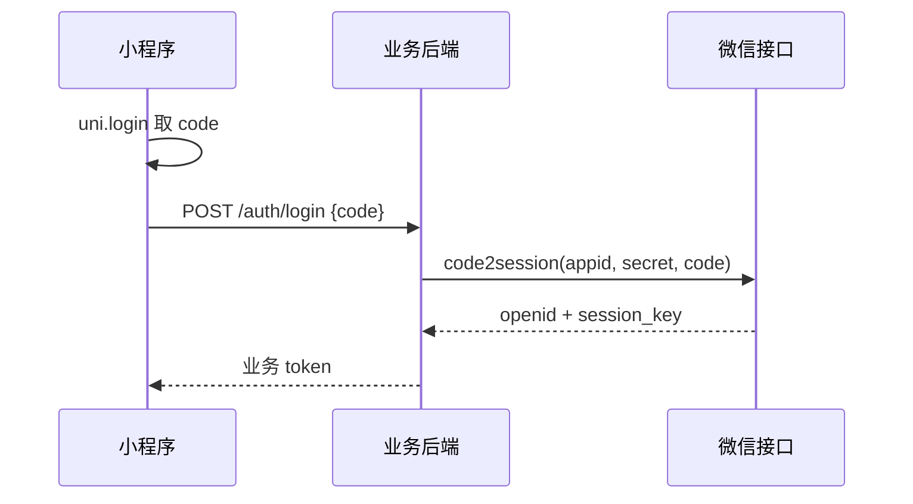
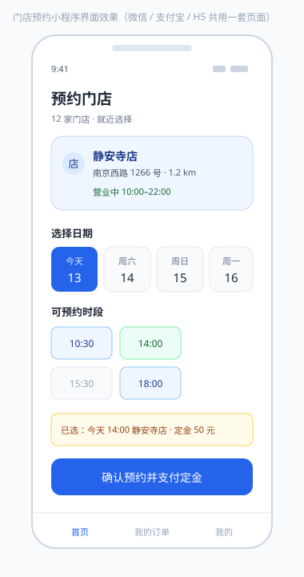

# uni-app与小程序

> 这篇从 uni-app 与小程序在交付链上的位置讲起，经过环境与最小工程、Vue 3 语法落地、页面路由与组件、平台 API 与条件编译、微信/支付宝/抖音三端发布，最后落到限制、性能与跨端排障。
>
> 学完能用一套 Vue 3 代码跑通一个可发布的小程序，并独立完成分包、登录、上传审核和多端差异处理。

## 一、uni-app 与小程序的能力边界

uni-app 是 DCloud 的跨端框架，用 Vue 语法编写，编译到微信、支付宝、抖音、百度等小程序，以及 H5、Android/iOS App 和鸿蒙。它的价值不在"一套代码到处跑"，而在**同一套业务代码可以按平台裁剪后分别发布**。

小程序不是浏览器页面。它由逻辑层（JavaScriptCore/V8）和视图层（WebView 或 Skyline）两个独立运行环境组成，两层之间通过 `setData` 传递数据；没有 DOM、没有 `window`、没有 `document`，包体积和审核规则都由平台约束。理解这一点，后面所有限制都有了解释。

| 方案 | 适合 | 主要代价 |
|---|---|---|
| uni-app | 国内小程序为主、团队会 Vue | 平台差异要靠条件编译 |
| 原生小程序 | 只投微信、追求极致包体 | 不能复用到其他端 |
| Taro | React 团队、多端小程序 | 生态与调试链更重 |
| Flutter | 重交互、自绘 UI | 小程序端不支持 |
| React Native | 原生体验、App 为主 | 小程序端不支持 |

国内岗位的实际情况是：中小项目、外包、私域电商、门店与政务系统大量使用小程序，招聘描述通常写"Vue + 微信小程序 + 发布流程"，而不是单写 uni-app。掌握 uni-app 的同时要能读懂原生小程序代码，否则遇到平台特有能力会被卡住。

> 边界：需要复杂动画、大量原生 SDK、蓝牙/串口等深度设备能力时，uni-app 的插件市场方案要逐项验证；验证不通过就退回原生或 Flutter，不要用条件编译硬扛。

## 二、环境与最小工程

版本基线取 2026-11：uni-app 3.x（Vue 3 编译器）、Vue 3.5、Node 20/22 LTS、微信开发者工具当前稳定版、小程序基础库 3.x。HBuilderX 是可选的可视化 IDE，CI 与团队协作更适合 CLI 工程。

| 工具 | 版本基线 | 用途 |
|---|---|---|
| Node.js | 20/22 LTS | 编译与依赖管理 |
| uni-app | 3.x（Vue 3） | 跨端框架 |
| Vue | 3.5 | 视图与响应式 |
| 微信开发者工具 | 当前稳定版 | 预览、真机调试、上传 |
| 基础库 | 3.x | 运行时能力 |

| 环境 | 安装方式 |
|---|---|
| Windows 10/11 | `winget install OpenJS.NodeJS.LTS`，开发者工具从官网下载 |
| macOS | `brew install node`，`brew install --cask wechatwebdevtools` |
| Ubuntu 24.04 | `curl -fsSL https://deb.nodesource.com/setup_22.x \| sudo -E bash -` 后 `sudo apt install -y nodejs` |
| Rocky/CentOS 9 | `sudo dnf module install nodejs:22`，开发者工具无官方包，用 Windows/macOS 机器上传 |

用 CLI 模板创建工程，避免 HBuilderX 工程与 npm 工程混用：

```bash
# degit 直接拉取官方 Vue3 + Vite 模板，不生成 git 历史
npx degit dcloudio/uni-preset-vue#vite booking-mini
cd booking-mini
npm install
npm run dev:mp-weixin
```

预期输出（关键片段）：

```text
ready in 812 ms
DONE  Build complete. Watching for changes...
运行方式：打开 微信开发者工具 -> 导入 dist/dev/mp-weixin
```

目录结构：

```text
booking-mini/
├── src/
│   ├── pages/index/index.vue       # 首页，pages.json 第一项
│   ├── pages/booking/booking.vue   # 预约页
│   ├── api/request.js              # 请求封装
│   ├── static/                     # 本地图片，会被打进包
│   ├── App.vue
│   ├── main.js
│   ├── manifest.json               # 各端 appid 与权限
│   └── pages.json                  # 路由、tabBar、分包
├── vite.config.js
└── package.json
```

`manifest.json` 的 `mp-weixin` 段填小程序 appid：

```json
{
  "name": "门店预约",
  "appid": "",
  "mp-weixin": {
    "appid": "wx1234567890abcdef",
    "setting": { "urlCheck": true },
    "usingComponents": true
  }
}
```

`urlCheck: true` 表示上传后按配置的合法域名校验请求，开发阶段才在开发者工具里手动勾选"不校验合法域名"。

微信开发者工具选择"导入项目"，目录指向 `dist/dev/mp-weixin`，appid 可用测试号。首页出现即完成最小闭环。

> 边界：CLI 工程的产物在 `dist/`，不要在 `dist` 里改代码；再次编译会覆盖。HBuilderX 工程则把源码放在根目录，两种结构不能混用，否则出现"改了没生效"。

## 三、Vue 3 语法在 uni-app 中的落地

uni-app 的 Vue 3 编译器支持单文件组件、`<script setup>`、`ref/reactive`、`computed`、`watch` 和全部常用指令，但运行时没有浏览器 DOM。所有"取元素、改样式、量尺寸"的操作都必须走小程序 API。

```vue
<script setup>
import { ref, computed } from 'vue'
import { onLoad, onShow } from '@dcloudio/uni-app'
import { request } from '@/api/request'

// 页面参数只能从 onLoad 拿，onShow 每次进入都会触发但没有 options
const shopId = ref('')
const slots = ref([])
const selected = ref('')

const canSubmit = computed(() => selected.value !== '' && slots.value.length > 0)

onLoad((options) => {
  // 路由参数是字符串，且经过 encodeURIComponent，必须解码
  shopId.value = decodeURIComponent(options.shopId || '')
  loadSlots()
})

onShow(() => {
  // 从支付页返回时刷新余量，放 onLoad 会只执行一次导致数据陈旧
  if (shopId.value) loadSlots()
})

async function loadSlots() {
  // 小程序没有 fetch；request 是第五章封装的 Promise 版本，内部仍是 uni.request
  slots.value = await request({ url: `/api/shops/${shopId.value}/slots` })
}
</script>
```

| 需求 | Web 写法 | 小程序写法 |
|---|---|---|
| 取节点尺寸 | `getBoundingClientRect` | `uni.createSelectorQuery()` |
| 页面跳转 | `history.pushState` | `uni.navigateTo` |
| 本地存储 | `localStorage` | `uni.setStorageSync` |
| 网络 | `fetch` | `uni.request` |
| 滚动容器 | `window.scrollTo` | `uni.pageScrollTo` |

样式使用 `rpx`，设计稿按 750 宽标注，1 rpx 等于屏幕宽度除以 750。`rpx` 只适合等比缩放，字号和固定间距仍推荐 `px`，否则大屏上文字会过大。

```css
.card {
  /* 设计稿 24px 内边距，换算成 rpx 才能在各机型等比 */
  padding: 24rpx;
  /* 字号用 px，避免大屏被放大到失真 */
  font-size: 28px;
}
```

> 边界：`reactive` 对象整体替换会丢响应，解构 `const { name } = state` 也会丢；用 `ref` 或 `toRefs`。`v-for` 必须给稳定 `key`，用数组下标会在删除时错位。

事件用 `@tap`，它同时兼容小程序与 H5，`@click` 在部分平台有 300ms 延迟。阻止冒泡写 `@tap.stop`，捕获写 `@tap.capture`。

## 四、页面、路由与组件

`pages.json` 是小程序的路由表，第一个页面是启动页，tabBar 页面必须在这里声明，分包也必须在这里声明，否则不会被编译进产物。

```json
{
  "pages": [
    { "path": "pages/index/index", "style": { "navigationBarTitleText": "门店预约" } },
    { "path": "pages/booking/booking", "style": { "navigationBarTitleText": "选择时间" } }
  ],
  "subPackages": [
    {
      "root": "pkg-order",
      "pages": [{ "path": "list/list", "style": { "navigationBarTitleText": "我的订单" } }]
    }
  ],
  "preloadRule": {
    "pages/index/index": { "network": "all", "packages": ["pkg-order"] }
  },
  "tabBar": {
    "list": [
      { "pagePath": "pages/index/index", "text": "首页" },
      { "pagePath": "pages/mine/mine", "text": "我的" }
    ]
  },
  "globalStyle": { "navigationBarBackgroundColor": "#ffffff" }
}
```

`preloadRule` 让首页在空闲时预下载分包，减少首次进入订单页的白屏；代价是启动阶段多占带宽，弱网下要谨慎。

| API | 行为 | 适用 |
|---|---|---|
| `navigateTo` | 压栈，可返回，最多 10 层 | 详情、表单 |
| `redirectTo` | 替换当前页 | 登录后跳转 |
| `switchTab` | 切到 tabBar 页 | 底部导航 |
| `reLaunch` | 关闭所有页面再打开 | 退出登录 |
| `navigateBack` | 返回上一页 | 取消操作 |

路由传参只支持字符串，对象要序列化：

```js
// 参数必须编码，否则中文和 ? & 会截断 URL
uni.navigateTo({
  url: `/pages/booking/booking?shopId=${encodeURIComponent(id)}&from=home`
})
```

自定义组件放在 `components/组件名/组件名.vue`，easycom 规则会自动注册，不需要 import。组件用 `defineProps` 收参、`defineEmits` 发事件：

```vue
<script setup>
defineProps({ slot: { type: Object, required: true } })
const emit = defineEmits(['pick'])
</script>

<template>
  <!-- 小程序事件对象没有 DOM 节点，取值只能靠 dataset -->
  <view class="slot" :data-id="slot.id" @tap="emit('pick', slot.id)">
    {{ slot.label }}
  </view>
</template>
```

> 边界：tabBar 页面只能用 `switchTab` 打开，用 `navigateTo` 会报 "can not navigateTo a tabbar page"。`onLoad` 只在页面创建时触发一次，返回页面要刷新数据必须用 `onShow`。

## 五、平台 API 与条件编译

小程序的所有网络请求都必须 HTTPS，域名要在平台后台配置为合法域名，且不能带端口。开发阶段的"不校验合法域名"只影响开发者工具，真机预览仍会校验。

```js
// api/request.js
const BASE = 'https://api.example.com'

export function request(options) {
  return new Promise((resolve, reject) => {
    uni.request({
      url: BASE + options.url,
      method: options.method || 'GET',
      data: options.data,
      header: {
        // token 放 header，不要放 query，避免出现在日志和 Referer
        Authorization: `Bearer ${uni.getStorageSync('token') || ''}`
      },
      timeout: 8000,
      success(res) {
        if (res.statusCode === 401) {
          // 401 统一清理并回登录页，避免各页面各写一遍
          uni.removeStorageSync('token')
          uni.reLaunch({ url: '/pages/login/login' })
          return reject(new Error('unauthorized'))
        }
        if (res.statusCode >= 200 && res.statusCode < 300) return resolve(res.data)
        reject(new Error(`HTTP ${res.statusCode}`))
      },
      fail: reject
    })
  })
}
```

登录流程是"小程序拿 code，后端换 openid"：



`session_key` 和 `appid secret` 只能留在服务端，小程序包里出现 secret 等于公开泄露。

跨端差异用条件编译，编译期直接剔除代码，不会打进产物：

```js
// #ifdef MP-WEIXIN
// 微信专属：订阅消息，用回调包一层 Promise，避免不同版本 Promise 返回值差异
await new Promise((resolve, reject) => {
  uni.requestSubscribeMessage({ tmplIds: ['TMPL_ID'], success: resolve, fail: reject })
})
// #endif

// #ifdef MP-ALIPAY
// 支付宝用 my.request 的别名能力，uni 已封装，差异在支付参数
// #endif

// #ifdef H5
// H5 没有小程序登录，走公众号 OAuth 或账号密码
// #endif
```

| 平台 | 宏 | 支付 API |
|---|---|---|
| 微信小程序 | `MP-WEIXIN` | `uni.requestPayment` provider=wxpay |
| 支付宝小程序 | `MP-ALIPAY` | `uni.requestPayment` provider=alipay |
| 抖音小程序 | `MP-TOUTIAO` | 抖音支付，需单独开通 |
| H5 | `H5` | 跳转收银台 |
| App | `APP-PLUS` | 微信/支付宝 SDK |

> 边界：`uni.getUserProfile` 已不再返回真实头像昵称，改用"头像昵称填写能力"（`open-type="chooseAvatar"` 与 `type="nickname"` 的 input）。手机号必须用 `open-type="getPhoneNumber"` 并由后端解密，前端拿不到明文。

## 六、多端发布：微信、支付宝、抖音

发布链路是：编译产物 → 开发者工具上传 → 平台审核 → 分阶段放量。三端的 appid、类目、审核规则都不同，`manifest.json` 要为每端单独配置。

```json
{
  "mp-weixin": { "appid": "wx..." },
  "mp-alipay": { "appid": "2021..." },
  "mp-toutiao": { "appid": "tt..." }
}
```

编译命令按端区分：

```bash
npm run build:mp-weixin
npm run build:mp-alipay
npm run build:mp-toutiao
```

微信支持命令行上传，CI 用 `miniprogram-ci`：

```bash
npm i -D miniprogram-ci
```

```js
// upload.js —— 在 CI 中执行，私钥不要提交到仓库
const ci = require('miniprogram-ci')

const project = new ci.Project({
  appid: process.env.WX_APPID,
  type: 'miniProgram',
  projectPath: 'dist/build/mp-weixin', // 必须指向编译产物，不是源码
  privateKeyPath: process.env.WX_KEY_PATH
})

ci.upload({
  project,
  version: process.env.VERSION,      // 与 package.json 版本保持一致，便于回溯
  desc: process.env.COMMIT_MESSAGE,
  setting: { es6: true, minify: true }
}).then((res) => {
  console.log('upload ok', res.subPackageInfo)
}).catch((err) => {
  console.error('upload failed', err)
  process.exit(1)                    // CI 必须显式失败，否则会带着旧包继续发布
})
```

预期输出：

```text
upload ok [
  { name: '__FULL__', size: 1420331 },
  { name: 'pkg-order', size: 318402 }
]
```

| 端 | 上传方式 | 审核时长 | 常见卡点 |
|---|---|---|---|
| 微信 | 工具或 miniprogram-ci | 数小时到 1 天 | 类目、隐私协议 |
| 支付宝 | 支付宝开发者工具 | 1 天左右 | 实名、行业资质 |
| 抖音 | 抖音开发者工具 | 1 天左右 | 内容合规、支付资质 |

审核材料提前准备：隐私政策链接、用户信息收集清单、类目资质、涉及支付的商户号。隐私协议要在小程序内可访问，且与实际收集行为一致，否则会被驳回。

> 边界：小程序不能热更新代码，只能整包发版走审核；"热更新"在小程序里只存在于服务端下发的配置和文案。把业务规则做成远程配置，可以减少发版次数。

## 七、限制、性能与常见驳回

小程序主包上限 2 MB，分包合计上限以平台当前文档为准（微信为 30 MB 量级）。主包只放 tabBar 页面和公共组件，低频页面全部进分包，这是包体积的第一条规则。

```text
主包 1.4 MB  ── 首页、预约、我的、请求封装、uni-ui 按需
分包 0.3 MB  ── 订单列表、订单详情、发票
```

`setData` 是跨层通信，数据量越大越慢。只传变化字段：

```js
// 错误：每次把整个长列表回传，几百条时明显卡顿
this.list = newList
// 正确：只更新受影响的索引，路径写清楚
this.setData({ [`list[${i}].status`]: 'paid' })
```

在 uni-app 的 Vue 3 中对应的是避免把大对象整体赋给响应式变量，列表分页加载，长列表用 `scroll-view` 加虚拟列表组件。

| 现象 | 原因 | 处理 |
|---|---|---|
| 主包超限 | 图片、uni-ui 全量引入 | 图片上 CDN，组件按需 |
| 首屏白屏久 | 同步 API、串行请求 | 并行请求，分包预载 |
| 列表滚动卡 | setData 数据量大 | 分页、局部更新 |
| iOS 日期 NaN | `new Date('2026-11-13 10:00')` | 换成 `2026/11/13 10:00` |
| 真机样式不同 | rpx 与 px 混用 | 统一换算规则 |

常见驳回原因集中在四类：类目与实际内容不符、隐私政策缺失或与收集行为不一致、诱导分享/关注、虚拟支付未走平台能力。上线前按这四类自查一遍，比反复提交快。

> 边界：`scroll-view` 必须给定高度才能滚动，高度用 `calc(100vh - 头部高度)` 时要减去安全区，否则底部内容被遮挡。

## 八、现场手册：跨端排障

排障顺序固定为：先确认跑的是哪个端、哪份产物，再看编译日志，最后看运行时日志。多数"代码没生效"是构建目录或缓存问题。

| 现象 | 最可能原因 | 第一条检查 |
|---|---|---|
| 改了代码没变化 | 打开了旧产物目录 | 确认导入的是 `dist/dev/mp-weixin` |
| 请求全部失败 | 域名未配置或非 HTTPS | 开发者工具 Network 与合法域名 |
| 页面白屏 | 运行时异常被吞 | 开发者工具 Console 第一行报错 |
| 样式错乱 | scoped 未生效或选择器不支持 | 检查是否用了后代选择器外的通配 |
| 上传报包体积 | 未分包或图片未上 CDN | 看上传结果里的 `__FULL__` 大小 |
| 支付调不起 | 商户号与 appid 未绑定 | 后端下单参数与签名 |

排查白屏时先打开"调试器 → Console"，小程序会把未捕获异常打印在启动日志里；如果是 `Cannot read property of undefined`，多半是 `onLoad` 里对路由参数直接取值。

```bash
# 清缓存重编，排除构建缓存干扰
rm -rf dist/dev/mp-weixin
npm run dev:mp-weixin
```

真机与开发者工具不一致时，优先信真机。开发者工具的渲染层实现与真机不同，`position: fixed`、键盘顶起、安全区在两端表现经常不同，必须真机验证。

> 边界：`console.log` 在体验版仍会输出，但正式版会被裁剪；不要依赖日志做业务判断，也不要在日志里打印 token 和手机号。

## 九、最佳实践案例

### 9.1 案例背景

一家有 12 家门店的连锁美业品牌要做预约小程序，同时投放微信、支付宝和 H5 三个入口。约束是两名前端、四周工期、无原生开发资源；现状是门店用电话和微信群排班，漏单率高，客户无法自助改约。目标是上线一个可自助选门店、选时段、支付定金的预约流程，并支持后续加订单查询而不增加主包体积。

### 9.2 案例实操

第一步确定分包结构：主包只保留首页、预约、我的三个 tabBar 页面与请求封装，订单与发票进 `pkg-order`，用 `preloadRule` 在首页预载。

```json
{
  "pages": [
    { "path": "pages/index/index", "style": { "navigationBarTitleText": "预约" } },
    { "path": "pages/booking/booking", "style": { "navigationBarTitleText": "选时段" } },
    { "path": "pages/mine/mine", "style": { "navigationBarTitleText": "我的" } }
  ],
  "subPackages": [
    { "root": "pkg-order", "pages": [{ "path": "list/list" }] }
  ],
  "preloadRule": {
    "pages/index/index": { "network": "wifi", "packages": ["pkg-order"] }
  }
}
```

预载只在 Wi-Fi 下触发，避免移动网络下抢首屏带宽。

第二步做统一请求层，把 token、401、超时收在一处，页面只关心数据：

```js
// api/request.js
const BASE = import.meta.env.VITE_API_BASE // 三端共用同一网关，按 UA 分发

export async function post(url, data) {
  const res = await uni.request({
    url: BASE + url,
    method: 'POST',
    data,
    header: { Authorization: `Bearer ${uni.getStorageSync('token')}` },
    timeout: 8000
  })
  if (res.statusCode === 401) {
    uni.reLaunch({ url: '/pages/login/login' })
    throw new Error('unauthorized')
  }
  // 后端统一返回 {code, data, message}，这里拆包，页面不用层层判断
  if (res.data.code !== 0) throw new Error(res.data.message)
  return res.data.data
}
```

第三步是预约页，核心是"时段余量"和"提交幂等"：

```vue
<script setup>
import { ref, computed } from 'vue'
import { onLoad } from '@dcloudio/uni-app'
import { post } from '@/api/request'

const shopId = ref('')
const slots = ref([])
const selected = ref('')
const submitting = ref(false)

onLoad(async (options) => {
  shopId.value = decodeURIComponent(options.shopId)
  const data = await post('/shops/slots', { shopId: shopId.value })
  slots.value = data.slots
})

const canSubmit = computed(() => selected.value && !submitting.value)

async function submit() {
  submitting.value = true // 先置位，防止连点产生两笔订单
  try {
    const order = await post('/orders', {
      shopId: shopId.value,
      slotId: selected.value,
      requestId: `${Date.now()}-${Math.random()}` // 幂等键，后端按它去重
    })
    const pay = await post('/pay/prepay', { orderId: order.id })
    // #ifdef MP-WEIXIN
    // 支付参数由后端签名，前端只透传；回调包 Promise 消除平台返回值差异
    await new Promise((resolve, reject) => {
      uni.requestPayment({ provider: 'wxpay', ...pay.payParams, success: resolve, fail: reject })
    })
    // #endif
    // #ifdef H5
    location.href = pay.cashierUrl // H5 走收银台，不能复用小程序支付
    // #endif
    uni.redirectTo({ url: `/pkg-order/list/list?created=${order.id}` })
  } finally {
    submitting.value = false // 失败也要解锁，否则按钮永久置灰
  }
}
</script>
```



第四步做登录差异：微信与支付宝各自 `uni.login` 取 code，后端按 provider 调对应接口换 openid，业务侧只认自家 token。

```js
async function login() {
  // 默认微信；条件编译在编译期覆盖，避免运行时判断字符串拼错
  let provider = 'weixin'
  // #ifdef MP-ALIPAY
  provider = 'alipay'
  // #endif
  // #ifdef H5
  // H5 没有 uni.login，直接跳公众号授权，由后端 302 回来
  location.href = '/api/auth/wechat/authorize'
  return
  // #endif
  // uni.login 的 Promise 返回值各端不一致，回调包一层最稳
  const code = await new Promise((resolve, reject) => {
    uni.login({ provider, success: (res) => resolve(res.code), fail: reject })
  })
  const data = await post('/auth/login', { code, provider })
  uni.setStorageSync('token', data.token)
}
```

第五步接 CI，三端分别构建、分别上传，微信走 `miniprogram-ci`：

```bash
npm run build:mp-weixin
WX_APPID=wx1234567890abcdef \
WX_KEY_PATH=/secrets/private.key \
VERSION=1.2.0 \
COMMIT_MESSAGE="$GIT_COMMIT" \
node upload.js
```

预期输出：

```text
upload ok [
  { name: '__FULL__', size: 1382140 },
  { name: 'pkg-order', size: 296117 }
]
```

### 9.3 案例结果

上线后主包 1.38 MB，分包 0.29 MB，均在限制内；首页到可交互的首屏时间在真机上约 1.6 秒（示例，来自中端 Android 机型三次冷启动取中位数）。三端共用约 85% 的业务代码，差异集中在支付、登录和订阅消息。

审核方面微信一次通过，支付宝因类目选了"生活服务"而非"美容"被驳回一次，改类目后通过。复盘出三条失败模式：一是最初把订单页放主包，主包 2.1 MB 上传失败；二是提交按钮没做置位，弱网下用户连点产生重复订单，后来加了 `requestId` 幂等键；三是 H5 直接复用了小程序的支付参数，报"签名不匹配"，改为独立收银台。

遗留风险：抖音端因支付资质未开通，本期只做了展示与留资，没有交易链路；后续接入需要重新走商户资质，不能假设与微信一致。
