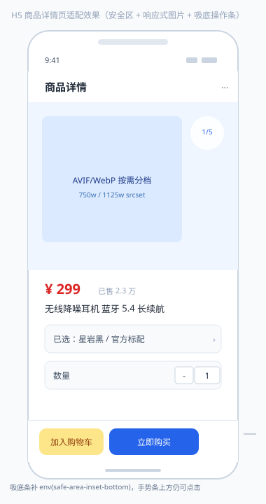

# 移动Web与H5适配

> 这篇从移动 Web 的运行边界讲起，经过最小页面与调试环境、viewport 与视口单位、响应式布局与字体、安全区、1px 与高清屏、触控手势、键盘与滚动，最后落到移动端性能指标与现场排障。
>
> 学完能把一个桌面 Web 页面改造成在 iOS/Android 主流浏览器和 App 内 WebView 都不变形、不遮挡、不卡顿的 H5 页面，并用 Lighthouse 指标验证。

## 一、移动 Web 的能力边界

移动 Web（H5）是跑在手机浏览器和 App 内 WebView 里的页面，不用安装、即点即用、可被分享链接传播；代价是没有推送（iOS）、离线能力和部分系统能力，性能和体验上限低于原生与跨平台 App。

| 维度 | 移动 Web | 小程序 | 原生 App |
|---|---|---|---|
| 获客 | 链接直达 | 平台内搜 | 需下载 |
| 能力 | 受浏览器沙箱 | 平台 API | 全量 |
| 更新 | 秒级 | 审核发版 | 商店审核 |
| 性能 | 视渲染层 | 双线程 | 最优 |

移动 Web 的适配问题和桌面不同，根源有四个：**屏幕尺寸碎片化**（320px 到超过 430px 逻辑宽度，还有折叠屏）、**DPR 高清屏**（2x/3x 渲染）、**浏览器交互侵入**（地址栏伸缩、键盘、手势条）、**WebView 私有行为**（App 内嵌内核版本不受系统控制）。后面每一条适配规则都对应其中一两个根源。

> 边界：需要扫码、蓝牙、后台定位、推送闭环的产品不要用 H5 硬做；H5 的主场是营销活动页、内容页、电商详情页和嵌入 App 的混合页。

## 二、环境与最小页面

版本基线 2026-11：Vite 7、Chrome/Edge 当前稳定版、Safari iOS 17+、Android System WebView 当前版。本地开发用 Vite 起服务，真机连局域网访问，这是移动调试的最小闭环。

| 环境 | 安装 |
|---|---|
| Windows 10/11 | `winget install OpenJS.NodeJS.LTS` |
| macOS | `brew install node` |
| Ubuntu 24.04 | `sudo apt install -y nodejs npm` |
| Rocky/CentOS 9 | `sudo dnf module install nodejs:22` |

```bash
npm create vite@latest h5-shop -- --template vanilla
cd h5-shop
npm install
npm run dev -- --host   # --host 让手机能通过局域网 IP 访问
```

预期输出（关键片段）：

```text
  ➜  Local:   http://localhost:5173/
  ➜  Network: http://192.168.1.23:5173/
```

手机连同一 Wi-Fi，访问 Network 地址，即完成真机访问。最小页面的 `index.html` 头部：

```html
<!DOCTYPE html>
<html lang="zh-CN">
<head>
  <meta charset="UTF-8" />
  <!-- 移动适配的核心声明，缺了这条整个页面按 980px 布局再缩小 -->
  <meta name="viewport" content="width=device-width, initial-scale=1, viewport-fit=cover" />
  <title>商品详情</title>
</head>
<body>
  <main id="app"></main>
  <script type="module" src="/main.js"></script>
</body>
</html>
```

调试入口分两种：Chrome 安卓真机用 `chrome://inspect` 远程调试；iOS Safari 在 Mac 上用 Safari 的开发菜单。WebView 内的页面同样适用，前提是 App 打开了调试开关。

> 边界：开发者工具的设备模拟只能验证布局，不能验证触摸、键盘、滚动惯性和安全区；这四项必须真机确认。

## 三、viewport 与视口单位

`width=device-width` 把布局视口设为设备逻辑宽度，`viewport-fit=cover` 把页面扩展到刘海和手势条之下（配合安全区使用），两者组合是移动页面的标准开头。

```html
<!-- 推荐：覆盖刘海 + 允许缩放（可访问性） -->
<meta name="viewport" content="width=device-width, initial-scale=1, viewport-fit=cover" />
```

`user-scalable=no` 和 `maximum-scale=1` 会禁掉双击放大，看似解决 iOS 输入聚焦放大的问题，实际同时剥夺了弱视用户的缩放能力，部分浏览器已忽略该设置。正确做法是让字号不小于 16px，聚焦时不触发自动放大。

视口单位的选择由"要不要跟随地址栏伸缩"决定：

| 单位 | 行为 | 适用 |
|---|---|---|
| `vh` | 布局视口的 1% | 桌面 |
| `dvh` | 动态视口，地址栏伸缩时变 | 全屏容器 |
| `svh` | 最小视口，永远最小值 | 底部固定条 |
| `lvh` | 最大视口 | 背景铺满 |
| `%` | 相对父容器 | 常规布局 |

```css
/* 100vh 在 iOS 上会高出地址栏一截，底部按钮被压住；dvh 动态跟随 */
.hero { height: 100dvh; }

/* 老浏览器回退：先写 vh 再写 dvh，不支持的忽略后者 */
.hero { height: 100vh; height: 100dvh; }
```

字体不要用 `rem` 一刀切缩放，大屏手机上会整体放大失真；标题用 `clamp()` 给上下限：

```css
/* 1rem = 16px 基准；clamp 保证 320px 小屏不小于 20px，大屏不超过 28px */
h1 { font-size: clamp(20px, 5.5vw, 28px); }
body { font-size: 16px; /* 移动端正文 16px 起，再小触发 iOS 聚焦放大 */ }
```

> 边界：`dvh` 在地址栏收起瞬间会重排，页面顶部有依赖高度的计算布局时会跳动；这类布局改用固定高度或 `svh`。

## 四、安全区与刘海屏

`viewport-fit=cover` 让页面画进刘海区，同时暴露出遮挡问题；安全区变量 `env(safe-area-inset-*)` 告诉页面四个方向各被切掉多少，固定条和吸底按钮必须补上这段距离。

```css
/* 兼容写法：constant() 是旧 iOS 的语法，先写旧再写新 */
.tabbar {
  position: fixed;
  bottom: 0;
  left: 0;
  right: 0;
  padding-bottom: constant(safe-area-inset-bottom);
  padding-bottom: env(safe-area-inset-bottom);
}

/* 横屏时左右也可能被切掉，用 max() 保证至少留 12px */
.container {
  padding-left: max(12px, env(safe-area-inset-left));
  padding-right: max(12px, env(safe-area-inset-right));
}
```

`@supports` 用于条件应用，避免不支持的环境把 padding 写成 0 之外的东西：

```css
.fixed-btn {
  position: fixed;
  bottom: 16px;
  left: 16px;
  right: 16px;
}

@supports (padding: env(safe-area-inset-bottom)) {
  .fixed-btn {
    bottom: calc(16px + env(safe-area-inset-bottom)); /* 有手势条时整体上移 */
  }
}
```

| 场景 | 处理 |
|---|---|
| 底部固定条 | `env(safe-area-inset-bottom)` 加 padding |
| 顶部通栏头图 | 图片可以铺进刘海，文字避开 |
| 横屏视频 | 左右 inset |
| 桌面浏览器 | inset 为 0，无需特判 |

> 边界：不加 `viewport-fit=cover` 时 `env()` 恒为 0，页面也不会画进刘海；先决定要不要全屏，再决定要不要安全区适配，两个配置必须一起改。

## 五、1px 边框与高清屏

高清屏上 `1px` 物理上是 2 到 3 个物理像素，加上移动浏览器默认按 DPR 渲染，视觉上"1px 边框"会显得粗。反过来，1 物理像素的细线在多数场景更精致。

| 方案 | 原理 | 适用 |
|---|---|---|
| `0.5px` | 浏览器按物理像素渲染 | iOS 8+、多数安卓 |
| `transform: scaleY(0.5)` | 伪元素压缩 | 兼容老的安卓 |
| `box-shadow` 模拟 | 阴影不受边框限制 | 已少用 |
| SVG/图片边框 | border-image | 不规则边框 |

```css
/* 方案一：0.5px，优先；不支持的环境回退为 1px，可接受 */
.thin { border: 1px solid #e5e7eb; }
@supports (-webkit-touch-callout: none) {
  .thin { border-width: 0.5px; }
}

/* 方案二：伪元素 scaleY，四条边可分别处理 */
.hairline-bottom { position: relative; }
.hairline-bottom::after {
  content: '';
  position: absolute;
  left: 0; right: 0; bottom: 0;
  height: 1px;
  background: #e5e7eb;
  transform: scaleY(0.5);    /* 视觉上半个物理像素 */
  transform-origin: 0 0;     /* 从上往下压缩，避免缝隙 */
}
```

图片适配与边框同源：用 `srcset` 按 DPR 供图，用 `sizes` 按布局宽度选图，格式优先 AVIF/WebP：

```html

```

> 边界：`srcset` 解决的是"传多大图"，`sizes` 解决的是"显示多宽"；只写 `srcset` 不写 `sizes` 时浏览器按视口全宽估，窄列图会下载过大版本。

## 六、触控与手势

移动端统一用 Pointer Events 处理触摸：一套 `pointerdown/pointermove/pointerup` 同时覆盖触摸、鼠标和触控笔，`touchstart/touchmove` 只在需要多指手势时使用。

```js
// 长按删除：500ms 内移动超过 10px 视为滑动，取消长按
let timer = null
btn.addEventListener('pointerdown', (e) => {
  const startX = e.clientX, startY = e.clientY
  const cancel = (ev) => {
    if (Math.hypot(ev.clientX - startX, ev.clientY - startY) > 10) clearTimeout(timer)
  }
  timer = setTimeout(() => {
    btn.dispatchEvent(new CustomEvent('longpress'))
    btn.removeEventListener('pointermove', cancel)
  }, 500)
  btn.addEventListener('pointermove', cancel, { once: true })
})
```

`touch-action` 决定浏览器保留哪些默认手势，自定义滑动手势前必须先声明，否则浏览器抢走事件：

```css
/* 元素自己接管横向滑动，纵向滚动仍交给浏览器 */
.carousel { touch-action: pan-y; }

/* 完全接管，比如画板 */
.canvas { touch-action: none; }
```

滚动监听必须 `passive: true`，浏览器不必等回调结束就能立即滚动，否则页面滚动掉帧：

```js
// passive 承诺不调用 preventDefault，让滚动不被 JS 阻塞
document.addEventListener('scroll', onScroll, { passive: true })
```

弹层"滚动穿透"（底层页面跟着滚）的修法是锁 body：

```css
/* 弹层出现时给 body 加 .locked */
body.locked { overflow: hidden; }
```

```js
// iOS 上 overflow:hidden 不彻底，还要冻结位置：记录滚动值再 fixed
function lockScroll() {
  const y = window.scrollY
  document.body.style.position = 'fixed'
  document.body.style.top = `-${y}px`
  return y
}
function unlockScroll(y) {
  document.body.style.position = ''
  document.body.style.top = ''
  window.scrollTo(0, y)   // 恢复到弹层前的位置，否则回到顶部
}
```

> 边界：`click` 在移动端不再有 300ms 延迟（前提是 viewport 正确设置），不要为此引入 Fastclick 之类的历史库；库解决的是 2015 年的问题，现在反而带来双击误判。

## 七、键盘、滚动与表单

软键盘是移动端最不可控的输入环境：iOS 会把整个视口往上推，Android 通常压缩视口高度。吸底输入框在两个平台表现不同，必须真机验证。

```html
<!-- inputmode 决定键盘面板，type 决定语义与校验，两者分工 -->
<input inputmode="numeric" type="text" enterkeyhint="search" autocomplete="off" />
```

| 需求 | 属性 | 效果 |
|---|---|---|
| 数字键盘 | `inputmode="numeric"` | 纯数字面板 |
| 手机号 | `type="tel"` | 电话面板 |
| 回车文案 | `enterkeyhint="search"` | 键盘显示"搜索" |
| 自动填充 | `autocomplete="tel"` | 系统填手机号 |
| 关闭首字母大写 | `autocapitalize="off"` | 用户名输入 |

键盘弹起时吸底元素会被顶出屏幕或遮住输入框，监听 `visualViewport` 跟随：

```js
// visualViewport 只含可见区域，键盘弹起时 height 变小，用 inset 补偿
if (window.visualViewport) {
  const onResize = () => {
    const bar = document.querySelector('.chat-bar')
    // offsetTop 是键盘上沿相对布局视口的距离，把输入条挪到键盘之上
    bar.style.transform = `translateY(${visualViewport.offsetTop -
      (window.innerHeight - visualViewport.height)}px)`
  }
  visualViewport.addEventListener('resize', onResize)
  visualViewport.addEventListener('scroll', onResize)
}
```

滚动相关三个要点：`position: sticky` 做吸顶比 JS 监听滚动便宜得多；`scroll-behavior: smooth` 让锚点跳转平滑；长列表用 `content-visibility: auto` 跳过屏外渲染：

```css
.list-item {
  content-visibility: auto;   /* 屏外不渲染，渲染开销延迟到滚动到时 */
  contain-intrinsic-size: 88px; /* 预留高度，避免滚动条跳动 */
}

.nav { position: sticky; top: 0; backdrop-filter: blur(8px); }
html { scroll-behavior: smooth; }
```

> 边界：`focus()` 只有在用户手势回调里调用才会弹键盘，页面加载后自动 focus 会被 iOS 静默忽略；不要设计"进页面就弹键盘"的交互。

## 八、移动端性能

移动端性能看三个核心指标（Core Web Vitals）：LCP 最大内容绘制 2.5 秒内、INP 交互到下一帧 200ms 内、CLS 累计布局偏移 0.1 内。移动网络和移动 CPU 让桌面上的"没问题"在手机上变成"明显卡"。

| 优化项 | 手段 | 影响指标 |
|---|---|---|
| 首屏图 | `<link rel="preload" as="image">` | LCP |
| 连接 | `preconnect` 提前握手 | LCP |
| 字体 | `font-display: swap` + 子集化 | LCP/CLS |
| 图片 | 懒加载 + 固定宽高 | CLS |
| 长列表 | `content-visibility` | INP |
| 骨架屏 | 占位防跳动 | CLS |

```html
<link rel="preconnect" href="https://cdn.example.com" crossorigin />
<link rel="preload" as="image" href="/hero-750.webp" fetchpriority="high" />
```

```css
/* 图片固定宽高比，加载完成前占住空间，CLS 不会被撑爆 */
figure { aspect-ratio: 3 / 4; overflow: hidden; }
img { width: 100%; height: 100%; object-fit: cover; }
```

```html
<!-- 视口外图片延迟加载；首屏 LCP 图不要 lazy，否则本末倒置 -->

```

Web 字体按需子集化，中文字体全量几 MB，只打包页面用到的字形：

```bash
# subset-font 生成只含实际用字的子集，几百 KB 到几十 KB
npx subset-font --no-hinting --precision 0 source.woff2 sub.woff2 --text-file chars.txt
```

长任务会卡 INP，把大计算拆块并让出主线程：

```js
// 每处理 8ms 就让出一次，保证输入事件能插队
async function heavy(list) {
  const out = []
  for (let i = 0; i < list.length; i++) {
    out.push(process(list[i]))
    if (performance.now() - start > 8) await new Promise(r => setTimeout(r, 0))
  }
  return out
}
```

> 边界：`requestIdleCallback` 在部分 WebView 上不可用；拆任务用 `setTimeout(0)` 让出即可，不要为调度引库。

### 8.1 首屏渲染与缓存策略

移动端首屏的优化路线有两条：静态站用预渲染，动态站用服务端渲染（SSR）。选错路线，后面的图片优化都只是小头。

| 场景 | 策略 | 说明 |
|---|---|---|
| 营销活动页 | 构建时预渲染 | 内容固定，秒开 |
| 商品详情 | SSR + 边缘缓存 | 内容动态但可缓存 |
| 个人中心 | 纯客户端渲染 | 内容私有，缓存无意义 |

```bash
# Vite 预渲染插件，构建时把首屏生成为静态 HTML
npx vite build --ssr
```

缓存头按资源类型区分，HTML 短缓存保证可更新，静态资源长缓存配内容哈希：

```nginx
# HTML 不缓存或短缓存，避免用户看到旧版本
location = /index.html {
  add_header Cache-Control "no-cache";
}

# 带 hash 的静态资源缓存一年，文件名变了缓存自然失效
location /assets/ {
  add_header Cache-Control "public, max-age=31536000, immutable";
}
```

预渲染后的首屏 HTML 直接包含 LCP 图片和标题文字，浏览器不需要等 JS 执行就能画出首屏，这是移动弱网下最有效的一刀。

骨架屏的作用是稳定 CLS 而不是"显得快"：骨架的尺寸必须与真实内容一致，否则数据到达时布局跳动，CLS 反而变差。

```html
<!-- 骨架尺寸与真实卡片一致，加载完成后无缝替换 -->
<div class="card skeleton" style="aspect-ratio: 3/4"></div>
```

> 边界：SSR 在弱网下把等待从"JS 下载后"挪到"HTML 下载中"，总时间未必更短；HTML 超过 100KB 时优先裁剪首屏字段，而不是急着上 SSR。

## 九、微信内置浏览器与分享

微信内的 H5 跑在 XWeb 内核里，UA 带 `MicroMessenger`，能力比系统浏览器少：不能直接调起分享面板、视频默认不自动播放、支付必须走微信 JSAPI。国内移动 H5 的多数流量来自这里，适配不能只按 Chrome 做。

```js
// UA 判断只能用来做能力降级，不要用来做业务分支
const isWeChat = /MicroMessenger/i.test(navigator.userAgent)
```

分享卡片必须通过 JS-SDK 配置，签名用的 URL 是**当前页面去掉 hash 的完整地址**，且必须与后端签名时用的字符串完全一致：

```js
// 后端签名：把当前页 URL 原样传过去，服务端用同一串算 sha1
const url = location.href.split('#')[0]
const { appId, timestamp, nonceStr, signature } = await fetch(
  `/api/wechat/jsapi?url=${encodeURIComponent(url)}`
).then(r => r.json())

wx.config({
  debug: false,
  appId,
  timestamp,
  nonceStr,
  signature,
  jsApiList: ['updateAppMessageShareData', 'updateTimelineShareData', 'chooseImage']
})

wx.ready(() => {
  // 分享内容要在 ready 之后设置，否则不生效
  wx.updateAppMessageShareData({
    title: '秋季新品 5 折起',
    desc: '限时三天',
    link: location.href.split('#')[0],
    imgUrl: 'https://cdn.example.com/share.png'
  })
})
```

| 能力 | 微信内 | 系统浏览器 |
|---|---|---|
| 分享到会话/朋友圈 | 需 JS-SDK | 系统分享 |
| 视频自动播放 | 需用户交互 | 可静音自动播 |
| 微信支付 | JSAPI | 不可用 |
| 定位 | 需公众号配置 | 浏览器授权 |

视频在微信内默认不自动播放，必须由用户手势触发，或在 `WeixinJSBridgeReady` 后静音播放：

```js
document.addEventListener('WeixinJSBridgeReady', () => {
  const video = document.querySelector('video')
  video.muted = true          // 静音是自动播放的前提
  video.play().catch(() => {}) // 失败交给用户点击，不要弹错误
})
```

| 现象 | 原因 | 处理 |
|---|---|---|
| 分享卡片无图 | 图片非 HTTPS 或小于 300px | 换 500×400 以上的 HTTPS 图 |
| 签名报 invalid signature | URL 不一致或含 hash | 用去 hash 的完整地址重签 |
| 支付调不起 | 未配置支付授权目录 | 后端下单参数与目录对齐 |
| 页面样式异常 | XWeb 缓存了旧 CSS | 静态资源加内容哈希 |

微信的缓存比系统浏览器更顽固，`Cache-Control: no-cache` 也可能拿到旧资源。发布后样式错乱优先怀疑缓存，验证方式是给资源 URL 加版本参数再打开。

> 边界：JS-SDK 的域名要在公众号后台配置为 JS 接口安全域名，且需要 ICP 备案；本地 IP 调试只能用测试号，正式域名一旦变更要重新配置并重签。

## 十、现场手册：适配排障

适配问题的排查顺序：先确认 viewport 声明，再确认单位，最后查平台差异。前两步能解决七成问题。

| 现象 | 最可能原因 | 第一条检查 |
|---|---|---|
| 页面整体缩小 | 缺 viewport 声明 | 查 meta 标签 |
| 聚焦输入页放大 | 字号小于 16px | 查输入框 font-size |
| 底部按钮被手势条遮住 | 没加安全区 | 查 `env(safe-area-inset-bottom)` |
| 弹层下页面在滚 | 滚动穿透 | 查 body 是否锁定 |
| 边框粗细不一 | DPR 渲染 | 换 0.5px 或 scaleY |
| 全屏高度溢出一截 | 用了 `100vh` | 换 `dvh` |
| WebView 内白屏 | 内核版本过低 | 查不支持的语法 |

真机白屏优先看 Safari 开发菜单或 `chrome://inspect` 的控制台；App 内 WebView 白屏常见于 ES 新语法超出内嵌内核支持范围，构建时用 Vite 默认的兼容目标即可规避。

```bash
# 本地验证 Lighthouse 移动端跑分，--preset=mobile 是默认
npx lighthouse http://192.168.1.23:5173 --view
```

预期输出（关键片段）：

```text
Performance: 92
LCP: 1.8 s
TBT: 120 ms
CLS: 0.02
```

> 边界：办公室 Wi-Fi 上的 LCP 不能代表真实用户；上线后以真实用户监控（RUM）数据为准，实验室数据只用于回归对比。

## 十一、最佳实践案例

### 11.1 案例背景

一家电商公司的大促商品详情页 H5 投放在微信、浏览器和自家 App WebView 三个入口。现状是：小屏手机上底部"立即购买"被手势条遮住，iOS 上聚焦数量输入框会放大页面，主图 1.5MB 导致低端安卓机上 LCP 4.2 秒，弹层出现时底层页面跟着滚动。目标是在两周内完成适配与性能整改，Lighthouse 移动端 Performance 从 58 分提到 85 分以上，且不改变业务代码结构。

### 11.2 案例实操

第一步修 viewport 与字体，先保证不变形：

```html
<meta name="viewport" content="width=device-width, initial-scale=1, viewport-fit=cover" />
```

```css
/* 输入框 16px 起，iOS 不再触发自动放大 */
input, select, textarea { font-size: 16px; }

/* 吸底操作条补安全区，constant() 兜旧系统 */
.buy-bar {
  position: fixed; bottom: 0; left: 0; right: 0;
  display: flex; gap: 12px; padding: 12px 16px;
  padding-bottom: calc(12px + constant(safe-area-inset-bottom));
  padding-bottom: calc(12px + env(safe-area-inset-bottom));
  background: rgba(255,255,255,.92);
  backdrop-filter: blur(8px);
}
```

第二步处理弹层穿透，封装成开关函数，所有弹层复用：

```js
let savedY = 0
export function lockScroll() {
  savedY = window.scrollY
  document.body.classList.add('locked')        // overflow:hidden 给安卓
  document.body.style.position = 'fixed'       // fixed 给 iOS
  document.body.style.top = `-${savedY}px`
}
export function unlockScroll() {
  document.body.classList.remove('locked')
  document.body.style.position = ''
  document.body.style.top = ''
  window.scrollTo({ top: savedY })             // 回到弹层前位置
}
```

第三步优化主图，按 DPR 与宽度分档供图，首屏图预加载：

```html
<link rel="preload" as="image" href="/goods-750.avif" fetchpriority="high" />
```

```html

```

首屏 LCP 图是页面最大元素，加了宽高声明和 preload 后浏览器可以在布局完成前就开始下载。

第四步把规格弹层里的长 SKU 列表加 `content-visibility`，屏外不渲染：

```css
.sku-item {
  content-visibility: auto;
  contain-intrinsic-size: 64px;
}
```



第五步真机回归矩阵：iPhone（刘海屏 + iOS 键盘）、一台小屏安卓（320px 级）、一台低端安卓 WebView。每台机器检查四项：底部按钮可点、聚焦不放大、弹层锁定滚动、图片清晰不糊。

```bash
npx lighthouse https://shop.example.com/goods/1001 --form-factor=mobile --view
```

### 11.3 案例结果

整改后 Lighthouse 移动端 Performance 91 分（示例，实验室环境）：LCP 从 4.2 秒降到 1.6 秒，主图传输量从 1.5MB 降到约 260KB（按设备分档），CLS 从 0.21 降到 0.03，INP 未再出现 500ms 以上的长任务。

失败模式复盘：第一次只加了 `viewport-fit=cover` 没加安全区 padding，刘海屏上反而更糟，说明这两个配置必须成对改；第二次把全部图片都加了 `loading="lazy"`，首屏 LCP 图也被延迟，分数不升反降，首屏图必须 preload 而不是 lazy。遗留风险是 App 内老版本 WebView 不支持 AVIF，需要保留 WebP 回退格式；此风险由 CDN 按请求头 `Accept` 协商分发，不放到前端判断。
