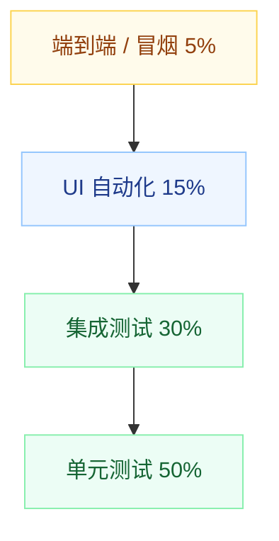

# 移动端测试与性能

> 这篇从移动测试的分层讲起，经过环境与最小自动化用例、Maestro 与 Appium、真机兼容性矩阵、启动性能、内存与卡顿、弱网与流量，最后落到 CI 质量门禁和一次性能回归排查。
>
> 学完能独立搭起"冒烟自动化 + 真机矩阵 + 启动/内存指标门禁"的测试链路，并在版本发布前判断哪些性能问题必须拦下。

## 一、移动测试的分层与边界

移动测试不是一个工具能覆盖的：单元测试跑在 JVM，UI 自动化跑在真机或模拟器，性能测试要看系统级指标，兼容性要覆盖设备矩阵。按投入产出排成金字塔，底层多、顶层少。



与 Web 测试的差异集中在三点：**设备是黑盒**（不能直接读 DOM，要靠无障碍树定位）、**状态受系统影响**（来电、切后台、权限弹窗、低电量都会打断流程）、**耗时长**（一次真机冒烟比浏览器用例慢一个数量级）。所以移动端只把"核心路径"放进 E2E，细节逻辑下沉到单元与集成测试。

| 层级 | 工具 | 运行位置 | 反馈时间 |
|---|---|---|---|
| 单元 | JUnit / Kotest | JVM | 秒级 |
| 集成 | Espresso / XCTest | 模拟器 | 分钟级 |
| UI 自动化 | Maestro / Appium | 真机或模拟器 | 分钟级 |
| 性能 | Macrobenchmark / Perfetto | 真机 | 十分钟级 |

> 边界：不要用 UI 自动化覆盖所有分支；一个 200 步的 E2E 用例维护成本高于它发现缺陷的价值，核心路径控制在 10 条以内。

## 二、环境与最小自动化用例

版本基线 2026-11：Maestro 当前稳定版、Appium 2.x/3.x、UiAutomator2 驱动、Android API 36、iOS 18+。Maestro 用 YAML 描述流程，上手成本最低，适合冒烟；Appium 用代码驱动，适合复杂断言和多平台复用。

| 环境 | 安装 |
|---|---|
| Windows 10/11 | `winget install OpenJS.NodeJS.LTS`，Maestro 用 PowerShell 脚本 |
| macOS | `brew install maestro` 或官方安装脚本 |
| Ubuntu 24.04 | `curl -Ls "https://get.maestro.mobile.dev" \| bash` |
| Rocky/CentOS 9 | 先装 JDK 17+，再执行同一安装脚本 |

```bash
# macOS / Linux 通用安装
curl -Ls "https://get.maestro.mobile.dev" | bash
maestro --version
```

预期输出：

```text
1.39.x
```

Appium 侧：

```bash
npm i -g appium
appium driver install uiautomator2
appium driver install xcuitest
appium --version
```

```text
3.x.x
```

最小冒烟流程，验证"启动 → 首页可见 → 进入详情"：

```yaml
# flows/smoke.yaml
appId: com.example.shop
---
- launchApp:
    clearState: true      # 每次从干净状态开始，避免缓存掩盖首启问题
- assertVisible: "首页"
- tapOn: "商品"
- assertVisible:
    text: "商品详情"
- back
- assertVisible: "首页"
```

```bash
maestro test flows/smoke.yaml
```

预期输出：

```text
Running 1 flow...
  ✓ smoke
1/1 flows passed
```

`clearState` 是移动冒烟的关键：不清状态时第二次运行会跳过引导页和登录，用例通过但真实首启可能已经坏了。

> 边界：Maestro 的 `tapOn` 按文本或 id 定位，文本随多语言变化时要改用 `id`；Android 的 `contentDescription` 与 iOS 的 `accessibilityIdentifier` 要由开发在代码里显式设置，测试改不了。

### 2.1 单元与集成测试的最小闭环

UI 自动化之前先把逻辑测试跑起来，否则所有验证都压在真机上，反馈慢且定位难。Android 侧用 JUnit 测纯逻辑，用 Compose Test 测界面状态。

```kotlin
// 纯逻辑：不依赖 Android 框架，毫秒级
class PriceCalculatorTest {
    @Test
    fun `满 300 减 50`() {
        // 边界值：299 不减、300 减，两个用例锁住阈值
        assertEquals(299, PriceCalculator.payable(299))
        assertEquals(250, PriceCalculator.payable(300))
    }
}
```

```bash
./gradlew :app:testDebugUnitTest
```

```text
> Task :app:testDebugUnitTest
BUILD SUCCESSFUL in 8s
2 tests completed
```

Compose 的界面测试跑在设备或 Robolectric 上，断言的是"状态对应的界面"：

```kotlin
@get:Rule
val rule = createComposeRule()

@Test
fun 空购物车展示引导() {
    rule.setContent { CartScreen(state = CartState(items = emptyList())) }
    // 断言文案而不是控件 id，贴近用户可见行为
    rule.onNodeWithText("购物车还是空的").assertIsDisplayed()
}
```

```bash
./gradlew :app:connectedDebugAndroidTest
```

```text
Starting 6 tests on Pixel_7_API_36
6 tests completed, 0 failed
```

| 层级 | 命令 | 单次耗时 |
|---|---|---|
| 单元 | `testDebugUnitTest` | 秒级 |
| 集成 | `connectedDebugAndroidTest` | 分钟级 |
| 冒烟 | `maestro test` | 分钟级 |

> 边界：Compose 测试依赖 `ui-test-junit4` 与 `debugImplementation ui-test-manifest`，漏了后者会报找不到 Activity；Robolectric 能加速但不能替代真机的渲染验证。

## 三、Maestro 编写可维护的流程

可维护的流程有三个特征：选择器稳定、步骤可复用、失败可定位。用子流程拆分登录和加购，用 `runFlow` 组合，用 `assertVisible` 做业务断言而不是只断言控件存在。

```yaml
# flows/login.yaml
appId: com.example.shop
---
- tapOn:
    id: "tab_mine"
- tapOn: "登录"
- inputText: "13800138000"
- tapOn: "获取验证码"
- inputText: "123456"     # 测试环境固定验证码，生产不下发
- tapOn: "登录"
- assertVisible: "我的订单"
```

```yaml
# flows/buy.yaml
appId: com.example.shop
---
- runFlow: login.yaml         # 复用登录，不复制步骤
- tapOn: "首页"
- tapOn:
    id: "goods_card_1"
- tapOn: "加入购物车"
- assertVisible: "已加入购物车"
- tapOn: "购物车"
- assertVisible: "无线降噪耳机"
```

| 指令 | 用途 | 注意 |
|---|---|---|
| `launchApp` | 启动并清状态 | `clearState` 影响首启 |
| `tapOn` | 点击 | 优先用 id |
| `inputText` | 输入 | 需先聚焦输入框 |
| `assertVisible` | 断言可见 | 带超时重试 |
| `runFlow` | 复用子流程 | 路径相对当前文件 |
| `takeScreenshot` | 失败取证 | CI 归档 |

等待不要写死 `sleep`，用 `assertVisible` 自带的超时机制；确实要等异步结果时用 `extendedWaitUntil`：

```yaml
- extendedWaitUntil:
    visible: "支付成功"
    timeout: 15000       # 支付回调链路慢，给足 15 秒
```

失败取证在 CI 里很重要：

```yaml
- takeScreenshot: "after_pay"
```

> 边界：`sleep` 是 flaky 的主要来源，网络慢时 2 秒不够、快时白等；能用断言等待就不用固定睡眠。

## 四、Appium 与原生自动化

Appium 适合需要读控件属性、做复杂手势、或同时覆盖 Android 与 iOS 的场景。它通过 WebDriver 协议驱动平台原生框架：Android 走 UiAutomator2，iOS 走 XCUITest。

```python
# test_login.py —— Appium Python client 3.x
from appium import webdriver
from appium.options.android import UiAutomator2Options
from appium.webdriver.common.appiumby import AppiumBy
from selenium.webdriver.support.ui import WebDriverWait

options = UiAutomator2Options()
options.platform_name = "Android"
options.device_name = "Pixel_7"
options.app_package = "com.example.shop"
options.app_activity = ".MainActivity"
options.no_reset = False          # 每次重置，保证用例独立

driver = webdriver.Remote("http://127.0.0.1:4723", options=options)

wait = WebDriverWait(driver, 10)  # 显式等待，替代 sleep
wait.until(lambda d: d.find_element(AppiumBy.ID, "tab_mine")).click()
driver.find_element(AppiumBy.XPATH, "//*[@text='登录']").click()

phone = driver.find_element(AppiumBy.ID, "phone_input")
phone.send_keys("13800138000")
driver.find_element(AppiumBy.ID, "send_code").click()

# 断言用业务文案，不用控件存在性，避免"页面在但功能坏"也通过
assert "我的订单" in driver.page_source
driver.quit()
```

```bash
# 启动 Appium 服务（默认监听 4723，base path 为 /），再在另一个终端跑用例
appium
pytest test_login.py -v
```

预期输出：

```text
test_login.py::test_login PASSED
============================== 1 passed in 24.31s ==============================
```

定位策略的优先级：`id`（资源 ID）高于 `accessibility id`，高于 `xpath`。XPath 在长列表里会遍历整棵树，慢且脆弱；`-android uiautomator` 选择器性能好但只适用于 Android。

| 定位方式 | 稳定性 | 速度 |
|---|---|---|
| id | 高 | 快 |
| accessibility id | 高 | 快 |
| xpath | 低 | 慢 |
| uiautomator 文本 | 中 | 中 |

> 边界：Appium 的隐式等待默认是 0，忘了写显式等待就会偶发找不到元素；`no_reset=False` 会重装应用，跑大批量用例时很慢，按需在 CI 与本地切换。

## 五、真机与兼容性矩阵

兼容性不能靠"我这两台手机没问题"。矩阵按三个维度裁剪：系统版本、屏幕形态、厂商定制。预算有限时优先覆盖"用户占比最高的三档 + 已知问题机型"。

| 维度 | 覆盖建议 | 原因 |
|---|---|---|
| Android 版本 | 最低支持版 + 两个中间版 + 最新 | 权限与后台策略差异 |
| iOS 版本 | 当前大版本与上一版 | 新 API 与安全区变化 |
| 屏幕 | 小屏、常规、大屏/折叠 | 布局与 rpx 换算 |
| 厂商 | 主流三家 + 一家定制重的 | 后台保活与推送差异 |

云真机服务（Firebase Test Lab、国内各家云测）解决"设备买不起"的问题，适合发版前的批量回归：

```bash
# Firebase Test Lab 跑一组 Instrumentation 测试
gcloud firebase test android run \
  --type instrumentation \
  --app app-debug.apk \
  --test app-debug-androidTest.apk \
  --devices model=Pixel7,version=34,locale=zh_CN \
  --timeout 10m
```

预期输出（关键片段）：

```text
Test execution completed.
  Passed: 128
  Failed: 0
  Skipped: 4
```

手工探索测试仍然必要：权限拒绝、来电打断、切后台再回来、低电量模式、系统字体放大到 200%，这些场景自动化覆盖成本高，但线上问题多出在这里。

> 边界：模拟器不能替代真机验证推送、指纹/人脸、蓝牙和厂商后台策略；模拟器适合逻辑回归，真机负责系统交互。

## 六、启动性能

启动分三种：冷启动（进程不存在）、温启动（进程在但 Activity 销毁）、热启动（Activity 在后台）。用户感知最强的是冷启动，优化目标通常定在 1.5 秒内可交互。

```bash
# 强制冷启动并输出各阶段耗时
adb shell am force-stop com.example.shop
adb shell am start -W -n com.example.shop/.MainActivity
```

预期输出：

```text
Starting: Intent { cmp=com.example.shop/.MainActivity }
Status: ok
LaunchState: COLD
Activity: com.example.shop/.MainActivity
TotalTime: 1284
WaitTime: 1301
```

`TotalTime` 是 `am start` 到首帧绘制的时间，是冷启动的核心指标；`WaitTime` 还包含系统调度，一般略大。连续测三次取中位数，单次数据没有意义。

启动耗时的构成与优化手段：

| 阶段 | 典型开销 | 优化 |
|---|---|---|
| 进程创建 | 100–300ms | 减少 Application 初始化 |
| Application.onCreate | 200–800ms | 懒加载、异步初始化 |
| Activity 布局 | 100–400ms | 减少层级、避免同步 IO |
| 首帧绘制 | 50–200ms | Baseline Profile、预编译 |

Application 里的初始化按"首屏是否需要"分级：

```kotlin
class App : Application() {
    override fun onCreate() {
        super.onCreate()
        // 首屏必需的同步初始化，控制在 50ms 内
        initCrashReporter()

        // 非首屏的丢到后台线程，用启动任务库编排依赖
        CoroutineScope(Dispatchers.IO).launch {
            initAnalytics()
            initPush()
        }
    }
}
```

Baseline Profile 让 ART 在安装时预编译热点方法，减少解释执行：

```kotlin
// app/build.gradle.kts
baselineProfile {
    saveInAppModule = true   // 生成产物随包发布，安装时生效
}
```

> 边界：把初始化丢到后台线程不等于"更快"，首屏如果依赖它就会白屏；启动任务要有明确的首屏依赖图，不能一律异步。

## 七、内存、卡顿与网络

内存问题的表现是 OOM 和后台被杀，卡顿的表现是掉帧。两者都要在真机上测，模拟器的内存和 GPU 与真机差距大。

```bash
# 查看进程内存分布，重点看 Java Heap 与 Native Heap
adb shell dumpsys meminfo com.example.shop | head -20
```

```text
Total PSS by process:
    180,432K: com.example.shop (pid 12345)
Total PSS by OOM adjustment:
     92,140K: Native
     48,220K: Dalvik Heap
```

持续增长且不回落就是泄漏信号。LeakCanary 在 debug 包里自动检测 Activity/Fragment 泄漏：

```kotlin
// debug 依赖，release 不引入
debugImplementation("com.squareup.leakcanary:leakcanary-android:2.14")
```

卡顿用帧统计定位，`jank` 百分比高于 5% 就需要看：

```bash
adb shell dumpsys gfxinfo com.example.shop framestats | head -30
```

```text
Total frames rendered: 1240
Janky frames: 87 (7.02%)
90th percentile: 22ms
95th percentile: 34ms
```

Compose 的卡顿常见于无谓重组：把不随状态变化的计算移出组合，用 `derivedStateOf` 收敛高频状态。

```kotlin
// 错误：scrollState 每次变化都让整个列表重组
val showTop = scrollState.value > 200

// 正确：只在布尔值翻转时重组，而不是每个像素都触发
val showTop by remember { derivedStateOf { scrollState.value > 200 } }
```

弱网用模拟器限速或代理工具，验证超时、重试、骨架屏：

```bash
# Android 模拟器控制台限速，模拟 2G 级别的延迟与带宽
adb emu network delay gprs
adb emu network speed gprs
```

| 场景 | 关注点 | 验收 |
|---|---|---|
| 弱网 | 首屏骨架、超时提示 | 10 秒内可用 |
| 断网 | 离线缓存、重试 | 不白屏 |
| 弱信号切换 | 请求中断恢复 | 不重复下单 |
| 大图列表 | 内存峰值 | 不 OOM |

> 边界：抓包工具装证书会改变 TLS 行为，被测包的证书固定（pinning）会导致请求全部失败；这类包只能看系统级流量统计，不能解密内容。

## 八、CI 集成与质量门禁

CI 里的移动测试只做两件事：跑冒烟、卡指标。全量 UI 回归放夜间任务，提交级只跑 5 分钟内能完成的子集。

```yaml
# .github/workflows/mobile-test.yml
name: mobile-test
on: pull_request
jobs:
  smoke:
    runs-on: macos-15          # iOS 模拟器需要 macOS
    steps:
      - uses: actions/checkout@v4
      - uses: actions/setup-java@v4
        with: { distribution: temurin, java-version: '21' }
      - run: ./gradlew :app:assembleDebug
      - run: |
          emulator -avd test_api36 -no-window &
          adb wait-for-device
      - run: maestro test flows/smoke.yaml
      - uses: actions/upload-artifact@v4
        if: failure()          # 只在失败时归档截图，节省空间
        with:
          name: maestro-artifacts
          path: ~/.maestro/tests
```

质量门禁用数字表达，不用"感觉"：

| 指标 | 阈值 | 采集方式 |
|---|---|---|
| 冒烟通过率 | 100% | Maestro 结果 |
| 冷启动 TotalTime | ≤ 1500ms | `am start -W` 三次中位数 |
| Janky frames | ≤ 5% | `dumpsys gfxinfo` |
| 崩溃率 | ≤ 0.3% | 线上监控 |

flaky 用例的处理原则：连续三次失败才判定为真失败，单次失败自动重跑；重跑仍失败则阻断，并把截图和日志归档。不要用"重试到通过"掩盖不稳定。重试放在 CI 层做，用例本身保持可重复：

```yaml
      - name: Smoke
        uses: nick-fields/retry@v3
        with:
          max_attempts: 3        # 单次失败自动重跑，最多 3 次
          timeout_minutes: 10
          command: maestro test flows/smoke.yaml
```

```text
Attempt 1 of 3 failed
Attempt 2 of 3: smoke passed
```

> 边界：CI 的模拟器启动本身可能花 2 分钟，提交级流水线要设超时，避免卡住队列；夜间任务再跑全量与低端机。

## 九、最佳实践案例

### 9.1 案例背景

一个电商 App 每月发两次版，线上反馈集中在两类：新版本首屏变慢、个别机型进入商品列表就闪退。团队此前只有手工点击验收，没有自动化，性能数据靠"感觉"。目标是在一个迭代内建立可执行的门禁：核心路径冒烟自动化、冷启动与卡顿指标进 CI、发版前跑一次真机矩阵，并把"慢"和"崩"变成可拦截的数字。

### 9.2 案例实操

第一步确定冒烟范围，只保留 6 条核心路径：启动到首页、登录、搜索、商品详情、加购、下单支付（测试环境 mock 支付）。写成 Maestro 子流程，主流程组合。

```yaml
# flows/core.yaml
appId: com.example.shop
---
- launchApp:
    clearState: true
- assertVisible: "首页"
- runFlow: login.yaml
- tapOn:
    id: "search_entry"
- inputText: "耳机"
- pressKey: Enter
- tapOn:
    id: "goods_card_1"
- assertVisible: "商品详情"
- tapOn: "加入购物车"
- assertVisible: "已加入购物车"
```

```bash
maestro test flows/core.yaml --format junit --output report.xml
```

预期输出：

```text
Running 1 flow...
  ✓ core
1/1 flows passed
```

第二步写启动耗时采集脚本，取三次中位数并和阈值比较，超阈值退出码非 0，直接阻断流水线：

```bash
#!/usr/bin/env bash
# scripts/startup.sh —— 冷启动三次取中位数，超过 1500ms 失败
set -euo pipefail
PKG=com.example.shop
ACT=$PKG/.MainActivity

times=()
for i in 1 2 3; do
  adb shell am force-stop "$PKG"
  # 每次都从冷态开始，避免温启动把数据拉低
  out=$(adb shell am start -W -n "$ACT" | awk '/TotalTime/ {print $2}')
  times+=("$out")
done

median=$(printf '%s\n' "${times[@]}" | sort -n | sed -n '2p')
echo "cold start: ${times[*]} median=${median}ms"
test "$median" -le 1500   # 门禁阈值，超标即失败
```

```text
cold start: 1180 1320 1260 median=1260ms
```

第三步卡顿采集，进入列表页滑动 5 秒后读 `gfxinfo`，解析 Janky 百分比：

```bash
adb shell dumpsys gfxinfo com.example.shop reset   # 先清零，只统计本次滑动
adb shell input swipe 540 1600 540 400 300
adb shell dumpsys gfxinfo com.example.shop | grep "Janky frames"
```

```text
Janky frames: 41 (4.28%)
```

第四步定位一次真实回归。灰度版本首屏从 1.2 秒涨到 2.4 秒，用 Perfetto 抓启动 trace，发现 `Application.onCreate` 新增了推送 SDK 的同步初始化，阻塞主线程 600ms。

```bash
# 抓 5 秒系统 trace，覆盖启动全过程
adb shell perfetto -o /data/misc/perfetto-traces/start.pb -t 5s \
  sched freq idle am wm gfx view binder_driver
adb pull /data/misc/perfetto-traces/start.pb
```

修复是把推送初始化移到首帧之后，并用启动任务库声明依赖：

```kotlin
override fun onCreate() {
    super.onCreate()
    initCrashReporter()                 // 首屏前必须完成，保证崩溃可上报
    firstFrame().invokeOnCompletion {   // 首帧后再初始化，避免抢占主线程
        initPush()
        initAnalytics()
    }
}
```

第五步把三项指标写进发布检查单，任一不达标不发版：

| 检查项 | 命令 | 通过标准 |
|---|---|---|
| 冒烟 | `maestro test flows/core.yaml` | 全通过 |
| 冷启动 | `scripts/startup.sh` | 中位数 ≤1500ms |
| 卡顿 | `gfxinfo` 解析 | Janky ≤5% |
| 闪退 | 真机矩阵 30 分钟 | 无崩溃 |

### 9.3 案例结果

门禁落地后的第一个月，6 条冒烟在 12 次提交中拦下 3 次回归：一次是登录按钮 id 被改导致流程断裂，一次是购物车空态崩溃，一次是支付回调文案变更导致断言失败。冷启动中位数稳定在 1.26 秒（示例，中端安卓真机，三次取中位），灰度期间拦下一次 2.4 秒的回归，定位到推送 SDK 同步初始化，修复后回到 1.3 秒。卡顿从 7.0% 降到 4.3%，主要收益来自列表项去掉每帧重组。

失败模式复盘：最初把 20 条用例全塞进提交级流水线，单次跑 18 分钟，开发者开始绕过；后来按"提交级 6 条 + 夜间全量"拆分才可持续。第二个坑是只用模拟器验证，推送和厂商后台策略的问题直到真机矩阵才暴露。遗留风险是 iOS 真机自动化仍靠人工，XCUITest 的证书配置成本高，暂未纳入提交级门禁。
