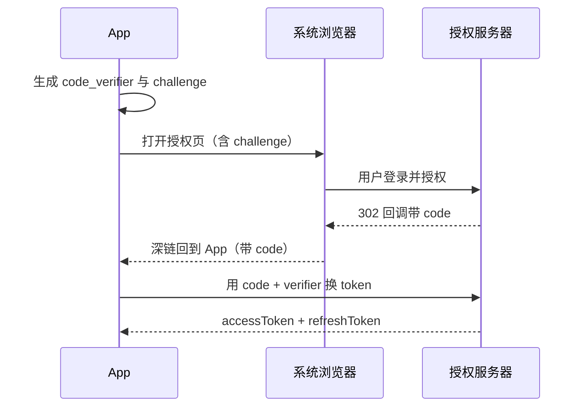
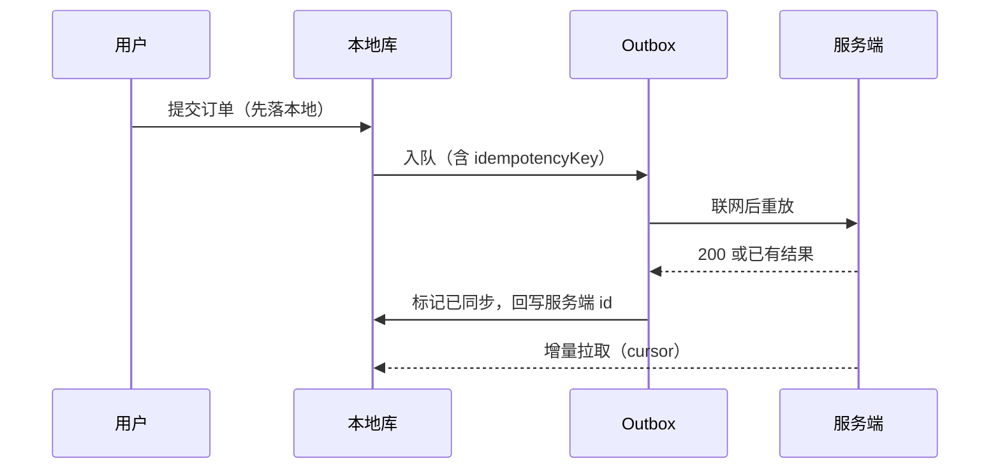

# 移动端与后端集成

> 这篇从移动端与后端集成的边界讲起，经过联调环境、移动 API 设计、登录与会话、推送、深链，最后落到离线同步、失败重试和一次完整的订单离线提交排障。
>
> 学完能设计一套移动端可用的 API 契约，独立完成 OIDC 登录、推送注册、深链跳转和离线队列，并把弱网与重复提交处理干净。

## 一、移动集成的边界

移动端和后端的集成比 Web 多四类约束：**网络不可靠**（地铁、电梯、切换网络）、**客户端版本不可控**（老版本长期在线）、**身份长期有效**（不能每次打开都登录）、**系统通道独立**（推送、深链由操作系统转发，不经过页面）。

| 维度 | Web | 移动端 |
|---|---|---|
| 会话 | Cookie + SameSite | Token + 刷新 |
| 版本 | 用户刷新即最新 | 多版本共存数月 |
| 网络 | 基本稳定 | 弱网、断网、切换 |
| 触达 | 站内 | 推送、深链 |

这四条决定了移动 API 的设计取向：接口要能容忍旧客户端、响应要小、错误要可编程处理、写操作要幂等。把 Web 接口直接给 App 用，常见后果是老版本解析不了新字段导致崩溃、弱网重复下单、token 过期后整站 401。

> 边界：内嵌 WebView 的页面可以复用 Web 接口与 Cookie，但登录态要和原生侧打通（通常是原生注入 token 或共享 Cookie），两套会话并存会互相踢下线。

## 二、环境与最小联调

版本基线 2026-11：后端 Spring Boot 3.5 / Node 22 均可，移动侧 Android API 36、iOS 18+。联调的第一原则是**手机与后端在同一可信网络、走 HTTPS、能抓包**。

本地 HTTPS 用 mkcert 签发受信任证书，避免移动端因自签名证书直接拒绝请求：

```bash
# 生成局域网 IP 的证书，手机安装根证书后可信任
mkcert -install
mkcert 192.168.1.23 localhost
```

```text
Created a new certificate valid for the following names
 - "192.168.1.23"
 - "localhost"
```

后端最小接口用 curl 验证，先确认契约再写客户端：

```bash
curl -s -X POST https://192.168.1.23:8443/api/v1/auth/login \
  -H 'Content-Type: application/json' \
  -d '{"provider":"password","username":"demo","password":"secret"}' | jq
```

```json
{
  "accessToken": "eyJhbGciOiJIUzI1NiIs...",
  "refreshToken": "rt_9f2c...",
  "expiresIn": 900,
  "user": { "id": 1001, "name": "张三" }
}
```

| 场景 | 工具 | 用途 |
|---|---|---|
| 抓包 | Charles / mitmproxy | 看请求与响应 |
| 模拟弱网 | 模拟器限速 | 超时与重试 |
| Mock | Mockoon / WireMock | 后端未就绪 |
| 证书 | mkcert | 本地 HTTPS |

Android 7+ 默认不信任用户安装的 CA，调试包要显式声明：

```xml
<!-- debug 专用 manifest，release 不能带这段 -->
<application android:networkSecurityConfig="@xml/network_security_config">
```

```xml
<network-security-config>
    <debug-overrides>
        <trust-anchors>
            <certificates src="user" />   <!-- 只允许调试包信任用户证书 -->
        </trust-anchors>
    </debug-overrides>
</network-security-config>
```

> 边界：抓包会改变 TLS 行为，开了证书固定（pinning）的包抓不到内容；`debug-overrides` 绝不能进 release，否则任何中间人证书都能被信任。

## 三、移动 API 设计

移动 API 的第一原则是**响应只带客户端要用的字段**。列表接口返回完整实体，在弱网下就是几倍的传输时间和流量，用户感知为"加载慢"。

```json
// 列表只给渲染必需字段，详情再拉全量
{
  "items": [
    { "id": 1001, "title": "无线降噪耳机", "price": 299, "cover": "https://cdn/a.webp" }
  ],
  "nextCursor": "c_20261113_1001",
  "hasMore": true
}
```

分页用游标（cursor）而不是页码：移动端列表会不断插入新数据，页码分页在数据变动时重复或漏项，游标按稳定排序键翻页不会。

| 设计点 | 做法 | 原因 |
|---|---|---|
| 分页 | `cursor` + `limit` | 数据变动不重不漏 |
| 错误 | 业务码 + HTTP 状态 | 客户端可分支处理 |
| 写操作 | `Idempotency-Key` | 弱网重试不重复 |
| 版本 | URL `/v1` | 老客户端继续可用 |
| 压缩 | gzip/br | 移动流量敏感 |

统一响应包，但不要把 HTTP 状态全改成 200：

```json
{
  "code": 0,
  "message": "ok",
  "data": { },
  "traceId": "a1b2c3"
}
```

```text
HTTP 200 + code 0        成功
HTTP 400 + code 1001     参数错误
HTTP 401 + code 2001     token 失效，需刷新
HTTP 409 + code 3002     幂等冲突，返回已有结果
HTTP 426 + code 4001     客户端版本过低，强制升级
```

`426 Upgrade Required` 配合最低版本号，用来兜住必须废弃的旧接口：

```json
{ "code": 4001, "message": "请升级到 3.8.0 及以上版本", "data": { "minVersion": "3.8.0" } }
```

幂等键由客户端生成，服务端按 `(userId, key)` 去重并缓存结果 24 小时：

```java
// Spring Boot 片段：幂等键拦截，重复请求直接返回首次结果
@PostMapping("/orders")
public Order create(@RequestHeader("Idempotency-Key") String key,
                    @RequestBody CreateOrder req) {
    // 先占位，避免并发下两个请求同时通过查重
    if (!idempotency.tryLock(req.userId(), key)) {
        return idempotency.cachedResult(req.userId(), key);
    }
    Order order = orderService.create(req);
    idempotency.save(req.userId(), key, order);
    return order;
}
```

> 边界：幂等键必须是客户端生成并持久化的 UUID，不能在每次重试时重新生成；服务端缓存过期时间要覆盖用户可能的重试窗口，通常 24 小时。

## 四、登录与会话

移动端登录用 OIDC 授权码 + PKCE，不允许内嵌 WebView 登录（平台已限制且容易被钓鱼）。流程在系统浏览器完成，回调通过 App Link 或自定义 scheme 返回 App。



```kotlin
// 生成 PKCE 参数：verifier 只留在本机，challenge 发给服务端
val verifier = Base64.getUrlEncoder().withoutPadding()
    .encodeToString(ByteArray(32).also { SecureRandom().nextBytes(it) })
val challenge = MessageDigest.getInstance("SHA-256")
    .digest(verifier.toByteArray())
    .let { Base64.getUrlEncoder().withoutPadding().encodeToString(it) }
```

token 的生命周期与存储：

| 项 | 有效期 | 存储位置 |
|---|---|---|
| accessToken | 15 分钟 | 内存优先 |
| refreshToken | 30 天，轮换 | Keychain / Keystore |
| 设备绑定 | 长期 | 服务端记录 |

刷新要串行：并发请求同时 401 时，只允许一个请求去刷新，其余等待结果，否则会触发 refresh token 轮换冲突导致全部失效。

```kotlin
// 单飞刷新：多个 401 只触发一次刷新
private val refreshMutex = Mutex()

suspend fun refreshIfNeeded(): String = refreshMutex.withLock {
    val current = tokenStore.access
    if (current != null && !current.isExpired()) return current
    val newToken = api.refresh(tokenStore.refresh)   // 轮换后旧 refresh 立即失效
    tokenStore.save(newToken)
    newToken.access
}
```

> 边界：refresh token 必须轮换并在服务端记录家族，检测到重复使用就吊销整个家族；把 refresh token 存在 SharedPreferences 明文里，root 设备可直接读走。

## 五、推送

推送不是"调一个接口"，而是三段链路：客户端拿设备 token → 服务端按平台下发 → 系统通道展示。Android 走 FCM 与国内厂商通道，iOS 走 APNs。


注册接口按 token 做 upsert，同一设备换用户时要迁移而不是新增：

```http
POST /api/v1/devices
{
  "token": "fcm_or_apns_token",
  "platform": "android",
  "appVersion": "3.7.0",
  "deviceId": "stable-uuid",
  "pushEnabled": true
}
```

```text
204 No Content
```

Android 13+ 的通知权限是运行时权限，没授权时 token 仍能拿到但通知不展示，必须显式申请：

```kotlin
// Android 13+ 必须先申请 POST_NOTIFICATIONS，否则推送静默丢弃
if (Build.VERSION.SDK_INT >= 33) {
    launcher.launch(Manifest.permission.POST_NOTIFICATIONS)
}
```

服务端发 FCM HTTP v1：

```bash
curl -X POST \
  "https://fcm.googleapis.com/v1/projects/$PROJECT/messages:send" \
  -H "Authorization: Bearer $ACCESS_TOKEN" \
  -H "Content-Type: application/json" \
  -d '{
    "message": {
      "token": "DEVICE_TOKEN",
      "notification": { "title": "订单已发货", "body": "点击查看物流" },
      "data": { "deeplink": "app://orders/1001" },
      "android": { "collapse_key": "order_1001", "ttl": "3600s" }
    }
  }'
```

```json
{ "name": "projects/demo/messages/0:1731542400000000%abc" }
```

| 平台 | 通道 | 限制 |
|---|---|---|
| Android 海外 | FCM | 依赖 Google 服务 |
| Android 国内 | 厂商通道 | 需逐家接入 |
| iOS | APNs | 需证书或 p8 key |
| 小程序 | 订阅消息 | 用户逐次授权 |

`collapse_key` 让同一订单的多条通知合并，避免刷屏；`ttl` 控制过期，过期的推送不该再打扰用户。iOS 的角标数由服务端算好下发，客户端不能自行累加，否则多设备会不一致。

> 边界：推送不保证送达，也不能作为业务状态的唯一来源；订单状态必须由客户端主动拉取兜底，推送只做提醒。

## 六、深链

深链分三层：自定义 scheme（`app://`）、Android App Links（`https://` + `assetlinks.json`）、iOS Universal Links（`https://` + AASA 文件）。后两者没有"是否安装"的弹窗，体验最好，配置也最严。

```json
// https://example.com/.well-known/assetlinks.json
[{
  "relation": ["delegate_permission/common.handle_all_urls"],
  "target": {
    "namespace": "android_app",
    "package_name": "com.example.shop",
    "sha256_cert_fingerprints": ["3F:2A:...:9C:1D"]
  }
}]
```

```json
// https://example.com/.well-known/apple-app-site-association（无扩展名，Content-Type: application/json）
{
  "applinks": {
    "details": [{
      "appIDs": ["TEAMID.com.example.shop"],
      "components": [{ "/": "/orders/*", "comment": "订单详情" }]
    }]
  }
}
```

验证 App Links 是否生效：

```bash
adb shell pm get-app-links com.example.shop
adb shell pm verify-app-links --re-verify com.example.shop
```

```text
com.example.shop:
    User 0:
      Verification status: verified
      Domain example.com: verified
```

| 类型 | 未安装时 | 配置成本 |
|---|---|---|
| 自定义 scheme | 无反应 | 低 |
| App Links | 打开网页 | 中 |
| Universal Links | 打开网页 | 中高 |

深链参数统一走一个路由表，避免每个入口各解析一次：

```kotlin
// 只在一处解析，页面只接收结构化参数
fun route(uri: Uri): Destination = when (uri.host) {
    "orders" -> Destination.OrderDetail(uri.pathSegments.getOrNull(0)?.toLongOrNull())
    "promo" -> Destination.Promo(uri.getQueryParameter("id"))
    else -> Destination.Home
}
```

延迟深链（安装后还能落到指定页）不能靠 URL 本身，需要服务端在安装归因时补发；不要用剪贴板读取做归因，iOS 会弹提示且体验差。

> 边界：`assetlinks.json` 的 SHA-256 必须是**签名证书**的指纹，用 debug 证书配置的深链在正式包上必然失效；更换签名后要同步更新。

## 七、离线同步

离线能力的最小实现是"本地队列 + 幂等提交 + 增量拉取"。客户端把写操作存进 outbox，联网后按顺序重放，服务端按幂等键去重。



```kotlin
// 幂等键在入队时生成并持久化，重放时复用，不能每次重试都换
@Entity
data class OutboxItem(
    @PrimaryKey val id: String = UUID.randomUUID().toString(),
    val method: String,
    val path: String,
    val body: String,
    val idempotencyKey: String = UUID.randomUUID().toString(),
    val createdAt: Long = System.currentTimeMillis(),
    val retryCount: Int = 0
)
```

重试必须退避加抖动，否则断网恢复时全量客户端同时打过来：

```kotlin
// 指数退避 + 抖动：1s、2s、4s…上限 5 分钟，避免惊群
fun nextDelay(retry: Int): Long {
    val base = minOf(300_000L, 1_000L shl retry)
    return base + Random.nextLong(0, base / 2)
}
```

增量拉取用服务端游标 + 版本号，不做全量对比：

```http
GET /api/v1/orders/sync?cursor=c_20261113_1001&limit=100

{
  "items": [{ "id": 1001, "status": "shipped", "version": 3, "updatedAt": "2026-11-13T10:00:00Z" }],
  "nextCursor": "c_20261113_1012",
  "hasMore": false,
  "serverTime": "2026-11-13T10:00:05Z"
}
```

冲突解决要提前定规则，不能到线上再商量：

| 策略 | 规则 | 适用 |
|---|---|---|
| 服务端优先 | 以服务端为准 | 库存、价格 |
| 客户端优先 | 本地覆盖 | 草稿、备注 |
| 版本比较 | `version` 大者胜 | 通用实体 |
| 人工合并 | 提示用户选择 | 冲突敏感 |

> 边界：离线队列只放"用户已确认的写操作"，不要把浏览、上报也塞进去；队列要有上限和过期，否则长期离线会积压出一次异常大的重放。

## 八、现场手册：集成排障

集成问题的排查顺序：先看请求是否发出、再看服务端是否收到、最后看响应是否被正确解析。移动端多数"接口不通"其实是证书、域名或字段解析问题。

| 现象 | 最可能原因 | 第一条检查 |
|---|---|---|
| 全部 401 | token 未带或刷新死循环 | 抓包看 Authorization |
| 登录回调不回 App | 深链未验证 | `pm get-app-links` |
| 推送收不到 | 权限/通道/token 失效 | 通知权限与 token 上报 |
| 重复下单 | 重试未带幂等键 | 请求头 `Idempotency-Key` |
| 老版本崩溃 | 新增必填字段 | 服务端字段兼容 |
| 同步丢数据 | 游标被覆盖 | 本地 cursor 持久化 |

刷新死循环的典型代码是"401 → 刷新 → 刷新接口也 401 → 再刷新"。修法是给刷新接口本身设白名单，并限制单次请求只重试一次：

```kotlin
// 刷新请求不走拦截器，避免自己触发自己
if (request.url.encodedPath == "/api/v1/auth/refresh") {
    return chain.proceed(request)
}
```

推送收不到按链路逐段排查：客户端是否有 token、服务端是否存了 token、通道是否返回成功、系统是否允许通知。国内 Android 还必须确认厂商通道已接入，只接 FCM 在无 Google 服务的机型上必然收不到。

> 边界：不要用"重启 App"作为排查结论；重启能好说明是客户端状态问题（token、缓存、单例），要定位到具体状态而不是让用户重启。

## 九、最佳实践案例

### 9.1 案例背景

一个连锁餐饮 App 的外卖下单链路要支持"地铁里点单"：用户在弱网或断网时也能提交订单，恢复网络后自动同步；同时上线订单状态推送和"再来一单"深链。约束是老版本仍占 18% 装机量，不能强制升级；后端已有 Web 接口，不能推倒重来。现状是弱网下重复下单投诉每周 20 余起，推送到达率不足 60%，深链在部分机型上直接打开浏览器。

### 9.2 案例实操

第一步抽出移动 BFF，做字段裁剪与版本兼容，Web 接口保持不变：

```json
// GET /api/v1/home?appVersion=3.7.0
{
  "banners": [{ "id": 1, "img": "https://cdn/b1.webp", "link": "app://promo/1" }],
  "categories": [{ "id": 10, "name": "热销" }],
  "minVersion": "3.5.0",
  "serverTime": "2026-11-13T10:00:05Z"
}
```

`minVersion` 由服务端下发，客户端只在低于它时弹强制升级，避免每次发版都逼所有人更新。

第二步登录改 OIDC + PKCE，token 存 Keychain/Keystore，刷新单飞：

```kotlin
class TokenAuthenticator(
    private val store: TokenStore,
    private val api: AuthApi
) : Authenticator {   // OkHttp Authenticator 只在 401 时触发

    private val mutex = Mutex()

    override fun authenticate(route: Route?, response: Response): Request? {
        // 同步锁：OkHttp 的 authenticate 在 IO 线程，用 runBlocking 包一层
        return runBlocking {
            mutex.withLock {
                val latest = store.access()
                // 别的线程已经刷过，直接用新 token 重试，避免重复刷新
                if (latest != null && latest != response.request.header("Authorization")) {
                    return@withLock response.request.newBuilder()
                        .header("Authorization", latest).build()
                }
                val refreshed = api.refresh(store.refresh()) ?: return@withLock null
                store.save(refreshed)
                response.request.newBuilder()
                    .header("Authorization", "Bearer ${refreshed.accessToken}")
                    .build()
            }
        }
    }
}
```

第三步离线下单。订单先落本地并立刻给用户"已提交"反馈，队列后台重放：

```kotlin
suspend fun placeOrder(draft: OrderDraft): String {
    val item = OutboxItem(
        method = "POST",
        path = "/api/v1/orders",
        body = json.encodeToString(draft),
        // 幂等键此刻生成并入库，之后每次重放都用同一个
        idempotencyKey = UUID.randomUUID().toString()
    )
    db.outbox().insert(item)
    syncWorker.enqueue()          // WorkManager 约束联网后执行
    return item.id                // 本地单号，服务端确认后替换
}
```

服务端按幂等键去重并返回首次结果：

```java
@PostMapping("/api/v1/orders")
public ResponseEntity<Order> create(
        @RequestHeader("Idempotency-Key") String key,
        @RequestBody CreateOrder req) {
    var existing = idempotency.find(req.userId(), key);
    if (existing.isPresent()) {
        // 重放命中，返回同样的结果，不产生第二单
        return ResponseEntity.ok(existing.get());
    }
    var order = orderService.create(req);
    idempotency.save(req.userId(), key, order);
    return ResponseEntity.ok(order);
}
```

第四步推送。启动时上报 token，退出登录时解绑，Android 13 先申请权限：

```kotlin
suspend fun syncDeviceToken() {
    val token = FirebaseMessaging.getInstance().token.await()
    api.upsertDevice(DeviceReq(
        token = token,
        platform = "android",
        deviceId = deviceId,          // 稳定设备号，用于换账号时迁移
        pushEnabled = notificationAllowed()
    ))
}
```

```bash
# 服务端下发，collapse_key 合并同订单的多条状态变更
curl -s -X POST "https://fcm.googleapis.com/v1/projects/demo/messages:send" \
  -H "Authorization: Bearer $TOKEN" -H "Content-Type: application/json" \
  -d '{"message":{"token":"DEV","notification":{"title":"订单已发货"},
       "data":{"deeplink":"app://orders/1001"},"android":{"collapse_key":"o1001"}}}'
```

```json
{ "name": "projects/demo/messages/0:1731542400000000%abc" }
```

第五步深链。统一由 `route()` 解析，`assetlinks.json` 用正式签名指纹，发版前用命令验证：

```bash
adb shell pm get-app-links com.example.shop | grep verified
```

```text
Domain example.com: verified
```

第六步把同步结果回写本地并刷新 UI，失败进入退避队列：

```kotlin
suspend fun flush() {
    db.outbox().pending().forEach { item ->
        try {
            val res = api.call(item)       // 带 item.idempotencyKey
            db.orders().updateServerId(item.id, res.id)
            db.outbox().delete(item.id)
        } catch (e: IOException) {
            // 网络类错误才退避重试，4xx 业务错误直接标记失败让用户处理
            db.outbox().bump(item.id, nextDelay(item.retryCount))
        }
    }
}
```

### 9.3 案例结果

上线一个版本后，重复下单投诉从每周 20 余起降到 2 起（示例，来自客服工单统计），其中 1 起是用户在两台设备同时操作导致，属于预期。推送到达率从不足 60% 提升到 88%，主要收益来自补齐两家厂商通道和 Android 13 权限申请；深链在验证通过的机型上直接进 App，未通过的回落到网页，不再出现"点了没反应"。

失败模式复盘：一是最初把幂等键放在请求体重试时重新生成，重复问题没解决，改为入队时生成；二是刷新逻辑没做单飞，token 轮换时并发请求互相吊销，全部用户被登出一次；三是 `assetlinks.json` 用了 debug 指纹，测试机正常、正式包全部回落浏览器。遗留风险是老版本（低于 3.5.0）不支持幂等键，服务端对这类请求退化为"按用户 + 商品 + 5 分钟"去重，仍有极小概率误判，等老版本占比降到 5% 以下再移除兼容逻辑。
